# 10 Backend Design Pattern Laws of Senior Engineers and Architects

**Video:** <https://youtu.be/b4IlyJSIlL0>
**Channel:** Cloud X Berry

---

## 1. Jargon Translation (Read This First)

| Term | Official Definition | Simple Words and Analogy |
|---|---|---|
| **Design Pattern** | A reusable, proven solution to a problem that appears again and again in software design. | A recipe. It is not the food itself. You change it to fit your kitchen. |
| **Controller** | The layer that receives an HTTP (HyperText Transfer Protocol) request and returns a response. | A waiter. The waiter takes the order and brings the food, but does not cook. |
| **Service (Service Layer)** | The layer that holds business logic. | The chef. The chef decides how to make the dish. |
| **Business Logic / Business Rules** | The rules that describe how the company works, such as "students get 10% off". | The shop's rule book. |
| **Data Access** | The code that reads from and writes to a database. | The storeroom worker who knows where everything is kept. |
| **Mock** | A fake object used in a test in place of a real dependency. | A crash-test dummy. It stands in for a real person so the test is safe. |
| **Implementation** | The real code that does a job, behind a shared interface. | Stripe and PayPal are two different "machines" that do the same job: take payment. |
| **Interface** | The agreed list of methods an object must offer. JavaScript has no `interface` keyword, so this is an agreement by convention. TypeScript has one. | A wall socket. Any plug with the right shape works. |
| **Instance** | One real object created from a class. | A class is a house plan. An instance is one house built from that plan. |
| **Global Variable** | A value that any part of the program can read or change. | A whiteboard in a public hall. Anyone can change it, and nobody knows who did. |
| **Hidden Dependency** | Something a function needs that you cannot see in its parameters. | A recipe that secretly needs an oven, but never lists one. |
| **Dependency Injection (DI)** | Giving an object the things it needs from the outside, instead of letting it create them. | A hotel gives you towels. You do not bring your own. |
| **Object Life Cycle** | The time from when an object is created until it is destroyed. | The time from when a shop opens until it closes. |
| **Algorithm** | A set of steps that solves a problem. | The steps in a recipe. |
| **Tight Coupling** | Two parts of the code depend heavily on each other, so a change in one breaks the other. | Two people tied together with a rope. One cannot move alone. |
| **Loose Coupling** | Parts of the code know very little about each other, so each can change alone. | Two people talking by phone. Each can move freely. |
| **Event** | A message that says something has already happened, such as `OrderPlaced`. | A school bell. It announces something. It does not care who hears it. |
| **Listener / Subscriber** | Code that waits for an event and reacts to it. | A student who hears the bell and goes to class. |
| **Event-Driven** | A design where parts of a system react to events instead of calling each other directly. | A newsroom. A story arrives, and each team reacts in its own way. |
| **Message Broker** | A separate server that receives messages and passes them to other services. | A post office. The sender does not need to meet the receiver. |
| **Constructor** | The special function that creates and sets up a new object. | The factory line that makes a new car. |
| **SDK (Software Development Kit)** | A ready-made library for using a platform or service from your code. | A toolbox made by the service provider. |
| **Legacy System** | An old system that is still in use and is hard to change. | An old building that is still used, so you must work around its old wiring. |
| **camelCase** | Words joined together, where each new word starts with a capital letter: `customerId`. | The capital letters look like the humps of a camel. |
| **snake_case** | Lowercase words joined with underscores: `customer_id`. | The words lie flat, like a snake on the ground. |
| **JSON (JavaScript Object Notation)** | A text format for data, based on key and value pairs. | A neat form with labels and answers. |
| **XML (eXtensible Markup Language)** | A text format for data that uses tags, like `<id>7</id>`. | The same form, but every answer sits between opening and closing labels. |
| **Middleware** | A function that runs around a request, before or after your main logic. | Airport security. Every passenger passes through it before reaching the gate. |
| **Caching** | Keeping a copy of data in a fast place so you do not fetch it again. | Keeping your favourite book on your desk, not in the library. |
| **Authorization** | Checking what a user is allowed to do. | Your ticket says which seat you may use. |
| **Authentication** | Checking who a user is. | Showing your ID card at the door. |
| **Auditing** | Keeping a record of who did what and when. | A visitor book at reception. |
| **Rate Limiting** | Limiting how many requests a client can make in a period of time. | A shop lets in only 10 people per minute. |
| **CRUD (Create, Read, Update, Delete)** | The four basic operations on stored data. | The four basic things you can do with a paper file. |
| **CQRS (Command Query Responsibility Segregation)** | A pattern that separates the code that changes data from the code that reads data. | A library with one desk for returning books and another desk for asking questions. |
| **Command** | A request that changes data. | "Please change my address." |
| **Query** | A request that only reads data and changes nothing. | "What is my address?" |
| **Read-Heavy / Write-Heavy** | A workload that has far more reads, or far more writes. | Many people read a newspaper, but few people write it. |
| **Distributed System** | An application made of many services that talk over a network. | A team spread across cities, working by phone. |
| **Timeout** | The maximum time you will wait before giving up on a request. | You wait 10 minutes for a bus, then you walk. |
| **Fallback** | A safe backup answer used when the normal path fails. | The lift is broken, so you take the stairs. |
| **Circuit Breaker** | A pattern that stops calls to a failing service for a short time. | The electric breaker in your home. It cuts the power to stop a fire. |
| **Cascading Failure** | A failure in one part that spreads and brings down other parts. | One car stops on a highway, and soon the whole road is blocked. |
| **Service Mesh** | An infrastructure layer that handles traffic between services, outside your code. | The road system and traffic police between all the buildings in a city. |
| **Cloud-Native** | Software built to run well in the cloud, often with containers and small services. | A fish that was born to live in water. |

---

## 2. Topics Introduced in the Lecture Transcript

1. Why simple backend code becomes hard to change as an application grows.
2. What design patterns are and why they help.
3. Repository Pattern: separate data access from the rest of the application.
4. Factory Pattern: keep object creation in one place.
5. Singleton Pattern: one shared instance, and the danger of overusing it.
6. Strategy Pattern: replace long `if else` chains with separate rules.
7. Observer Pattern: publish events so other parts can react independently.
8. Builder Pattern: build complex objects step by step.
9. Adapter Pattern: translate between your application and external systems.
10. Decorator Pattern: add behavior by wrapping, not by changing the original.
11. CQRS (Command Query Responsibility Segregation): separate reads from writes.
12. Circuit Breaker Pattern: stop one failing dependency from hurting everything.
13. How the patterns work together in real applications.
14. Final advice: understand the problem behind a pattern, do not memorize definitions.

---

## 3. Exhaustive Deep Dive & Structured Notes

### 3.0 Why Design Patterns Matter (00:00)

**The promise of the video:** these 10 patterns help you build applications that are:

- easier to **maintain**
- easier to **extend**
- more **reliable** as the system grows

**How backend development feels at the start:**

- Most applications look fairly simple.
- You learn a programming language.
- You pick a framework.
- You connect a database.
- You build a few APIs (Application Programming Interfaces).
- Everything seems to work.

**What changes as the application grows:**

- More **features** are added.
- More **developers** work on the same code base.
- **Business requirements** keep changing.
- Code that looked perfectly fine at the start becomes:
  - difficult to understand
  - risky to modify

**What design patterns give you:**

- They help with **recurring problems**.
- They give you **proven ways to structure your code**.

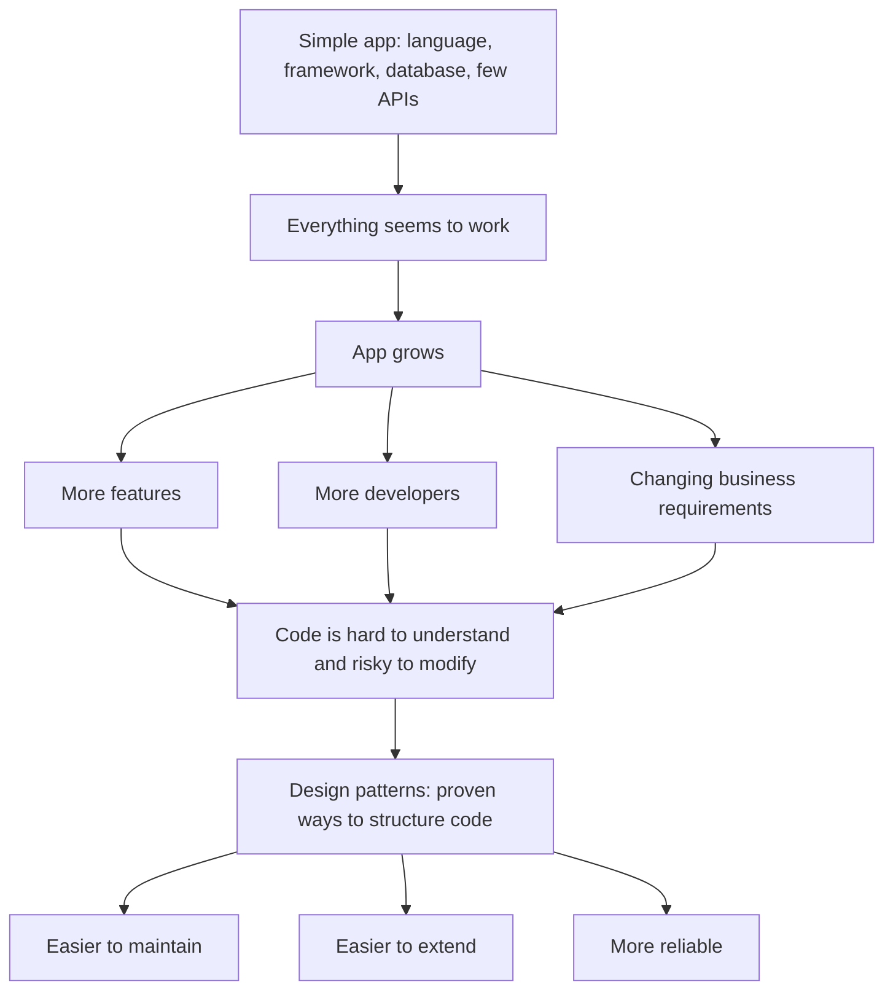

⚠️ **Correction:** The video says these patterns are worth learning "before 2027", which can sound like they are new → They are not new. Seven of them come from the 1994 "Gang of Four" book *Design Patterns*. Repository was described by Martin Fowler in 2002. Circuit Breaker was made popular by Michael Nygard's 2007 book *Release It!*. CQRS was named by Greg Young around 2010. They are worth learning because they have lasted.

**Where each pattern comes from:**

| Group | What it deals with | Patterns |
|---|---|---|
| **Creational** (Gang of Four) | How objects are created | Factory, Singleton, Builder |
| **Structural** (Gang of Four) | How objects are connected | Adapter, Decorator |
| **Behavioral** (Gang of Four) | How objects share work | Strategy, Observer |
| **Enterprise / Data** | How data is stored and accessed | Repository, CQRS |
| **Resilience** | How systems survive failure | Circuit Breaker |

---

### 3.1 Repository Pattern (00:43)

#### The Problem

- A **controller** or **service** needs data from the database.
- So you put the database query right there, because it is **quick and easy**.
- The trouble starts when that same class also handles:
  - validation
  - business rules
  - calculations
  - API responses
- In the end, **one class knows too much** about both the database and the business logic.
- Result:
  - **difficult to test**
  - **even harder to change**

#### The Solution

- The Repository Pattern **separates data access from the rest of the application**.
- The service does **not** talk directly to MySQL, PostgreSQL, MongoDB, or any other database.
- The service talks to a **repository**.
- The repository is responsible for the **actual database operations**.
- The service can simply ask for a customer or save an order.
- The service does **not** need to know how that data is stored.

#### Why It Helps

| Benefit | How it works |
|---|---|
| **Easier testing** | You replace the real repository with a **mock** when you test business logic. No real database is needed. |
| **Easier database changes** | If the database code changes, most of the application stays untouched, because database-specific logic is **isolated** in the repository. |

#### Where You See It

- Repository-based approaches are common in **Spring Boot**, **ASP.NET Core**, and **NestJS**.

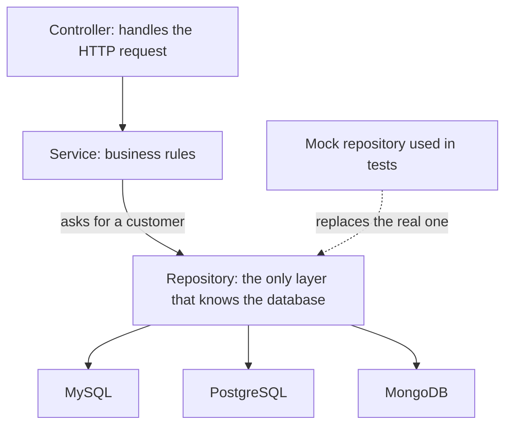

⚠️ **Correction:** The video suggests a database change leaves most of the application untouched → This is true for small changes, such as moving from MySQL to PostgreSQL. It is much harder when moving from SQL to MongoDB, because joins, transactions, and data shape all change. The repository's methods may need to change too. A repository makes the change smaller, but it does not make it free.

---

### 3.2 Factory Pattern (02:01)

#### When It Becomes Useful

- Your application has **multiple implementations of the same functionality**.
- You do not want every part of your code base to know **how those objects are created**.

#### The Payment Example

- You build a payment system. At first you support only **Stripe**.
- Creating a Stripe payment object does not seem like a big deal.
- Then the business adds **Razorpay**, then **PayPal**, and maybe more providers later.
- If you create these objects directly all over the application, **every new provider can force you to change code in many places**.

#### The Solution

- A factory gives you **one place** that is responsible for creating the correct implementation.
- Before: the application says, "Create a Stripe payment object."
- After: the application says, "I need a payment provider."
- The factory decides which implementation to return, based on:
  - **configuration**, or
  - **business rules**

#### Why It Helps

- The rest of your application stays **independent** from the specific payment provider.
- It is **easier to add new implementations** later.

#### The Key Idea

- The important idea is **not the factory class itself**.
- The important idea is **keeping object creation in one place**, so the rest of the application does not need to worry about it.

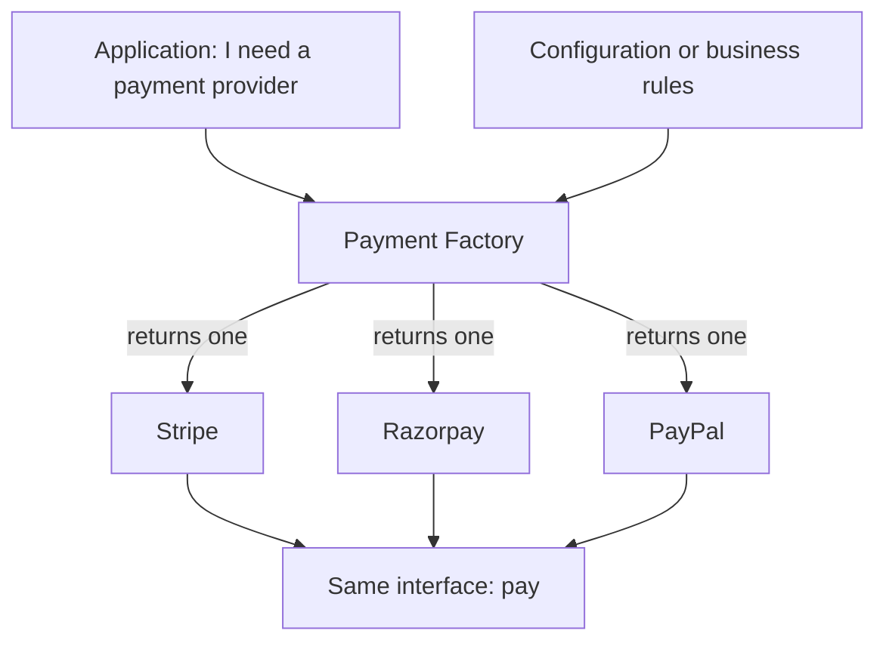

⚠️ **Correction:** The video calls this the "Factory Pattern", but what it shows is the **Simple Factory** → The Gang of Four book defines two formal patterns: **Factory Method** (subclasses decide which object to create) and **Abstract Factory** (creates families of related objects). Simple Factory is one function that picks an object. It is the most common version in real code, but know the difference for interviews.

---

### 3.3 Singleton Pattern (03:07)

#### When It Makes Sense

Sometimes, creating many instances of the same object does not make sense. Examples from the video:

- a **configuration manager**
- a **logging service**
- a **cache manager**
- another **shared resource** that should have one consistent instance

#### What It Does

- The Singleton Pattern ensures **only one instance** of an object exists during the application's life cycle.
- It prevents **unnecessary object creation**.
- It makes sure different parts of the application use the **same shared resource**.

#### The Warning

- Singleton is one of the patterns that is **easily overused**.
- If you treat singleton objects like **global variables**, you can end up with:
  - **hidden dependencies**
  - code that is **difficult to test**

#### The Modern Approach

- In modern backends, **dependency injection frameworks** often manage object life cycles for you.
- So you may already get the benefits of a singleton life cycle **without writing the pattern yourself**.
- The important thing: understand **why** a shared instance is needed. Do not make everything a singleton just because you can.

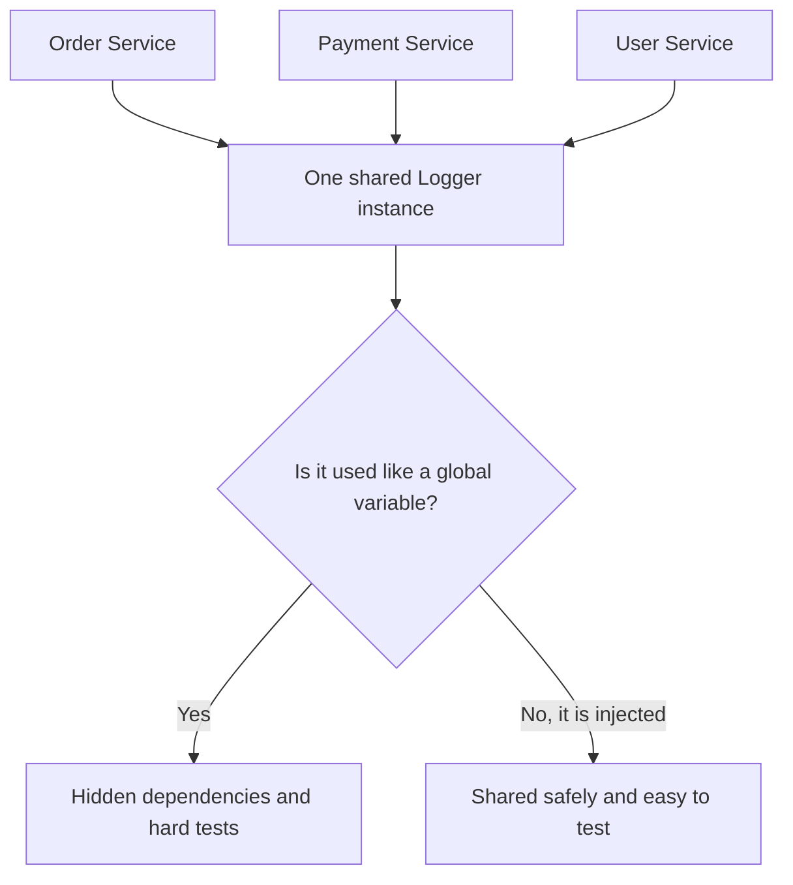

⚠️ **Correction:** The video says only one instance exists during the application's life cycle → This is true for **one process only**. If you run 4 Node.js workers or 10 Kubernetes pods, you have 4 or 10 "singletons". An in-memory cache singleton will therefore hold different data in each pod. For shared state across pods, use an external store such as Redis.

**Node.js notes:**

- Node.js caches a module after the first `require()`. So `module.exports = new Logger()` already behaves like a singleton.
- Node.js has no built-in dependency injection. NestJS adds it, and its providers are singletons by default.

---

### 3.4 Strategy Pattern (04:11)

#### The Problem

- The same operation often needs to be done **in different ways, depending on the situation**.
- **E-commerce example:**
  - **Premium customers** get one discount.
  - **Students** get another discount.
  - A **festival promotion** follows completely different pricing rules.
- One approach: put all the conditions in **one method** and keep adding `if else` statements as new rules appear.
- This might work at first.
- Over time, the method becomes **difficult to understand**, because it holds every possible business rule in one place.

#### The Solution

- Move **each algorithm or business rule into its own strategy**.
- Do not keep one large method that knows how every discount works.
- Instead, you have:
  - one strategy for **premium customers**
  - another for **students**
  - another for **festival pricing**
- The application **selects the right strategy** based on the situation.

#### Why It Helps

- If the business adds another discount policy, you **add another strategy**.
- You do **not** rewrite the existing ones.

#### Other Places It Is Useful

- authentication methods
- payment processing
- shipping calculations
- tax rules
- recommendation systems
- any area with **multiple ways of performing the same operation**

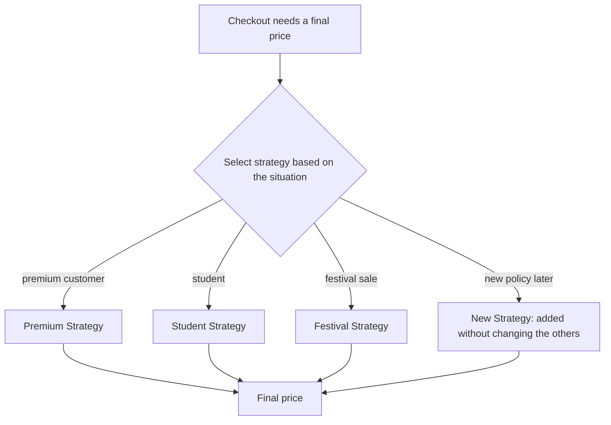

**Factory and Strategy look similar. Here is the difference:**

| | Factory | Strategy |
|---|---|---|
| **Main question** | Which object do I **create**? | Which **behavior** do I run? |
| **Group** | Creational | Behavioral |
| **Together** | A factory can create the chosen strategy. | A strategy does the work after it is chosen. |

---

### 3.5 Observer Pattern (05:28)

#### The Problem

When a customer places an order in an online shop, these things might need to happen:

- **Inventory** is updated.
- A **confirmation email** is sent.
- **Loyalty points** are credited.
- **Analytics** records the purchase.
- **Notifications** go to the customer or the warehouse team.

If you put all of this in the **order service**:

- The order service becomes responsible for **every operation after an order is placed**.
- As the application grows, that service becomes **larger** and **more tightly coupled** to other parts of the system.

#### The Solution

- The order service does **not** directly call every component.
- It **publishes an event**, such as `OrderPlaced`.
- Components that care about that event **react to it independently**:
  - The **inventory service** listens and updates inventory.
  - The **email service** sends the confirmation.
  - The **loyalty service** adds points.
  - **Analytics** records the purchase.
- The order service does **not** need to know how any of those things work.

#### Why It Helps

- The system is **more loosely coupled**.
- It is **easier to add new behavior** later.
- **Example:** the business wants to send a promotional coupon after every purchase. You add **another listener**. You do not change the original order service.

#### Related Technology

- This event-driven approach is closely related to **Kafka**, **RabbitMQ**, and **Azure Service Bus**.
- *Note: the auto-generated captions lose a few seconds here (06:45 to 06:51), so the video may name one more technology.*

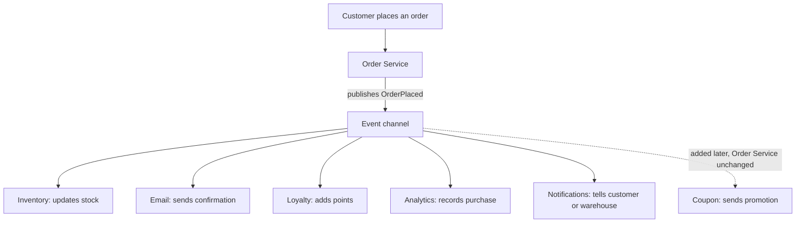

⚠️ **Correction:** The video treats Observer and event-driven messaging as one idea → They are related, but they are different in production:

| | Classic Observer | Publish/Subscribe with a broker |
|---|---|---|
| **Runs where** | Inside one process | Across services and machines |
| **Example** | Node.js `EventEmitter` | Kafka, RabbitMQ, Azure Service Bus |
| **Timing** | Usually synchronous | Asynchronous |
| **If the process crashes** | The event is lost | The broker can keep the message |
| **Who knows who** | The subject holds its listeners | Sender and receiver do not know each other |

⚠️ **Correction:** The video makes events sound like a free benefit → Events add new risks. Listeners can fail on their own. Messages can arrive twice, so listeners must be **idempotent** (running twice gives the same result). Saving the order and publishing the event are two separate steps, so one can fail while the other succeeds. The **Transactional Outbox** pattern solves that last problem.

---

### 3.6 Builder Pattern (06:51)

#### The Problem

- As applications become more complex, some objects have a **large number of optional properties**.
- **User profile example:**
  - One user gives only a **name** and **email**.
  - Another user also has a **phone number**, **address**, **profile picture**, **company information**, **social media links**, **subscription settings**, and **notification preferences**.
- If you pass all of these through a constructor, you can quickly reach **10 or 15 parameters**.
- At that point the code is:
  - **difficult to read**
  - **easy to misuse**
- You might even forget which parameter means which value.

#### The Solution

- The Builder Pattern lets you **construct a complex object step by step**.
- You do not provide every value at once.
- You **gradually configure** the object, then **build it when you are ready**.

#### Why It Helps

- The code is easier to understand, because **each property is explicitly identified**.
- It **reduces mistakes** caused by passing parameters in the wrong order.

#### Where You See It

- It is especially common with **complex configuration objects**.
- You will see similar approaches in **Java**, **Kotlin**, **C#**, and many **cloud SDKs**.

#### The Basic Idea

- When creating an object becomes complicated, **build it one step at a time**. Do not put everything into one huge constructor.

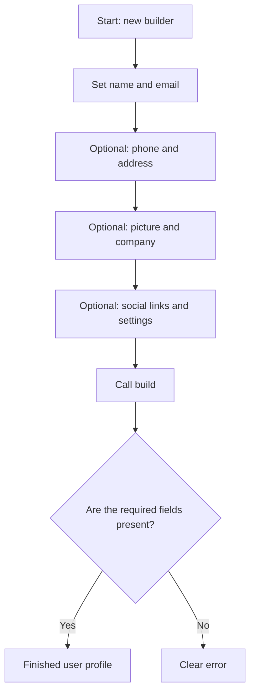

⚠️ **Correction:** The video presents Builder as the main answer to long constructors → In JavaScript, the simplest answer is often an **options object**: `new UserProfile({ name, email, phone })`. Each value already has a label, and the order does not matter. Kotlin also has named and default parameters for the same reason. Use a real Builder in JavaScript when you need step-by-step logic or checks at build time. Query builders such as Knex are a good example.

---

### 3.7 Adapter Pattern (08:06)

#### The Problem

- Backend applications **rarely work in isolation**.
- You will probably integrate with:
  - a payment gateway
  - a banking system
  - a shipping provider
  - a third-party API
  - maybe an old legacy system
- A big problem: **every external system represents data in its own way**.
  - One API returns a field called `customer_id`.
  - Another simply calls it `id`.
  - One system uses **camelCase**, while another uses **snake_case**.
  - One service returns **JSON**, while another uses **XML**.
- If these differences spread through your application:
  - Every part of your code must understand how every external system works.
  - The code becomes **difficult to maintain**.

#### The Solution

- The Adapter Pattern creates **a layer between your application and the external system**.
- The adapter **understands the external format** and **translates it into the format your application expects**.
- The rest of your application works with **one consistent interface**.
- It does not deal with the differences of every provider.

#### Why It Helps

- If a payment provider changes its API later, **ideally you only update the adapter**.
- You do not change code across the entire application.

#### The Mental Model

- Think of an adapter as a **translator** that lets two systems with different interfaces work together.

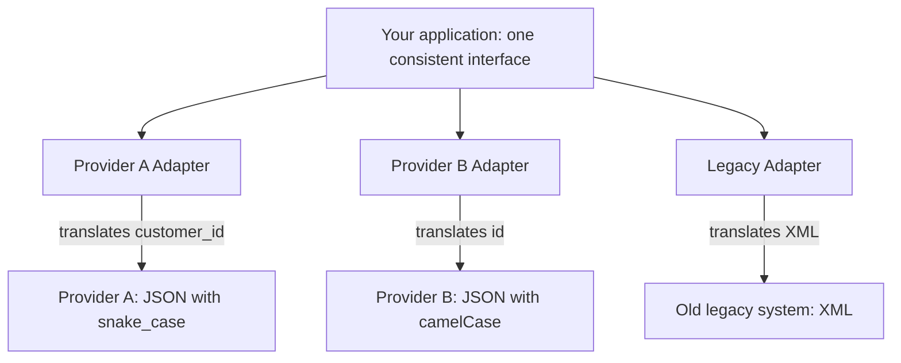

**Adapter and Factory together:** the Factory picks which provider to use. The Adapter makes that provider look like all the others.

---

### 3.8 Decorator Pattern (09:26)

#### The Problem

- You start with a service that simply **returns product information**.
- Everything works perfectly.
- Then new requirements keep appearing:
  - **caching**
  - **logging**
  - **performance monitoring**
  - **authorization**
  - eventually **auditing** or **rate limiting**
- If every new requirement means modifying the original service:
  - It becomes **responsible for too many things**.
  - It becomes **difficult to understand**.

#### The Solution

- The Decorator Pattern lets you add behavior **without changing the original implementation**.
- You **wrap** the existing service:
  - A **caching** decorator wraps the service.
  - Another decorator adds **logging**.
  - Another collects **metrics**.
  - Another handles **authorization**.
- Decorators can be **combined** depending on what the application needs.
- The original service keeps focusing on its **main responsibility**.

#### Where You Have Seen It

- You may have seen a similar idea in backend frameworks through **middleware**.
- Authentication, logging, caching, and other request processing can be added **around** your main logic, without putting everything into the same class.

#### The Key Idea

- **Extend behavior by wrapping existing functionality**, rather than constantly modifying the core implementation.

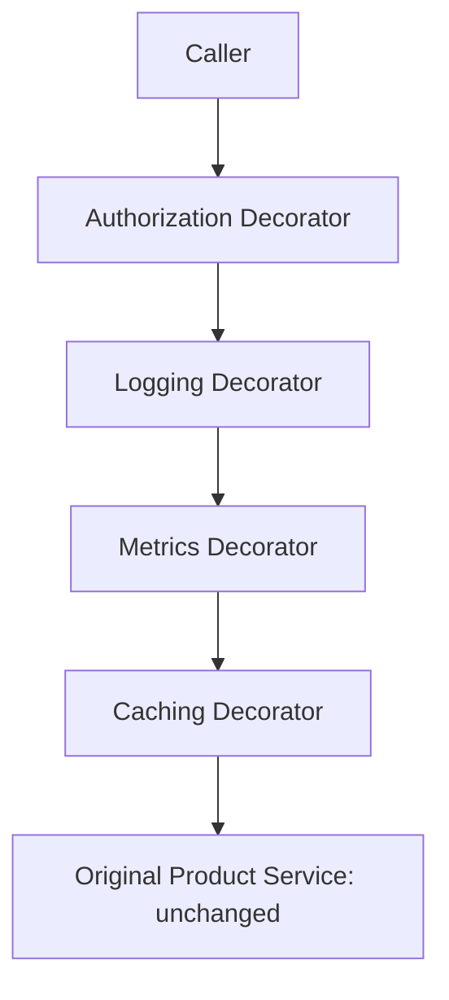

⚠️ **Correction:** The video does not mention that **decorator order matters** → Each wrapper runs in order. If caching sits outside authorization, a cached response can be returned to a user who never passed the check. That is a real security bug. Put authorization on the outside.

⚠️ **Correction:** The video compares decorators to middleware → The idea is similar, but they are not the same. A **decorator** wraps one object and keeps the same interface. **Express middleware** is a pipeline where each step calls `next()`. That is closer to the **Chain of Responsibility** pattern.

---

### 3.9 CQRS: Command Query Responsibility Segregation (10:40)

#### The Idea

- CQRS stands for **Command Query Responsibility Segregation**.
- The name sounds complicated, but the basic idea is fairly straightforward.
- You do **not** use the same approach for reading data and changing data.
- You **separate those two responsibilities**.

#### The Social Media Example

- **Millions of users** might read profiles every day.
- A **much smaller number** of operations actually update those profiles.
- As the system grows, the requirements for reading and writing can become **very different**.
- Using exactly the same model and infrastructure for both sides may not be the best option.

#### How It Works

| Side | Job | Example |
|---|---|---|
| **Command** | Changes data | Update my profile |
| **Query** | Only retrieves data | Show this profile |

- Each side can be **optimized independently**.
- In larger systems, the read and write sides can use different:
  - models
  - databases
  - infrastructure
- It is particularly useful in **high-traffic systems**, where read-heavy and write-heavy workloads behave very differently.

#### The Warning

- CQRS is **not** something to add automatically to every application.
- For a simple **CRUD** application, it can add a lot of **unnecessary complexity**.
- Use it when the separation **solves a real problem** in your system.

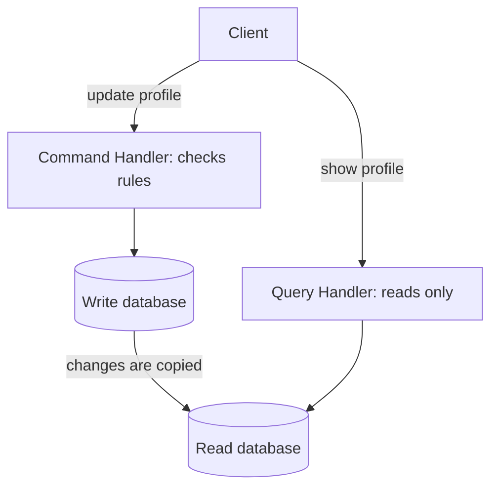

⚠️ **Correction:** The video does not mention the main cost of separate read and write databases → When data is copied from the write side to the read side, there is a delay. A user can save a profile, refresh, and still see the old version. This is called **eventual consistency**. You must plan for it, for example by reading from the write side just after a user's own update.

**Common misunderstandings:**

- CQRS does **not** require two databases. Two sets of code on one database is still CQRS.
- CQRS does **not** require **Event Sourcing**. They are often used together, but they are separate ideas.
- Before CQRS, try simpler tools first: indexes, caching, and read replicas.

---

### 3.10 Circuit Breaker Pattern (11:55)

#### The Problem

- Distributed applications **depend on other services**.
- Sooner or later, one of those services **will fail**.
- **Example:** your application depends on a third-party payment gateway, and the provider suddenly goes down.
- Without protection:
  1. Your application **keeps sending requests**.
  2. Those requests **wait for timeouts**.
  3. **Connections and threads stay occupied**.
  4. More requests arrive.
  5. **Your own application starts having problems**, even though the original failure was in another service.

#### The Solution: How the Circuit Works

1. The system **detects repeated failures**.
2. The circuit **opens** and temporarily **stops sending requests** to the unhealthy service.
3. Your application does not wait for another timeout each time. It can **immediately return a fallback response**, or handle the failure in another way.
4. After a certain amount of time, the circuit **allows a few requests through** to check if the service has recovered.
5. If it works again, the circuit **closes** and normal traffic resumes.
6. If it still fails, the circuit **remains open**.

#### Why It Helps

- It stops one **unhealthy dependency** from consuming resources.
- It prevents a **much larger failure** across your application.

#### Where You See It

- **Resilience4j** (Java)
- **Polly** (.NET)
- **Service meshes** such as **Istio**
- This makes the pattern especially useful for **cloud-native** and **distributed systems**.

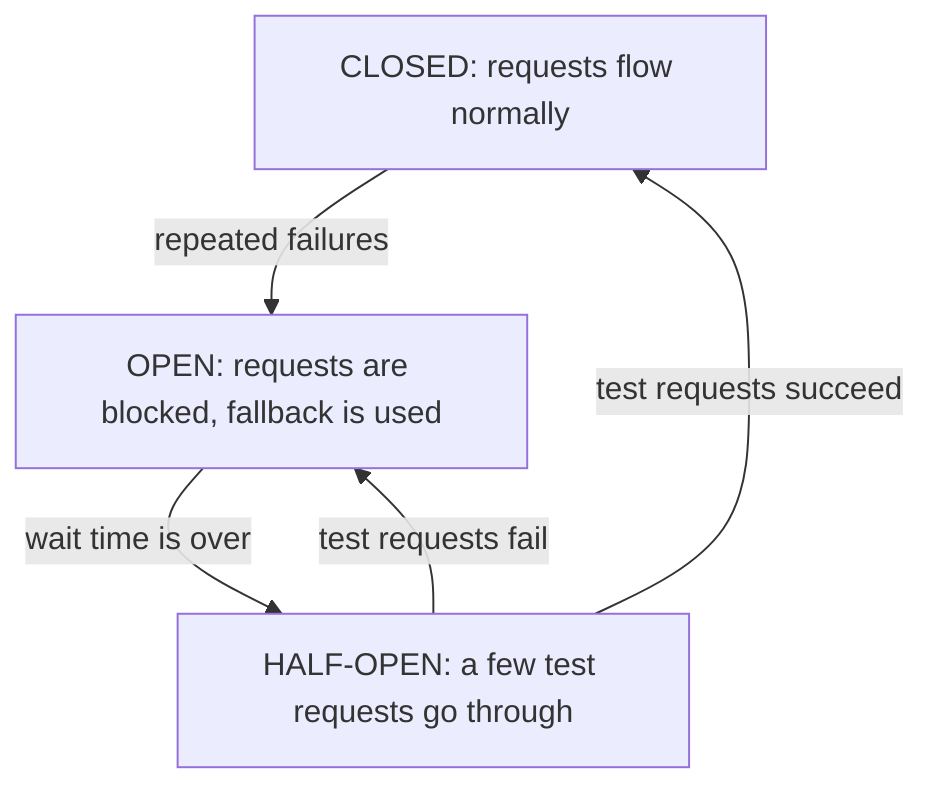

**The three states (the video describes them, but does not name the third one):**

| State | What happens | Like a home electric breaker |
|---|---|---|
| **Closed** | Requests flow as normal. Failures are counted. | The switch is on. Power flows. |
| **Open** | Requests fail fast. The fallback is used. | The switch tripped. No power. |
| **Half-Open** | A few test requests check for recovery. | You try the switch again, carefully. |

⚠️ **Correction:** The video says "connections and threads remain occupied" → This is true for thread-per-request platforms such as classic Java. Node.js handles waiting I/O (Input/Output) on one main thread, so a waiting request does not block a thread. But Node.js still suffers: open sockets, memory, pending promises, and database pool slots all build up. The pattern is still needed.

⚠️ **Correction:** The captions say "resilience 4J" → The correct name is **Resilience4j**, a Java library. For Node.js, a common library is **opossum**.

⚠️ **Correction:** The video calls Istio a circuit breaker implementation → This is partly true. Istio uses **connection pool limits** and **outlier detection**, which removes unhealthy pods from load balancing. It works at the network level, so it cannot run your application's fallback logic. Many systems use both.

**Important limits:**

- A circuit breaker does **not replace timeouts**. It needs them. A call that hangs forever never counts as a failure.
- A **fallback must be honest**. For a payment, "please try again later" is correct. Saying "payment successful" is not.

---

### 3.11 How the Patterns Work Together (13:14)

- Real backend applications **do not usually use these patterns independently**.
- They often **work together**, because **each pattern solves a different problem**.

| # | Pattern | The problem it solves | Main benefit |
|---|---|---|---|
| 1 | **Repository** | Database code is mixed with business logic | Easier to test and change |
| 2 | **Factory** | Object creation is spread everywhere | Easier to add implementations |
| 3 | **Singleton** | Many instances of a shared resource | One consistent resource |
| 4 | **Strategy** | Huge `if else` chains of rules | Add rules without rewriting |
| 5 | **Observer** | One service does everything after an event | Loose coupling |
| 6 | **Builder** | Constructors with too many parameters | Readable, safer creation |
| 7 | **Adapter** | External systems all use different formats | One consistent interface |
| 8 | **Decorator** | Extra features pile up inside one service | Extend without changing the core |
| 9 | **CQRS** | Reads and writes have very different needs | Each side is optimized alone |
| 10 | **Circuit Breaker** | One failing service brings down others | More resilience |

---

### 3.12 Final Advice from the Video (13:25)

- If you are preparing for backend development in 2027, these are 10 patterns worth understanding: **Repository, Factory, Singleton, Strategy, Observer, Builder, Adapter, Decorator, CQRS, and Circuit Breaker**.
- You do **not** need to memorize the textbook definition of each one.
- What really matters:
  - Understand **the problem behind the pattern**.
  - **Recognize when** it can make your code easier to maintain, easier to extend, or more resilient.
- Writing code that works is **only the beginning**.
- As your application grows, the real challenge is keeping code **understandable, testable, and reliable** while these keep being added:
  - new features
  - new developers
  - external services
  - production traffic
- That is where understanding design patterns starts to make a real difference.

---

## 4. Concrete Examples

### 4.1 One Checkout Request Using All 10 Patterns

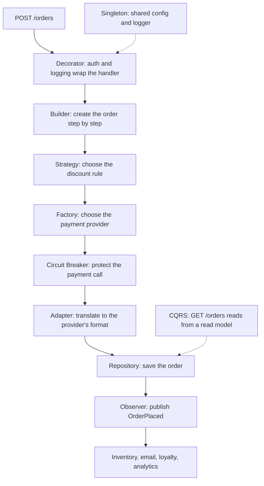

### 4.2 Patterns in This Course's Projects

| Project | Pattern | How you could use it |
|---|---|---|
| **Book Review API** | Repository | Put all Mongoose or SQL calls in `bookRepository.js`. Route handlers never touch the database. |
| **Book Review API** | Decorator (middleware idea) | Add JWT (JSON Web Token) authentication and logging around routes. |
| **Book Review API** | Strategy | Support sorting by rating, date, or title, with one function for each. |
| **MongoDB Backend** | Singleton | Create one MongoDB connection pool per process and share it. |
| **Travel Recommendation Site** | Adapter | Turn responses from two different travel APIs into one format. |
| **Multitier Guestbook** | CQRS (light version) | The read path uses Redis and the write path goes to the main store. |
| **Kubernetes / Istio labs** | Circuit Breaker | Add a `DestinationRule` with outlier detection. |
| **Microservices** | Observer | An `OrderPlaced` message on RabbitMQ is used by several services. |

### 4.3 How to Choose a Pattern

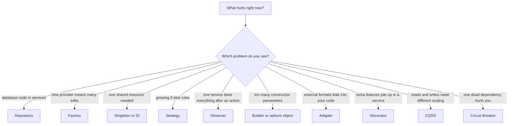

---

## 5. Code Blocks

All examples use plain Node.js with no extra packages. To run one, paste all the blocks of a section into one file, because each "What happens if" block can use code from the block above it.

### 5.1 Repository

```js
// The repository is the ONLY place that knows how data is stored.
class InMemoryCustomerRepository {
  constructor() {
    this.customers = new Map([[1, { id: 1, name: 'Asha', isActive: true }]]);
  }
  async findById(id) {
    return this.customers.get(id) ?? null; // Return null when nothing is found.
  }
}

// The service holds business rules. It has no database code.
class CustomerService {
  constructor(customerRepository) {
    this.customerRepository = customerRepository; // The repository is passed in.
  }
  async canPlaceOrder(id) {
    const customer = await this.customerRepository.findById(id);
    return customer !== null && customer.isActive; // A pure business rule.
  }
}

// In a test, a tiny mock replaces the real repository. No database is needed.
const mockRepository = { findById: async () => ({ id: 2, isActive: false }) };

(async () => {
  console.log(await new CustomerService(new InMemoryCustomerRepository()).canPlaceOrder(1)); // true
  console.log(await new CustomerService(mockRepository).canPlaceOrder(2)); // false
})();
```

**What happens if the repository leaks database details?**

```js
// BAD: the raw MongoDB document escapes, so services now depend on "_id".
const leakyRepository = {
  findById: async () => ({ _id: 'a1', full_name: 'Asha' }),
};

// GOOD: map the row to a clean object inside the repository.
const cleanRepository = {
  async findById() {
    const row = await leakyRepository.findById();
    return { id: row._id, name: row.full_name }; // Only clean fields leave.
  },
};

cleanRepository.findById().then(console.log); // { id: 'a1', name: 'Asha' }
```

If you later change databases, `_id` disappears and every service that used it breaks.

### 5.2 Factory

```js
class StripeProvider {
  pay(amount) { return `Stripe charged ${amount}`; }
}
class RazorpayProvider {
  pay(amount) { return `Razorpay charged ${amount}`; }
}
class PayPalProvider {
  pay(amount) { return `PayPal charged ${amount}`; }
}

// This Map is the one place that knows about all the providers.
const providers = new Map([
  ['stripe', StripeProvider],
  ['razorpay', RazorpayProvider],
  ['paypal', PayPalProvider],
]);

function createPaymentProvider(name) {
  const Provider = providers.get(name);
  if (!Provider) throw new Error(`Unknown payment provider: ${name}`); // Fail clearly.
  return new Provider();
}

// The caller says "I need a provider". Configuration decides which one.
const payment = createPaymentProvider(process.env.PAYMENT_PROVIDER ?? 'stripe');
console.log(payment.pay(500)); // Stripe charged 500
```

**What happens if the name has a typo and there is no check?**

```js
function createWithoutCheck(name) {
  const Provider = providers.get(name); // undefined for a typo
  return new Provider(); // TypeError: Provider is not a constructor
}

try {
  createWithoutCheck('strpe');
} catch (err) {
  console.log(err.message); // A vague error, far away from the real cause.
}
```

### 5.3 Singleton

```js
// logger.js
// Node.js caches a module after the first require().
// So every file that requires logger.js gets this same object.
class Logger {
  constructor() {
    this.count = 0; // Shared by all callers.
  }
  info(message) {
    this.count += 1;
    console.log(`[${this.count}] ${message}`);
  }
}

const logger = new Logger(); // Created once.
logger.info('Server started'); // [1] Server started
logger.info('Order saved'); // [2] Order saved
```

**What happens if you use a singleton like a global variable?**

```js
const settings = { taxRate: 0.18 }; // Shared and changeable by anyone.

function priceWithHiddenTax(amount) {
  return amount * (1 + settings.taxRate); // Hidden dependency.
}

settings.taxRate = 0; // One test changes it...
console.log(priceWithHiddenTax(100)); // 100, so the next test gets a wrong result.

// BETTER: pass the value in. The dependency is now visible and easy to test.
function priceWithTax(amount, taxRate) {
  return amount * (1 + taxRate);
}
console.log(priceWithTax(100, 0.5)); // 150
```

### 5.4 Strategy

```js
// Each rule is its own small function. Prices are whole cents to avoid decimal errors.
const discountStrategies = new Map([
  ['premium', (cents) => Math.round(cents * 0.8)], // 20% off
  ['student', (cents) => Math.round(cents * 0.9)], // 10% off
  ['festival', (cents) => Math.max(cents - 500, 0)], // 500 off, never below 0
]);

function finalPrice(cents, customerType) {
  const strategy = discountStrategies.get(customerType);
  if (!strategy) return cents; // No matching rule, so no discount.
  return strategy(cents);
}

console.log(finalPrice(10000, 'premium')); // 8000
console.log(finalPrice(10000, 'student')); // 9000
console.log(finalPrice(10000, 'festival')); // 9500

// A new policy is one new line. The other rules do not change.
discountStrategies.set('employee', (cents) => Math.round(cents * 0.5));
console.log(finalPrice(10000, 'employee')); // 5000
```

**What happens if you keep using `if else`?**

```js
function messyPrice(cents, type) {
  if (type === 'premium') return Math.round(cents * 0.8);
  else if (type === 'student') return Math.round(cents * 0.9);
  else if (type === 'festival') return Math.max(cents - 500, 0);
  // Every new rule makes this method longer, and every edit can break the old rules.
  return cents;
}
console.log(messyPrice(10000, 'student')); // 9000
```

### 5.5 Observer

```js
const { EventEmitter } = require('node:events');
const events = new EventEmitter();

// Listeners react on their own. OrderService knows nothing about them.
events.on('OrderPlaced', (order) => console.log(`Inventory updated for ${order.id}`));
events.on('OrderPlaced', (order) => console.log(`Email sent for ${order.id}`));
events.on('OrderPlaced', (order) => console.log(`Points added for ${order.id}`));

function placeOrder(id) {
  const order = { id }; // Imagine the order is saved here.
  events.emit('OrderPlaced', order); // Announce it. Do not call each service.
  return order;
}

placeOrder('A-100');

// A new feature is a new listener. placeOrder does not change.
events.on('OrderPlaced', (order) => console.log(`Coupon sent for ${order.id}`));
placeOrder('A-101');
```

**What happens if a listener throws?**

```js
const { EventEmitter: Emitter } = require('node:events');
const unsafeEvents = new Emitter();

unsafeEvents.on('OrderPlaced', () => { throw new Error('Email server down'); });
unsafeEvents.on('OrderPlaced', () => console.log('Inventory updated')); // Never runs!

try {
  unsafeEvents.emit('OrderPlaced', { id: 1 }); // EventEmitter listeners are synchronous.
} catch (err) {
  console.log(`The order flow failed: ${err.message}`); // The order was fine, the email was not.
}

// FIX: protect each listener, so one failure does not affect the others.
const safe = (listener) => (payload) => {
  try {
    listener(payload);
  } catch (err) {
    console.log(`Listener failed: ${err.message}`);
  }
};

const safeEvents = new Emitter();
safeEvents.on('OrderPlaced', safe(() => { throw new Error('Email server down'); }));
safeEvents.on('OrderPlaced', safe(() => console.log('Inventory updated'))); // Runs now.
safeEvents.emit('OrderPlaced', { id: 2 });
```

### 5.6 Builder

```js
class UserProfileBuilder {
  constructor() {
    this.profile = {}; // Filled step by step.
  }
  name(value) { this.profile.name = value; return this; } // "return this" allows chaining.
  email(value) { this.profile.email = value; return this; }
  phone(value) { this.profile.phone = value; return this; }
  company(value) { this.profile.company = value; return this; }
  build() {
    // All the checks live in one place, at the last step.
    if (!this.profile.name || !this.profile.email) {
      throw new Error('name and email are required');
    }
    return Object.freeze({ ...this.profile }); // The result cannot be changed.
  }
}

const profile = new UserProfileBuilder()
  .name('Asha')
  .email('asha@example.com')
  .company('Acme')
  .build();

console.log(profile);

// In JavaScript, an options object is often enough. Each value has a label.
function createProfile({ name, email, phone = null, company = null }) {
  return { name, email, phone, company };
}
console.log(createProfile({ name: 'Ravi', email: 'ravi@example.com' }));
```

**What happens with a long positional constructor?**

```js
function BadProfile(name, email, phone, address, company) {
  return { name, email, phone, address, company };
}

// Phone and company are swapped, and no error appears.
console.log(BadProfile('Asha', 'asha@example.com', 'Acme', undefined, '555-0100'));
```

### 5.7 Adapter

```js
// Two external systems use different field names. These are made-up examples.
const providerA = { getCustomer: async () => ({ customer_id: 7, full_name: 'Asha' }) };
const providerB = { getCustomer: async () => ({ id: 9, fullName: 'Ravi' }) };

// Each adapter translates to the ONE shape your application expects.
class ProviderAAdapter {
  async getCustomer() {
    const raw = await providerA.getCustomer();
    return { id: raw.customer_id, name: raw.full_name };
  }
}
class ProviderBAdapter {
  async getCustomer() {
    const raw = await providerB.getCustomer();
    return { id: raw.id, name: raw.fullName };
  }
}

(async () => {
  // The application code is the same for every provider.
  for (const adapter of [new ProviderAAdapter(), new ProviderBAdapter()]) {
    console.log(await adapter.getCustomer());
  }
})();
```

**What happens if the provider renames a field?**

```js
const changedProvider = { getCustomer: async () => ({ cust_id: 7 }) }; // Renamed field

// Without a check, undefined moves silently into your application.
class CheckedAdapter {
  async getCustomer() {
    const raw = await changedProvider.getCustomer();
    if (raw.customer_id === undefined) {
      throw new Error('Provider response changed: customer_id is missing');
    }
    return { id: raw.customer_id };
  }
}

new CheckedAdapter().getCustomer().catch((err) => console.log(err.message));
```

The fix is then one line in one adapter, not many edits across the application.

### 5.8 Decorator

```js
// The original service has one job. It is never edited below.
const productService = {
  async getProduct(id) {
    console.log(`Database read for ${id}`);
    return { id, name: 'Keyboard' };
  },
};

// Each decorator returns an object with the SAME method, so wrappers can stack.
function withCache(service, cache = new Map()) {
  return {
    async getProduct(id, ...rest) {
      if (cache.has(id)) return cache.get(id); // Cache hit: skip the service.
      const product = await service.getProduct(id, ...rest);
      cache.set(id, product);
      return product;
    },
  };
}

function withLogging(service) {
  return {
    async getProduct(id, ...rest) {
      console.log(`Getting product ${id}`);
      return service.getProduct(id, ...rest);
    },
  };
}

const decorated = withLogging(withCache(productService));

(async () => {
  await decorated.getProduct(1); // Logs, then reads the database.
  await decorated.getProduct(1); // Logs, then uses the cache. No database read.
})();
```

**What happens if the decorators are in the wrong order?**

```js
function withAuth(service) {
  return {
    async getProduct(id, user) {
      if (!user?.isAdmin) throw new Error('Forbidden');
      return service.getProduct(id, user);
    },
  };
}

const secretService = { getProduct: async (id) => ({ id, secret: 'cost price' }) };

const wrongOrder = withCache(withAuth(secretService)); // Cache is on the outside.
const rightOrder = withAuth(withCache(secretService)); // Auth is on the outside.

(async () => {
  await wrongOrder.getProduct(1, { isAdmin: true });
  console.log(await wrongOrder.getProduct(1, { isAdmin: false })); // Secret leaks to a guest!

  await rightOrder.getProduct(1, { isAdmin: true });
  await rightOrder.getProduct(1, { isAdmin: false }).catch((err) => console.log(err.message)); // Forbidden
})();
```

### 5.9 CQRS

```js
const writeStore = new Map(); // Built for safe, correct writes.
const readStore = new Map(); // Built for fast reads, in the shape the screen needs.

// COMMAND: changes data and returns no profile data.
function updateProfile({ userId, name }) {
  if (!name) throw new Error('name is required'); // Rules live on the command side.
  writeStore.set(userId, { userId, name, updatedAt: Date.now() });
  readStore.set(userId, { displayName: name }); // Copy to the read side.
}

// QUERY: reads only. It changes nothing.
function getProfile(userId) {
  return readStore.get(userId) ?? null;
}

updateProfile({ userId: 1, name: 'Asha' });
console.log(getProfile(1)); // { displayName: 'Asha' }
```

**What happens if the read side is updated later (eventual consistency)?**

```js
const delayedRead = new Map([[1, { displayName: 'Old Name' }]]);

function updateLater(userId, name) {
  setTimeout(() => delayedRead.set(userId, { displayName: name }), 50); // Copy takes time.
}

updateLater(1, 'New Name');
console.log(delayedRead.get(1)); // { displayName: 'Old Name' }. The user sees old data!
setTimeout(() => console.log(delayedRead.get(1)), 100); // { displayName: 'New Name' }
```

### 5.10 Circuit Breaker

```js
class CircuitBreaker {
  constructor(action, { failureThreshold = 3, resetTimeoutMs = 100 } = {}) {
    this.action = action; // The risky call we protect.
    this.failureThreshold = failureThreshold; // Failures allowed before opening.
    this.resetTimeoutMs = resetTimeoutMs; // How long to stay open.
    this.state = 'CLOSED';
    this.failures = 0;
    this.openedAt = 0;
  }

  async call(...args) {
    if (this.state === 'OPEN') {
      const waited = Date.now() - this.openedAt;
      if (waited < this.resetTimeoutMs) {
        throw new Error('Circuit is open'); // Fail fast. No timeout wait.
      }
      this.state = 'HALF_OPEN'; // Time is over, so test the service.
    }

    try {
      const result = await this.action(...args);
      this.state = 'CLOSED'; // It worked, so return to normal.
      this.failures = 0;
      return result;
    } catch (err) {
      this.failures += 1;
      if (this.state === 'HALF_OPEN' || this.failures >= this.failureThreshold) {
        this.state = 'OPEN'; // Stop sending requests.
        this.openedAt = Date.now();
      }
      throw err;
    }
  }
}

// A fake payment gateway. We control when it is healthy.
let gatewayIsUp = false;
const chargeCard = async () => {
  if (!gatewayIsUp) throw new Error('Gateway down');
  return 'Payment accepted';
};

const breaker = new CircuitBreaker(chargeCard);
const sleep = (ms) => new Promise((resolve) => setTimeout(resolve, ms));

// The fallback is honest: it does not claim the payment worked.
const pay = () => breaker.call().catch((err) => `Fallback: try again later (${err.message})`);

(async () => {
  for (let i = 1; i <= 4; i += 1) {
    console.log(await pay(), '| state:', breaker.state); // OPEN after the third failure.
  }
  gatewayIsUp = true; // The provider recovers.
  await sleep(120); // Wait for the reset time.
  console.log(await pay(), '| state:', breaker.state); // Payment accepted | state: CLOSED
})();
```

This is a teaching version. In half-open state it lets all requests through, while real libraries limit them to a few. In production, use a tested library such as **opossum**.

**What happens if the call has no timeout?**

```js
const hangsForever = () => new Promise(() => {}); // Never resolves or rejects.

// With no timeout, this never fails, so the breaker never counts it.
// FIX: make slow calls fail by racing them against a timer.
function withTimeout(action, ms) {
  return (...args) => {
    let timer;
    const timeout = new Promise((_, reject) => {
      timer = setTimeout(() => reject(new Error(`Timed out after ${ms}ms`)), ms);
    });
    return Promise.race([action(...args), timeout]).finally(() => clearTimeout(timer));
  };
}

const protectedCall = new CircuitBreaker(withTimeout(hangsForever, 20));
protectedCall.call().catch((err) => console.log(err.message)); // Timed out after 20ms
```

**The same idea at the network level, with Istio (no application code):**

```yaml
apiVersion: networking.istio.io/v1
kind: DestinationRule
metadata:
  name: payment-service
spec:
  host: payment-service
  trafficPolicy:
    connectionPool:
      http:
        http1MaxPendingRequests: 10 # Limit the requests waiting in the queue.
    outlierDetection:
      consecutive5xxErrors: 5 # Five 5xx errors in a row mark a pod as unhealthy.
      interval: 10s # How often pods are checked.
      baseEjectionTime: 30s # How long the pod stays out of load balancing.
      maxEjectionPercent: 100 # How many pods can be removed at once.
```

```bash
# Apply the rule to the cluster, then confirm that it exists.
kubectl apply -f payment-destination-rule.yaml
kubectl get destinationrule payment-service
```

---

## 6. Related Concepts

1. **Dependency Injection (DI):** Passing dependencies from the outside makes Repository mocks possible, and it is the modern replacement for hand-written Singletons.
2. **SOLID Principles:** Repository and Decorator follow the Single Responsibility Principle. Strategy and Decorator follow the Open/Closed Principle, because you add code and do not edit old code. Adapter and Repository support the Dependency Inversion Principle.
3. **Transactional Outbox:** Saves the event in the same database transaction as the order, then sends it later. It solves the main reliability risk of the Observer pattern across services.
4. **Retry with Exponential Backoff and Idempotency:** Retries handle short failures, and the Circuit Breaker handles long ones. Retrying a payment is safe only with an idempotency key, so the customer is not charged twice.
5. **Event Sourcing:** Stores every change as an event, not only the latest value. It is often paired with CQRS, because the events can build read models. It is a separate pattern and it adds a lot of complexity.
