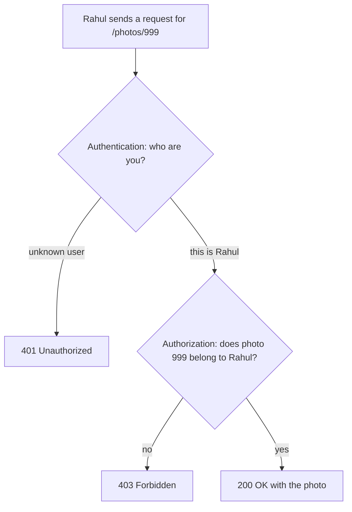
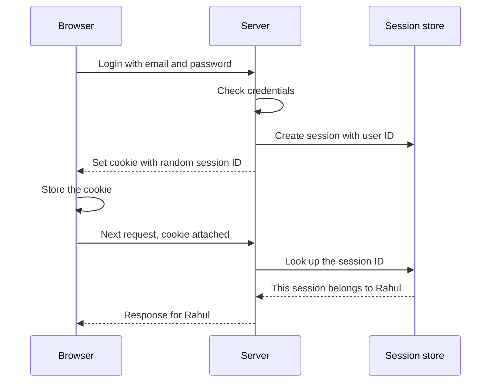
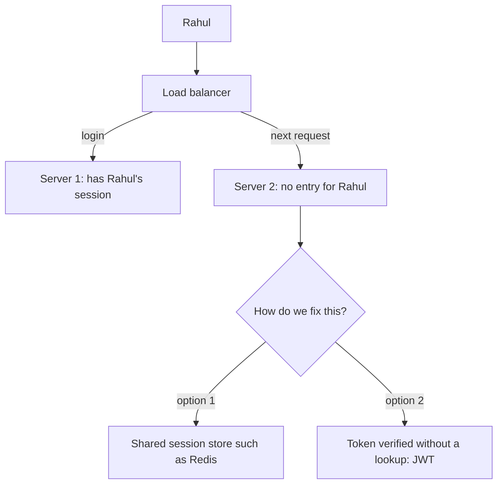
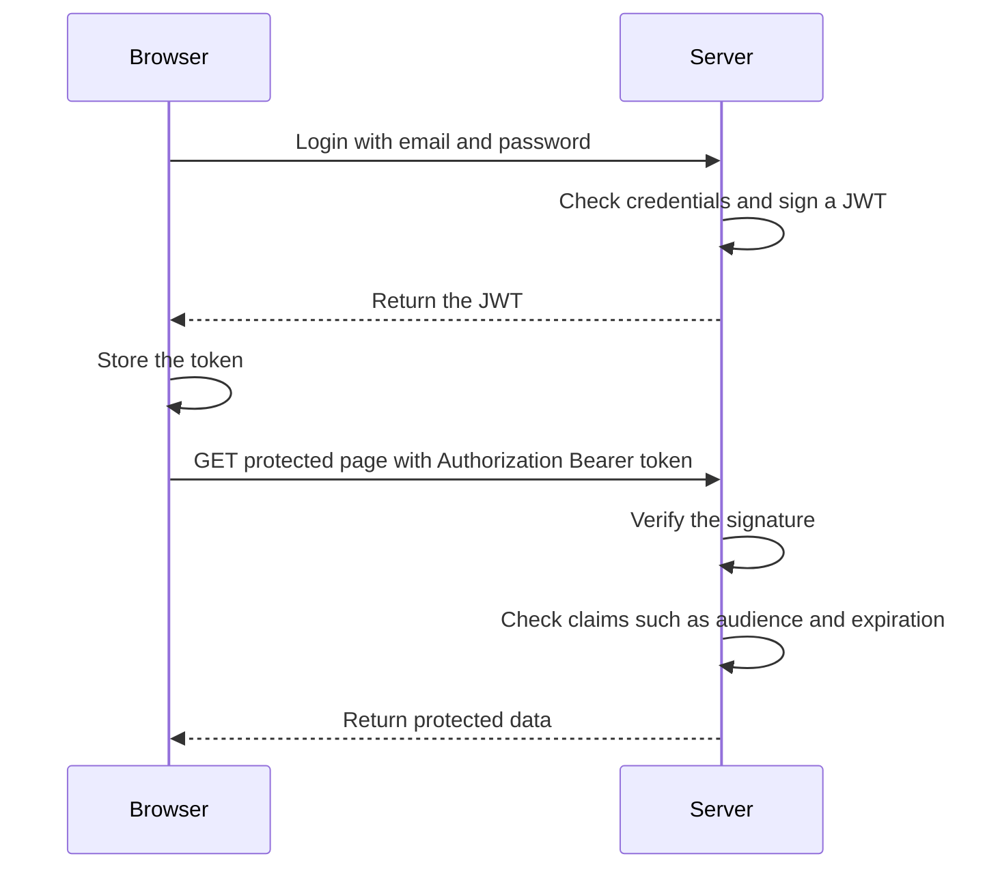
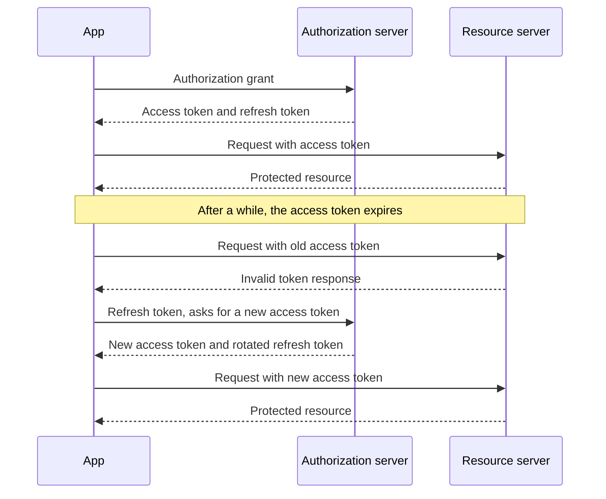
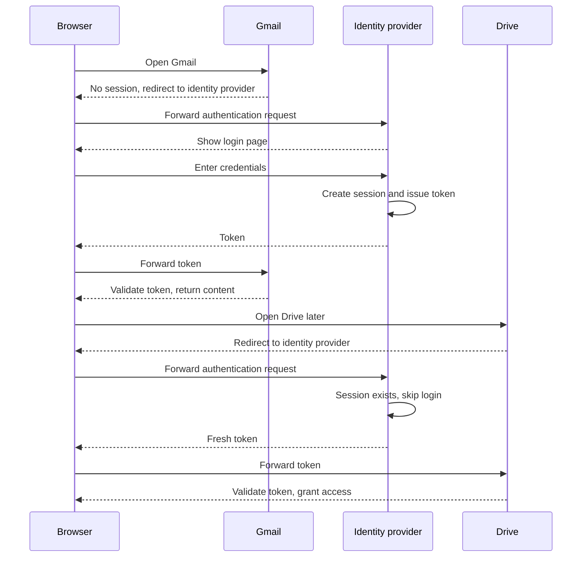
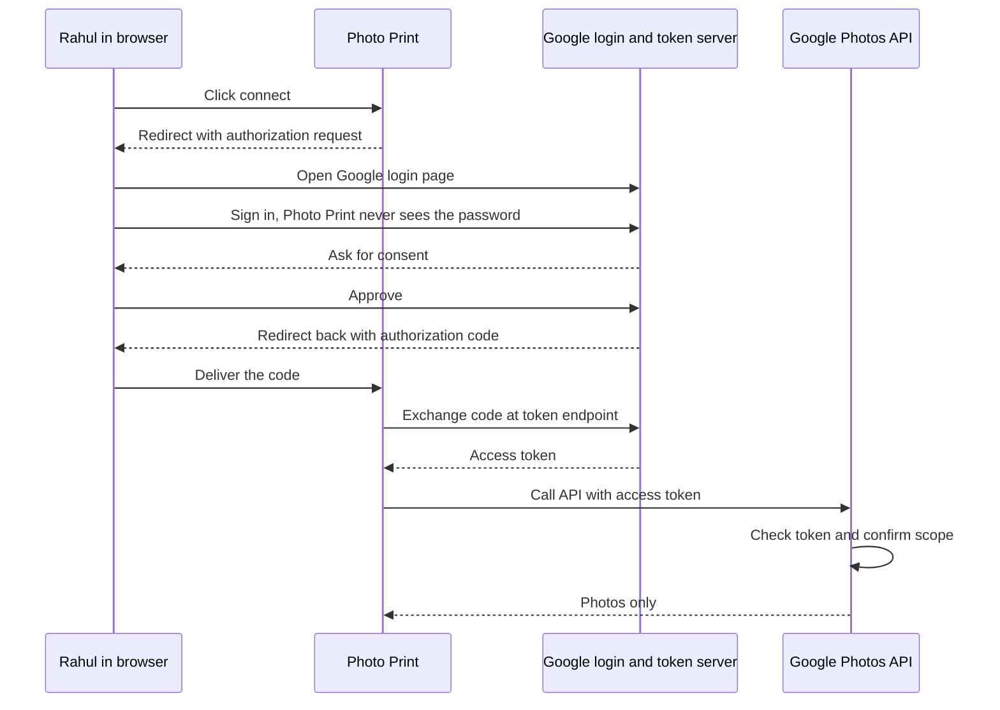
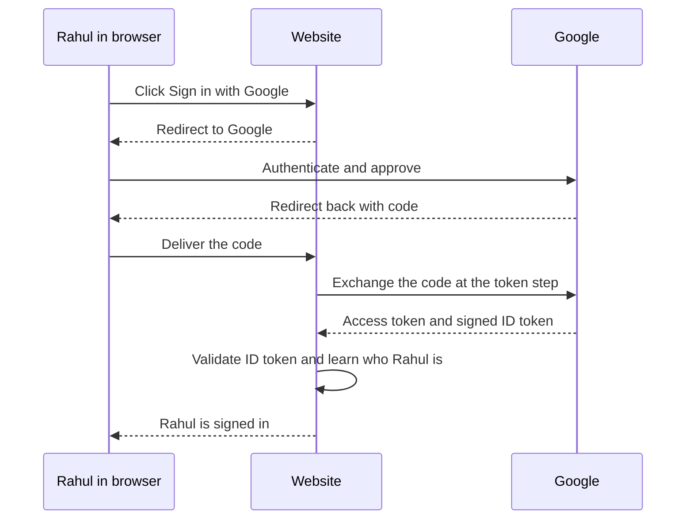
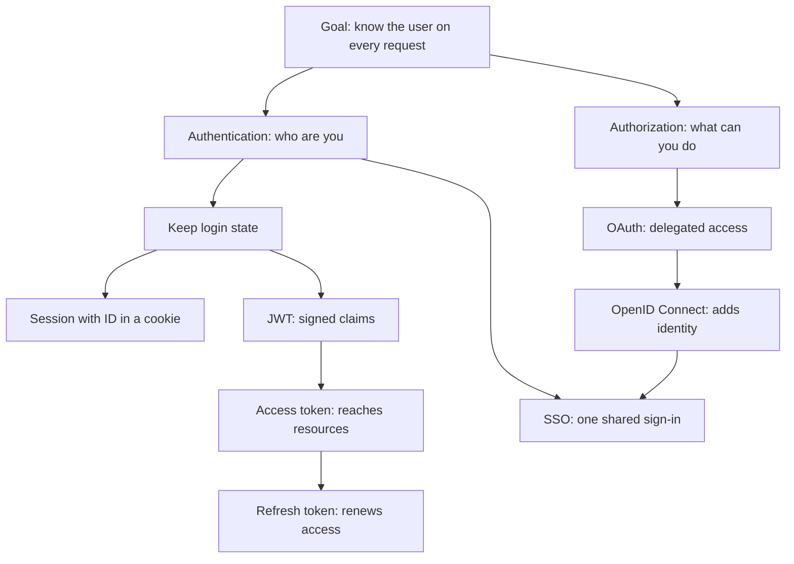

# 7 Authentication Concepts Every Senior Developer Should Know

**Video:** <https://youtu.be/Zo4VpTSelUE>
**Channel:** Visualcoders

---

## 1. Jargon Translation (Read This First)

| Term | Official Definition | Simple Words and Analogy |
|---|---|---|
| **Credentials** | The information a user gives to prove identity, such as an email and password. | The key you use to open your own front door. |
| **Authentication (AuthN)** | The process of checking who a user is. | Showing your ID card at the door. |
| **Authorization (AuthZ)** | The process of deciding what a user may do or access. | Your ticket says which seats you may use. |
| **Identity** | The information that says which user this is. | The name on your ID card. |
| **HTTP (HyperText Transfer Protocol)** | The protocol that browsers and servers use to talk. | A letter system. Each letter is handled on its own. |
| **Stateless** | Each request is handled alone, with no memory of earlier requests. | A shop worker with no memory. You must explain who you are each time. |
| **Session** | Login information kept on the server, linked to one user. | An entry in the server's notebook. |
| **Session ID** | A long random value that points to one session. | The order number on your coffee receipt. |
| **Cookie** | A small piece of data that the browser stores and sends back to the server. | The paper receipt in your pocket. |
| **Session Store** | The place where sessions are saved, such as server memory or Redis. | The notebook itself. |
| **Shared Store** | One session store that all servers can read. | One notebook that all staff can open. |
| **Token** | A piece of data that a client presents to prove something. | A ticket. |
| **JWT (JSON Web Token)** | A standard, compact format for carrying signed claims. JSON means JavaScript Object Notation. | An ID card with a special stamp that cannot be faked. |
| **Claim** | One fact inside a token, such as the user ID or expiry time. | One line on an ID card. |
| **Signature** | A value made with a secret or private key that shows the data has not changed. | A wax seal on a letter. A broken seal shows the letter was opened. |
| **Encoding** | Changing data into another format. Anyone can reverse it. No key is needed. | Writing in Morse code. Anyone with the chart can read it. |
| **Encryption** | Scrambling data so that only someone with the key can read it. | Locking a letter in a safe. |
| **Integrity** | Proof that data has not been changed. | A sealed box that has not been opened. |
| **Self-Contained Token** | A token that holds all the data needed to check it. | A passport. The guard does not need to phone your country. |
| **Revocation** | Cancelling a token or session before it would normally end. | Cancelling a lost bank card. |
| **Expiration** | The time after which a token no longer works. | The date on a bus pass. |
| **Audience** | The service that a token was made for. | A ticket that is valid for one cinema only. |
| **Authorization Header** | The HTTP header used to send credentials: `Authorization: Bearer <token>`. | The pocket where you show your ticket. |
| **Bearer Token** | A token that works for anyone who holds it. | Cash. A shop does not ask whose money it is. |
| **Impersonate** | To act as another user. | Using someone else's ID card to enter a building. |
| **Access Token** | A short-lived token used to call protected resources. | A day pass. |
| **Refresh Token** | A longer-lived token used to get a new access token. | A membership card that gets you a new day pass. |
| **Token Rotation** | Giving a new refresh token each time and stopping the old one. | Changing the locks each time a key is used. |
| **Authorization Grant** | Proof that the user allowed access, used to get tokens. | A signed permission slip. |
| **Authorization Server** | The server that signs users in and gives out tokens. | The ticket office. |
| **Resource Server** | The server that holds the protected data and accepts access tokens. | The cinema that checks your ticket. |
| **Protected Resource** | Data that needs a valid token. | The film behind the door. |
| **SSO (Single Sign-On)** | One sign-in gives access to many connected applications. | One wristband at a festival opens every stage. |
| **IdP (Identity Provider)** | A trusted service that authenticates users for other applications. | A central sign-in desk. |
| **Redirect** | A server response that tells the browser to go to another URL (Uniform Resource Locator). | "Please go to desk 4." |
| **SAML (Security Assertion Markup Language)** | An older XML-based (eXtensible Markup Language) standard for SSO. | A formal, stamped paper letter between companies. |
| **OAuth (Open Authorization)** | An authorization framework that gives an application limited access to a resource. | A valet key for your car. |
| **Delegated Access** | Letting one party act for you in a limited way. | Letting a friend collect one parcel for you. |
| **Scope** | The limit on what a token may do. | The valet key starts the car, but does not open the boot. |
| **Consent** | The user's approval of the access an app asked for. | Signing the permission slip. |
| **Authorization Code** | A short-lived, one-time code that is swapped for tokens. | A cloakroom ticket that you swap for your coat. |
| **Token Endpoint** | The URL where an app swaps a code for tokens. | The counter where you swap the ticket. |
| **API (Application Programming Interface)** | A defined way for software to talk to other software. | A menu of things you can ask for. |
| **OIDC (OpenID Connect)** | An identity layer built on top of OAuth 2.0. | OAuth plus a photo ID. |
| **ID Token** | A signed token that tells an application who the user is. | A photo ID made only for that application. |

---

## 2. Topics Introduced in the Lecture Transcript

1. The main question: how does a server know you on every request after one login?
2. Authentication: who are you?
3. Authorization: what are you allowed to do?
4. Why HTTP does not remember who sent the previous request.
5. Sessions and cookies, with the coffee receipt analogy.
6. The complete flow of session-based authentication.
7. The scaling problem when a second server is added.
8. The complete JWT (JSON Web Token) flow.
9. The three parts of a JWT, and why a signed JWT is not encrypted.
10. The trade-off between sessions and JWTs.
11. Bearer tokens, and what happens when one is stolen.
12. Access tokens, refresh tokens, and rotation.
13. SSO (Single Sign-On) and the identity provider.
14. OAuth and delegated access, with the valet key analogy.
15. OIDC (OpenID Connect) and the ID token.
16. Why the Photo Print example never received an ID token.
17. How all the pieces connect into one system.

---

## 3. Exhaustive Deep Dive & Structured Notes

### 3.0 The Big Question (00:00)

- You log in to an app and type your password **once**.
- After that, the password is **never sent again**.
- So how does the server still know it is you on **every single request**?
- The answer is **not simply** cookies, sessions, or JWTs.
- These are **different pieces of a much bigger picture**.
- Once you see how they fit together, authentication stops feeling like a collection of confusing technologies.
- It becomes **one connected system**.
- The video builds that system one piece at a time, using a user called **Rahul**.

**The title says 7 concepts:** the closing summary covers these pieces. Authentication and authorization count as one pair, and so do access and refresh tokens.

| # | Concept | Its role |
|---|---|---|
| 1 | Authentication and Authorization | Who you are, and what you may do |
| 2 | Sessions and Cookies | Keep login state on the server |
| 3 | JWT | Carry signed claims |
| 4 | Access and Refresh Tokens | Reach resources, and renew access |
| 5 | SSO | One shared sign-in |
| 6 | OAuth | Delegated access |
| 7 | OpenID Connect | Adds identity on top of OAuth |

---

### 3.1 Authentication: Who Are You? (00:34)

- Rahul opens a **photo sharing application**.
- He enters his **email and password**.
- The server **checks his credentials**.
- If they are valid, the server knows who Rahul is.
- This is **authentication**. It answers one question: **Who are you?**
- Authentication **establishes identity**.

⚠️ **Correction:** "The server checks his credentials" hides an important detail → A server must **never store the real password**. It stores a slow, salted **hash**, made with Argon2id, scrypt, or bcrypt. At login it hashes the password that was typed, then compares the two values. The password must also travel over HTTPS (HTTP Secure), or anyone on the network can read it.

---

### 3.2 Authorization: What Can You Do? (00:55)

- There is a **second question**.
- Rahul opens his photo gallery, and the application shows his pictures.
- Now imagine he **changes a URL** to reach another user's private photos.
- Should the application allow that? **Of course not.**
- Rahul is authenticated, but he is **not allowed to access everyone else's data**.
- Deciding what Rahul can and cannot do is **authorization**.
- Authorization **determines access**.

| | Authentication | Authorization |
|---|---|---|
| **Question** | Who are you? | What can you do? |
| **Result** | Identity | Access decision |
| **Happens** | First | After authentication |
| **HTTP status when it fails** | `401 Unauthorized` | `403 Forbidden` |



**Security note:** Rahul's URL trick is a real attack called **IDOR (Insecure Direct Object Reference)**. It is part of **Broken Access Control**, the top risk in the OWASP (Open Web Application Security Project) Top 10. Every request must check who owns the data. Being logged in is not enough.

**Naming note:** `401 Unauthorized` has a confusing name. It really means "not authenticated".

---

### 3.3 The Problem: HTTP Does Not Remember (01:30)

- The server can verify Rahul **at login**.
- But how does it recognize him when his **next request** arrives?
- HTTP does **not automatically remember** who sent the previous request.
- We need a way to **connect separate requests to the same user**.

---

### 3.4 Sessions and Cookies (01:47)

#### The Coffee Shop Analogy

| Coffee shop | Web session |
|---|---|
| Rahul orders a coffee and pays | Rahul logs in successfully |
| The barista gives him a receipt with an order number | The server gives the browser a session ID in a cookie |
| Staff track which order the number belongs to | The server stores the session record |
| Rahul shows his receipt and collects his coffee | The browser sends the cookie on the next request |

#### How It Works

- When Rahul logs in successfully, the server **creates a session**.
- It stores information that links the session to Rahul, such as his **user ID**.
- Think of it as an **entry in the server's notebook**.
- The server generates a **random session ID**.
- It sends the ID to the browser **inside a cookie**.
- A cookie is simply a **small piece of data the browser stores**.
- On the next request, the browser **attaches the cookie**.
- The server uses the session ID to **look Rahul up**.

#### The Key Distinction

- **The cookie carries the ticket.**
- **The session is the record the ticket points to.**

#### The Complete Flow (Session-Based Authentication)



⚠️ **Correction:** The video calls a cookie "simply a small piece of data" → This is true, but its **security attributes** matter a lot, and the video does not cover them:

| Attribute | What it does | Protects against |
|---|---|---|
| `HttpOnly` | JavaScript cannot read the cookie | Theft by XSS (Cross-Site Scripting) |
| `Secure` | Cookie is sent only over HTTPS | Reading it on the network |
| `SameSite` | Limits sending the cookie from other sites | CSRF (Cross-Site Request Forgery) |
| `Max-Age` | Sets how long the cookie lives | Sessions that stay open forever |

**Extra rules for session IDs:**

- The ID must come from a **secure random generator**, so it cannot be guessed.
- Create a **new session ID after login**. This stops **session fixation**, where an attacker sets a known ID before the victim logs in.

---

### 3.5 The Scaling Problem: A Second Server (03:15)

- Sessions work well.
- Then the application becomes popular, so the team adds a **second server**.
- Rahul logs in through **server one**.
- His next request reaches **server two**.
- Server two checks its notebook, and **there is no entry for Rahul**.
- His session exists, but server two **does not know about it**.

**The two options from the video:**

1. Put session data in a **shared store** that every server can read.
2. Use a **token** the server can verify **without a lookup**. This leads to JWTs.



**A third option the video skips:** **sticky sessions**. The load balancer always sends a user to the same server. It is simple, but the user loses the session if that server dies, and load can become uneven.

**Note:** a shared store such as Redis is very common. Needing to scale does **not** mean you must move to JWTs.

---

### 3.6 JWT: JSON Web Token (03:52)

#### The JWT Flow

1. Rahul enters his email and password and logs in.
2. The server checks his credentials.
3. The server creates a **signed token** called a **JSON Web Token (JWT)**.
4. It sends the token to the browser, which **stores it for later requests**.
5. Rahul opens a **protected page**, so the browser must prove who he is.
6. It attaches the token in an **Authorization header** that reads `Bearer`, then the token.
7. The server **verifies the signature**. If anything in the token was changed, verification fails.
8. It also **checks the claims**, such as the **audience** and the **expiration**.
9. Only then does it **trust the token**.
10. The token is valid, so the server returns the protected data.



#### What Is Inside a JWT?

A JWT has **three parts**, joined by dots: `header.payload.signature`

| Part | Job | Example content |
|---|---|---|
| **Header** | Names the algorithm | `{ "alg": "HS256", "typ": "JWT" }` |
| **Payload** | Holds the claims | `{ "sub": "42", "aud": "photo-api", "exp": 1790000000 }` |
| **Signature** | Proves integrity | Made from the header, payload, and key |

**Common standard claims (the video names only audience and expiration):**

| Claim | Meaning |
|---|---|
| `iss` | Issuer: who created the token |
| `sub` | Subject: who the token is about |
| `aud` | Audience: who the token is for |
| `exp` | Expiration time |
| `iat` | Issued-at time |
| `jti` | Unique token ID, useful for revocation |

#### The Important Detail

- A signed JWT is **not encrypted**.
- Its payload can be **decoded and read by anyone**.
- So **never put secrets inside it**.

#### Why It Solves the Second Server Problem

- The token is **self-contained**.
- Any server can verify it **without a session lookup**.
- Each server only needs the **key** to check the signature.

#### The Trade-Off

- A **session** can be deleted **instantly** when Rahul logs out.
- A **JWT** stays valid until it expires, unless you add a **revocation mechanism**.
- A JWT is **not automatically better** than a session.
- It is a **different tool with different trade-offs**.

| | Session | JWT |
|---|---|---|
| **Where state lives** | Server | Inside the token |
| **Check on each request** | Store lookup | Signature check |
| **Logout** | Instant: delete the record | Valid until expiry, unless revoked |
| **Multiple servers** | Needs a shared store | Works with the shared key |
| **Size on each request** | Small ID | Larger token |
| **Changing a user's role** | Takes effect at once | Old claims stay until expiry |

⚠️ **Correction:** The video says the browser "stores" the token but not **where** → This is a key decision. `localStorage` can be read by any script, so an XSS attack can steal the token. An `HttpOnly` cookie cannot be read by scripts, but the browser sends it automatically, so you must defend against CSRF. A JWT can also travel in a cookie, so "cookie or JWT" is a false choice. A cookie is a **transport**, and a JWT is a **format**.

⚠️ **Correction:** The video says the header "names the algorithm" → That is true, but the server must **not trust that value**. A famous attack sets `"alg": "none"` to skip the signature check. Always tell your verify code which algorithm you expect.

⚠️ **Correction:** "Any server can verify it without a lookup" has a limit → Revocation usually needs a list of cancelled tokens, and checking that list **is** a lookup. So real systems use short expiry times, and they accept some state when they need instant logout.

**Signing key types:**

| Type | Example | How it works |
|---|---|---|
| **Symmetric** | HS256 | One shared secret signs and verifies. Every verifier could also sign. |
| **Asymmetric** | RS256, ES256 | A private key signs and a public key verifies. Better for many services. |

---

### 3.7 Bearer Tokens: The Valuable Ticket (05:41)

- Imagine Rahul has a **valuable ticket**.
- **Anyone holding it can use it**.
- The system does not know if the person showing it is the real owner.
- This is the idea behind a **bearer token**.
- If an attacker steals Rahul's token, they can **impersonate him until it expires or is rejected**.
- So how do we **limit the damage** if a token is stolen?

---

### 3.8 Access Tokens and Refresh Tokens (06:03)

#### Two Tokens with Different Jobs

| | Access Token | Refresh Token |
|---|---|---|
| **Job** | Sent with each request | Gets a new access token when the old one expires |
| **Lifetime** | Short | Longer |
| **Permissions** | Only what it needs | Provides continued access |
| **Sent to** | Resource server | Authorization server only |
| **Protection** | Short life limits the damage | Needs careful protection |

#### The Complete Flow

1. The app sends an **authorization grant** to the **authorization server**.
2. The server signs him in and returns **two tokens**: an access token and a refresh token.
3. The app calls the **resource server** with the access token.
4. The token is valid, so the resource server returns the **protected resource**.
5. After a while, the **access token expires**.
6. The next call still carries the old token, so the resource server replies with an **invalid token response**.
7. The app sends the **refresh token** to the authorization server and asks for a new access token.
8. The server returns a **fresh access token** and **rotates the refresh token**, so the old one no longer works.



#### The Key Idea

- **Short-lived access tokens** limit how long a stolen one stays usable.
- **Refresh token protection and revocation** control longer-term access.
- These measures do **not make token theft harmless**.
- The **exact behavior depends on the design**.

**Details the video does not cover:**

- The invalid token response is normally `401 Unauthorized`.
- Rotation also helps **detect theft**. If an old refresh token is used again, someone has a copy, so the server can cancel the whole token family.
- Rotation is a **design choice**, not a rule of OAuth. The current OAuth security guidance (RFC 9700) requires public clients, such as browser and mobile apps, to protect refresh tokens with rotation or by binding them to the sender.
- **DPoP (Demonstrating Proof of Possession)** and mutual TLS (Transport Layer Security) can bind a token to one client, so a stolen copy is useless alone.

---

### 3.9 SSO: Single Sign-On (07:40)

#### The Problem

- So far, Rahul has used **one application**.
- But what if he uses **10 of them at work**?
- Should he sign in to each one separately?
- Imagine Rahul uses several Google apps: **Gmail** for email, **Drive** for files, and **Docs** for documents.
- Without a shared sign-in, he must authenticate with each one separately.
- That is **inconvenient** and **harder to manage**.

#### The Solution

- SSO lets him **sign in once** through a **trusted identity provider** and reach **every connected application**.
- Think of the identity provider as a **central sign-in desk**.
- Applications do not handle sign-in themselves.
- They all **trust this one service** to authenticate users.

#### The Flow

**First app: Gmail (Rahul must log in)**

1. Rahul opens Gmail.
2. The browser has **no session yet**.
3. Gmail **redirects the browser** to Google, the identity provider.
4. The browser forwards the **authentication request** to Google.
5. Google shows a **login page**, and Rahul enters his credentials.
6. Google **creates a session** and **issues a token**.
7. The browser **forwards the token** to Gmail.
8. Gmail **validates the token** and returns the protected content.

**Second app: Drive (no login needed)**

1. A little later, Rahul opens Google Drive.
2. Drive also **redirects the browser** to Google.
3. The browser forwards the authentication request.
4. This time, **Google already has a session**.
5. So it **skips the login completely**.
6. It **issues a fresh token** straight away.
7. The browser forwards the token to Drive.
8. Drive validates it and grants access.

**One sign-in, every Google app. That is single sign-on.**



#### The Key Point

- SSO is a **sign-in experience**, **not a token format**.
- Protocols like **OpenID Connect** and **SAML** can support it.

⚠️ **Correction:** Gmail and Drive are used as a teaching example → This is the general SSO pattern, not a description of how Google's internal systems work. In your own work, the same pattern appears with providers such as Okta, Microsoft Entra ID, and Keycloak.

**Things the video does not cover:**

- **Logout is harder than login.** Each app usually has its own session, so leaving one app may not log you out of the others. **Single logout** needs extra work.
- **One account opens many doors.** If the identity provider account is stolen, every connected app is at risk. This is why SSO should be paired with **MFA (Multi-Factor Authentication)**.
- **There is one point of failure.** If the identity provider is down, nobody can sign in.

---

### 3.10 OAuth: Delegated Access (10:01)

#### The Problem

- What if Rahul wants an **outside application** to read his photos **without giving it his password**?
- Rahul wants to use **Photo Print**, an app that prints photos.
- His photos live in **Google Photos**.
- Photo Print needs permission to read those photos.
- The easy answer is to give Photo Print his Google password.
- But that **hands over his whole account**, far more than it needs.

#### The Valet Key Analogy

- A **valet key** lets the valet park your car.
- It does not open everything you own.
- OAuth applies the same idea:
  - Rahul can authorize an application to access **specific resources** **without sharing his password**.
  - What it may touch is **limited by scope**.

#### The Full Flow

1. In Photo Print, Rahul clicks **connect**.
2. Photo Print sends an **authorization request** to Google.
3. Google redirects Rahul to **its own login page**.
4. Rahul signs in with his Google password, which **Photo Print never sees**.
5. Google asks for **consent**, and Rahul approves.
6. Google issues an **authorization code** to Photo Print.
7. Photo Print sends the code to Google's **token endpoint** and swaps it for an **access token**.
8. Photo Print calls the **Google Photos API** with the access token.
9. Google Photos **checks the token with Google**, **confirms the scope**, and returns the photos.

Photo Print gets exactly what it needs: **the photos and nothing else**.



#### The Heart of OAuth

- OAuth is an **authorization framework for delegated access**.
- Authentication asks **who you are**.
- OAuth answers **what access has been granted**.
- **An access token does not prove identity.**

⚠️ **Correction:** The video says Photo Print sends the request to Google, and the code goes to Photo Print → Both travel **through the browser** by redirect. This is called the **front channel**. Only the code exchange is a direct server call, which is called the **back channel**. This is the reason the code exists: a browser URL is not a safe place for a token, so a one-time code goes through the browser and the token comes through the back channel.

⚠️ **Correction:** The flow in the video leaves out protections that you must add in real code:

| Protection | What it stops |
|---|---|
| `state` parameter | CSRF: an attacker making your app accept their code |
| **PKCE (Proof Key for Code Exchange)** | A stolen code being swapped for tokens |
| Exact `redirect_uri` match | Codes being sent to an attacker's site |

⚠️ **Correction:** "Checks the token with Google" is only one option → A resource server can ask the authorization server (**token introspection**), or it can check a JWT access token on its own with a public key. Both are valid.

**Outdated flows to avoid:** the **Implicit** flow and the **Resource Owner Password Credentials** flow are no longer recommended. Use the **Authorization Code flow with PKCE**.

---

### 3.11 OpenID Connect: Identity on Top of OAuth (12:09)

#### Why It Exists

- An access token does not prove identity.
- So to let Rahul **sign in with a provider like Google**, we need **OpenID Connect**.
- OpenID Connect, or **OIDC**, builds an **identity layer on top of OAuth**.
- It lets an application **authenticate a user through an identity provider** and **learn about that authentication**.
- It does this with a familiar part of the story: **a token**.

#### The ID Token

- In an OIDC flow, the identity provider issues an **ID token**.
- It is **usually a signed JWT with claims about the user**.
- The application **validates it** and **learns the user's identity**.
- An access token has a **different job**: it **grants access to resources**.
- **Do not confuse the two.**

| | ID Token | Access Token |
|---|---|---|
| **Comes from** | OIDC | OAuth |
| **Tells you** | Who the user is | What access is granted |
| **Meant for** | The client application | The resource server or API |
| **Format** | Usually a signed JWT | Depends on the provider |
| **Send it to an API?** | No | Yes |

#### Sign In with Google

- Rahul clicks **Sign in with Google**.
- It runs **the exact same OAuth flow**.
- The site redirects him to Google, he authenticates, and the app exchanges the code at the token step.
- **The one new thing:** at the token step, the app also receives a **signed ID token**.
- That token **proves who Rahul is**.
- So OIDC is **the OAuth flow plus that one identity token**.
- One sign-in, and the site knows who you are.



#### Why Photo Print Never Got an ID Token (13:33)

- Back in the photo printing example, the app **never received an ID token**.
- Why not? Photo Print **never needed to know who Rahul was**.
- It only wanted **access to his photos**.
- If it also wanted his identity, it would simply **ask for an ID token too**.
- The flow stays the same. The app just **requests one more thing**.

⚠️ **Correction:** "OpenID Connect is just the OAuth flow plus that one identity token" is a helpful simplification, but it is incomplete → OIDC also defines the `openid` scope (the way you ask for the ID token), the `nonce` value, standard claims, a UserInfo endpoint, and a discovery document. The app must also **validate** the ID token: its signature, `iss`, `aud`, `exp`, and `nonce`.

**Practical tip:** use the `sub` claim to identify a user in your database. Do not use their email, because an email can change.

---

### 3.12 Connecting Everything (14:00)

- **Authentication** verifies who the user is.
- **Authorization** decides what they can access.
- **Sessions** let a server keep login state, usually with a session ID stored in a cookie.
- **JWTs** are a standard format for carrying signed claims a server can verify.
- **Access tokens** reach protected resources, and **refresh tokens** renew them.
- **SSO** is one shared sign-in.
- **OAuth** is delegated access.
- **OpenID Connect** adds identity on top.

**These are not seven competing choices. They are pieces that work together.**

Once you understand the role each piece plays, you can **design authentication with intention**, instead of just picking popular tools.



**Closing from the video (14:52):** the host asks viewers which concept to explore next (JWTs, OAuth, or OpenID Connect), and invites them to comment and subscribe to Visual Coders for more software engineering concepts explained with simple diagrams.

---

## 4. Concrete Examples

### 4.1 Which Tool for Which Situation?

| Situation | Good choice | Why |
|---|---|---|
| A normal website with its own login | Session and `HttpOnly` cookie | Simple, safe, instant logout |
| Website on many servers | Session in Redis | Keeps instant logout and works at scale |
| Mobile app calling your API | Short access token and refresh token | No browser cookies needed |
| Many microservices check the same user | JWT signed with a private key | Each service verifies with the public key |
| Company with many internal apps | SSO through an identity provider | One login, central control |
| Your app reads a user's Google data | OAuth | Limited access, no password shared |
| "Sign in with Google" button | OpenID Connect | You need to know who the user is |

### 4.2 Common Confusions

| People say | What is actually true |
|---|---|
| "Should I use cookies or JWTs?" | A cookie is a transport. A JWT is a format. A cookie can carry a JWT. |
| "JWT is more secure than sessions." | It is not automatically better. It only has different trade-offs. |
| "JWTs are encrypted." | A signed JWT can be read by anyone. |
| "We log in with OAuth." | OAuth grants access. Login needs OpenID Connect. |
| "SSO is a kind of token." | SSO is a sign-in experience. |
| "He is logged in, so he can see it." | Authentication is not authorization. |

### 4.3 Using These in This Course's Projects

| Project | Concept | How you could use it |
|---|---|---|
| **Book Review API** | JWT | Protect `PUT /review/:isbn` and read the user from the verified token. |
| **Book Review API** | Sessions | Use `express-session` to keep the logged-in user. |
| **Book Review API** | Authorization | Check that a user edits only their **own** review. |
| **MongoDB Backend** | Credentials | Store password hashes, never real passwords. |
| **Multitier Guestbook** | Shared store | Keep sessions in Redis, so any pod can serve a user. |
| **Kubernetes / Istio labs** | JWT | Istio `RequestAuthentication` can validate JWTs before they reach your service. |
| **Microservices** | Access tokens | A gateway checks the token, and services check its scope. |

---

## 5. Code Blocks

All JavaScript examples use only Node.js built-in modules. To run one, paste all the blocks of a section into one file, because each "What happens if" block can use code from the block above it. They show how things work. In production, use tested libraries such as `jose` or `jsonwebtoken` for JWTs, `express-session` for sessions, and `openid-client` for OAuth and OIDC.

### 5.1 Authentication: Checking a Password

```js
const crypto = require('node:crypto');

// Store a salted hash, never the password.
function hashPassword(password) {
  const salt = crypto.randomBytes(16); // A different salt for each user.
  const hash = crypto.scryptSync(password, salt, 64); // scrypt is slow on purpose.
  return { salt: salt.toString('hex'), hash: hash.toString('hex') };
}

function checkPassword(password, stored) {
  const attempt = crypto.scryptSync(password, Buffer.from(stored.salt, 'hex'), 64);
  // timingSafeEqual takes the same time wherever the values differ.
  return crypto.timingSafeEqual(attempt, Buffer.from(stored.hash, 'hex'));
}

const rahul = hashPassword('correct-horse');
console.log(checkPassword('correct-horse', rahul)); // true
console.log(checkPassword('wrong-password', rahul)); // false
```

**What happens if you use a fast hash with no salt?**

```js
const fastHash = (password) => crypto.createHash('sha256').update(password).digest('hex');

// Two users with the same password get the same value.
console.log(fastHash('123456') === fastHash('123456')); // true
// An attacker with a stolen database can spot them, and can try billions of guesses quickly.
```

### 5.2 Authorization: Checking Ownership

```js
const photos = new Map([
  [1, { id: 1, ownerId: 'rahul', url: 'beach.jpg' }],
  [2, { id: 2, ownerId: 'priya', url: 'private.jpg' }],
]);

function getPhoto(photoId, currentUserId) {
  const photo = photos.get(photoId);
  if (!photo) return { status: 404 };
  // Authorization: being logged in is not enough. Check who owns the photo.
  if (photo.ownerId !== currentUserId) return { status: 403 };
  return { status: 200, photo };
}

console.log(getPhoto(1, 'rahul').status); // 200
console.log(getPhoto(2, 'rahul').status); // 403
```

**What happens if you skip the ownership check?**

```js
function unsafeGetPhoto(photoId) {
  return { status: 200, photo: photos.get(photoId) }; // Trusts the ID in the URL.
}

// Rahul changes the URL from /photos/1 to /photos/2.
console.log(unsafeGetPhoto(2).photo.url); // private.jpg, another user's photo!
```

### 5.3 Sessions and Cookies

```js
const crypto = require('node:crypto');

const sessions = new Map(); // The server's notebook.

function login(userId) {
  const sessionId = crypto.randomBytes(32).toString('hex'); // Cannot be guessed.
  sessions.set(sessionId, { userId }); // The session is the record.
  // The cookie carries the ticket.
  return `sid=${sessionId}; HttpOnly; Secure; SameSite=Lax; Max-Age=3600; Path=/`;
}

function identify(cookieHeader) {
  const sessionId = cookieHeader.match(/sid=([^;]+)/)?.[1];
  return sessions.get(sessionId)?.userId ?? null; // Look the session up.
}

function logout(cookieHeader) {
  sessions.delete(cookieHeader.match(/sid=([^;]+)/)?.[1]); // Instant logout.
}

const cookie = login('rahul');
console.log(identify(cookie)); // rahul
logout(cookie);
console.log(identify(cookie)); // null
```

**What happens with two servers that each keep their own notebook?**

```js
const makeServer = (store) => ({
  login(userId) {
    const sessionId = crypto.randomBytes(16).toString('hex');
    store.set(sessionId, { userId });
    return sessionId;
  },
  identify: (sessionId) => store.get(sessionId)?.userId ?? null,
});

// Each server has its own Map.
const serverOne = makeServer(new Map());
const serverTwo = makeServer(new Map());
const id = serverOne.login('rahul');
console.log(serverTwo.identify(id)); // null: no entry for Rahul

// FIX: share one store. In production, this is Redis, not a Map.
const sharedStore = new Map();
const sharedOne = makeServer(sharedStore);
const sharedTwo = makeServer(sharedStore);
const sharedId = sharedOne.login('rahul');
console.log(sharedTwo.identify(sharedId)); // rahul
```

### 5.4 JWT: Sign and Verify

This builds a JWT by hand to show how it works. Use a library in real projects.

```js
const crypto = require('node:crypto');

const SECRET = 'demo-only-use-a-long-random-secret';
const toBase64Url = (value) => Buffer.from(value).toString('base64url');
const makeSignature = (data) => crypto.createHmac('sha256', SECRET).update(data).digest('base64url');

function signJwt(claims) {
  const header = toBase64Url(JSON.stringify({ alg: 'HS256', typ: 'JWT' }));
  const payload = toBase64Url(JSON.stringify(claims));
  return `${header}.${payload}.${makeSignature(`${header}.${payload}`)}`;
}

function verifyJwt(token, audience) {
  const [header, payload, signature] = token.split('.');
  // Never trust the algorithm in the token. Require the one we expect.
  if (JSON.parse(Buffer.from(header, 'base64url')).alg !== 'HS256') {
    throw new Error('Unexpected algorithm');
  }
  const expected = Buffer.from(makeSignature(`${header}.${payload}`));
  const actual = Buffer.from(signature ?? '');
  if (actual.length !== expected.length || !crypto.timingSafeEqual(actual, expected)) {
    throw new Error('Invalid signature'); // The token was changed.
  }
  const claims = JSON.parse(Buffer.from(payload, 'base64url'));
  if (claims.aud !== audience) throw new Error('Wrong audience');
  if (claims.exp <= Math.floor(Date.now() / 1000)) throw new Error('Token expired');
  return claims; // Only now do we trust the token.
}

const inOneHour = Math.floor(Date.now() / 1000) + 3600;
const token = signJwt({ sub: 'rahul', role: 'user', aud: 'photo-api', exp: inOneHour });

console.log(token.split('.').length); // 3
console.log(verifyJwt(token, 'photo-api').sub); // rahul
```

**What happens if someone changes the token, or sends a bad one?**

```js
const attempt = (label, value, audience = 'photo-api') => {
  try {
    verifyJwt(value, audience);
    console.log(`${label}: accepted`);
  } catch (err) {
    console.log(`${label}: ${err.message}`);
  }
};

// 1. Anyone can read the payload with no key at all. It is not encrypted.
const [tokenHeader, tokenPayload, tokenSignature] = token.split('.');
console.log(JSON.parse(Buffer.from(tokenPayload, 'base64url')).role); // user

// 2. An attacker changes the role, but cannot make a new signature.
const forgedPayload = toBase64Url(JSON.stringify({ sub: 'rahul', role: 'admin', aud: 'photo-api', exp: inOneHour }));
attempt('Changed role', `${tokenHeader}.${forgedPayload}.${tokenSignature}`); // Invalid signature

// 3. An attacker says that no algorithm is used.
const noneHeader = toBase64Url(JSON.stringify({ alg: 'none', typ: 'JWT' }));
attempt('alg none', `${noneHeader}.${forgedPayload}.`); // Unexpected algorithm

// 4. The token is expired, or it was made for another service.
attempt('Expired', signJwt({ sub: 'rahul', aud: 'photo-api', exp: 1 })); // Token expired
attempt('Wrong audience', token, 'billing-api'); // Wrong audience
```

### 5.5 Refresh Token Rotation

```js
const crypto = require('node:crypto');

const refreshTokens = new Map(); // Keyed by a hash, so a database leak does not expose tokens.
const revokedFamilies = new Set();
const hash = (token) => crypto.createHash('sha256').update(token).digest('hex');

function issueRefreshToken(userId, familyId = crypto.randomUUID()) {
  const token = crypto.randomBytes(32).toString('base64url');
  refreshTokens.set(hash(token), { userId, familyId, used: false });
  return token;
}

function refresh(oldToken) {
  const record = refreshTokens.get(hash(oldToken));
  if (!record || revokedFamilies.has(record.familyId)) throw new Error('Invalid refresh token');
  if (record.used) {
    revokedFamilies.add(record.familyId); // Used twice means someone has a copy.
    throw new Error('Reuse detected: all tokens in this family are cancelled');
  }
  record.used = true; // The old token no longer works.
  return {
    accessToken: `access-for-${record.userId}`, // In real code, this is a short-lived token.
    refreshToken: issueRefreshToken(record.userId, record.familyId),
  };
}

const first = issueRefreshToken('rahul');
const second = refresh(first);
console.log(second.accessToken); // access-for-rahul
```

**What happens if an attacker uses a stolen, old refresh token?**

```js
try {
  refresh(first); // The attacker replays the old token.
} catch (err) {
  console.log(err.message); // Reuse detected: all tokens in this family are cancelled
}

try {
  refresh(second.refreshToken); // The newest token is cancelled too.
} catch (err) {
  console.log(err.message); // Invalid refresh token
}
// Rahul must log in again, which also locks the attacker out.
```

### 5.6 OAuth: Authorization Code Flow with PKCE

```js
const crypto = require('node:crypto');

// Step 1: create one-time secrets for this login attempt.
const state = crypto.randomBytes(16).toString('base64url'); // Stops CSRF.
const codeVerifier = crypto.randomBytes(32).toString('base64url'); // Kept secret by the app.
const codeChallenge = crypto.createHash('sha256').update(codeVerifier).digest('base64url');

// Step 2: send the browser to the authorization server.
function buildAuthorizationUrl(scope, extra = {}) {
  const url = new URL('https://auth.example.com/authorize');
  url.search = new URLSearchParams({
    response_type: 'code', // We want an authorization code.
    client_id: 'photo-print',
    redirect_uri: 'https://photoprint.example.com/callback',
    scope, // Only what the app needs.
    state,
    code_challenge: codeChallenge, // Only the hash travels through the browser.
    code_challenge_method: 'S256',
    ...extra,
  }).toString();
  return url.toString();
}

console.log(buildAuthorizationUrl('photos.read'));

// Step 3: on return, check that this is the login attempt we started.
function handleCallback(query) {
  if (query.state !== state) throw new Error('State mismatch: possible CSRF');
  return query.code; // Next, swap the code for a token on the server.
}

console.log(handleCallback({ code: 'abc123', state })); // abc123
```

**What happens if the `state` value does not match?**

```js
try {
  // An attacker tricks the victim's browser into opening a callback with the attacker's code.
  handleCallback({ code: 'attacker-code', state: 'forged' });
} catch (err) {
  console.log(err.message); // State mismatch: possible CSRF
}
// Without this check, the victim's account could be linked to the attacker's data.
```

**Step 4: the app swaps the code for tokens on the back channel:**

```bash
# A direct server-to-server call. The token never travels through a browser URL.
curl -X POST https://auth.example.com/token \
  -d grant_type=authorization_code \
  -d code=abc123 \
  -d redirect_uri=https://photoprint.example.com/callback \
  -d client_id=photo-print \
  -d code_verifier=THE_ORIGINAL_VERIFIER
```

**Step 5: the response (OAuth only, so there is no ID token):**

```json
{
  "access_token": "eyJhbGciOi...",
  "token_type": "Bearer",
  "expires_in": 900,
  "refresh_token": "8xLOxBtZp8...",
  "scope": "photos.read"
}
```

### 5.7 OpenID Connect: Asking For and Checking the ID Token

Asking for identity is "one more thing": add the `openid` scope. This example continues in the same way as 5.6.

```js
const crypto = require('node:crypto');

const nonce = crypto.randomBytes(16).toString('base64url'); // Links the token to this login.

// The only new parts of the request: scope=openid and nonce.
const params = new URLSearchParams({ scope: 'openid email photos.read', nonce });
console.log(params.get('scope')); // openid email photos.read

// Run these checks after verifying the signature, as in section 5.4.
function validateIdTokenClaims(claims, expected) {
  const audiences = [claims.aud].flat(); // aud can be a string or an array.
  if (claims.iss !== expected.issuer) throw new Error('Wrong issuer');
  if (!audiences.includes(expected.clientId)) throw new Error('Token is for another app');
  if (claims.exp <= Math.floor(Date.now() / 1000)) throw new Error('ID token expired');
  if (claims.nonce !== expected.nonce) throw new Error('Nonce mismatch: possible replay');
  return { userId: claims.sub, email: claims.email }; // sub is the stable user ID.
}

const expected = { issuer: 'https://accounts.example.com', clientId: 'my-site', nonce };
const idTokenClaims = {
  iss: 'https://accounts.example.com',
  sub: '110169484474386276334',
  aud: 'my-site',
  exp: Math.floor(Date.now() / 1000) + 300,
  nonce,
  email: 'rahul@example.com',
};

console.log(validateIdTokenClaims(idTokenClaims, expected));
```

**What happens if you accept an ID token made for another app?**

```js
try {
  // A real, signed token, but it was issued to a different site.
  validateIdTokenClaims({ ...idTokenClaims, aud: 'evil-site' }, expected);
} catch (err) {
  console.log(err.message); // Token is for another app
}
// Without the aud check, any site Rahul logs in to could reuse his token to sign in as him here.
```

---

## 6. Related Concepts

1. **HTTPS and TLS (Transport Layer Security):** Every password, cookie, and bearer token in this video travels over the network. Without TLS, anyone on the network can steal them. Tokens are only as safe as their transport.
2. **XSS (Cross-Site Scripting) and CSRF (Cross-Site Request Forgery):** These two attacks decide where you store tokens. XSS steals what scripts can read, such as `localStorage`. CSRF abuses cookies that the browser sends automatically.
3. **RBAC (Role-Based Access Control):** A common way to build authorization. Permissions are given to roles, such as `admin` or `editor`, and roles are given to users. Roles are often carried as claims in a JWT.
4. **MFA (Multi-Factor Authentication) and Passkeys:** These make the first step, authentication, stronger. A stolen password alone is no longer enough, which is very important when SSO puts many apps behind one login.
5. **JWKS (JSON Web Key Set) and Key Rotation:** A JWKS is a public URL where a provider shares its public keys. Your service uses it to verify JWTs and ID tokens, and the provider can change its keys safely over time.
