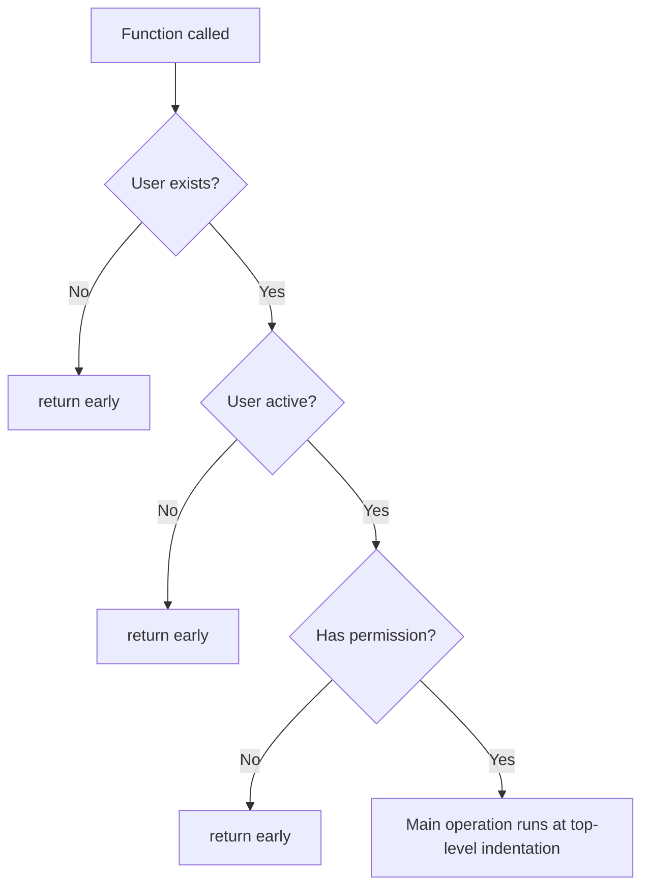
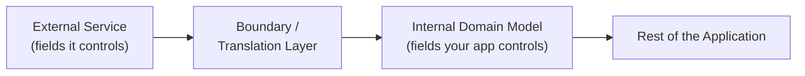
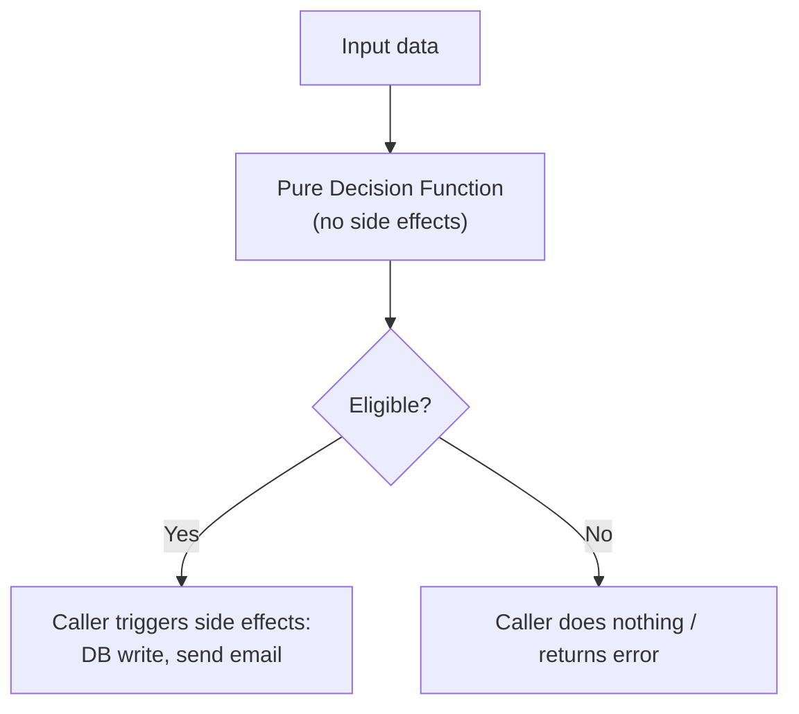
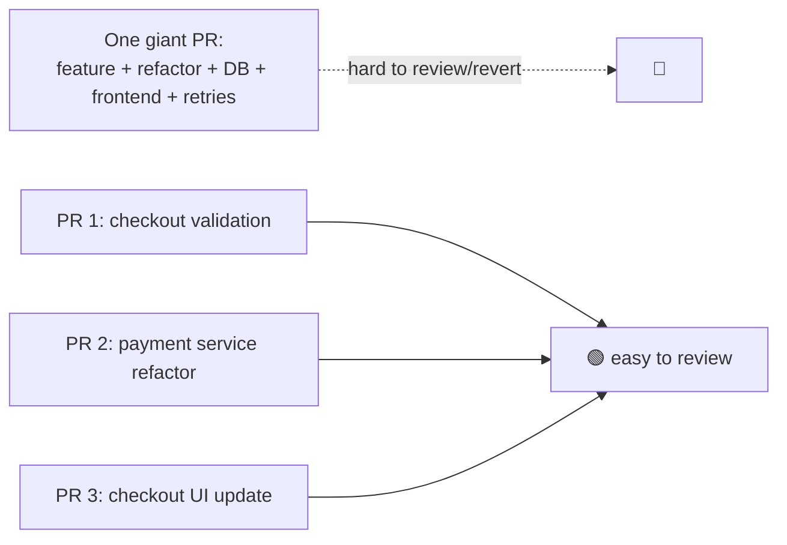
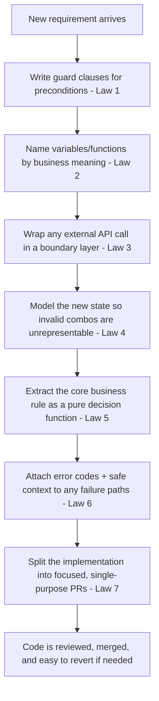

# 7 Coding Laws of Senior Developer

## 0. Jargon Translation (Read This First)

| Term | Official Definition | Plain-English Analogy |
|---|---|---|
| **Guard Clause / Early Return** | A conditional check placed at the top of a function that exits immediately (`return`, `throw`) when a precondition isn't met, instead of wrapping the rest of the function body in an `if`. | Like a bouncer checking ID at the door — if you fail the check, you're turned away immediately, instead of being let inside and questioned at every single room. |
| **Arrow Code / Nesting Pyramid** | Code where each new condition is indented one level deeper than the last, so the logic visually forms a triangle pointing right. Named because deeply nested code literally looks like an arrow (`>`) when you squint at the indentation. | A Russian nesting doll (matryoshka) — to find the real prize (the core logic) you have to open doll after doll after doll. |
| **Anti-Corruption Layer / Boundary** | A translation layer at the edge of your application that converts an external system's data shape into a shape your application defines and controls. | A customs checkpoint at a border — goods (data) from another country get inspected and repackaged into your country's standard labeling before they're allowed to circulate internally. |
| **Domain Model** | The set of types/classes your application uses internally to represent business concepts (an `Order`, a `User`), as opposed to the raw shapes sent by a database or external API. | The difference between a shipping manifest (raw, external format) and the inventory list your own warehouse uses to track stock (your internal format). |
| **Illegal State / Invalid State** | A combination of field values that shouldn't be possible according to business rules, but which the type system allows anyway (e.g., an order marked `paid: true` with no `paymentId`). | A form that lets you check "Married" and "Single" at the same time — the paper accepts it, but reality doesn't. |
| **Discriminated Union (Algebraic Data Type)** | A type composed of several variants, each tagged with a distinguishing field, where each variant only carries the fields that make sense for that state. | A vending machine slot labeled either "Candy" or "Empty" — it's never both, and each label comes with only the details relevant to it (candy has a price; empty has none). |
| **Side Effect** | Any action a function performs that reaches outside itself and changes something in the world — writing to a database, sending an email, making a network call — as opposed to simply computing and returning a value. | A function without side effects is like solving a math problem on scratch paper (self-contained); a function with side effects is like mailing a letter while solving it (it reaches outside the room). |
| **Pure Function** | A function whose return value depends only on its inputs and which produces no side effects, making it trivial to test in isolation. | A vending machine that only takes coins and dispenses a snack — no matter who uses it or when, the same coin always gets the same snack, with nothing else happening in the world. |
| **Error Code** | A short, stable, machine-readable identifier (e.g., `USER_NOT_FOUND`, `INSUFFICIENT_FUNDS`) attached to an error, distinct from the human-readable message. | A hospital triage tag color (red/yellow/green) attached alongside the doctor's written notes — the tag is what the next system (routing, billing, monitoring) acts on automatically. |
| **Scope Creep (in a change/PR)** | A single unit of work (commit, pull request) that grows to include multiple unrelated changes, making it hard to review, test, or revert independently. | Going to the store for milk and coming home with milk, a new couch, and a repainted fence — technically all "shopping," but no single receipt makes sense anymore. |
| **Pull Request (PR)** | A proposed set of code changes submitted for review before being merged into the main codebase. | A draft memo circulated for edits before it becomes the official policy — reviewers can suggest changes before it's final. |

---

## Topics Introduced in This Lecture

1. Reducing nested conditionals so the main/"happy path" logic of a function stays visible instead of buried inside multiple layers of `if` blocks.
2. Naming variables and functions after their business meaning instead of generic terms like `data`, `result`, or `item`.
3. Isolating external systems (APIs, payment providers, email services) behind a translation boundary so their changes don't ripple through the whole codebase.
4. Designing types/models so that invalid combinations of data are harder to construct in the first place, instead of relying on scattered runtime checks.
5. Separating pure business decisions (eligibility, pricing, permission checks) from the side effects they trigger (database writes, emails, API calls), so decisions can be unit-tested in isolation.
6. Pairing human-readable error messages with stable, machine-readable error codes, and logging useful context while excluding sensitive data (passwords, tokens, secrets).
7. Keeping individual commits/pull requests focused on one purpose so they're easier to review, test, debug, and roll back.
8. The meta-principle underlying all seven habits: every decision should make the *next* change to the code easier, not just make the current version work.

---

## Deep Dive

### Law 1: Keep the Main Path Easy to Follow

**Micro-Mechanics — The "Why" and "How":**
- **The anti-pattern:** Checking "does the user exist," "is the user active," and "does the user have permission" by nesting each check inside the previous one's `if` block. The code that actually matters — the real operation — ends up three or more indentation levels deep.
- **The core mechanic — guard clauses:** Instead of nesting, check each precondition up front and `return` (or `throw`) immediately if it fails. Every guard clause removes one layer of nesting for everything that follows it.
- **Why it scales better:** Nesting depth grows linearly with the number of preconditions. A function with five conditions nested becomes five levels deep, and adding a sixth condition means editing code that's already hard to read. Guard clauses keep the function at a flat, constant indentation level no matter how many preconditions exist.
- **What problem it solves:** It separates "conditions that stop execution" from "the actual work of the function," so a reader scanning the function can find the real logic instantly instead of mentally tracking which branch they're inside.
- **The caveat from the lecture:** The goal isn't to eliminate all nested code everywhere — some logic genuinely needs branches. The goal is to keep the *main* operation of a function visible and not buried.



**Code Example (JavaScript/Node.js):**
```javascript
// Anti-pattern — main operation buried three levels deep
function performAction(user, action) {
  if (user) {
    if (user.isActive) {
      if (user.hasPermission(action)) {
        return runAction(user, action); // the real work, hidden deep inside
      }
    }
  }
  return null;
}

// Clearer — guard clauses keep the main path flat
function performAction(user, action) {
  if (!user) return null;
  if (!user.isActive) return null;
  if (!user.hasPermission(action)) return null;

  return runAction(user, action); // the real work is immediately visible
}
```

```javascript
// What happens if... you keep adding conditions to the nested version?
function performAction(user, action, org) {
  if (user) {
    if (user.isActive) {
      if (user.hasPermission(action)) {
        if (org.isSubscribed) {
          if (!org.isSuspended) {
            return runAction(user, action); // now five levels deep
          }
        }
      }
    }
  }
  return null;
}
// Mistake: every new business rule adds another indentation level.
// A reviewer has to hold five open conditions in their head just to
// find the one line that actually does something.
```

---

### Law 2: Name Things by Meaning

**Micro-Mechanics — The "Why" and "How":**
- **The anti-pattern:** Using generic placeholder names — `data`, `result`, `item`, `obj`, `temp` — for variables and functions that actually represent specific business concepts. The name gives the reader zero information; they have to trace the variable back to its source just to know what it *is*.
- **The core mechanic:** Name a variable after what it represents in the business domain (`pendingOrder`, not `data`), and name a function after what it does to that thing (`processOrder`, not `handle`). The name itself should answer "what is this?" without requiring the reader to open another file.
- **Why it scales better:** In a small function, a vague name costs a few seconds of "detective work." Across a codebase with hundreds of functions, that cost compounds — every vague name is a small tax paid by every future reader, including the original author six months later.
- **What problem it solves:** It shifts the burden of understanding from "read the implementation to infer meaning" to "read the name and already know the meaning." You don't need exhaustively long names for everything — only for the concepts that matter.

**Code Example (JavaScript/Node.js):**
```javascript
// Anti-pattern — generic names hide the business meaning
function process(data) {
  const result = data.filter(x => x.status === 'pending');
  return result.map(x => finalize(x));
}

// Clearer — names communicate intent immediately
function processOrders(pendingOrders) {
  const ordersToFinalize = pendingOrders.filter(order => order.status === 'pending');
  return ordersToFinalize.map(order => finalizeOrder(order));
}
```

```javascript
// What happens if... vague names spread across a larger module?
function process(data) {
  const temp = data.map(x => transform(x));
  const result = temp.filter(x => x.valid);
  return save(result);
}
// Mistake: a new engineer reading this has no idea what "data," "temp,"
// or "result" actually contain without tracing every call site back to
// its origin. Multiply this by a whole file and onboarding slows to a crawl.
```

---

### Law 3: Keep External Systems Behind a Boundary

**Micro-Mechanics — The "Why" and "How":**
- **The anti-pattern:** Letting an external service's exact response shape (its field names, its structure) flow directly into your application logic. Your code now silently depends on a contract you don't control.
- **The core mechanic — the boundary/anti-corruption layer:** At the single point where your application receives data from (or sends data to) an external system, convert it into a shape your own application defines. Everything past that boundary only ever sees your own, stable shape.
- **Why it scales better:** Without a boundary, a field rename on the external service's side breaks every place in your codebase that reads that field — the blast radius is the whole application. With a boundary, the same external change only requires updating the one conversion function; everything downstream is unaffected.
- **What problem it solves:** It converts an unpredictable external dependency into a predictable internal one, and it gives you exactly one place to look when the external contract changes.



**Code Example (JavaScript/Node.js):**
```javascript
// Anti-pattern — external field names leak directly into the app
async function getCustomer(id) {
  const response = await paymentProvider.fetchCustomer(id);
  return response; // { cust_nm: ..., cust_em: ..., acct_stat: ... }
}
// Every caller now depends on the payment provider's exact field names.

// Clearer — a boundary converts the external shape into our own model
async function getCustomer(id) {
  const raw = await paymentProvider.fetchCustomer(id);
  return toCustomer(raw); // converted at the boundary
}

function toCustomer(raw) {
  return {
    name: raw.cust_nm,
    email: raw.cust_em,
    status: raw.acct_stat,
  };
}
// If the payment provider renames cust_nm -> customer_name tomorrow,
// only toCustomer() needs to change.
```

```javascript
// What happens if... the external service changes a field name?
// Without a boundary:
function sendReceipt(customer) {
  emailUser(customer.cust_em); // breaks the moment cust_em is renamed
}
function renderProfile(customer) {
  return `<h1>${customer.cust_nm}</h1>`; // breaks too
}
// Mistake: the external rename now requires hunting down and fixing
// every call site that touched the raw field name, scattered across
// the codebase, instead of a single fix in one translation function.
```

---

### Law 4: Make Invalid States Harder to Represent

**Micro-Mechanics — The "Why" and "How":**
- **The anti-pattern:** Making almost every field on a model optional "just in case." The result is that every part of the application that touches that model has to re-ask "does this exist? Is it valid? Can I actually do this operation right now?" — the same questions, asked over and over, in every consumer of the model.
- **The core mechanic:** Model the state explicitly instead of leaving it implicit. If an order is "paid," define a type where the fields that only make sense for a paid order (`orderId`, `paymentId`, `paidAt`) are *required* on that type, rather than optional fields tacked onto a single catch-all `Order` type.
- **Why it scales better:** Every optional field is a decision point that every future reader has to re-verify by hand. A type that encodes the state directly removes that decision point once, at the type level, instead of leaving it to be rechecked (or forgotten) at every use site.
- **What problem it solves:** It doesn't eliminate every possible bug, but it removes an entire category of bugs — "I forgot to check if `paymentId` exists before using it" — by making the invalid combination (paid, but no `paymentId`) impossible to construct in the first place.

**Code Example (JavaScript/TypeScript):**
```typescript
// Anti-pattern — everything optional, every consumer must guess
type Order = {
  id: string;
  status: string;
  paymentId?: string;
  paidAt?: string;
};

function printReceipt(order: Order) {
  // must defensively check, every single time this function is called
  if (order.status === 'paid' && order.paymentId && order.paidAt) {
    console.log(`Paid via ${order.paymentId} at ${order.paidAt}`);
  }
}

// Clearer — the state is encoded in the type itself
type PendingOrder = { id: string; status: 'pending' };
type PaidOrder = {
  id: string;
  status: 'paid';
  paymentId: string; // required — cannot be "paid" without it
  paidAt: string;
};
type Order = PendingOrder | PaidOrder;

function printReceipt(order: PaidOrder) {
  // paymentId and paidAt are guaranteed to exist — no guessing required
  console.log(`Paid via ${order.paymentId} at ${order.paidAt}`);
}
```

```typescript
// What happens if... you keep every field optional as the model grows?
type Order = {
  id: string;
  status: string;
  paymentId?: string;
  refundId?: string;
  cancelledReason?: string;
};
// Mistake: nothing stops a caller from constructing an order that is
// simultaneously "refunded" with a cancelledReason and no refundId —
// a state that should be logically impossible, but the type allows it.
```

---

### Law 5: Separate Decisions from Actions

**Micro-Mechanics — The "Why" and "How":**
- **The anti-pattern:** Mixing the business rule ("is this user eligible?") directly into the code that performs the side effects (database writes, sending an email). The decision can now only be tested by also triggering the database and email.
- **The core mechanic:** Extract the decision into a small, pure function that takes the relevant data and returns a yes/no (or a result), with no side effects of its own. The calling code stays responsible for *acting* on that decision.
- **Why it scales better:** As the business rule grows more complex (more conditions, more edge cases), a pure decision function can be unit-tested exhaustively in milliseconds. A decision entangled with side effects requires mocking a database and an email service just to test one `if` condition.
- **What problem it solves:** This pattern generalizes to permissions, pricing, validation, retries, and notifications — anywhere a "should this happen?" question is currently answered in the same breath as "make it happen."



**Code Example (JavaScript/Node.js):**
```javascript
// Anti-pattern — decision and side effects mixed together
async function grantFeatureAccess(user) {
  if (user.isVerified && user.age >= 18) {
    await db.users.update(user.id, { hasAccess: true });
    await sendEmail(user.email, 'You now have access!');
  }
}
// Testing the eligibility rule requires a real (or mocked) DB and email service.

// Clearer — the decision is a pure, isolated function
function isEligibleForFeature(user) {
  return user.isVerified && user.age >= 18;
}

async function grantFeatureAccess(user) {
  if (!isEligibleForFeature(user)) return;
  await db.users.update(user.id, { hasAccess: true });
  await sendEmail(user.email, 'You now have access!');
}
```

```javascript
// What happens if... you need to test the eligibility rule alone?
// With decision and action mixed together, there's no way to check
// "is this user eligible?" without also calling db.users.update and
// sendEmail. With isEligibleForFeature() extracted:
console.log(isEligibleForFeature({ isVerified: true, age: 17 })); // false
console.log(isEligibleForFeature({ isVerified: true, age: 18 })); // true
// No database, no network call, no mocking required — just a function call.
```

---

### Law 6: Make Errors Useful

**Micro-Mechanics — The "Why" and "How":**
- **The anti-pattern:** Throwing or logging a generic message like `"Something went wrong"`. Neither a human debugging the issue nor another system trying to react to the failure has anything actionable to work with.
- **The core mechanic:** Pair a human-readable message with a stable, predictable **error code** (`USER_NOT_FOUND`, `INSUFFICIENT_FUNDS`). The message is for the person reading a log; the code is for a system that needs to branch on *what kind* of failure occurred, consistently, release after release.
- **Why it scales better:** A free-text message can be reworded at any time without warning, so nothing should ever parse it programmatically. A code is a stable contract — other services, retry logic, and monitoring dashboards can key off it reliably.
- **What problem it solves:** It turns "the app broke" into "the app broke in this specific, identifiable way," which is what makes automated handling (retries, fallback logic, alerting) and fast human debugging both possible.
- **The safety rule from the lecture:** Include useful context in logs to speed up investigation, but never log passwords, tokens, secrets, or other sensitive information.

**Code Example (JavaScript/Node.js):**
```javascript
// Anti-pattern — a message with no structure a system can act on
function getUser(id) {
  const user = db.users.find(id);
  if (!user) throw new Error('Something went wrong');
  return user;
}

// Clearer — a message for humans, a code for systems
class AppError extends Error {
  constructor(code, message, context = {}) {
    super(message);
    this.code = code;
    this.context = context;
  }
}

function getUser(id) {
  const user = db.users.find(id);
  if (!user) {
    throw new AppError('USER_NOT_FOUND', `No user found for id ${id}`, { userId: id });
  }
  return user;
}
```

```javascript
// What happens if... a caller needs to react differently to different failures?
try {
  getUser(id);
} catch (err) {
  if (err.code === 'USER_NOT_FOUND') {
    return res.status(404).json({ code: err.code, message: err.message });
  }
  throw err; // unhandled error types still propagate
}
// Mistake to avoid: never do this when logging the error —
// logger.error('Failed', { password: user.password, token: user.authToken });
// Log identifiers and context (userId, requestId), never secrets.
```

---

### Law 7: Keep Your Changes Focused

**Micro-Mechanics — The "Why" and "How":**
- **The anti-pattern:** A single pull request that adds a new feature, refactors an old service, changes the database schema, updates the front end, and modifies retry logic all at once. It might work perfectly, but nobody can review it properly, and if something in it breaks production, there's no small, safe unit to revert.
- **The core mechanic:** Split the same work into smaller, purpose-scoped changes — one PR adds checkout validation, another refactors the payment service, another updates the checkout interface. Each change has exactly one reason to exist.
- **Why it scales better:** Review time and defect risk both grow faster than linearly with PR size — a reviewer skimming a 2,000-line diff misses far more than a reviewer reading four focused 500-line diffs. Focused changes are also independently revertible: if the interface update breaks something, it can be rolled back without also undoing the payment service refactor.
- **What problem it solves:** This is the one habit in the list that isn't about how code is written — it's about how code *changes*. Software doesn't get hard to maintain because of the first version; it gets hard when the next fifty changes are each harder to review, test, debug, and roll back than they needed to be.



**Concrete Example (from the lecture):**
- ❌ One PR: adds a new feature, refactors an old service, changes the database, updates the front end, and modifies retry logic — all in one diff.
- ✅ Three PRs: (1) adds new checkout validation, (2) refactors the payment service, (3) updates the checkout interface — each independently reviewable, testable, and revertible.

```javascript
// What happens if... an unrelated refactor is bundled into a feature PR
// and the refactor introduces a subtle bug?
// - The feature also has to be reverted to undo the refactor's bug,
//   even though the feature itself was correct.
// - The reviewer, faced with a mixed diff, is more likely to rubber-stamp
//   the refactor portion since it "looked unrelated to the actual feature."
// Mistake: bundling unrelated changes removes the ability to isolate,
// test, and revert each piece of work independently.
```

---

### The Meta-Law: Make the Next Change Easier

**Micro-Mechanics — The "Why" and "How":**
- All seven habits point at the same underlying goal: code isn't judged only by whether it works today, but by how easy it is to understand, change, and trust tomorrow.
- **The practical instruction:** Becoming a better engineer isn't primarily about writing *more* code or learning another language — it's about consistently asking, for any piece of code you're about to write, "will the next person (including future you) be able to follow this, extend it, and fix it safely?"
- Restated as the seven laws: keep the important logic visible (Law 1), use names that communicate intent (Law 2), keep external dependencies contained (Law 3), make invalid states harder to create (Law 4), separate decisions from side effects (Law 5), make failures understandable (Law 6), and keep changes focused (Law 7).
- The difference between code that simply *works* and code that *survives* in a real system is whether the next fifty changes stay easy — not whether the first version compiles.

---

## Step-by-Step Breakdown: Applying All 7 Laws to One Feature Change



1. **New requirement arrives** — e.g., "only verified adult users can redeem a promo code."
2. **Guard clauses (Law 1)** — check `user`, `isVerified`, and `age` up front in the request handler; return early on failure instead of nesting.
3. **Meaningful names (Law 2)** — call the input `promoRedemptionRequest`, not `data`; call the handler `redeemPromoCode`, not `process`.
4. **Boundary for external systems (Law 3)** — if promo validity is checked via a third-party promotions API, convert its response into your own `PromoCode` shape at a single translation point.
5. **Invalid states harder to represent (Law 4)** — model `RedeemedPromo` as a type that requires `redeemedAt` and `orderId`, so a "redeemed" promo without those fields can't be constructed.
6. **Decision separated from action (Law 5)** — write `isEligibleForPromo(user)` as a pure function, unit-test it directly, and only call the DB/email side effects after it returns `true`.
7. **Useful errors (Law 6)** — on failure, throw `PROMO_INELIGIBLE_USER` with context (`userId`, `promoCode`) — no passwords or tokens in the log.
8. **Focused change (Law 7)** — ship the eligibility rule and its tests in one PR, the promo-boundary integration in a second, and any UI changes in a third.
9. **Result** — each piece is small enough to review carefully, test independently, and revert on its own if something goes wrong in production.

---

## Related Concepts

1. **Cyclomatic Complexity:** A metric that counts the number of independent paths through a function's code — directly reduced by Law 1's guard-clause pattern, since flattening nested conditionals lowers the number of branch points a reviewer (or a test suite) has to account for.
2. **Domain-Driven Design (DDD):** A broader design approach that Laws 2, 3, and 4 all echo — naming things after the business domain, isolating external/"foreign" models behind a boundary, and modeling state so that only valid domain states are representable.
3. **Command–Query Separation (CQS):** A principle closely related to Law 5 — a function should either answer a question (a "query," with no side effects) or perform an action (a "command"), but ideally not both, which is exactly what separating a decision function from its side effects achieves.
4. **Structured Logging:** The logging discipline behind Law 6 — emitting logs as structured key-value data (including an error code and safe context fields) instead of free-text strings, so logs can be filtered, aggregated, and alerted on by machines, not just read by humans.
5. **Trunk-Based Development / Small Batch Size:** The version-control practice underlying Law 7 — keeping each merged change small and frequent reduces integration risk and shortens the feedback loop between writing code and discovering a problem with it.

---

## Key Takeaways (Flashcard-Ready)

1. **Q:** What's the difference between eliminating nested code entirely and applying Law 1?
   **A:** Law 1 isn't about avoiding all nesting — it's about using guard clauses so the function's main/important operation stays visible at the top level, instead of being buried three or more `if` blocks deep.

2. **Q:** Why does isolating an external service behind a boundary matter even if the external service "works fine" today?
   **A:** Because you don't control when or how the external service changes its field names or shape — a boundary means that change only requires updating one translation function instead of every place in the codebase that touched the raw external data.

3. **Q:** How does making fields required (instead of optional) reduce bugs, according to Law 4?
   **A:** It removes an entire category of "did I forget to check this?" bugs by making invalid combinations of state (e.g., "paid" with no `paymentId`) impossible for the type system to represent in the first place.

4. **Q:** Why should a business decision (like eligibility) be written as a separate, pure function instead of inline with its side effects?
   **A:** A pure decision function can be unit-tested directly with plain inputs and outputs, with no need to mock a database, email service, or network call just to verify the business rule itself.

5. **Q:** What's the difference in purpose between an error's human-readable message and its error code?
   **A:** The message is for a person reading logs to understand what happened; the code is a stable, predictable identifier that other systems (retry logic, monitoring, client branching) can key off consistently, even if the message wording changes later.

---

## 💡 The Secret Engineering Trick

**The "one underlying rule" behind all seven laws:** Every one of these habits — guard clauses, meaningful names, boundaries, precise types, separated decisions, coded errors, focused PRs — is really the same question asked in a different context: *"Will this choice make the next change easier or harder?"* Senior engineers don't necessarily write less code or simpler algorithms than anyone else; they consistently optimize for the fiftieth future change to a piece of code, not just the first version that makes it work today. That's why experienced code often *looks* boring or overly explicit (a guard clause instead of a clever nested ternary, a named type instead of a loose object) — the boringness is the point. Code that's exciting to write is often expensive to change six months later; code that's boring to write is usually cheap to change forever.
