# 7 Database Laws of Senior Backend Developer

## 0. Jargon Translation (Read This First)

| Term | Official Definition | Plain-English Analogy |
|---|---|---|
| **Access Pattern** | The specific set of read and write operations an application performs against its data, including how often each runs and what it needs back. | It's like knowing whether people visit a library to browse by topic (needs relationships between shelves) or to grab one specific book by its call number (needs a direct lookup) — the building you design depends entirely on which one they actually do. |
| **ACID (Atomicity, Consistency, Isolation, Durability)** | A set of guarantees a database transaction provides: it either fully completes or fully fails (Atomicity), it leaves data in a valid state (Consistency), concurrent transactions don't interfere with each other (Isolation), and once committed, the change survives a crash (Durability). | Like a bank teller who either completes your entire transfer — debit one account, credit the other — or does neither half, never leaving money "in limbo" between accounts. |
| **Eventual Consistency** | A consistency model where, if no new updates are made, all copies of a piece of data will eventually converge to the same value, but may temporarily disagree. | Like a rumor spreading through an office — everyone will eventually hear the same version of the news, but for a few minutes some people know something others don't yet. |
| **Query Plan** | The step-by-step execution strategy a database engine chooses to run a given query (e.g., which index to use, in what order to join tables). | It's the database's own "driving directions" for your query — sometimes it takes the highway (an index), sometimes it walks door-to-door through every house on the street (a full table scan). |
| **Index** | A separate, ordered data structure the database maintains alongside a table so it can locate matching rows without scanning every row. | The index at the back of a textbook — instead of reading every page to find "mitochondria," you jump straight to page 214. |
| **Partitioning / Sharding** | Splitting a single logical dataset across multiple physical storage units (tables, nodes, or servers) so no single machine has to hold or serve all of it. | Splitting one enormous phone book into twelve smaller regional phone books — each one is faster to search, and you can hand different books to different clerks at the same time. |
| **Read Replica** | A copy of a primary database that stays synchronized (usually asynchronously) and serves read-only queries, offloading traffic from the primary. | Like a store opening extra checkout lanes that only ring up items already priced by the main office — they can't change prices, but they speed up checkout for everyone. |
| **Durability** | The guarantee that once data is written and acknowledged, it survives crashes, power loss, or hardware failure. | The difference between writing something on a whiteboard (gone if the power flickers and someone wipes it) versus carving it into stone (survives almost anything). |
| **Source of Truth (Authoritative System)** | The single system officially designated as holding the correct, current value for a given piece of data, when multiple systems store copies of it. | Like a company having one official master calendar — everyone can keep their own copy on their phone, but if two versions disagree, the master calendar wins. |
| **Managed Database Service** | A cloud provider's offering where the provider handles infrastructure tasks (patching, backups, failover, hardware) for a database, while the application team still owns schema, queries, and access design. | Renting a fully-serviced apartment instead of owning a house — the landlord fixes the plumbing and roof, but you still decide how to arrange your own furniture and who gets a key. |
| **P95 / P99 Latency** | The response time below which 95% (P95) or 99% (P99) of requests complete — a way of measuring the experience of your slowest real users, not just the average. | The average commute time on the highway sounds fine, but P99 is "how bad was it for the unluckiest 1% of drivers who hit every red light and an accident" — that's the experience that actually generates complaints. |

---

## Topics Introduced in This Lecture

1. The distinction between *choosing a database* and *designing a data architecture* — they are not the same decision.
2. Deriving the right database from an application's **access patterns** (the queries it actually runs) rather than from the shape of the data alone.
3. Treating **consistency** as a per-business-rule decision instead of a single global setting for the whole application.
4. Diagnosing real performance bottlenecks (missing indexes, bad query plans, over-fetching, repeated expensive queries, connection management) before assuming the database itself must be replaced.
5. Understanding that "scaling" is not one problem — it differs for read-heavy, write-heavy, large-dataset, high-traffic-spike, and multi-region workloads, each with different solutions and tradeoffs.
6. Recognizing when to introduce additional systems (cache, search index, analytics platform) alongside a primary database, and why each addition has an operational and data-duplication cost.
7. Establishing a clear **source of truth** for each piece of business state when the same information exists in multiple systems (primary database, cache, search index).
8. Distinguishing **fast** (in-memory) storage from **durable** storage based on whether the data could be rebuilt from another source if lost.
9. Planning for what happens *after* deployment: backups, monitoring, failover, upgrades, incident response, and the real total cost of ownership (infrastructure cost plus engineering time).
10. Actively testing failure scenarios — restoring a backup, triggering failover, measuring P95/P99 latency under realistic concurrency — instead of trusting documentation or average-case numbers.
11. The meta-principle: start with a general-purpose database that fits a workload you actually understand, and evolve the architecture only when a measured problem justifies the added complexity.

---

## Deep Dive

### Law 1: Start With the Queries, Not the Data

**Micro-Mechanics — The "Why" and "How":**
- **The anti-pattern:** A team looks at the data first and asks, "What database should store this?" This treats database selection as a data-modeling exercise, disconnected from how the application will actually use that data.
- **The core mechanic:** Before picking a technology, write down the important **reads and writes** the application will actually perform. The *shape of the queries* — not the shape of the data — should drive the choice.
- **Worked contrast from the lecture:** An e-commerce system (customers, orders, products, payments, inventory) needs queries like "get all orders for a customer," "find the products inside an order," "check inventory," "calculate totals," and "generate reports across several entities." Those are **relationship-heavy** queries that connect different pieces of data in different ways — a relational database fits naturally. A completely different service where most requests look like "get the session for user 12345" already knows the key and just needs the value quickly — no relationships required, so a **key-value** or document store fits better, even though both systems are "just storing data."
- **What problem it solves:** It prevents a mismatch between the technology's strengths and what the application actually asks of it — the most common root cause of teams later saying "we picked the wrong database."

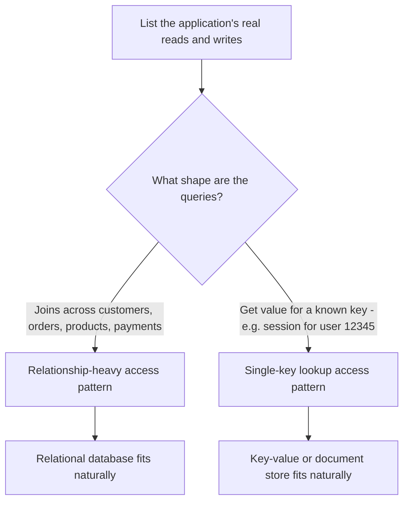

`[IMAGE: A split-panel diagram. Left panel titled "Relationship-Heavy Access Pattern" shows a customer icon connected by lines to an order icon, which connects to product icons and a payment icon, all converging into a relational-table grid graphic. Right panel titled "Single-Key Access Pattern" shows one key icon labeled "user:12345" pointing directly at one value box labeled "session data", with no other connections. Use a clean whiteboard-sketch style with teal and amber accent colors.]`

**Concrete Example (E-commerce system from the lecture):**
- Access pattern: "Get all orders for customer 42, with the products inside each order and the total." This spans customers → orders → order_items → products — a multi-table join.
- Access pattern: "Get the session for user 12345." This is a single, known-key lookup with no relationships involved.

**Code Example (Node.js):**
```javascript
// Minimal working example — a relationship-heavy access pattern (SQL/relational fit)
async function getCustomerOrdersWithTotals(db, customerId) {
  const rows = await db.query(`
    SELECT o.id AS order_id, o.created_at, p.name AS product_name,
           oi.quantity, oi.unit_price
    FROM orders o
    JOIN order_items oi ON oi.order_id = o.id
    JOIN products p ON p.id = oi.product_id
    WHERE o.customer_id = $1
    ORDER BY o.created_at DESC
  `, [customerId]);
  return rows;
}

// Minimal working example — a single-key access pattern (key-value fit)
async function getSession(redisClient, userId) {
  // No joins, no relationships — just a direct key lookup.
  return redisClient.get(`session:${userId}`);
}
```

```javascript
// What happens if... you force a single-key access pattern into a relational join?
async function getSessionTheHardWay(db, userId) {
  // Mistake: modeling "session" as a normalized relational entity with
  // foreign keys to a users table, then joining every single read.
  const rows = await db.query(`
    SELECT s.* FROM sessions s
    JOIN users u ON u.id = s.user_id
    WHERE u.id = $1
  `, [userId]);
  return rows[0];
  // Consequence: every session lookup — potentially thousands per second —
  // now pays for a join and index traversal that a direct key-value GET
  // would have served in constant time.
}
```

---

### Law 2: Ask What Happens If the Data Is Wrong

**Micro-Mechanics — The "Why" and "How":**
- **The anti-pattern:** Treating consistency as one global setting for the entire application — either "everything is strongly consistent" or "everything is eventually consistent."
- **The core mechanic:** Ask, for each operation, "What happens if this data is temporarily incorrect?" The answer differs wildly by business rule, even within the *same* application.
- **Worked contrast from the lecture:** In an e-commerce system, a recommendation being slightly outdated isn't a big problem, and a product search result taking a second to update isn't either. But **inventory** is different — if two customers both see the last item as available and both successfully purchase it, that's now a real business problem (overselling). The same reasoning applies to payments and account balances.
- **The decision mechanic:** Don't ask "do I need strong consistency?" as a single yes/no for the app. Ask, "**Which business rules must always remain true?**" Operations that back that answer need **transactions** and stronger consistency guarantees. Operations that don't can safely use **asynchronous updates** and **eventual consistency**.
- **Why it matters:** Applying strong consistency everywhere adds unnecessary latency and complexity to operations that didn't need it; applying eventual consistency everywhere risks real business damage on the operations that did.

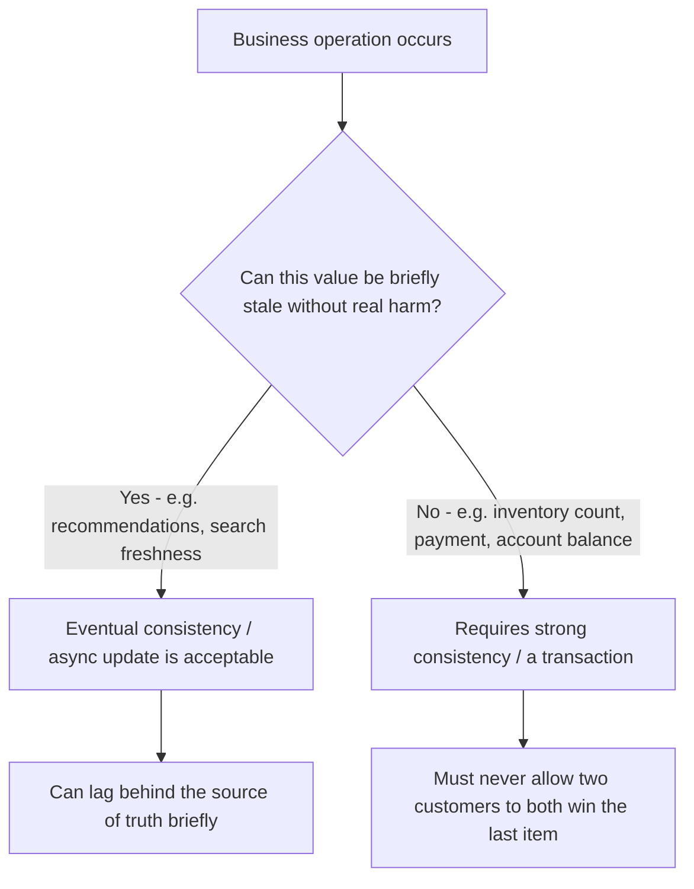

`[IMAGE: A two-column comparison chart. Left column headed "Tolerates Staleness" (green) lists "Product recommendation," "Search result freshness," with a relaxed clock icon. Right column headed "Must Stay Correct" (red) lists "Inventory count," "Payment status," "Account balance," with a strict lock icon. A small e-commerce storefront illustration sits above both columns. Clean flat-icon infographic style.]`

**Concrete Example (Inventory vs. Recommendations, from the lecture):**
- Inventory decrement on purchase → must be a strongly consistent, transactional operation, or two buyers can both "successfully" purchase the last unit.
- Recommendation refresh after a purchase → can be updated asynchronously minutes later with no real business harm.

**Code Example (Node.js + SQL):**
```javascript
// Minimal working example — a transaction protecting a critical business rule
async function purchaseLastItem(db, productId, customerId) {
  const client = await db.connect();
  try {
    await client.query('BEGIN');
    // Row-level lock prevents a second concurrent buyer from reading stale stock.
    const { rows } = await client.query(
      'SELECT stock FROM products WHERE id = $1 FOR UPDATE', [productId]
    );
    if (rows[0].stock < 1) throw new Error('OUT_OF_STOCK');
    await client.query('UPDATE products SET stock = stock - 1 WHERE id = $1', [productId]);
    await client.query('INSERT INTO orders (customer_id, product_id) VALUES ($1, $2)', [customerId, productId]);
    await client.query('COMMIT');
  } catch (err) {
    await client.query('ROLLBACK');
    throw err;
  } finally {
    client.release();
  }
}

// Minimal working example — an eventually consistent, non-critical update
async function refreshRecommendationsAsync(queue, customerId) {
  // Fire-and-forget: the recommendation engine can catch up a few seconds later.
  await queue.publish('recommendations.refresh', { customerId });
}
```

```javascript
// What happens if... inventory is decremented the same "eventually consistent" way?
async function purchaseWithoutLocking(db, productId, customerId) {
  const { rows } = await db.query('SELECT stock FROM products WHERE id = $1', [productId]);
  if (rows[0].stock < 1) throw new Error('OUT_OF_STOCK');
  // Mistake: no transaction, no row lock. Two concurrent requests can both
  // read stock = 1 before either write happens.
  await db.query('UPDATE products SET stock = stock - 1 WHERE id = $1', [productId]);
  await db.query('INSERT INTO orders (customer_id, product_id) VALUES ($1, $2)', [customerId, productId]);
  // Consequence: both requests "succeed," stock goes negative, and the
  // business has now sold the same physical item to two customers.
}
```

---

### Law 3: Don't Replace the Database Before Finding the Bottleneck

**Micro-Mechanics — The "Why" and "How":**
- **The anti-pattern:** The application becomes slow, someone checks the architecture, and immediately says, "We need a different database" — without evidence.
- **The core mechanic:** Before replacing anything, find the *actual slow operation*. The lecture lists common real culprits:
  - A **missing index**.
  - A query **scanning millions of rows** when it didn't need to.
  - An API **returning 10,000 records when the application only needs 20** (over-fetching / missing pagination).
  - The **same expensive query being executed thousands of times** (no caching, no batching — a classic N+1 pattern).
  - Poor **connection management** (e.g., exhausting a connection pool).
- **The diagnostic process:** Look at the **query plan**. Check the **indexes**. Measure the expensive queries. Look at how the application is accessing the data.
- **Why it matters:** You might discover the database is perfectly capable of handling the workload — the problem was *how the application was using it*. **Fix the bottleneck before changing the architecture**, because a new database will not automatically fix a bad query.

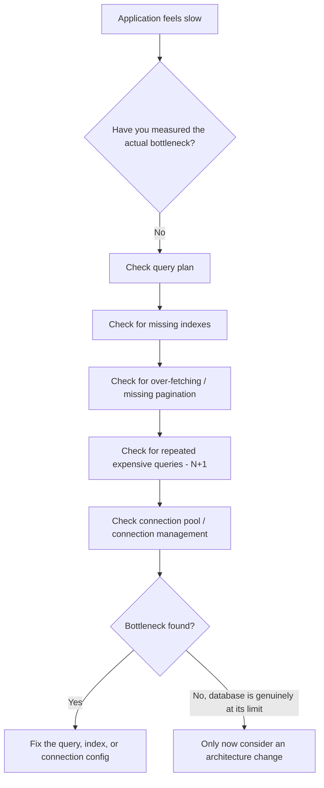

**Concrete Example (from the lecture's diagnostic list):**
An API endpoint that returns "10,000 records when the application only needs 20" is not a database problem at all — it's a missing `LIMIT`/pagination in application code, and no database migration would fix it.

**Code Example (SQL + Node.js):**
```sql
-- Minimal working example — inspecting the query plan before blaming the database
EXPLAIN ANALYZE
SELECT o.id, o.total
FROM orders o
WHERE o.customer_id = 42
ORDER BY o.created_at DESC;
-- If this shows "Seq Scan on orders" instead of "Index Scan", the fix is
-- an index on (customer_id, created_at), not a new database engine.
```

```javascript
// Minimal working example — fixing the N+1 pattern instead of the database
// BEFORE: one query per order (N+1) — the actual bottleneck in many "slow" apps
async function getOrderTotalsSlow(db, orderIds) {
  const totals = [];
  for (const id of orderIds) {
    const { rows } = await db.query('SELECT SUM(quantity * unit_price) AS total FROM order_items WHERE order_id = $1', [id]);
    totals.push(rows[0].total);
  }
  return totals; // orderIds.length separate round trips to the database
}

// AFTER: one batched query
async function getOrderTotalsFast(db, orderIds) {
  const { rows } = await db.query(
    'SELECT order_id, SUM(quantity * unit_price) AS total FROM order_items WHERE order_id = ANY($1) GROUP BY order_id',
    [orderIds]
  );
  return rows; // a single round trip, regardless of how many orders
}
```

```javascript
// What happens if... you "fix" this by migrating to a different database instead?
// Mistake: swapping PostgreSQL for a different engine without changing the
// N+1 query pattern above. The new database still executes the same number
// of round trips per request — the bottleneck was the access pattern, not
// the storage engine, so the same slowness reappears under the new brand name.
```

---

### Law 4: Understand How It Scales

**Micro-Mechanics — The "Why" and "How":**
- **The anti-pattern:** Saying "our application needs to scale" as if scale were one single problem with one single fix.
- **The core mechanic:** "Scale" can mean fundamentally different things, and each needs a different solution:
  - **Read-heavy workload** → better indexes, caching, or **read replicas** may solve it.
  - **Write-heavy workload** → may eventually need **partitioning** or a distributed design.
  - **Data set becoming huge** → may need distributed storage.
  - **Sudden traffic spikes** → different concern than steady-state growth.
  - **Users distributed across multiple regions** → **replication** and **regional latency** matter more than raw throughput.
- **The reframed question:** Don't ask "Can this database scale?" Ask "**How does it scale for my workload?**" That's where the real tradeoffs appear — one database scales by giving you more resources on a single machine (vertical scaling), another spreads data across many machines (horizontal scaling), and another requires you to design around partitions from the beginning.
- **The hidden cost:** The database may scale perfectly — the real question is **what complexity your application takes on as it does** (e.g., partition-aware query design, cross-shard joins becoming impossible, replica lag to account for).

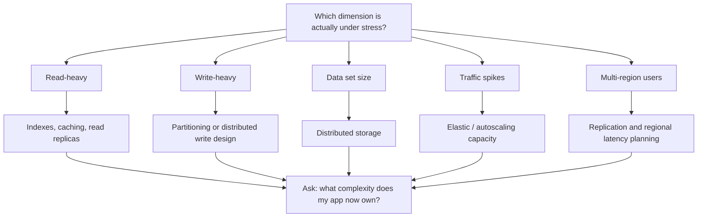

`[IMAGE: A radial diagram with "Scaling" at the center and five spokes labeled "Reads," "Writes," "Data Size," "Traffic Spikes," and "Regions," each spoke ending in a distinct icon - a magnifying glass for reads, a pencil for writes, a stacked database cylinder for data size, a jagged line graph for spikes, and a globe for regions. Professional dark-blue technical-diagram style.]`

**Concrete Example (from the lecture):** A read-heavy product catalog service and a write-heavy order-ingestion service in the *same* e-commerce system may need completely different scaling strategies, even though both are "the same application."

**Code Example (Node.js):**
```javascript
// Minimal working example — routing reads to a replica, writes to the primary
const pool = {
  primary: createPool(process.env.DB_PRIMARY_URL),
  replica: createPool(process.env.DB_REPLICA_URL),
};

async function getProduct(id) {
  // Read-heavy path: safe to serve from a replica, tolerating brief lag.
  return pool.replica.query('SELECT * FROM products WHERE id = $1', [id]);
}

async function createOrder(order) {
  // Write path: must go to the primary, which owns the source of truth.
  return pool.primary.query('INSERT INTO orders (...) VALUES (...)', [order]);
}
```

```javascript
// What happens if... you read your own just-written data from a lagging replica?
async function createOrderThenShowIt(order) {
  await pool.primary.query('INSERT INTO orders (...) VALUES (...)', [order]);
  // Mistake: immediately reading the order back from the replica.
  return pool.replica.query('SELECT * FROM orders WHERE id = $1', [order.id]);
  // Consequence: replication lag means this read can return "not found" or
  // stale data for the order the customer just placed — a scaling solution
  // (read replicas) silently introduced a new consistency problem (Law 2).
}
```

---

### Law 5: Know When One Database Is Enough

**Micro-Mechanics — The "Why" and "How":**
- **The core idea:** This is where database *choice* becomes database *architecture*. A typical, healthy evolution: start with one database → some reads become expensive, so a **cache** is added → search requirements grow, so a **search system** is added → analytics gets more complex, so data starts flowing into a separate **analytics platform**. That evolution is reasonable.
- **The anti-pattern:** Introducing *all* of that on day one, before any of it is a measured, real problem.
- **The real cost of each addition:** Every additional database is another system to monitor, secure, backup, upgrade, and troubleshoot — and now there are **copies of the same information in different places**.
- **Worked example from the lecture:** A customer's address changes. The main database has the new address. The cache still has the old one. The search index hasn't updated yet. **Which system should the application trust?**
- **The core mechanic — source of truth:** For each important piece of business state, be explicit about which system is **authoritative**. The cache is a copy. The search index is a copy. The analytics system is a copy. Those copies can update **asynchronously** and, ideally, be **rebuilt when necessary** from the authoritative system.
- **The reframed question:** Don't ask "How many databases should our architecture have?" Ask "**What problem does each additional database solve?**" If there's no good answer, you probably don't need it yet.

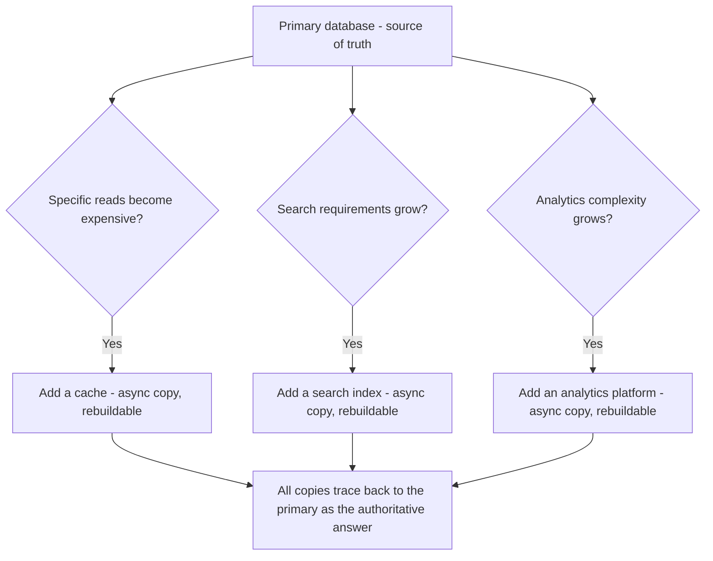

`[IMAGE: A hub-and-spoke diagram with a central database cylinder labeled "Primary - Source of Truth" glowing gold. Three dashed arrows radiate outward to smaller, grayed-out cylinders labeled "Cache," "Search Index," and "Analytics Store," each stamped with a small "COPY" watermark. A curved arrow loops from each copy back to the primary labeled "can be rebuilt from here." Clean technical-diagram style, dark background.]`

**Concrete Example (Customer address update, from the lecture):**
Main database: new address ✅. Cache: still old address ⏳. Search index: not yet updated ⏳. The application must always read the **primary database** as the authoritative answer for "what is this customer's current address," even while the copies catch up.

**Code Example (Node.js):**
```javascript
// Minimal working example — primary is authoritative, copies update asynchronously
async function updateCustomerAddress(db, eventBus, customerId, newAddress) {
  // 1. Write to the source of truth first.
  await db.query('UPDATE customers SET address = $1 WHERE id = $2', [newAddress, customerId]);
  // 2. Notify copies to catch up asynchronously — they are not required
  //    to be correct the instant this function returns.
  await eventBus.publish('customer.address_changed', { customerId, newAddress });
}

// The cache and search-index consumers update independently and can lag briefly.
eventBus.subscribe('customer.address_changed', async ({ customerId, newAddress }) => {
  await cache.set(`customer:${customerId}:address`, newAddress);
  await searchIndex.update(customerId, { address: newAddress });
});
```

```javascript
// What happens if... there is no clear source of truth?
async function getCustomerAddressAmbiguous(customerId) {
  // Mistake: reading from whichever system happens to be fastest/handiest,
  // with no rule for which one is correct.
  const cached = await cache.get(`customer:${customerId}:address`);
  if (cached) return cached; // might be the OLD address
  return db.query('SELECT address FROM customers WHERE id = $1', [customerId]);
  // Consequence: a shipping label generated right after an address change
  // may silently use the stale cached address, because nothing in the code
  // declares the database — not the cache — as authoritative.
}
```

---

### Law 6: Don't Confuse Fast With Durable

**Micro-Mechanics — The "Why" and "How":**
- **The core problem:** This is especially important with **in-memory systems**. They're fast — that's why they're useful — but speed doesn't tell you whether the data actually *belongs* there.
- **The core mechanic — the one question that matters:** "What happens if I lose everything in this system?"
  - If the application can **rebuild the data from another source**, that's very different from losing the actual business record.
  - A **cache can disappear and be repopulated**. A **customer's order history cannot** simply be treated that way.
- **What to evaluate:** When assessing a storage system, don't look only at **latency**. Look at **durability**, look at **recovery**, look at **replication**, and ask whether the data can actually be recreated.
- **The simple rule:** Fast storage is great for data that **benefits from speed**. Durable storage is essential for data the **business can't afford to lose**.

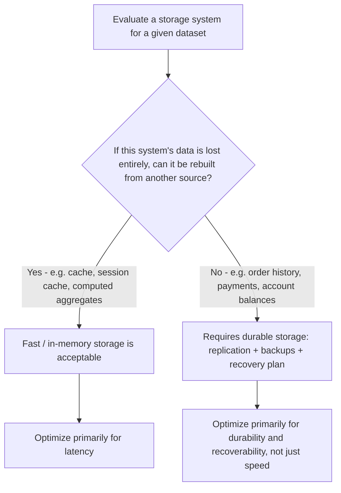

**Concrete Example (from the lecture):**
A cache holding recently-viewed products can vanish and be rebuilt from the primary database with no lasting harm. A customer's order history vanishing is not a "rebuild it later" situation — it is data loss with real business and legal consequences.

**Code Example (Node.js):**
```javascript
// Minimal working example — cache-aside pattern for data that is safely rebuildable
async function getProductCached(cache, db, productId) {
  const cached = await cache.get(`product:${productId}`);
  if (cached) return JSON.parse(cached);
  const product = await db.query('SELECT * FROM products WHERE id = $1', [productId]);
  await cache.set(`product:${productId}`, JSON.stringify(product), { ttl: 300 });
  return product; // if the cache is wiped entirely, this path rebuilds it on demand
}

// Minimal working example — a durable write for data that cannot be rebuilt
async function recordOrder(durableDb, order) {
  // Must land in a durable, replicated, backed-up store — there is no
  // "other source" this order can be reconstructed from if it's lost.
  return durableDb.query(
    'INSERT INTO orders (customer_id, total, created_at) VALUES ($1, $2, now())',
    [order.customerId, order.total]
  );
}
```

```javascript
// What happens if... order history is stored only in an in-memory cache "for speed"?
async function recordOrderInMemoryOnly(cache, order) {
  // Mistake: treating the order record like a cache entry because it's fast.
  await cache.set(`order:${order.id}`, JSON.stringify(order));
  // Consequence: a node restart, an eviction under memory pressure, or a
  // crash wipes the order permanently. Unlike a product cache entry, there
  // is no "other source" to rebuild this specific customer's purchase from.
}
```

---

### Law 7: Think About What Happens After Deployment

**Micro-Mechanics — The "Why" and "How":**
- **The core idea:** Choosing the database is only the beginning. **Someone has to operate it.** Who handles backups? Who monitors performance? Who manages failover? Who performs upgrades? Who investigates an incident? Who restores the database when something goes wrong?
- **Where managed services fit:** A **managed database service** can remove a lot of infrastructure work, freeing the team to spend more time building the application instead of operating database servers.
- **The critical caveat — "managed doesn't mean automatic":** You still need to **design the schema**. You still need to **understand the queries**. You still need to **control access**. And you still need to understand the **pricing model**, because cost changes as the workload changes — a database that looks cheap during development might become expensive once traffic increases significantly.
- **The full cost equation:** **Infrastructure isn't the only cost — engineering time matters too.** A database that is cheaper to run but requires a lot of manual operational work may cost **more overall** than a managed option.
- **The mandatory pre-commitment test:** Don't just read that backups exist — **restore one**. Don't just read about failover — **test it**. Don't just look at average latency — **run realistic queries with realistic concurrency and look at P95 and P99**. The goal isn't to prove the database works when everything is healthy; the goal is to understand how the system behaves when it isn't.

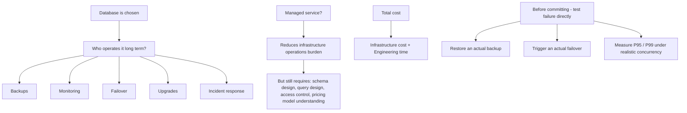

`[IMAGE: A checklist-style infographic titled "Before You Commit." Five checkbox rows read "Restore a real backup," "Trigger real failover," "Measure P95/P99 under load," "Confirm the pricing model at scale," "Confirm who owns incident response." Each checkbox has a small clock or gauge icon beside it. Minimal, high-contrast operations-dashboard visual style.]`

**Concrete Example (from the lecture):** A database that "looks cheap during development" can become expensive once real traffic arrives — the operational and cost profile of a database is not fully knowable from its feature list or its list price alone.

**Code Example (bash + Node.js):**
```bash
# Minimal working example — actually testing a backup, not just trusting it exists
pg_restore --clean --if-exists -d staging_verify_db /backups/latest.dump
# Then run application smoke tests against staging_verify_db to confirm the
# restored data is actually usable, not just that the restore command exited 0.
```

```javascript
// Minimal working example — measuring P95/P99 under realistic concurrency
const latencies = [];
async function loadTest(fn, concurrency, iterations) {
  const workers = Array.from({ length: concurrency }, async () => {
    for (let i = 0; i < iterations; i++) {
      const start = Date.now();
      await fn();
      latencies.push(Date.now() - start);
    }
  });
  await Promise.all(workers);
  latencies.sort((a, b) => a - b);
  const p95 = latencies[Math.floor(latencies.length * 0.95)];
  const p99 = latencies[Math.floor(latencies.length * 0.99)];
  return { p95, p99 };
}
```

```javascript
// What happens if... you only ever check average latency in a monitoring dashboard?
// Mistake: "average query time: 12ms" looks healthy, but averages hide the
// tail. If P99 is 4,200ms, 1 in 100 real users is waiting over four seconds —
// invisible in the average, catastrophic in the actual user experience, and
// exactly the kind of surprise Law 7's "test what happens when it isn't
// healthy" is meant to catch before production does.
```

---

### The Meta-Law: Fit and Understood Consequences Beat the Longest Feature List

**Micro-Mechanics — The "Why" and "How":**
- Database selection isn't about finding the technology with the longest feature list. It's about **choosing a system that fits your workload and understanding the consequences of that choice**.
- **The practical starting point:** For many applications, you don't need an exotic answer. **Start with a general-purpose database that fits the workload you actually understand.** Build the application. Measure the real bottlenecks. Optimize the queries.
- **The evolution path, in order:** Add caching **when you have a caching problem**. Add search infrastructure **when search becomes a real requirement**. Move toward distributed storage **when the workload actually demands it**. Use managed services **when the operational benefits are worth the cost**.
- **The lock-in question:** Also think about how difficult it would be to change your mind later. Can you export the data? How tightly is your application coupled to the database? How much code depends on database-specific features? You don't need to eliminate every form of lock-in — you just need to **understand what you're committing to**.

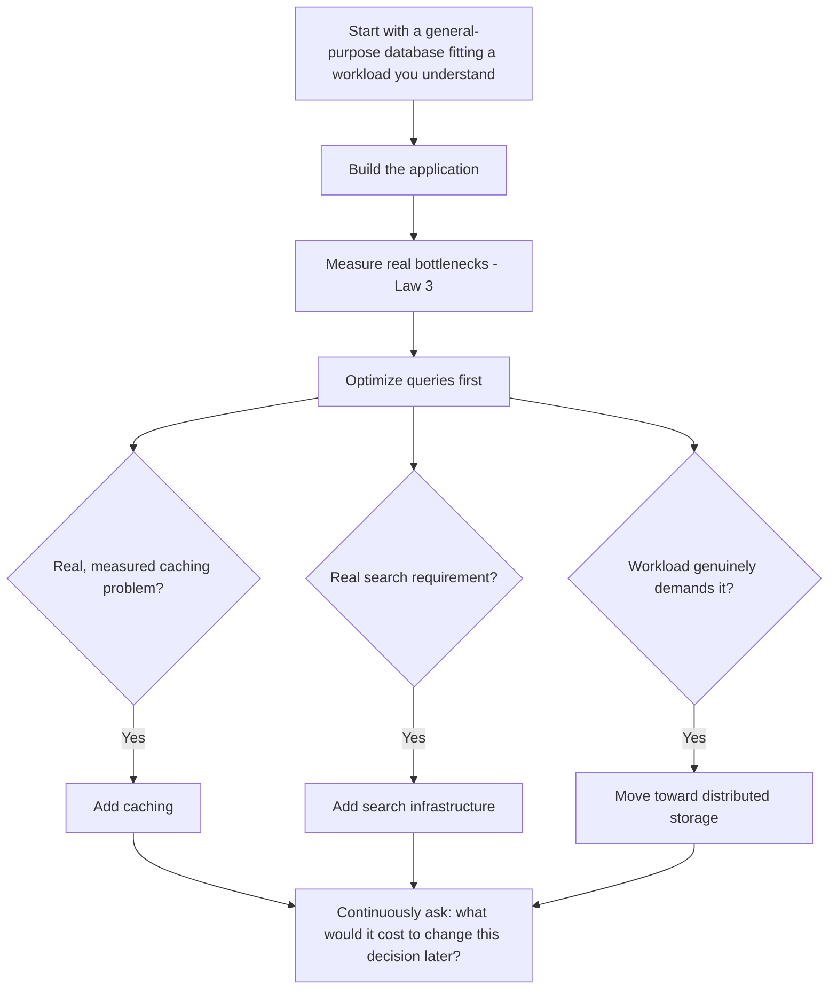

---

## Step-by-Step Breakdown: Applying All 7 Laws to One Data-Architecture Lifecycle

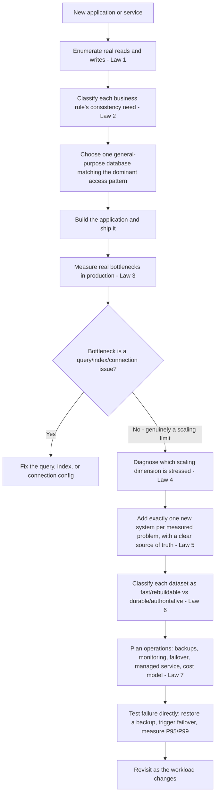

1. **Enumerate access patterns** — before naming a technology, list the actual reads and writes the application performs (Law 1).
2. **Classify consistency needs per business rule** — decide which operations (inventory, payments) must always be correct, and which (recommendations, search freshness) can lag (Law 2).
3. **Pick one general-purpose database** that fits the dominant access pattern and the strictest consistency requirements identified above.
4. **Build and measure** — ship the application, then measure real bottlenecks instead of guessing (Law 3).
5. **Diagnose the scaling dimension actually under stress** — reads, writes, data size, spikes, or geography each point to a different fix (Law 4).
6. **Add new systems only when a measured problem justifies them**, and explicitly name the source of truth each time a cache, search index, or analytics store is introduced (Law 5).
7. **Separate fast/rebuildable data from durable/authoritative data**, and store each accordingly (Law 6).
8. **Plan for operations before going live** — backups, monitoring, failover, and a realistic understanding of the pricing model as the workload grows (Law 7).
9. **Test failure scenarios directly** — an untested backup and an unmeasured P99 are both unknowns, not guarantees.
10. **Revisit the architecture** as the workload evolves, rather than treating the original database choice as permanent.

---

## Related Concepts

1. **ACID vs. BASE (Basically Available, Soft state, Eventually consistent):** These are the two competing consistency philosophies underlying Law 2's "which business rules must always remain true" question — ACID systems favor correctness guarantees per transaction, BASE systems favor availability and accept temporary staleness.
2. **CAP Theorem (Consistency, Availability, Partition tolerance):** Explains *why* the tradeoffs in Law 2 and Law 4 exist at all in distributed databases — a system experiencing a network partition must sacrifice either strict consistency or availability, which is the formal reason "one setting for the whole app" (Law 2) doesn't work.
3. **CQRS (Command Query Responsibility Segregation):** An architectural pattern that formalizes Law 1's "start with the queries" advice by physically separating the read model from the write model, often backed by entirely different storage technologies optimized for each.
4. **Change Data Capture (CDC):** The common mechanism that powers Law 5's "copies update asynchronously" behavior — CDC streams row-level changes from the primary database (the source of truth) to downstream caches, search indexes, and analytics stores in near-real time.
5. **Database Sharding / Horizontal Partitioning:** The concrete implementation behind Law 4's answer to a write-heavy or huge-dataset scaling problem — splitting one logical dataset across many physical nodes, at the cost of the application taking on partition-aware query design (Law 4's "hidden complexity" point).

---

## Key Takeaways (Flashcard-Ready)

1. **Q:** What should determine your database choice — the shape of the data, or the application's access patterns?
   **A:** The application's access patterns (the actual reads and writes it performs) should drive the choice; looking only at the shape of the data, without asking how it will be queried, is the first mistake the lecture identifies.

2. **Q:** Why is "does my application need strong consistency?" the wrong question to ask?
   **A:** Because different business rules within the *same* application tolerate different amounts of staleness — the right question is "which specific operations must always remain correct?" (e.g., inventory and payments), not a single global consistency setting.

3. **Q:** Before replacing a database for performance reasons, what should you check first?
   **A:** The query plan, missing indexes, over-fetching (returning far more records than needed), repeated expensive queries, and connection management — a new database will not automatically fix a bad query or a missing index.

4. **Q:** When you add a cache or search index alongside your primary database, what must you always define?
   **A:** Which system is the authoritative **source of truth** for each piece of business state — the cache and search index are copies that can update asynchronously and be rebuilt; the primary database is not.

5. **Q:** What single question determines whether data belongs in fast, in-memory storage versus durable storage?
   **A:** "What happens if I lose everything in this system?" — if the data can be rebuilt from another source (like a cache), fast storage is fine; if it's the actual business record (like order history), it requires durable, replicated, backed-up storage.

---

## 💡 The Secret Engineering Trick

**Don't trust documentation about failure — trigger the failure yourself.** Teams routinely verify a database choice by reading that "backups are enabled," that "failover is supported," and by glancing at an average-latency graph that looks healthy. None of that actually proves the system behaves correctly under stress. The senior-engineer move from the lecture is to **test the unhealthy path directly, before committing**: actually **restore a backup** into a separate environment and confirm the data is usable — not just that the restore command exits successfully. Actually **trigger a failover** and watch what the application does during the cutover window — connection errors, stale reads, or a clean handoff are very different outcomes that only show up under a real test. And replace "average latency looks fine" with **P95 and P99 measured under realistic concurrency**, because an average of 12ms can be hiding a P99 of several seconds that only the unluckiest 1% of real users ever experience — and by the time that shows up in production, it's an incident, not a test result.

---

## Interview Questions

### 1. Why should database selection start from the application's access patterns rather than from the shape of the data, and what happens when teams get this backwards?

**Simple Definition:** Access-pattern-first design means you decide *how* the data will be asked for before you decide *where* it lives. It's the difference between designing a kitchen around the meals you actually cook, versus buying every appliance in the catalog and hoping a workflow emerges afterward — one produces a kitchen that works, the other produces clutter you have to work around.

**Official Definition:** Access-pattern-driven database selection is the practice of enumerating an application's concrete read and write operations — including their frequency, selectivity, and relational scope — prior to selecting a storage technology, so that the technology's strengths (indexing model, query language, consistency model) are matched to the operations it will actually be asked to perform.

**Primary Responsibilities / Core Details:**
- **Enumerate reads and writes before naming a technology.** The lecture's instruction is explicit: "write down the important reads and writes your application will perform" — this is a discrete, doable exercise, not an abstract principle.
- **Relationship-heavy access patterns point toward relational databases.** The e-commerce example — get all orders for a customer, find products inside an order, check inventory, calculate totals, generate cross-entity reports — all require connecting multiple entities, which is exactly what a relational database's join model is built for.
- **Single-key access patterns point toward key-value or document stores.** "Get the session for user 12345" already knows its key and just needs the value fast — paying for relational overhead here (joins, foreign key constraints, normalization) buys nothing.
- **The same application can have multiple access patterns.** Nothing says an e-commerce platform can only use one storage technology for everything — a session-lookup service and an order-management service inside the same company can reasonably use different underlying stores, because their access patterns differ.
- **Data shape and access pattern are not the same axis.** Two systems can store conceptually similar data (both are "just key-value pairs" or "just structured records") yet need completely different technologies once you look at *how* that data will be retrieved and combined.
- **This exercise also reveals hidden requirements early.** Writing out "generate reports across several entities" as an access pattern surfaces a reporting/analytics need before a team accidentally tries to force ad-hoc analytical queries onto a database tuned only for single-record lookups.
- **Getting this backwards is expensive to unwind later.** A database chosen from the data shape alone often "works" during early development (low traffic hides the mismatch), then becomes painful exactly when the access patterns the team never wrote down start dominating production traffic.
- **This is a repeatable habit, not a one-time exercise.** As new features are added, their access patterns should be checked against the existing database's strengths, not assumed to fit just because "we already have a database."

**Real-World Example:** A retail company building both a product catalog service and a shopping-cart/session service faced exactly this fork. The catalog needed relationship-heavy queries — products by category, filtered by attributes, joined with inventory and pricing — so a relational database with strong indexing fit naturally. The session service needed only "get the cart for session ID X" at extremely high frequency and low latency, with no cross-entity relationships — so a key-value store (like Redis) fit far better, even though both services technically "store data about a customer's shopping activity." Choosing one database for both, based on the superficial similarity of the data rather than the very different access patterns, would have forced an unnecessary compromise on one side or the other.

**Best Coding/Development Practices:**
1. **Write access patterns down explicitly before writing schema code**, as a literal list of expected queries.
   ```javascript
   // access-patterns.md style comment kept alongside the schema design
   // 1. Get all orders for a customer, most recent first.
   // 2. Get the products and quantities inside a single order.
   // 3. Check current stock for a product.
   // 4. Get the session for a known user ID.
   ```
2. **Prototype the actual query, not just the table shape, before committing.** Run the join or lookup against a realistic dataset size early.
   ```javascript
   const { rows } = await db.query(
     'SELECT * FROM orders WHERE customer_id = $1 ORDER BY created_at DESC LIMIT 20',
     [customerId]
   );
   ```
3. **Separate services by access pattern when they diverge sharply**, rather than forcing one database to serve two very different query shapes.
   ```javascript
   const catalogDb = createPostgresPool(process.env.CATALOG_DB_URL);
   const sessionStore = createRedisClient(process.env.SESSION_STORE_URL);
   ```
4. **Revisit access patterns whenever a major feature is added**, instead of assuming the existing database automatically accommodates it.
5. **Avoid choosing a database because of its data-modeling elegance alone** — a beautifully normalized schema that can't answer the app's actual queries efficiently is still the wrong choice.

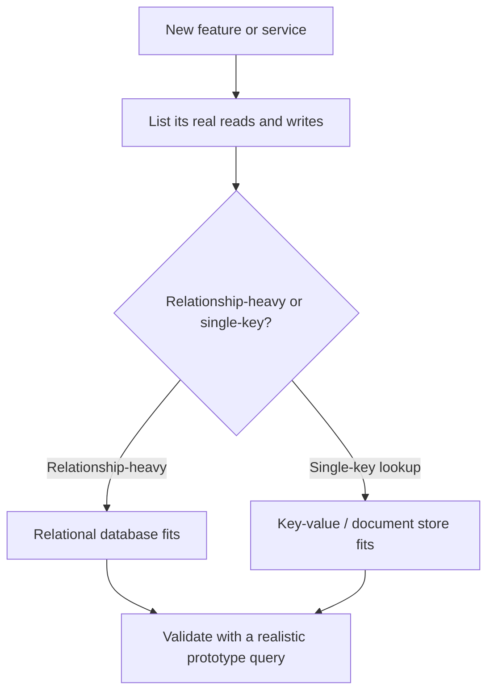

**Core Focus Areas:** Access patterns | Data modeling vs. query modeling | Relational vs. key-value fit | Early requirements discovery | Avoiding retroactive database mismatch

---

### 2. Why should consistency be treated as a per-business-rule decision instead of a single application-wide setting, and how does this connect to broader consistency models like ACID and eventual consistency?

**Simple Definition:** Not every piece of information in your application is equally dangerous to get wrong for a moment. A restaurant can be relaxed about whether the "popular dishes" list is a few minutes stale, but it cannot be relaxed about whether two servers both think the same table is free — one causes a shrug, the other causes a double-booked dinner and an angry customer.

**Official Definition:** Consistency-by-business-rule is the practice of evaluating the tolerable staleness and correctness guarantees required by each distinct operation or entity in a system individually, rather than applying a single, uniform consistency model (e.g., strict ACID transactions everywhere, or eventual consistency everywhere) across the entire application.

**Primary Responsibilities / Core Details:**
- **The diagnostic question is per-operation, not per-application.** "What happens if this data is temporarily incorrect?" must be asked for *each* type of operation — recommendations, search results, inventory, payments — because the answer genuinely differs.
- **Low-stakes staleness is often completely acceptable.** The lecture explicitly names a recommendation being slightly outdated, and a product search result taking a second to update, as tolerable — treating these with the same rigor as payments wastes engineering effort and adds unnecessary latency.
- **High-stakes correctness failures have real business consequences.** The inventory example is concrete: if two customers both see the last item as available and both successfully purchase it, that's an overselling incident with real fallout (refunds, apologies, broken trust) — not an abstract edge case.
- **Payments and account balances follow the same high-stakes logic as inventory.** Anywhere money or a scarce, non-duplicable resource is being decremented, the "two readers both act on stale data" failure mode applies.
- **Strong consistency generally requires transactions.** For operations that must always remain correct, the mechanism is typically an ACID-style transaction (often with row-level locking) so that concurrent operations can't both read the same pre-update value and act on it.
- **Eventual consistency is a deliberate choice, not a shortcut.** For low-stakes data, asynchronous updates and eventual consistency are "completely reasonable" — this isn't cutting corners, it's correctly matching the consistency mechanism's cost to the actual business risk.
- **This connects directly to CAP theorem tradeoffs.** In a distributed system experiencing a network partition, a designer must choose between consistency and availability for that specific data path — which is exactly why a single global consistency setting can't be optimal for a whole application with mixed requirements.
- **The reframed question is the deliverable.** The lecture's actual instruction is to stop asking "do I need strong consistency?" and start asking "which business rules must always remain true?" — that answer, operation by operation, is what should drive the consistency architecture.

**Real-World Example:** A ride-sharing platform treats "driver's current estimated arrival time shown to the passenger" very differently from "has this ride been charged to the passenger's card." The ETA can be a few seconds stale — recalculated asynchronously as GPS pings arrive — with no real harm if it's briefly wrong. But the charge must be processed exactly once, using a strongly consistent, transactional path (often with an idempotency key, tying back to non-idempotent POST semantics), because double-charging a customer or failing to charge them at all are both unacceptable outcomes with direct financial and trust consequences. Treating both data paths with the same consistency model would either slow down every ETA update to transactional speed, or expose the charge path to the same tolerable staleness as the ETA — the platform survives specifically because it doesn't do either.

**Best Coding/Development Practices:**
1. **Wrap only the operations that need strong consistency in explicit transactions**, rather than transactionalizing everything by default.
   ```javascript
   await client.query('BEGIN');
   await client.query('UPDATE inventory SET stock = stock - 1 WHERE id = $1 AND stock > 0', [productId]);
   await client.query('COMMIT');
   ```
2. **Push low-stakes updates onto an async queue instead of the critical request path.**
   ```javascript
   await queue.publish('search-index.refresh', { productId });
   ```
3. **Use row-level locking (`SELECT ... FOR UPDATE`) or optimistic concurrency checks specifically for scarce-resource decrements**, like inventory or seat availability.
   ```javascript
   await client.query('SELECT stock FROM products WHERE id = $1 FOR UPDATE', [productId]);
   ```
4. **Document, per data type, which consistency guarantee it carries** so future engineers don't assume uniformity across the codebase.
5. **Avoid a single "transaction everywhere" or "eventual consistency everywhere" policy** — both extremes either waste performance budget or risk real business-rule violations.

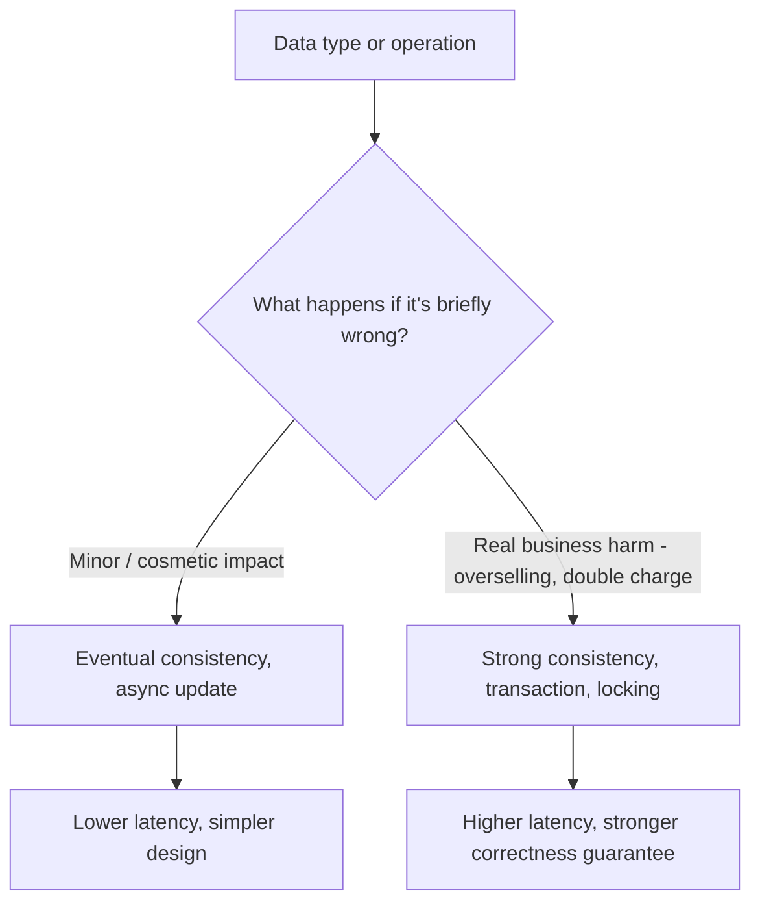

**Core Focus Areas:** Consistency models | Business-rule-driven design | ACID transactions | Eventual consistency | CAP theorem tradeoffs

---

### 3. How should an engineer diagnose a "the database is slow" problem before deciding to replace the database technology itself?

**Simple Definition:** If your car is running rough, you check the spark plugs and the oil before buying a new car — most of the time, the engine you already have is fine, and the fix is a fifteen-dollar part, not a thirty-thousand-dollar replacement. Database performance problems work the same way far more often than teams assume.

**Official Definition:** Performance root-cause diagnosis is the systematic process of measuring and isolating the specific operation responsible for observed latency or throughput degradation — via query plan analysis, index inspection, and access-pattern review — before attributing the problem to the underlying database technology itself.

**Primary Responsibilities / Core Details:**
- **The anti-pattern is architecture-first troubleshooting.** The lecture is blunt about this: "the application becomes slow, someone checks the architecture and says we need a different database... but you need evidence first."
- **A missing index is one of the most common real causes.** A query that should hit an index instead falls back to scanning the entire table — this is invisible from the application code and only shows up when you actually inspect the query plan.
- **A query scanning millions of rows may simply be badly shaped**, not a sign the database engine itself is inadequate — the same engine, given the right index or a narrower filter, can serve the same logical request orders of magnitude faster.
- **Over-fetching is an application-layer bug disguised as a database problem.** "An API returning 10,000 records when the application only needs 20" wastes serialization time, network bandwidth, and downstream processing — no database migration fixes a missing `LIMIT`.
- **Repeated expensive queries (the N+1 pattern) multiply a small inefficiency by request volume.** Running "the same expensive query... thousands of times" turns a 50ms query into a systemic bottleneck purely through repetition, which batching or caching solves without touching the database engine.
- **Connection management is an easy-to-overlook culprit.** Exhausting a connection pool, or opening new connections per request instead of reusing a pool, produces symptoms that look exactly like "the database can't keep up," when the database itself is barely working.
- **The correct diagnostic sequence:** look at the query plan → check the indexes → measure the actual expensive queries → examine how the application is accessing the data — in that order, before touching the architecture.
- **The payoff of this discipline:** "You might discover that the database is perfectly capable of handling the workload. The problem was the way the application was using it" — and a new database migration is a large, risky, multi-week project that a targeted index or query fix can often make entirely unnecessary.

**Real-World Example:** A SaaS analytics dashboard reported growing complaints about "the database can't handle our scale," with engineering leadership proposing a migration to a distributed database. Before approving the migration, an engineer ran `EXPLAIN ANALYZE` on the dashboard's slowest queries and found a full table scan on a 40-million-row events table, because the `WHERE` clause filtered on a column with no index. Adding a single composite index dropped the query from 8 seconds to 40 milliseconds — a two-line migration, versus a multi-month re-architecture that would not have addressed the actual cause at all, since the new database would have run the same unindexed query just as slowly.

**Best Coding/Development Practices:**
1. **Run `EXPLAIN ANALYZE` (or the equivalent for your engine) on slow queries before proposing any architectural change.**
   ```sql
   EXPLAIN ANALYZE SELECT * FROM orders WHERE customer_id = 42 ORDER BY created_at DESC;
   ```
2. **Add pagination/limits to every list endpoint**, instead of returning entire result sets and filtering client-side.
   ```javascript
   app.get('/orders', async (req, res) => {
     const { page = 1, pageSize = 20 } = req.query;
     const rows = await db.query('SELECT * FROM orders LIMIT $1 OFFSET $2', [pageSize, (page - 1) * pageSize]);
     res.json(rows);
   });
   ```
3. **Batch repeated per-item queries instead of looping.**
   ```javascript
   const rows = await db.query('SELECT * FROM products WHERE id = ANY($1)', [productIds]);
   ```
4. **Monitor connection pool saturation explicitly**, not just query latency.
   ```javascript
   pool.on('error', (err) => logger.error('pool error', err));
   setInterval(() => logger.info('pool idle/total', pool.idleCount, pool.totalCount), 30000);
   ```
5. **Treat a database migration as the last resort in the diagnostic sequence**, only pursued once indexing, query shape, and connection management have all been ruled out as the actual cause.

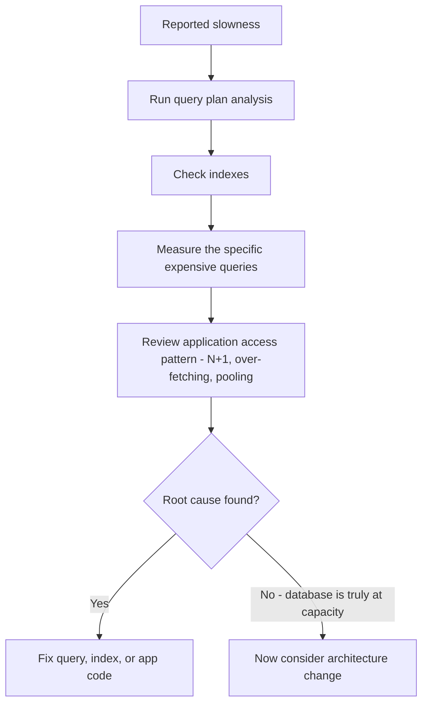

**Core Focus Areas:** Query plan analysis | Indexing | N+1 query detection | Connection management | Evidence-based diagnosis before migration

---

### 4. What does "database scalability" actually mean, and why must the scaling strategy be matched to the specific workload dimension under stress?

**Simple Definition:** "We need to scale" is like saying "the house needs work" without saying whether the roof leaks, the foundation is cracking, or you just need a bigger kitchen — each of those is a real problem, but they call for completely different contractors, and hiring the wrong one wastes time and money without fixing anything.

**Official Definition:** Database scalability is the capacity of a storage system to sustain increasing demand along a specific dimension — read throughput, write throughput, data volume, traffic burstiness, or geographic distribution — via a strategy (vertical scaling, read replication, partitioning, or distributed design) matched to that dimension, each carrying its own architectural tradeoffs.

**Primary Responsibilities / Core Details:**
- **Scale is multi-dimensional, not singular.** The lecture lists five distinct possibilities behind the vague phrase "our application needs to scale": struggling with reads, struggling with writes, the data set becoming huge, traffic suddenly spiking, and users being distributed across multiple regions.
- **Read-heavy problems have a well-known toolkit.** Better indexes, caching, or read replicas are the lecture's named solutions — each adds capacity for read traffic without necessarily changing how writes are handled.
- **Write-heavy problems require a structurally different answer.** Heavy write workloads "may eventually need partitioning or distributed design" — a read replica does nothing for write throughput, because replicas still ultimately depend on a single write path (or a much more complex multi-writer design).
- **Large datasets are a distinct problem from traffic volume.** A dataset can be enormous while traffic is modest, or traffic can be enormous while the dataset stays small — conflating "big data" with "high traffic" leads to the wrong architecture being chosen.
- **Regional distribution changes the dominant constraint from throughput to latency.** For a global application, "replication and regional latency may matter much more" than raw request-per-second capacity — a user in another hemisphere cares about round-trip time to the nearest replica, not how many total requests the system can theoretically absorb.
- **The reframed question is workload-specific, not database-specific.** "Don't just ask, can this database scale? Ask, how does it scale for my workload?" — because a database's marketing claim of "scales to billions of rows" says nothing about whether *your* specific access pattern benefits from that scaling model.
- **Every scaling strategy has a "complexity tax."** Some databases scale by giving you more resources on a single machine (vertical scaling — simple, but has a ceiling); others spread data across many machines (horizontal scaling — higher ceiling, but requires partition-aware application logic); the lecture's explicit warning is to evaluate "what complexity your application takes on" alongside the raw scaling capability.
- **Scaling solutions can introduce the very consistency problems Law 2 addresses.** A read replica introduces replication lag; a write partition can complicate cross-partition transactions — scaling decisions are never purely additive, they trade one constraint for another.

**Real-World Example:** A social media platform's news feed service and its direct-messaging service scale along entirely different dimensions. The news feed is read-dominated at massive scale — the same popular posts are read millions of times — so aggressive caching and read replicas solve most of the load. Direct messaging is comparatively write-heavy and latency-sensitive per user pair, so the platform partitions conversation data by user or conversation ID across many nodes instead, accepting the added complexity of routing each request to the correct partition, because read replicas alone would never have addressed the write-throughput constraint that actually limits messaging.

**Best Coding/Development Practices:**
1. **Identify the specific stressed dimension with monitoring before choosing a scaling strategy** — read/write ratio, dataset growth rate, request burstiness, and regional latency should each be measured, not guessed.
   ```javascript
   // Track read/write ratio explicitly to guide the scaling decision
   metrics.increment(isWrite ? 'db.writes' : 'db.reads');
   ```
2. **Use read replicas only for genuinely read-heavy, lag-tolerant paths.**
   ```javascript
   const product = await pool.replica.query('SELECT * FROM products WHERE id = $1', [id]);
   ```
3. **Design partition/shard keys around the dominant write access pattern**, not arbitrarily.
   ```javascript
   const shardKey = hashToShard(conversationId); // co-locate a conversation's messages
   ```
4. **Deploy read replicas or regional read paths close to users for latency-sensitive, geographically distributed workloads.**
5. **Re-measure after each scaling change** to confirm the specific dimension that was stressed actually improved, rather than assuming a general "scaling" fix addressed the real bottleneck.

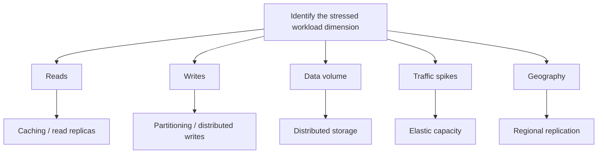

**Core Focus Areas:** Multi-dimensional scaling | Read replicas | Partitioning and sharding | Regional latency | Complexity tradeoffs of scaling strategies

---

### 5. How should a team decide when to introduce additional data systems like a cache or search index, and how do they maintain a single source of truth once they do?

**Simple Directions:** Adding a cache, a search index, and an analytics platform on day one is like buying a boat, a second car, and a vacation home before you've confirmed you actually need any of them — each one seems reasonable in isolation, but together they're maintenance burdens you didn't measure a need for, and now you also have three different calendars that might disagree about where you're supposed to be.

**Official Definition:** Polyglot persistence with a designated source of truth is an architectural pattern in which a primary datastore holds the authoritative value for each piece of business state, while auxiliary systems (caches, search indexes, analytics stores) hold asynchronously-updated, rebuildable copies introduced individually in response to a measured, specific problem rather than provisioned preemptively.

**Primary Responsibilities / Core Details:**
- **This is the point where "database choice" becomes "database architecture."** A single database choice is a starting point; the decision to add more systems around it is a separate, later decision that should be justified independently.
- **The healthy evolution is incremental and problem-driven.** Start with one database → some reads become expensive, so add a cache → search requirements grow, so add a search system → analytics gets more complex, so route data to a separate analytics platform. Each step follows a real, observed pain point.
- **The anti-pattern is provisioning all of it upfront.** "The mistake is introducing all of that on day one" — before there is a cache-worthy read, a real search requirement, or analytics complexity that justifies a separate platform.
- **Every additional system has a real operational tax.** "Another system to monitor, secure, backup, upgrade, and troubleshoot" — this cost exists regardless of whether the system ever gets meaningfully used, so it must be weighed against an actual benefit, not a hypothetical future one.
- **Duplication creates an authority problem, not just extra storage.** The moment the same fact (a customer's address, a product's price) lives in more than one system, those systems can disagree, and something has to be the tiebreaker.
- **The concrete resolution is naming a source of truth per piece of state.** "For each important piece of business state, be explicit about which system is authoritative." The primary database typically holds this role; caches, search indexes, and analytics stores are copies.
- **Copies should be asynchronous and rebuildable, not another primary write path.** The lecture's phrasing — "those systems can update asynchronously and ideally be rebuilt when necessary" — implies these systems should never be the only place a critical fact is written; they should always be derivable from the source of truth again if lost.
- **The governing question is "what problem does each additional database solve?"** If a team can't answer that concretely for a proposed new system, "you probably don't need it yet" — this is the practical gate that prevents premature architectural sprawl.

**Real-World Example:** An online marketplace initially served all product searches directly from its relational primary database using `LIKE` queries. As the catalog grew past a few hundred thousand items, search latency and relevance both degraded, so the team introduced a dedicated search index (e.g., Elasticsearch), populated via change-data-capture from the primary database. They explicitly documented the primary relational database as the source of truth for product data — the search index was rebuildable from scratch by replaying the primary's data through the same ingestion pipeline, and any temporary lag between a product update and its appearance in search results was treated as an acceptable, understood tradeoff rather than a bug, because no code ever wrote directly to the search index as an original source.

**Best Coding/Development Practices:**
1. **Require a stated, measured problem before adding a new data system**, not a speculative future need.
   ```javascript
   // Only introduce Redis once p95 latency on getPopularProducts()
   // has been measured above the agreed SLA for two consecutive weeks.
   ```
2. **Write to the source of truth first, and propagate to copies asynchronously**, never the reverse.
   ```javascript
   await db.query('UPDATE products SET price = $1 WHERE id = $2', [price, productId]);
   await eventBus.publish('product.updated', { productId });
   ```
3. **Make every auxiliary system rebuildable from the source of truth by design.**
   ```javascript
   async function rebuildSearchIndex(db, searchIndex) {
     const products = await db.query('SELECT * FROM products');
     await searchIndex.bulkReplace(products);
   }
   ```
4. **Document, per entity, which system is authoritative**, so no engineer has to guess which value to trust during an incident.
5. **Periodically audit for accidental additional-write paths** into a cache or search index that would make it a second, undocumented source of truth, undermining the whole pattern.

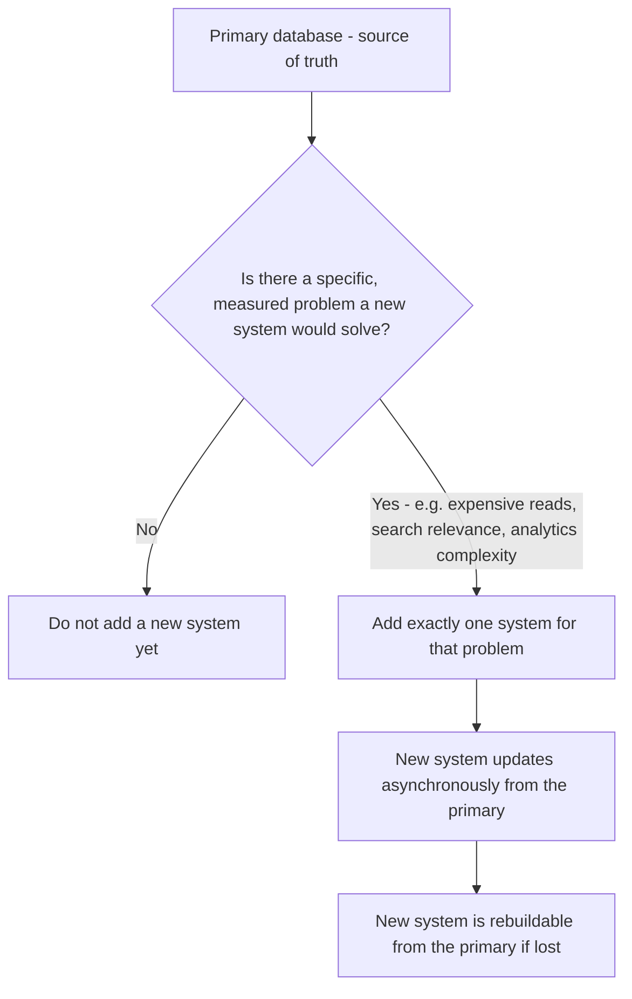

**Core Focus Areas:** Polyglot persistence | Source of truth | Cache and search index introduction criteria | Change data capture | Architectural sprawl prevention

---
