# 8 API Laws of Senior Backend Developer

## 0. Jargon Translation (Read This First)

| Term | Official Definition | Plain-English Analogy |
|---|---|---|
| **REST (Representational State Transfer)** | An architectural style for networked applications where resources are identified by URLs (Uniform Resource Locators) and manipulated using a fixed set of HTTP (HyperText Transfer Protocol) methods. | Think of REST like a library. Every book (resource) has a fixed shelf address (URL). You don't invent a new word for "borrow this book" — you just use the standard library actions: check out, return, renew. |
| **Idempotent** | An operation that produces the same result no matter how many times it is executed with the same input. | Pressing an elevator "floor 5" button five times still only sends you to floor 5 once — pressing it again doesn't stack up five trips. |
| **HTTP (HyperText Transfer Protocol) Method** | A verb sent with an HTTP request (GET, POST, PUT, PATCH, DELETE) that tells the server what kind of operation to perform on a resource. | The method is the "verb" in a sentence where the URL is the "noun." `GET /orders/1` reads like "read order 1," not "getOrder(1)." |
| **Status Code** | A three-digit number in the HTTP response that summarizes the outcome of a request (e.g., 200, 404, 500). | It's the "traffic light" of an API response — green (2xx) means go, yellow/red (4xx) means you did something wrong, red (5xx) means the server broke. |
| **Query Parameter** | Key-value pairs appended to a URL after a `?`, used to filter, sort, or paginate a resource collection (e.g., `?status=shipped&sort=date`). | If the URL path is the "aisle" in a supermarket, query parameters are you telling the cashier "just the red ones, sorted by price." |
| **Breaking Change** | A modification to an API's contract (request/response shape, field meaning, or behavior) that causes existing client code to fail or behave incorrectly. | Like moving the light switch to the other side of the room — anyone who reaches for it out of habit fumbles in the dark. |
| **API Versioning** | A strategy for evolving an API's contract over time while still supporting clients built against an older contract. | Building elevators with two buttons — "old floor plan" and "new floor plan" — while the building is being remodeled, so nobody gets stuck between floors. |
| **Idempotency Key** | A unique client-generated token attached to a non-idempotent request (usually POST) so the server can detect and ignore duplicate retries. | A ticket stub at a raffle — if you hand in the same stub twice, the organizer recognizes it and doesn't give you two prizes. |

---

## Topics Introduced in This Lecture

1. Designing API endpoints around resources (nouns) instead of actions (verbs).
2. Making URL naming predictable and consistent across an entire API.
3. Using HTTP methods according to their real semantic meaning, including idempotency.
4. Choosing HTTP status codes that accurately communicate the result of a request.
5. Structuring error responses consistently instead of returning vague failure messages.
6. Separating path parameters (resource identity) from query parameters (filtering/refinement) and avoiding action-like query parameters.
7. Handling API evolution and versioning without breaking existing clients.
8. Keeping request/response formats (naming conventions, dates, pagination, structures) consistent across every endpoint.
9. The meta-principle: strict REST (REpresentational State Transfer) compliance is less important than overall API predictability and consistency.

---

## Deep Dive

### Law 1: Design Around Resources, Not Actions

**Micro-Mechanics — The "Why" and "How":**
- **The anti-pattern:** Endpoints like `GET /getUsers`, `POST /createOrder`, `DELETE /deleteProduct` embed the *action* directly into the URL. This is redundant because HTTP already has a dedicated slot for the action — the **HTTP method**.
- **The core mechanic:** A URL should identify a **noun** (a resource: `users`, `orders`, `products`). The **HTTP method** (GET, POST, PUT, PATCH, DELETE) tells the server what to *do* with that noun. This is a **separation of concerns** — the URL answers "what thing," the method answers "what operation."
- **Why it scales better:** Under the action-based model, every new operation on a resource requires a brand-new endpoint name (`getUser`, `updateUser`, `archiveUser`, `restoreUser`...). Under the resource-based model, the same URL (`/users/123`) supports many operations just by changing the method — no new naming decisions required as the API grows.
- **What problem it solves:** It removes ambiguity and naming sprawl. A client that already knows `/orders` supports GET/POST can reasonably guess that `/orders/123` supports GET/PUT/DELETE too, without reading new documentation for every action.

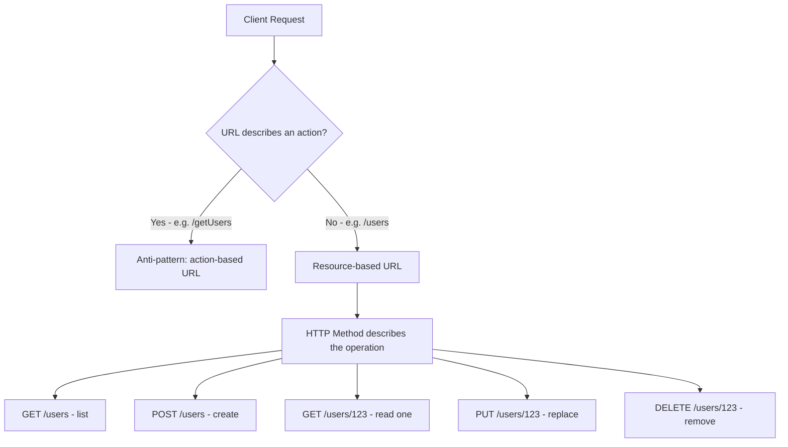

`[IMAGE: A split-panel diagram. Left panel titled "Action-Based (Anti-Pattern)" shows a messy list of endpoints — GET /getUsers, POST /createOrder, DELETE /deleteProduct, GET /fetchOrderById — each in a different color with tangled arrows to a single server icon. Right panel titled "Resource-Based (Correct)" shows three clean resource nouns — /users, /orders, /products — each as a labeled box, with small HTTP-verb tags (GET, POST, PUT, DELETE) orbiting each box like satellites, all pointing to the same clean server icon. Use a professional dark-blue and teal color scheme.]`

**Concrete Example (Book Review API project):**
Instead of `GET /fetchAllReviews`, `POST /submitReview`, `DELETE /removeReview`, design:
- `GET /books/:isbn/reviews` — list reviews for a book
- `POST /books/:isbn/reviews` — add a review
- `DELETE /books/:isbn/reviews/:reviewId` — remove a specific review

**Code Example (Express/Node.js):**
```javascript
// Minimal working example — resource-based routing in Express
const express = require('express');
const router = express.Router();

// Resource: /orders — the URL is a noun, the method is the verb
router.get('/orders', listOrders);        // Read the collection
router.post('/orders', createOrder);      // Create a new order
router.get('/orders/:id', getOrder);      // Read one order
router.put('/orders/:id', replaceOrder);  // Replace an order
router.delete('/orders/:id', removeOrder);// Remove an order

module.exports = router;
```

```javascript
// What happens if... you mix action-based and resource-based routes?
router.post('/createOrder', createOrder);     // action-based (inconsistent)
router.get('/orders/:id', getOrder);          // resource-based

// Mistake: now developers must memorize per-endpoint which convention applies.
// There is no rule they can apply to a *new* endpoint they haven't seen yet —
// they have to check documentation every single time, defeating the purpose
// of REST's predictability.
```

---

### Law 2: Make Your URLs Predictable

**Micro-Mechanics — The "Why" and "How":**
- **The anti-pattern:** Using `user`, `customers`, and `customer_profiles` to refer to conceptually related or identical entities across different parts of the same API. Each endpoint might individually "work," but the *set of naming rules* a developer must memorize grows with every inconsistency.
- **The core mechanic:** Pick **one** naming convention for collections (e.g., always plural: `users`, `orders`, `products`) and **one** convention for multi-word resources (e.g., always `kebab-case`: `customer-profiles`, or always `camelCase`: `customerProfiles`) and apply it **everywhere**, without exception.
- **Why the specific convention matters less than consistency:** A developer only needs to learn the rule *once*. After that, they can correctly predict the shape of an endpoint they've never seen before, without reading docs. This is the definition of a **discoverable API**.
- **What problem it solves:** It reduces the *cognitive load* and *onboarding time* for API consumers. A predictable API needs fewer support tickets, less documentation, and fewer integration bugs caused by guessed-wrong endpoint names.

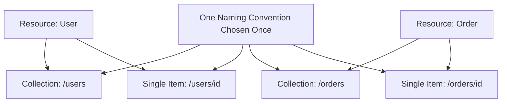

`[IMAGE: A "before and after" comparison chart. Top half labeled "Inconsistent Naming" shows three overlapping speech bubbles reading "/user/5", "/customers/5", "/customer-profile/5" pointing confusedly at the same database cylinder icon. Bottom half labeled "Predictable Naming" shows a single clean rule card "Always plural, always kebab-case for multi-word resources" with arrows branching cleanly to "/users/5", "/orders/5", "/order-items/5". Use a clean whiteboard-sketch style with teal accent lines.]`

**Concrete Example (Travel Recommendation project):**
Pick plural nouns and stick with them: `/destinations`, `/destinations/:id/reviews`, `/travel-packages` (not `/travelPackage`, `/TravelPkgs`, or `/packages_travel` in different corners of the same API).

**Code Example:**
```javascript
// Minimal working example — one convention applied consistently
app.use('/destinations', destinationsRouter);
app.use('/travel-packages', travelPackagesRouter);
app.use('/travel-packages/:id/bookings', bookingsRouter);

// Consistent: plural, kebab-case for multi-word resources, everywhere.
```

```javascript
// What happens if... naming conventions drift across a growing codebase?
app.use('/destination', destinationsRouter);      // singular here
app.use('/travelPackages', travelPackagesRouter);  // camelCase here
app.use('/travel_package_bookings', bookingsRouter); // snake_case here

// Mistake: three different pluralization and casing rules in one API.
// A client library generator (e.g., OpenAPI/Swagger codegen) will produce
// inconsistent method names, and human developers will guess wrong at least
// a third of the time.
```

---

### Law 3: Use HTTP Methods for Their Actual Purpose

**Micro-Mechanics — The "Why" and "How":**
- **The anti-pattern:** Using POST, PUT, and PATCH interchangeably to "update a user" because all three technically work if the server code accepts them. This forces the client to learn your *custom* rules instead of relying on universally understood HTTP semantics.
- **The core mechanic — method meanings:**
  - **GET** — retrieves data; must **never** change server state.
  - **POST** — creates a new resource, or triggers processing that doesn't map cleanly to a resource update.
  - **PUT** — **replaces** the entire representation of a resource.
  - **PATCH** — applies a **partial** update to a resource.
  - **DELETE** — removes a resource.
- **The idempotency mechanic (critical, often tested in interviews):** An operation is **idempotent** if performing it multiple times has the same effect as performing it once.
  - GET, PUT, and DELETE are expected to be idempotent: sending the same PUT five times should leave the resource in the same final state as sending it once. Sending the same DELETE five times should not cause an error avalanche or five deletions — the resource is simply gone after the first one.
  - POST is **not** idempotent by default: sending the same "create order" request twice can create **two separate orders**.
- **Why this matters in production:** Networks are unreliable. Clients time out and retry. If your API's method semantics don't match real HTTP semantics, a client's "safe" retry logic (built to trust GET/PUT/DELETE idempotency) can silently corrupt data or, worse, a retried POST can silently double-charge a customer.
- **What problem it solves:** Choosing methods by their *intended semantics* — not by "whatever makes the endpoint work" — lets clients apply standard, battle-tested retry and caching strategies without needing custom knowledge of your API.

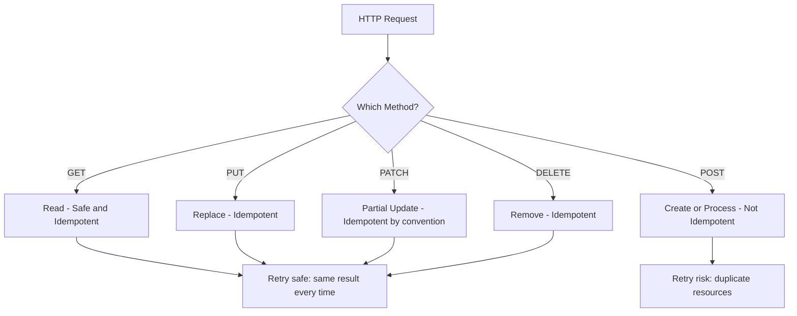

**Concrete Example (Guestbook project):**
- `POST /guestbook-entries` — creates a new entry (not idempotent; two identical retried requests risk two duplicate entries unless mitigated).
- `PUT /guestbook-entries/:id` — replaces one entry's full content (idempotent; resending doesn't create a second entry).

**Code Example:**
```javascript
// Minimal working example — idempotency-safe PUT vs non-idempotent POST
app.put('/guestbook-entries/:id', (req, res) => {
  // Replacing with the same body five times in a row leaves the
  // same final record in the database every time.
  db.entries.replaceOne({ id: req.params.id }, req.body);
  res.status(200).json({ id: req.params.id, ...req.body });
});

app.post('/guestbook-entries', (req, res) => {
  // Each call inserts a brand-new document with a new id.
  const entry = db.entries.insertOne({ ...req.body, createdAt: new Date() });
  res.status(201).json(entry);
});
```

```javascript
// What happens if... a flaky network causes the client to retry a POST?
async function submitEntry(body) {
  try {
    await fetch('/guestbook-entries', { method: 'POST', body: JSON.stringify(body) });
  } catch (err) {
    // Naive retry on timeout — DANGEROUS for POST.
    await fetch('/guestbook-entries', { method: 'POST', body: JSON.stringify(body) });
    // Mistake: if the first request actually succeeded server-side but the
    // response was lost in transit, this creates a duplicate guestbook entry.
    // Fix: generate a client-side idempotency key and have the server
    // deduplicate requests carrying the same key within a time window.
  }
}
```

---

### Law 4: Make Status Codes Useful

**Micro-Mechanics — The "Why" and "How":**
- **The anti-pattern:** Returning HTTP `200 OK` while the response *body* says `{"success": false, "error": "Product not found"}`. The transport layer says "everything is fine" while the payload says "it isn't." The client is forced to inspect two separate signals to know the true outcome.
- **The core mechanic:** Use the status code itself to carry the **high-level result** of the request, so tooling (proxies, monitoring, HTTP clients, browsers) that only look at the status code still gets an accurate picture.
- **The relevant code families from the lecture:**
  - `200 OK` — a successful read.
  - `201 Created` — a resource was successfully created.
  - `202 Accepted` — the request was accepted and will finish **asynchronously**.
  - `204 No Content` — success, with no response body to return.
  - `400 Bad Request` — the request itself is malformed/invalid.
  - `401 Unauthorized` — authentication is missing or invalid.
  - `403 Forbidden` — the client is authenticated but lacks permission.
  - `404 Not Found` — the requested resource doesn't exist.
  - `409 Conflict` — the request conflicts with the current state of the resource.
  - `422 Unprocessable Entity` — the request is well-formed but fails business validation rules.
  - `429 Too Many Requests` — the client is being rate-limited.
- **Why it matters:** The point isn't memorizing every number — it's ensuring the response is understandable **without inventing a custom error protocol layered on top of HTTP**. Monitoring dashboards, load balancers, and API gateways all key off status codes; hiding failure inside a `200` breaks that entire ecosystem.

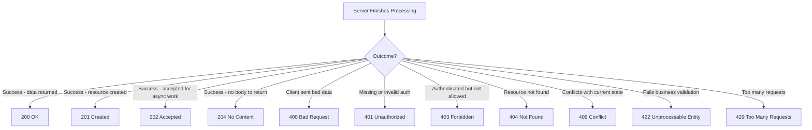

`[IMAGE: A vertical traffic-light-inspired infographic. Top section colored green lists "2xx Success" with icons for 200, 201, 202, 204. Middle section colored amber lists "4xx Client Error" with icons for 400, 401, 403, 404, 409, 422, 429, each with a tiny one-word cause label underneath (Malformed, No Auth, No Permission, Missing, Conflict, Invalid Data, Rate Limited). A small red "5xx Server Error" strip at the very bottom for contrast. Clean flat-icon style, dark background.]`

**Code Example:**
```javascript
// Minimal working example — status code carries the real outcome
app.get('/products/:id', async (req, res) => {
  const product = await db.products.findById(req.params.id);
  if (!product) {
    return res.status(404).json({ error: { code: 'PRODUCT_NOT_FOUND' } });
  }
  res.status(200).json(product);
});
```

```javascript
// What happens if... you return 200 for a logical failure?
app.get('/products/:id', async (req, res) => {
  const product = await db.products.findById(req.params.id);
  if (!product) {
    // Mistake: status is 200, but the body says it failed.
    return res.status(200).json({ success: false, error: 'Product not found' });
  }
  res.status(200).json({ success: true, data: product });
});
// Consequence: a load balancer health check, a CDN cache rule, or a simple
// `if (response.ok)` check in client JS will treat this as a SUCCESS,
// because response.ok only inspects the HTTP status, not the JSON body.
```

---

### Law 5: Keep Errors Consistent

**Micro-Mechanics — The "Why" and "How":**
- **The anti-pattern:** Returning `{"error": "something went wrong"}` for every failure. Status codes tell the client the *category* of failure, but the client often needs more — *why* it failed, *what* to show the user, and *what* to log for debugging.
- **The core mechanic:** Return a **structured error body**, typically containing:
  - An **error code** — a stable, machine-readable identifier (e.g., `VALIDATION_FAILED`) that application code can branch on without parsing human text.
  - A **message** — a human-readable explanation, safe to show to a developer or (carefully) to an end user.
  - A **status** — often mirrors the HTTP status for convenience when the body is logged separately from headers.
  - For **validation failures specifically**, return exactly *which fields* failed and why, instead of a single generic "invalid request."
- **Why it matters:** A structured error lets the **client display** the message, the **application logic react** to the error code (e.g., redirect to login on `AUTH_EXPIRED`), and **developers investigate** using the code/message without needing a debugger session. The exact JSON shape can vary between systems, but it must be **structured and predictable** — never force the client to guess.

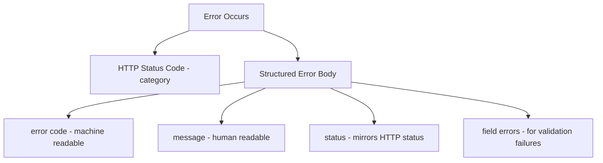

**Concrete Example (Book Review API — validation failure):**
```json
{
  "status": 422,
  "error": {
    "code": "VALIDATION_FAILED",
    "message": "The review could not be saved because required fields are invalid.",
    "fields": {
      "rating": "must be an integer between 1 and 5",
      "reviewText": "must not be empty"
    }
  }
}
```

**Code Example:**
```javascript
// Minimal working example — a shared error-formatting middleware
function apiError(res, status, code, message, fields = null) {
  const body = { status, error: { code, message } };
  if (fields) body.error.fields = fields;
  return res.status(status).json(body);
}

app.post('/books/:isbn/reviews', (req, res) => {
  const { rating, reviewText } = req.body;
  const fields = {};
  if (!Number.isInteger(rating) || rating < 1 || rating > 5) {
    fields.rating = 'must be an integer between 1 and 5';
  }
  if (!reviewText) fields.reviewText = 'must not be empty';

  if (Object.keys(fields).length > 0) {
    return apiError(res, 422, 'VALIDATION_FAILED', 'Review validation failed.', fields);
  }
  // ...save review
  res.status(201).json({ rating, reviewText });
});
```

```javascript
// What happens if... every route hand-rolls its own error shape?
app.post('/orders', (req, res) => {
  res.status(400).json({ err: 'bad input' }); // shape #1
});
app.post('/products', (req, res) => {
  res.status(400).json({ message: 'Invalid product', ok: false }); // shape #2
});
// Mistake: client-side error handling now needs a special case per endpoint
// (`err` vs `message` vs `error.message`), which defeats the entire purpose
// of structured errors — predictability.
```

---

### Law 6: Don't Put Everything Into the URL Path

**Micro-Mechanics — The "Why" and "How":**
- **The anti-pattern:** Starting with `/products`, then progressively bolting on `/products/electronics/in-stock/under-50/search/laptop/sort-by-price` as more filtering needs appear. The path becomes unmanageable and encodes information that isn't part of the resource's *identity*.
- **The core mechanic — division of responsibility:**
  - **Path segments** identify the **resource** (`/products/123` = "this exact product").
  - **Query parameters** refine or filter a **collection** (`/products?category=electronics&inStock=true&sort=price`).
  - **HTTP method** describes the **operation** (GET, POST, etc.).
- **The second anti-pattern (action-smuggling via query params):** Using `GET /products?action=delete` to delete a product. This breaks the contract that GET is safe/read-only, and it hides the real operation from anything that inspects the HTTP method (caches, proxies, monitoring) — the method and the URL no longer agree on what's happening.
- **Why it matters:** Keeping this responsibility boundary crisp means a developer can predict, from the shape of the URL alone, which part identifies "the thing" and which part is "optional filtering," without needing per-endpoint documentation.

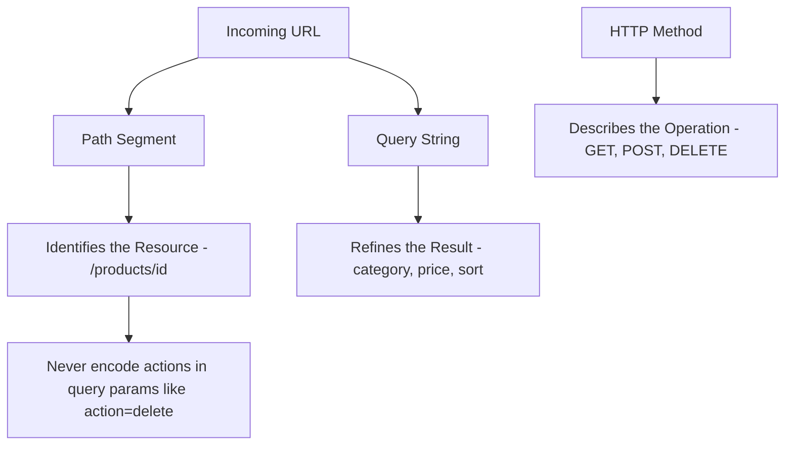

**Concrete Example (Travel Recommendation project):**
```
GET /destinations?region=asia&maxBudget=1500&sort=rating   ✅ correct
GET /destinations/asia/under-1500/sorted-by-rating          ❌ anti-pattern
GET /destinations?action=delete&id=42                        ❌ anti-pattern
```

**Code Example:**
```javascript
// Minimal working example — path identifies, query refines
app.get('/destinations', (req, res) => {
  const { region, maxBudget, sort } = req.query; // optional filters
  const results = db.destinations.find({ region, maxBudget }, { sort });
  res.status(200).json(results);
});

app.get('/destinations/:id', (req, res) => {
  const destination = db.destinations.findById(req.params.id); // identity
  res.status(200).json(destination);
});
```

```javascript
// What happens if... you smuggle an action into query params?
app.get('/products', (req, res) => {
  if (req.query.action === 'delete') {
    db.products.deleteOne({ id: req.query.id }); // MUTATION inside a GET!
    return res.status(204).send();
  }
  res.status(200).json(db.products.find({}));
});
// Mistake: a GET request must be safe (no side effects). A prefetching
// browser, a search-engine crawler, or a caching proxy could trigger this
// "GET" and unintentionally delete data, because nothing about a GET
// signals "this might mutate state."
```

---

### Law 7: Treat API Changes Carefully (Versioning & Evolution)

**Micro-Mechanics — The "Why" and "How":**
- **The core problem:** APIs don't stay unchanged forever. A response shape that looks perfect today may need new fields, a restructured shape, or a corrected field meaning six months from now. The danger is making a **breaking change** without accounting for **existing clients already depending on the old contract**.
- **Worked example from the lecture:** An earlier version returns a simple `price` field (a number). Later, the team wants a richer pricing structure (e.g., `{ amount, currency, discounts }`). This is **not** "just another field" — the **structure itself changed**, and any client doing `order.price.toFixed(2)` will crash because `price` is no longer a number.
- **The decision mechanic — does this need a new version?**
  - **Additive, non-required field** → usually safe, ship without versioning (existing clients that ignore unknown fields are unaffected).
  - **Changing or removing existing behavior/fields** → likely requires a version bump.
- **Versioning strategies (the specific one matters less than picking exactly one and using it consistently):**
  - **URL versioning** — `/v1/orders`, `/v2/orders`.
  - **Header versioning** — e.g., an `Accept-Version` or custom header.
  - **Other established mechanisms** — content negotiation, media-type versioning, etc.
- **Why it matters:** Good API evolution means existing clients don't become **collateral damage**. The goal isn't "never change the API" — it's "always give consumers a predictable signal and a migration path when you do."

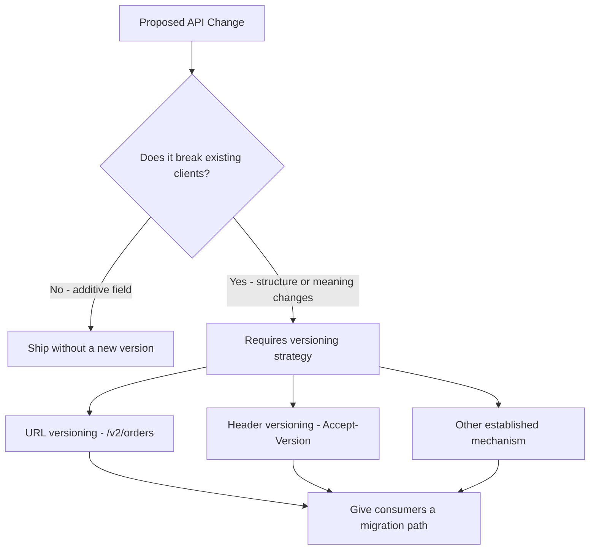

**Concrete Example (guestbook / book review evolution):**
```json
// v1 response
{ "id": 1, "price": 19.99 }

// v2 response — structural change, requires a new version
{ "id": 1, "pricing": { "amount": 19.99, "currency": "USD", "discounts": [] } }
```

**Code Example:**
```javascript
// Minimal working example — URL-based versioning served side by side
app.get('/v1/products/:id', (req, res) => {
  const product = db.products.findById(req.params.id);
  res.status(200).json({ id: product.id, price: product.amount }); // old shape
});

app.get('/v2/products/:id', (req, res) => {
  const product = db.products.findById(req.params.id);
  res.status(200).json({
    id: product.id,
    pricing: { amount: product.amount, currency: 'USD', discounts: product.discounts },
  }); // new shape
});
```

```javascript
// What happens if... you change a field's shape in place, without versioning?
app.get('/products/:id', (req, res) => {
  const product = db.products.findById(req.params.id);
  // Mistake: silently replacing "price: number" with "price: object"
  res.status(200).json({ id: product.id, price: { amount: product.amount, currency: 'USD' } });
});
// Consequence: every existing client calling `product.price.toFixed(2)` now
// throws a runtime TypeError in production, with zero warning, because the
// contract changed underneath them without a version signal.
```

---

### Law 8: Keep Request and Response Formats Consistent

**Micro-Mechanics — The "Why" and "How":**
- **The anti-pattern:** One endpoint returns `createdAt`, another returns `created_at`, another returns `CreatedAt`. All three are individually "valid" JSON, but now every client integration must remember which convention applies to which specific endpoint. The lecture notes this same problem recurs with **dates, pagination shapes, error response shapes, property naming, and general response structures**.
- **The core mechanic:** Pick conventions **once**, globally, and apply them to **every** endpoint:
  - One JSON property-naming convention (e.g., always `camelCase`).
  - One date format (e.g., always ISO 8601 strings).
  - One pagination shape (e.g., always `{ data: [...], page, pageSize, totalCount }`).
  - One error-response shape (Law 5's structure, reused everywhere).
  - One filtering/query-parameter pattern (Law 6's approach, reused everywhere).
- **Why it matters:** The goal is *not* to produce a giant rulebook clients must memorize — the goal is that **the next endpoint looks familiar**. Once a developer learns how one endpoint behaves, they should be able to correctly *guess* how every other endpoint behaves, without checking docs each time.

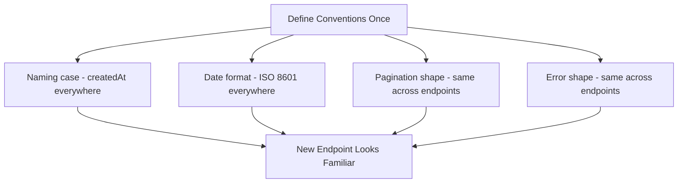

**Concrete Example (shared pagination convention across the course's Book Review and Travel Recommendation projects):**
```json
{
  "data": [ { "id": 1, "title": "..." }, { "id": 2, "title": "..." } ],
  "page": 1,
  "pageSize": 20,
  "totalCount": 134
}
```

**Code Example:**
```javascript
// Minimal working example — a shared response-shaping helper reused everywhere
function paginated(res, data, page, pageSize, totalCount) {
  return res.status(200).json({ data, page, pageSize, totalCount });
}

app.get('/books', async (req, res) => {
  const { page = 1, pageSize = 20 } = req.query;
  const { rows, total } = await db.books.findPage(page, pageSize);
  paginated(res, rows, Number(page), Number(pageSize), total);
});

app.get('/reviews', async (req, res) => {
  const { page = 1, pageSize = 20 } = req.query;
  const { rows, total } = await db.reviews.findPage(page, pageSize);
  paginated(res, rows, Number(page), Number(pageSize), total); // same shape, reused
});
```

```javascript
// What happens if... every team member invents their own pagination shape?
app.get('/books', (req, res) => {
  res.json({ results: [...], nextPage: 2 }); // shape #1
});
app.get('/reviews', (req, res) => {
  res.json({ items: [...], hasMore: true, cursor: 'abc123' }); // shape #2
});
// Mistake: a shared frontend pagination component can't be reused across
// both endpoints — every screen needs bespoke pagination-parsing logic,
// multiplying maintenance cost across the entire application.
```

---

### The Meta-Law: REST Compliance Isn't the Goal — Predictability Is

**Micro-Mechanics — The "Why" and "How":**
- A lot of developers focus on whether an API technically follows REST — but that's a means, not the goal. An API doesn't become "good" simply because it correctly uses GET/POST/PUT/DELETE.
- **A good API is one clients can understand without constantly checking documentation:**
  - Resource names make sense.
  - Methods behave predictably (and match their real semantics — Law 3).
  - Status codes mean something (Law 4).
  - Errors have a consistent structure (Law 5).
  - Filters work the same way across endpoints (Laws 6 and 8).
  - Changes don't unexpectedly break existing consumers (Law 7).
- **The practical instruction:** When designing a new REST API, don't start by creating endpoints one at a time. Start by **defining the patterns first**: How will you name resources? How will you represent collections? How will filtering work? Which HTTP methods will you use, and for what? How will errors look? How will status codes be handled? How will the API evolve? What conventions will every endpoint follow?
- A good REST API doesn't just return the right data — **it makes the right way to use it obvious.**

---

## Step-by-Step Breakdown: Applying All 8 Laws to One Request Lifecycle

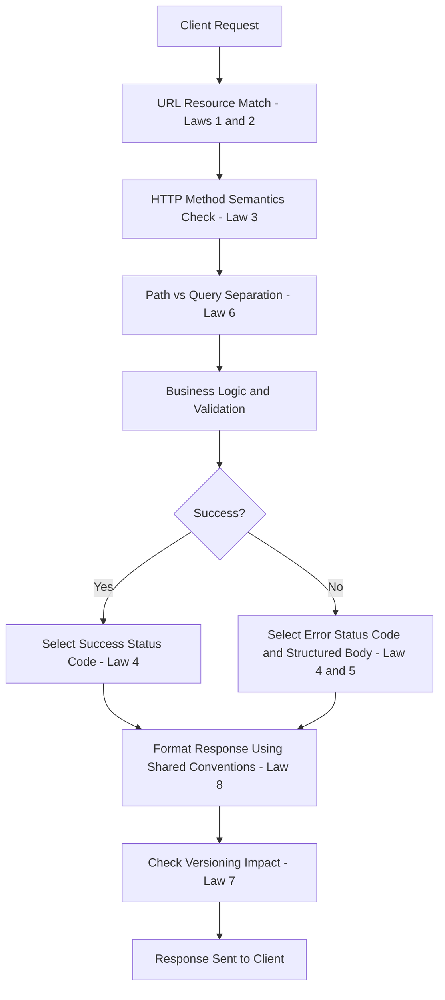

1. **Client Request arrives** — e.g., `PUT /v1/orders/42` with a JSON body.
2. **URL Resource Match** — the server recognizes `orders` as a known, consistently-named resource, and `42` as an identifier (Laws 1 & 2).
3. **HTTP Method Semantics Check** — PUT means "replace this resource's representation"; the server treats retries as safe/idempotent (Law 3).
4. **Path vs Query Separation** — `42` (path) identifies *which* order; any `?` query params would only refine a collection request, not this single-item request (Law 6).
5. **Business Logic & Validation** — the server checks the request body against business rules (e.g., order total must be positive).
6. **Branch on Success/Failure** — validation passes or fails.
7. **Status Code Selection** — success returns `200 OK` (replaced) or `204 No Content`; failure returns `422 Unprocessable Entity` with a structured body (Laws 4 & 5).
8. **Consistent Response Formatting** — the JSON shape (property casing, date format) matches every other endpoint in the API (Law 8).
9. **Versioning Check** — because the request hit `/v1/`, the server knows to shape the response using the v1 contract, even if a `/v2/` with a different shape also exists (Law 7).
10. **Response sent to client.**

---

## Related Concepts

1. **HATEOAS (Hypermedia as the Engine of Application State):** An extension of REST where responses include links to related actions/resources (e.g., an order response includes a `cancel` link). It builds directly on Law 1's "resources as nouns" idea by making the *available next actions* discoverable at runtime instead of hardcoded in documentation.
2. **OpenAPI/Swagger Specification:** A machine-readable contract format for documenting REST APIs. It only stays trustworthy if the underlying API actually follows consistent conventions (Laws 2 and 8) — otherwise the generated documentation and client SDKs (Software Development Kits) become misleading.
3. **Rate Limiting & Throttling:** The mechanism that produces the `429 Too Many Requests` status code from Law 4. It's typically implemented with a token-bucket or sliding-window algorithm at the API gateway layer.
4. **Optimistic Concurrency Control:** Directly related to the `409 Conflict` status code (Law 4) and idempotency (Law 3) — uses a version field or `ETag` header so a PUT/PATCH can detect it's about to overwrite a change made by someone else since the client last read the resource.
5. **API Gateway Pattern:** A single entry point that can centrally enforce many of these laws — consistent error shapes (Law 5), versioning routing (Law 7), and rate limiting — across many backend microservices, so individual services don't each have to reimplement the rules.

---

## Key Takeaways (Flashcard-Ready)

1. **Q:** What should identify a resource in a REST API — the URL or the HTTP method?
   **A:** The URL identifies the resource (the noun); the HTTP method describes the operation (the verb) performed on it.

2. **Q:** Which common HTTP methods are expected to be idempotent, and which is not?
   **A:** GET, PUT, and DELETE are expected to be idempotent (repeating them has the same effect as doing it once); POST is not, since repeating it can create duplicate resources.

3. **Q:** Why is returning `200 OK` with `{"success": false}` in the body considered a design mistake?
   **A:** It forces clients to inspect two separate signals (status code and body) to determine the real outcome, and breaks tooling (proxies, health checks, caches) that only reads the HTTP status code.

4. **Q:** What's the difference in responsibility between a URL path segment and a query parameter?
   **A:** The path identifies the specific resource (e.g., `/products/123`); query parameters refine or filter a collection (e.g., `?category=electronics&sort=price`) — actions should never be smuggled into query parameters.

5. **Q:** When does an API change require a new version versus being safe to ship directly?
   **A:** Adding a new, non-required field is usually safe without versioning; changing or removing existing fields, meaning, or structure usually requires a versioning strategy (URL, header, or another consistent mechanism) plus a migration path for existing clients.

---

## 💡 The Secret Engineering Trick

**The retry-duplication trap:** Because networks fail and clients automatically retry timed-out requests, a **non-idempotent POST** (like "create order" or "charge card") can silently execute twice even though your code is "correct" — the *first* request may have actually succeeded server-side, but the response was lost in transit, so the client (reasonably) retries. The fix senior engineers reach for is an **idempotency key**: the client generates a unique token per logical operation (e.g., a UUID) and sends it in a header; the server stores completed-operation results keyed by that token for a time window, and returns the *original* result instead of re-executing the operation if the same key arrives again. This turns a fundamentally non-idempotent operation (POST) into a *practically* idempotent one from the client's perspective — without changing what the operation semantically means.

---

## Interview Questions

### 1. Why should a REST API be designed around resources instead of actions, and how does this decision affect long-term API maintainability?

**Simple Definition:** Designing "around resources" means your URLs name *things* (`/users`, `/orders`) instead of *actions* (`/getUser`, `/createOrder`), because HTTP already has a built-in way to express the action — the method (GET, POST, PUT, PATCH, DELETE). It's the difference between a filing cabinet labeled by folder name (resource) versus one labeled by what you plan to do with each folder today (action) — the second one becomes unusable the moment your plans change.

**Official Definition:** Resource-oriented design is a REST (REpresentational State Transfer) architectural constraint in which every distinct entity or collection in a system is exposed as a URI (Uniform Resource Identifier), and the semantics of HTTP methods — rather than URL-embedded verbs — define the operations permitted on that URI.

**Primary Responsibilities / Core Details:**
- **Nouns in the path, verbs in the method:** `/orders/123` is the noun; `GET`, `PUT`, `DELETE` supply the verb. This mapping should hold for every endpoint in the system, without exceptions "just this once."
- **Collections vs. single items:** `/orders` (collection — supports GET-list and POST-create) and `/orders/123` (single item — supports GET-one, PUT-replace, PATCH-partial-update, DELETE-remove) are two distinct but related URIs built from the same resource name.
- **No endpoint sprawl:** Under an action-based model, every new capability requires a new endpoint name (`archiveOrder`, `restoreOrder`, `duplicateOrder`...). Under a resource-based model, new capabilities are usually just new HTTP methods or sub-resources (`POST /orders/123/archive` as a sub-resource action, used sparingly for operations that truly don't map to CRUD).
- **Discoverability:** A developer who already understands `/users` can correctly guess the shape of `/products` without reading new docs, because the *pattern* — not the specific endpoint — is what they learned.
- **Reduced client coupling to custom rules:** Clients rely on HTTP's well-known, standardized method semantics instead of a bespoke verb vocabulary invented by your team, which means generic tooling (HTTP caches, API gateways, SDK generators) works correctly out of the box.
- **Alignment with tooling:** OpenAPI/Swagger generators, HTTP caching layers, and API gateways all assume resource-oriented URLs; action-based URLs break their assumptions (e.g., a cache can't safely assume `/getUser?id=5` is cacheable the way `GET /users/5` obviously is).
- **Long-term maintainability payoff:** As the API grows from 5 endpoints to 500, the resource-oriented model keeps the *number of naming decisions* roughly constant (pick a resource name once), while the action-oriented model requires a fresh naming decision for every new capability, compounding inconsistency over time.
- **Nested sub-resources model relationships, not actions:** `/orders/123/items` expresses "the items belonging to order 123" as its own addressable collection, reusing the exact same GET/POST/PUT/DELETE vocabulary one level deeper, instead of inventing `getOrderItems` or `addItemToOrder` as bespoke function-style endpoints.
- **It forces upfront domain modeling:** deciding what counts as a "resource" (Is a shopping cart a resource? Is a search a resource?) pushes the team to think in terms of the domain's actual nouns early, which tends to produce a cleaner data model than bolting on actions reactively as features are requested.

**Real-World Example:** GitHub's REST API exposes `/repos/{owner}/{repo}/issues` as a resource. Creating an issue is `POST` to that URL; closing an issue is `PATCH` on `/repos/{owner}/{repo}/issues/{number}` with `{"state": "closed"}` — not a separate `/closeIssue` endpoint. Locking a conversation is modeled as `PUT /repos/{owner}/{repo}/issues/{number}/lock`, treating "lock" itself as a sub-resource with its own existence (present = locked, absent = unlocked) rather than as a verb. This lets the same generic "issue" client code (used for creating, editing, and reading issues) also handle closing and locking them, because every one of these is modeled as a *state change on a resource*, not a distinct action needing its own endpoint and client method.

**Best Coding/Development Practices:**
1. **Model state transitions as PATCH/PUT on the resource, not as new verbs.** Instead of `POST /orders/123/cancel`, prefer `PATCH /orders/123` with `{"status": "cancelled"}` when the transition is simple.
   ```javascript
   app.patch('/orders/:id', (req, res) => {
     const order = db.orders.update(req.params.id, { status: req.body.status });
     res.status(200).json(order);
   });
   ```
2. **Reserve action-style sub-resources for operations that truly aren't a state field.** E.g., `POST /orders/123/refunds` (creating a new "refund" resource) is more honest than shoehorning refund logic into a PATCH on `orders`.
   ```javascript
   app.post('/orders/:id/refunds', (req, res) => {
     const refund = db.refunds.create({ orderId: req.params.id, amount: req.body.amount });
     res.status(201).json(refund);
   });
   ```
3. **Keep collection and item routes symmetric.** If `/products` exists, always also support `/products/:id` (even if some methods return 405 Method Not Allowed) so the pattern stays predictable.
   ```javascript
   router.get('/products', listProducts);
   router.get('/products/:id', getProduct);
   router.post('/products', createProduct);
   router.put('/products/:id', replaceProduct);
   router.delete('/products/:id', deleteProduct);
   ```
4. **Avoid verbs in URL segments during code review.** Add a lint rule of thumb: if a route path contains a verb (`get`, `create`, `update`, `delete`, `fetch`), it's a design smell worth flagging before merge.
5. **Model relationships as nested resources instead of parameterized actions.** `/orders/:id/items` reuses the full CRUD vocabulary one level deep, instead of a one-off `/orders/:id/addItem` endpoint.
   ```javascript
   router.get('/orders/:id/items', listOrderItems);
   router.post('/orders/:id/items', addOrderItem);
   router.delete('/orders/:id/items/:itemId', removeOrderItem);
   ```

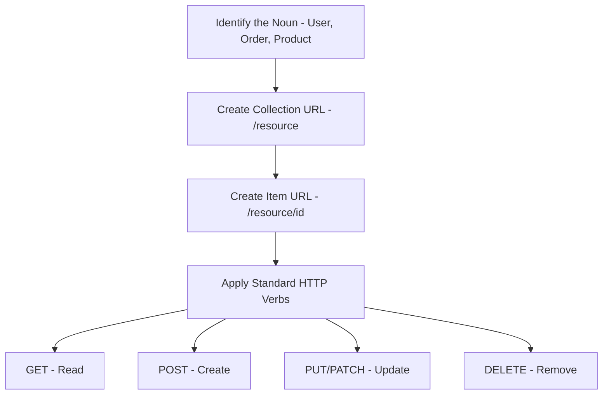

**Core Focus Areas:** Resource naming | URL-as-noun design | HTTP method semantics | API discoverability | Long-term maintainability

---

### 2. What is idempotency in the context of HTTP methods, and why is it critical for building reliable APIs?

**Simple Definition:** Idempotency means "doing it again doesn't change the outcome." If pressing a crosswalk button five times still only triggers one walk signal, that button is idempotent. In APIs, this matters because unreliable networks mean clients sometimes don't know if their request actually reached the server, so they retry — and idempotent operations make retrying safe.

**Official Definition:** An HTTP method is idempotent if the side effects of N identical requests are the same as the side effects of a single request (for N > 0), as defined by RFC (Request for Comments) 7231, the specification governing HTTP semantics.

**Primary Responsibilities / Core Details:**
- **GET is safe *and* idempotent:** it must not modify server state at all, so repeating it any number of times is inherently harmless.
- **PUT is idempotent by design:** it replaces a resource's full representation. Sending the exact same PUT body five times leaves the resource in the exact same final state as sending it once.
- **DELETE is idempotent by convention:** the first call removes the resource; subsequent identical calls find nothing to delete, but the *end state* ("resource does not exist") remains the same.
- **PATCH is idempotent only if designed that way:** a PATCH that says "set status to shipped" is idempotent; a PATCH that says "increment quantity by 1" is *not*, because repeating it changes the outcome each time. This is a subtlety many developers get wrong.
- **POST is fundamentally non-idempotent:** "create a new order" executed twice creates two orders, by definition, because it doesn't target an existing resource with a fixed identity.
- **Why networks make this critical:** TCP connections drop, load balancers time out, mobile clients lose signal mid-request. When a client doesn't receive a response, it cannot distinguish "the request never arrived" from "the request succeeded but the response was lost." Idempotent methods let the client safely retry either way, because the end result is the same regardless.
- **The idempotency-key mitigation for POST:** Since POST can't be made naturally idempotent, production systems attach a client-generated unique token to the request; the server remembers which tokens it has already processed and returns the cached result for a duplicate token instead of re-executing the create logic.
- **Idempotency is different from "safe":** GET is both safe (no side effects at all) and idempotent (repeatable with the same result). PUT and DELETE are idempotent but *not* safe — they do change server state, they just change it to the same end state no matter how many times they're repeated. Conflating "safe" with "idempotent" is a common interview trap.
- **At-least-once delivery is the real-world default:** most retry logic (browsers, mobile SDKs, message queues) implements "at-least-once" delivery, not "exactly-once," precisely because guaranteeing exactly-once across an unreliable network is extremely difficult. Idempotency is what makes at-least-once delivery *safe to build on top of*, without needing a distributed exactly-once guarantee.

**Real-World Example:** Payment APIs (e.g., Stripe) require an `Idempotency-Key` header on `POST /charges` requests specifically because a charge is a POST (non-idempotent) but the *financial* consequence of accidentally double-charging a customer due to a retried request is severe. Stripe stores the key with the resulting charge for 24 hours and returns the original charge object if the same key is seen again, rather than creating a second charge. AWS's (Amazon Web Services) SQS (Simple Queue Service) FIFO queues apply the same underlying idea at the messaging layer, deduplicating messages with identical content within a five-minute window so that a producer's retry doesn't cause a consumer to process the same job twice.

**Best Coding/Development Practices:**
1. **Design PATCH endpoints around "set to" semantics, not "adjust by" semantics, when idempotency matters.**
   ```javascript
   // Idempotent: repeated calls converge to the same state
   app.patch('/orders/:id', (req, res) => {
     db.orders.update(req.params.id, { status: req.body.status }); // "set to"
     res.sendStatus(204);
   });
   ```
2. **Implement idempotency keys for critical POST endpoints (payments, order creation).**
   ```javascript
   app.post('/charges', async (req, res) => {
     const key = req.headers['idempotency-key'];
     const existing = await db.idempotencyKeys.find(key);
     if (existing) return res.status(200).json(existing.result); // replay, don't re-charge
     const charge = await chargeCard(req.body);
     await db.idempotencyKeys.save(key, charge);
     res.status(201).json(charge);
   });
   ```
3. **Make DELETE return success even when the resource is already gone.** Returning `404` on a second DELETE call can break idempotent-retry assumptions in clients; many APIs treat "already deleted" as an acceptable no-op success (`204`).
   ```javascript
   app.delete('/orders/:id', async (req, res) => {
     await db.orders.deleteIfExists(req.params.id); // no error if already gone
     res.sendStatus(204);
   });
   ```
4. **Never let GET have side effects, even "harmless" ones like incrementing a view counter synchronously in the request path**, if that count feeds into anything user-visible or billable — move it to an async/background job so repeated GETs (e.g., from prefetching or crawlers) don't inflate the count.
5. **Document idempotency behavior explicitly in API docs per endpoint**, especially for any PATCH endpoint, since PATCH's idempotency is not guaranteed by the HTTP spec the way it is for PUT — consumers need to know whether it's safe to retry blindly.
   ```javascript
   /**
    * PATCH /orders/:id
    * Idempotent: sets status to the given value; safe to retry.
    * NOT idempotent: /orders/:id/increment-quantity would not be, if it existed.
    */
   ```

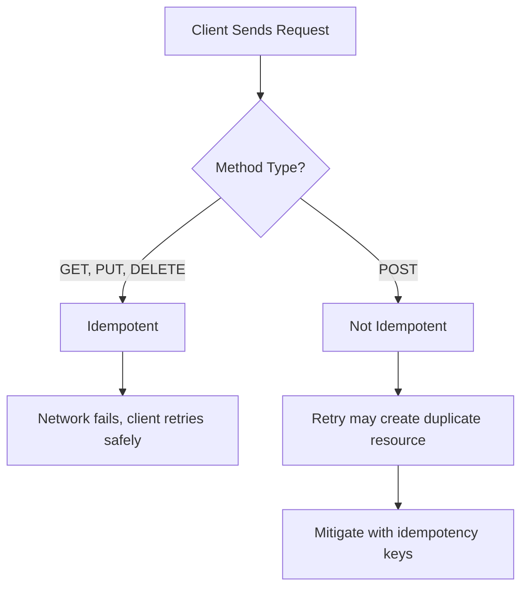

**Core Focus Areas:** HTTP method semantics | Idempotency | Retry safety | Network reliability | Idempotency keys

---

### 3. How should a well-designed API communicate success and failure, and why isn't the HTTP status code alone sufficient?

**Simple Definition:** Think of the status code as the headline of a news article and the response body as the article itself. The headline ("200 OK" or "404 Not Found") gives a fast, universal summary that any system can react to; the body gives the specific details a human or application logic actually needs to act on the failure.

**Official Definition:** API error communication is the practice of pairing a semantically accurate HTTP status code — drawn from the standard 2xx (success), 4xx (client error), and 5xx (server error) classes — with a structured, machine-parseable response body that provides an application-specific error code, a human-readable message, and, where relevant, field-level detail.

**Primary Responsibilities / Core Details:**
- **Status codes communicate the *category* of outcome:** `200`/`201`/`202`/`204` for success variants; `400`/`401`/`403`/`404`/`409`/`422`/`429` for client-caused failures; `5xx` for server-caused failures. Generic infrastructure (load balancers, monitoring, browsers) reacts correctly to these without understanding your business domain at all.
- **The body communicates the *specifics*:** an `error.code` like `INSUFFICIENT_STOCK` that application code can `switch` on, a `message` for display/logging, and (for validation) a `fields` map pinpointing exactly what was wrong and why.
- **Status-code precision matters:** `404` (resource doesn't exist) is not interchangeable with `403` (resource exists but you can't access it) — conflating them either leaks information (revealing existence to unauthorized users) or confuses legitimate clients about whether to retry with different credentials versus give up entirely.
- **`422` vs `400` distinction:** `400` means the request itself is malformed (bad JSON, wrong types); `422` means the request was well-formed but violates a business rule (e.g., "end date before start date"). Conflating these hides *why* something failed.
- **`409 Conflict` for state-based failures:** used when the request is individually valid but clashes with the resource's current state (e.g., trying to book an already-booked seat) — distinct from a validation error because the *same* request could succeed later if the state changes.
- **Never hide failure inside a `200`:** doing so breaks any tool that trusts the HTTP status alone (caches, health checks, `response.ok` checks in client code), because they never look inside the body.
- **Consistency across endpoints:** the *same* error shape (same field names: `code`, `message`, `fields`) must be used everywhere, or clients need endpoint-specific parsing logic, which defeats the purpose of standardizing at all.
- **5xx errors need structure too, but different content:** a `500 Internal Server Error` body should *not* leak stack traces or internal implementation details to the client (a security concern), but it should still include a stable `code` (e.g., `INTERNAL_ERROR`) and, ideally, a correlation/request ID the client can hand to support for log lookup — the difference from 4xx is what detail is safe to expose, not whether structure matters.
- **Async/eventual outcomes need their own signaling:** a `202 Accepted` response typically can't include a final success/failure body yet, since the work hasn't finished — the API should also expose a status-check endpoint or webhook so the client can later resolve the real outcome, rather than leaving `202` as a dead end.

**Real-World Example:** Stripe's API returns `402 Payment Required`-adjacent errors with a body like `{"error": {"type": "card_error", "code": "insufficient_funds", "message": "Your card has insufficient funds."}}`. The `code` field lets integrators branch programmatically (e.g., prompt for a different card), while `message` is safe to show directly to the end user — this dual-purpose design is exactly what Law 5 describes. Stripe also attaches a `request_id` to every response (success or failure), which support teams use to look up the exact server-side log entry for a customer's specific failed request, without exposing any internal detail in the response body itself.

**Best Coding/Development Practices:**
1. **Centralize status-code selection logic in one error-handling middleware** instead of scattering `res.status(...)` calls with inconsistent choices across every route.
   ```javascript
   app.use((err, req, res, next) => {
     const status = err.status || 500;
     res.status(status).json({ error: { code: err.code || 'INTERNAL_ERROR', message: err.message } });
   });
   ```
2. **Throw typed errors with a status and code attached, rather than manually formatting JSON in every route.**
   ```javascript
   class ApiError extends Error {
     constructor(status, code, message) { super(message); this.status = status; this.code = code; }
   }
   app.get('/orders/:id', (req, res, next) => {
     const order = db.orders.findById(req.params.id);
     if (!order) return next(new ApiError(404, 'ORDER_NOT_FOUND', 'Order does not exist.'));
     res.status(200).json(order);
   });
   ```
3. **Return field-level detail for every validation failure**, never a single opaque "invalid request."
   ```javascript
   if (fields.length) {
     return next(new ApiError(422, 'VALIDATION_FAILED', 'Validation failed.', { fields }));
   }
   ```
4. **Distinguish `401` from `403` explicitly** — return `401` when there's no valid credential at all, `403` when the credential is valid but insufficiently privileged.
   ```javascript
   if (!req.user) return next(new ApiError(401, 'AUTH_REQUIRED', 'Login required.'));
   if (!req.user.isAdmin) return next(new ApiError(403, 'FORBIDDEN', 'Admin role required.'));
   ```
5. **Attach a correlation/request ID to every response, success or failure**, so a `500` body can stay generic to the client while still being traceable in server logs.
   ```javascript
   app.use((req, res, next) => { req.id = crypto.randomUUID(); res.set('X-Request-Id', req.id); next(); });
   app.use((err, req, res, next) => {
     logger.error({ requestId: req.id, err });
     res.status(err.status || 500).json({ error: { code: err.code || 'INTERNAL_ERROR', requestId: req.id } });
   });
   ```

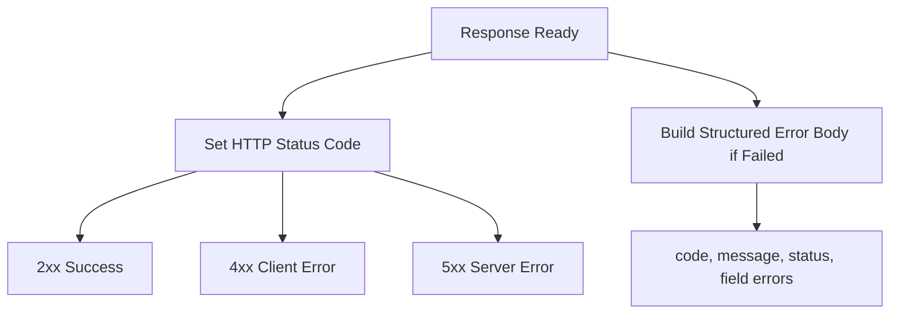

**Core Focus Areas:** HTTP status codes | Structured error responses | Client vs server error distinction | Validation error detail | Consistency

---

### 4. What is the difference between path parameters and query parameters, and how should each be used in REST API design?

**Simple Definition:** A path parameter answers "which one" (like a house's street address — there's exactly one), while a query parameter answers "show me which subset, in what order" (like telling a librarian "just the mystery novels, published after 2010, sorted by title"). Mixing them up is like putting your filtering criteria into the house address itself.

**Official Definition:** A path parameter is a variable segment of a URI (Uniform Resource Identifier) that identifies a specific resource or sub-resource within a hierarchical structure, whereas a query parameter is a key-value pair appended after a `?` in the URI that modifies the scope, filtering, sorting, or pagination of a request without altering which base resource or collection is being addressed.

**Primary Responsibilities / Core Details:**
- **Path parameters express identity:** `/products/123` — the `123` is not optional and not a filter; it's *which* product. Removing it changes what resource you're even talking about.
- **Query parameters express refinement of a collection:** `/products?category=electronics&inStock=true&sort=-price&page=2` — every one of these is optional; omitting them still returns a valid (just broader) result set from the *same* resource collection.
- **Growing a path with filters is an anti-pattern:** `/products/electronics/in-stock/under-50/sorted-by-price` becomes unmanageable as filter combinations multiply combinatorially, and it conflates "what resource" with "what subset of it," which are different concerns.
- **Query parameters must never encode a mutating action:** `GET /products?action=delete&id=42` breaks the fundamental guarantee that GET is safe (no side effects) — anything that treats GET as cacheable/prefetchable/safe-to-retry (browsers, CDNs, crawlers, link-prefetchers) could trigger a delete without the developer's intent.
- **The HTTP method still owns "what operation":** even with clean path/query separation, it's the method (GET/POST/PUT/DELETE) — not any part of the URL — that says what's being done to the addressed resource.
- **Sorting/pagination belong in query parameters, not the path**, because they're presentation-layer concerns about the *same underlying collection*, not different resources.
- **Predictable query parameter naming matters too:** just like Law 8 for response bodies, query parameter names (`sort` vs `sortBy` vs `orderBy`) should be standardized across all endpoints for the same reason — reduced cognitive load.
- **Multi-value filters need a consistent array convention:** filtering by several categories at once can be written as `?category=books&category=games` (repeated key) or `?category=books,games` (comma-separated) — either is valid, but an API mixing both conventions across different endpoints forces clients to special-case parsing per route.
- **Path parameters should be validated as strictly as any other input:** an `:id` segment isn't automatically safe just because it's in the path rather than the query string or body — it still needs type/format validation (e.g., confirming it's a valid UUID or numeric ID) before being used in a database lookup, to avoid malformed-ID errors surfacing as confusing 500s instead of a clean 400.

**Real-World Example:** The GitHub API's `/search/issues` endpoint uses `q` as a query parameter carrying a structured search string (`q=repo:owner/name+is:open+label:bug`), while `/repos/{owner}/{repo}/issues/{issue_number}` uses path parameters for the specific, addressable resource. Search/filter logic lives entirely in the query string; resource identity lives entirely in the path — the two responsibilities never overlap in the same segment. GitHub's list endpoints also standardize `page` and `per_page` as query parameters across every collection resource (issues, pull requests, commits, releases), so a developer who learns pagination on one endpoint can apply it unchanged to any other.

**Best Coding/Development Practices:**
1. **Route resource identity through `:id`-style path parameters, and filtering through `req.query`.**
   ```javascript
   app.get('/orders/:id', (req, res) => { /* identity */ });
   app.get('/orders', (req, res) => {
     const { status, sort, page = 1 } = req.query; // refinement
   });
   ```
2. **Whitelist and validate accepted query parameters explicitly, rejecting unknown ones with a `400`** rather than silently ignoring typos (e.g., `?stauts=shipped`).
   ```javascript
   const ALLOWED = ['status', 'sort', 'page', 'pageSize'];
   const unknown = Object.keys(req.query).filter(k => !ALLOWED.includes(k));
   if (unknown.length) return res.status(400).json({ error: { code: 'UNKNOWN_QUERY_PARAM', fields: unknown } });
   ```
3. **Never perform a write operation inside a GET handler, regardless of what the query string contains.**
   ```javascript
   app.get('/products', (req, res) => {
     // Only ever reads — no branch here should ever call db.*.delete/update/insert
     res.status(200).json(db.products.find(req.query));
   });
   ```
4. **Standardize sort/pagination parameter names globally** (e.g., always `sort`, `page`, `pageSize`) and document them once, rather than per-endpoint.
   ```javascript
   function paginate(req) {
     return { page: Number(req.query.page) || 1, pageSize: Number(req.query.pageSize) || 20 };
   }
   ```
5. **Validate path-parameter format before hitting the database**, returning a clean `400` instead of letting a malformed ID crash into a `500`.
   ```javascript
   app.get('/orders/:id', (req, res, next) => {
     if (!/^[0-9a-fA-F]{24}$/.test(req.params.id)) {
       return res.status(400).json({ error: { code: 'INVALID_ID_FORMAT' } });
     }
     next();
   }, getOrder);
   ```

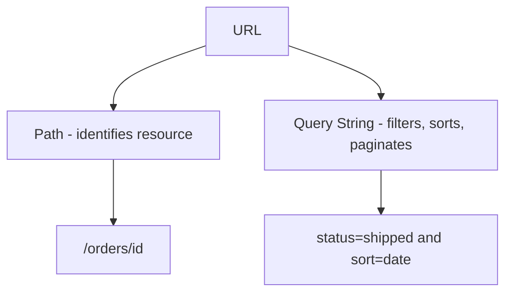

**Core Focus Areas:** Path vs query semantics | Resource identity | Filtering and pagination | GET safety | Predictable query naming

---

### 5. How should a backend team approach API versioning and evolution to avoid breaking existing clients?

**Simple Definition:** API versioning is like renovating a restaurant while it's still open — you don't rip out the whole kitchen overnight; you either keep serving the old menu on request or clearly tell customers "the menu changed, here's the new one," instead of silently swapping dishes and letting regulars order something they didn't expect.

**Official Definition:** API versioning is a formal strategy for evolving the contract (request/response shape, field semantics, and behavior) of a web API over time, using an explicit signaling mechanism (such as a URI segment, HTTP header, or media type) that allows a server to support multiple contract versions concurrently, preventing backward-incompatible changes from silently breaking clients built against an earlier contract.

**Primary Responsibilities / Core Details:**
- **Distinguish additive from breaking changes first:** adding a new, optional, non-required field to a response is typically safe and doesn't require versioning, because well-built clients ignore unknown fields. Changing an existing field's type/meaning, removing a field, or restructuring the response (like the lecture's `price` number → `pricing` object example) is breaking and does require a strategy.
- **URL-based versioning** (`/v1/orders`, `/v2/orders`): highly visible, easy to route/cache/log by version, but can lead to route duplication across the codebase if overused.
- **Header-based versioning** (e.g., `Accept-Version: 2` or content-type media-type versioning like `application/vnd.company.v2+json`): keeps URLs stable (better for caching by resource identity) but is less discoverable — developers must know to look at headers, not just the browser address bar.
- **The specific mechanism matters less than consistency:** picking *one* strategy and applying it to every versioned change is more valuable than picking the theoretically "best" strategy — mixing URL versioning for some endpoints and header versioning for others reintroduces exactly the unpredictability the whole exercise is meant to eliminate.
- **Always provide a migration path:** versioning without a deprecation plan just delays the pain — communicate a timeline, keep both versions running long enough for clients to migrate, and monitor real traffic on the old version before retiring it.
- **Avoid unnecessary version bumps:** over-versioning (bumping the version for every additive change) creates maintenance overhead and forces clients to track version churn that never actually affected them — reserve version bumps strictly for genuinely breaking changes.
- **Internal communication matters as much as the technical mechanism:** a changelog, deprecation headers (e.g., `Deprecation: true` / `Sunset: <date>`), and advance notice are part of "treating changes carefully," not just the versioning scheme itself.
- **Semantic-style major/minor thinking still applies even without a formal semver string:** a "major" version bump maps to breaking changes (new URL/header version required), while a "minor," backward-compatible addition can ship silently under the existing version — teams benefit from applying this same mental model to APIs even when the version identifier itself is just a single integer or a date.
- **Backward-compatible transformation layers reduce the cost of supporting old versions:** rather than maintaining fully separate code paths per version indefinitely, a common pattern is to build the *latest* internal representation once, then transform it down to each supported public version at the response-formatting boundary, keeping the core business logic version-agnostic.

**Real-World Example:** Stripe uses date-based header versioning — every account is pinned to an API version like `2023-10-16` via the `Stripe-Version` header, and Stripe maintains backward-compatible transformation logic internally so that older-pinned accounts keep receiving the old response shape indefinitely, even as the "latest" version evolves. This lets Stripe ship breaking changes to new integrators without forcing existing production integrations to update on Stripe's timeline.

**Best Coding/Development Practices:**
1. **Ask "is this additive or breaking?" before touching a shared response shape**, and only reach for versioning when the answer is "breaking."
   ```javascript
   // Additive — safe, no version bump needed
   res.status(200).json({ id: order.id, total: order.total, giftWrapped: order.giftWrapped });
   ```
2. **Run old and new versions side by side rather than mutating a live endpoint in place.**
   ```javascript
   app.get('/v1/products/:id', (req, res) => res.json({ id: p.id, price: p.amount }));
   app.get('/v2/products/:id', (req, res) => res.json({ id: p.id, pricing: { amount: p.amount, currency: 'USD' } }));
   ```
3. **Signal deprecation explicitly instead of silently removing an old version.**
   ```javascript
   app.get('/v1/products/:id', (req, res) => {
     res.set('Deprecation', 'true');
     res.set('Sunset', '2026-12-31');
     res.status(200).json({ id: p.id, price: p.amount });
   });
   ```
4. **Centralize version-to-shape transformation logic** so the core business logic stays version-agnostic, and only the response-formatting layer branches by version.
   ```javascript
   function formatProduct(product, version) {
     return version === 'v2'
       ? { id: product.id, pricing: { amount: product.amount, currency: 'USD' } }
       : { id: product.id, price: product.amount };
   }
   ```
5. **Track real usage of each version** (request volume, unique clients) before retiring an old one, rather than retiring on a fixed calendar date regardless of actual migration progress.

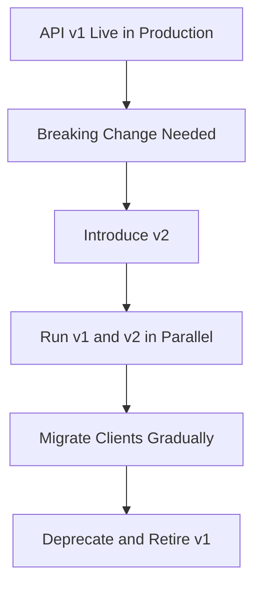

**Core Focus Areas:** API versioning strategies | Breaking vs additive changes | Client migration paths | Deprecation signaling | Contract stability
