# Phase 1 — Planning: "Broad First, Detail Later"

**SDLC series — Phase 1 of 6.** How professional backend teams do **Planning** today: the core tasks, the Waterfall way vs. the modern way, and the industry practices modern teams add.

> **Last reviewed:** 2026-11-27 · **Next review due:** 2027-05-27 · **Review owner:** Product Owner · [Review rule](../README.md#91-review-schedule) · [Review log](../CHANGELOG.md)

[Guide README](../README.md) · [Design →](../02-Design/Design.md)

---

## 0. Jargon Translation (Read This First)

| Term                                       | Official Definition                                                                                          | Simple Words                                                                     | Analogy                                                               |
| ------------------------------------------ | ------------------------------------------------------------------------------------------------------------ | -------------------------------------------------------------------------------- | --------------------------------------------------------------------- |
| **SDLC (Software Development Life Cycle)** | A systematic process to build high-quality software in a predictable time and budget.                        | The steps a team follows from idea to running software.                          | A recipe for a big meal.                                              |
| **Waterfall**                              | A model where each phase is fully finished before the next starts, with no going back.                       | One straight pass: plan everything, then build everything, then test everything. | Water falling down steps.                                             |
| **Agile**                                  | A way of working in short loops that deliver small, working pieces of software and adapt to feedback.        | Build a little, show it, learn, repeat.                                          | Cooking one dish at a time and tasting each before the next.          |
| **Sprint / Iteration**                     | A fixed time-box (usually 1–4 weeks) in which a team delivers a small set of features.                       | One short loop of work.                                                          | One lap of a running track.                                           |
| **DevOps**                                 | A culture and set of practices where development and operations work as one team, with heavy automation.     | The people who build the software also release and run it.                       | A chef who also serves the food and hears what guests think.          |
| **Backlog**                                | An ordered list of work items (features, bugs, tasks), most valuable first.                                  | The team's "to-do list", always kept in order.                                   | A shopping list sorted by "need most".                                |
| **Epic**                                   | A large feature that is too big for one sprint and is split into user stories.                               | A big chunk of work.                                                             | "Renovate the kitchen".                                               |
| **User story**                             | A short requirement written from the user's point of view: _"As a [user], I want [goal], so that [reason]."_ | One small thing a user needs.                                                    | "Fit a new tap".                                                      |
| **Acceptance criteria**                    | Clear yes/no conditions a story must meet to be accepted.                                                    | The checklist that says "this story is done".                                    | "Tap does not leak; hot and cold both work".                          |
| **Definition of Ready (DoR)**              | A checklist a backlog item must pass before the team can start it in a sprint.                               | "Is this story clear enough to start?"                                           | Checking you have all ingredients before you start cooking.           |
| **Persona**                                | A short, research-based profile of a typical user.                                                           | A pretend "typical user" with a name, goals and problems.                        | "Asha, 28, reads 3 books a month, wants honest reviews."              |
| **Functional requirement**                 | A statement of what the system must do.                                                                      | A thing the software does.                                                       | "The car must have brakes."                                           |
| **Non-functional requirement**             | A statement of how well the system must work (performance, security, availability, usability).               | How fast, safe or reliable it must be.                                           | "The car must stop from 100 km/h in under 40 m."                      |
| **MVP (Minimum Viable Product)**           | The smallest version of a product that delivers real value and lets the team learn from real users.          | The simplest useful first version.                                               | A food truck before opening a full restaurant.                        |
| **Feasibility study**                      | An early check that a project is technically, economically, legally, operationally and time-wise possible.   | "Can we, and should we, build this?"                                             | Checking your budget and the land before building a house.            |
| **Risk register**                          | A living list of project risks with likelihood, impact, mitigation and owner.                                | The team's "what could go wrong" list, with a plan for each.                     | A ship's list of dangers on the route and how to avoid each one.      |
| **Traceability**                           | The ability to link each requirement to its design, code and tests.                                          | Following one requirement all the way to its test.                               | A parcel tracking number.                                             |
| **Gherkin**                                | A plain-language format (Given / When / Then) for writing acceptance criteria that tools can run as tests.   | Test steps written like simple sentences.                                        | A recipe card: "Given flour, when you add water, then you get dough." |
| **SLO (Service Level Objective)**          | A measurable reliability target, for example "99.9% of requests succeed".                                    | A number that says "good enough" for users.                                      | "The bus arrives on time 99 days out of 100".                         |
| **Discovery phase** | A short, fixed-price phase before the build where we turn a vague client idea into a clear plan and a real estimate. | "Find out what to build before we price it." | A doctor's check-up before the treatment plan. |
| **PRD (Product Requirements Document)** | A document that describes the problem, users, goals, features and scope of a product. At LumenVenture the **client PRD** is the plain-language version the client approves. | "What we will build, in the client's words." | The menu a caterer agrees with you before the party. |
| **MoSCoW** | A way to prioritize: **M**ust have, **S**hould have, **C**ould have, **W**on't have (this time). | Sort features into four boxes by importance. | Packing for a trip: passport (must), jacket (should), book (could), surfboard (won't). |
| **Assumption** | Something we believe is true but the client has not confirmed yet. | "We guessed this — please check." | Assuming a guest eats meat because nobody said otherwise. |
| **Decision-maker** | The one named person on the client side who can approve scope and budget. | The person whose "yes" counts. | At a wedding, the couple, not every guest, chooses the menu. |
| **Elicitation** | Drawing out requirements from stakeholders with techniques such as interviews, workshops, observation and prototypes. | Asking and watching to find the real needs. | A doctor asking questions to find the real problem. |
| **Goal / objective** | A **goal** is a broad, long-term outcome. An **objective** is a specific, measurable result that shows progress toward it. | Goal = the big "why"; objective = a number with a date. | "Get fit" vs. "run 5 km in under 30 minutes by June". |
| **OKR (Objectives and Key Results)** | A goal-setting format: a qualitative **objective** plus 2–5 measurable **key results**. | What we want, and the numbers that prove we got it. | "Be a strong runner" → "5 km under 30 min; 3 runs a week". |
| **Power / interest grid** | A 2×2 grid that sorts stakeholders by their power over the project and their interest in it. | A map that shows who to involve, and how much. | Seating plan for a wedding: family at the front, neighbors at the back. |
| **EARS (Easy Approach to Requirements Syntax)** | Five sentence patterns (*always / When / While / If…then / Where*) for writing clear system requirements. | Fill-in-the-blank sentences that remove vague words. | A form with fixed boxes instead of a blank page. |
| **Validation vs. verification** | **Validation:** are we building the **right** thing? **Verification:** is it written / built **right**? | Right thing vs. thing done right. | Right recipe for the guests vs. recipe followed correctly. |
| **Baseline** | An approved version of the requirements; later changes go through change control. | The "official" version everyone agreed on. | The signed version of a contract. |
| **URS / SRS / SysRS** | **User**, **Software** and **System** Requirements Specification. In ISO/IEC/IEEE 29148 the names are StRS, SRS and SyRS. | User needs / what the software does / what the whole system (with hardware and people) does. | The family's wish list / the architect's plan / the plan for the whole house with plumbing and power. |

---

## 1. The job (same in every model)

- Find out **what** to build, **for whom**, **why**, and with **what time and money**.
- **Other names:** some organizations call this phase **"requirements"**, **"strategy"** or **"analysis"**. Some split it into two stages (for example **feasibility** + **requirements analysis**).
- **Why it comes first:** every later phase depends on it. A wrong requirement makes everything built on top of it wrong — and the later it is found, the more it costs to fix.
- Consider the **eight planning factors**: users, purpose, data inputs and outputs, legal and regulatory compliance, risks, QA (Quality Assurance) requirements, human and financial resources, and schedule (see [3](#3-the-eight-planning-factors-then-and-now)).
- **The four core requirement steps are the same in every model.** Requirements are:
  1. **gathered** (collected from stakeholders),
  2. **analyzed** (checked: are they clear, possible, not conflicting?),
  3. **documented** (written down), and
  4. **prioritized** (ordered by importance: "must have" first).
- **Other core planning tasks (also still true):**
  - **Estimate labor and material costs** and weigh them against **time constraints**.
  - **Identify project teams** and **propose the role** of each team member.
  - Build **prototypes** when stakeholders struggle to define requirements. Prototyping can also happen **in any later phase** when requirements need to be clarified again.
  - Combine the requirements into a document (the **SRS**) that **all stakeholders understand and approve**, with **developers involved** early.

## 2. The four core steps: Waterfall way vs. modern way

- **What stays the same:** all four steps still happen. They usually follow this order, but in practice they **loop**: analysis often shows a gap, so the team gathers again.
- **What changes:**
  - **Waterfall** does them **once**, for **all** requirements, at the start.
  - **Modern teams** do them **broadly once at the start**, then **again in every sprint**, in more detail for the next few items only.

| Step              | Waterfall way (once, up front)                              | Modern way (start + every sprint)                                                                                                                                    | Modern tools and methods                                                                                            |
| ----------------- | ----------------------------------------------------------- | -------------------------------------------------------------------------------------------------------------------------------------------------------------------- | ------------------------------------------------------------------------------------------------------------------- |
| **1. Gather**     | Long interviews and workshops before any work starts        | Kick-off workshops at the start, then continuous input: Sprint Reviews, user feedback, analytics, support tickets                                            | Story mapping workshops, user interviews, product analytics                                                         |
| **2. Analyze**    | Analysts check the whole list once                          | Each story is checked in **backlog refinement**: is it clear, possible, testable, not in conflict with others? Developers and testers take part.                     | **INVEST** checklist (Independent, Negotiable, Valuable, Estimable, Small, Testable), spikes (short research tasks) |
| **3. Document**   | One large SRS document, signed off                          | A **light SRS** or product brief for the big picture, plus **user stories with acceptance criteria** in a tracking tool. The documents change as the project learns. | Jira, GitHub Issues, Azure Boards, Markdown docs in Git                                                             |
| **4. Prioritize** | Fixed once in the SRS; changes need a formal change request | **Re-prioritized every sprint** by the product owner, based on value, risk and feedback                                                                              | **MoSCoW** (Must, Should, Could, Won't), value vs. effort matrix                                                    |

**The other planning tasks, then and now:**

| Core task                                    | Waterfall way                                                           | Modern way                                                                                                                                                                                                                                                                  |
| -------------------------------------------- | ----------------------------------------------------------------------- | --------------------------------------------------------------------------------------------------------------------------------------------------------------------------------------------------------------------------------------------------------------------------- |
| **Estimate costs vs. time**                  | One detailed estimate for the whole project, fixed at the start         | A rough range for the whole project, then **re-estimated every sprint** (story points, T-shirt sizes); the team's measured speed (**velocity**) makes forecasts better over time. Velocity is only for the team's own forecasting — never for comparing teams or people     |
| **Identify teams and propose roles**         | Roles split by phase (analysts, designers, coders, testers, operations) | **Small cross-functional teams** that own a product end to end; key roles: **product owner** (what and in which order), **Scrum Master** (a coach who helps the team follow Scrum and removes blockers — not a manager), and developers (who also test and run the service) |
| **Prototypes to find requirements**          | A mock-up shown to the client during planning                           | Fast throwaway prototypes in days (Figma, quick demo apps), and real users trying early releases                                                                                                                                                                            |
| **SRS approved by all, developers involved** | One formal sign-off of the full SRS                                     | Stakeholders agree on the vision and priorities; **developers and testers join refinement** for every story; each story is "approved" when its acceptance criteria are agreed                                                                                               |

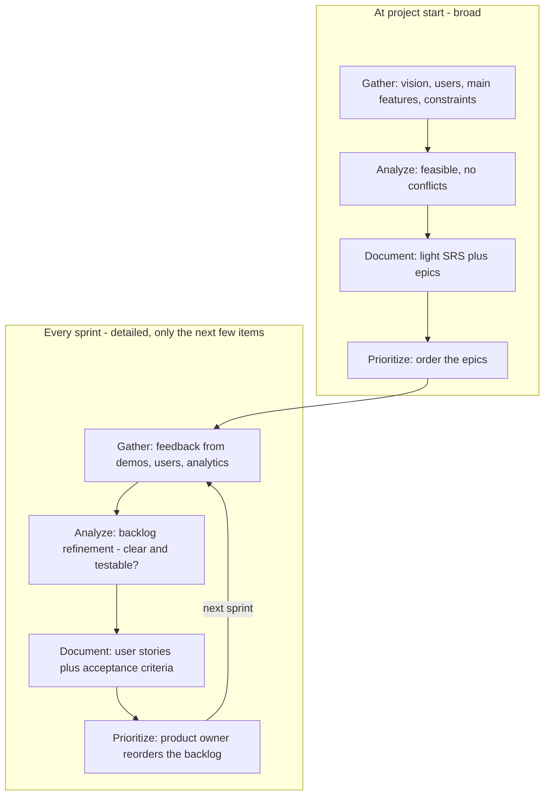

> **Remember:** the four steps are **timeless**. Waterfall runs them **once, in full detail**. Modern teams run them **broadly at the start, then in detail every sprint**.

### 2.1 The full six-step requirements process

The four core steps above are the middle of a longer process. The full **requirement gathering** process has **six steps**: two **before** gathering starts, and the four core steps. Steps 3–5 **loop**: each check finds gaps, so the team asks again.

| # | Step | Main question | Output | Details |
|---|------|---------------|--------|---------|
| 1 | **Identify stakeholders** | Who cares about this product? | Stakeholder register, power/interest grid | [4.1](#41-stakeholder-identification-and-analysis) |
| 2 | **Establish goals and objectives** | Why build it? How do we measure success? | Goals + measurable objectives (key results) in the project brief | [4.10](#410-goals-objectives-and-success-metrics) |
| 3 | **Elicit** (= gather) | What do people need? | Interview notes, workshop results, data | [4.11](#411-elicitation-toolbox) |
| 4 | **Document** | How do we write it so it can be tested? | Stories with IDs and acceptance criteria; EARS sentences | [4.12](#412-writing-requirements-that-can-be-tested) |
| 5 | **Analyze and confirm** | Is it clear, consistent, complete? Do stakeholders agree? | Approved requirements = **baseline** | [4.13](#413-checking-and-confirming-requirements) |
| 6 | **Prioritize** | What comes first? | One ordered backlog | [4.14](#414-prioritization-frameworks) |

**The modern way:** the six steps run at **three moments** — broadly at project start, in detail for the next few stories every sprint, and again after each release, when real use gives new input.

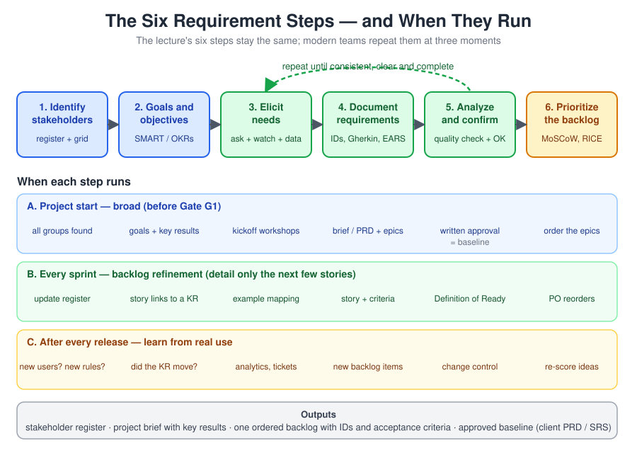

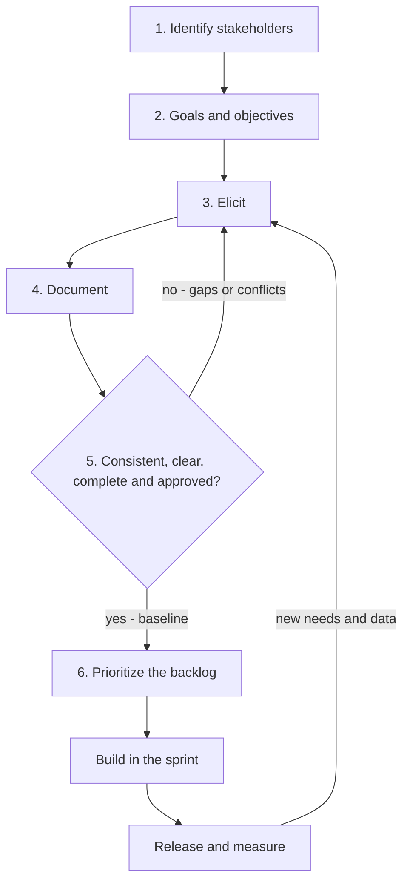

## 3. The eight planning factors: then and now

Eight factors are traditionally considered in planning. All eight are still required today. What changed is **how** teams work them out.

| #   | Factor                              | Question it answers                           | Waterfall way                                                     | ✅ Modern way                                                                                                                                                                                                                                                                                                                                                                                                         |
| --- | ----------------------------------- | --------------------------------------------- | ----------------------------------------------------------------- | --------------------------------------------------------------------------------------------------------------------------------------------------------------------------------------------------------------------------------------------------------------------------------------------------------------------------------------------------------------------------------------------------------------------- |
| 1   | **Users of the solution**           | Who will use it?                              | A list of user types in the SRS                                   | **Personas** (short profiles of typical users) built from **user research**; for APIs, also the **client apps and services** that call it                                                                                                                                                                                                                                                                             |
| 2   | **Overall purpose**                 | Why does it exist?                            | A purpose statement in the SRS                                    | A **product vision** plus **measurable success metrics** (KPIs — Key Performance Indicators, or OKRs — Objectives and Key Results), for example _"500 reviews posted in the first month"_                                                                                                                                                                                                                             |
| 3   | **Data inputs and outputs**         | What data goes in and comes out?              | Data tables described in the SRS                                  | A first **data model** and **API contract** sketch; **data classification** (which data is personal or sensitive — PII, Personally Identifiable Information); how long data is kept (**retention**)                                                                                                                                                                                                                   |
| 4   | **Legal and regulatory compliance** | Which laws or rules apply?                    | Checked once by the legal team                                    | Checked early **and** for every new feature: privacy laws (**GDPR** — General Data Protection Regulation, **CCPA** — California Consumer Privacy Act), **accessibility** (**WCAG** — Web Content Accessibility Guidelines), **open-source licenses**, and AI rules if the product uses AI (the **EU AI Act**: transparency rules apply from 2 Aug 2026, high-risk Annex III rules from 2 Dec 2027 after the Digital Omnibus amendments). Clients in the EU may also fall under **NIS2** (Directive (EU) 2022/2555: security and supply-chain duties for essential and important entities), which can flow down to us as their supplier. Under GDPR, high-risk data processing needs a **DPIA** (Data Protection Impact Assessment) |
| 5   | **Risk identification**             | What could go wrong?                          | A risk list written once                                          | A **risk register** that is **reviewed regularly**: each risk has a **likelihood**, an **impact**, a **mitigation** (plan to reduce it) and an **owner**. Security risks are found early with **threat modeling**                                                                                                                                                                                                     |
| 6   | **QA requirements**                 | What quality level is required?               | Quality goals written in words                                    | **Non-functional requirements** written as **numbers** (SLOs — Service Level Objectives), a **test strategy**, and a team **Definition of Done**                                                                                                                                                                                                                                                                      |
| 7   | **Human and financial resources**   | Who works on it, and how much money is there? | Staff and budget fixed for the whole project                      | A **stable cross-functional team**; budget reviewed often; **cloud costs** estimated and watched from the start (**FinOps** — financial operations for the cloud)                                                                                                                                                                                                                                                     |
| 8   | **Project scheduling**              | When is each part due?                        | A **Gantt chart** with fixed **milestones** for the whole project | A **roadmap** (goals by month or quarter), a **release plan**, and **sprints**; fixed dates are kept for real deadlines (for example a legal date), and **scope** is what flexes                                                                                                                                                                                                                                      |

### 3.1 Risk register example

| Risk                        | Likelihood | Impact    | Mitigation                                                                         | Owner             |
| --------------------------- | ---------- | --------- | ---------------------------------------------------------------------------------- | ----------------- |
| Spam reviews flood the site | High       | Medium    | Login required; rate limiting; one review per user per book                        | Backend lead      |
| Personal data leak          | Low        | Very high | Hash passwords; encrypt data; least-privilege database users; security tests in CI | Security champion |
| Key developer leaves        | Medium     | High      | Code review, shared ownership, written ADRs                                        | Team lead         |
| Cloud bill grows too fast   | Medium     | Medium    | Budget alerts; right-size servers; review costs monthly                            | Product owner     |

## 4. Often-missed parts of a good plan

These are often missing from classic textbooks, but professional teams treat them as part of planning.

### 4.1 Stakeholder identification and analysis

- **List every stakeholder** before gathering requirements: users, customers, product owner, developers, testers, operations, security, legal, support.
- Note what each one **needs** and how much **influence** they have. Missing a stakeholder (for example the legal team) means missing their requirements.
- Have a **representative from every group the product affects**. A group nobody asked = requirements nobody wrote. Example: if support is not asked, the product may have no way to look up a customer's account — and support finds out after launch.
- **Analyze, don't only list.** Place each stakeholder on a **power / interest grid**; the box tells you how to involve them:

  | | **Low interest** | **High interest** |
  |---|---|---|
  | **High power** | **Keep satisfied** — short updates, ask at key decisions (finance director) | **Manage closely** — every decision and demo; they sign off (sponsor, client decision-maker) |
  | **Low power** | **Monitor** — check now and then (vendor account manager) | **Keep informed** — user research, demos, release notes (end users, support, operations) |

- **Describe end users as personas** built from research, not guesses ("Asha, 28, reads reviews on her phone during her commute").
- **Groups people often forget:** security and compliance, legal and privacy, accessibility, operations / SRE (Site Reliability Engineering), data and analytics, customer support, users who are **not** employees (the public), regulators and partners.
- **One named decision-maker.** Many people give input; **one** person approves scope and priorities. Record them in the [stakeholder register](templates/stakeholder-register.md).

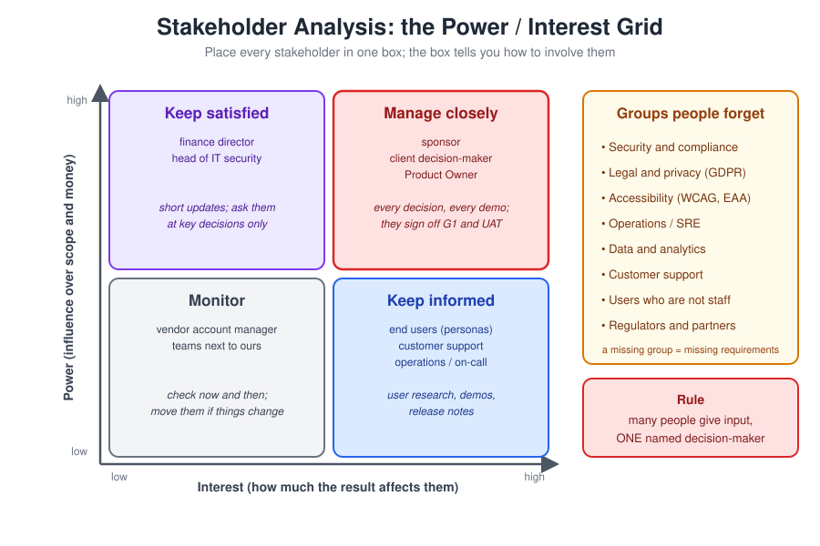

### 4.2 Feasibility study

Before committing, check if the project **can** and **should** be done:

| Type                        | Question                                                |
| --------------------------- | ------------------------------------------------------- |
| **Technical**               | Can we build it with the technology and skills we have? |
| **Economic** (cost-benefit) | Is the value bigger than the cost?                      |
| **Legal**                   | Is it allowed?                                          |
| **Operational**             | Will people actually use it, and can we run it?         |
| **Schedule**                | Can it be done in the time we have?                     |

### 4.3 Functional vs. non-functional requirements

Every requirements list must contain **both** kinds:

| Kind                                    | What it describes        | Examples (Book Review API)                                                                                                                                                                                                              |
| --------------------------------------- | ------------------------ | --------------------------------------------------------------------------------------------------------------------------------------------------------------------------------------------------------------------------------------- |
| **Functional**                          | **What** the system does | "A logged-in user can add a review." "Anyone can list reviews for a book."                                                                                                                                                              |
| **Non-functional** (quality attributes) | **How well** it does it  | **Performance:** 95% of requests in under 200 ms. **Availability:** 99.9%. **Security:** passwords hashed. **Scalability:** handle 10x traffic. **Accessibility:** WCAG 2.2 AA for the website. **Maintainability:** 80% test coverage. |

- Teams often forget the non-functional ones — and these are usually the hardest to add later.
- **Accessibility is often a legal requirement, not only a nice-to-have.** In the EU, the **European Accessibility Act** has applied since **28 June 2025** to many consumer digital products and services (for example e-commerce, banking, e-books, passenger transport ticketing); very small service companies (microenterprises) are exempt. **WCAG 2.2 level AA** is the usual technical target.

### 4.4 Scope, MVP, assumptions, constraints and dependencies

- **Scope:** write what is **in scope** and also what is **out of scope**. "Out of scope" stops arguments later.
- **MVP (Minimum Viable Product):** the smallest version that delivers real value and lets you learn from real users. Build it first.
- **Assumptions:** things you believe are true but have not proven (for example "users already have an account"). Check them early.
- **Constraints:** fixed limits (budget, deadline, required technology, laws).
- **Dependencies:** things you need from others (a payment provider's API, another team's service).
- **Do not mix up constraints and assumptions.** A **constraint** is a fixed fact ("must run on the client's Azure subscription"). An **assumption** is a **guess** we act on ("we assume every user already has a company account"). An assumption is a **risk**: if it is wrong, the plan changes — so each one gets an owner and a date to confirm it (client projects: in the [assumptions and decisions log](templates/assumptions-and-decisions-log.md)).

| Statement | Type |
|-----------|------|
| "The site must meet WCAG 2.2 AA." | **Constraint** (conformance to a standard) |
| "We assume readers already have an email address." | **Assumption** (not confirmed — a risk) |
| "Book details come from the Open Library API." | **Dependency** (another software product) |

### 4.5 Definition of Ready and traceability

- **Definition of Ready (DoR):** a checklist a story must pass **before** a sprint can start it — for example "clear acceptance criteria, small enough for one sprint, no open blockers".
- **Traceability:** give each requirement an **ID** (for example `REQ-07`) and link it to its design, code (commits, PRs) and tests. You can then prove every requirement was built and tested. In regulated industries, a **traceability matrix** is required.

### 4.6 Change management

Requirements **will** change. The plan must say **how** changes are handled:

|                               | Waterfall way                                    | Modern way                                |
| ----------------------------- | ------------------------------------------------ | ----------------------------------------- |
| **How a change is requested** | A formal **change request**                      | A new or edited item in the **backlog**   |
| **Who decides**               | A **change control board**                       | The **product owner**, with the team      |
| **When it is built**          | After re-planning, re-estimating and re-approval | In a coming sprint, based on its priority |

### 4.7 Writing acceptance criteria that can be tested

A common modern format is **Gherkin** (_Given / When / Then_). It is readable by non-developers, and tools (for example Cucumber) can run it as an automated test.

```gherkin
# features/add-review.feature — acceptance criteria for REQ-07
Feature: Add a book review
  As a reader, I want to rate a book from 1 to 5,
  so that other readers can judge it.

  Scenario: Valid rating is saved
    Given I am logged in as "asha"
    When I post a review with rating 4 for book "978-0132350884"
    Then the response status is 201
    And the review is listed for that book

  Scenario: Rating outside 1 to 5 is rejected
    Given I am logged in as "asha"
    When I post a review with rating 6 for book "978-0132350884"
    Then the response status is 400

  Scenario: Guest cannot post
    Given I am not logged in
    When I post a review with rating 4 for book "978-0132350884"
    Then the response status is 401
```

**What happens if... acceptance criteria are vague?**

```gherkin
# ❌ Not testable — "fast" and "good" mean different things to different people
Scenario: Reviews work well
  Then the page loads fast and ratings look good
# ✅ Write numbers and exact results: "responds in under 200 ms", "status is 400".
```

### 4.8 Using AI tools in planning

- AI assistants can help **draft** user stories, find **missing edge cases**, and **summarize** interview notes.
- **A human must check every requirement.** AI can invent needs nobody asked for, or miss legal and business rules it does not know.
- Do **not** paste confidential customer data into AI tools that your company has not approved.

### 4.9 Workshops that turn vague ideas into clear requirements

| Workshop | What it does | Use it when |
|----------|--------------|-------------|
| **Story mapping** | Lays out the user's journey left to right, with stories under each step; a horizontal line marks the MVP | Planning the first release; showing the client the "big picture" |
| **Example mapping** | For one story, the PO, a developer and a tester write the **rules** and concrete **examples** on cards (about 25 minutes); open questions get their own cards | Before a complex story enters a sprint; the examples become the acceptance criteria |
| **EventStorming** | The team and business people map the process as a timeline of **domain events** ("Review posted", "Review reported") on sticky notes | Complex business processes; finding module boundaries for the design (see [Design 4.2](../02-Design/Design.md#42-choose-an-architecture-style)) |

### 4.10 Goals, objectives and success metrics

- **Goals come before requirements.** Every requirement should help reach an objective. A requested feature that supports **no** objective is a "could have" or "won't have this time".
- **Goal** = broad, long-term outcome (a customer outcome or a business goal). **Objective** = specific, measurable result that shows progress toward the goal.
- An objective is a **result**, not an action: "run an ad campaign" is an action; "50,000 monthly active users by December" is the objective.
- **Write objectives as SMART** targets — **S**pecific, **M**easurable, **A**chievable, **R**elevant, **T**ime-bound — or as **OKR key results**:

  ```text
  Objective (OKR):  Readers trust our reviews.
  Key result 1:     30% of visitors read at least one full review per visit (today 12%).
  Key result 2:     Fewer than 1% of reviews are reported as spam, by 30 June.
  Key result 3:     App store rating of 4.5 or higher by 31 December.
  ```

  - Watch the words: in OKRs the "objective" is the **qualitative** part, and the **key results** are what classic textbooks call "objectives".
- **Outcome over output.** "We shipped search" is **output**. "Users find a book 40% faster" is an **outcome**. Set targets on outcomes, and check them after each release with product analytics.
- **Give objectives IDs** (`OBJ-1`, `OBJ-2`) so stories can point to them. This gives one chain from **goal → objective → epic → requirement → test → measured result**:

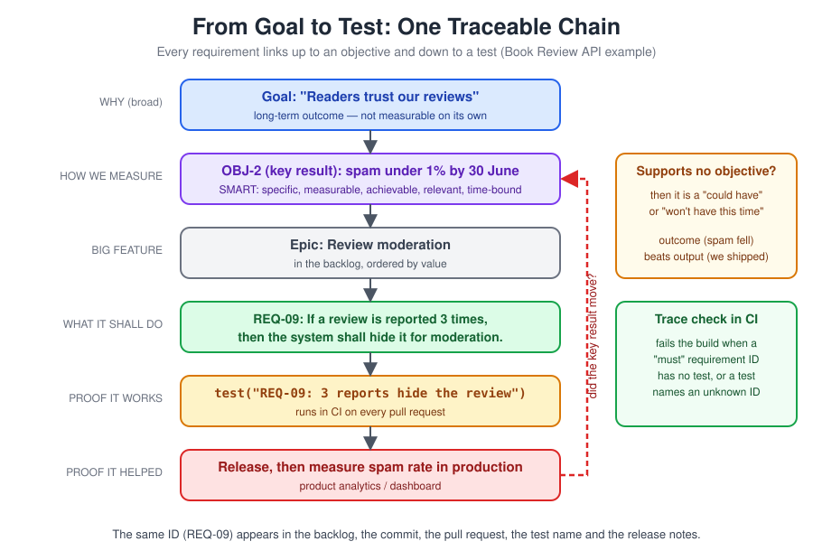

| | Goal | Objective / key result |
|---|---|---|
| **Level** | Broad | Specific |
| **Time** | Long-term | Has a date |
| **Measurable?** | Not directly | **Yes** — has a number |
| **Example** | "Readers find good books faster." | "Users find a book with 4+ stars in under 30 seconds by Q3." |

### 4.11 Elicitation toolbox

Surveys, questionnaires and interviews capture what people **say**. Add techniques that show what people **do**, and that make ideas **visible**. Use **more than one** technique on every project.

| Technique | How it works | Best for | Watch out |
|-----------|--------------|----------|-----------|
| **Interviews** | Talk with one person or a small group | Deep understanding; asking "why?" | Slow; depends on the interviewer |
| **Surveys / questionnaires** | The same written questions to many people | Numbers from many users, cheaply | Shallow; no follow-up questions |
| **Workshops** (story mapping, example mapping, EventStorming — [4.9](#49-workshops-that-turn-vague-ideas-into-clear-requirements)) | Stakeholders and the team in one session | Agreeing scope and rules fast; settling conflicts | Needs a good facilitator |
| **Observation** (contextual inquiry) | Watch users do their real work, where they do it | Needs users forget to mention (work-arounds) | Takes time; ask permission |
| **Prototypes** | Clickable mock-ups users try (for example Figma) | Non-technical stakeholders; UI needs | People may think it is "almost done" |
| **Document analysis** | Read manuals, forms, laws, old system specs | Business rules; legal rules | Old documents can be out of date |
| **Product analytics** | Look at real usage: funnels, drop-off points | What really happens, not what people say | Shows *what*, not *why* |
| **Support tickets and reviews** | Read complaints and app-store reviews | Pain points; missing features | Only hears from unhappy users |
| **Competitor analysis** | Study similar products | Features users expect as "basic" | Do not copy blindly |
| **JTBD (Jobs To Be Done) interviews** | Ask what "job" the user is trying to get done, and what they use today | The real motivation behind a request | Needs practice |

**Interview rules:**

1. Ask about **past behavior** ("Tell me about the last time you…"), not the future ("Would you use…?"). People are poor at predicting what they will do.
2. Keep asking **"why?"** to find the need behind the requested feature.
3. Ask for **examples** and **exceptions** ("What happens when it goes wrong?").
4. **Record** (with permission) and **send a written summary the same day** ([meeting summary template](templates/meeting-summary.md)).

### 4.12 Writing requirements that can be tested

Every requirement has an **ID**, a **source** (who asked, when), a **priority**, a link to an **objective**, and **acceptance criteria** ([user story template](templates/user-story.md)). Write it in a fixed **pattern** so it has only one meaning:

- **User-facing needs → user story + Given/When/Then** ([4.7](#47-writing-acceptance-criteria-that-can-be-tested)).
- **System behavior and non-functional needs → EARS** (Easy Approach to Requirements Syntax, from Rolls-Royce, 2009). Five patterns:

  | Pattern | Keyword | Template | Example |
  |---------|---------|----------|---------|
  | **Ubiquitous** (always true) | — | The `<system>` shall `<response>`. | The API shall return all dates in ISO 8601 format. |
  | **Event-driven** | **When** | When `<trigger>`, the `<system>` shall `<response>`. | When a review is reported 3 times, the system shall hide it for moderation. |
  | **State-driven** | **While** | While `<state>`, the `<system>` shall `<response>`. | While the database is in maintenance mode, the API shall return HTTP 503 with a `Retry-After` header. |
  | **Unwanted behavior** | **If … then** | If `<condition>`, then the `<system>` shall `<response>`. | If a login fails 5 times in 10 minutes, then the system shall lock the account for 15 minutes. |
  | **Optional feature** | **Where** | Where `<feature is included>`, the `<system>` shall `<response>`. | Where single sign-on is enabled, the system shall redirect users to the identity provider. |

- **Vague vs. testable:**

  | ❌ Vague | ✅ Testable |
  |---------|-------------|
  | "The system should be fast." | "95% of search requests shall respond in under 300 ms with 1,000 concurrent users." |
  | "The app must be secure." | "Passwords shall be hashed with Argon2id; the API shall meet OWASP ASVS 5.0 level 2." |
  | "Users can easily find books." | "A user shall find a book by title, author or ISBN from the home page in at most 2 clicks." |
  | "The system should handle errors." | "If the payment provider does not respond within 5 s, then the system shall show 'Payment delayed' and retry once." |

- **Words to avoid** (they cannot be tested): *fast, easy, user-friendly, flexible, robust, etc., and/or, as appropriate, should* (when you mean "must").
- **Cover the four SRS categories** so nothing is missed: **functional**, **external interface** (users, hardware, other software), **system features** (groups of related functional requirements), **non-functional** (performance, safety, security, quality — use **ISO/IEC 25010** as the checklist of quality areas).
- **Keep requirements as docs as code** where it helps: a `requirements.json` or Markdown file in Git, reviewed by pull request, so a CI script can check traceability (see [Testing rule 11](../04-Testing/Testing.md#64-rules)).

### 4.13 Checking and confirming requirements

**Step 5** checks the requirements, then gets stakeholder approval. Check **each requirement** against these quality characteristics (based on ISO/IEC/IEEE 29148):

| Characteristic | Question to ask |
|----------------|-----------------|
| **Necessary** | If we remove it, is something important missing? |
| **Unambiguous** (clear) | Can it be read only one way? |
| **Complete** | Does it contain everything needed to build and test it? |
| **Singular** | Does it state **one** thing (no "and/or")? |
| **Feasible** | Can we build it with the time, money and technology we have? |
| **Verifiable** | Can we prove it with a test, inspection, demonstration or analysis? |
| **Correct** | Is it what the stakeholder really needs? |
| **Consistent** (as a set) | Does it agree with all other requirements? |

- **Two different checks:**
  - **Validation** — "Are we building the **right** thing?" Check against real needs: walkthroughs, prototype reviews, demos.
  - **Verification** — "Are the requirements **written right**?" Check against the table above: peer review by a developer ("can I build it?") and a tester ("can I test it?").
- **Approval is written**, not only spoken: a signed document, an approval in the tracking tool, or an email.
- **The approved set is the baseline.** Changes after that follow the change process ([4.6](#46-change-management)): a backlog edit by the PO on internal projects; a [change request](templates/change-request.md) with cost and time on client and regulated projects.

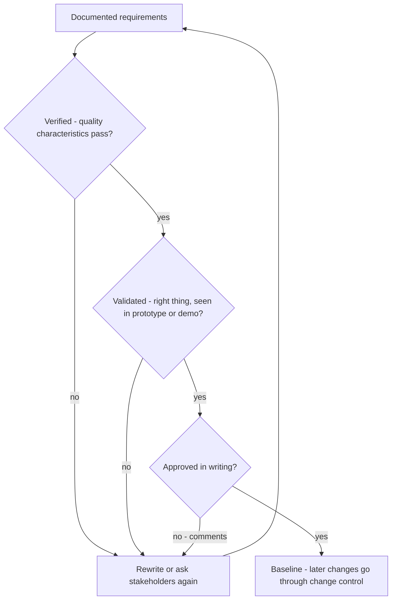

### 4.14 Prioritization frameworks

**MoSCoW** is our default (it is the modern form of "must-have / highly desired / nice to have", plus an explicit "won't have this time" list). Other frameworks help when there are many ideas to compare:

| Framework | How it works | Use it when |
|-----------|--------------|-------------|
| **MoSCoW** | **M**ust, **S**hould, **C**ould, **W**on't have (this time). Guideline: Musts are no more than about 60% of the effort | Agreeing scope with a client; fixed-date projects |
| **RICE** | Score = **R**each × **I**mpact × **C**onfidence ÷ **E**ffort | Product teams comparing many feature ideas |
| **WSJF** (Weighted Shortest Job First) | Cost of delay ÷ job size — small, urgent, valuable work first (from SAFe, the Scaled Agile Framework) | Many teams sharing one roadmap |
| **Kano model** | Sorts features into **basic** (expected — missing them makes users angry), **performance** (more is better) and **delighters** | Deciding what users expect vs. what makes them happy |
| **Value vs. effort matrix** | 2×2 grid; quick wins (high value, low effort) first | Fast decisions in a workshop |

- **Labels are not the end.** In the end there is **one ordered backlog**, owned by the PO, re-ordered every sprint.
- **Prioritize by objective:** a story that moves a key result beats one that does not.
- **Risky or uncertain items early**, while problems are still cheap to fix.
- A score **supports** the decision; the **PO still decides**.

### 4.15 Which requirement documents to write

Classic textbooks name three documents: **URS** (user needs), **SRS** (software — the most common) and **SysRS** (the whole system, including hardware and people). The standard **ISO/IEC/IEEE 29148:2018** uses four levels and lets you **combine** them when that is simpler.

| ISO 29148 | Classic name | Covers | **At LumenVenture** |
|-----------|-------------|--------|---------------------|
| **BRS** — Business Requirements Specification | (scope part of the SRS) | Business purpose, goals, processes | [Project brief](templates/project-brief.md) §1–2 — every project |
| **StRS** — Stakeholder Requirements Specification | **URS** | User and stakeholder needs as stories or use cases; checked by **UAT** | Client: [client PRD](templates/client-prd.md) + user stories. Internal: stories + personas. GxP clients: a real URS |
| **SyRS** — System Requirements Specification | **SysRS** | Software + hardware + people + policy + regulation; system acceptance criteria | Only when the product includes **devices, hardware or operators** (IoT, kiosks). Cloud-only: design doc + C4 + infrastructure as code + SLOs |
| **SRS** — Software Requirements Specification | **SRS** | Functional, external interface, system features, non-functional; constraints, assumptions, dependencies | Default: backlog + NFRs as numbers + OpenAPI contract. Regulated or contract asks: full SRS + traceability matrix |

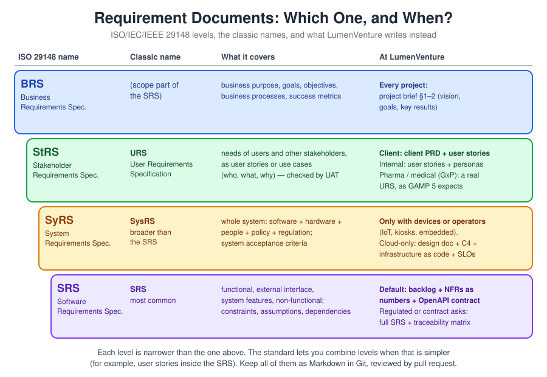

- **Pharmaceutical and medical clients (GxP — "good practice" rules such as good manufacturing practice):** regulators expect computer systems to be **validated**. The industry guide **GAMP 5** (2nd edition, 2022) starts validation from a **URS** with objective, verifiable requirements. It also supports Agile, iterative work. On such projects the URS is a **must** (see [8.2](#82-required-outputs)).
- **Use cases vs. user stories:** a use case states **who** (actor) and **what** (steps), but often not **why** — add the business reason when you use them.
- **UAT is still needed** even when acceptance criteria run automatically in CI. Automated tests prove the software does what was **written**; UAT proves that what was written is what users **need**.

### 4.16 Often-missed requirement areas

| Area | What to add | Why |
|------|-------------|-----|
| **Operational** | SLOs, logging, monitoring, backups, support hours | The system must be **run**, not only built |
| **Data** | Data sources, volumes, quality rules, migration of old data | Data problems are a top reason projects are late |
| **Privacy** | Each piece of personal data: purpose, retention, deletion | GDPR duty; users' trust |
| **Accessibility** | WCAG 2.2 AA as a written requirement | Legal duty in many markets (EAA in the EU) |
| **Security** | ASVS level + abuse cases ([6](#6-modern-planning-practices-checklist)) | Security added late is expensive and weak |
| **Infrastructure** (cloud "hardware") | Capacity and scaling limits, regions, RPO (Recovery Point Objective) and RTO (Recovery Time Objective) | Becomes the SysRS content for cloud systems |

### 4.17 Forecasting and budgeting: fix time and cost, flex scope

- **The problem:** in Agile, the full scope is not known on day one, so a single up-front price and date are hard to give. Waterfall seems easier — but its up-front estimate is made when the team knows the **least** (the **cone of uncertainty**), so it often ends in overruns and change requests.
- **Our default: fix time and cost, flex scope.** "4 developers for 6 months" is fixed. The PO orders the backlog so the **most valuable** work is built first. If time runs out, the **least valuable** items are left out — **never** the testing or security work.

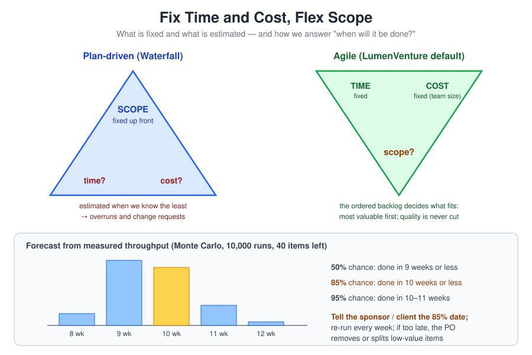

| | Plan-driven (Waterfall) | Our way |
|---|---|---|
| **Fixed** | Scope | Time and cost (team size) |
| **Estimated** | Time and cost | Scope that fits — decided by the ordered backlog |
| **When the estimate is wrong** | Overrun or change request | The PO cuts or splits low-value items; the date holds |

- **How we forecast:**
  1. **Before Sprint 1:** a **range** from relative sizes (T-shirt sizes or story points) — for example "4–6 months, low confidence".
  2. **From Sprint 3 on:** a **throughput forecast**. Count the items finished per week, then simulate the remaining backlog many times (**Monte Carlo forecasting**) to get dates with probabilities.
  3. **Report the 85% date** to the sponsor or client ("85% chance we finish by 14 June"), not the 50% date.
  4. **Re-run every week** with the current backlog size. If the backlog grows, the old date is wrong.

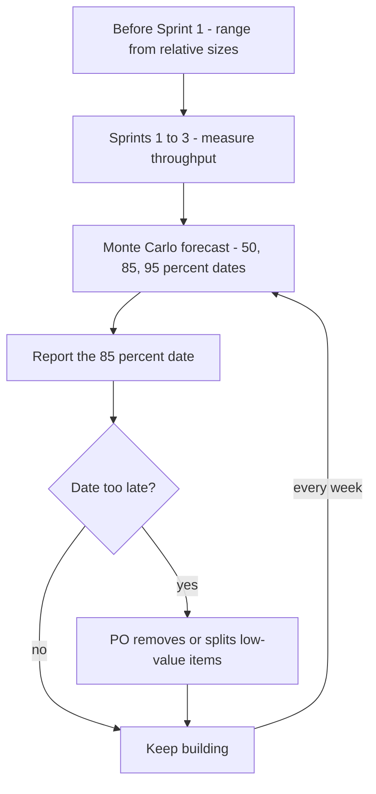

- **Contract models for client projects:**

  | Model | How it works | Use it when |
  |-------|--------------|-------------|
  | **Paid discovery first** | A short fixed-price phase to turn the idea into a PRD and a real estimate ([§8.6](#86-client-discovery-client-projects)) | The client's idea is vague |
  | **Fixed price per phase** | Each phase (MVP, phase 2…) has its own price and approved scope; swaps allowed inside a phase | The client needs a firm budget |
  | **Time and materials with a cap** | The client pays for time used, up to a budget limit; scope is ordered by value | Scope will change a lot |
  | **Fixed budget, flexible scope** | Team and dates fixed; the backlog decides what is delivered | Internal products; trusted long-term clients |

  - **Avoid:** one fixed price for a large, unclear scope after the first call (see [§8.6.4](#864-common-mistakes)).

## 5. How modern teams do it

- **Know the whole map first, but draw the detailed roads only just before you travel them.**
  - At the start, gather **high-level** requirements: goals, users, main features, constraints, risks. This is a **light SRS** (or a "product brief").
  - Split them into **epics** and place them in a **backlog**.
  - Each sprint, **refine** the top items into detailed **user stories** with **acceptance criteria** (this is called **backlog refinement**).
  - Feedback from each release **adds, changes or removes** backlog items.
- **Why not write every detail on day one?**
  - Many requirements **cannot be known** until users see working software.
  - Detailed requirements **go stale**: what you wrote in month 1 is often wrong by month 6.
- **When a full SRS is still the right choice:** fixed-price contracts, regulated industries (banking, medical, aviation, government), or safety-critical systems. The international standard for writing one is **ISO/IEC/IEEE 29148** (it replaced the older **IEEE 830**).

| Level                   | When it is written      | Detail    | Example (Book Review API)                                              |
| ----------------------- | ----------------------- | --------- | ---------------------------------------------------------------------- |
| **Vision and scope**    | Project start           | Low       | "Readers can share and read book reviews."                             |
| **Epics**               | Project start (roughly) | Medium    | "User accounts", "Reviews", "Search"                                   |
| **User stories**        | Just before building    | High      | "As a reader, I want to rate a book 1–5, so that others can judge it." |
| **Acceptance criteria** | With the story          | Very high | "Rating 0 or 6 → HTTP 400. Not logged in → HTTP 401."                  |

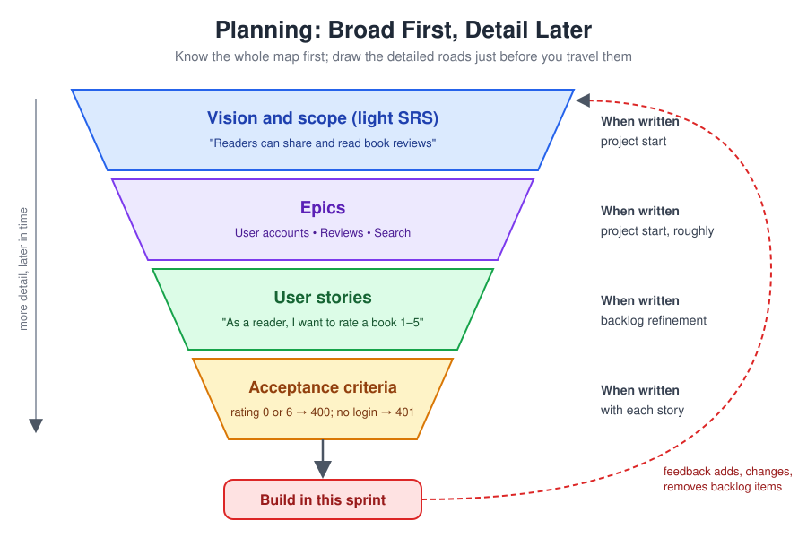

## 6. Modern planning practices checklist

- **Prioritize by value:** methods like **MoSCoW** (Must have, Should have, Could have, Won't have this time).
- **Secure by design:** write security and privacy as real requirements from day one.
  - Example: _"Passwords are hashed with Argon2id (OWASP's first choice; bcrypt only in existing systems)."_ _"Personal data follows GDPR (General Data Protection Regulation)."_
  - Use the **OWASP (Open Worldwide Application Security Project) Top 10:2025** to learn the most common web risks, and the **OWASP ASVS 5.0 (Application Security Verification Standard)** as the detailed checklist to write testable security requirements from.
  - **Abuse cases (misuse stories):** for every epic that handles accounts, money or user content, write at least one story from the **attacker's** side — _"As an attacker, I want to post 10,000 fake reviews…"_. Each one becomes a security requirement (rate limit, moderation, CAPTCHA).
  - **Privacy by design:** list every piece of **personal data**, why you need it, how long you keep it, and how a user can export or delete it. Collect only what you need (**data minimization**).
- **Measurable quality targets (SLOs):** _"99.9% of requests succeed; 95% answer in under 200 ms."_ Not _"the API must be fast"_. An **SLA (Service Level Agreement)** is the **contract** version promised to a customer, usually looser than the internal SLO.
- **Cheap prototypes:** clickable mock-ups (for example in Figma) or a quick throwaway demo, to get feedback within days.
- **Estimate in ranges, re-plan often:** use story points or T-shirt sizes (S, M, L), and update the plan every sprint.

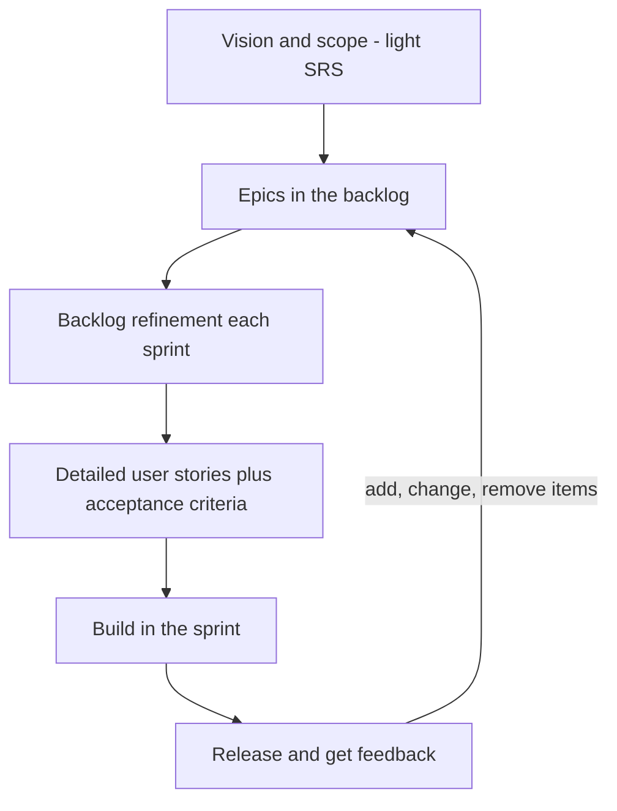

## 7. Planning is "done enough" when...

- [ ] All **stakeholders** are identified, and they agree on the **vision, scope and success metrics**.
- [ ] Every affected group has a **representative**, stakeholders are placed on the **power / interest grid**, and **one decision-maker** is named.
- [ ] **Goals** have **measurable objectives** (SMART or OKR key results) with IDs.
- [ ] Elicitation used **more than one technique** (for example interviews + prototype + data).
- [ ] Requirements pass the **quality check** (necessary, unambiguous, singular, feasible, verifiable, consistent, complete) and are **approved in writing** — this is the **baseline**.
- [ ] The project is **feasible** (technical, economic, legal, operational, schedule).
- [ ] All **eight planning factors** are answered.
- [ ] **Functional and non-functional** requirements exist (non-functional ones written as numbers).
- [ ] **In scope / out of scope**, the **MVP**, assumptions, constraints and dependencies are written down.
- [ ] A **risk register** exists, with owners.
- [ ] **Cost and time** are estimated (as ranges), and the **team and roles** are set.
- [ ] The **backlog** is prioritized, and the first stories meet the **Definition of Ready**, with testable **acceptance criteria**.
- [ ] Requirements have **IDs** for traceability.
- [ ] The **change process** is agreed.
- [ ] (Only where required) the full **SRS** is approved by all stakeholders.
- [ ] (Client projects) **client discovery** is done and the **client PRD** is approved in writing — see [§8.6.5](#865-discovery-is-done-when).

---

## 8. LumenVenture Standard

> **What we do on every project.** See the [guide README](../README.md) for roles, gates and project types. **must** = required · **should** = default (skip only with a written reason) · **may** = optional.

### 8.1 Owners

| Activity                              | Accountable   | Responsible       | Consulted                  |
| ------------------------------------- | ------------- | ----------------- | -------------------------- |
| Project brief, scope, success metrics | Product Owner | PO, Delivery Lead | Sponsor, Tech Lead, client |
| Backlog and priorities                | Product Owner | PO                | Team, client               |
| Risk register                         | Delivery Lead | DL, Tech Lead     | Team                       |
| Estimates                             | Delivery Lead | Whole team        | PO                         |
| Change requests                       | Product Owner | Delivery Lead     | Client, Tech Lead          |
| Client discovery (client projects, §8.6) | Product Owner | PO, Delivery Lead, Tech Lead | Client decision-maker |
| Client PRD and its approval | Product Owner | PO | Client decision-maker, Tech Lead |

### 8.2 Required outputs

| Output                                                                                          | Internal | Client                         | Prototype         | + Regulated                        |
| ----------------------------------------------------------------------------------------------- | -------- | ------------------------------ | ----------------- | ---------------------------------- |
| Project brief ([template](templates/project-brief.md))                                          | **must** | **must**                       | one page **must** | **must**                           |
| Discovery pack: meeting summaries, assumptions and decisions log, clickable prototype, MVP workshop result (§8.6) | **may** | **must** | **may** | **must** (if client) |
| Client PRD, approved in writing ([template](templates/client-prd.md)) | — | **must** | — | **must** (if client), plus the full SRS |
| Signed scope / SOW (Statement of Work)                                                          | —        | **must**                       | —                 | —                                  |
| Full SRS + traceability matrix                                                                  | —        | **may** (if the contract asks) | —                 | **must**                           |
| Goals with measurable objectives / key results, with IDs (in the project brief)                  | **must** | **must**                       | **should**        | **must**                           |
| SyRS (System Requirements Specification) — only if the product includes devices, hardware or operators (§4.15) | **must** if it applies | **must** if it applies | —     | **must** if it applies             |
| URS validated per GAMP 5 — only for pharmaceutical / medical (GxP) clients (§4.15)              | —        | **must** if it applies         | —                 | **must** if it applies             |
| Stakeholder register ([template](templates/stakeholder-register.md))                            | **must** | **must**                       | **should**        | **must**                           |
| Team roles with backups ([template](templates/team-roles.md), README §3.3)                       | **must** | **must**                       | **should**        | **must**                           |
| Working agreement ([template](templates/working-agreement.md), README §6.6)                      | **must** | **must**                       | **should**        | **must**                           |
| Risk register ([template](templates/risk-register.md))                                          | **must** | **must**                       | **should**        | **must**                           |
| Backlog of epics + first stories with acceptance criteria ([template](templates/user-story.md)) | **must** | **must**                       | **should**        | **must**                           |
| Change requests ([template](templates/change-request.md))                                       | —        | **must**                       | —                 | **must**                           |
| Non-functional requirements written as numbers                                                  | **must** | **must**                       | **may**           | **must**                           |
| Compliance check (privacy, accessibility, licenses, AI rules)                                   | **must** | **must**                       | **should**        | **must** + DPIA where GDPR applies |

### 8.3 Gate G1 — Plan approved

**When:** before design and build start; again after a big scope change. **Who decides:** Sponsor (+ client on client projects).

- [ ] Project type and tailoring are recorded in the brief
- [ ] Vision, scope (in / out), MVP and **success metrics** are agreed
- [ ] Every goal has **measurable objectives** (key results) with IDs; every epic links to at least one
- [ ] Stakeholders are on the **power / interest grid**; none of the "often forgotten" groups (§4.1) is missing without a reason
- [ ] The approved requirements are recorded as the **baseline** (client PRD, brief + backlog, or SRS)
- [ ] **Client projects:** discovery done (§8.6); every assumption that changes cost or time is **confirmed**; the **client PRD** is **approved in writing** by the named decision-maker
- [ ] All **stakeholders** are listed; the client contact is named (client projects)
- [ ] The **eight planning factors** are answered
- [ ] **Feasibility** checked (technical, economic, legal, operational, schedule) — no open blocker
- [ ] **Non-functional requirements** have measurable targets
- [ ] **Risk register** started; every high risk (score 6–9) has an owner and a mitigation
- [ ] **Estimate** given as a range, with confidence
- [ ] Team and **roles** named (PO, DL, TL, QA at least) in `docs/team-roles.md`, with backups for PO and TL (on-call backup from go-live) ([README §3.3](../README.md#33-role-rules))
- [ ] **Working agreement** written by the whole team in `docs/working-agreement.md` ([README §6.6](../README.md#66-working-rhythm-rules), rule 7)
- [ ] First stories meet the **Definition of Ready**
- [ ] Change process agreed (backlog for internal; change requests for client/regulated)

### 8.4 Rules

1. **must** — Every story meets the **Definition of Ready** (in the [user story template](templates/user-story.md)) before it enters a sprint.
2. **must** — Acceptance criteria are **testable**: exact results, numbers and status codes, preferably in Given/When/Then.
3. **must** — Requirements have **IDs** (for example `REQ-07`) that are used in commits, PRs and tests.
4. **must** — Security, privacy and compliance needs are written as **requirements**, not left for later.
5. **must** — On client projects, **no scope change without a change request** that shows cost and time impact.
6. **should** — Re-estimate and update the forecast every sprint; report the range to the sponsor/client.
7. **should** — Review the risk register in every sprint review.
8. **should** — Use prototypes to settle unclear requirements before committing to a design.
9. **may** — Use AI tools to draft stories and find edge cases; the PO checks every requirement, and confidential data is never put into unapproved tools.
10. **must** — **Client projects:** no build estimate is final and **no build work starts** before the client PRD and the scope / SOW are **approved in writing** by the named decision-maker. Silence is **not** approval for scope.
11. **must** — Send a **meeting summary** with decisions, assumptions and open questions **the same working day** after every client meeting ([template](templates/meeting-summary.md)).
12. **must** — Every assumption that changes cost or time is in the [assumptions and decisions log](templates/assumptions-and-decisions-log.md) and is **confirmed** before PRD approval.
13. **should** — When the client's idea is vague, sell a **paid discovery phase** first ([template](templates/discovery-proposal.md)) instead of quoting the full build.
14. **should** — Show a **clickable prototype** before writing the PRD; non-technical clients react to screens, not documents.
15. **should** — Client changes after approval are handled as a **swap** (same size, no price change) or a **change request** (extra cost and time) — never as an unwritten "quick change".
16. **should** — Every epic that handles **accounts, money or user content** has at least one **abuse case**, and every requirement that touches **personal data** says why the data is needed and how long it is kept.
17. **should** — Run **example mapping** for any story with more than a few business rules before it enters a sprint.
18. **must** — Every requirement has an **ID**, a **source**, a **priority** and a link to an **objective** (`OBJ-n`). A feature that supports no objective cannot be a Must. (Legal, security and operational requirements link to their **source** instead — the law, the ASVS level or the SLO.)
19. **must** — Non-functional and system-behavior requirements are written as **numbers** or as **EARS** sentences; the vague words in §4.12 are not allowed in acceptance criteria.
20. **should** — In refinement, a developer and a tester check each story against the **quality characteristics** in §4.13 ("can I build it? can I test it?").
21. **should** — Use **more than one elicitation technique** per epic; at least one must show what users **do** (observation, prototype test or analytics), not only what they say.
22. **should** — After each release, check whether the linked **key results moved**, and feed the result back into the backlog.
23. **must** — Dates and budgets are given as **ranges with a confidence level**; from Sprint 3 on, forecasts come from **measured throughput**, and the **85% date** is the one reported to the sponsor or client.
24. **must** — Client projects record their **contract model** (§4.17) in the project brief §9 before Gate G1; when time or budget runs short, **scope** is cut by the PO — testing, security and the Definition of Done are never cut.

### 8.5 Templates

| Template                                                     | Copy to                             |
| ------------------------------------------------------------ | ----------------------------------- |
| [project-brief.md](templates/project-brief.md)               | `docs/project-brief.md`             |
| [stakeholder-register.md](templates/stakeholder-register.md) | `docs/stakeholder-register.md`      |
| [team-roles.md](templates/team-roles.md)                     | `docs/team-roles.md`                |
| [working-agreement.md](templates/working-agreement.md)       | `docs/working-agreement.md`         |
| [risk-register.md](templates/risk-register.md)               | `docs/risk-register.md`             |
| [user-story.md](templates/user-story.md)                     | Your tracking tool (issue template) |
| [change-request.md](templates/change-request.md)             | `docs/change-requests/CR-<n>.md`    |
| [discovery-proposal.md](templates/discovery-proposal.md) | Send to the client (PDF or shared doc) |
| [discovery-questions.md](templates/discovery-questions.md) | `docs/discovery/discovery-questions.md` |
| [meeting-summary.md](templates/meeting-summary.md) | Email to the client + `docs/discovery/meetings/<date>-<topic>.md` |
| [assumptions-and-decisions-log.md](templates/assumptions-and-decisions-log.md) | `docs/discovery/assumptions-and-decisions-log.md` |
| [mvp-workshop.md](templates/mvp-workshop.md) | `docs/discovery/mvp-workshop-<date>.md` |
| [client-prd.md](templates/client-prd.md) | `docs/discovery/client-prd.md` (send the client a PDF or shared-doc copy) |

### 8.6 Client Discovery (client projects)

> **The real situation:** most clients are **not technical**. They come with a **short idea**, not requirements, and they often do not know what they want until they **see** it. So on client projects, **LumenVenture writes the requirements for the client**, and the client **checks and approves** them.
> **Our rule in one line:** *we ask → we write it down → we show screens → we agree in writing → we build in small steps.*

#### 8.6.1 How discovery fits the normal planning flow

- Discovery happens **before Gate G1** on client projects. Its outputs feed the normal planning outputs:

  | Discovery output (client-facing) | Feeds this planning output (internal) |
  |----------------------------------|----------------------------------------|
  | Meeting summaries + [assumptions and decisions log](templates/assumptions-and-decisions-log.md) | [Project brief](templates/project-brief.md) §4, §8; [risk register](templates/risk-register.md) |
  | Clickable prototype | Design input (UI), story details |
  | [MVP workshop](templates/mvp-workshop.md) result (MoSCoW) | Project brief §4 (scope and MVP); epics in the backlog |
  | [Client PRD](templates/client-prd.md) (plain words, feature IDs `F-01`…) | [User stories](templates/user-story.md) with acceptance criteria (each story links to its `F-` ID) |

- **Two versions of the same requirements:**

  | | **Client PRD** — for the client | **User stories** — for the team |
  |---|---|---|
  | Language | Plain words, no jargon | Story format + Given/When/Then |
  | Level | Features and user journeys | Small, testable pieces of one feature |
  | Example | *"If a customer gives 6 stars, they see an error."* | *"rating 6 → HTTP 400, not saved"* |
  | Who approves | Client decision-maker | PO (Definition of Ready) |
  | Where it lives | `docs/discovery/client-prd.md` + a copy sent to the client | Tracking tool (Jira, GitHub Issues, Azure Boards) |

- **Project brief vs. client PRD:** the project brief is **our internal plan** (feasibility, risks, estimate, tailoring). The client PRD is **what the client approves**. Scope, MVP and assumptions **must be the same** in both.

#### 8.6.2 The eight discovery steps

| # | Step | Owner | Output | Template |
|---|------|-------|--------|----------|
| 0 | **Offer a paid discovery phase** (1–3 weeks, fixed price) when the idea is vague | DL + PO | Signed discovery proposal | [discovery-proposal.md](templates/discovery-proposal.md) |
| 1 | **Discovery meeting** — ask our standard questions; find the **one decision-maker** | PO (asks), DL/TL (notes) | Answers | [discovery-questions.md](templates/discovery-questions.md) |
| 2 | **Same-day summary** — what we understood, decisions, **assumptions**, open questions | PO | Email + `docs/discovery/meetings/` | [meeting-summary.md](templates/meeting-summary.md), [assumptions-and-decisions-log.md](templates/assumptions-and-decisions-log.md) |
| 3 | **Clickable prototype** of the main screens — show, don't tell | PO + designer/DEV | Prototype link (for example Figma) | — |
| 4 | **Prototype review + MVP workshop** — client clicks through; sort features with **MoSCoW**; fit the Must list to budget and date | PO (facilitator), TL (sizes) | Agreed MVP feature list + phase 2 list | [mvp-workshop.md](templates/mvp-workshop.md) |
| 5 | **Write two versions** — client PRD in plain words; first epics and user stories for the team | PO (+ team) | `client-prd.md`, backlog | [client-prd.md](templates/client-prd.md), [user-story.md](templates/user-story.md) |
| 6 | **Written agreement** — client approves the PRD and the scope / SOW (in/out, assumptions, price, feedback deadline, change rules) → **Gate G1** | Client decision-maker, SP | Signed PRD + SOW | client-prd.md §12, project brief §11 |
| 7 | **Build in sprints, Sprint Review with the client every 2 weeks** — working software is the best requirements tool | Team | Sprint Reviews with the client | — |
| 8 | **Handle changes fairly** — **swap** (same size, no price change) or **change request** (extra cost and time, approved first) | PO + DL | Updated log / CR | [change-request.md](templates/change-request.md) |

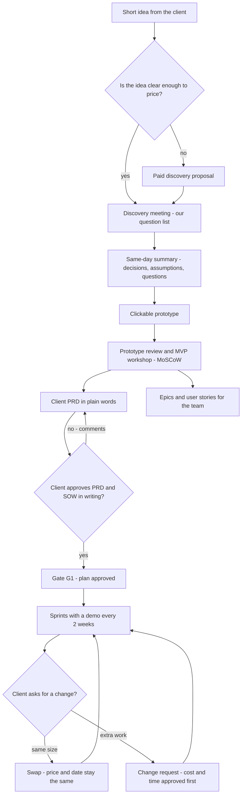

#### 8.6.3 Working with non-technical clients — golden rules

1. **Ask "why?"** until you understand the real problem, not only the feature they asked for.
2. **Ask for examples**, not definitions: "Show me an app you like", "Walk me through a normal day".
3. **Write everything down** and send it the **same day**. People forget what they said; a written summary protects both sides.
4. **Show screens, not documents.** A 10-minute click-through gives better feedback than a 20-page document.
5. **Make assumptions visible.** Most client disputes come from hidden assumptions. Every assumption that changes cost or time must be **confirmed**.
6. **One named decision-maker.** Feedback can come from many people, but only one person approves scope.
7. **Keep the MVP small.** Use MoSCoW; the "Won't have this time" list shows the client their ideas are parked, not forgotten.
8. **Speak their language.** Use the client's words in the PRD; keep technical detail in the stories and design docs.
9. **Agree feedback deadlines** (for example 3 working days). For **meeting summaries**, "no reply = we continue" is OK; for **scope approval**, only a clear written "Approved" counts.
10. **Change = swap or pay**, always in writing.

#### 8.6.4 Common mistakes

| ❌ Mistake | What happens | ✅ Instead |
|-----------|--------------|-----------|
| Giving a fixed price after the first call | The scope grows; we lose money or the client relationship | Offer paid discovery, then estimate as a range |
| Sending the client Gherkin or technical stories | They do not read it, or approve without understanding | Client PRD in plain words, with simple examples |
| No written summary after meetings | "But I said that in the meeting!" | Same-day summary with decisions and assumptions |
| Many people giving "final" feedback | Conflicting requests, endless rework | One named decision-maker in the stakeholder register |
| Writing all stories in detail before approval | Wasted work when the client changes their mind | Epics + first stories only; detail the rest in refinement |
| Accepting "a quick change" in a demo | Hidden scope growth; missed deadlines | Note it; answer with a swap or a change request |

#### 8.6.5 Discovery is done when…

- [ ] The client **decision-maker** is named in the [stakeholder register](templates/stakeholder-register.md)
- [ ] Problem, users and a **measurable success goal** are written down and confirmed
- [ ] The client has **clicked through a prototype** of the main journeys
- [ ] The **MVP** feature list (MoSCoW) fits the budget and date; the phase 2 list exists
- [ ] Every assumption that changes cost or time is **confirmed** in the log
- [ ] The **client PRD** is approved **in writing**, and it matches the project brief
- [ ] The first **epics and user stories** exist, linked to PRD feature IDs, and the first stories meet the **Definition of Ready**
- [ ] The client knows the **demo rhythm**, the **feedback deadline** and the **change rules**

---

[Guide README](../README.md) · [Design →](../02-Design/Design.md)
