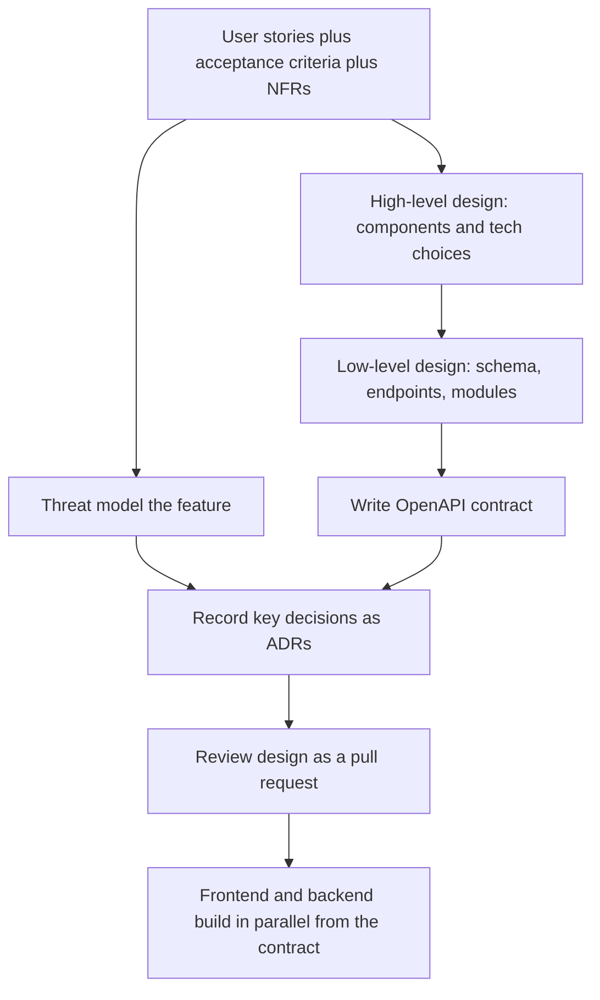
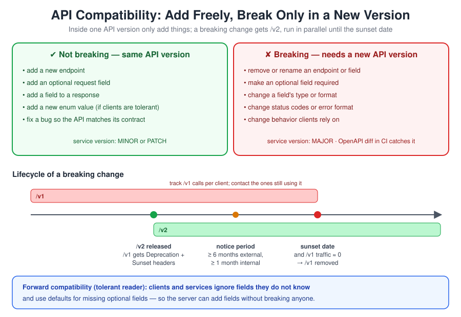
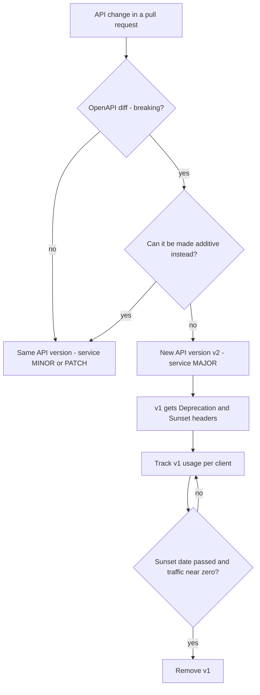
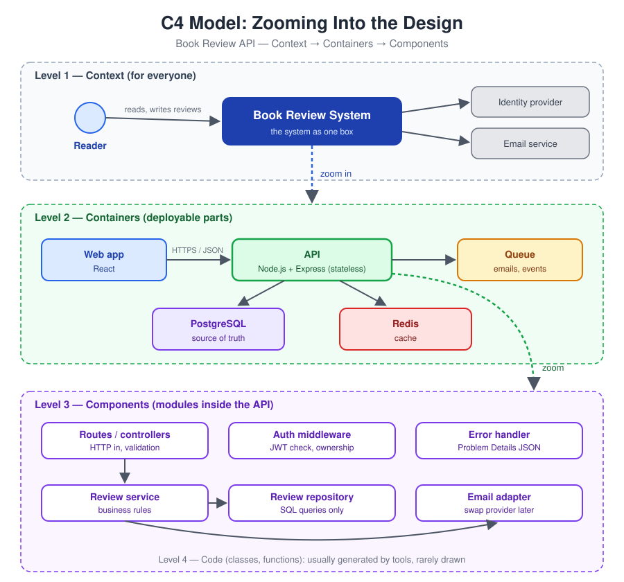
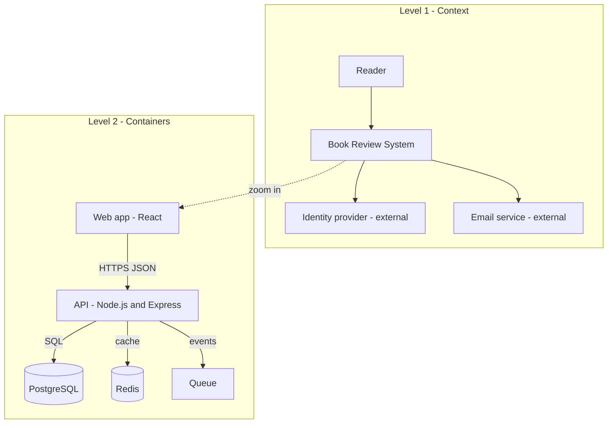

# Phase 2 — Design: "Lightweight, Versioned, API-First"

**SDLC series — Phase 2 of 6.** How professional backend teams do **Design** today: the lecture's core tasks, the Waterfall way vs. the modern way, and the industry practices the lecture does not cover.

> **Last reviewed:** 2026-11-26 · **Next review due:** 2027-05-26 · **Review owner:** Tech Lead · [Review rule](../README.md#91-review-schedule) · [Review log](../CHANGELOG.md)

[← Planning](../01-Planning/Planning.md) · [Guide README](../README.md) · [Overview](../../6-Phases-of-SDLC-Modern-Best-Practices.md) · [Development →](../03-Development/Development.md)

---

## 0. Jargon Translation (Read This First)

| Term | Official Definition | Simple Words | Analogy |
|------|--------------------|--------------|---------|
| **SDLC (Software Development Life Cycle)** | A systematic process to build high-quality software in a predictable time and budget. | The steps a team follows from idea to running software. | A recipe for a big meal. |
| **Waterfall** | A model where each phase is fully finished before the next starts, with no going back. | One straight pass: plan everything, then build everything, then test everything. | Water falling down steps. |
| **Agile** | A way of working in short loops that deliver small, working pieces of software and adapt to feedback. | Build a little, show it, learn, repeat. | Cooking one dish at a time and tasting each before the next. |
| **Sprint / Iteration** | A fixed time-box (usually 1–4 weeks) in which a team delivers a small set of features. | One short loop of work. | One lap of a running track. |
| **DevOps** | A culture and set of practices where development and operations work as one team, with heavy automation. | The people who build the software also release and run it. | A chef who also serves the food and hears what guests think. |
| **OpenAPI** | A standard YAML/JSON format that describes a REST (Representational State Transfer) API. | A machine-readable "menu" of your API. | A restaurant menu that both waiters and computers can read. |
| **ADR (Architecture Decision Record)** | A short document that records one architecture decision, its reasons and the options rejected. | A diary entry: "we chose X because Y". | A note in a car's service book explaining why a part was replaced. |
| **Threat modeling** | A structured way to find how a system could be attacked, and plan defenses. | Asking "how could a bad person abuse this?" | A security guard walking the building to find weak doors. |
| **HLD (High-Level Design)** | The big-picture design: main components, how they connect, and technology choices. | The map of the whole system. | A city map showing districts and main roads. |
| **LLD (Low-Level Design)** | The detailed design inside each component: modules, database tables, endpoints, error rules. | The detailed plan for one part. | The floor plan of one building, with every room. |
| **Quality attribute** | A measurable property of a system, such as performance, availability, security or maintainability. | How *well* the system works, not *what* it does. | A car's top speed, safety rating and fuel use. |
| **Modular monolith** | One deployable application split into strict internal modules with clear boundaries. | One app, but well-organized inside. | One big house with separate, lockable rooms. |
| **Microservices** | An architecture of many small services, each owning its data and deployed on its own. | Many small apps that talk over the network. | A street of small specialized shops instead of one supermarket. |
| **Stateless service** | A service that keeps no user data in its own memory between requests. | Any copy of the server can answer any request. | Any cashier can serve you, because your order is on the receipt, not in one cashier's head. |
| **Spike** | A short, time-boxed experiment to answer a technical question before committing to a design. | A quick test to learn something. | Testing one tile on the wall before tiling the whole bathroom. |
| **C4 model** | A way to draw architecture at four zoom levels: Context, Container, Component, Code. | Architecture diagrams that zoom in step by step. | Zooming a map from country → city → street → house. |
| **RFC (Request for Comments) / design doc** | A short document that proposes a design and asks the team for feedback before building. | "Here is my plan — please comment." | Sharing a draft travel plan with your friends before booking. |
| **Least privilege** | Giving every user, service and account only the permissions it needs. | Give only the keys someone really needs. | A cleaner gets the key to the office, not to the safe. |
| **Problem Details (RFC 9457)** | A standard JSON format for HTTP API errors (`type`, `title`, `status`, `detail`). | One standard shape for every error. | A standard accident-report form every insurer understands. |
| **Non-functional requirement** | A statement of how well the system must work (performance, security, availability, usability). | How fast, safe or reliable it must be. | "The car must stop from 100 km/h in under 40 m." |

---

## 1. The job

- Decide **how** the system will be built to meet the requirements: its parts, data, APIs, security, how it scales, and how it runs in production.
- **Core tasks from the lecture (still true in every model):**
  1. Use the **requirements** (from the SRS or the stories) as the input.
  2. **Several team members work together** to design the **software architecture**.
  3. The architecture is **reviewed by stakeholders and the team**.
  4. **Prototypes** can be designed — a **preliminary mock-up of the system, or parts of it**, used for **demonstration**.
  5. The result is written down as a **design document**, which developers use in the **development phase** (planners also use it to assign coding tasks).
- **Why design before coding:** a mistake fixed in a diagram costs minutes. The same mistake found in code costs days, and in production it can cost data and customers.
- **Two levels of design** (classic SDLC terms, still used in interviews and in large companies):

  | Level | What it covers | Who mainly does it | Book Review API example |
  |-------|----------------|-------------------|--------------------------|
  | **HLD (High-Level Design)** | The big picture: main components, how they talk, technology choices, where data lives | Architect / senior engineers | "Express API in containers on Kubernetes, PostgreSQL database, Redis cache, JWT login" |
  | **LLD (Low-Level Design)** | The details inside each component: modules, classes or functions, database tables, endpoint contracts, error rules | Developers who will build it | "`reviews` table with unique (user_id, isbn); `POST /books/{isbn}/reviews` returns 201/400/401/409" |

## 2. Core tasks: Waterfall way vs. modern way

| Core task | Waterfall way (once, up front) | Modern way (per slice, kept up to date) |
|-----------|-------------------------------|------------------------------------------|
| **Input: requirements** | The complete, signed SRS | The light SRS for the big picture + the user stories (with **non-functional requirements**) for this slice |
| **Team designs the architecture** | Architects design the whole system (HLD and all LLD) before coding | **"Just enough" design up front:** the HLD and the hard-to-change decisions are made early; the **LLD for each feature** is done just before it is built, by the developers who will build it, with an architect's help |
| **Review by stakeholders and team** | Formal review gates (often a **preliminary** and a **critical design review**) | Design docs and ADRs reviewed as **pull requests**; small, frequent reviews; a wider **architecture review** only for big or risky changes |
| **Prototypes** | A mock-up to show the client | Clickable mock-ups, **mock servers generated from OpenAPI**, or a short **spike** (time-boxed experiment) to test a risky idea |
| **Design document** | One large document, rarely updated | Small **versioned** docs in Git: OpenAPI contract, ADRs, **C4 diagrams as code**, short design docs (RFCs) — updated when the system changes |
| **Link to requirements** | A traceability matrix in the design document | Each design doc, ADR or endpoint references the **requirement or story IDs** it serves (for example `REQ-07`) |

## 3. How modern teams do it

- **API-first design:** write the API contract in **OpenAPI** **before** writing code.
  - Frontend and backend teams can work **in parallel**.
  - Tools create docs, mock servers, client code and validation tests from the same file.
- **ADRs (Architecture Decision Records) in Git:** one short Markdown file per important decision (*context*, *decision*, *rejected options*, *consequences*). By convention an accepted ADR is **not rewritten**; when the decision changes, a new ADR **supersedes** it, so the history of decisions stays visible.
- **Design docs as pull requests:** the design is reviewed like code, and it **changes with the system** — it is not a one-time document.
- **Threat modeling** for each significant new feature: "How could an attacker abuse this?" (A simple method is **STRIDE**: Spoofing, Tampering, Repudiation, Information disclosure, Denial of service, Elevation of privilege.)
- **Design for operations:** plan health checks, logs, metrics, traces, configuration through **environment variables**, and secrets through a **secret manager** — before coding.
- **Start simple:** a well-structured **modular monolith** is often better than many microservices for a new product. Split services only when there is a real need (see [4.2](#42-choose-an-architecture-style)).
- **Decide late on things that are easy to change; decide early on things that are hard to change** (for example the database, the public API, the identity provider).

```yaml
# openapi.yaml — design-phase contract written before any Express code
openapi: 3.1.0
info: { title: Book Review API, version: 1.0.0 }
paths:
  /books/{isbn}/reviews:
    post:
      summary: Add a review (REQ-07)
      operationId: addReview
      security: [{ bearerAuth: [] }]          # login required (defined below)
      parameters:
        - { name: isbn, in: path, required: true, schema: { type: string } }
      requestBody:
        required: true
        content:
          application/json:
            schema: { $ref: '#/components/schemas/NewReview' }
      responses:
        '201': { description: Review created }
        '400': { $ref: '#/components/responses/Problem' }   # invalid input
        '401': { $ref: '#/components/responses/Problem' }   # not logged in
        '409': { $ref: '#/components/responses/Problem' }   # already reviewed this book
components:
  securitySchemes:
    bearerAuth: { type: http, scheme: bearer, bearerFormat: JWT }
  schemas:
    NewReview:
      type: object
      required: [rating]
      additionalProperties: false              # reject unknown fields
      properties:
        rating: { type: integer, minimum: 1, maximum: 5 }
        text:   { type: string, maxLength: 2000 }
    Problem:                                   # RFC 9457 "Problem Details" error format
      type: object
      properties:
        type:   { type: string }
        title:  { type: string }
        status: { type: integer }
        detail: { type: string }
  responses:
    Problem:
      description: Error
      content:
        application/problem+json:
          schema: { $ref: '#/components/schemas/Problem' }
```

**What happens if... you reference a security scheme you never define?**

```yaml
# ❌ "bearerAuth" is used but not declared under components.securitySchemes
security: [{ bearerAuth: [] }]
# Validators (for example Redocly or Spectral) report an error, generated docs show
# no login method, and generated clients cannot send the token.
# ✅ Always declare it: components.securitySchemes.bearerAuth (see above).
```

```markdown
<!-- docs/adr/0003-use-postgresql.md — an ADR (Architecture Decision Record) -->
# ADR 0003: Use PostgreSQL for reviews

**Status:** Accepted (2026-11-10)
**Context:** Users, books and reviews are closely related and are often read together
(joins). Rule REQ-09: one review per user per book. The team knows SQL well.
**Decision:** Use PostgreSQL. Enforce REQ-09 with a UNIQUE constraint on (user_id, isbn).
**Rejected options:**
- MongoDB — would also work (it supports compound unique indexes), but our data is
  relational and most queries join users, books and reviews.
- A separate search engine — not needed for the expected traffic.
**Consequences:** One database to run and back up. Revisit if search traffic grows 10x.
```



## 4. The design areas a complete design must cover

The lecture says "develop the software architecture". In practice, a complete backend design answers questions in **all** of these areas.

### 4.1 Non-functional requirements drive the architecture

- **Functional** requirements decide **what** components exist. **Non-functional** requirements (quality attributes) decide **how** they are built.
- Every important design choice should point back to a quality attribute:

| Quality attribute (from planning) | Example target | Typical design choices ("tactics") |
|-----------------------------------|----------------|------------------------------------|
| **Performance** | 95% of requests < 200 ms | Database indexes, caching (Redis), pagination, avoid N+1 queries |
| **Availability** | 99.9% uptime | Several instances behind a load balancer, health checks, no single point of failure, backups |
| **Scalability** | Handle 10x traffic | **Stateless** API servers (no session in memory), horizontal scaling, queues for slow work |
| **Security** | Protect personal data | Authentication + authorization design, encryption, least privilege, input validation, rate limiting |
| **Maintainability** | Easy to change | Clear module boundaries, layers (routes → services → repositories), tests, ADRs |
| **Observability** | Find problems in minutes | Structured logs, metrics, tracing (OpenTelemetry), request IDs |
| **Cost** | Fit the cloud budget | Right-sized resources, autoscaling, managed services vs. self-hosted trade-off |

- **Trade-offs are normal.** For example, a cache improves performance but can show **slightly old data**. Write the trade-off down in an ADR.

### 4.2 Choose an architecture style

| Style | What it is | Good when | Watch out for |
|-------|-----------|-----------|---------------|
| **Monolith** | One application, one deployment | Small team, new product | Can become a "big ball of mud" without clear modules |
| **Modular monolith** | One deployment, but strict internal modules (reviews, users, books) | **Default choice for most new products** | Needs discipline to keep module boundaries |
| **Microservices** | Many small services, each with its own data and deployment | Many teams that must release independently; parts with very different scaling needs | Network failures, distributed data, much more DevOps work |
| **Serverless** | Functions run by the cloud on demand (AWS Lambda, Azure Functions) | Spiky or low traffic, event processing | Cold starts, vendor lock-in, harder local testing |
| **Event-driven** | Services communicate through events on a broker (Kafka, RabbitMQ) | Work that can happen later (emails, notifications, analytics) | Eventual consistency, harder debugging |

- These styles can be **combined** — for example a modular monolith that sends events to a serverless function for emails.
- **Finding the module boundaries:** use **DDD (Domain-Driven Design)** ideas — split along **business** areas ("bounded contexts" such as Reviews, Catalog, Accounts), each with its own model and words. An **EventStorming** workshop ([Planning 4.9](../01-Planning/Planning.md#49-workshops-that-turn-vague-ideas-into-clear-requirements)) is a fast way to find them.
- **Inside each module — ports and adapters (hexagonal architecture):** business rules in the center do not depend on Express, the database or any vendor. **Adapters** connect them to the outside (HTTP route, database repository, email provider). Business logic becomes easy to unit-test, and a vendor can be replaced without touching it.
- **Keep the boundaries automatically — architecture fitness functions:** a test in CI that fails when a rule is broken, for example "the `reviews` module must not import from `accounts/internal`" (tools: **dependency-cruiser**, ESLint import rules).

### 4.3 Data design

- **Choose the database by access patterns** — how the data will be read and written — not by habit. (See [7 Database Laws](../../7-Database-Laws-of-Senior-Backend-Developer.md).)
- Design the **schema**: tables or collections, fields, types, relations.
- **Enforce business rules in the database too** (NOT NULL, UNIQUE, FOREIGN KEY, CHECK), not only in the code.
- Plan **indexes** for the most common queries.
- Plan **migrations**: every schema change is a versioned script, written to be **backward compatible**.
- Plan **data protection**: which fields are personal data, encryption, backups, retention and deletion (GDPR "right to erasure").

```sql
-- migrations/0004_create_reviews.sql — data design for REQ-07 and REQ-09
CREATE TABLE reviews (
  id          BIGSERIAL PRIMARY KEY,
  user_id     BIGINT      NOT NULL REFERENCES users(id) ON DELETE CASCADE, -- delete reviews with the user (GDPR erasure)
  isbn        VARCHAR(17) NOT NULL REFERENCES books(isbn),
  rating      SMALLINT    NOT NULL CHECK (rating BETWEEN 1 AND 5),         -- REQ-07 enforced by the database
  text        VARCHAR(2000),
  created_at  TIMESTAMPTZ NOT NULL DEFAULT now(),
  CONSTRAINT one_review_per_user_per_book UNIQUE (user_id, isbn)           -- REQ-09
);

-- Most common query: "list reviews for a book, newest first"
CREATE INDEX idx_reviews_isbn_created ON reviews (isbn, created_at DESC);
```

**What happens if... the "one review per user" rule lives only in the code?**

```javascript
// ❌ Check-then-insert: two requests from the same user at the same moment
const existing = await db.query('SELECT 1 FROM reviews WHERE user_id=$1 AND isbn=$2', [userId, isbn]);
if (existing.rowCount === 0) {
  await db.query('INSERT INTO reviews (user_id, isbn, rating) VALUES ($1,$2,$3)', [userId, isbn, rating]);
}
// Both requests see "no review yet" and BOTH insert → duplicate reviews (a race condition).

// ✅ Let the UNIQUE constraint decide, and turn the error into HTTP 409
try {
  await db.query('INSERT INTO reviews (user_id, isbn, rating) VALUES ($1,$2,$3)', [userId, isbn, rating]);
} catch (err) {
  if (err.code === '23505') {               // PostgreSQL code for "unique_violation"
    return res.status(409).json({ title: 'You already reviewed this book', status: 409 });
  }
  throw err;                                 // any other error goes to the error middleware
}
```

### 4.4 API design

(See [8 API Laws](../../8-API-Laws-of-Senior-Backend-Developer.md) for details.)

- **Resources, not actions:** `POST /books/{isbn}/reviews`, not `POST /createReview`.
- **Correct HTTP methods and status codes** (`200` OK, `201` created, `400` bad input, `401` not logged in, `403` not allowed, `404` not found, `405` method not allowed, `409` conflict, `422` validation error, `429` too many requests for rate limiting — **OWASP API4:2023** Unrestricted Resource Consumption).
- **One consistent error format** for every endpoint — the standard is **RFC 9457 "Problem Details"** (`application/problem+json`).
- **Pagination** for every list endpoint (`?limit=20&cursor=...`).
- **Idempotency** for retries: `PUT` and `DELETE` are idempotent by design; for `POST` payments or orders, accept an **`Idempotency-Key`** header.
- **Versioning and evolution plan:** add fields without breaking clients; use a new version (for example `/v2`) only for breaking changes; announce deprecations with the **`Deprecation`** header (RFC 9745) and the **`Sunset`** header (RFC 8594, the date it stops working). Details in [4.4.1](#441-api-compatibility-and-versioning).
- **API contract first:** REST APIs are described in **OpenAPI** (current version **3.2**, released September 2025; 3.1 is still widely supported by tools). Event and message APIs (queues, Kafka topics, webhooks) are described in **AsyncAPI**.

#### 4.4.1 API compatibility and versioning

- **Why it matters:** web apps, mobile apps that users have not updated, partner systems and our own services all call the API, and they **cannot all upgrade at the same moment**. During a rolling deployment, even old and new copies of **our own** service run side by side.
- **Backward compatibility (our promise):** inside one API version we **only add** things. Old clients keep working.
- **Forward compatibility (tolerant reader):** our clients and services **ignore fields they do not know** and use defaults for missing optional fields, so the other side can add fields safely. Note: our **input validation** still rejects unknown fields in **requests** (no mass assignment, [Development rule 4](../03-Development/Development.md#64-rules)) — being tolerant applies to **reading responses and events**.

| Change | Breaking? | What we do |
|--------|-----------|------------|
| Add an endpoint, an optional request field, or a response field | No | Same API version; service MINOR bump |
| Fix a bug so the API matches its OpenAPI contract | Usually no | PATCH bump; note it in the changelog |
| Add an enum value | Only for strict clients | Document that clients must handle unknown values |
| Remove or rename an endpoint or field | **Yes** | New API version (`/v2`) |
| Make an optional field required; change a type or format | **Yes** | New API version |
| Change status codes or the error format clients rely on | **Yes** | New API version |

- **A breaking change gets a new major API version**, which runs **in parallel** with the old one:
  1. Release `/v2`; mark `/v1` with `Deprecation` and `Sunset` headers and a `Link` to the migration guide.
  2. Give notice: **at least 6 months** for external or partner clients, **at least 1 month** for internal-only clients (the project's [versioning policy](../03-Development/templates/versioning-policy.md) may set longer periods).
  3. **Track `/v1` calls per client** and contact the ones still using it.
  4. Remove `/v1` after the sunset date **and** when its traffic is near zero.
- **Catch breaking changes automatically:** compare the OpenAPI file of the pull request with the one on `main` in CI (an OpenAPI diff tool, for example **oasdiff**), and fail the build on a breaking change inside the same API version.





### 4.5 Security design

(See [7 Authentication Concepts](../../7-Authentication-Concepts-Every-Senior-Developer-Should-Know.md) for details.)

- **Authentication:** how users prove who they are (sessions, JWT, OAuth 2.0 / OpenID Connect).
- **Authorization:** who may do what — check **ownership** on the server for every request (for example only the author can delete a review), preventing **BOLA (Broken Object Level Authorization)** (**API1:2023** in the OWASP API Security Top 10:2023).
- **Payment data (PCI DSS, Payment Card Industry Data Security Standard, v4.0.1):** **never** design application back-ends or databases to store raw credit card numbers (**PAN**, Primary Account Number) or security codes (**CVV**, Card Verification Value / **CVC**, Card Verification Code). Send card fields straight from the client to a PCI DSS-certified payment processor (such as Stripe or Adyen) and store only the returned **payment token** plus an `Idempotency-Key` for charges.
- **Least privilege:** every user, service and database account gets only the permissions it needs.
- **Defense in depth:** several layers of protection (validation, auth, rate limiting, database constraints), so one mistake is not enough for an attack.
- **Secure defaults:** deny by default; HTTPS everywhere; secure cookie flags; no secrets in code.
- **Encryption:** in transit (TLS — Transport Layer Security) and at rest (encrypted disks and backups); passwords **hashed** with **Argon2id** (OWASP's first choice; bcrypt only for existing systems), never encrypted or stored as plain text.
- Use the **STRIDE** threat model results and the **OWASP ASVS 5.0** requirements as the checklist; check the **OWASP Top 10:2025** risks, which now include **Software Supply Chain Failures** and **Mishandling of Exceptional Conditions** (design how the system fails safely).

### 4.6 Reliability design

- **Timeouts** on every call to another service or database — never wait forever.
- **Retries with backoff and jitter** (wait longer each time, plus a small random delay so all clients do not retry at the same moment) only for safe, idempotent operations.
- **Bulkheads and rate limits:** separate pools (connections, workers) for different kinds of work, and limits per client, so one slow or abusive part cannot use up all resources.
- **Circuit breakers** to stop calling a service that is failing (see [10 Backend Design Patterns](../../10-Backend-Design-Pattern-Laws-of-Senior-Engineers-and-Architects.md)).
- **Graceful degradation:** if the "recommended books" service is down, still show the reviews.
- **Queues** for slow or unreliable work (sending emails) so the user does not wait.
- **Backups and a restore test** — a backup you never restored is not a backup.

### 4.7 Integrations and build vs. buy

- List every **external system** (payment provider, email service, identity provider) and design an **adapter** for each, so it can be replaced later.
- **Build vs. buy:** do not build what is not your core business. Login, payments and email are usually **bought** (managed services); your book-review logic is **built**.

### 4.8 Diagrams: the C4 model

The **C4 model** is the most common way to draw software architecture today. It has four zoom levels, like a map:

| Level | Shows | Audience |
|-------|-------|----------|
| **1. Context** | The system as one box, with its users and external systems | Everyone, including non-technical stakeholders |
| **2. Container** | The deployable parts: API, database, cache, frontend | Developers, architects, operations |
| **3. Component** | The main modules inside one container | Developers |
| **4. Code** | Classes or functions (usually generated by tools, rarely drawn) | Developers |

- Keep diagrams **as code** (Mermaid, PlantUML, Structurizr) in Git, so they are reviewed and updated with the system.





### 4.9 UI/UX design and prototypes

- Even for a backend course, the full SDLC design phase includes the **user experience**: **wireframes** (simple screen sketches), **mock-ups**, and clickable **prototypes** (for example in Figma).
- Use a **design system** (shared components and styles) so all screens look and behave the same.
- Design for **accessibility** (WCAG) from the start — adding it later is expensive.
- The lecture's design-phase **prototype** (a preliminary mock-up for demonstration) fits here: show it to stakeholders before building.

### 4.10 The design document (RFC) template

Many companies write a short design doc, often called an **RFC (Request for Comments)**, for each significant feature:

```markdown
# Design: Book ratings (REQ-07, REQ-09)

## Context and problem        — why are we doing this?
## Goals and non-goals        — what is in, and what is explicitly out
## Proposed design            — HLD diagram, LLD: schema, endpoints, modules
## Alternatives considered    — other options and why they lost
## Security and privacy       — threat model results, personal data
## Reliability and operations — failure cases, monitoring, alerts
## Rollout and migration      — feature flag, migration steps, rollback plan
## Testing plan               — how we will prove it works
## Open questions             — what we still need to decide
```

### 4.11 Using AI tools in design

- AI assistants can **suggest options**, **review a design for missing failure cases**, and **draft diagrams or OpenAPI files**.
- **A human owns every decision.** AI may suggest patterns the system does not need, or tools that do not fit your constraints. Record the final decision and the reasons in an ADR.
- If the product **itself uses an AI model**, design for it explicitly: answers can differ each time (plan **evaluation tests**), model calls are slow and cost money (plan **timeouts, caching and budgets**), and user text can try to trick the model (**prompt injection**) — so **authorization must always be checked by your server, never by the model**.

### 4.12 Web delivery and cloud baseline

> From course note [module 2, 01 Overview of Web and Cloud Development](../../course-1-introduction-to-software-engineering/module-2-introduction-to-software-development/notes/01-overview-of-web-and-cloud-development.md). The lecture explains the client-server model and what "cloud" means. This section turns it into design decisions.

**1. Choose how each page or screen is delivered.** Decide this per part of the product, not once for everything.

| Delivery style | What it is | Good for | Watch out for |
|----------------|-----------|----------|---------------|
| **Static** (pre-built files on a CDN) | Files are built once and served as they are | Marketing pages, docs, blogs | Content changes need a new build |
| **Server-rendered (SSR)** | The server builds HTML for each request | Pages that need SEO and fresh data | Server cost; cache carefully |
| **Single-page app (SPA)** | The browser loads JavaScript and calls your API | Logged-in apps and dashboards | Slower first load; SEO needs extra work |
| **API only** | JSON for other clients (mobile app, partners) | Backend products like the Book Review API | You need an API contract (§4.4) |

- A common default: a **static or SPA front end on a CDN** that calls a **stateless API**. Record the choice in an ADR when it is hard to change.

**2. Put a CDN (Content Delivery Network) in front of anything public.** A CDN keeps copies of your files in many places near the user and also absorbs traffic spikes and some attacks.

| Content | Cache header (default) | Why |
|---------|------------------------|-----|
| Files with a **hash in the name** (`app.3f9a1c.js`) | `Cache-Control: public, max-age=31536000, immutable` | The name changes when the content changes, so the file can be cached for a year |
| The **HTML entry page** | `Cache-Control: no-cache` | The browser checks for a new version each time (`no-cache` means "revalidate", not "do not store") |
| **Personal or logged-in responses** | `Cache-Control: private, no-cache` (or `no-store` for very sensitive data) | A shared cache must never serve one user's data to another user |

**3. Know who is responsible for what in the cloud.** The cloud provider secures and runs the **infrastructure** ("security **of** the cloud"). You are always responsible for your **data, access rules, configuration and application code** ("security **in** the cloud"). The more the provider manages, the less you manage, but **you never hand over responsibility for your data and permissions**.

| Service model | You manage | Example |
|---------------|-----------|---------|
| **IaaS** (Infrastructure as a Service) | OS, patches, runtime, app, data | A virtual machine (AWS EC2) |
| **PaaS** (Platform as a Service) / containers | App, config, data | A managed container or app platform |
| **FaaS** (Function as a Service, serverless) | Function code, permissions, data | AWS Lambda, Azure Functions |
| **SaaS** (Software as a Service) | Your users, permissions and data in it | A hosted email or CRM tool |

- **Default:** prefer the **most managed** option that meets the requirements ("buy" side of §4.7). Use IaaS only when there is a written reason. Every extra layer you run is a layer you must patch (see [Maintenance 4.7](../06-Maintenance/Maintenance.md#47-keeping-the-platform-up-to-date-adaptive-maintenance)).

**4. Design for failure of a data center, not only of a server.** In the cloud, a **region** is a geographic area, and an **availability zone (AZ)** is one or more separate data centers inside it with their own power and network.

- **Default for production:** run **at least 2 instances in at least 2 availability zones** behind a load balancer, with the database set up for **multi-AZ failover** (a standby copy in another zone).
- **Multi-region** (a second region that can take over) is **not** the default. It is a costly choice for strict availability or legal needs. Add it only with an ADR that states the **RTO/RPO** target and the cost (see [Maintenance 4.6](../06-Maintenance/Maintenance.md#46-backups-and-disaster-recovery)).
- High availability needs a **stateless** API: no session or file kept on one server. Sessions go to a shared store or into signed tokens; uploaded files go to object storage.

**5. Follow the Twelve-Factor rules for a cloud-ready service** (config in the environment, stateless processes, disposable processes, logs as streams). The full list and where each factor lives in this guide is in [Development 4.5](../03-Development/Development.md#45-configuration-fail-fast-at-startup).

### 4.13 Front-end design decisions

> From course note [module 2, 02 Learning Front-End Development](../../course-1-introduction-to-software-engineering/module-2-introduction-to-software-development/notes/02-learning-front-end-development.md). The lecture names HTML, CSS, JavaScript, Sass, Less and three frameworks. This section turns them into design decisions. For delivery style (static, server-rendered, single-page app) and the CDN, see [4.12](#412-web-delivery-and-cloud-baseline).

| Decision | Default | Why |
|----------|---------|-----|
| **Approach** | Plain HTML, CSS and a little JavaScript for content sites. A **framework** (for example Angular, Vue, or React with Next.js or React Router) for apps with many screens and states | A framework gives structure, routing and rendering modes. A simple site does not need its weight |
| **Library or framework?** | React is a **library**: its own documentation advises new apps to start with a framework. Angular is a full framework. Vue can be adopted step by step | Picking only a library means you assemble routing, data loading and build tools yourself |
| **Layout** | **Responsive and mobile-first**, with the **same content and features on every device** | Search engines index the mobile page first; phone users need every feature. Separate "adaptive" versions cost more to maintain |
| **Browser and device support** | A **written policy** (for example the current and previous major versions of Chrome, Edge, Firefox and Safari, plus iOS Safari) kept in `browserslist` | Without a policy, "works in every browser" cannot be tested or promised |
| **Accessibility** | **WCAG (Web Content Accessibility Guidelines) 2.2 level AA** (see [Planning](../01-Planning/Planning.md)) | Often a legal duty (European Accessibility Act); also better for everyone |
| **Performance targets** | **Core Web Vitals** at the **75th percentile of real users**: Largest Contentful Paint (LCP) ≤ 2.5 s, Interaction to Next Paint (INP) ≤ 200 ms, Cumulative Layout Shift (CLS) ≤ 0.1 | A measurable non-functional requirement for [4.1](#41-non-functional-requirements-drive-the-architecture) |
| **Styling** | One approach per project: plain modern CSS, CSS Modules, utility CSS, or Sass | Mixed systems are hard to maintain. Browsers now support custom properties and nesting, so a preprocessor is optional for new projects |
| **Shared UI** | Reusable components and **design tokens** when the product has many screens | Same look and one place to change a color |

- **Frameworks sit on a range** from **minimal** (Express for Node.js: routing and middleware; you choose validation, structure and database layer) to **opinionated** (Django and Angular decide folders, names and workflow; NestJS gives an out-of-the-box architecture inspired by Angular and runs on Express by default), so you make fewer decisions but follow their rules. A framework **calls your code** (inversion of control), so it shapes your architecture; choose with care early. Changing it later is **possible but costly**: migrate **step by step** (strangler approach, [Maintenance 4.10](../06-Maintenance/Maintenance.md#410-legacy-systems-and-modernization)). More: [course note 06](../../course-1-introduction-to-software-engineering/module-2-introduction-to-software-development/notes/06-application-development-tools.md).
- **Write an ADR for the front-end approach** (rule 5 already requires one for a major dependency). It must list the **support window and end-of-life date** of the framework. Real examples: AngularJS support ended in January 2022 and Vue 2 reached end of life on 31 December 2023, so teams on them had to migrate.
- **The browser is not part of the trusted system.** Everything the user's browser holds can be read or changed, so design validation, authorization and secrets on the **server** (rule 3; [Development 4.14](../03-Development/Development.md#414-front-end-code-standards)).
- **Checklist for the team:** [frontend-checklist.md](../03-Development/templates/frontend-checklist.md).

### 4.14 Choosing the technology stack

> From course note [module 2, 08 Introduction to Software Stacks](../../course-1-introduction-to-software-engineering/module-2-introduction-to-software-development/notes/08-introduction-to-software-stacks.md). A **software stack** is the layered set of languages, frameworks, runtime, web and application servers, messaging and database. A **technology stack** adds the hardware and infrastructure (virtual machines, containers, storage, load balancers). We record **both**: the software choices and who runs the infrastructure.

- **Layers:** name the presentation, business logic and data layers of the product ([4.2](#42-choose-an-architecture-style)) and the technology in each. Use only the layers you need.
- **Decide with criteria, not with a brand name** (acronyms such as LAMP, MEAN or MERN only describe one combination):

| Criterion | Question |
|-----------|----------|
| **Team skills and hiring** | Can the team build and run it, and can we hire for it? |
| **Data shape and access patterns** | Tables, documents or both? ([4.3](#43-data-design)) |
| **Quality targets** | Scale, speed, availability ([4.1](#41-non-functional-requirements-drive-the-architecture)); these come from architecture, not from the stack's name |
| **License and legal** | Is it open source (OSI-approved) or only "source available" (for example MongoDB's SSPL, which the OSI says is not open source)? Which duties does it add (often when you redistribute or offer the software as a service to others)? Does the client allow it? The Tech Lead decides with the client's legal contact (see the legal factor in [Planning](../01-Planning/Planning.md)) |
| **Support** | Who maintains it, and what are the end-of-life dates? |
| **Operation** | Who runs each part: our servers, a managed cloud service or a third party? What does it cost to run and watch? |

- **Data:** relational databases can also hold flexible data (PostgreSQL `jsonb`, MySQL JSON columns), and MongoDB supports multi-document ACID transactions (on replica sets and sharded clusters), so "relational vs unstructured" is rarely a hard split. Prefer **one primary database** and add a second kind of store only when an access pattern needs it.
- **One language end to end** (for example JavaScript or TypeScript with Node.js) is a convenience, not a rule. A front end can call a back end in any language through an API.
- **Execution model and memory safety** ([module 3, note 01](../../course-1-introduction-to-software-engineering/module-3-basics-of-programming/notes/01-interpreted-and-compiled-programming-languages.md)): match the runtime to the workload—ahead-of-time (AOT) compiled binaries (for example Go, Rust, .NET Native AOT, or GraalVM Native Image) start fastest for serverless cold starts; JIT-compiled (Just-In-Time) or bytecode runtimes (Node.js/TypeScript, Python, JVM — Java Virtual Machine, .NET CLR — Common Language Runtime) favor fast iteration and rich ecosystems. Prefer memory-safe languages or runtimes over raw C/C++ for new services, and consider **WebAssembly (Wasm)** only when a browser UI needs near-native compute speed alongside JavaScript. Record the runtime choice in the stack ADR (rule 24).
- **Stack names age:** check what a name means today (for example ASP.NET today is ASP.NET Core, which is cross-platform).

## 5. Design is "done enough" when...

- [ ] The **HLD** is agreed: components, technology choices and an **architecture style**, with a C4 context and container diagram.
- [ ] Important decisions are recorded as **ADRs**, each linked to the **quality attributes** it serves.
- [ ] The **LLD** for the next slice exists: **schema** (with constraints and indexes), **API contract** (OpenAPI, error format, pagination), module boundaries.
- [ ] A **threat model** was done, and the security design covers authentication, authorization, least privilege and encryption.
- [ ] **Reliability** is planned: timeouts, retries, failure behavior, backups.
- [ ] **Operations** are planned: logs, metrics, traces, health checks, configuration and secrets.
- [ ] **Integrations** have adapters; build-vs-buy is decided.
- [ ] **Delivery and cloud baseline** (§4.12) is decided: delivery style per part, CDN and cache rules, service model, and the availability-zone setup.
- [ ] **Front-end decisions** (§4.13) are decided for web UIs: approach (ADR with end-of-life date), responsive and mobile-first, browser support policy, WCAG and Core Web Vitals targets.
- [ ] **Technology stack** (§4.14) is recorded in an ADR: alternatives, license check, support dates (rule 24).
- [ ] A **rollout, migration and rollback** plan exists.
- [ ] The design links back to the **requirement IDs** it serves.
- [ ] The design was **reviewed** by the team (and stakeholders for big changes), and **prototypes** were shown where useful.

---

## 6. LumenVenture Standard

> **What we do on every project.** See the [guide README](../README.md) for roles, gates and project types. **must** = required · **should** = default (skip only with a written reason) · **may** = optional.

### 6.1 Owners

| Activity | Accountable | Responsible | Consulted |
|----------|-------------|-------------|-----------|
| Architecture (HLD) and ADRs | Tech Lead | Tech Lead, developers | PO, QA, Sponsor (big decisions) |
| Feature design (LLD) | Tech Lead | Developer building it | QA, Security Champion |
| Threat model | Tech Lead | Security Champion, developers | QA |
| Design review | Tech Lead | Reviewers | Client (HLD on client projects) |

### 6.2 Required outputs

| Output | Internal | Client | Prototype | + Regulated |
|--------|----------|--------|-----------|-------------|
| HLD with C4 context + container diagram ([design doc](templates/design-doc.md)) | **must** | **must** (client reviews) | **may** (sketch) | **must** |
| ADR for each significant decision ([template](templates/adr.md)) | **must** | **must** | **should** | **must** |
| Threat model ([template](templates/threat-model.md)) | **must** | **must** | **may** | **must** + DPIA where GDPR applies |
| Design doc for each significant feature | **should** | **should** | — | **must** |
| API contract (for example OpenAPI) before implementation | **should** | **must** | **may** | **must** |
| Data design: schema, constraints, migrations, personal-data map | **must** | **must** | **may** | **must** |

**"Significant" means any of:** a new service or data store; a public API change; personal or payment data; a new external integration; a change that is hard to undo; or more than about a week of work.

### 6.3 Gate G2 — Architecture approved

**When:** before the walking skeleton at project start; for each significant feature before coding. **Who decides:** Tech Lead (+ Sponsor for the initial architecture; + client on client projects).

- [ ] HLD agreed: architecture style, components, technology choices — each choice recorded as an **ADR**
- [ ] Design traces back to **requirement IDs** and **quality attributes** (targets from planning)
- [ ] **Data design** done: schema with constraints and indexes, migration approach, personal data identified
- [ ] **API contract** written and reviewed (when there is an API)
- [ ] **Threat model** done; high threats have mitigations planned as stories
- [ ] **Reliability** planned: timeouts, retries, failure behavior, backups
- [ ] **Operations** planned: logs, metrics, traces, health checks, configuration and secrets
- [ ] **Delivery and cloud baseline** recorded (§4.12): delivery style, CDN and cache headers, service model, availability zones
- [ ] **Front-end decisions** recorded (§4.13) for web UIs: approach ADR, support policy, accessibility and performance targets
- [ ] **Technology stack** recorded (§4.14): ADR with alternatives, license check and support dates
- [ ] **Rollout, migration and rollback** approach known
- [ ] Reviewed as a **pull request** by the Tech Lead and at least one other developer

### 6.4 Rules

1. **must** — Decisions that are **hard to change** (database, public API, identity provider, architecture style) are recorded as ADRs **before** building on them.
2. **must** — Design docs, ADRs and diagrams live **in the repository** (`docs/`) and are reviewed by pull request.
3. **must** — Authorization is designed as **server-side checks** for every request; nothing trusts the client (or an AI model) to enforce permissions.
4. **must** — Business rules that protect data integrity are also enforced in the **database** (unique, foreign key, not null, check).
5. **must** — No new external dependency (service, vendor, major library) without an ADR that covers cost, lock-in, security and exit plan.
6. **should** — Start with a **modular monolith**; move to microservices only with an ADR showing the need.
7. **should** — Use the standard error format (RFC 9457 Problem Details), pagination on all lists, and an API versioning policy.
8. **should** — Draw diagrams as code (Mermaid / PlantUML / Structurizr).
9. **may** — Use AI tools to suggest options or review designs; the Tech Lead owns the decision and the ADR.
10. **should** — Module boundaries are **enforced in CI** (an architecture fitness function), and business logic does not import framework or database code directly (ports and adapters).
11. **should** — Event and message APIs are documented in **AsyncAPI**, like REST APIs in OpenAPI.
12. **must** — Inside one API version, changes are **additive only** (§4.4.1). A breaking change gets a **new API version** that runs in parallel with the old one, which gets `Deprecation`/`Sunset` headers and the notice period from the versioning policy.
13. **should** — CI runs an **OpenAPI diff** against `main` and fails on breaking changes inside the same API version.
14. **must** — Production services are **stateless** (no session, upload or cache that only one instance holds) and run **at least 2 instances across at least 2 availability zones** with a health-checked load balancer. A single instance needs an ADR (internal tools and prototypes only).
15. **should** — Public static files are served through a **CDN**. Hashed files use `Cache-Control: public, max-age=31536000, immutable`; HTML uses `no-cache`; personal responses use `private` (§4.12).
16. **should** — Multi-region is chosen only with an ADR that names the **RTO/RPO** target and the cost; single-region multi-AZ is the default.
17. **must** — The design lists, per service, **what the cloud provider manages and what we manage** (service model, patching, access, data). Nothing is left as "the cloud handles it".
18. **must** on public and client-facing UIs, **should** on internal tools — A web UI is **responsive and mobile-first** and shows the **same content and features on every device**. A separate adaptive (per-screen-size) version, or a desktop-only UI, needs an ADR.
19. **must** — A **browser and device support policy** is written in the project brief or the versioning policy, and a feature outside it may fail, but the **core task must still work** (progressive enhancement, §4.13).
20. **should** — The front-end ADR (rule 5) lists the framework's **support window and end-of-life date**, and the chosen **rendering mode** (§4.12).
21. **should** — Web UIs have **WCAG 2.2 AA** and **Core Web Vitals** targets (LCP ≤ 2.5 s, INP ≤ 200 ms, CLS ≤ 0.1 at the 75th percentile) written as quality attributes (§4.1).
22. **should** — Products with many screens use **shared components and design tokens** instead of copied styles.
23. **must** — Application back-ends and databases **never** store raw credit card numbers (PAN) or security codes (CVV/CVC); use **tokenization** via a PCI DSS-certified payment processor (§4.5).
24. **must** on client and internal projects, **should** on prototypes — The technology stack (languages, frameworks, runtime, database, hosting) is chosen in an **ADR** (owner: Tech Lead) that lists at least two alternatives, the criteria of §4.14, the **license check** result and the support and end-of-life dates. Who runs each part follows rule 17, and the exit plan is the one rule 5 asks for. If the client mandates the stack, record it as a **constraint** with the license and end-of-life check only. The ADR names real components and versions: an acronym such as LAMP or MEAN is not enough.
25. **should** — Default to **one primary database**. Add another kind of store (document, search, queue) only when a named access pattern in §4.3 needs it, and record it in an ADR. A cache such as Redis needs no extra ADR unless it holds the only copy of data. Owner: Tech Lead.

### 6.5 Templates

| Template | Copy to |
|----------|---------|
| [design-doc.md](templates/design-doc.md) | `docs/design/<name>.md` |
| [adr.md](templates/adr.md) | `docs/adr/<NNNN>-<title>.md` |
| [threat-model.md](templates/threat-model.md) | `docs/threat-model.md` |
| [frontend-checklist.md](../03-Development/templates/frontend-checklist.md) | Web UIs: decisions at project start, checks before each release |

---

[← Planning](../01-Planning/Planning.md) · [Guide README](../README.md) · [Overview](../../6-Phases-of-SDLC-Modern-Best-Practices.md) · [Development →](../03-Development/Development.md)
