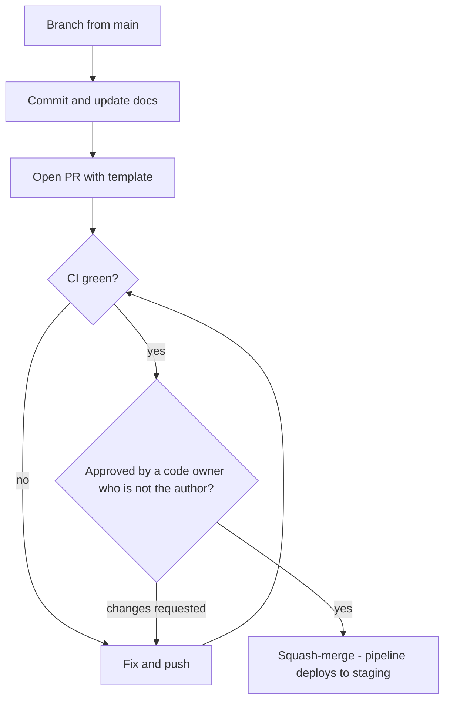

# SOP — <procedure name> — <Project>

> **Standard Operating Procedure:** the exact steps for a task this team repeats, written the way **this project** does it ([README §7.2](../../README.md#72-documentation-rules), rule 6). Copy to `docs/sop/<short-name>.md`. Keep it short: if a step can be enforced by a tool (branch protection, CODEOWNERS, CI, the pipeline), enforce it and say so here. For alerts, use a [runbook](../../06-Maintenance/templates/runbook.md) instead.

| Field | Value |
|-------|-------|
| **Owner (role)** | <e.g. Tech Lead> |
| **Version / last reviewed** | <v1.0 · YYYY-MM-DD> |
| **Next review due** | <last reviewed + 6 months> |
| **Applies to** | <who uses it, and when> |

## 1. Purpose and scope
<Why this procedure exists, and what it covers (and does not).>

## 2. Roles
| Role | Does |
|------|------|
| | |

## 3. Before you start (prerequisites)
- <access, tools, information needed>

## 4. Steps
<Choose the form that fits: numbered steps (short, straight tasks), a hierarchical outline (long tasks with sub-steps), or a flowchart (Mermaid) when there are decisions. Mark steps a tool enforces with 🔒.>

1.
2.
3.

## 5. If something goes wrong
| Problem | What to do | Who to ask |
|---------|------------|------------|
| | | |

## 6. References
- <related SOPs, runbooks, ADRs, guide sections>

## 7. Change history
| Date | Version | Change | By |
|------|---------|--------|----|
| | | | |

---

## Filled example — SOP: Merging a change to `main` (Book Review API)

| Field | Value |
|-------|-------|
| **Owner (role)** | Tech Lead |
| **Version / last reviewed** | v1.2 · 2026-11-16 |
| **Next review due** | 2027-05-16 |
| **Applies to** | Every developer, for every change to the repository |

**1. Purpose and scope** — every change reaches `main` reviewed, tested and documented, so `main` can be deployed at any time. Covers code, tests, docs and configuration. Hotfixes use the same steps (review can be quick).

**2. Roles** — **Author:** a developer. **Reviewer:** another developer, never the author, who is a code owner of the changed files (the team named in `.github/CODEOWNERS`).

**3. Before you start** — the story meets the Definition of Ready; you have write access to the repository.

**4. Steps**

1. Create a branch from the latest `main`: `feat/LV-123-short-name` (or `fix/…`). Keep it short-lived — merge within 2 days where possible.
2. Commit with **Conventional Commits** messages (`feat:`, `fix:`, `docs:` …).
3. Update the **docs in the same branch**: README, `openapi.yaml`, user help, runbook or SOP — or write "no docs change" in the PR.
4. Open a pull request; fill in the PR template; link the story (`Closes LV-123`).
5. 🔒 CI must be green: lint, types, tests, dependency / secret / SAST scans, docs checks.
6. 🔒 **One approval** from a person who is not the author, and that person is a **code owner** of the changed files (one approval can satisfy both — Development rule 1).
7. Answer every review comment; push fixes to the same branch.
8. **Squash-merge** into `main`; the branch is deleted automatically. The pipeline deploys to staging.

**5. If something goes wrong**

| Problem | What to do | Who to ask |
|---------|------------|------------|
| A flaky test fails | Do not re-run until green; quarantine it with a ticket (Testing rule 5) | QA Engineer |
| No reviewer within one working day | Ask in the team channel; raise it at the Daily Scrum | Delivery Lead |
| Merge conflict | Update the branch from `main`, run the tests again | Author |

**6. References** — [Development rules 1–2](../Development.md#64-rules), [pull request template](pull_request_template.md), [Definition of Done](definition-of-done.md), [README §7.2](../../README.md#72-documentation-rules).

**7. Change history**

| Date | Version | Change | By |
|------|---------|--------|----|
| 2026-11-16 | v1.2 | Step 3 added: docs updated in the same branch | Tech Lead |
