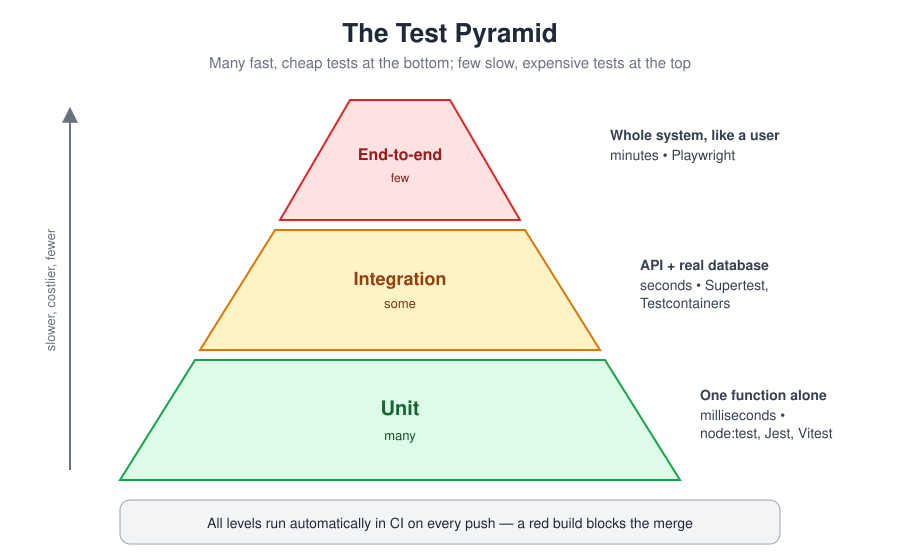
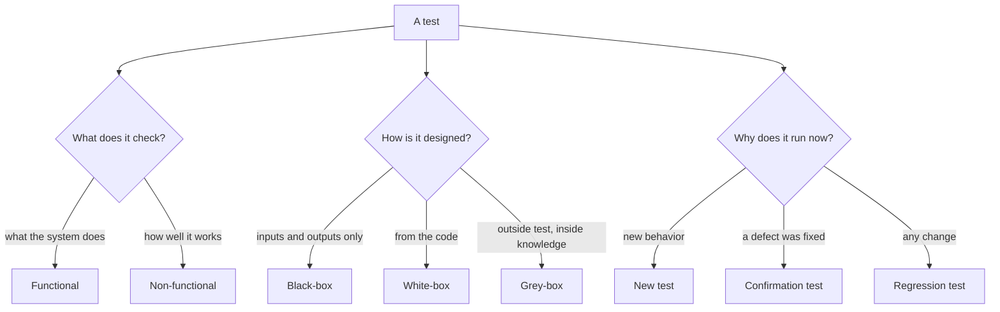
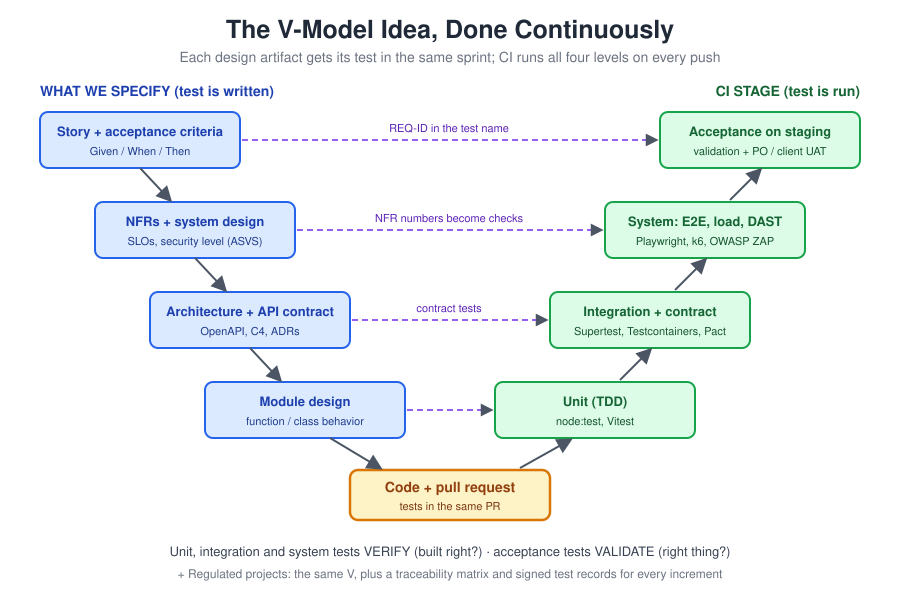
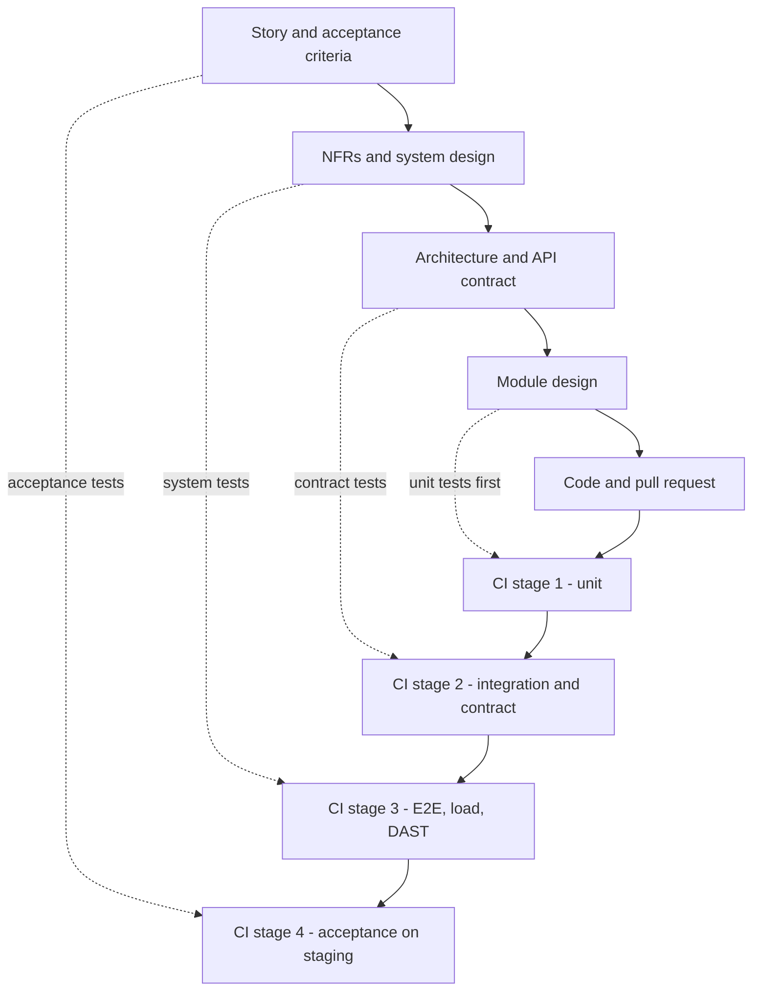
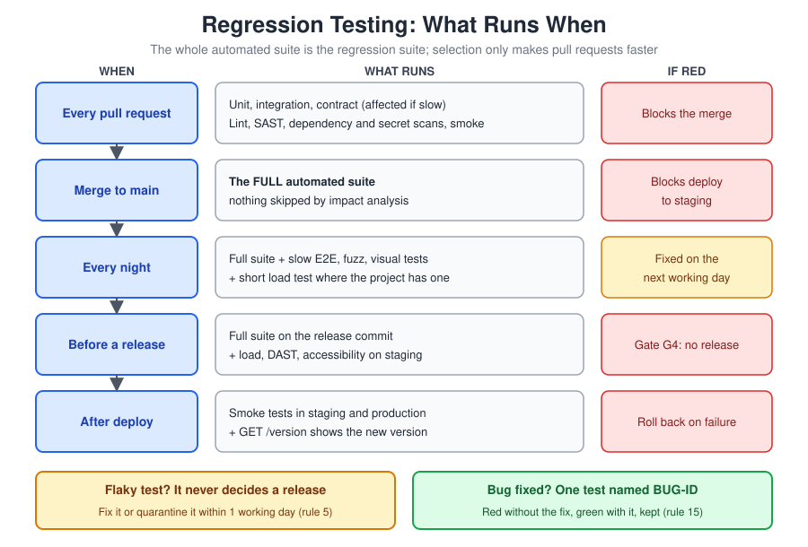

# Phase 4 — Testing: "Shift-Left, Automate, Pyramid"

**SDLC series — Phase 4 of 6.** How professional backend teams do **Testing** today: the lecture's core tasks, the Waterfall way vs. the modern way, and the industry practices the lecture does not cover.

> **Last reviewed:** 2026-11-16 · **Next review due:** 2027-05-16 · **Review owner:** QA Engineer · [Review rule](../README.md#91-review-schedule) · [Review log](../CHANGELOG.md)

[← Development](../03-Development/Development.md) · [Guide README](../README.md) · [Overview](../../6-Phases-of-SDLC-Modern-Best-Practices.md) · [Deployment →](../05-Deployment/Deployment.md)

---

## 0. Jargon Translation (Read This First)

| Term | Official Definition | Simple Words | Analogy |
|------|--------------------|--------------|---------|
| **SDLC (Software Development Life Cycle)** | A systematic process to build high-quality software in a predictable time and budget. | The steps a team follows from idea to running software. | A recipe for a big meal. |
| **Waterfall** | A model where each phase is fully finished before the next starts, with no going back. | One straight pass: plan everything, then build everything, then test everything. | Water falling down steps. |
| **Agile** | A way of working in short loops that deliver small, working pieces of software and adapt to feedback. | Build a little, show it, learn, repeat. | Cooking one dish at a time and tasting each before the next. |
| **Sprint / Iteration** | A fixed time-box (usually 1–4 weeks) in which a team delivers a small set of features. | One short loop of work. | One lap of a running track. |
| **DevOps** | A culture and set of practices where development and operations work as one team, with heavy automation. | The people who build the software also release and run it. | A chef who also serves the food and hears what guests think. |
| **Shift-left** | Moving testing and security work earlier in the timeline. | Test early, not at the end. | Checking ingredients before cooking, not after serving. |
| **TDD (Test-Driven Development)** | Writing a failing test first, then the code that makes it pass, then cleaning up. | Write the exam question before the answer. | Drawing the target before shooting the arrow. |
| **CI (Continuous Integration)** | Merging code into the main branch often, with an automated build and tests on every change. | A robot checks every change as soon as you push it. | A spell-checker that runs on every sentence you type. |
| **Acceptance criteria** | Clear yes/no conditions a story must meet to be accepted. | The checklist that says "this story is done". | "Tap does not leak; hot and cold both work". |
| **Gherkin** | A plain-language format (Given / When / Then) for writing acceptance criteria that tools can run as tests. | Test steps written like simple sentences. | A recipe card: "Given flour, when you add water, then you get dough." |
| **Verification vs. validation** | Verification: "did we build it right?" (against the spec). Validation: "did we build the right thing?" (against real needs). | Right *way* vs. right *thing*. | Following the recipe exactly vs. the guests actually liking the dish. |
| **Black-box / white-box testing** | Testing without looking at the code (black-box) vs. using knowledge of the code's internals (white-box). | Test from outside vs. from inside. | Test-driving a car vs. inspecting the engine. |
| **Grey-box testing** | Testing from the outside (through the API) while using some knowledge of the inside (for example the database design). | Outside test, inside knowledge. | Test-driving a car while knowing how its brakes are built. |
| **Regression test** | A test that checks old features still work after a change. | "Did we break anything that used to work?" | Re-checking all the lights after fixing one switch. |
| **Confirmation test (re-test)** | Running the test that failed before, to confirm a defect is really fixed. | "Did the fix fix it?" | Turning on the repaired switch to see if that light works. |
| **Maintenance testing** | Testing changes to software that is already in use (fixes, upgrades, migrations). It **includes** confirmation and regression testing — it is not another name for regression testing. | Testing when you change live software. | Inspecting a house after a renovation. |
| **Test case** | A set of preconditions, steps, input data and **expected results** that checks one behavior, linked to the requirement it comes from. | One exact "try this, expect that" check. | One exam question with its answer in the answer key. |
| **Test basis** | The documents a test is based on: requirements, acceptance criteria, designs, API contracts. | What tells you the right answer. | The rulebook a referee uses. |
| **Equivalence partitioning / boundary value analysis** | Test design techniques: split inputs into groups that behave the same and test one per group; test the values **at and next to** each limit. | Pick a few smart inputs instead of all inputs. | Checking the height line at a theme-park ride with someone just under, exactly at and just over it. |
| **Test impact analysis** | Running only the tests that are related to the changed files. | Test what the change can touch. | After fixing one tap, first test the pipes connected to it. |
| **OAT (Operational Acceptance Testing)** | Acceptance testing by the people who run the service: backups, monitoring, alerts, runbooks, failover. | "Can we run it in production?" | The fire inspector's check before a building opens. |
| **Smoke test** | A quick, basic test that the build starts and the most important features work. | "Does it even turn on?" | Turning on a new appliance to see that it powers up, before testing every button. |
| **Exploratory testing** | Unscripted testing where a tester learns the app and designs tests while using it. | Testing by curious exploring. | A detective looking for clues, not following a checklist. |
| **Load test** | A test that measures speed and errors under expected (or higher) traffic. | "Is it fast enough when many people use it?" | Testing a bridge with many trucks at once. |
| **Test double (mock, stub, fake, spy)** | A replacement for a real dependency, used in a test. | A stand-in for the real thing. | A crash-test dummy instead of a real driver. |
| **Code coverage** | The share of code lines or branches that the tests run. | How much of the code the tests touch. | How many rooms of a house the inspector walked into. |
| **Mutation testing** | Making small deliberate changes to code to check that the tests notice. | Testing the tests. | A teacher adding a wrong answer to see if the student spots it. |
| **Flaky test** | A test that sometimes passes and sometimes fails with no code change. | An unreliable test. | A smoke alarm that goes off at random. |
| **Severity vs. priority** | Severity = technical impact of a bug; priority = how urgently to fix it. | How bad vs. how urgent. | A small stain on a wedding dress: low damage, but very urgent. |
| **Chaos engineering** | Deliberately injecting failures to prove a system can recover. | Breaking things on purpose, safely. | A fire drill. |

---

## 1. The job

- Prove the software is **stable**, **secure**, and **meets the requirements** — and find problems as **early and cheaply** as possible.
- **Core tasks from the lecture (still true in every model):**
  1. Code is **thoroughly tested**: **stable**, **secure**, and **meets the requirements** (the SRS or the acceptance criteria).
  2. Testing is **manual**, **automated**, or a **hybrid** of both.
  3. Large projects may have **dedicated testing (QA — Quality Assurance) teams**.
  4. **The bug cycle:** bugs are **reported**, **tracked**, **fixed**, and the code is **retested** until it is stable.
  5. Testing happens at several **levels**: **unit**, **integration**, **system**, **acceptance**.
- **What testing can and cannot do:** testing **finds defects and reduces risk**. It can **never prove** that software has no defects — passing tests only show that the cases we tested work. So we choose tests by **risk** and with **test design techniques** ([§4.13](#413-the-seven-testing-principles), [§4.14](#414-test-cases-and-test-design-techniques)), and "done" means "good enough quality for the risk", not "error-free".
- **Two questions testing must answer** (a classic interview topic):

  | | **Verification** | **Validation** |
  |---|---|---|
  | **Question** | "Did we build the product **right**?" | "Did we build the **right** product?" |
  | **Checks against** | The specification / design / acceptance criteria | The real needs of users and stakeholders |
  | **Examples** | Code review, unit and integration tests, contract tests | Acceptance testing / UAT, usability tests, beta testing |

## 2. Core tasks: Waterfall way vs. modern way

| Core task | Waterfall way | Modern way |
|-----------|---------------|------------|
| **When testing happens** | After all coding is complete | **During** coding (shift-left), on **every push** in CI, and some checks **in production** (shift-right) |
| **Manual / automated / hybrid** | Mostly manual test scripts | **Hybrid, mostly automated**: automated tests for every rule; manual **exploratory testing** for usability and unexpected cases |
| **Who tests** | A separate QA team at the end | **Developers** write unit and integration tests; **QA engineers** work inside the team: test strategy, end-to-end automation, exploratory testing. Quality is the **whole team's** job |
| **Report → track → fix → retest** | Bug reports in a spreadsheet or tool, fixed in a later round | Bugs tracked in Jira / GitHub Issues with **severity and priority**; each fix comes with a **regression test**; CI **retests everything automatically** |
| **Testing levels** | Run one after another, each as its own stage | **All levels run in the pipeline**, in pyramid proportions; acceptance criteria are often automated |

## 3. How modern teams do it

- **Shift-left testing:** testing starts **while** coding, not after.
- **TDD (Test-Driven Development)** cycle:
  1. **Red** — write a test; it fails.
  2. **Green** — write the smallest code that passes.
  3. **Refactor** — clean up; the test proves nothing broke.
- **CI runs every test on every push and PR.** A red build blocks the merge.
- **The test pyramid:** many fast unit tests, fewer integration tests, few end-to-end tests. The lecture's four levels map onto it like this:

  | Level (lecture) | What it tests | Speed | How many | Node.js tools |
  |-----------------|---------------|-------|----------|---------------|
  | **Unit** | One function or module alone | Milliseconds | Many | `node:test`, Jest, Vitest |
  | **Integration** | Parts together (route + service + real database) | Seconds | Some | Supertest, Testcontainers (real database in Docker) |
  | **System** | The **whole** system, end to end — **functional** (E2E user flows) **and non-functional** (performance, security, reliability) | Minutes | Few | Playwright (E2E), k6 (load), OWASP ZAP (security) |
  | **Acceptance** | Does it meet the user's needs? | — | Per story | Automated acceptance criteria (for example Gherkin/Cucumber) + customer/product owner review on staging (UAT) |

- **What each level is for** (each level finds the defects it is **best and cheapest** at finding — avoiding duplicate tests is only a side benefit):
  - **Unit** — removes construction errors in one function or module; written by developers, mostly **white-box**.
  - **Integration** — finds errors **between** parts: wrong field names or data formats, different logic in two modules (cents vs. euros), unhandled errors from a called module, timeouts. It is a **level**, not a design technique: it can be **black-box or white-box** (often grey-box).
  - **System** — **verifies** the complete system against its **specified** requirements, functional **and** non-functional, on **staging**.
  - **Acceptance** — **validates** that the system meets user needs and business processes, **before release**. After go-live it is repeated only for **changes** (maintenance testing).
- **Pyramid vs. "testing trophy":** some teams (especially in JavaScript) prefer the **testing trophy**, which puts **more weight on integration tests**, because they give high confidence for their cost. Both agree on the main rule: **many fast tests, few slow ones, and no ice-cream cone** (mostly manual and E2E tests — slow and fragile).
- **Contract testing:** checks that a provider and its consumers still agree on the API. Two common forms:
  - **Schema validation:** responses are checked against the **OpenAPI** contract in tests.
  - **Consumer-driven contracts** (for example **Pact**): each client publishes what it expects, and the provider's CI checks it still delivers that — useful between microservices.
- **Automated security testing (DevSecOps):**

  | Check | What it does | Example tools |
  |-------|-------------|---------------|
  | **SAST (Static Application Security Testing)** | Scans source code for unsafe patterns | CodeQL, Semgrep |
  | **Dependency / SCA (Software Composition Analysis)** | Finds npm packages with known vulnerabilities | `npm audit`, Dependabot, Snyk |
  | **Secret scanning** | Finds passwords and keys in commits | GitHub secret scanning, gitleaks |
  | **DAST (Dynamic Application Security Testing)** | Attacks the running app in a test environment | OWASP ZAP |
  | **Container image scanning** | Finds vulnerable OS packages in Docker images | Trivy, Grype |

- **Shift-right testing:** some checks continue **in production** — canary releases, synthetic monitoring, feature flags and chaos experiments (see [4.10](#410-shift-right-testing-in-production)).
- **Regression tests for every bug:** each fixed bug gets a test, so if the bug ever comes back, CI **catches it at once**.



```javascript
// test/unit/rating.test.js — TDD: these tests were written BEFORE isValidRating existed
const test = require('node:test');
const assert = require('node:assert');
const { isValidRating } = require('../../src/services/rating');

test('accepts whole numbers 1 to 5', () => {
  for (const r of [1, 2, 3, 4, 5]) assert.strictEqual(isValidRating(r), true);
});

test('rejects edge cases from the acceptance criteria', () => {
  for (const r of [0, 6, 4.5, '5', null]) assert.strictEqual(isValidRating(r), false);
});
```

**What happens if... you only test the happy path?**

```javascript
// ❌ Passes even if the code wrongly accepts rating 99
test('rating works', () => assert.strictEqual(isValidRating(3), true));
// The bug escapes to production and is found by users — the most expensive place.
```

## 4. Industry practices the lecture does not cover

### 4.1 Ways to classify tests

| Classification | Meaning | Example |
|----------------|---------|---------|
| **Static testing** | Checking **without running** the code | Code review, linting, type checking, SAST |
| **Dynamic testing** | Checking **by running** the code | Unit, integration, E2E, load tests |
| **Black-box testing** | Testing inputs and outputs **without** looking at the code | QA sends requests to the API and checks responses |
| **White-box testing** | Testing **with knowledge of** the code's internal paths | A developer writes tests to cover every `if` branch |
| **Grey-box testing** | Testing from the outside **with some knowledge** of the inside | An API test that also checks the unique index in the database |
| **Functional testing** | Does it do the **right thing**? | Rating 6 → HTTP 400 with a Problem Details body |
| **Non-functional testing** | Does it do it **well enough**? | 95% of requests under 200 ms at 500 users |
| **Change-related testing** | Testing **again because something changed**: **confirmation** (is the defect fixed?) and **regression** (did anything else break?) | After fixing BUG-212, re-run its test and the whole suite |

- **Three questions classify any test:** **what** does it check (functional / non-functional)? **How** is it designed (black / white / grey box)? **Why** does it run now (new behavior / confirmation / regression)? **Regression is not a third kind next to functional and non-functional** — a regression suite re-runs functional **and** non-functional tests.
- **Usability and accessibility are non-functional** (in ISO/IEC 25010:2023 they belong to *interaction capability*, where accessibility became *inclusivity* and *user assistance*). Functional tests check **what** the system does — including user errors, edge cases and the **error format**, which is part of the API contract ([Design rule 7](../02-Design/Design.md#64-rules)).
- **Maintenance testing** (changes to a live system) is **not** another name for regression testing: it **contains** confirmation and regression tests, and regression tests also run long before go-live, on every change.



### 4.2 Common test types (and when they run)

| Type | Purpose | When |
|------|---------|------|
| **Smoke test** | "Does the build start and do the most basic things work?" | After every build and every deployment |
| **Sanity test** | A quick, narrow check that one specific fix or feature works | After a small fix |
| **Confirmation test (re-test)** | The test that found a defect now passes | With the fix, in the same PR |
| **Regression test** | Old features still work after **any** change (feature, fix, refactoring, dependency or runtime upgrade, configuration) | Every PR; the **full** suite on every merge to `main`, nightly and before every release ([§4.15](#415-regression-testing-what-runs-when)) |
| **Exploratory test** | A tester freely explores the app to find unexpected problems | During each sprint, by humans |
| **Performance / load test** | Speed under expected traffic | Before big releases, and regularly |
| **Stress / spike / soak test** | Behavior beyond normal load / sudden load / load for many hours (finds memory leaks) | Before big events or launches |
| **Security / penetration test** | Experts try to break in | Regularly and before major releases (often required by customers) |
| **Accessibility test** | Can people with disabilities use it (WCAG)? | Automated checks in CI (for example axe) + manual checks |
| **Property-based test** | The tool generates hundreds of inputs to break a rule ("a valid rating is always a whole number 1–5"); it **shrinks** a failure to the smallest example (for example **fast-check**) | In CI, for validation, parsing and calculation logic |
| **Fuzz test** | Sends random or malformed input to find crashes and security bugs | Nightly or before release, for parsers and public APIs |
| **Visual regression test** | Compares screenshots with approved ones to catch unwanted UI changes (for example Playwright screenshots) | In CI, for UI components and key pages |
| **Compatibility test** | It works on every **supported** platform: Node.js LTS lines in the CI matrix, browsers, operating systems, API client versions | In CI (matrix); browsers in the E2E run |
| **Documentation test** | The API docs and user guides match the real behavior (for example: responses are validated against the OpenAPI contract, and docs are generated from it) | In CI; user guides before each release |
| **Recovery (DR — Disaster Recovery) test** | A backup restore or a failover works within the **RPO / RTO** (Recovery Point / Recovery Time Objective) | At least every quarter ([Maintenance rule 6](../06-Maintenance/Maintenance.md#65-rules)) |
| **Alpha / beta test** | Real users try a pre-release version (internal = alpha, external = beta) | Before general availability |
| **UAT (User Acceptance Testing)** | Users or the client confirm it supports their real work | Per story with the PO; before release with the client |
| **OAT (Operational Acceptance Testing)** | Backups, monitoring, alerts, runbooks and failover are ready | Before go-live — the [go-live checklist](../06-Maintenance/templates/go-live-checklist.md) (Gate G5) |
| **Contract / regulatory acceptance** | The system meets the contract or the law (for example accessibility, data protection) | Before go-live, with the client; evidence kept on regulated projects |

### 4.3 Non-functional testing: a load test example

```javascript
// load/reviews.k6.js — run with: k6 run load/reviews.k6.js
import http from 'k6/http';
import { check, sleep } from 'k6';

export const options = {
  vus: 200,                         // 200 virtual users at the same time
  duration: '2m',
  thresholds: {
    http_req_duration: ['p(95)<200'], // the SLO from planning: 95% of requests under 200 ms
    http_req_failed: ['rate<0.001'],  // fewer than 0.1% errors (99.9% success)
  },
};

export default function () {
  const res = http.get('https://staging.example.com/books/9780132350884/reviews');
  check(res, { 'status is 200': (r) => r.status === 200 });
  sleep(1);                         // each user waits 1 second between requests
}
// If a threshold fails, k6 exits with an error, so the CI pipeline fails too.
```

### 4.4 Writing good tests

- **AAA pattern:** **Arrange** (set up data) → **Act** (do one thing) → **Assert** (check the result).
- **FIRST** principles: tests are **F**ast, **I**ndependent (no order dependence), **R**epeatable (same result every time), **S**elf-validating (pass/fail with no human check), **T**imely (written with or before the code).
- **Test behavior, not implementation:** test what the API returns, not which private function was called. Then refactoring does not break the tests.
- **One reason to fail:** each test checks one behavior, with a name that says what it checks.

```javascript
// test/integration/reviews.test.js — integration test with Supertest (AAA pattern)
const test = require('node:test');
const assert = require('node:assert');
const request = require('supertest');
const app = require('../../src/app');          // the app WITHOUT app.listen()

test('POST /books/:isbn/reviews rejects rating 6 with 400 Problem Details', async () => {
  // Arrange
  const token = await loginAsTestUser();         // helper creates a user and returns a JWT

  // Act
  const res = await request(app)
    .post('/books/9780132350884/reviews')
    .set('Authorization', `Bearer ${token}`)
    .send({ rating: 6 });

  // Assert
  assert.strictEqual(res.status, 400);
  assert.match(res.headers['content-type'], /application\/problem\+json/);
  assert.strictEqual(res.body.status, 400);
});
```

### 4.5 Test doubles: mocks, stubs, fakes, spies

| Double | What it does | Example |
|--------|--------------|---------|
| **Stub** | Returns a fixed answer | `getBook()` always returns one test book |
| **Mock** | Checks that it was called in the expected way | "`sendEmail` was called once with the author's address" |
| **Spy** | Records calls to a real function | Count how many times the logger was called |
| **Fake** | A simple working version | An in-memory repository instead of PostgreSQL |

- **Mock at the boundaries** (email provider, payment API, clock) — not your own business logic.
- **Prefer a real database in integration tests** (Testcontainers) over mocking the database: many bugs live in SQL, constraints and transactions.

```javascript
// test/unit/reviewService.test.js — mock the email adapter (an external boundary)
const test = require('node:test');
const assert = require('node:assert');
const { createReviewService } = require('../../src/services/reviewService');

test('notifies the book author after a new review', async (t) => {
  const email = { send: t.mock.fn(async () => {}) };            // mock: records calls
  const repo = { insert: async (r) => ({ id: 1, ...r }) };       // fake repository
  const service = createReviewService({ repo, email });          // dependencies injected

  await service.addReview(7, '9780132350884', { rating: 5 });

  assert.strictEqual(email.send.mock.callCount(), 1);           // called exactly once
});
```

### 4.6 Test data and environments

- **Never use real production personal data** in tests. Use **synthetic** data (generated, for example with a library like Faker) or properly **anonymized** data.
- **Each test creates its own data** and does not depend on other tests (use factories or fixtures; reset the database between tests or run each test in a transaction that is rolled back).
- **Ephemeral preview environments:** many teams spin up a temporary environment **per pull request**, so reviewers and QA can test the change before merging. It is deleted after the merge.

### 4.7 Code coverage and its limits

- **Coverage** = the share of code lines or branches that tests run. Node.js has it built in: `node --test --experimental-test-coverage` (Jest and Vitest also report it).
- **Branch coverage** (every `if`/`else` path) says more than line coverage.
- **Coverage is a warning light, not a goal.** 100% coverage does not mean the tests check anything useful. Many teams use a minimum (for example 80%) to catch **untested areas**, not to prove quality.
- **Mutation testing** (for example **Stryker**) measures test **quality**: it makes small changes ("mutants") to the code, such as turning `>=` into `>`. If no test fails, the tests are too weak.

### 4.8 Flaky tests

- A **flaky test** sometimes passes and sometimes fails **with no code change**. It destroys trust in CI.
- **Common causes:** depending on time or dates, test order, shared data, real network calls, race conditions, fixed `sleep()` waits.
- **Fixes:** control the clock with fake timers, isolate data, mock external services, wait for **conditions** instead of fixed times. **Quarantine** a flaky test (move it out of the blocking suite) and fix it quickly — never just "re-run until green".

```javascript
// ❌ Flaky: fails when the test runs exactly at midnight, or in another time zone
test('review date is today', () => {
  const review = createReview();
  assert.strictEqual(review.date, new Date().toISOString().slice(0, 10));
});

// ✅ Control time with node:test fake timers (Date mocking needs Node 20.11+)
test('review date uses the current time', (t) => {
  t.mock.timers.enable({ apis: ['Date'], now: new Date('2026-11-10T09:00:00Z') });
  const review = createReview();
  assert.strictEqual(review.date, '2026-11-10');
});
```

### 4.9 Bugs: severity, priority and lifecycle

- **Severity** = how bad the **technical impact** is. **Priority** = how **urgently** it must be fixed. They are different:

  | Example | Severity | Priority |
  |---------|----------|----------|
  | Payment page crashes for everyone | Critical | Highest — fix now |
  | Company logo wrong on the home page | Low | High — very visible |
  | Crash in a rarely used admin export | High | Medium |
  | Typo in a help page nobody reads | Low | Low |

- **Bug lifecycle:** New → Triaged → In progress → Fixed → Verified (retested) → Closed. If it appears again → **Reopened**.
- **A good bug report** contains: title, environment and version, **steps to reproduce**, **expected** result, **actual** result, logs/screenshots, severity.

```markdown
**Title:** POST /books/:isbn/reviews returns 500 when text is longer than 2000 chars
**Environment:** staging, api v1.5.0
**Steps:** 1. Log in  2. POST a review with rating 4 and 2,500-character text
**Expected:** 400 Problem Details "text: too long"
**Actual:** 500 Internal Server Error (log reqId 9f2c…)
**Severity:** Medium   **Priority:** High (any user can trigger it)
```

### 4.10 Shift-right: testing in production

- **Synthetic monitoring:** a robot runs key user flows (log in, post review) every few minutes against production.
- **Canary analysis:** compare error rate and latency of the new version against the old one before full rollout.
- **Feature flags:** turn a new feature on for internal users first ("dogfooding").
- **Chaos engineering:** carefully break things on purpose (kill a pod, slow the database) to prove the system recovers — start in staging, with a clear plan and a stop button.

### 4.11 Using AI in testing

- AI tools can **suggest test cases and edge cases**, generate test data, and draft test code.
- **Review generated tests carefully:** AI often writes tests that only repeat what the code already does, so they pass even when the code is wrong. Make sure each test checks a **requirement**.
- If the product **itself uses an AI model**, normal assertions are not enough because answers vary. Teams add **evaluations ("evals")**: a fixed set of example inputs with scoring rules, run on every change to the prompt or model.

### 4.12 The V-model idea: each design artifact gets its test

- The **V-model** pairs every specify-and-design step with a test level: requirements ↔ acceptance, system design ↔ system, architecture ↔ integration, module design ↔ unit. Its best idea — **write the test together with the thing it checks** — is what we keep.
- Its weakness — tests **run only at the end**, so changes after testing starts are very hard — is what we remove: all four levels run **on every push** in CI.
- **Verification vs. validation:** unit, integration and system tests **verify** ("did we build it right, as specified?"); acceptance tests and UAT **validate** ("did we build the right thing for the user?").

| What we specify | Its test is written… | It runs in CI as… | Tools (examples) |
|-----------------|----------------------|-------------------|------------------|
| **Story + acceptance criteria** (requirements) | With the story, before or with the code | **Acceptance** tests on staging + PO / client UAT | Gherkin/Cucumber, Playwright |
| **NFRs + system design** (SLOs, ASVS level) | When the NFR is written | **System** tests: E2E, load, DAST | Playwright, k6, OWASP ZAP |
| **Architecture + API contract** (OpenAPI, ADRs) | In the same PR as the contract change | **Integration** and **contract** tests | Supertest, Testcontainers, Pact |
| **Module design** (function behavior) | First (TDD: red → green → refactor) | **Unit** tests | `node:test`, Vitest |





- **Regulated projects** (the "+ Regulated data" add-on, or safety-critical clients — for example automotive **ISO 26262**, medical device software **IEC 62304**, pharma **GAMP 5**): run the **full V** with a **traceability matrix** and **signed test records** — but as **one small V per increment**, not one big V for the whole product.

### 4.13 The seven testing principles

These principles come from the ISTQB (International Software Testing Qualifications Board) Foundation Level syllabus. They explain **how much** and **when** to test.

| # | Principle | What it means for our teams |
|---|-----------|-----------------------------|
| 1 | **Testing shows the presence, not the absence, of defects** | Green tests reduce risk; they are not a guarantee. Never promise a client "bug-free" software |
| 2 | **Exhaustive testing is impossible** | Choose tests by **risk** and with **test design techniques** ([§4.14](#414-test-cases-and-test-design-techniques)) |
| 3 | **Early testing saves time and money** | Tests are written with the story and the code (rules 1 and 12) |
| 4 | **Defects cluster together** | A few modules hold most bugs — look at the bug history and test those modules harder |
| 5 | **Tests wear out** (once called the "pesticide paradox") | The same tests stop finding new bugs; add tests for every bug and review the suite |
| 6 | **Testing is context dependent** | A payment API needs more and different testing than an internal admin page — the test strategy sets the depth |
| 7 | **Absence-of-defects fallacy** | Bug-free software that does not meet user needs is still a failure — that is why we do acceptance testing |

### 4.14 Test cases and test design techniques

- **Most test cases are automated code** that runs in CI. A **written** test case (the [test-case template](templates/test-case.md)) is used only where a test **cannot be automated** or a **signed record** is needed: UAT scripts for the client, OAT, manual accessibility checks, and regulated projects.
- **When:** a test case is written **as soon as its requirement or acceptance criterion is agreed** — not after "all requirements are final". Writing a test often shows that a requirement is unclear. When a requirement changes, its tests change in the **same** story or PR.
- **What a test case contains** (automated or written):

  | Field | Example (Book Review API) |
  |-------|---------------------------|
  | **ID and title** | `TC-07-02` — Rating above 5 is rejected |
  | **Requirement link** | `REQ-07` (rate a book 1–5) — in the test name, so the traceability check in CI finds it (rule 11) |
  | **Preconditions** | Test user `asha` is logged in; book `978-0132350884` exists |
  | **Steps and input data** | `POST /v1/books/978-0132350884/reviews` with `{ "rating": 6 }` |
  | **Expected result** | `400`, Problem Details body "Rating must be between 1 and 5"; no review saved |
  | **Actual result / status** | Filled in when it runs: Pass / Fail (CI does this for automated tests) |
  | **Priority** | High — validation of user input |

- **Black-box test design techniques** — pick a **few good inputs** instead of guessing:

  | Technique | Idea | Example for "rating must be a whole number 1–5" | Use it for |
  |-----------|------|-------------------------------------------------|------------|
  | **Equivalence partitioning** | Inputs in one group behave the same; test one value per group | Too low (≤ 0), valid (1–5), too high (≥ 6), not a whole number, wrong type | Every validated input |
  | **Boundary value analysis** | Bugs hide at the edges; test on and next to each limit | 0, 1, 5, 6 | Every range and length limit |
  | **Decision table** | List each combination of conditions and its expected result | Logged in? × book exists? × already reviewed? → 401 / 404 / 409 / 201 | Rules with 3 or more conditions |
  | **State transition** | Test the allowed **and** forbidden moves between states | Review: published → hidden (3 reports) → restored by a moderator; "hidden → published" by the author is rejected | Anything with a status field |

- **White-box:** **branch coverage** shows which `if/else` paths no test runs ([§4.7](#47-code-coverage-and-its-limits)). It shows what is **not** tested; a high number does not prove the tests are good.

```javascript
// test/unit/rating.test.js — equivalence classes + boundary values in one table
const test = require('node:test');
const assert = require('node:assert');
const { isValidRating } = require('../../src/services/rating');

const cases = [
  [0, false], [1, true], [5, true], [6, false], // boundaries: just outside, on, on, just outside
  [3, true],                                    // a normal value inside the range
  [4.5, false], ['5', false], [null, false],    // classes: not a whole number, wrong type, missing
];

for (const [input, expected] of cases) {
  test(`REQ-07: isValidRating(${JSON.stringify(input)}) is ${expected}`, () => {
    assert.strictEqual(isValidRating(input), expected);
  });
}
// If the code says "value < 5" instead of "value <= 5", the case [5, true] fails at once.
```

### 4.15 Regression testing: what runs when

- **The whole automated suite is the regression suite.** Regression tests run after **any** change — not only after requirement changes or bug fixes: also refactoring, dependency and Node.js upgrades, configuration and infrastructure changes.
- **Selection is for speed, not to skip risk.** When the suite gets too slow for pull requests, run the **affected** tests there (**test impact analysis**, for example `vitest run --changed origin/main` or Jest `--changedSince=origin/main`), but run **everything** on `main`, nightly and before releases. Impact analysis misses some changes (shared fixtures, configuration).
- **When choosing tests for a fast or manual subset**, prefer: areas with **frequent defects**, **frequently used** features (the critical user journeys), **recently changed** features, **complex** logic and **edge cases**, and tests that **recently found a real defect**.
- **Flaky tests are never part of a regression decision.** A test that passes and fails at random says nothing about the change — fix it or quarantine it (rule 5).
- **Every bug fix adds one automated test named with the bug ID** (for example `test("BUG-212: a second review by the same user returns 409")`). It is written first and is **red without the fix**. Green with the fix, it is the **confirmation** test; kept in the suite, it is the **regression** test from then on. (A manual confirmation is needed only when the bug cannot be reproduced by an automated test.)

| When | What runs | Blocks |
|------|-----------|--------|
| **Every pull request** | Unit + integration + contract tests (all, or the **affected** ones when the suite is slow), lint, SAST, dependency and secret scans, a smoke test of the built app (or of the preview environment, where there is one) | The merge |
| **Every merge to `main`** | The **full** automated suite | Deployment to staging |
| **Nightly** (client and regulated projects; internal products when they have slow tests that do not run on `main`) | Full suite + slow E2E, fuzz and visual tests; a short load test where the project has one | Nothing directly — a red nightly run is fixed first thing the next working day |
| **Before every release** | Full suite on the **release commit** + load, DAST and accessibility checks on staging, as the project type requires (§6.2) | Gate G4 |
| **After every deployment** | Smoke tests in staging and production ([Deployment rule 5](../05-Deployment/Deployment.md#64-rules)) | Rollout (rollback on failure) |



```yaml
# .github/workflows/tests.yml (excerpt) — fast on pull requests, full on main and every night
on:
  pull_request:
  push:
    branches: [main]
  schedule:
    - cron: "0 2 * * *"                       # 02:00 UTC every night: the full regression suite
# ... checkout with fetch-depth: 0, so the changed files can be compared with main ...
      - name: Affected tests only (pull requests)
        if: github.event_name == 'pull_request'
        run: npx vitest run --changed origin/main
      - name: Full regression suite (main and nightly)
        if: github.event_name != 'pull_request'
        run: npx vitest run
```

**What happens if… a team only ever runs the affected tests?** A change in a shared test fixture or in configuration is not linked to the tests it breaks, so a regression reaches staging — or production on an internal product with Continuous Deployment. The full run on `main` catches it before deployment.

## 5. Testing is "done enough" when... (exit criteria)

- [ ] Every **acceptance criterion** has a passing test (automated where possible).
- [ ] **Unit, integration and system** tests pass in CI; the suite is **not flaky**.
- [ ] Every fixed bug has an automated test named with the bug ID that was red without the fix (confirmation) and stays in the suite (regression).
- [ ] Test inputs are chosen with **test design techniques** (equivalence classes and boundary values for every validated input — rule 13, checked in code review).
- [ ] The **full** regression suite runs on every merge to `main` and on the release commit (and nightly, as rule 14 requires).
- [ ] **Non-functional** targets are proven: performance (load test vs. SLOs), security scans clean, accessibility checks pass.
- [ ] **Coverage** is above the team minimum, and important paths (auth, payments, data changes) are well covered.
- [ ] No open **critical or high-severity** bugs (or each has an agreed plan).
- [ ] **Smoke tests** pass on staging; **UAT / product owner acceptance** is done.
- [ ] Test data contains **no real personal data**.

---

## 6. LumenVenture Standard

> **What we do on every project.** See the [guide README](../README.md) for roles, gates and project types. **must** = required · **should** = default (skip only with a written reason) · **may** = optional.

### 6.1 Owners

| Activity | Accountable | Responsible | Consulted |
|----------|-------------|-------------|-----------|
| Test strategy | QA Engineer | QA, Tech Lead | Developers, PO |
| Unit and integration tests | Tech Lead | Developers | QA |
| System (E2E and non-functional) tests | QA Engineer | QA, developers | Tech Lead, Security Champion |
| Bug triage (severity and priority) | Product Owner | QA | Tech Lead |
| UAT / acceptance | Product Owner | QA, PO (+ client) | Delivery Lead |

### 6.2 Required outputs

| Output | Internal | Client | Prototype | + Regulated |
|--------|----------|--------|-----------|-------------|
| Test strategy ([template](templates/test-strategy.md)) | **must** | **must** | **may** | **must** |
| Automated unit + integration tests in CI | **must** | **must** | **should** | **must** |
| Automated E2E tests for key flows | **should** | **must** | — | **must** |
| Load test against SLOs before go-live and major releases | **should** | **must** | — | **must** |
| Security scans in CI (dependency, secret, SAST) | **must** | **must** | **should** | **must** |
| DAST / penetration test | **may** | **should** (or as the contract says) | — | **must** before go-live |
| Accessibility checks (user-facing UI) | **should** | **must** | — | **must** |
| UAT sign-off ([template](templates/uat-signoff.md)) | PO **must** | Client + PO **must** | — | **must**, kept for audit |
| Bug reports ([template](templates/bug-report.md)) | **must** | **must** | **should** | **must** |
| Nightly full regression run in CI (§4.15) | **should** (**must** when slow tests run only at night) | **must** | — | **must** |
| Written test cases for manual, UAT and OAT tests ([template](templates/test-case.md)) | **may** | **should** (UAT scripts for the client) | — | **must**, signed and kept for audit |

### 6.3 Gate input for G4 — Testing exit criteria

The release goes to [G4 in Deployment](../05-Deployment/Deployment.md#6-lumenventure-standard) only when:

- [ ] Every acceptance criterion in the release has a passing test (automated where possible)
- [ ] The **full** automated regression suite (unit, integration, contract and system tests — not only the affected tests) passes on the release commit; no known flaky tests in the blocking suite
- [ ] Coverage is at or above the project minimum; critical paths are covered
- [ ] Non-functional targets proven (load vs. SLOs, scans clean, accessibility) as the project type requires
- [ ] No open **S1/S2** bugs (or an agreed, signed plan for each)
- [ ] **UAT / acceptance signed**

### 6.4 Rules

1. **must** — Tests are written **with** the code (shift-left); a story is not done without them.
2. **must** — Every bug fix includes a **regression test**.
3. **must** — **No real personal data** in test environments; use synthetic or properly anonymized data.
4. **must** — Bugs are tracked with **severity and priority** (S1–S4, P1–P4) as defined in the test strategy.
5. **must** — A failing or flaky test is never "re-run until green": fix it, or **quarantine** it with a ticket and an owner within one working day.
6. **should** — Follow the test pyramid/trophy: many fast tests, few slow ones; use a real database in integration tests (for example Testcontainers).
7. **should** — Mock only at system boundaries (external APIs, email, clock).
8. **should** — Coverage minimum of **80%** for new code, used as a warning light, not a goal.
9. **should** — Exploratory testing by QA each sprint for new user-facing features.
10. **may** — Mutation testing on critical modules; preview environments per PR; **property-based tests** for validation and parsing logic; **fuzzing** for public parsers and APIs.
11. **should** (**must** on regulated projects) — **Requirement traceability check in CI:** test names carry the requirement ID (for example `test("REQ-10: 3 reports hide the review")`), and a CI step fails when a **Must** requirement has no test, or a test names an ID that does not exist. It proves **coverage of requirements**, not test quality — code review still checks the tests. See [Planning §4.12](../01-Planning/Planning.md#412-writing-requirements-that-can-be-tested).
12. **must** — Each test level is written **in the same sprint** as the artifact it checks (§4.12): acceptance tests with the story, contract tests with the API change, unit tests with the code. No testing-only sprint or phase at the end.
13. **should** — Test inputs are chosen with **test design techniques** (§4.14): equivalence partitioning and boundary value analysis for every validated input, decision tables for rules with 3 or more conditions, state-transition tests for every status field. Code review checks this.
14. **must** — **Regression schedule** (§4.15): the **full** automated suite runs on every merge to `main` and on the **release commit**, and **nightly** on client and regulated projects (internal products: nightly when they have slow tests that do not run on `main`). Pull requests may run only the affected tests; that selection never replaces the full runs. A red nightly run is fixed (or the failing test quarantined under rule 5) on the next working day.
15. **must** — A bug fix is merged only with an automated test named with the bug ID (`BUG-<id>: …`) that is shown to **fail without the fix** (written first, red, then green with the fix). The same test is the confirmation test now and the regression test afterwards (§4.15). This extends rule 2.
16. **should** — **Compatibility** is tested in a CI matrix for every **supported** platform the project lists (Node.js LTS lines, browsers, API client versions — see the [versioning policy](../03-Development/templates/versioning-policy.md)), and **API documentation** is generated from or checked against the OpenAPI contract in CI.
17. **must** on regulated projects, **should** on client projects — Tests that cannot be automated (UAT scripts, OAT, manual accessibility checks) are written with the [test-case template](templates/test-case.md) **before** the test session, linked to requirement IDs, and the executed record is kept with the release (`docs/releases/`).

### 6.5 Templates

| Template | Copy to |
|----------|---------|
| [test-strategy.md](templates/test-strategy.md) | `docs/test-strategy.md` |
| [bug-report.md](templates/bug-report.md) | Your tracking tool (issue template) |
| [uat-signoff.md](templates/uat-signoff.md) | `docs/releases/<version>-uat.md` |
| [test-case.md](templates/test-case.md) | `docs/test-cases/<area>.md` (written cases); executed records in `docs/releases/<version>-tests.md` |

---

[← Development](../03-Development/Development.md) · [Guide README](../README.md) · [Overview](../../6-Phases-of-SDLC-Modern-Best-Practices.md) · [Deployment →](../05-Deployment/Deployment.md)
