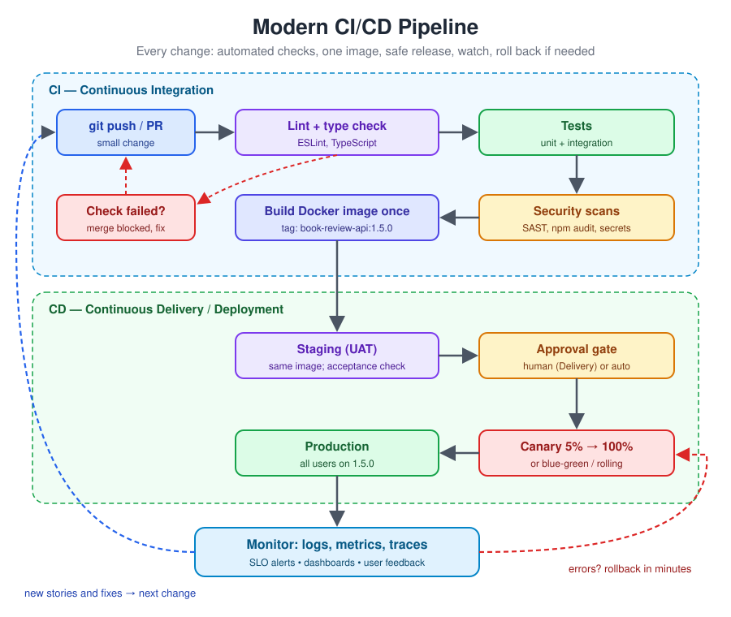
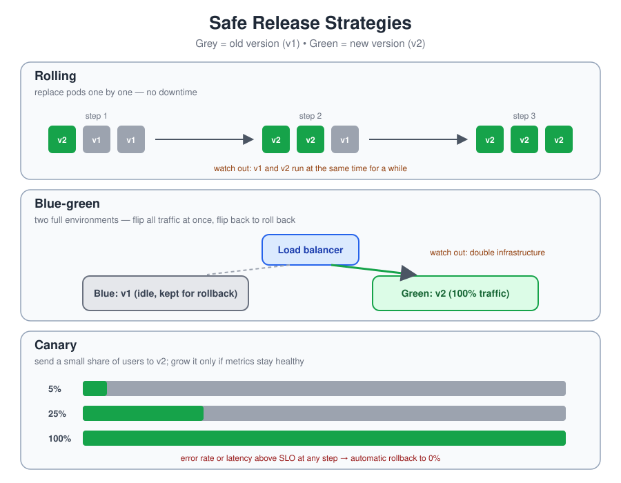

# Phase 5 — Deployment: "Automated, Small, Reversible"

**SDLC series — Phase 5 of 6.** How professional backend teams do **Deployment** today: the lecture's core tasks, the Waterfall way vs. the modern way, and the industry practices the lecture does not cover.

> **Last reviewed:** 2026-11-26 · **Next review due:** 2027-05-26 · **Review owner:** Tech Lead · [Review rule](../README.md#91-review-schedule) · [Review log](../CHANGELOG.md)

[← Testing](../04-Testing/Testing.md) · [Guide README](../README.md) · [Overview](../../6-Phases-of-SDLC-Modern-Best-Practices.md) · [Maintenance →](../06-Maintenance/Maintenance.md)

---

## 0. Jargon Translation (Read This First)

| Term | Official Definition | Simple Words | Analogy |
|------|--------------------|--------------|---------|
| **SDLC (Software Development Life Cycle)** | A systematic process to build high-quality software in a predictable time and budget. | The steps a team follows from idea to running software. | A recipe for a big meal. |
| **Waterfall** | A model where each phase is fully finished before the next starts, with no going back. | One straight pass: plan everything, then build everything, then test everything. | Water falling down steps. |
| **Agile** | A way of working in short loops that deliver small, working pieces of software and adapt to feedback. | Build a little, show it, learn, repeat. | Cooking one dish at a time and tasting each before the next. |
| **Sprint / Iteration** | A fixed time-box (usually 1–4 weeks) in which a team delivers a small set of features. | One short loop of work. | One lap of a running track. |
| **DevOps** | A culture and set of practices where development and operations work as one team, with heavy automation. | The people who build the software also release and run it. | A chef who also serves the food and hears what guests think. |
| **CI (Continuous Integration)** | Merging code into the main branch often, with an automated build and tests on every change. | A robot checks every change as soon as you push it. | A spell-checker that runs on every sentence you type. |
| **CD (Continuous Delivery / Deployment)** | Every change that passes CI is automatically ready to release (Delivery) or released automatically (Deployment). | A robot moves good changes to the servers. | A conveyor belt from kitchen to table. |
| **Pipeline** | The automated chain of steps (build, test, scan, deploy) that every change goes through. | The assembly line for code. | A car factory line. |
| **Deploy vs. release** | Deploy: new code is running on servers. Release: users can use the new feature. | Installing it vs. turning it on for users. | A new shop counter is installed overnight (deploy) but opens to customers next week (release). |
| **Progressive delivery** | Releasing changes gradually (canary, feature flags) while watching metrics, with automatic rollback. | Release step by step, watching carefully. | Opening a new road one lane at a time. |
| **Feature flag** | A setting that turns a feature on or off without deploying new code. | A light switch for a feature. | A shop that is built but has its door closed until opening day. |
| **Canary release** | Sending a small share of users to a new version first, then increasing it if all is well. | Test the new version on a few users first. | Miners took a canary into the mine to detect danger early. |
| **Blue-green deployment** | Running the old (blue) and new (green) versions side by side, then switching traffic. | Two copies; flip a switch to change; flip back if it breaks. | Two stages in a theater: prepare the next scene on the second stage. |
| **Rollback** | Returning production to the last good version. | "Undo" for a release. | Ctrl+Z. |
| **Roll-forward** | Fixing a bad release by quickly deploying a new, fixed version instead of going back. | Fix forward instead of undoing. | Patching a flat tire on the road instead of driving back home. |
| **Immutable image / digest** | A container image that is never changed after it is built; its digest (`sha256:…`) uniquely identifies its exact content. | A sealed, numbered package that is never repacked. | A sealed parcel with a unique tracking number. |
| **Multi-stage build** | A Dockerfile with several stages, where only the needed files are copied into the final image. | Build in a messy workshop, ship only the finished product. | Cooking in the kitchen but serving only the plate. |
| **Graceful shutdown** | Stopping a server by finishing current requests before exiting. | Finish serving, then close. | A shop that stops letting people in at closing time but serves everyone already inside. |
| **HPA (Horizontal Pod Autoscaler)** | A Kubernetes feature that adds or removes pods automatically based on load. | More copies when busy, fewer when quiet. | A supermarket opening more checkouts when the queue grows. |
| **IaC (Infrastructure as Code)** | Defining servers, networks and config in versioned code files instead of manual setup. | Infrastructure written as code in Git. | A building's blueprint that can rebuild the same building anywhere. |
| **GitOps** | Running deployments by changing a Git repository; a tool makes the cluster match Git automatically. | Git is the single source of truth for production. | A thermostat that keeps the room at the temperature written on the dial. |
| **OIDC federation (in CI)** | Letting a CI job exchange its identity for a short-lived cloud token, instead of storing long-lived keys. | No permanent passwords in the pipeline. | A visitor badge that expires tonight instead of a permanent office key. |
| **DORA metrics** | Five measures of software delivery: change lead time, deployment frequency, failed deployment recovery time (throughput), change fail rate and deployment rework rate (instability). | Five numbers that show how fast and how safely a team delivers. | A car's speed, fuel use, breakdown rate, repair time and how often it goes back to the garage. |

---

## 1. The job

- Release the software to users **safely**: no downtime, a small blast radius if something is wrong, and a fast way back.
- **Core tasks from the lecture (still true in every model):**
  1. Release the application into the **production environment** and make it **available to users**.
  2. Release **in stages**: first to a **UAT (User Acceptance Testing) platform**, then to production.
  3. Get **customer sign-off** on the functionality before production.
  4. Deliver to the right **target**: a **website**, a **mobile app store**, or a **software distribution server** on a corporate network.
- **Deploy ≠ release** (a key modern idea, not in the lecture):

  | | **Deploy** | **Release** |
  |---|---|---|
  | **Meaning** | New code is **installed and running** on the servers | Users can **see and use** the new feature |
  | **Controlled by** | The CD pipeline | A **feature flag** or a configuration switch |
  | **Why separate them** | Deploy often, at low risk | Turn features on when the business is ready — and off in seconds if there is a problem |

## 2. Core tasks: Waterfall way vs. modern way

| Core task | Waterfall way | Modern way |
|-----------|---------------|------------|
| **Release to production** | One big release at the end, often done by hand by an operations team, often at night or on weekends | Many small releases by a **CD pipeline**, started by a merge, during normal working hours |
| **Staged release (UAT, then production)** | A UAT server, deployed by hand | Automatic environments: CI → **staging (UAT)** → production, all using the **same image**; plus **canary** steps inside production |
| **Customer sign-off** | A formal signed document after UAT; in large companies also a **CAB (Change Advisory Board)** meeting | An **approval gate** in the pipeline (Continuous Delivery), or automatic if all checks pass (Continuous Deployment); **feature flags** let the product owner "release" a feature when ready. Many enterprises now use **automated change approval** based on pipeline evidence (tests, scans, reviews) |
| **Targets: website, app store, corporate server** | Each released by hand | **Website / API:** container to Kubernetes, OpenShift, a PaaS (Platform as a Service, for example Azure App Service) or serverless. **App store:** automated build + beta track (TestFlight, Google Play testing) + store review + **staged rollout** to a % of users. **Corporate devices:** device-management tools push updates in waves |

## 3. How modern teams do it

- **A CD pipeline** does the release work, not a person typing commands.
- **Environments:** development → CI → **staging (UAT — User Acceptance Testing)** → production. Staging should match production closely (same image, same configuration shape, realistic data volume).
- **Build once, promote everywhere:** build **one** immutable Docker image and move that **same** image through every environment. Identify it by the **git commit SHA** or, even safer, by its **digest** (`sha256:…`), which can never point to different content.
- **Continuous Delivery vs. Continuous Deployment:**

  | | Continuous Delivery | Continuous Deployment |
  |---|---|---|
  | **To staging** | Automatic | Automatic |
  | **To production** | One-click human approval | Automatic if all checks pass |
  | **Good for** | Regulated or customer-approval projects | Fast-moving product teams |

- **Safe release strategies** (together called **progressive delivery**):

  | Strategy | How it works | Benefit | Watch out for |
  |----------|--------------|---------|---------------|
  | **Rolling** | Replace instances one by one | No downtime; built into Kubernetes | Old and new versions run **at the same time** for a while |
  | **Blue-green** | Two full environments; switch all traffic at once | Instant rollback (switch back) | Needs **double** the infrastructure during the switch |
  | **Canary** | 5% of users first, then 25%, 50%, 100%, checking metrics at each step | Problems hit few users | Needs good metrics and traffic splitting (service mesh such as Istio, or Argo Rollouts / Flagger) |
  | **Feature flags** | Code deployed but hidden; turned on per user group | "Deploy" separate from "release" | Remove old flags, or they become technical debt; prefer a vendor-neutral SDK such as **OpenFeature** (a CNCF project) so you can change flag provider later |
  | **Shadow / dark launch** | Copy real traffic to the new version, but ignore its answers | Test with real load, zero user impact | Must not cause side effects (no double emails or payments) |

- **Always have a rollback plan** — return to the last good version in minutes (see [4.6](#46-rollback-vs-roll-forward)).
- **Infrastructure as Code (IaC):** servers, Kubernetes manifests and config live in Git (Terraform, Helm, Kustomize). **GitOps** tools (Argo CD, Flux) make the cluster match what is in Git, and every change to production is a reviewed commit.
- **Backward-compatible database migrations** (**expand → migrate → contract**): first add new columns, then move the code, and only later remove old columns, so old and new versions can run at the same time.
- **Health checks:** Kubernetes uses a **readiness probe** to decide if a pod should **receive traffic**, and a **liveness probe** to decide if a pod is stuck and must be **restarted**.





```yaml
# .github/workflows/ci-cd.yml — test, build once, deploy to staging, then production
name: CI-CD
on:
  push: { branches: [main] }
  pull_request:

permissions:
  contents: read

env:
  IMAGE: ghcr.io/acme/book-review-api:${{ github.sha }}   # one immutable tag per commit

jobs:
  test:
    runs-on: ubuntu-latest
    steps:
      - uses: actions/checkout@v4
      - uses: actions/setup-node@v4
        with: { node-version: 24, cache: npm }  # a pinned Node.js LTS line (check nodejs.org); cache npm downloads
      - run: npm ci                             # exact versions from package-lock.json
      - run: npm run lint                       # coding standards
      - run: npm test                           # unit + integration tests
      - run: npm audit --audit-level=high       # block known high-risk packages

  build:
    needs: test                                 # only runs if tests pass
    if: github.ref == 'refs/heads/main'         # only for merges to main
    runs-on: ubuntu-latest
    permissions:
      contents: read
      packages: write                           # needed to push to GitHub Container Registry
    steps:
      - uses: actions/checkout@v4
      - uses: docker/login-action@v3            # log in BEFORE pushing
        with:
          registry: ghcr.io
          username: ${{ github.actor }}
          password: ${{ secrets.GITHUB_TOKEN }} # short-lived token, no stored password
      - uses: docker/build-push-action@v6
        with: { push: true, tags: "${{ env.IMAGE }}" }

  deploy-staging:
    needs: build
    runs-on: ubuntu-latest
    environment: staging                        # staging secrets and URL
    steps:
      - uses: actions/checkout@v4
      - run: ./scripts/deploy.sh staging "$IMAGE"   # e.g. update the GitOps repo or run kubectl
      - run: ./scripts/smoke-test.sh https://staging.example.com

  deploy-production:
    needs: deploy-staging
    runs-on: ubuntu-latest
    environment: production                     # set "required reviewers" here = the sign-off gate
    steps:
      - uses: actions/checkout@v4
      - run: ./scripts/deploy.sh production "$IMAGE"  # the SAME image that passed staging
      - run: ./scripts/smoke-test.sh https://api.example.com
```

**What happens if... you push an image without logging in?**

```yaml
# ❌ No docker/login-action and no "packages: write" permission
- run: docker push ghcr.io/acme/book-review-api:${{ github.sha }}
# The job fails with "unauthorized" / "denied", and nothing reaches the registry.
```

```yaml
# deployment.yaml — Kubernetes rolling update with health checks, limits and safe shutdown
apiVersion: apps/v1
kind: Deployment
metadata: { name: book-review-api }
spec:
  replicas: 3
  strategy:
    type: RollingUpdate
    rollingUpdate: { maxUnavailable: 0, maxSurge: 1 }   # never drop below 3 ready pods
  selector: { matchLabels: { app: book-review-api } }
  template:
    metadata: { labels: { app: book-review-api } }
    spec:
      terminationGracePeriodSeconds: 30                  # time for in-flight requests to finish
      securityContext: { runAsNonRoot: true }            # the container must not run as root
      containers:
        - name: api
          image: ghcr.io/acme/book-review-api:9f2c1e7    # the exact tag (git SHA) tested on staging
          ports: [{ containerPort: 3000 }]
          resources:
            requests: { cpu: 250m, memory: 256Mi }       # what the scheduler reserves
            limits:   { memory: 512Mi }                  # pod is killed if it uses more memory
          readinessProbe: { httpGet: { path: /health/ready, port: 3000 } }  # gets traffic?
          livenessProbe:  { httpGet: { path: /health/live,  port: 3000 } }  # restart if stuck?
          lifecycle:
            preStop: { exec: { command: ["sleep", "5"] } } # let the load balancer stop sending traffic first
          env:
            - name: DATABASE_URL
              valueFrom: { secretKeyRef: { name: api-secrets, key: database-url } }
```

```bash
# Roll back a bad release in one command (if not using GitOps)
kubectl rollout undo deployment/book-review-api
kubectl rollout status deployment/book-review-api   # watch it recover
# With GitOps (Argo CD / Flux): revert the commit in the GitOps repo instead,
# otherwise the tool will "fix" the cluster back to the bad version.
```

## 4. Industry practices the lecture does not cover

### 4.1 Building a good container image

- **Multi-stage build:** install and build in one stage, copy only what is needed into a small final image.
- **Small, pinned base image** (for example `node:24-alpine` — an LTS line, pinned — or a "distroless" image) — fewer packages, fewer vulnerabilities.
- **Production dependencies only:** `npm ci --omit=dev`.
- **Run as a non-root user** — set it by **numeric UID** (`USER 1000`); Kubernetes `runAsNonRoot` cannot verify a user given only by name and refuses to start the pod.
- **`.dockerignore`** so `node_modules`, `.git`, `.env` and test files never enter the image.
- **Never bake secrets into the image** — they stay readable in the image layers forever. Inject them at runtime.
- **Start `node` directly**, not through `npm start`, so the process receives shutdown signals (`SIGTERM`) correctly.

```dockerfile
# Dockerfile — multi-stage, small, non-root
FROM node:24-alpine AS deps
WORKDIR /app
COPY package.json package-lock.json ./
RUN npm ci --omit=dev                 # exact production dependencies only

FROM node:24-alpine
ENV NODE_ENV=production
WORKDIR /app
COPY --from=deps /app/node_modules ./node_modules
COPY src ./src
USER 1000                             # the built-in "node" user, as a NUMERIC id so Kubernetes runAsNonRoot can verify it
EXPOSE 3000
CMD ["node", "src/server.js"]         # node is PID 1 and receives SIGTERM directly
```

**What happens if... you use `CMD npm start` and copy everything?**

```dockerfile
# ❌
FROM node:24
COPY . .                  # copies .env (secrets!), .git and local node_modules into the image
RUN npm install           # dev dependencies too; versions may differ from the lockfile
CMD npm start             # shell + npm wrap node; SIGTERM may not reach the app,
                          # so Kubernetes kills it after 30 s and requests are cut off
```

### 4.2 Zero-downtime deploys: graceful shutdown

When Kubernetes replaces a pod it sends **`SIGTERM`**. The app must stop taking new requests, **finish the current ones**, close connections, and exit.

```javascript
// src/server.js — graceful shutdown
const app = require('./app');
const config = require('./config');
const db = require('./db');
const logger = require('./lib/logger');

const server = app.listen(config.PORT, () => logger.info(`listening on ${config.PORT}`));

process.on('SIGTERM', () => {
  logger.info('SIGTERM received, shutting down gracefully');
  server.close(async () => {          // stop accepting new connections; wait for open requests
    await db.end();                   // close the database pool
    process.exit(0);
  });
  setTimeout(() => process.exit(1), 25_000).unref(); // force exit before Kubernetes' 30 s limit
});
```

### 4.3 Configuration and secrets per environment

- The **same image** runs everywhere; only **configuration** changes (environment variables, ConfigMaps).
- **Secrets** come from a secret manager (HashiCorp Vault, AWS Secrets Manager, Azure Key Vault) or Kubernetes Secrets synced by a tool such as External Secrets Operator.
- **Pipelines should not hold long-lived cloud keys.** Use **OIDC (OpenID Connect) federation**: the CI job proves who it is and gets a **short-lived** cloud token.
- **Protect production:** only the pipeline (not people's laptops) deploys; production environments need **required reviewers**; access follows **least privilege**.

### 4.4 Autoscaling and capacity

- **Resource requests and limits** tell Kubernetes how much CPU and memory each pod needs.
- **HPA (Horizontal Pod Autoscaler)** adds or removes pods based on CPU, memory or custom metrics (for example requests per second).
- Autoscaling only works if the app is **stateless** (see [Design 4.1](../02-Design/Design.md#41-non-functional-requirements-drive-the-architecture)).

### 4.5 Verify after every deployment

- **Smoke tests** run automatically right after each deploy. The first check calls **`GET /version`** and confirms it returns the **version and commit SHA that were just deployed** — so you know the new code is really the code that is running.
- **Automated canary analysis:** tools such as **Argo Rollouts** or **Flagger** compare the new version's error rate and latency with the old one, and **roll back automatically** if the SLOs are broken.
- **Watch dashboards** for the first minutes after a release; link each deploy to its version in your monitoring tool (a "deploy marker").

### 4.6 Rollback vs. roll-forward

| | **Rollback** | **Roll-forward** |
|---|---|---|
| **What** | Go back to the previous version | Fix the problem and deploy a **new** version quickly |
| **When** | Default choice when a release is bad | When rollback is not possible — for example after a database migration that old code cannot read |
| **Key rule** | Keep migrations backward compatible so rollback **stays possible** | Needs a very fast, reliable pipeline |

- **Database changes are the hardest part to undo.** That is why the **expand → migrate → contract** pattern matters: old code still works on the new schema.

### 4.7 Release management

- **Version and tag** each release (SemVer, git tags), with **release notes** generated from Conventional Commits. The rules for choosing the number are in [Development §4.2.1](../03-Development/Development.md#421-our-versioning-policy-details).
- **Image tags:** tag every image with the **version** (`book-api:2.5.0`) **and** the **commit SHA** (`book-api:a1b2c3d`). Deployment manifests reference the version tag or, in production, the **digest** (`book-api@sha256:…`), which can never point to different content. **`latest` is never deployed** — it changes over time, so you cannot tell or repeat what is running.
- **Pre-release builds** (`3.0.0-rc.1`) may go to staging, but **only final versions** are promoted to production.
- **Supply-chain evidence:** many teams **sign** images (Sigstore **cosign**) and attach an **SBOM** (CycloneDX or SPDX format) and **provenance** (who built it, from which commit — see the **SLSA** framework), so production only runs trusted images.
- **Pre-release names:** `2.0.0-alpha.1` → `2.0.0-beta.1` → `2.0.0-rc.1` (**RC — Release Candidate**, may become the final version if no serious bugs are found) → `2.0.0`. Keep a human-readable **CHANGELOG.md** (for example in the "Keep a Changelog" format).
- **Publishing packages (npm):** npm **revoked all classic tokens on 9 December 2025**; write tokens are now short-lived (granular, **at most 90 days**). Publish from CI with **trusted publishing** (OIDC, supported for GitHub Actions and GitLab CI/CD), which needs no stored token and adds **provenance** automatically.
- **EU Cyber Resilience Act (CRA):** for software products sold in the EU, the CRA's **reporting duties apply since 11 September 2026** (actively exploited vulnerabilities and severe incidents must be reported), and the **rest of the Act applies from 11 December 2027** (secure-by-design requirements, vulnerability handling, security updates, technical documentation such as an SBOM). Check with the client whether their product is in scope.
- **Deployment freezes** (for example during peak sales) are still used by some companies — but with small, safe releases, they are needed less.
- **Mobile apps** are different: users may not update, so the backend must support **several app versions at once**, and app-store review adds days. Use feature flags and API versioning.

### 4.8 Measuring delivery: DORA metrics

The **DORA (DevOps Research and Assessment)** research program measures software delivery with these key metrics:

| Metric | Group | Question |
|--------|-------|----------|
| **Change lead time** | Throughput | How long from commit to running in production? |
| **Deployment frequency** | Throughput | How often do we deploy to production? |
| **Failed deployment recovery time** | Throughput | How fast do we recover when a deployment fails? (earlier called "time to restore service" / MTTR) |
| **Change fail rate** | Instability | What share of deployments cause a failure in production? |
| **Deployment rework rate** | Instability | What share of deployments are **unplanned** fixes for production problems? (newest metric) |

- **Why the change:** DORA first used **four** metrics. It renamed "time to restore" to **failed deployment recovery time** (to measure recovery from *deployments*, not from every outage) and added **rework rate** as a fifth metric. Older articles still show the four-metric version.

- DORA's research found that teams that deploy **more often** usually also have **fewer failures** and **faster recovery** — speed and stability go together when releases are small and automated.
- DORA reports also look at **reliability** (meeting your SLOs) next to these delivery metrics.

### 4.9 Using AI tools in deployment

- AI tools can help **write and review** pipelines, Dockerfiles and Kubernetes manifests, and explain failed deploy logs.
- **Review every generated config** — small mistakes (wrong permissions, missing limits, `latest` tags) cause outages and security holes.
- **Do not give AI agents unrestricted production access.** Changes to production should still go through the reviewed pipeline.

### 4.10 Go-live web baseline: DNS, HTTPS and CDN

> From course note [module 2, 01 Overview of Web and Cloud Development](../../course-1-introduction-to-software-engineering/module-2-introduction-to-software-development/notes/01-overview-of-web-and-cloud-development.md). Do these checks **before the first public release** and after any domain or edge change. The design side is in [Design 4.12](../02-Design/Design.md#412-web-delivery-and-cloud-baseline).

- **DNS (Domain Name System):** the domain points to the load balancer or CDN. Keep the **TTL** (how long DNS answers are cached) **low (for example 300 seconds) before a migration**, so you can switch fast, and raise it afterwards. Keep DNS records in **Infrastructure as Code**, and turn on registrar lock and 2FA for the domain account.
- **HTTPS only:**
  - A valid certificate that **renews automatically** (see [Maintenance 4.7](../06-Maintenance/Maintenance.md#47-keeping-the-platform-up-to-date-adaptive-maintenance)).
  - **TLS 1.3 preferred, TLS 1.2 as the minimum.** TLS 1.0 and 1.1 are switched off (RFC 8996). NIST SP 800-52 Rev. 2 also sets TLS 1.2 as the baseline.
  - Plain `http://` answers with a **permanent redirect (301/308) to `https://`**. This redirect must **not** carry the HSTS header (browsers ignore it over HTTP).
  - **HSTS** (`Strict-Transport-Security`) is sent on HTTPS responses: `max-age=31536000; includeSubDomains` (1 year) once every subdomain works over HTTPS. **Preloading** (the `preload` flag) is hard to undo, so it needs a Tech Lead decision.
- **CDN and cache headers:** hashed static files use `Cache-Control: public, max-age=31536000, immutable`; HTML uses `no-cache`; personal responses use `private` ([Design 4.12](../02-Design/Design.md#412-web-delivery-and-cloud-baseline)). **Check on staging with `curl -I`** that no personal response is cached by the CDN.
- **Health endpoints reachable by the load balancer:** liveness and readiness exist (see the manifest in §3) and do **not** go through the CDN cache.
- **Check from outside:** open the site from a network that is not the office or VPN, and run the checks above against the real domain. Many problems only appear at the edge.

## 5. Deployment is "done" when...

- [ ] The change reached production through the **pipeline** (no manual steps), using the **same image** that passed staging.
- [ ] **Smoke tests** passed in staging and production; **sign-off / approval gate** completed where required.
- [ ] For a **first release or a domain change**: the **web baseline** (§4.10: HTTPS, redirect, HSTS, cache headers) was checked on the real domain.
- [ ] The rollout used a **safe strategy** (rolling, canary or blue-green), with **no downtime**.
- [ ] **Metrics are healthy** after release (error rate, latency vs. SLOs); no automatic rollback was triggered.
- [ ] A **rollback (or roll-forward) plan** is known and tested; migrations are backward compatible.
- [ ] **Secrets and config** came from the right environment; no secrets in the image.
- [ ] The image is **scanned** (and signed, where the team requires it); the release is **tagged** with release notes.
- [ ] New user-facing features are controlled by **feature flags** where needed.

---

## 6. LumenVenture Standard

> **What we do on every project.** See the [guide README](../README.md) for roles, gates and project types. **must** = required · **should** = default (skip only with a written reason) · **may** = optional.

### 6.1 Owners

| Activity | Accountable | Responsible | Consulted |
|----------|-------------|-------------|-----------|
| Pipeline and environments | Tech Lead | Tech Lead, developers | Security Champion |
| Release go / no-go (G4) | Tech Lead | QA, release owner | PO, client |
| Feature flag on/off (release to users) | Product Owner | Developers | Tech Lead |
| Rollback decision | Tech Lead (or on-call) | On-call developer | PO |

### 6.2 Required outputs

| Output | Internal | Client | Prototype | + Regulated |
|--------|----------|--------|-----------|-------------|
| CI/CD pipeline + environments ([checklist](templates/pipeline-checklist.md)) | **must** | **must** | **should** (no production) | **must** |
| Production approval gate | **may** (Continuous Deployment allowed) | **must** | — | **must** |
| Release checklist per release ([template](templates/release-checklist.md)) | **should** (major releases) | **must** | — | **must**, kept for audit |
| Written rollback plan per release | **must** | **must** | — | **must** |
| Release notes / CHANGELOG | **should** | **must** | — | **must** |
| Signed images + SBOM | **may** | **should** | — | **must** |

### 6.3 Gate G4 — Release ready

**When:** before each production release. **Who decides:** Tech Lead (Accountable), with QA and PO (+ client approval on client projects).

- [ ] **Testing exit criteria** met ([Testing §6.3](../04-Testing/Testing.md#63-gate-input-for-g4--testing-exit-criteria))
- [ ] The **same image** that passed staging is promoted (identified by commit SHA or digest)
- [ ] Safe rollout chosen (rolling / canary / blue-green); flags set
- [ ] Migrations backward compatible; **rollback plan** written and possible
- [ ] Production config and secrets verified; no secrets in the image
- [ ] First release or domain change: **web baseline** checked (HTTPS-only with redirect, HSTS, CDN cache headers, auto-renewing certificate; §4.10)
- [ ] Monitoring, alerts and runbooks cover the change; on-call informed
- [ ] Users / client / support informed of visible changes
- [ ] The [release checklist](templates/release-checklist.md) is complete (as required by the project type)

### 6.4 Rules

1. **must** — Production changes go **only through the pipeline**. Manual changes are "break-glass" only, logged, and followed by a ticket.
2. **must** — **Build once, promote the same artifact** through staging to production.
3. **must** — Every release has a **rollback (or roll-forward) plan**; database migrations follow **expand → migrate → contract**.
4. **must** — Secrets come from a secret manager or CI secrets at runtime; pipelines use **short-lived credentials** (OIDC) where the platform supports it.
5. **must** — Smoke tests run automatically after every deployment, in staging and production.
6. **must** — Containers run as **non-root** (numeric UID), with resource requests and limits.
7. **should** — Use a progressive rollout (canary or rolling with health checks) and watch metrics for at least **30 minutes** after a release.
8. **should** — Do not release late on Fridays, before holidays, or during known peak periods without the Tech Lead's approval and on-call cover.
9. **should** — Separate **deploy** from **release** with feature flags; remove flags after full rollout.
10. **should** — Track the **DORA metrics** and discuss them in the monthly service review.
11. **should** — Every release has an **SBOM** (CycloneDX or SPDX) stored with the release.
12. **must** — Packages are published to registries (for example npm) **only from CI** with **trusted publishing** (OIDC) or a short-lived token; no long-lived publish tokens.
13. **must** — For client products sold in the EU, the **CRA** scope is checked in the project brief; if in scope, the vulnerability-reporting and security-update process is agreed with the client before go-live.
14. **must** — Releases are **not tied to the sprint end**. A change that passes the pipeline is deployed when it is ready (internal: automatically; client: after the approval gate). The Sprint Review inspects the work; it is never a release gate ([README §6.4](../README.md#64-releases-are-not-tied-to-sprints)).
15. **must** — Images are tagged with the **version and the commit SHA**; production manifests use the version tag or the **digest** — **never `latest`**. Only final (non-pre-release) versions reach production, and the post-deploy smoke test checks `/version`.
16. **must** — Every public site and API is **HTTPS-only**: plain HTTP redirects to HTTPS, TLS 1.2 is the minimum (TLS 1.3 preferred), and certificates renew automatically.
17. **should** — Send **HSTS** (`max-age` of at least one year) once all subdomains support HTTPS. Use **preload** only with a Tech Lead decision.
18. **must** — Cache headers are **checked on staging before release** (`curl -I`): hashed files immutable, HTML `no-cache`, personal responses `private` or `no-store`. A response with personal data that a shared cache can store is a release blocker.
19. **should** — Lower the DNS TTL (about 300 seconds) **before** a planned migration or domain change, and raise it again afterwards. DNS records are kept in Infrastructure as Code.

### 6.5 Templates

| Template | Copy to |
|----------|---------|
| [release-checklist.md](templates/release-checklist.md) | `docs/releases/<version>.md` or the release ticket |
| [pipeline-checklist.md](templates/pipeline-checklist.md) | Use once at project start (with the repo setup checklist) |

---

[← Testing](../04-Testing/Testing.md) · [Guide README](../README.md) · [Overview](../../6-Phases-of-SDLC-Modern-Best-Practices.md) · [Maintenance →](../06-Maintenance/Maintenance.md)
