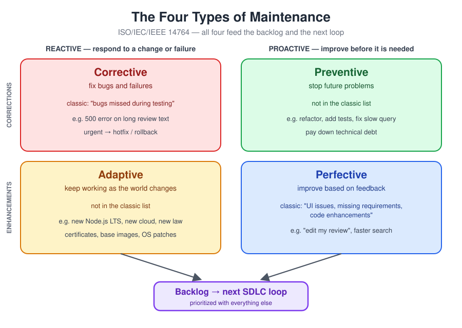
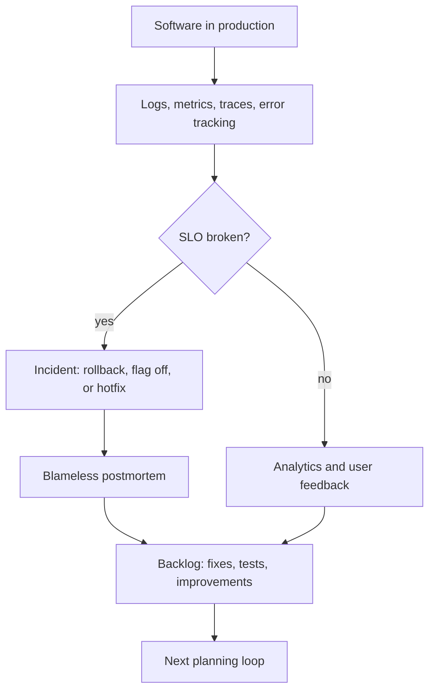

# Phase 6 — Maintenance: "Observe, Learn, Improve Continuously"

**SDLC series — Phase 6 of 6.** How professional backend teams do **Maintenance** today: the lecture's core tasks, the Waterfall way vs. the modern way, and the industry practices the lecture does not cover.

> **Last reviewed:** 2026-11-26 · **Next review due:** 2027-05-26 · **Review owner:** Tech Lead · [Review rule](../README.md#91-review-schedule) · [Review log](../CHANGELOG.md)

[← Deployment](../05-Deployment/Deployment.md) · [Guide README](../README.md) · [Overview](../../6-Phases-of-SDLC-Modern-Best-Practices.md) · [Overview →](../../6-Phases-of-SDLC-Modern-Best-Practices.md)

---

## 0. Jargon Translation (Read This First)

| Term | Official Definition | Simple Words | Analogy |
|------|--------------------|--------------|---------|
| **SDLC (Software Development Life Cycle)** | A systematic process to build high-quality software in a predictable time and budget. | The steps a team follows from idea to running software. | A recipe for a big meal. |
| **Waterfall** | A model where each phase is fully finished before the next starts, with no going back. | One straight pass: plan everything, then build everything, then test everything. | Water falling down steps. |
| **Agile** | A way of working in short loops that deliver small, working pieces of software and adapt to feedback. | Build a little, show it, learn, repeat. | Cooking one dish at a time and tasting each before the next. |
| **Sprint / Iteration** | A fixed time-box (usually 1–4 weeks) in which a team delivers a small set of features. | One short loop of work. | One lap of a running track. |
| **DevOps** | A culture and set of practices where development and operations work as one team, with heavy automation. | The people who build the software also release and run it. | A chef who also serves the food and hears what guests think. |
| **Corrective / adaptive / perfective / preventive maintenance** | The four maintenance types: fix bugs / adapt to a changing environment / improve features / prevent future problems. | Fix it, keep it compatible, make it better, stop problems early. | A car: repair a flat tire, fit winter tires, add a better radio, change the oil. |
| **Observability** | The ability to understand what a system is doing from its logs, metrics and traces. | Being able to "see inside" the running app. | A car dashboard plus a black-box recorder. |
| **Golden signals** | Four key metrics for a service: latency, traffic, errors, saturation. | The four numbers to watch first. | A car's speedometer, fuel, warning lights and engine temperature. |
| **SLI (Service Level Indicator)** | The actual measurement of a service's behavior, such as the share of fast, successful requests. | The number you measure. | The bus's real on-time record. |
| **SLO (Service Level Objective)** | A measurable reliability target, for example "99.9% of requests succeed". | A number that says "good enough" for users. | "The bus arrives on time 99 days out of 100". |
| **SLA (Service Level Agreement)** | A contract that promises customers a service level, often with penalties if it is missed. | The promise in the contract. | A delivery company refunding you if the parcel is late. |
| **Error budget** | The amount of failure an SLO allows (100% − SLO), used to balance speed and reliability. | How much "failing" you are allowed. | A monthly allowance: spend it on risky changes, stop when it is gone. |
| **On-call** | A rota where an engineer is responsible for responding to production alerts at any time. | The person "on duty" for the system. | The doctor on night duty at a hospital. |
| **Runbook** | A short guide that explains how to check and fix a known problem. | Step-by-step instructions for an alert. | The emergency card in an airplane seat pocket. |
| **Postmortem (blameless)** | A written review after an incident about what happened and how to prevent it, without blaming people. | Learn from the failure, don't punish. | An airline investigating a near-miss to fix the process. |
| **MTTR (Mean Time To Restore)** | The average time to recover service after an incident. | How fast we fix outages. | How long the road stays closed after an accident. |
| **RPO / RTO** | RPO: maximum acceptable data loss. RTO: maximum acceptable downtime. | How much data, and how much time, we can lose. | How many pages of your work you could lose, and how long you can wait to get your laptop back. |
| **Hotfix** | An urgent, small fix released to production outside the normal release schedule. | An emergency fix. | A plumber called at night for a burst pipe. |
| **Rollback** | Returning production to the last good version. | "Undo" for a release. | Ctrl+Z. |
| **Feature flag** | A setting that turns a feature on or off without deploying new code. | A light switch for a feature. | A shop that is built but has its door closed until opening day. |
| **Technical debt** | The future cost of shortcuts taken in code today. | Messy code you must "pay back" later. | Not washing dishes: easy now, harder tomorrow. |
| **Strangler fig pattern** | Replacing a legacy system piece by piece behind a router until the old system can be removed. | Replace the old system slowly, part by part. | A new road built next to the old one, lane by lane, before the old one is closed. |
| **High cardinality (metrics)** | A metric label with very many possible values, creating huge numbers of time series. | Too many different label values. | Filing every receipt in its own folder instead of by month. |

---

## 1. The job

- Keep the software **working, secure, fast and useful** after release, and feed what you learn into the next loop.
- Maintenance is usually the **longest** phase: software often runs and changes for years after its first release.
- **Core tasks from the lecture (still true in every model):**
  1. Find **bugs** that were **missed during testing**.
  2. Identify **UI (User Interface) issues**.
  3. Identify **requirements that were not listed in the SRS**.
  4. Identify **code enhancements**.
  5. **High-priority bugs** are fixed now; **others** are added to the requirements of a **future release**.
  6. **Feedback from stakeholders** feeds into **another development cycle**.

### 1.1 The four types of maintenance (classic SDLC theory, not in the lecture)

The classic four maintenance categories, used by the software maintenance standard **ISO/IEC/IEEE 14764**, are below. **Corrective** and **adaptive** are *reactive* (responding to a failure or a change); **preventive** and **perfective** are *proactive*. The lecture's tasks fit into them:

| Type | Meaning | Lecture task it covers | Example |
|------|---------|------------------------|---------|
| **Corrective** | Fix bugs and failures | "Find bugs missed during testing" | Fix the 500 error on long review text |
| **Adaptive** | Keep working in a **changing environment** | (not in the lecture) | Upgrade to a newer Node.js LTS; move to a new cloud; follow a new law |
| **Perfective** | Improve or add features based on feedback | "UI issues", "missing requirements", "code enhancements" | Add "edit my review"; make search faster |
| **Preventive** | Stop future problems before they happen | (not in the lecture) | Refactor messy code, add missing tests, update dependencies, fix a slow query before traffic grows |



## 2. Core tasks: Waterfall way vs. modern way

| Core task | Waterfall way | Modern way |
|-----------|---------------|------------|
| **When maintenance starts** | After the project is "finished" and handed to a separate support team | From the **first release**, by the **same team** ("you build it, you run it") |
| **Find missed bugs** | Users report them to a help desk | **Error tracking** and **SLO alerts** often detect bugs **before** users report them |
| **Find UI issues** | User complaints | Product analytics, real-user monitoring, usability tests, user feedback |
| **Find missing requirements and enhancements** | Collected for "version 2" months later | Added to the **backlog** immediately and planned in the next sprints; ideas can be checked with **A/B tests** |
| **High priority → fix now; others → future release** | Emergency patch; everything else waits for the next big version | **Rollback**, **feature flag off** or **hotfix** in minutes for urgent issues; everything else is **prioritized in the backlog** — the "future release" may be next week |
| **Feedback → next cycle** | A new project starts | The loop never stops: feedback becomes stories, and the six phases run again |

## 3. How modern teams do it

- **"You build it, you run it":** the team that wrote the service is also **on call** for it.
- **Observability — the three pillars:**

  | Pillar | What it answers | Example tools |
  |--------|-----------------|---------------|
  | **Logs** | "What happened?" (structured JSON events) | Grafana Loki, ELK (Elasticsearch, Logstash, Kibana) |
  | **Metrics** | "How much / how fast?" (rates, errors, latency) | Prometheus + Grafana |
  | **Traces** | "Where did this request spend its time?" | OpenTelemetry, Jaeger, Grafana Tempo |

  **OpenTelemetry** is the vendor-neutral standard for producing all three, so you can change monitoring tools without changing code.
- **What to watch:**
  - **Golden signals** (Google SRE): **latency**, **traffic**, **errors**, **saturation**.
  - **RED** method for each service: **R**ate, **E**rrors, **D**uration.
  - **USE** method for each resource (CPU, memory, disk): **U**tilization, **S**aturation, **E**rrors.
  - **Error tracking** (for example Sentry) groups exceptions with stack traces and the release that caused them.
- **Alert on SLOs**, not on every small warning: alert when users are actually hurt (see [4.1](#41-sli-slo-sla-and-error-budgets)).
- **Incident management:**
  1. **Detect** — an alert fires.
  2. **Mitigate** — roll back, turn off a feature flag, or **hotfix**.
  3. **Learn** — write a **blameless postmortem**.
  4. **Prevent** — add the fixes and new tests to the backlog.
- **Continuous security maintenance:** automated dependency updates (Dependabot, Renovate), fast patching of CVEs (Common Vulnerabilities and Exposures), and regular secret rotation.
- **Pay down technical debt:** reserve regular time each sprint (many teams use around 10–20%) for refactoring and upgrades.
- **Product analytics and user feedback** become new stories in the backlog — and the loop starts again.



```javascript
// src/routes/health.js — endpoints used by Kubernetes probes and monitoring
const express = require('express');
const router = express.Router();

// Liveness: "is the process alive?" — keep it simple, NO dependency checks
router.get('/health/live', (req, res) => res.status(200).json({ status: 'ok' }));

// Readiness: "can THIS pod serve traffic right now?"
router.get('/health/ready', async (req, res) => {
  try {
    // Always use a short timeout — a hanging check is worse than a failed one
    await Promise.race([
      req.app.locals.db.query('SELECT 1'),
      new Promise((_, reject) => setTimeout(() => reject(new Error('timeout')), 1000)),
    ]);
    res.status(200).json({ status: 'ready' });
  } catch (err) {
    res.status(503).json({ status: 'not ready' });  // Kubernetes stops sending traffic to this pod
  }
});

module.exports = router;
```

- **Design note:** if **every** pod checks the **same shared** database, a database outage makes **all** pods unready at once, and users get the load balancer's generic error instead of your clear error message. Some teams therefore check only what **this pod** controls (its own connection pool, startup finished) in readiness, and report shared dependencies through **metrics and alerts** instead. Choose deliberately and record it in an ADR.

**What happens if... the liveness probe checks the database?**

```javascript
// ❌ If the database is slow for 30 seconds, Kubernetes RESTARTS every API pod.
//    Restarting does not fix the database — it only causes a full outage.
router.get('/health/live', async (req, res) => {
  await req.app.locals.db.query('SELECT 1');
  res.send('ok');
});
// ✅ Liveness = process only. Readiness = what this pod needs to serve traffic.
```

## 4. Industry practices the lecture does not cover

### 4.1 SLI, SLO, SLA and error budgets

| Term | Meaning | Example |
|------|---------|---------|
| **SLI (Service Level Indicator)** | The **measurement** | Share of requests that succeed in under 200 ms |
| **SLO (Service Level Objective)** | The **internal target** for the SLI | 99.9% over 30 days |
| **SLA (Service Level Agreement)** | The **contract** with customers, often with money back if missed | 99.5% per month, or a service credit |
| **Error budget** | What the SLO **allows** to fail: 100% − SLO | 0.1% of requests ≈ about 43 minutes of full downtime in 30 days |

- **How teams use the error budget:** while budget is left, ship features fast. When the budget is **used up**, slow down releases and spend time on **reliability** work.
- Keep the **SLA looser than the SLO**, so you get an internal warning before you break the contract.
- **Alert on the error budget, not on fixed numbers:** a **burn-rate alert** fires when the budget is being used up too fast — for example "at this speed the whole 30-day budget is gone in 2 days" pages someone; a slow burn opens a ticket. Using two time windows (a long and a short one) avoids both late and noisy alerts (see the Google SRE Workbook).

### 4.2 Metrics in code

```javascript
// src/middleware/metrics.js — RED metrics with prom-client, scraped by Prometheus
const client = require('prom-client');
client.collectDefaultMetrics();                 // CPU, memory, event-loop lag of this Node process

const labelNames = ['method', 'route', 'status'];
const duration = new client.Histogram({
  name: 'http_request_duration_seconds',
  help: 'HTTP request duration',
  labelNames,
  buckets: [0.05, 0.1, 0.2, 0.5, 1, 2],         // 0.2 s bucket matches the 200 ms SLO
});
const requests = new client.Counter({ name: 'http_requests_total', help: 'HTTP requests', labelNames });

function metrics(req, res, next) {
  const end = duration.startTimer();
  res.on('finish', () => {
    // Use the route PATTERN (/books/:isbn/reviews), never the real URL
    const labels = { method: req.method, route: req.route?.path || 'unmatched', status: res.statusCode };
    end(labels);
    requests.inc(labels);
  });
  next();
}

async function metricsEndpoint(req, res) {      // app.get('/metrics', metricsEndpoint)
  res.set('Content-Type', client.register.contentType);
  res.end(await client.register.metrics());
}

module.exports = { metrics, metricsEndpoint };
```

**What happens if... you use the real URL as a metric label?**

```javascript
// ❌ route: req.originalUrl  →  "/books/9780132350884/reviews", "/books/9781492052203/reviews", ...
// Every ISBN creates a NEW time series ("high cardinality"). Prometheus memory explodes,
// dashboards become slow, and monitoring can fall over during the incident you need it for.
// ✅ Use the route pattern: "/books/:isbn/reviews".
```

### 4.3 Alerting and on-call

- **What to measure:** the **golden signals** (latency, traffic, errors, saturation); for each **service** the **RED** method (**R**ate, **E**rrors, **D**uration); for each **resource** (CPU, disk, connection pool) the **USE** method (**U**tilization, **S**aturation, **E**rrors).
- **Every alert must be actionable.** If nobody needs to do anything, it should be a dashboard or a ticket, not a page.
- **Page vs. ticket:** wake someone up only when users are hurt **now** (for example the SLO burning fast). Slow problems become tickets.
- **Runbooks:** each alert links to a short guide: what it means, how to check, how to fix.
- **On-call rotation:** a fair schedule, a clear escalation path, and time to recover after a hard night.
- **Alert fatigue** (too many noisy alerts) makes people ignore the real ones — delete or fix noisy alerts.

```yaml
# alerts.yaml — Prometheus alert: more than 1% of requests failing for 5 minutes
groups:
  - name: book-review-api
    rules:
      - alert: HighErrorRate
        expr: |
          sum(rate(http_requests_total{status=~"5.."}[5m]))
            / sum(rate(http_requests_total[5m])) > 0.01
        for: 5m                                  # must last 5 minutes — ignore short blips
        labels: { severity: page }
        annotations:
          summary: "Book Review API: more than 1% of requests are failing"
          runbook_url: "https://wiki.example.com/runbooks/high-error-rate"
```

### 4.4 Incidents in detail

- **Severity levels** (for example SEV1 = full outage … SEV4 = minor issue) decide who is called and how fast.
- **Clear roles** in a big incident: an **incident commander** (coordinates, decides), people who **investigate and fix**, and a **communications lead** (updates the **status page** and stakeholders).
- **Mitigate first, find the root cause later.** Rolling back in 5 minutes is better than debugging for an hour while users suffer.
- **Measure:** **MTTD** (Mean Time To Detect) and **MTTR** (Mean Time To Restore/Recover).
- **Problem management** (an **ITIL** — Information Technology Infrastructure Library — idea, common in enterprises): an *incident* is one outage; a *problem* is the **root cause** behind repeated incidents, tracked until it is removed.

```markdown
# Postmortem: Reviews API errors — 2026-11-10 (SEV2)

**Impact:** 18% of review requests failed for 22 minutes. No data lost.
**Timeline (UTC):** 09:02 deploy v1.6.0 · 09:05 alert HighErrorRate · 09:09 rollback started · 09:24 recovered
**Root cause:** New query had no index on (isbn, created_at); the database CPU reached 100% under normal load.
**What went well:** Alert fired in 3 minutes; rollback was one command.
**What went wrong:** The load test used a database with only 100 rows.
**Action items (owner, due date):**
- Add the missing index via migration (backend lead, 2026-11-12)
- Use production-sized synthetic data in load tests (QA, 2026-11-20)
- Add a slow-query alert (SRE, 2026-11-20)
*Blameless: we fix systems and processes, not people.*
```

#### 4.4.1 Where is it broken? Triage by boundary

> From course note [module 2, 01 Overview of Web and Cloud Development](../../course-1-introduction-to-software-engineering/module-2-introduction-to-software-development/notes/01-overview-of-web-and-cloud-development.md). A web request crosses four boundaries. Check them **in order**, outside to inside. This keeps the first minutes of an incident calm and fast.

| # | Boundary | Typical problems | First checks |
|---|----------|------------------|--------------|
| 1 | **Client** (browser, app, device) | JavaScript errors, old cached files, slow device or network | Browser console and network tab; does it fail for **everyone** or one device or version? |
| 2 | **Edge and network** (DNS, CDN, load balancer, TLS) | Wrong DNS, expired certificate, bad cache rule, blocked traffic, load balancer sees no healthy instance | `dig`, `curl -I`, certificate expiry, CDN and load balancer dashboards |
| 3 | **Application** (Node.js, Express) | Exceptions after a deploy, blocked event loop, memory leak, a failing dependency | Error rate and latency by version, recent deploy marker, logs by request ID |
| 4 | **Persistence** (database, cache, object storage) | Exhausted connection pool, slow query, lock, full disk | Connection count, slow-query log, CPU and disk, replication lag |

- **Rule of thumb:** if only **one user or device** fails, start at 1. If **everything** fails right after a deploy, start at 3 and consider rollback first. If **errors are slow, then fail**, suspect 4.
- Write the boundary where the fault was found into the **postmortem**; repeated faults at one boundary show where to invest.

### 4.5 The hotfix process

- A hotfix is a **small, urgent fix** to production — but it still goes through the **same pipeline**: a PR, a review (it can be quick), **tests**, and staging.
- **Skipping tests for "just a one-line fix"** is a common cause of a second incident.
- Always add a **regression test** for the bug — named with the bug ID and red without the fix ([Testing rule 15](../04-Testing/Testing.md#64-rules)) — and make sure the fix also lands on `main` so the next release does not bring the bug back.

### 4.6 Backups and disaster recovery

| Term | Question | Example target |
|------|----------|----------------|
| **RPO (Recovery Point Objective)** | How much data can we afford to **lose**? | At most 5 minutes (point-in-time recovery) |
| **RTO (Recovery Time Objective)** | How long can we be **down**? | Back online within 1 hour |

- **Test restores regularly** — a backup you have never restored is only a hope.
- Keep backups in a **separate account or region**, and protect them from deletion (ransomware often targets backups first).
- Practice **disaster recovery drills** (for example "the main region is down").

### 4.7 Keeping the platform up to date (adaptive maintenance)

- **Runtime and framework upgrades:** move to a newer Node.js **LTS** line **before** the old one reaches end-of-life; keep Express and major libraries current. Small, regular upgrades are much cheaper than one huge upgrade every few years.
- **Base images:** rebuild Docker images regularly to get OS security fixes, even if your code did not change.
- **Certificates:** automate TLS certificate renewal (for example cert-manager with Let's Encrypt). Expired certificates are a classic, embarrassing outage.
- **Vulnerability management:** fix known vulnerabilities within an agreed time by severity (for example critical within days).
  - **Let people report problems to you:** publish a **`/.well-known/security.txt`** file (RFC 9116) and a short **vulnerability disclosure policy** (how to report, what you promise).
  - **EU Cyber Resilience Act:** for products in scope, an **actively exploited vulnerability** or a **severe incident** must be reported: an **early warning within 24 hours**, a **notification within 72 hours**, and a final report later. These duties apply **since 11 September 2026**.
- **Access reviews:** regularly remove access that people or services no longer need.

### 4.8 Data maintenance

- **Retention and deletion:** delete or archive data you no longer need; handle **GDPR requests** (export, correct, delete a user's data) within the legal deadline.
- **Database health:** watch slow queries, add or remove indexes, keep table statistics fresh (in PostgreSQL, **autovacuum** does much of this — monitor it).
- **Capacity and cost:** watch disk growth and cloud costs (**FinOps**); right-size servers.
- **Audit logs:** keep a record of important actions (who deleted what, and when).

### 4.9 Deprecation and end-of-life

- Features and API versions also need a **planned end**:
  1. Announce the deprecation (docs, changelog, emails).
  2. Mark responses with the **`Deprecation`** header (RFC 9745) and the **`Sunset`** header (RFC 8594 — the date it will stop working; it must not be earlier than the deprecation date), plus a link to the migration guide.
  3. Watch usage metrics **per API version and per client**; contact remaining users.
  4. Remove it after the sunset date **and** when its traffic is near zero (notice periods: [Design §4.4.1](../02-Design/Design.md#441-api-compatibility-and-versioning)).
- **Errors by version:** dashboards split error rate and latency by **`service.version`**, so a problem that starts with one release is visible at once — and so you can see which **client app versions** still call old API versions.
- **Supported versions list:** the [versioning policy](../03-Development/templates/versioning-policy.md) §3 lists the supported runtime, API and framework versions with their end-of-support dates; it is checked in the monthly service review.

### 4.10 Legacy systems and modernization

- Old systems that are hard to change are common. A full rewrite is risky.
- The **strangler fig pattern** replaces a legacy system **piece by piece**: put a router in front, move one feature at a time to the new service, and remove the old code when nothing uses it.
- First add **tests and monitoring** around the legacy code, so changes are safe.

### 4.11 Using AI in maintenance

- AI tools can **summarize logs and incidents**, suggest likely causes, draft postmortems, and propose fixes or dependency upgrades. Many monitoring products now include these features (often called **AIOps**).
- **Treat AI suggestions as hypotheses.** Verify with real data, and send every fix through the normal review and tests.
- If the product **itself uses an AI model**, maintenance also includes: monitoring answer **quality** over time (quality can drift as user behavior changes), re-running **evals** before upgrading to a new model version, and watching **cost per request**.

### 4.12 Front-end monitoring and upgrades

> From course note [module 2, 02 Learning Front-End Development](../../course-1-introduction-to-software-engineering/module-2-introduction-to-software-development/notes/02-learning-front-end-development.md). The lecture says front-end technologies are upgraded constantly and that sites must keep working in many browsers, operating systems and devices.

- **Real-user monitoring (RUM):** collect **Core Web Vitals** (Largest Contentful Paint, Interaction to Next Paint, Cumulative Layout Shift) from real visitors; INP replaced FID (First Input Delay) in 2024, for example with Google's `web-vitals` library, and look at the **75th percentile**. Lab tests do not show what slow phones and bad networks see.
- **JavaScript error tracking:** send front-end errors to an error-tracking tool with **source maps** so stack traces are readable. Alert on a **spike after a release** and link the alert to the release version.
- **Check by boundary** when users report a problem: start with the client (browser, device, cached files), then the edge (CDN, DNS, certificate), as in [4.4.1](#441-where-is-it-broken-triage-by-boundary).
- **Track end-of-life dates** of the framework, build tools, Node.js and the browser support policy. Real examples: **AngularJS** support ended in January 2022, **Vue 2** reached end of life on 31 December 2023, and Sass `@import` is deprecated and will be removed in Dart Sass 3.0.0. Plan upgrades as backlog work **before** the date, not after.
- **Automate small updates** (Dependabot or Renovate) and let CI tests prove they are safe; do **major** framework upgrades one version at a time.
- **Review the support policy** every quarter: browsers, operating systems and devices change.

## 5. A service is "healthy and well maintained" when...

- [ ] **SLOs** are defined, measured (SLIs), and **met**; the error budget is tracked.
- [ ] **Logs, metrics, traces and error tracking** are in place; dashboards show RED/golden signals.
- [ ] **Alerts** are actionable, link to **runbooks**, and page the **on-call** person only when users are hurt.
- [ ] **Incidents** are handled with clear roles and followed by **blameless postmortems** whose action items are done.
- [ ] **Hotfixes** use the normal pipeline and always add a **regression test** named with the bug ID.
- [ ] **Backups** meet RPO/RTO and **restores are tested**.
- [ ] **Dependencies, Node.js LTS, base images and certificates** are kept up to date; vulnerabilities are fixed on time.
- [ ] **Web UIs:** real-user Core Web Vitals and JavaScript errors are visible, and framework end-of-life dates are tracked (§4.12).
- [ ] **Data** retention, deletion requests and database health are managed.
- [ ] **Technical debt** gets regular time; deprecated features and APIs follow a **sunset plan**.
- [ ] **Feedback, analytics and incident learnings** flow into the **backlog**, starting the next loop.

---

## 6. LumenVenture Standard

> **What we do on every project.** See the [guide README](../README.md) for roles, gates and project types. **must** = required · **should** = default (skip only with a written reason) · **may** = optional.

### 6.1 Owners

| Activity | Accountable | Responsible | Consulted |
|----------|-------------|-------------|-----------|
| SLOs and alerts | Tech Lead | Developers | PO |
| On-call and incident response | Tech Lead | On-call developer, incident commander | DL, PO |
| Postmortems | Tech Lead | Incident commander | Whole team |
| Monthly service review | Tech Lead | Tech Lead, DL | PO, client (optional) |
| Security and platform updates | Tech Lead | Security Champion, developers | — |
| Client communication during incidents | Delivery Lead | DL | PO, Tech Lead |

### 6.2 Required outputs

| Output | Internal | Client | Prototype | + Regulated |
|--------|----------|--------|-----------|-------------|
| SLOs ([template](templates/slo.md)) | **must** | **must** (looser SLA in the contract) | — | **must** |
| Runbook per alert ([template](templates/runbook.md)) | **must** | **must** | — | **must** |
| Go-live checklist ([template](templates/go-live-checklist.md)) | **must** | **must** | — | **must** |
| On-call rotation | **must** | As the support agreement says | — | **must** |
| Postmortem for SEV1/SEV2 ([template](templates/postmortem.md)) | **must** | **must** (shared with client as agreed) | — | **must** |
| Monthly service review ([template](templates/service-review.md)) | **must** | **must** | — | **must** |
| Backups with tested restore | **must** | **must** | — | **must** |
| Audit logs, quarterly access review | **should** | **should** | — | **must** |

### 6.3 Gate G5 — Live and healthy

**When:** before the first release to real users (and after major changes); then checked every month in the service review. **Who decides:** Tech Lead, with the PO (+ client on client projects).

- [ ] Every item of the [go-live checklist](templates/go-live-checklist.md) is done
- [ ] SLOs are met, or a reliability plan is in the backlog
- [ ] Postmortem action items are done on time
- [ ] No vulnerabilities past their fix deadline
- [ ] Runtime, framework and base image are on supported versions (no end-of-life within 3 months without a plan)

### 6.4 Incident severity (default)

| SEV | Meaning | Response | Postmortem |
|-----|---------|----------|------------|
| **SEV1** | Full outage, data loss or security breach | Immediately, 24/7; incident commander named | **must**, within 5 working days |
| **SEV2** | Major feature broken or many users affected | Within 30 minutes (on-call hours as agreed) | **must** |
| **SEV3** | Minor feature broken; workaround exists | Next working day | **may** |
| **SEV4** | Cosmetic or very small impact | Planned in the backlog | — |

> Client projects: the **support agreement** may set different response times. The agreement wins; record it in `docs/slo.md`.

### 6.5 Rules

1. **must** — The team that builds the service **runs it** (on call), with a fair rotation and an escalation path.
2. **must** — Every alert is **actionable** and links to a **runbook**; noisy alerts are fixed or deleted.
3. **must** — **Mitigate first** (rollback, flag off, scale), then find the root cause.
4. **must** — SEV1/SEV2 incidents get a **blameless postmortem** within 5 working days; action items have owners and due dates.
5. **must** — Hotfixes go through the **normal pipeline** (fast review, tests, staging) and include a **regression test** named with the bug ID that fails without the fix ([Testing rule 15](../04-Testing/Testing.md#64-rules)).
6. **must** — Backups meet the documented **RPO/RTO**, and a **restore is tested at least every quarter**.
7. **must** — Security fixes by severity (default): **critical within 7 days**, **high within 30 days**, others planned.
8. **should** — Reserve about **10–20%** of each sprint for preventive and adaptive maintenance (tech debt, upgrades).
9. **should** — Upgrade the runtime and frameworks **before** end-of-life; rebuild images regularly for OS patches.
10. **should** — Deprecate features and APIs with notice, `Deprecation`/`Sunset` headers and usage tracking.
11. **may** — Use AI tools to summarize incidents and logs; verify every conclusion with real data.
12. **should** — Page on **SLO burn-rate** alerts where possible, instead of fixed thresholds.
13. **should** — Every public service publishes a **`security.txt`** and a vulnerability disclosure policy.
14. **must** — Where the **EU Cyber Resilience Act** applies, the on-call and incident process includes the **24-hour / 72-hour** reporting steps, with a named owner.
15. **should** — Maintenance and support work (bugs, tickets, upgrades, security fixes) runs in a **Kanban lane** with a **WIP limit** (default 2), in the **same backlog** as features, and the team tracks its **cycle time** ([README §6.3](../README.md#63-kanban-for-continuous-work)).
16. **should** — Incident triage follows the **four boundaries** (client, edge and network, application, persistence) and each runbook says which boundary its alert belongs to (§4.4.1).
17. **must** — On-call people can **check certificate expiry, DNS and the CDN** from a runbook, not only the application logs. Expired certificates and wrong DNS are among the most common avoidable outages.
18. **should** — Web UIs collect **real-user Core Web Vitals** and **JavaScript errors** (with source maps); the 75th-percentile values and the error rate are reviewed in the monthly service review.
19. **must** — The **end-of-life dates** of the framework, Node.js LTS line and build tools are tracked; the browser support policy is reviewed every quarter. Upgrade work is planned in the backlog **at least one quarter before** the date (rule 9 and the G5 check apply).

### 6.6 Templates

| Template | Copy to |
|----------|---------|
| [slo.md](templates/slo.md) | `docs/slo.md` |
| [runbook.md](templates/runbook.md) | `docs/runbooks/<alert>.md` |
| [postmortem.md](templates/postmortem.md) | `docs/postmortems/<date>-<title>.md` |
| [go-live-checklist.md](templates/go-live-checklist.md) | Use before first release; keep in `docs/releases/` |
| [service-review.md](templates/service-review.md) | `docs/service-reviews/<YYYY-MM>.md` |

---

[← Deployment](../05-Deployment/Deployment.md) · [Guide README](../README.md) · [Overview](../../6-Phases-of-SDLC-Modern-Best-Practices.md) · [Overview →](../../6-Phases-of-SDLC-Modern-Best-Practices.md)
