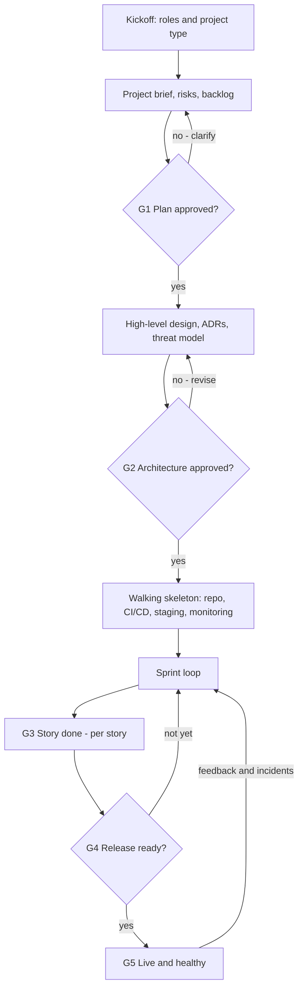
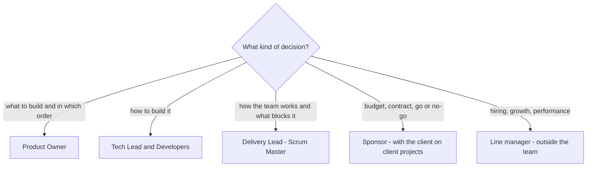
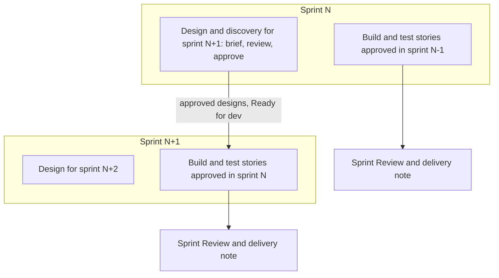
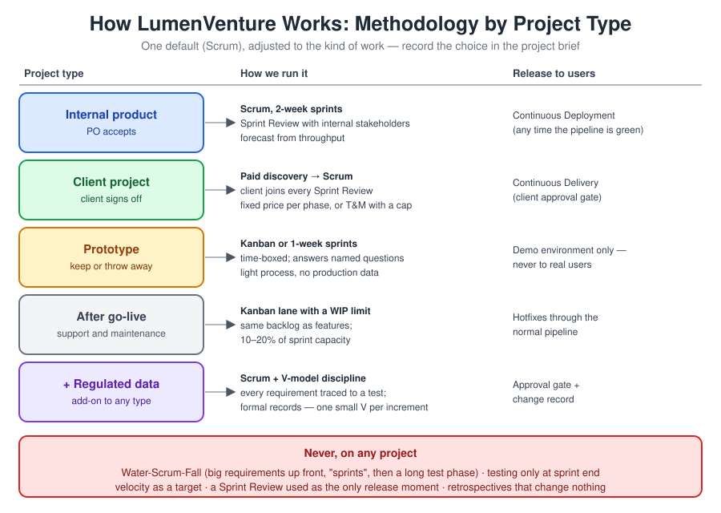
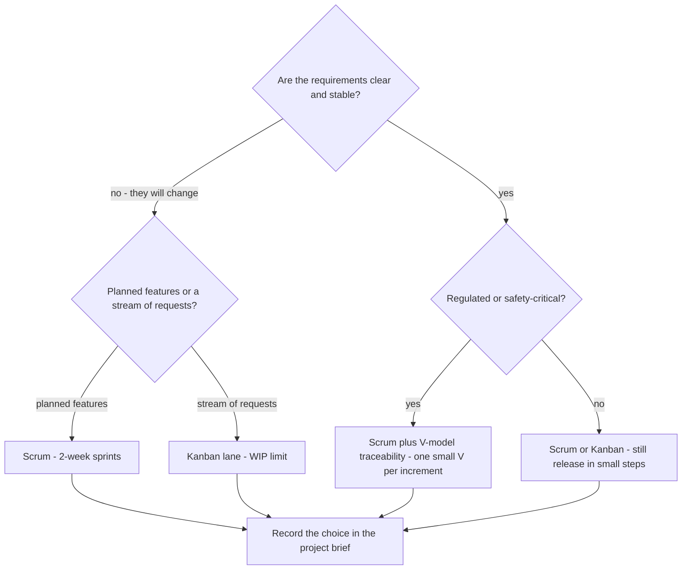
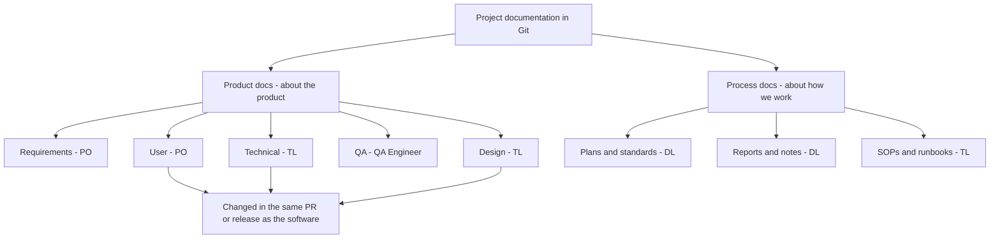

# LumenVenture SDLC Guide

**The way LumenVenture plans, designs, builds, tests, releases and runs software — for every project.**

- **Applies to:** all projects — internal products, client projects, and any other kind (prototypes, integrations, migrations) — and every service we sell: apps, SaaS, custom software, connected (IoT) products and firmware, AI agents, launch and brand work, support and takeovers. Each project picks a **type** and a **delivery track**: [4. Project types and tailoring](#4-project-types-and-tailoring).
- **Method:** **Agile** for every track, adapted to the kind of work ([§6.1](#61-our-methodology-by-delivery-track)).
- **Team model:** one cross-functional team of **4–8 people**. A small company team that runs several projects at once works on **one sprint and one board** ([§6.6 rule 10](#66-working-rhythm-rules)).
- **Why it exists:** every rule added since November 2026 is linked to a real problem from our own projects and retrospectives ([§4.2](#42-why-these-rules-exist-problems-they-solve)).
- **Technology:** **stack-neutral.** The guide fixes the *process*, not the tools. Tools named in the guide are **examples**; each project records its real choices in an ADR (Architecture Decision Record).
- **Status:** living document. Change it through a pull request (see [9. Changing this guide](#9-changing-this-guide)).
- **Last reviewed:** 2026-11-28 · **Next full-guide review due:** 2027-05-28 · External standards and their editions: [§10](#10-standards-this-guide-follows) · Every phase file shows its own review date ([9.1 Review schedule](#91-review-schedule), [review log](CHANGELOG.md)).

> **Must / should / may:** in the "LumenVenture Standard" sections, **must** = required on every project; **should** = the default, skip only with a written reason (ADR or project brief); **may** = optional, use when it helps.

---

## 1. How to Use This Guide

| Folder | File | Read it to learn… | Use its templates when… |
|--------|------|-------------------|-------------------------|
| [01-Planning](01-Planning/Planning.md) | `Planning.md` | what to build, for whom, and why | starting a project; refining stories every sprint |
| [02-Design](02-Design/Design.md) | `Design.md` | how the system will be built | before building a new system or a significant feature |
| [03-Development](03-Development/Development.md) | `Development.md` | how code is written, reviewed and merged | setting up the repository; every pull request |
| [04-Testing](04-Testing/Testing.md) | `Testing.md` | how quality is proven | writing the test strategy; reporting bugs; before releases |
| [05-Deployment](05-Deployment/Deployment.md) | `Deployment.md` | how software reaches users safely | setting up the pipeline; every release |
| [06-Maintenance](06-Maintenance/Maintenance.md) | `Maintenance.md` | how the running service is kept healthy | going live; incidents; monthly service reviews |

Also in this folder: the [CHANGELOG](CHANGELOG.md) (review log), `images/` (diagrams for this README) and `tools/check.py` (the check script, [9.2](#92-pull-request-rule-and-checks)). Nothing outside this folder is needed to use or change the guide.

Each phase file has the same shape:

1. **Jargon** — the terms used in that phase.
2. **The job** and **Waterfall way vs. modern way** — what the phase is for.
3. **How modern teams do it** and **industry practices** — the explanations and examples.
4. **"Done when…" checklist** — the quality bar.
5. **LumenVenture Standard** — **what we actually do**: owners, required outputs, the gate, rules, and templates.

> **The phases are not one long Waterfall.** We run them **broadly once at project start**, then **in small loops every sprint**. The gates below apply at those two levels.

---

## 2. Starting a New Project (Kickoff in 10 Steps)

| # | Step | Owner | Output | Template |
|---|------|-------|--------|----------|
| 1 | Name the **Product Owner**, **Tech Lead** and **Delivery Lead** (and any optional roles, [§3.2](#32-optional-and-shared-roles)); book the kickoff | Sponsor | Named roles and backups in `docs/team-roles.md` | [team-roles.md](01-Planning/templates/team-roles.md) |
| 2 | Pick the **project type**, the **delivery track(s)** and the tailoring level; internal products first pass **idea validation** | Delivery Lead + Product Owner | Recorded in the project brief | [§4](#4-project-types-and-tailoring), [idea-validation.md](01-Planning/templates/idea-validation.md) |
| 2a | **Client projects: run Client Discovery** — discovery meeting, same-day summaries, prototype, MVP workshop, client PRD (paid discovery phase if the idea is vague) | Product Owner + Delivery Lead | `docs/discovery/` | [Planning §8.6](01-Planning/Planning.md#86-client-discovery-client-projects) |
| 3 | Write the **project brief**: vision, scope, stakeholders, success metrics, the 8 planning factors, feasibility | Product Owner | `docs/project-brief.md` | [project-brief.md](01-Planning/templates/project-brief.md) |
| 4 | Fill in the **stakeholder register**; start the **risk register** | Product Owner / Delivery Lead | `docs/stakeholder-register.md`, `docs/risk-register.md` | [stakeholder-register.md](01-Planning/templates/stakeholder-register.md), [risk-register.md](01-Planning/templates/risk-register.md) |
| 5 | Build the first **backlog**: epics, then the first stories with acceptance criteria | Product Owner + team | Backlog in the tracking tool | [user-story.md](01-Planning/templates/user-story.md) |
| 5a | Agree the **working agreement** (communication, reviews, decisions, disagreement, knowledge sharing) and the first team health check | Delivery Lead + whole team | `docs/working-agreement.md` | [working-agreement.md](01-Planning/templates/working-agreement.md) |
| 6 | **Gate G1 — Plan approved** | Sponsor (+ client) | Sign-off recorded | [Planning §8](01-Planning/Planning.md#8-lumenventure-standard) |
| 7 | Write the **high-level design**, first **ADRs** and the **threat model** | Tech Lead | `docs/design/`, `docs/adr/` | [design-doc.md](02-Design/templates/design-doc.md), [adr.md](02-Design/templates/adr.md), [threat-model.md](02-Design/templates/threat-model.md) |
| 8 | **Gate G2 — Architecture approved** | Tech Lead + Sponsor | Design review recorded | [Design §6](02-Design/Design.md#6-lumenventure-standard) |
| 9 | Create the **repository** and **"walking skeleton"**: repo rules, CI/CD, staging environment, health check, monitoring — **before** feature work | Tech Lead | A "hello world" that deploys to staging through the pipeline | [repo-setup-checklist.md](03-Development/templates/repo-setup-checklist.md) |
| 10 | Write the **test strategy** and agree the **Definition of Done**; start **Sprint 1** | QA Engineer + team | `docs/test-strategy.md`, DoD | [test-strategy.md](04-Testing/templates/test-strategy.md), [definition-of-done.md](03-Development/templates/definition-of-done.md) |



---

## 3. Roles (Default for a 4–8 Person Team)

| Role | Short | Responsible for | Usually |
|------|-------|-----------------|---------|
| **Sponsor** | SP | Budget, priorities across projects, final go/no-go at G1 and G2 | LumenVenture leadership, or the client's sponsor |
| **Product Owner** | PO | **What** to build and in which order; the backlog; accepting stories | 1 person (on client projects: ours, working closely with the client) |
| **Delivery Lead** | DL | **How** the team works: sprints, risks, blockers, team-level reporting, change requests | 1 person; may be the Scrum Master; in small teams may be combined with another role |
| **Tech Lead** | TL | Architecture, ADRs, technical quality, repo standards, release decisions | A senior developer who also codes |
| **Developers** | DEV | Code, unit/integration tests, code review, running what they build (on call) | 2–5 people |
| **QA Engineer** | QA | Test strategy, test automation, exploratory testing, release test sign-off | 1 person (in a 4-person team, a developer may hold this role) |
| **Security Champion** | SEC | Threat models, security checks, dependency and vulnerability follow-up | One developer, as an extra hat |
| **Client / Stakeholders** | CL | Requirements input, UAT, sign-offs (client projects) | The client's named contact |

> **One person may hold several roles** in a small team (at most 3, [§3.3 rule 6](#33-role-rules)) (for example Tech Lead + Security Champion). **Must:** the **author and the reviewer of a change are never the same person**, and the **Product Owner does not also act as the only tester**.

### 3.1 Who does what (RACI)

**R** = Responsible (does the work) · **A** = Accountable (owns the result; exactly one) · **C** = Consulted · **I** = Informed

| Activity | SP | PO | DL | TL | DEV | QA | CL |
|----------|----|----|----|----|-----|----|----|
| Project brief and scope | C | **A/R** | R | C | I | I | C |
| Backlog and priorities | I | **A/R** | C | C | C | C | C |
| Risk register | I | C | **A/R** | R | C | C | I |
| Architecture and ADRs | I | C | I | **A/R** | R | C | I |
| Threat model | I | C | I | **A** | R | C | I |
| Code and code review | — | I | I | **A** | R | C | — |
| Test strategy and automation | — | C | I | C | R | **A/R** | I |
| UAT / acceptance | I | **A** | C | C | C | R | R |
| Release go/no-go (G4) | I | C | C | **A** | C | R | C |
| Incidents and postmortems | I | I | C | **A** | R | C | I |
| UX design and usability tests ¹ | — | **A** | I | C | R | C | C |
| User documentation ² | — | **A** | I | C | R | C | C |

¹ **R** = the UX / product designer when the project has one ([§3.2](#32-optional-and-shared-roles)), otherwise developers. ² **R** = the technical writer when the project has one, otherwise developers; owner and rules in [§7.1](#71-documentation-map-what-we-keep-who-owns-it-when-it-changes) and [§7.2 rule 9](#72-documentation-rules).

### 3.2 Optional and shared roles

Not every project has every role. These roles join **when the project needs them**, often shared with other projects. Record who holds which hat in [`docs/team-roles.md`](01-Planning/templates/team-roles.md).

| Role | Short | Responsible for | We add it when… | If absent, who covers |
|------|-------|-----------------|-----------------|-----------------------|
| **UX (User Experience) / product designer** | UX | User research, flows, prototypes, usability tests, design system, accessibility ([Design §4.9](02-Design/Design.md#49-uiux-design-and-prototypes)) | The product has screens for end users | PO + developers, using the company design system |
| **Technical writer** | TW (Technical Writer) | User and developer documentation, release notes, docs in Git ([§7](#7-where-project-documents-live)) | Many end users, a public API, or the contract requires manuals | Developers + PO (PO stays owner of user docs) |
| **SRE (Site Reliability Engineering) / platform team** (shared; a "platform team" in Team Topologies terms) | SRE | Platform, CI/CD (Continuous Integration / Continuous Delivery) and observability tooling, SLO (Service Level Objective) coaching, help in big incidents | The company runs a shared platform (for example Kubernetes) | The team itself |
| **Business analyst** | BA (Business Analyst) | Eliciting and writing requirements, modeling client business processes | Client projects with complex business rules or many client departments | PO |
| **Solution architect** | SA (Solution Architect) | How the product fits into the client's other systems and vendors | Client projects that integrate several client systems | TL |
| **Line manager / engineering manager** | — | People management: hiring, 1:1s (one-to-one meetings), growth, performance | Always — **outside** the project team | — |

- **SRE is not "ops":** an SRE (Site Reliability Engineer) improves reliability **with software** — SLOs, automation, postmortems. A shared SRE or platform team gives the team tools and a platform; it does **not** take over the team's on-call ("you build it, you run it", [Maintenance rule 1](06-Maintenance/Maintenance.md#65-rules)).
- **The Delivery Lead is not a project manager who assigns tasks.** In Scrum, the project-management work is split: the **PO** owns scope and order, the **Developers** plan and estimate their work, and the **DL** (Scrum Master) owns the team's effectiveness and blockers. Budget and contracts stay with the **Sponsor**. When a client has its own **project manager**, the DL is their single contact for dates, budget and change requests.
- **Product manager ≠ Product Owner:** a client's or the company's **product manager** owns product strategy, market and outcomes across releases; our **PO** owns this project's backlog and its order. On internal products one person often does both; on client projects the PO works with the client's product manager or decision-maker.



### 3.3 Role rules

1. **must** (prototypes: **should**) — Every project records who holds each role in `docs/team-roles.md` ([template](01-Planning/templates/team-roles.md)) at kickoff, and updates it the same day a person joins, leaves or changes hats. **PO** and **TL** have a named **backup** from kickoff; the **on-call** rotation has a backup from go-live (Gate G5), when the project has an on-call rotation ([Maintenance §6.2](06-Maintenance/Maintenance.md#62-required-outputs)).
2. **must** — The **PO** decides **what** is built and in which order; the **TL and Developers** decide **how it is built** (technical design). The PO does not assign technical tasks, and the TL does not re-order the backlog.
3. **must** — The **DL** (Scrum Master) does **not** assign tasks to developers or report on individual people's hours or speed; the team plans its own work in Sprint Planning.
4. **must** — The team that builds a service is on call for it ([Maintenance rule 1](06-Maintenance/Maintenance.md#65-rules)). A shared SRE or platform team may provide tooling and help, but takes over on-call **only** if a written support agreement says so.
5. **should** — **People management** (hiring, performance reviews) stays with each person's **line manager outside the team**, and never with the PO or DL of the same project. Small-company exceptions are written in the project brief §10.
6. **should** — Nobody holds more than **3 hats** on one project (Developer work, on-call duty and backup duty do **not** count as hats), and nobody is planned for more than 100% of their time across projects. The PO and DL should be different people where the team size allows.
7. **should** — Projects with end-user screens have a **UX / product designer** (shared is fine) for at least part of every sprint in which screens change; if none, `docs/team-roles.md` records the reason and the fallback from §3.2. Client projects that integrate several client systems name a **solution architect** (may be the TL) in `docs/team-roles.md`.
8. **should** — If a client or another team says **"squad"**, we map it to our project team: a squad is a small cross-skilled Agile team, **similar to a Scrum team** (the word comes from the Spotify way of working). It has **10 or fewer people in total** (our default: 4–8) and **no extra "squad leader" role**: the **PO** sets priorities, the **TL** guides technical decisions and the **DL** coaches the process. The Scrum Guide's "10 or fewer" is a **ceiling, not a target**; 4–8 stays our default. Tribes, chapters and guilds are not needed for one team.
9. **must** — When one person is both the **designer** and the **PO or DL** on the same project, this is written in the risk register with a mitigation: a second person reviews designs, design work gets its own planned capacity, and design briefs ([Design rule 27](02-Design/Design.md#64-rules)) are used so the work can be handed over. A designer who joins mid-project gets a **hand-over session** (the brief, the design system, past decisions and why designs were rejected) before their first task. Owner: Delivery Lead.

---

## 4. Project Types and Tailoring

Every project records **two choices** in the project brief §10:

1. **Type: who it is for**: internal product, client project or prototype, plus **"Regulated data"** if it applies (table below). The type sets sign-offs, contracts and release approvals.
2. **Delivery track: what kind of work** (§4.1). The track sets the method and the extra outputs. A project may use **several tracks** (for example a connected device with a set-up app = tracks B + A); each part follows its own track, on one board.

When a project fits no type or track ("other"), use the **closest** one and write the differences in the project brief.

| Topic | **Internal product** | **Client project** | **Prototype / proof of concept** | **+ Regulated data** (add-on) |
|-------|----------------------|--------------------|----------------------------------|-------------------------------|
| **Requirements** | **Idea validation** first ([Planning §8.7](01-Planning/Planning.md#87-validate-before-we-build)), then light brief + backlog | **Client discovery** + brief + **client PRD and signed scope** (SOW — Statement of Work) + backlog | One-page goal + questions to answer | **Full SRS** (ISO/IEC/IEEE 29148 style) + traceability matrix |
| **Sign-offs** | PO accepts | **Client** signs G1, G2 (major), UAT, release | PO decides keep / throw away | Formal records kept for audit |
| **Changes to scope** | Backlog reorder | **Change request** with cost and time impact | Free | Change request + impact on compliance |
| **Design** | Design doc for significant features | Design doc + client review of HLD | Spike notes only | + DPIA (Data Protection Impact Assessment) where GDPR applies |
| **Testing** | Full standard | Full standard + **client UAT** | Smoke tests only; **must not** go to real users with real data | + security/penetration test before go-live |
| **Release** | Continuous Deployment allowed | Continuous **Delivery** with client approval gate | Not to production | Approval gate + change record |
| **Maintenance** | Team on call | As agreed in the **support agreement / SLA** | None | + audit logs, access reviews, retention rules |

> **Prototype rule (must):** a prototype that becomes a real product must pass **G1–G2** and the full Development and Testing standards **before** real users or real data touch it.

### 4.1 Delivery tracks (by service)

| Track | Services it covers | Method ([§6.1](#61-our-methodology-by-delivery-track)) | Extra outputs on top of the project type | Main rules |
|-------|--------------------|--------------------------------|-------------------------------------------|------------|
| **A. Product build** | Mobile apps, SaaS products, custom software (portals, internal tools, dashboards), the product part of a startup launch | Scrum, 2-week sprints, **design one sprint ahead** | Design brief per feature, design-system ADR, sprint delivery note to the client | [Design §4.9](02-Design/Design.md#49-uiux-design-and-prototypes), Design rules 27–30 |
| **B. Connected product (IoT)** | Device firmware, device set-up apps (for example Bluetooth pairing), cloud connection (for example AWS IoT Core), hardware review | Scrum for firmware, cloud and app **inside hardware milestones**; one story covers device → cloud → app; demo on a **real device** every sprint | Device-to-cloud-to-app design, hardware-in-the-loop test rig, over-the-air (OTA) update plan, installation checklist | [Design §4.15](02-Design/Design.md#415-connected-products-device-to-cloud-to-app), [Development §4.16](03-Development/Development.md#416-firmware-and-device-code), [Testing §4.17](04-Testing/Testing.md#417-testing-connected-devices-and-ai-features), [Deployment §4.11](05-Deployment/Deployment.md#411-releasing-firmware-and-mobile-apps) |
| **C. AI agents and automation** | AI agents, automated workflows, AI search and chat over company data, AI features inside tracks A and B | A **time-boxed AI pilot** (one workflow, a few weeks, a clear before/after result), then Scrum; **evals written before the build** | Eval set with a pass threshold, list of actions that need human approval, AI cost budget | Development rule 33, Testing rule 23, [Maintenance §4.11](06-Maintenance/Maintenance.md#411-using-ai-in-maintenance) |
| **D. Launch and brand** | Brand and logo, launch website, first social media set-up; website refresh or rebuild | **Phased Kanban**: brand → website → launch, with a client sign-off between phases | Design brief per phase, sprint delivery note per phase, go-live checklist for the website | Design rules 27–28 |
| **E. Support, takeover and small jobs** | Maintenance and support retainers, taking over a product from another vendor, cloud cost work, fixed-price fixes | **Kanban lane** with a WIP limit and response-time targets; a takeover starts with a **fixed-length audit sprint** | Takeover audit; per job: ticket with acceptance criteria and before/after evidence | [Maintenance §4.13](06-Maintenance/Maintenance.md#413-taking-over-a-product-from-another-vendor), Maintenance rules 21–23 |

### 4.2 Why these rules exist: problems they solve

The guide is only useful if it stops the problems we have actually had. Each row is a problem seen in our past projects or retrospectives, and the rules that now prevent it. **When a retrospective finds a new problem, add a row here and the rule that fixes it** (§9).

| # | Problem we had | Rules that fix it |
|---|----------------|-------------------|
| P1 | Development started before designs were ready; UI was built from text or spoken instructions, then rebuilt | [§6.6](#66-working-rhythm-rules) rule 11; [Planning rule 25](01-Planning/Planning.md#84-rules) (Definition of Ready); Design rule 30 |
| P2 | Designs were rejected with no written reason; designers and developers waited | Design rules 27–28; [design brief](02-Design/templates/design-brief.md) |
| P3 | Limits of the component library were found late; the design language was lost over time; UI quality too basic | Design rules 22 and 29; Testing rule 20; visual quality bar (Planning rule 27) |
| P4 | One person held two heavy roles (product + design); design work was not handed over | [§3.3](#33-role-rules) rule 9 |
| P5 | Features were built "silently"; QA did not know what had changed | [§6.6](#66-working-rhythm-rules) rule 12; Development rule 31 |
| P6 | The technical approach was not planned before building a feature or project | Planning rule 25 (tech note in the Definition of Ready); [Design §6.3](02-Design/Design.md#63-gate-g2--architecture-approved) (Gate G2) |
| P7 | The user's real pain point, other decision-makers and the client's visual expectations were missed | Planning rules 26–27 |
| P8 | No per-sprint delivery note, user guide, release notes or closure report for the client | Deployment rule 27; [§7.2](#72-documentation-rules) rule 9; Maintenance rule 22 |
| P9 | Internal product ideas were built without validation, then abandoned | Planning rule 28; [idea validation](01-Planning/templates/idea-validation.md) |
| P10 | Projects stopped without a decision or a closure; work was lost | [§6.6](#66-working-rhythm-rules) rule 13; Maintenance rule 22 |
| P11 | Research and design explorations were not stored where others could find them | Maintenance rule 24 |
| P12 | Several projects ran at once and the team was out of sync | [§6.6](#66-working-rhythm-rules) rule 10 |
| P13 | Firmware, takeovers of other vendors' systems and AI work had no process | Tracks B, C and E (§4.1) |

---

## 5. Gates Overview

| Gate | When | Decides | Owner | Details |
|------|------|---------|-------|---------|
| **G1 — Plan approved** | Project start (and after big scope changes) | Is the project feasible, clear and worth doing? | SP (+ CL) | [Planning §8](01-Planning/Planning.md#8-lumenventure-standard) |
| **DoR — Ready** | Each story, before a sprint | Is this story clear enough to start? | PO | [Planning §8](01-Planning/Planning.md#8-lumenventure-standard) |
| **G2 — Architecture approved** | Project start; significant features | Is the design sound, secure and operable? | TL (+ SP) | [Design §6](02-Design/Design.md#6-lumenventure-standard) |
| **G3 — Story done (DoD)** | Each story / PR | Is the change finished to our quality bar? | TL | [Development §6](03-Development/Development.md#6-lumenventure-standard) |
| **G4 — Release ready** | Each release to production | Is it tested, accepted and safe to ship? | TL | [Testing §6](04-Testing/Testing.md#6-lumenventure-standard), [Deployment §6](05-Deployment/Deployment.md#6-lumenventure-standard) |
| **G5 — Live and healthy** | After go-live; reviewed monthly | Is the service observable, supported and meeting its SLOs? | TL | [Maintenance §6](06-Maintenance/Maintenance.md#6-lumenventure-standard) |

---

## 6. Working Rhythm (Defaults)

| Event | Default | Purpose |
|-------|---------|---------|
| **Sprint** | 2 weeks | One plan → build → inspect loop with one **Sprint Goal**. Releases are **not** tied to the sprint end — the pipeline releases whenever a change is ready ([6.4](#64-releases-are-not-tied-to-sprints)) |
| **Sprint Planning** | Start of sprint, max 2 h | Agree the **Sprint Goal**; pick stories that meet DoR; plan how to build them |
| **Daily Scrum** (stand-up) | 15 min | Progress toward the Sprint Goal; adjust the plan; raise blockers |
| **Backlog refinement** | Weekly, 1 h (an ongoing activity, not a formal Scrum event) | Detail the next stories (DoR) |
| **Sprint Review** | End of sprint, max 2 h | Inspect the working increment with the PO and stakeholders (client on client projects) and **adapt the backlog**. It is a working session, not a release gate |
| **Sprint Retrospective** | After the Sprint Review, max 1.5 h | Improve how we work — at least one action with an owner; propose changes to this guide |
| **Service review** | Monthly, after go-live | SLOs, incidents, costs, security, tech debt |


### 6.1 Our methodology by delivery track

> **Default:** **Scrum** (as in the Scrum Guide 2020) with **2-week sprints**, plus the engineering practices in this guide (TDD, CI/CD, trunk-based development, feature flags). It is **iterative** (we repeat and improve) and **incremental** (each sprint adds a working piece). Every track below is **Agile**; they differ in how work flows. Record the track and any change from the default in the project brief §10.

| Track or type | How we run it | Release to users |
|---------------|---------------|------------------|
| **A. Product build** | Scrum, 2-week sprints, **dual-track**: discovery and design for sprint N+1 happen **during** sprint N, so every UI story starts with an approved design | Internal: **Continuous Deployment**. Client: **Continuous Delivery** with a client approval gate. Mobile: staged store rollout ([Deployment rule 26](05-Deployment/Deployment.md#64-rules)) |
| **B. Connected product (IoT)** | Scrum for firmware, cloud and app. Hardware changes slowly, so sprints sit **inside hardware milestones** (for example prototype → engineering validation (EVT) → design validation (DVT) → production validation (PVT)). Each sprint ends with a demo **on a real device**; "done" includes testing on the target hardware | Firmware: signed, **staged over-the-air rollout** with automatic stop and rollback ([Deployment rule 25](05-Deployment/Deployment.md#64-rules)) |
| **C. AI agents and automation** | **AI pilot** first: one workflow, time-boxed (a few weeks), a measured before/after result and an eval set agreed with the client. Then Scrum as track A | Behind a feature flag; key actions need a **person's approval** until evals and monitoring show it is safe |
| **D. Launch and brand** | **Phased Kanban** with a WIP limit: brand → website → launch. Each phase has a design brief and ends with the client's written sign-off | Website go-live checklist; launch on an agreed date |
| **E. Support, takeover and small jobs** | **Kanban lane** with a WIP limit and response-time targets ([6.3](#63-kanban-for-continuous-work)). A takeover starts with a **1–2 week audit sprint** ([Maintenance §4.13](06-Maintenance/Maintenance.md#413-taking-over-a-product-from-another-vendor)) | Fixes and hotfixes through the normal pipeline |
| **Client project** (type) | **Paid discovery** (when the idea is vague) → the track's method; the client joins **every Sprint Review** and receives a **sprint delivery note**; contract model from [Planning §4.17](01-Planning/Planning.md#417-forecasting-and-budgeting-fix-time-and-cost-flex-scope) | Client approval gate |
| **Internal product** (type) | **Idea validation** first (build → measure → learn, [Planning §8.7](01-Planning/Planning.md#87-validate-before-we-build)); only a validated idea gets sprint capacity, with stop criteria | Continuous Deployment |
| **Prototype** (type) | **Kanban** or 1-week sprints, time-boxed, answering named questions | Demo environment only — never real users or real data |
| **After go-live** (any track) | A **Kanban lane** with a WIP limit, in the **same backlog** as features ([6.3](#63-kanban-for-continuous-work)) | Hotfixes through the normal pipeline |
| **+ Regulated data** (add-on) | Scrum **plus V-model discipline**: every requirement traced to a test, signed test records, run as **one small V per increment** ([Testing §4.12](04-Testing/Testing.md#412-the-v-model-idea-each-design-artifact-gets-its-test)) | Approval gate + change record |

**One team, one sprint, one board.** A small team works on several projects at once. Separate plans per project hide work from each other and from QA. So the whole team runs **one shared 2-week sprint** with **one board** (a column or label per project). In Sprint Planning the team first splits its **capacity by project** (for example 50% project X, 30% project Y, 20% support lane), then picks stories per project. Each project still has its own Sprint Goal, Sprint Review with its client, and delivery note.







> **Why not Waterfall?** We do **not** run projects as one long sequence (plan everything → build everything → test everything). Requirements change, and late feedback is expensive. Where a client or regulator needs **phase gates**, we keep the gates (G1–G5) as **governance** on top of Scrum delivery — we do not stop delivering in small steps.

### 6.2 Scrum accountabilities in our roles

| Scrum Guide 2020 | LumenVenture role ([§3](#3-roles-default-for-a-48-person-team)) | Notes |
|------------------|------------------------------------------------------------------|-------|
| **Product Owner** — maximizes value; orders the Product Backlog | **Product Owner** | One person, never a committee; on client projects works closely with the client decision-maker |
| **Scrum Master** — the team's effectiveness; coaches Scrum; removes blockers | **Delivery Lead** | A coach, **not** a manager of the developers |
| **Developers** — build a usable increment every sprint | **Tech Lead, Developers, QA Engineer** (and designers) | Everyone who does the work; testers are part of the team, not a later phase |

| Scrum artifact | Its commitment | At LumenVenture |
|----------------|----------------|-----------------|
| **Product Backlog** | **Product Goal** | The goal and key results in the project brief §2 (`OBJ-n`) |
| **Sprint Backlog** | **Sprint Goal** | One sentence, agreed in Sprint Planning |
| **Increment** | **Definition of Done** | The [DoD template](03-Development/templates/definition-of-done.md) (Gate G3) |

### 6.3 Kanban for continuous work

- Work that **arrives unpredictably** — bugs, support tickets, small upgrades, security fixes — cannot always wait for the next sprint.
- It runs in a **Kanban lane** on the same board: **To do → In progress → Review → Done**, with a **WIP (work in progress) limit** (default: **2** items in progress for the lane). Finish before you start.
- It lives in the **same backlog** as features, so the PO sees all the work in one place. Maintenance rule 8 reserves **10–20%** of sprint capacity for it ([Maintenance §6.5](06-Maintenance/Maintenance.md#65-rules)).
- Measure **cycle time** (start → done) and **throughput** (items done per week); discuss them in the retrospective.

### 6.4 Releases are not tied to sprints

- The Sprint Review **inspects** the work; it is **not** the moment code reaches users (Scrum Guide 2020: the Sprint Review should never be a gate to releasing value).
- Every merged change goes through the pipeline. **Internal products** deploy automatically; **client projects** deploy after the client approval gate. Unfinished features are hidden with **feature flags** ([Deployment rule 9](05-Deployment/Deployment.md#64-rules)).

### 6.5 Anti-patterns we do not accept

| ❌ Anti-pattern | What it looks like | ✅ What we do instead |
|----------------|--------------------|----------------------|
| **Water-Scrum-Fall** | Big requirements up front, then "sprints" for coding, then a long test and release phase | Broad plan first ([Planning §2](01-Planning/Planning.md#2-the-four-core-steps-waterfall-way-vs-modern-way)), then test and release **inside** every sprint |
| **Mini-waterfall in the sprint** | Developers code for 9 days; QA tests on day 10 | Developer and QA work on the same story together; tests are written with the code |
| **Cargo-cult Agile** | Stand-ups and sprints happen, but nothing reaches users and nothing changes from feedback | Ship working software; feedback changes the backlog |
| **"Agile means no documentation / no plan"** | No ADRs, no roadmap, no forecast | Just enough docs in Git; Product Goal, roadmap with ranges, data-based forecasts |
| **Velocity as a target** | Teams compared by story points; points inflate | Velocity and throughput are only for the team's own forecasting |
| **Retrospectives that change nothing** | Same problems every sprint | At least one improvement action with an owner, checked next retro |

### 6.6 Working rhythm rules

1. **must** — Every project records its **methodology** (default Scrum; or the variant from §6.1) and any deviation in the project brief §10.
2. **must** — Every sprint has a **Sprint Goal**, ends with a **Sprint Review** with stakeholders (the client on client projects) and a **Sprint Retrospective** with at least one improvement action.
3. **must** — Testing is done **inside** the sprint, in the same story and PR as the code; no "testing sprint" or testing-only phase at the end.
4. **must** — The Sprint Review is never the only path to production; releases follow the pipeline rules in [Deployment §6.4](05-Deployment/Deployment.md#64-rules).
5. **should** — Unplanned work (bugs, support, upgrades) runs in a **Kanban lane** with a WIP limit, in the same backlog.
6. **should** — Velocity and throughput are used **only** for the team's own forecasting, never to compare teams or people.
7. **must** (prototypes: **should**) — Every project has a written **working agreement** ([template](01-Planning/templates/working-agreement.md)) made by the whole team at kickoff. It is reviewed in a Sprint Retrospective at least every **3 sprints** (Kanban teams: monthly) and when a person joins.
8. **should** — The team runs a short **team health check** (the five questions in the working agreement) about every **3 sprints**, discusses the two lowest scores in the retrospective and turns them into an improvement action. Scores are collected **anonymously** (a poll tool or paper slips) and only the team average and spread are discussed; they are **never used to rate individuals**.
9. **should** — **Knowledge is shared on purpose:** every important part of the system has at least **two people** who can change and operate it (**bus factor ≥ 2**); demos or tech talks are recorded for newcomers **when the content allows** (never record production data, secrets, personal data or client-confidential content; keep recordings in the project's access-controlled space); every new joiner gets a **buddy** and an onboarding checklist in their first week. A **monthly shared-learning hour** (a guild habit) is a good way to spread skills across teams (**may**). Parts with only one expert are listed in the working agreement with a plan to fix it.
10. **must** — A team that works on more than one project runs **one shared sprint and one board** for all of them (§6.1). Sprint Planning records the **capacity per project** (and for the support lane); nobody is planned above 100%. A request that skips the board ("can you quickly…") goes onto the board first. Owner: Delivery Lead.
11. **must** on tracks A and D, **should** on others — **Design runs one sprint ahead** of development (dual-track). A story with screens enters a sprint only when its design is **Approved** and linked ([Design rule 30](02-Design/Design.md#64-rules)). If a design is late, the team builds other ready work; it does **not** guess the design. Owner: Product Owner.
12. **must** — **No work without a ticket**, and **no silent features**: every change (feature, fix, experiment) has a ticket on the board **before** work starts. QA joins backlog refinement for every story (product, development and QA check it together, sometimes called "three amigos"), and QA is told — by the board or an automatic message — when a story reaches staging. Owner: Delivery Lead; QA Engineer checks it.
13. **must** — A project, phase or internal product that **stops or pauses** gets a written decision from the Sponsor and a **closure report** ([Maintenance rule 22](06-Maintenance/Maintenance.md#65-rules)) within 2 weeks. Work is never left to fade out. Owner: Delivery Lead.
14. **should** — The Sprint Retrospective checks the problem table in [§4.2](#42-why-these-rules-exist-problems-they-solve): is an old problem coming back? A problem that appears in **two retrospectives** becomes a pull request to this guide (a new or stronger rule). Owner: Delivery Lead.

---

## 7. Where Project Documents Live

Every project keeps its documents **in its Git repository**, next to the code, so they are versioned and reviewed in pull requests:

```text
<project-repo>/
├── README.md                     # what it is, how to run, test and deploy
├── docs/
│   ├── project-brief.md          # Planning
│   ├── team-roles.md             # Planning: who wears which hat, backups (§3.3)
│   ├── working-agreement.md      # Planning: how the team communicates, reviews, decides (§6.6)
│   ├── stakeholder-register.md   # Planning
│   ├── risk-register.md          # Planning
│   ├── change-requests/          # Planning (client projects)
│   ├── discovery/                # Planning (client projects): meetings/, assumptions log, MVP workshop, client-prd.md
│   ├── idea-validation.md        # Planning (internal products, §4)
│   ├── design/                   # Design docs (one per significant feature)
│   │   └── briefs/               # Design briefs with review log (Design rule 27)
│   ├── adr/                      # 0001-short-title.md, 0002-...
│   ├── threat-model.md           # Design
│   ├── versioning-policy.md      # Development (Sprint 0)
│   ├── test-strategy.md          # Testing
│   ├── test-cases/               # Testing: written test cases for manual, UAT and OAT tests (client and regulated projects)
│   ├── releases/                 # Release checklists / notes
│   ├── delivery-notes/           # Sprint delivery notes sent to the client (Deployment rule 27)
│   ├── takeover/                 # Takeover audit (track E, Maintenance rule 21)
│   ├── closure-report.md         # When the project or a phase ends (Maintenance rule 22)
│   ├── slo.md                    # Maintenance
│   ├── runbooks/                 # One per alert
│   ├── sop/                      # SOPs: repeated, project-specific procedures (§7.2)
│   ├── user/                     # User docs (help, FAQ, guides), unless they live in a help center
│   └── postmortems/              # One per SEV1/SEV2 incident
├── .github/pull_request_template.md
└── CHANGELOG.md
```

### 7.1 Documentation map: what we keep, who owns it, when it changes

Documentation has two categories. **Product documentation** describes the product (five types below). **Process documentation** describes and records **how we work** — plans, standards, reports, and **SOPs (Standard Operating Procedures)** for repeated, project-specific tasks. Every document has **one owner role** and a named **audience**.

| Category / type | Documents (template) | Owner | Audience | Updated when |
|-----------------|----------------------|-------|----------|--------------|
| Product — **requirements** | Project brief, backlog stories, client PRD (Product Requirements Document), SRS (Software Requirements Specification) on regulated projects ([Planning §8](01-Planning/Planning.md#8-lumenventure-standard)) | PO | Team, client, QA | Every refinement; scope changes by change request |
| Product — **design** | Design docs, ADRs, C4 diagrams (context, containers, components, code), OpenAPI / AsyncAPI, threat model ([Design §6](02-Design/Design.md#6-lumenventure-standard)) | TL | Developers, reviewers, client (the HLD — high-level design) | In the PR that changes the design or contract |
| Product — **technical** | README, code comments ("why"), generated API reference, `.env.example`, versioning policy | TL | Developers, AI coding assistants | In the same PR as the code |
| Product — **QA** | Test strategy, test cases, test reports, UAT sign-off ([Testing §6](04-Testing/Testing.md#6-lumenventure-standard)) | QA (UAT sign-off: PO) | Team, PO, client, auditors | With each story; per release |
| Product — **user** | Help pages, FAQ (Frequently Asked Questions), installation guide, release notes (sorted as tutorial / how-to / reference / explanation — the Diátaxis framework) | PO | End users, client's staff, API consumers | In the same release as the change they describe |
| Process — **plans and standards** | Sprint goals, Definition of Done, the project's tailoring and deviations (project brief §10), risk register | DL | Team, sponsor | Sprint events; retrospectives |
| Process — **reports and notes** | Client meeting summaries and the assumptions and decisions log (owner: PO); service reviews and postmortems (owner: TL); other team notes (owner: DL) | PO / TL / DL as listed | Team, client, sponsor | Same day (meetings); monthly (service review); after incidents |
| Process — **SOPs and runbooks** | SOPs ([template](03-Development/templates/sop.md)), runbooks ([template](06-Maintenance/templates/runbook.md)) | TL | Team, on-call | When the procedure changes; reviewed every 6 months |



### 7.2 Documentation rules

1. **must** — Project documents live in the project's Git repository as in §7 (user docs may live in a help center that links to the release); each document in §7.1 has its owner role.
2. **must** — A change that alters behavior, the API, operations or a procedure **updates the affected documents in the same pull request** (or, for help-center content, in the same release). The PR states "no docs change" when none is needed. Documentation is **never** left for "later" or "the maintenance phase".
3. **must** — No secrets, credentials, internal-only hostnames or real personal data in any document, screenshot, video or example. This extends [Development rule 3](03-Development/Development.md#64-rules) and [Testing rule 3](04-Testing/Testing.md#64-rules) to documentation.
4. **should** — The API reference is **generated** from the OpenAPI contract, never maintained as a separate hand-written copy. This extends [Testing rule 16](04-Testing/Testing.md#64-rules) (API docs checked against the contract in CI).
5. **should** (**must** on regulated projects) — CI (Continuous Integration) checks documentation on every PR: Markdown lint, broken links, and OpenAPI lint (tools, for example: markdownlint, lychee, Spectral or Redocly CLI). Pin the tools in `devDependencies` (Development rule 5). A check with a `paths:` filter is not made a required status check — a PR that does not touch those files would never run it and could not merge.
6. **should** (**must** on client and regulated projects, at least for "merge to `main`") — A procedure the team repeats and that is **specific to this project or client** (merging, releasing, onboarding, rotating secrets, restoring a backup, client hand-over) has an **SOP** written with the [SOP template](03-Development/templates/sop.md). Every step a tool can enforce **is** enforced (branch protection, CODEOWNERS, CI, the pipeline); the SOP keeps the reasons and the human steps. The [release checklist](05-Deployment/templates/release-checklist.md) is the release SOP — do not write a second one.
7. **should** — **SOPs and runbooks** show **Last reviewed** and **Next review due** and are reviewed **at least every 6 months**, and at once when an incident or a new team member shows they are wrong; the monthly service review lists overdue ones. The README and user docs stay current through rule 2 and are checked in the monthly service review.
8. **should** — Working papers and meeting notes are **process** documents. [Design rule 1](02-Design/Design.md#64-rules) (hard-to-change decisions are ADRs **before** building on them) and [Planning rule 12](01-Planning/Planning.md#8-lumenventure-standard) (assumptions that change cost or time go into the decisions log) still apply; any **other** decision taken in them is moved into an ADR or the decisions log in the same sprint.
9. **must** on client projects, **should** on internal products — User-facing features ship with **user documentation** for a named audience (help, FAQ or guide, and release notes); its scope is agreed in the project brief (or SOW — Statement of Work), and it meets the same accessibility target as the product (default WCAG 2.2 AA).

---

## 8. All Templates

| Phase | Template | Use |
|-------|----------|-----|
| Planning | [project-brief.md](01-Planning/templates/project-brief.md) | Vision, scope, stakeholders, 8 factors, feasibility |
| Planning | [stakeholder-register.md](01-Planning/templates/stakeholder-register.md) | Who the stakeholders are, power / interest, what they need, who signs off |
| Planning | [team-roles.md](01-Planning/templates/team-roles.md) | Who holds each role (hat), share of time, backups, optional roles (filled example) |
| Planning | [working-agreement.md](01-Planning/templates/working-agreement.md) | The team's own rules for communication, reviews, decisions, knowledge sharing; includes a 5-question team health check |
| Planning | [risk-register.md](01-Planning/templates/risk-register.md) | Living list of risks |
| Planning | [user-story.md](01-Planning/templates/user-story.md) | Story + objective, source, priority + acceptance criteria (and EARS rules) + DoR |
| Planning | [change-request.md](01-Planning/templates/change-request.md) | Scope changes (client and regulated projects) |
| Planning | [discovery-proposal.md](01-Planning/templates/discovery-proposal.md) | Offer a paid discovery phase to a client with a vague idea |
| Planning | [discovery-questions.md](01-Planning/templates/discovery-questions.md) | Question list for the first client discovery meeting |
| Planning | [meeting-summary.md](01-Planning/templates/meeting-summary.md) | Same-day summary after every client meeting |
| Planning | [assumptions-and-decisions-log.md](01-Planning/templates/assumptions-and-decisions-log.md) | Living list of assumptions and agreed decisions |
| Planning | [mvp-workshop.md](01-Planning/templates/mvp-workshop.md) | MoSCoW workshop to agree the MVP |
| Planning | [client-prd.md](01-Planning/templates/client-prd.md) | Plain-language PRD the client approves |
| Planning | [idea-validation.md](01-Planning/templates/idea-validation.md) | Validate an internal product idea before it gets build time; stop criteria |
| Design | [design-brief.md](02-Design/templates/design-brief.md) | What a design must achieve, one approver, written review log, hand-off to development |
| Design | [design-doc.md](02-Design/templates/design-doc.md) | Design / RFC for a system or significant feature |
| Design | [adr.md](02-Design/templates/adr.md) | One architecture decision |
| Design | [threat-model.md](02-Design/templates/threat-model.md) | STRIDE threat model |
| Development | [repo-setup-checklist.md](03-Development/templates/repo-setup-checklist.md) | New repository / walking skeleton |
| Development | [pull_request_template.md](03-Development/templates/pull_request_template.md) | Copy to `.github/` |
| Development | [definition-of-done.md](03-Development/templates/definition-of-done.md) | Team DoD |
| Development | [versioning-policy.md](03-Development/templates/versioning-policy.md) | Version scheme, bump rules, supported versions, deprecation periods |
| Development | [sop.md](03-Development/templates/sop.md) | Standard Operating Procedure for a repeated, project-specific task (filled example: merging to `main`) |
| Development | [frontend-checklist.md](03-Development/templates/frontend-checklist.md) | Web UIs: decisions at project start and checks before each release |
| Testing | [test-strategy.md](04-Testing/templates/test-strategy.md) | How the project proves quality |
| Testing | [bug-report.md](04-Testing/templates/bug-report.md) | Reporting a bug |
| Testing | [uat-signoff.md](04-Testing/templates/uat-signoff.md) | Acceptance by PO / client |
| Testing | [test-case.md](04-Testing/templates/test-case.md) | Written test cases and execution record for tests that cannot be automated (UAT, OAT, regulated) |
| Deployment | [release-checklist.md](05-Deployment/templates/release-checklist.md) | Gate G4 for each release |
| Deployment | [pipeline-checklist.md](05-Deployment/templates/pipeline-checklist.md) | Setting up CI/CD and environments |
| Deployment | [sprint-delivery-note.md](05-Deployment/templates/sprint-delivery-note.md) | What the client can use after each sprint, how to use it, what we need from them |
| Maintenance | [takeover-audit.md](06-Maintenance/templates/takeover-audit.md) | Taking over a product from another vendor: access, rebuild, baseline, risk report |
| Maintenance | [project-closure.md](06-Maintenance/templates/project-closure.md) | Closing a project or phase (delivered, paused or stopped): hand-over and lessons |
| Maintenance | [slo.md](06-Maintenance/templates/slo.md) | SLIs, SLOs, error budget |
| Maintenance | [runbook.md](06-Maintenance/templates/runbook.md) | One per alert |
| Maintenance | [postmortem.md](06-Maintenance/templates/postmortem.md) | After SEV1/SEV2 incidents |
| Maintenance | [go-live-checklist.md](06-Maintenance/templates/go-live-checklist.md) | Gate G5 |
| Maintenance | [service-review.md](06-Maintenance/templates/service-review.md) | Monthly review |

---

## 9. Changing This Guide

- Anyone can propose a change by **pull request** ([9.2](#92-pull-request-rule-and-checks)). Approvals depend on what changes: the file's **review owner and second reviewer** ([9.1](#91-review-schedule)); a change to a **must** rule also needs both **guide owners**.
- **This folder is self-contained (must):** it is the single source of truth. Do not link to files outside it, and do not copy text from courses, lectures, notes or other repositories. Links to public web pages, standards and articles are fine, and every changed fact names its public source (9.1). The check script ([9.2](#92-pull-request-rule-and-checks)) fails on links that leave the folder and on references to course material.
- Good sources of changes: **retrospectives**, **postmortems**, and new industry practice.
- **Source of truth:** this guide follows **current industry-standard practice**. Textbooks and older documents give background only; when they disagree with current practice, the guide follows current practice.
- Every file is reviewed on a fixed schedule — see [9.1](#91-review-schedule).
- Projects may **deviate** from a "should" rule with a written reason (ADR or project brief). "Must" rules need approval from the guide owners.

### 9.1 Review schedule

**Rule (must):** every phase file — **with its `templates/` folder** — is reviewed **at least every 6 months**, and this README at least every 6 months as part of a **full-guide review**. A file whose "Next review due" date has passed is **overdue**; the Delivery Lead raises it in the next retrospective.

| File | Review owner (lead) | Second reviewer |
|------|---------------------|-----------------|
| [README.md](README.md) (full-guide review) | Delivery Lead | Tech Lead |
| [01-Planning/Planning.md](01-Planning/Planning.md) | Product Owner | Delivery Lead |
| [02-Design/Design.md](02-Design/Design.md) | Tech Lead | Security Champion |
| [03-Development/Development.md](03-Development/Development.md) | Tech Lead | A developer |
| [04-Testing/Testing.md](04-Testing/Testing.md) | QA Engineer | Tech Lead |
| [05-Deployment/Deployment.md](05-Deployment/Deployment.md) | Tech Lead | Delivery Lead |
| [06-Maintenance/Maintenance.md](06-Maintenance/Maintenance.md) | Tech Lead | Security Champion |

> **"Guide owners"** in this section means the **lead Tech Lead** and the **lead Delivery Lead** of LumenVenture. They approve changes to **must** rules.

#### What a review checks

- [ ] **Standards and versions** — go through the table in [§10](#10-standards-this-guide-follows): is each one still the current edition? Update the table and its "last checked" date.
- [ ] **Laws and deadlines** — privacy, accessibility and security laws that apply to our clients (for example GDPR, the European Accessibility Act, the EU Cyber Resilience Act); have any dates passed or changed?
- [ ] **Tools and runtimes** — is every tool named as an example still maintained? Are runtime versions still supported (for example the Node.js LTS lines)?
- [ ] **Industry practice** — has a newer, widely adopted practice replaced something we recommend? (check primary sources: official standards, project docs, published research such as the DORA reports — not opinion posts)
- [ ] **Our own lessons** — retrospective and postmortem findings since the last review, deviations projects asked for, and rules that people keep skipping
- [ ] **Templates** — are they still used? Do they match the rules in the phase file?
- [ ] **Links** — no broken links or section anchors
- [ ] **Readability** — still in simple (B1) English; a new team member can follow it without help

**Rules for review changes:** every changed fact is checked against a **current primary source**, and the source is linked in the pull request. Never add tools, versions or statistics that cannot be verified.

#### Early reviews (do not wait for the date)

Review the affected file **within 2 weeks** when:

- a **new edition** of a standard we use is published (for example a new OWASP Top 10)
- a **law or deadline** that affects our projects comes into force or changes
- a tool or runtime we recommend reaches **end of life**, is deprecated, or has a serious **security incident**
- a **SEV1/SEV2 incident** or a retrospective shows that a rule is wrong or missing
- a project needs to **deviate from a "must"** rule

#### Recording a review

1. Open a pull request titled `review: <file> <yyyy-mm>`.
2. Update the file's **Last reviewed** and **Next review due** dates (next = review date + 6 months), even if nothing else changed.
3. Add an entry to the [review log](CHANGELOG.md): date, file, reviewers, what changed (or "no changes needed"), sources checked.
4. Approval: the review owner + the second reviewer; changes to **must** rules also need the guide owners.

---

### 9.2 Pull request rule and checks

**Rule (must):** every change to this guide, including a change to a template, goes through a **pull request** into `main`. Nobody pushes to `main` directly.

1. **Branch protection on `main`:** pull request required, at least **2 approvals** (the review owner and the second reviewer from the table in [9.1](#91-review-schedule)), approvals dismissed when new commits arrive, status check below required, no force-push.
2. **Guide owners** are required reviewers for any change to a **must** rule or any new **must** rule (set this with a `CODEOWNERS` entry for the phase files).
3. **Required check:** `python3 tools/check.py` (standard library only) must pass. It finds broken links and anchors, links that leave this folder, skipped or duplicate rule numbers, templates and images that no file mentions, references to course material, and files whose review date has passed.
4. **Every pull request** adds an entry at the top of the [CHANGELOG](CHANGELOG.md) (files, what changed, sources checked, not re-checked), updates "Last reviewed" and "Next review due" only in the files it changed, and links the **public source** of each changed fact.
5. **Emergency fix** (a wrong fact that could cause harm): the Tech Lead may merge with **one** approval, and the second review happens within 2 working days.

Example CI job (copy to `.github/workflows/sdlc-check.yml`; pin third-party actions to a full commit SHA, see [Deployment rule 24](05-Deployment/Deployment.md#64-rules)):

```yaml
name: sdlc-check
on: { pull_request: { paths: ["**"] } }
permissions: { contents: read }
jobs:
  check:
    runs-on: ubuntu-latest
    steps:
      - uses: actions/checkout@v7
      - run: python3 tools/check.py
```

---

## 10. Standards This Guide Follows

The external standards, laws and specifications this guide relies on. **Review owners check this table at every review** ([§9.1](#91-review-schedule)). "Last checked" = the date someone confirmed the edition against a current source.

| Standard / law | Current edition or status | Used in | Last checked |
|----------------|---------------------------|---------|--------------|
| **OWASP Top 10** (web risks) | **2025** edition — new: A03 Software Supply Chain Failures, A10 Mishandling of Exceptional Conditions; SSRF merged into A01 | Planning, Design, Development, Testing | 2026-11-27 (list A01–A10 read on owasp.org; SSRF is CWE-918 inside A01) |
| **OWASP ASVS** (security requirements) | **5.0** (May 2025), levels 1–3 | Planning, Design, Testing | 2026-11-27 (5.0.0 published 30 May 2025) |
| **OWASP API Security Top 10** | 2023 edition (`API1:2023` Broken Object Level Authorization / BOLA, `API4:2023` Unrestricted Resource Consumption) | Design, Development | 2026-11-26 |
| **PCI DSS** (Payment Card Industry Data Security Standard) | **v4.0.1** — tokenization keeps raw credit card numbers and security codes out of app databases | Design, Development | 2026-11-26 |
| **OWASP Top 10 for LLM Applications** | **2026** edition (announced September 2026; replaces the 2025 edition; LLM01:2026 Prompt Injection, LLM02:2026 Sensitive Information Disclosure, LLM10:2026 Improper Output Handling) | Development (AI features) | 2026-11-27 |
| **OWASP Password Storage Cheat Sheet** | Living document — Argon2id first choice; bcrypt for legacy | Design, Development | 2026-11-13 |
| **OWASP SAMM** (security maturity model) | v2 | Optional reference for measuring how mature our security practices are | 2026-11-27 (v2; latest 2.2.0) |
| **NIST SSDF** (Secure Software Development Framework) | SP 800-218 **v1.1** (final). **Rev. 1 (v1.2) is an initial public draft**: re-check when it is final | Whole guide | 2026-11-27 |
| **SLSA** (supply-chain levels) | **v1.2** is the current specification (v1.1 is the previous one) | Deployment | 2026-11-27 |
| **ISO/IEC/IEEE 29148** (requirements / SRS) | 2018 edition (replaced IEEE 830; confirmed by ISO in 2024); a revision (DIS stage) is under way, so re-check at the next review; document levels BRS, StRS, SyRS, SRS | Planning — requirement quality characteristics (all projects); full SRS (regulated projects) | 2026-11-27 |
| **GAMP 5** (validation of computerized systems, GxP) | 2nd edition (2022) | Planning — URS for pharmaceutical / medical clients only | 2026-11-27 (ISPE page lists the 2nd edition; year 2022 from general knowledge) |
| **Scrum Guide** | 2020 edition (still the official current version) — 3 accountabilities, 5 events, 3 artifacts with commitments (Product Goal, Sprint Goal, Definition of Done). The 2025 *Scrum Guide Expansion Pack* is an optional companion, **not** a new edition | README §3.2–§3.3 roles, §6 working rhythm | 2026-11-16; re-read 2026-11-26 for "self-managing", "no sub-teams or hierarchies", "10 or fewer people" and the Sprint Retrospective concluding the Sprint |
| **Agile Manifesto** | 2001 — 4 values, 12 principles | README §6 | — (fixed text) |
| **Semantic Versioning** | 2.0.0 (semver.org) — `MAJOR.MINOR.PATCH`, pre-release `-…`, build metadata `+…` | Development, Design, Deployment | 2026-11-27 |
| **Conventional Commits** | 1.0.0 | Development | 2026-11-27 |
| **ISO/IEC 25010** (software quality model) | 2023 edition — usability renamed **interaction capability** (accessibility split into *inclusivity* and *user assistance*); **safety** added; portability renamed **flexibility** | Planning (NFRs), Testing | 2026-11-27 |
| **ISTQB Foundation Level syllabus** (testing terms and principles) | CTFL (Certified Tester Foundation Level) **v4.0** (April 2023; errata release v4.0.1, Sept 2024) — seven testing principles ("tests wear out" was called the "pesticide paradox" in older editions); maintenance testing = checking the change + regression | Testing §4.13 | 2026-11-27 (CTFL v4.0 is the current syllabus on istqb.org; the v4.0.1 errata date was not re-checked) |
| **WCAG** (accessibility) | 2.2 (W3C Recommendation, republished 12 Dec 2024; success criterion 4.1.1 Parsing removed), level AA as default target. AA includes text contrast 4.5:1 and a minimum touch-target size of 24×24 CSS pixels | Planning, Design, Development, Testing | 2026-11-26 |
| **European Accessibility Act** | Applies since 28 June 2025 | Planning | next review |
| **GDPR** (EU data protection) | Regulation (EU) 2016/679 | Planning, Design, Maintenance | next review |
| **EU AI Act** (Regulation (EU) 2024/1689) | Applies in steps: prohibitions Feb 2025, general-purpose AI Aug 2025, most rules and transparency (Art. 50) **2 Aug 2026**, high-risk Annex III **2 Dec 2027**, Annex I products **2 Aug 2028** (as amended by the Digital Omnibus on AI) | Planning | 2026-11-27 (European Commission AI Act Service Desk timeline) |
| **NIS2** (Directive (EU) 2022/2555) | In force; Member States had to transpose by 17 Oct 2024; national laws differ | Planning, Maintenance (client duties) | 2026-11-27 (European Commission NIS2 page; national status not checked) |
| **NIST SP 800-63-4** (digital identity) / OWASP MFA Cheat Sheet | 800-63-4 final July 2025 (supersedes 800-63-3); passkeys (syncable authenticators) covered in 63B-4 | Design | 2026-11-27 |
| **CISA KEV** catalog / **EPSS** (FIRST) | KEV = vulnerabilities exploited in the wild, a recommended input to prioritization; EPSS = probability of exploitation | Maintenance | 2026-11-27 |
| **ETSI EN 303 645** (cyber security baseline for consumer IoT) | **V3.1.3** (published 2024) — for example no universal default passwords, a way to report vulnerabilities, secure software updates | Design (track B connected products) | 2026-11-28 (etsi.org deliverables folder: latest published version 03.01.03) |
| **App store staged releases** | Apple App Store **phased release**: 7 days (1% → 2% → 5% → 10% → 20% → 50% → 100%), pause up to 30 days. Google Play **staged rollout**: a percentage of users you raise over time; updates only, not the first release | Deployment (mobile apps) | 2026-11-28 (developer.apple.com and Play Console Help pages read) |
| **EU Cyber Resilience Act** | Reporting duties since **11 Sep 2026**; full application **11 Dec 2027**. Applies to products with digital elements, including connected devices and their software | Design (track B), Deployment, Maintenance | 2026-11-27 (European Commission page: reporting from 11 Sep 2026, main obligations from 11 Dec 2027; the Commission published guidance on 27 July 2026) |
| **OpenAPI** | **3.2.0** (19 Sept 2025) and patch **3.2.1** (10 Sept 2026); 3.1 still widely supported | Design | 2026-11-27 |
| **RFC 9457** Problem Details / **RFC 9745** Deprecation / **RFC 8594** Sunset / **RFC 9116** security.txt | Published RFCs | Design, Development, Maintenance | 2026-11-27 (all four RFC pages read: 9457 July 2023, 9745 March 2025, 8594 May 2019, 9116 April 2022) |
| **DORA metrics** | **Five** metrics: change lead time, deployment frequency, failed deployment recovery time, change fail rate, deployment rework rate | Deployment, Maintenance | 2026-11-27 (dora.dev: five-metric model; MTTR replaced by failed deployment recovery time) |
| **Core Web Vitals** (web.dev) | LCP ≤ 2.5 s, INP ≤ 200 ms, CLS ≤ 0.1, measured at the 75th percentile of real page loads; INP replaced FID in 2024 | Design, Testing, Maintenance | 2026-11-26 |
| **Team effectiveness research** (Google re:Work, "Understand team effectiveness", Project Aristotle) | Five dynamics: psychological safety, dependability, structure and clarity, meaning, impact | README §6.6, working-agreement template | 2026-11-26 (re:Work page https://rework.withgoogle.com/intl/en/guides/understand-team-effectiveness read via a search result; not the full study) |
| **Browser security features** (MDN) | Cookies `HttpOnly`, `Secure`, `SameSite`; strict CSP with nonce or hash (test in Report-Only first); SRI with `integrity` + `crossorigin`; viewport meta `width=device-width` | Development, Deployment | 2026-11-26 |
| **The Twelve-Factor App** (12factor.net) | 12 factors (I Codebase … XII Admin processes); page last updated 2017; still the common cloud-service baseline | Design, Development, Deployment | 2026-11-26 |
| **HTTPS and TLS** — HSTS (RFC 6797), TLS 1.3 (RFC 8446), TLS 1.0/1.1 deprecated (RFC 8996), NIST SP 800-52 Rev. 2 | TLS 1.2 minimum, 1.3 preferred; HSTS `max-age` at least 1 year for preload. NIST has announced a Rev. 3 (not yet published): re-check at next review | Design, Deployment | 2026-11-26 (HSTS, NIST via MDN and NIST pages); RFC numbers next review |
| **Public TLS certificate lifetime** (CA/Browser Forum SC-081v3) | Max validity 200 days (since 15 Mar 2026), 100 days (15 Mar 2027), 47 days (15 Mar 2029); Let's Encrypt 90 → 45 days by 2028 | Maintenance | 2026-11-27 (Let's Encrypt announcement read; CA/B schedule from several CA sources, cabforum.org page not fetched) |
| **HTTP caching** (`Cache-Control`, `immutable`, RFC 9111 / RFC 8246) | Hashed files: long `max-age` + `immutable`; HTML: `no-cache`; personal data: `private` | Design, Deployment | 2026-11-26 (MDN) |
| **Cloud shared responsibility** (provider "of the cloud", customer "in the cloud") and availability zones | AWS model used as the reference; other providers use the same idea | Design | 2026-11-26 (AWS docs) |
| **Node.js release schedule** | Use an Active or Maintenance LTS line (v26 Active LTS, v24 & v22 Maintenance LTS; v20 EOL April 30, 2026); from Node.js 27, one major per year and every major becomes LTS | Development, Maintenance | 2026-11-26 |
| **npm registry security** | Classic tokens revoked 9 Dec 2025; granular write tokens ≤ 90 days; trusted publishing (OIDC) recommended; `min-release-age` cooldown since npm 11.10.0 | Development, Deployment | 2026-11-13; classic-token revocation (9 Dec 2025) re-read on the GitHub changelog 2026-11-27 |
