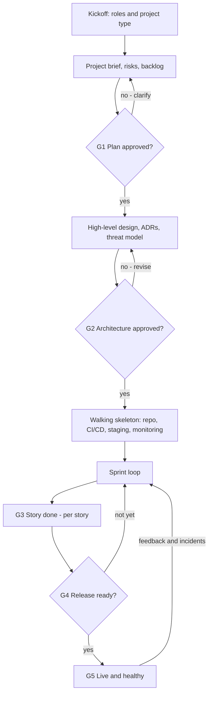
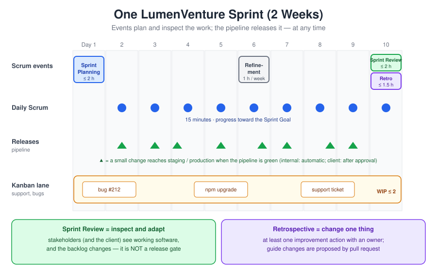
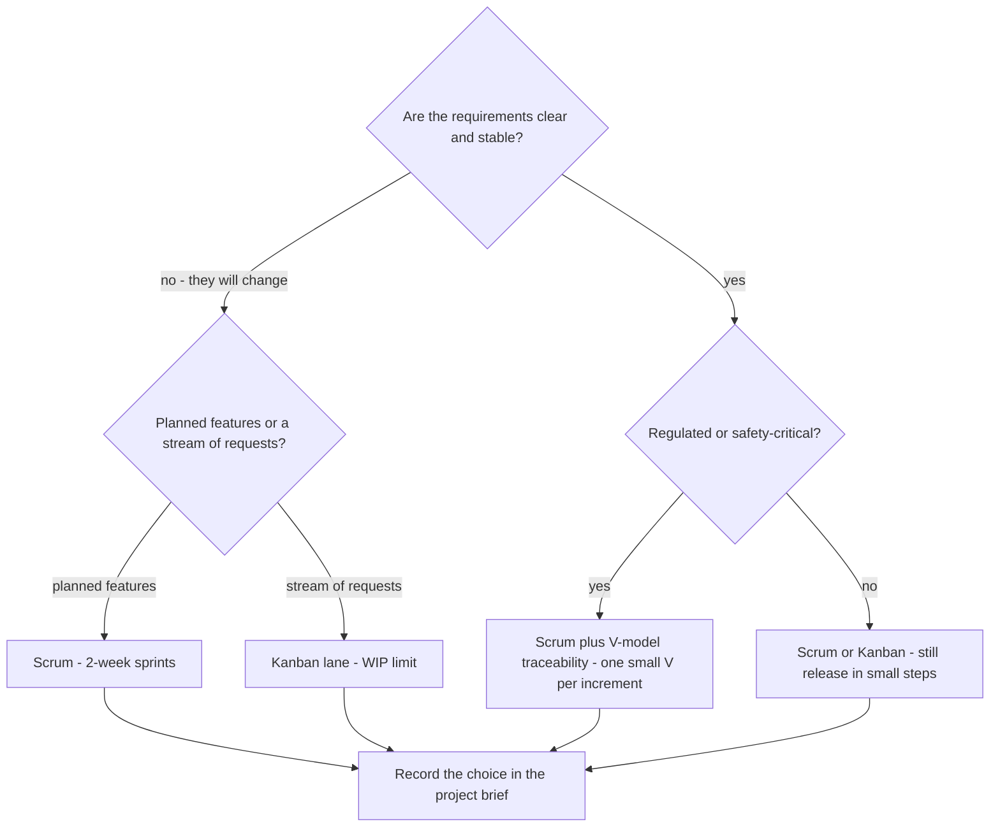
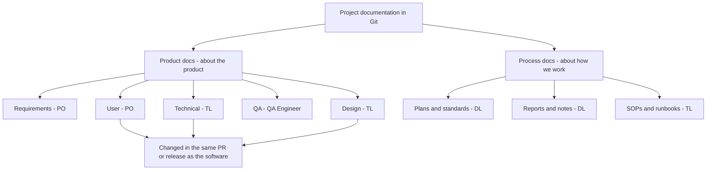

# LumenVenture SDLC Guide

**The way LumenVenture plans, designs, builds, tests, releases and runs software — for every project.**

- **Applies to:** all projects — internal products, client projects, and any other kind (prototypes, integrations, migrations). Rules for adapting the process are in [4. Project types](#4-project-types-and-tailoring).
- **Team model:** one cross-functional team of **4–8 people** per project.
- **Technology:** **stack-neutral.** The guide fixes the *process*, not the tools. Tools named in the guide are **examples**; each project records its real choices in an ADR (Architecture Decision Record).
- **Status:** living document. Change it through a pull request (see [9. Changing this guide](#9-changing-this-guide)).
- **Last reviewed:** 2026-11-13 · **Next full-guide review due:** 2027-05-13 · External standards and their editions: [§10](#10-standards-this-guide-follows) · Every phase file shows its own review date ([9.1 Review schedule](#91-review-schedule), [review log](CHANGELOG.md)).

> **Must / should / may:** in the "LumenVenture Standard" sections, **must** = required on every project; **should** = the default, skip only with a written reason (ADR or project brief); **may** = optional, use when it helps.

---

## 1. How to Use This Guide

| Folder | File | Read it to learn… | Use its templates when… |
|--------|------|-------------------|-------------------------|
| [01-Planning](01-Planning/Planning.md) | `Planning.md` | what to build, for whom, and why | starting a project; refining stories every sprint |
| [02-Design](02-Design/Design.md) | `Design.md` | how the system will be built | before building a new system or a significant feature |
| [03-Development](03-Development/Development.md) | `Development.md` | how code is written, reviewed and merged | setting up the repository; every pull request |
| [04-Testing](04-Testing/Testing.md) | `Testing.md` | how quality is proven | writing the test strategy; reporting bugs; before releases |
| [05-Deployment](05-Deployment/Deployment.md) | `Deployment.md` | how software reaches users safely | setting up the pipeline; every release |
| [06-Maintenance](06-Maintenance/Maintenance.md) | `Maintenance.md` | how the running service is kept healthy | going live; incidents; monthly service reviews |

Each phase file has the same shape:

1. **Jargon** — the terms used in that phase.
2. **The job** and **Waterfall way vs. modern way** — what the phase is for.
3. **How modern teams do it** and **industry practices** — the explanations and examples.
4. **"Done when…" checklist** — the quality bar.
5. **LumenVenture Standard** — **what we actually do**: owners, required outputs, the gate, rules, and templates.

> **The phases are not one long Waterfall.** We run them **broadly once at project start**, then **in small loops every sprint**. The gates below apply at those two levels.

---

## 2. Starting a New Project (Kickoff in 10 Steps)

| # | Step | Owner | Output | Template |
|---|------|-------|--------|----------|
| 1 | Name the **Product Owner**, **Tech Lead** and **Delivery Lead**; book the kickoff | Sponsor | Named roles | — |
| 2 | Pick the **project type(s)** and tailoring level | Delivery Lead + Product Owner | Recorded in the project brief | [§4](#4-project-types-and-tailoring) |
| 2a | **Client projects: run Client Discovery** — discovery meeting, same-day summaries, prototype, MVP workshop, client PRD (paid discovery phase if the idea is vague) | Product Owner + Delivery Lead | `docs/discovery/` | [Planning §8.6](01-Planning/Planning.md#86-client-discovery-client-projects) |
| 3 | Write the **project brief**: vision, scope, stakeholders, success metrics, the 8 planning factors, feasibility | Product Owner | `docs/project-brief.md` | [project-brief.md](01-Planning/templates/project-brief.md) |
| 4 | Fill in the **stakeholder register**; start the **risk register** | Product Owner / Delivery Lead | `docs/stakeholder-register.md`, `docs/risk-register.md` | [stakeholder-register.md](01-Planning/templates/stakeholder-register.md), [risk-register.md](01-Planning/templates/risk-register.md) |
| 5 | Build the first **backlog**: epics, then the first stories with acceptance criteria | Product Owner + team | Backlog in the tracking tool | [user-story.md](01-Planning/templates/user-story.md) |
| 6 | **Gate G1 — Plan approved** | Sponsor (+ client) | Sign-off recorded | [Planning §8](01-Planning/Planning.md#8-lumenventure-standard) |
| 7 | Write the **high-level design**, first **ADRs** and the **threat model** | Tech Lead | `docs/design/`, `docs/adr/` | [design-doc.md](02-Design/templates/design-doc.md), [adr.md](02-Design/templates/adr.md), [threat-model.md](02-Design/templates/threat-model.md) |
| 8 | **Gate G2 — Architecture approved** | Tech Lead + Sponsor | Design review recorded | [Design §6](02-Design/Design.md#6-lumenventure-standard) |
| 9 | Create the **repository** and **"walking skeleton"**: repo rules, CI/CD, staging environment, health check, monitoring — **before** feature work | Tech Lead | A "hello world" that deploys to staging through the pipeline | [repo-setup-checklist.md](03-Development/templates/repo-setup-checklist.md) |
| 10 | Write the **test strategy** and agree the **Definition of Done**; start **Sprint 1** | QA Engineer + team | `docs/test-strategy.md`, DoD | [test-strategy.md](04-Testing/templates/test-strategy.md), [definition-of-done.md](03-Development/templates/definition-of-done.md) |



---

## 3. Roles (Default for a 4–8 Person Team)

| Role | Short | Responsible for | Usually |
|------|-------|-----------------|---------|
| **Sponsor** | SP | Budget, priorities across projects, final go/no-go at G1 and G2 | LumenVenture leadership, or the client's sponsor |
| **Product Owner** | PO | **What** to build and in which order; the backlog; accepting stories | 1 person (on client projects: ours, working closely with the client) |
| **Delivery Lead** | DL | **How** the team works: sprints, risks, blockers, reporting, change requests | 1 person; may be the Scrum Master; in small teams may be combined with another role |
| **Tech Lead** | TL | Architecture, ADRs, technical quality, repo standards, release decisions | A senior developer who also codes |
| **Developers** | DEV | Code, unit/integration tests, code review, running what they build (on call) | 2–5 people |
| **QA Engineer** | QA | Test strategy, test automation, exploratory testing, release test sign-off | 1 person (in a 4-person team, a developer may hold this role) |
| **Security Champion** | SEC | Threat models, security checks, dependency and vulnerability follow-up | One developer, as an extra hat |
| **Client / Stakeholders** | CL | Requirements input, UAT, sign-offs (client projects) | The client's named contact |

> **One person may hold two roles** in a small team (for example Tech Lead + Security Champion). **Must:** the **author and the reviewer of a change are never the same person**, and the **Product Owner does not also act as the only tester**.

### 3.1 Who does what (RACI)

**R** = Responsible (does the work) · **A** = Accountable (owns the result; exactly one) · **C** = Consulted · **I** = Informed

| Activity | SP | PO | DL | TL | DEV | QA | CL |
|----------|----|----|----|----|-----|----|----|
| Project brief and scope | C | **A/R** | R | C | I | I | C |
| Backlog and priorities | I | **A/R** | C | C | C | C | C |
| Risk register | I | C | **A/R** | R | C | C | I |
| Architecture and ADRs | I | C | I | **A/R** | R | C | I |
| Threat model | I | C | I | **A** | R | C | I |
| Code and code review | — | I | I | **A** | R | C | — |
| Test strategy and automation | — | C | I | C | R | **A/R** | I |
| UAT / acceptance | I | **A** | C | C | C | R | R |
| Release go/no-go (G4) | I | C | C | **A** | C | R | C |
| Incidents and postmortems | I | I | C | **A** | R | C | I |

---

## 4. Project Types and Tailoring

Every project picks **one base type** and adds **"Regulated data"** if it applies. When a project fits no type ("other"), use the **closest** one and write the differences in the project brief.

| Topic | **Internal product** | **Client project** | **Prototype / proof of concept** | **+ Regulated data** (add-on) |
|-------|----------------------|--------------------|----------------------------------|-------------------------------|
| **Requirements** | Light brief + backlog | **Client discovery** + brief + **client PRD and signed scope** (SOW — Statement of Work) + backlog | One-page goal + questions to answer | **Full SRS** (ISO/IEC/IEEE 29148 style) + traceability matrix |
| **Sign-offs** | PO accepts | **Client** signs G1, G2 (major), UAT, release | PO decides keep / throw away | Formal records kept for audit |
| **Changes to scope** | Backlog reorder | **Change request** with cost and time impact | Free | Change request + impact on compliance |
| **Design** | Design doc for significant features | Design doc + client review of HLD | Spike notes only | + DPIA (Data Protection Impact Assessment) where GDPR applies |
| **Testing** | Full standard | Full standard + **client UAT** | Smoke tests only; **must not** go to real users with real data | + security/penetration test before go-live |
| **Release** | Continuous Deployment allowed | Continuous **Delivery** with client approval gate | Not to production | Approval gate + change record |
| **Maintenance** | Team on call | As agreed in the **support agreement / SLA** | None | + audit logs, access reviews, retention rules |

> **Prototype rule (must):** a prototype that becomes a real product must pass **G1–G2** and the full Development and Testing standards **before** real users or real data touch it.

---

## 5. Gates Overview

| Gate | When | Decides | Owner | Details |
|------|------|---------|-------|---------|
| **G1 — Plan approved** | Project start (and after big scope changes) | Is the project feasible, clear and worth doing? | SP (+ CL) | [Planning §8](01-Planning/Planning.md#8-lumenventure-standard) |
| **DoR — Ready** | Each story, before a sprint | Is this story clear enough to start? | PO | [Planning §8](01-Planning/Planning.md#8-lumenventure-standard) |
| **G2 — Architecture approved** | Project start; significant features | Is the design sound, secure and operable? | TL (+ SP) | [Design §6](02-Design/Design.md#6-lumenventure-standard) |
| **G3 — Story done (DoD)** | Each story / PR | Is the change finished to our quality bar? | TL | [Development §6](03-Development/Development.md#6-lumenventure-standard) |
| **G4 — Release ready** | Each release to production | Is it tested, accepted and safe to ship? | TL | [Testing §6](04-Testing/Testing.md#6-lumenventure-standard), [Deployment §6](05-Deployment/Deployment.md#6-lumenventure-standard) |
| **G5 — Live and healthy** | After go-live; reviewed monthly | Is the service observable, supported and meeting its SLOs? | TL | [Maintenance §6](06-Maintenance/Maintenance.md#6-lumenventure-standard) |

---

## 6. Working Rhythm (Defaults)

| Event | Default | Purpose |
|-------|---------|---------|
| **Sprint** | 2 weeks | One plan → build → inspect loop with one **Sprint Goal**. Releases are **not** tied to the sprint end — the pipeline releases whenever a change is ready ([6.4](#64-releases-are-not-tied-to-sprints)) |
| **Sprint Planning** | Start of sprint, max 2 h | Agree the **Sprint Goal**; pick stories that meet DoR; plan how to build them |
| **Daily Scrum** (stand-up) | 15 min | Progress toward the Sprint Goal; adjust the plan; raise blockers |
| **Backlog refinement** | Weekly, 1 h (an ongoing activity, not a formal Scrum event) | Detail the next stories (DoR) |
| **Sprint Review** | End of sprint, max 2 h | Inspect the working increment with the PO and stakeholders (client on client projects) and **adapt the backlog**. It is a working session, not a release gate |
| **Sprint Retrospective** | After the Sprint Review, max 1.5 h | Improve how we work — at least one action with an owner; propose changes to this guide |
| **Service review** | Monthly, after go-live | SLOs, incidents, costs, security, tech debt |



### 6.1 Our methodology by project type

> **Default:** **Scrum** (as in the Scrum Guide 2020) with **2-week sprints**, plus the engineering practices in this guide (TDD, CI/CD, trunk-based development, feature flags). It is **iterative** (we repeat and improve) and **incremental** (each sprint adds a working piece). Record any change from the default in the project brief §10.

| Project type | How we run it | Release to users |
|--------------|---------------|------------------|
| **Internal product** | Scrum, 2-week sprints; forecasts from measured throughput | **Continuous Deployment** — any time the pipeline is green |
| **Client project** | **Paid discovery** (when the idea is vague) → Scrum; the client joins **every Sprint Review**; contract model from [Planning §4.17](01-Planning/Planning.md#417-forecasting-and-budgeting-fix-time-and-cost-flex-scope) | **Continuous Delivery** with a client approval gate |
| **Prototype** | **Kanban** or 1-week sprints, time-boxed, answering named questions | Demo environment only — never real users or real data |
| **After go-live** (support and maintenance) | A **Kanban lane** with a WIP limit, in the **same backlog** as features ([6.3](#63-kanban-for-continuous-work)) | Hotfixes through the normal pipeline |
| **+ Regulated data** (add-on) | Scrum **plus V-model discipline**: every requirement traced to a test, signed test records, run as **one small V per increment** ([Testing §4.12](04-Testing/Testing.md#412-the-v-model-idea-each-design-artifact-gets-its-test)) | Approval gate + change record |




> **Why not Waterfall?** We do **not** run projects as one long sequence (plan everything → build everything → test everything). Requirements change, and late feedback is expensive. Where a client or regulator needs **phase gates**, we keep the gates (G1–G5) as **governance** on top of Scrum delivery — we do not stop delivering in small steps.

### 6.2 Scrum accountabilities in our roles

| Scrum Guide 2020 | LumenVenture role ([§3](#3-roles-default-for-a-48-person-team)) | Notes |
|------------------|------------------------------------------------------------------|-------|
| **Product Owner** — maximizes value; orders the Product Backlog | **Product Owner** | One person, never a committee; on client projects works closely with the client decision-maker |
| **Scrum Master** — the team's effectiveness; coaches Scrum; removes blockers | **Delivery Lead** | A coach, **not** a manager of the developers |
| **Developers** — build a usable increment every sprint | **Tech Lead, Developers, QA Engineer** (and designers) | Everyone who does the work; testers are part of the team, not a later phase |

| Scrum artifact | Its commitment | At LumenVenture |
|----------------|----------------|-----------------|
| **Product Backlog** | **Product Goal** | The goal and key results in the project brief §2 (`OBJ-n`) |
| **Sprint Backlog** | **Sprint Goal** | One sentence, agreed in Sprint Planning |
| **Increment** | **Definition of Done** | The [DoD template](03-Development/templates/definition-of-done.md) (Gate G3) |

### 6.3 Kanban for continuous work

- Work that **arrives unpredictably** — bugs, support tickets, small upgrades, security fixes — cannot always wait for the next sprint.
- It runs in a **Kanban lane** on the same board: **To do → In progress → Review → Done**, with a **WIP (work in progress) limit** (default: **2** items in progress for the lane). Finish before you start.
- It lives in the **same backlog** as features, so the PO sees all the work in one place. Maintenance rule 8 reserves **10–20%** of sprint capacity for it ([Maintenance §6.5](06-Maintenance/Maintenance.md#65-rules)).
- Measure **cycle time** (start → done) and **throughput** (items done per week); discuss them in the retrospective.

### 6.4 Releases are not tied to sprints

- The Sprint Review **inspects** the work; it is **not** the moment code reaches users (Scrum Guide 2020: the Sprint Review should never be a gate to releasing value).
- Every merged change goes through the pipeline. **Internal products** deploy automatically; **client projects** deploy after the client approval gate. Unfinished features are hidden with **feature flags** ([Deployment rule 9](05-Deployment/Deployment.md#64-rules)).

### 6.5 Anti-patterns we do not accept

| ❌ Anti-pattern | What it looks like | ✅ What we do instead |
|----------------|--------------------|----------------------|
| **Water-Scrum-Fall** | Big requirements up front, then "sprints" for coding, then a long test and release phase | Broad plan first ([Planning §2](01-Planning/Planning.md#2-the-four-core-steps-waterfall-way-vs-modern-way)), then test and release **inside** every sprint |
| **Mini-waterfall in the sprint** | Developers code for 9 days; QA tests on day 10 | Developer and QA work on the same story together; tests are written with the code |
| **Cargo-cult Agile** | Stand-ups and sprints happen, but nothing reaches users and nothing changes from feedback | Ship working software; feedback changes the backlog |
| **"Agile means no documentation / no plan"** | No ADRs, no roadmap, no forecast | Just enough docs in Git; Product Goal, roadmap with ranges, data-based forecasts |
| **Velocity as a target** | Teams compared by story points; points inflate | Velocity and throughput are only for the team's own forecasting |
| **Retrospectives that change nothing** | Same problems every sprint | At least one improvement action with an owner, checked next retro |

### 6.6 Working rhythm rules

1. **must** — Every project records its **methodology** (default Scrum; or the variant from §6.1) and any deviation in the project brief §10.
2. **must** — Every sprint has a **Sprint Goal**, ends with a **Sprint Review** with stakeholders (the client on client projects) and a **Sprint Retrospective** with at least one improvement action.
3. **must** — Testing is done **inside** the sprint, in the same story and PR as the code; no "testing sprint" or testing-only phase at the end.
4. **must** — The Sprint Review is never the only path to production; releases follow the pipeline rules in [Deployment §6.4](05-Deployment/Deployment.md#64-rules).
5. **should** — Unplanned work (bugs, support, upgrades) runs in a **Kanban lane** with a WIP limit, in the same backlog.
6. **should** — Velocity and throughput are used **only** for the team's own forecasting, never to compare teams or people.

---

## 7. Where Project Documents Live

Every project keeps its documents **in its Git repository**, next to the code, so they are versioned and reviewed in pull requests:

```text
<project-repo>/
├── README.md                     # what it is, how to run, test and deploy
├── docs/
│   ├── project-brief.md          # Planning
│   ├── stakeholder-register.md   # Planning
│   ├── risk-register.md          # Planning
│   ├── change-requests/          # Planning (client projects)
│   ├── discovery/                # Planning (client projects): meetings/, assumptions log, MVP workshop, client-prd.md
│   ├── design/                   # Design docs (one per significant feature)
│   ├── adr/                      # 0001-short-title.md, 0002-...
│   ├── threat-model.md           # Design
│   ├── versioning-policy.md      # Development (Sprint 0)
│   ├── test-strategy.md          # Testing
│   ├── test-cases/               # Testing: written test cases for manual, UAT and OAT tests (client and regulated projects)
│   ├── releases/                 # Release checklists / notes
│   ├── slo.md                    # Maintenance
│   ├── runbooks/                 # One per alert
│   ├── sop/                      # SOPs: repeated, project-specific procedures (§7.2)
│   ├── user/                     # User docs (help, FAQ, guides), unless they live in a help center
│   └── postmortems/              # One per SEV1/SEV2 incident
├── .github/pull_request_template.md
└── CHANGELOG.md
```

### 7.1 Documentation map: what we keep, who owns it, when it changes

Documentation has two categories. **Product documentation** describes the product (five types below). **Process documentation** describes and records **how we work** — plans, standards, reports, and **SOPs (Standard Operating Procedures)** for repeated, project-specific tasks. Every document has **one owner role** and a named **audience**.

| Category / type | Documents (template) | Owner | Audience | Updated when |
|-----------------|----------------------|-------|----------|--------------|
| Product — **requirements** | Project brief, backlog stories, client PRD (Product Requirements Document), SRS (Software Requirements Specification) on regulated projects ([Planning §8](01-Planning/Planning.md#8-lumenventure-standard)) | PO | Team, client, QA | Every refinement; scope changes by change request |
| Product — **design** | Design docs, ADRs, C4 diagrams (context, containers, components, code), OpenAPI / AsyncAPI, threat model ([Design §6](02-Design/Design.md#6-lumenventure-standard)) | TL | Developers, reviewers, client (the HLD — high-level design) | In the PR that changes the design or contract |
| Product — **technical** | README, code comments ("why"), generated API reference, `.env.example`, versioning policy | TL | Developers, AI coding assistants | In the same PR as the code |
| Product — **QA** | Test strategy, test cases, test reports, UAT sign-off ([Testing §6](04-Testing/Testing.md#6-lumenventure-standard)) | QA (UAT sign-off: PO) | Team, PO, client, auditors | With each story; per release |
| Product — **user** | Help pages, FAQ (Frequently Asked Questions), installation guide, release notes (sorted as tutorial / how-to / reference / explanation — the Diátaxis framework) | PO | End users, client's staff, API consumers | In the same release as the change they describe |
| Process — **plans and standards** | Sprint goals, Definition of Done, the project's tailoring and deviations (project brief §10), risk register | DL | Team, sponsor | Sprint events; retrospectives |
| Process — **reports and notes** | Client meeting summaries and the assumptions and decisions log (owner: PO); service reviews and postmortems (owner: TL); other team notes (owner: DL) | PO / TL / DL as listed | Team, client, sponsor | Same day (meetings); monthly (service review); after incidents |
| Process — **SOPs and runbooks** | SOPs ([template](03-Development/templates/sop.md)), runbooks ([template](06-Maintenance/templates/runbook.md)) | TL | Team, on-call | When the procedure changes; reviewed every 6 months |



### 7.2 Documentation rules

1. **must** — Project documents live in the project's Git repository as in §7 (user docs may live in a help center that links to the release); each document in §7.1 has its owner role.
2. **must** — A change that alters behavior, the API, operations or a procedure **updates the affected documents in the same pull request** (or, for help-center content, in the same release). The PR states "no docs change" when none is needed. Documentation is **never** left for "later" or "the maintenance phase".
3. **must** — No secrets, credentials, internal-only hostnames or real personal data in any document, screenshot, video or example. This extends [Development rule 3](03-Development/Development.md#64-rules) and [Testing rule 3](04-Testing/Testing.md#64-rules) to documentation.
4. **should** — The API reference is **generated** from the OpenAPI contract, never maintained as a separate hand-written copy. This extends [Testing rule 16](04-Testing/Testing.md#64-rules) (API docs checked against the contract in CI).
5. **should** (**must** on regulated projects) — CI (Continuous Integration) checks documentation on every PR: Markdown lint, broken links, and OpenAPI lint (tools, for example: markdownlint, lychee, Spectral or Redocly CLI). Pin the tools in `devDependencies` (Development rule 5). A check with a `paths:` filter is not made a required status check — a PR that does not touch those files would never run it and could not merge.
6. **should** (**must** on client and regulated projects, at least for "merge to `main`") — A procedure the team repeats and that is **specific to this project or client** (merging, releasing, onboarding, rotating secrets, restoring a backup, client hand-over) has an **SOP** written with the [SOP template](03-Development/templates/sop.md). Every step a tool can enforce **is** enforced (branch protection, CODEOWNERS, CI, the pipeline); the SOP keeps the reasons and the human steps. The [release checklist](05-Deployment/templates/release-checklist.md) is the release SOP — do not write a second one.
7. **should** — **SOPs and runbooks** show **Last reviewed** and **Next review due** and are reviewed **at least every 6 months**, and at once when an incident or a new team member shows they are wrong; the monthly service review lists overdue ones. The README and user docs stay current through rule 2 and are checked in the monthly service review.
8. **should** — Working papers and meeting notes are **process** documents. [Design rule 1](02-Design/Design.md#64-rules) (hard-to-change decisions are ADRs **before** building on them) and [Planning rule 12](01-Planning/Planning.md#8-lumenventure-standard) (assumptions that change cost or time go into the decisions log) still apply; any **other** decision taken in them is moved into an ADR or the decisions log in the same sprint.
9. **must** on client projects, **should** on internal products — User-facing features ship with **user documentation** for a named audience (help, FAQ or guide, and release notes); its scope is agreed in the project brief (or SOW — Statement of Work), and it meets the same accessibility target as the product (default WCAG 2.2 AA).

---

## 8. All Templates

| Phase | Template | Use |
|-------|----------|-----|
| Planning | [project-brief.md](01-Planning/templates/project-brief.md) | Vision, scope, stakeholders, 8 factors, feasibility |
| Planning | [stakeholder-register.md](01-Planning/templates/stakeholder-register.md) | Who the stakeholders are, power / interest, what they need, who signs off |
| Planning | [risk-register.md](01-Planning/templates/risk-register.md) | Living list of risks |
| Planning | [user-story.md](01-Planning/templates/user-story.md) | Story + objective, source, priority + acceptance criteria (and EARS rules) + DoR |
| Planning | [change-request.md](01-Planning/templates/change-request.md) | Scope changes (client and regulated projects) |
| Planning | [discovery-proposal.md](01-Planning/templates/discovery-proposal.md) | Offer a paid discovery phase to a client with a vague idea |
| Planning | [discovery-questions.md](01-Planning/templates/discovery-questions.md) | Question list for the first client discovery meeting |
| Planning | [meeting-summary.md](01-Planning/templates/meeting-summary.md) | Same-day summary after every client meeting |
| Planning | [assumptions-and-decisions-log.md](01-Planning/templates/assumptions-and-decisions-log.md) | Living list of assumptions and agreed decisions |
| Planning | [mvp-workshop.md](01-Planning/templates/mvp-workshop.md) | MoSCoW workshop to agree the MVP |
| Planning | [client-prd.md](01-Planning/templates/client-prd.md) | Plain-language PRD the client approves |
| Design | [design-doc.md](02-Design/templates/design-doc.md) | Design / RFC for a system or significant feature |
| Design | [adr.md](02-Design/templates/adr.md) | One architecture decision |
| Design | [threat-model.md](02-Design/templates/threat-model.md) | STRIDE threat model |
| Development | [repo-setup-checklist.md](03-Development/templates/repo-setup-checklist.md) | New repository / walking skeleton |
| Development | [pull_request_template.md](03-Development/templates/pull_request_template.md) | Copy to `.github/` |
| Development | [definition-of-done.md](03-Development/templates/definition-of-done.md) | Team DoD |
| Development | [versioning-policy.md](03-Development/templates/versioning-policy.md) | Version scheme, bump rules, supported versions, deprecation periods |
| Development | [sop.md](03-Development/templates/sop.md) | Standard Operating Procedure for a repeated, project-specific task (filled example: merging to `main`) |
| Testing | [test-strategy.md](04-Testing/templates/test-strategy.md) | How the project proves quality |
| Testing | [bug-report.md](04-Testing/templates/bug-report.md) | Reporting a bug |
| Testing | [uat-signoff.md](04-Testing/templates/uat-signoff.md) | Acceptance by PO / client |
| Testing | [test-case.md](04-Testing/templates/test-case.md) | Written test cases and execution record for tests that cannot be automated (UAT, OAT, regulated) |
| Deployment | [release-checklist.md](05-Deployment/templates/release-checklist.md) | Gate G4 for each release |
| Deployment | [pipeline-checklist.md](05-Deployment/templates/pipeline-checklist.md) | Setting up CI/CD and environments |
| Maintenance | [slo.md](06-Maintenance/templates/slo.md) | SLIs, SLOs, error budget |
| Maintenance | [runbook.md](06-Maintenance/templates/runbook.md) | One per alert |
| Maintenance | [postmortem.md](06-Maintenance/templates/postmortem.md) | After SEV1/SEV2 incidents |
| Maintenance | [go-live-checklist.md](06-Maintenance/templates/go-live-checklist.md) | Gate G5 |
| Maintenance | [service-review.md](06-Maintenance/templates/service-review.md) | Monthly review |

---

## 9. Changing This Guide

- Anyone can propose a change by **pull request**; the change needs approval from **one Tech Lead and one Delivery Lead**.
- Good sources of changes: **retrospectives**, **postmortems**, and new industry practice.
- **Source of truth:** this guide follows **current industry-standard practice**. Course material and older documents give background only; when they disagree with current practice, the guide follows current practice.
- Every file is reviewed on a fixed schedule — see [9.1](#91-review-schedule).
- Projects may **deviate** from a "should" rule with a written reason (ADR or project brief). "Must" rules need approval from the guide owners.

### 9.1 Review schedule

**Rule (must):** every phase file — **with its `templates/` folder** — is reviewed **at least every 6 months**, and this README at least every 6 months as part of a **full-guide review**. A file whose "Next review due" date has passed is **overdue**; the Delivery Lead raises it in the next retrospective.

| File | Review owner (lead) | Second reviewer |
|------|---------------------|-----------------|
| [README.md](README.md) (full-guide review) | Delivery Lead | Tech Lead |
| [01-Planning/Planning.md](01-Planning/Planning.md) | Product Owner | Delivery Lead |
| [02-Design/Design.md](02-Design/Design.md) | Tech Lead | Security Champion |
| [03-Development/Development.md](03-Development/Development.md) | Tech Lead | A developer |
| [04-Testing/Testing.md](04-Testing/Testing.md) | QA Engineer | Tech Lead |
| [05-Deployment/Deployment.md](05-Deployment/Deployment.md) | Tech Lead | Delivery Lead |
| [06-Maintenance/Maintenance.md](06-Maintenance/Maintenance.md) | Tech Lead | Security Champion |

> **"Guide owners"** in this section means the **lead Tech Lead** and the **lead Delivery Lead** of LumenVenture. They approve changes to **must** rules.

#### What a review checks

- [ ] **Standards and versions** — go through the table in [§10](#10-standards-this-guide-follows): is each one still the current edition? Update the table and its "last checked" date.
- [ ] **Laws and deadlines** — privacy, accessibility and security laws that apply to our clients (for example GDPR, the European Accessibility Act, the EU Cyber Resilience Act); have any dates passed or changed?
- [ ] **Tools and runtimes** — is every tool named as an example still maintained? Are runtime versions still supported (for example the Node.js LTS lines)?
- [ ] **Industry practice** — has a newer, widely adopted practice replaced something we recommend? (check primary sources: official standards, project docs, published research such as the DORA reports — not opinion posts)
- [ ] **Our own lessons** — retrospective and postmortem findings since the last review, deviations projects asked for, and rules that people keep skipping
- [ ] **Templates** — are they still used? Do they match the rules in the phase file?
- [ ] **Links** — no broken links or section anchors
- [ ] **Readability** — still in simple (B1) English; a new team member can follow it without help

**Rules for review changes:** every changed fact is checked against a **current primary source**, and the source is linked in the pull request. Never add tools, versions or statistics that cannot be verified.

#### Early reviews (do not wait for the date)

Review the affected file **within 2 weeks** when:

- a **new edition** of a standard we use is published (for example a new OWASP Top 10)
- a **law or deadline** that affects our projects comes into force or changes
- a tool or runtime we recommend reaches **end of life**, is deprecated, or has a serious **security incident**
- a **SEV1/SEV2 incident** or a retrospective shows that a rule is wrong or missing
- a project needs to **deviate from a "must"** rule

#### Recording a review

1. Open a pull request titled `review: <file> <yyyy-mm>`.
2. Update the file's **Last reviewed** and **Next review due** dates (next = review date + 6 months), even if nothing else changed.
3. Add an entry to the [review log](CHANGELOG.md): date, file, reviewers, what changed (or "no changes needed"), sources checked.
4. Approval: the review owner + the second reviewer; changes to **must** rules also need the guide owners.

---

## 10. Standards This Guide Follows

The external standards, laws and specifications this guide relies on. **Review owners check this table at every review** ([§9.1](#91-review-schedule)). "Last checked" = the date someone confirmed the edition against a current source.

| Standard / law | Current edition or status | Used in | Last checked |
|----------------|---------------------------|---------|--------------|
| **OWASP Top 10** (web risks) | **2025** edition — new: A03 Software Supply Chain Failures, A10 Mishandling of Exceptional Conditions; SSRF merged into A01 | Planning, Design, Development, Testing | 2026-11-13 |
| **OWASP ASVS** (security requirements) | **5.0** (May 2025), levels 1–3 | Planning, Design, Testing | 2026-11-13 |
| **OWASP API Security Top 10** | 2023 edition | Design, Development | next review |
| **OWASP Top 10 for LLM Applications** | 2025 edition | Development (AI features) | next review |
| **OWASP Password Storage Cheat Sheet** | Living document — Argon2id first choice; bcrypt for legacy | Design, Development | 2026-11-13 |
| **OWASP SAMM** (security maturity model) | v2 | Optional reference for measuring how mature our security practices are | next review |
| **NIST SSDF** (Secure Software Development Framework) | SP 800-218 | Whole guide | next review |
| **SLSA** (supply-chain levels) | v1.x — check slsa.dev | Deployment | next review |
| **ISO/IEC/IEEE 29148** (requirements / SRS) | 2018 edition (replaced IEEE 830); document levels BRS, StRS, SyRS, SRS | Planning — requirement quality characteristics (all projects); full SRS (regulated projects) | 2026-11-13 |
| **GAMP 5** (validation of computerized systems, GxP) | 2nd edition (2022) | Planning — URS for pharmaceutical / medical clients only | next review |
| **Scrum Guide** | 2020 edition — 3 accountabilities, 5 events, 3 artifacts with commitments (Product Goal, Sprint Goal, Definition of Done) | README §6 working rhythm | next review |
| **Agile Manifesto** | 2001 — 4 values, 12 principles | README §6 | — (fixed text) |
| **Semantic Versioning** | 2.0.0 (semver.org) — `MAJOR.MINOR.PATCH`, pre-release `-…`, build metadata `+…` | Development, Design, Deployment | next review |
| **Conventional Commits** | 1.0.0 | Development | next review |
| **ISO/IEC 25010** (software quality model) | 2023 edition — usability renamed **interaction capability** (accessibility split into *inclusivity* and *user assistance*); **safety** added; portability renamed **flexibility** | Planning (NFRs), Testing | 2026-11-16 |
| **ISTQB Foundation Level syllabus** (testing terms and principles) | CTFL (Certified Tester Foundation Level) **v4.0** (April 2023; errata release v4.0.1, Sept 2024) — seven testing principles ("tests wear out" was called the "pesticide paradox" in older editions); maintenance testing = checking the change + regression | Testing §4.13 | 2026-11-16 |
| **WCAG** (accessibility) | 2.2, level AA as default target | Planning, Testing | next review |
| **European Accessibility Act** | Applies since 28 June 2025 | Planning | next review |
| **GDPR** (EU data protection) | Regulation (EU) 2016/679 | Planning, Design, Maintenance | next review |
| **EU Cyber Resilience Act** | Reporting duties since **11 Sep 2026**; full application **11 Dec 2027** | Deployment, Maintenance | 2026-11-13 |
| **OpenAPI** | **3.2** (Sept 2025); 3.1 still widely supported | Design | 2026-11-13 |
| **RFC 9457** Problem Details / **RFC 9745** Deprecation / **RFC 8594** Sunset / **RFC 9116** security.txt | Published RFCs | Design, Development, Maintenance | 2026-11-13 (9745); others next review |
| **DORA metrics** | **Five** metrics: change lead time, deployment frequency, failed deployment recovery time, change fail rate, deployment rework rate | Deployment, Maintenance | 2026-11-13 |
| **Node.js release schedule** | Use an Active or Maintenance LTS line; from Node.js 27, one major per year and every major becomes LTS | Development, Maintenance | 2026-11-13 |
| **npm registry security** | Classic tokens revoked 9 Dec 2025; granular write tokens ≤ 90 days; trusted publishing (OIDC) recommended; `min-release-age` cooldown since npm 11.10.0 | Development, Deployment | 2026-11-13 |
