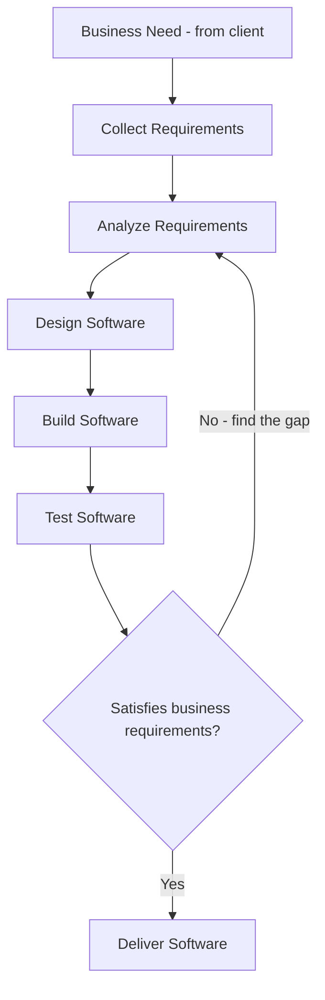
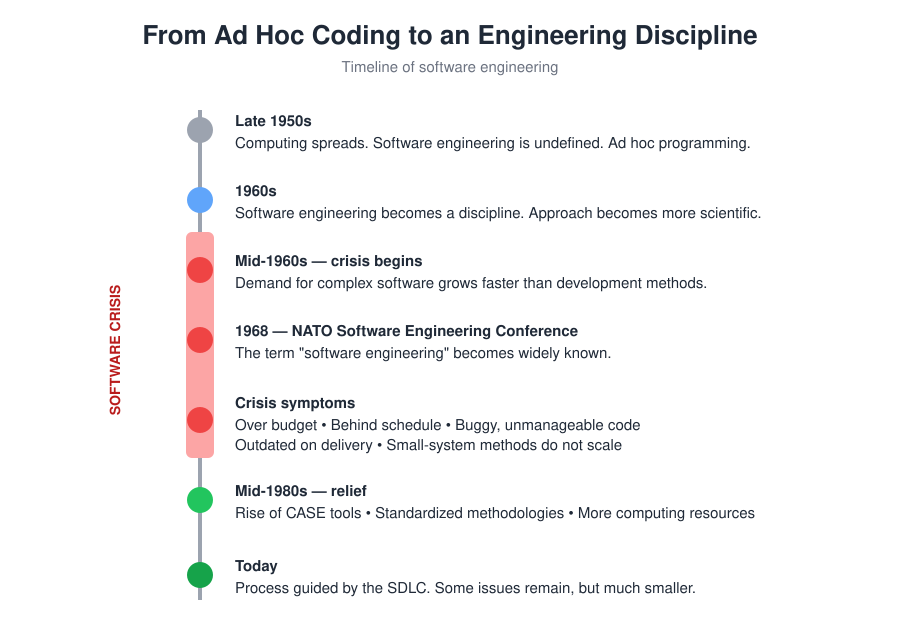
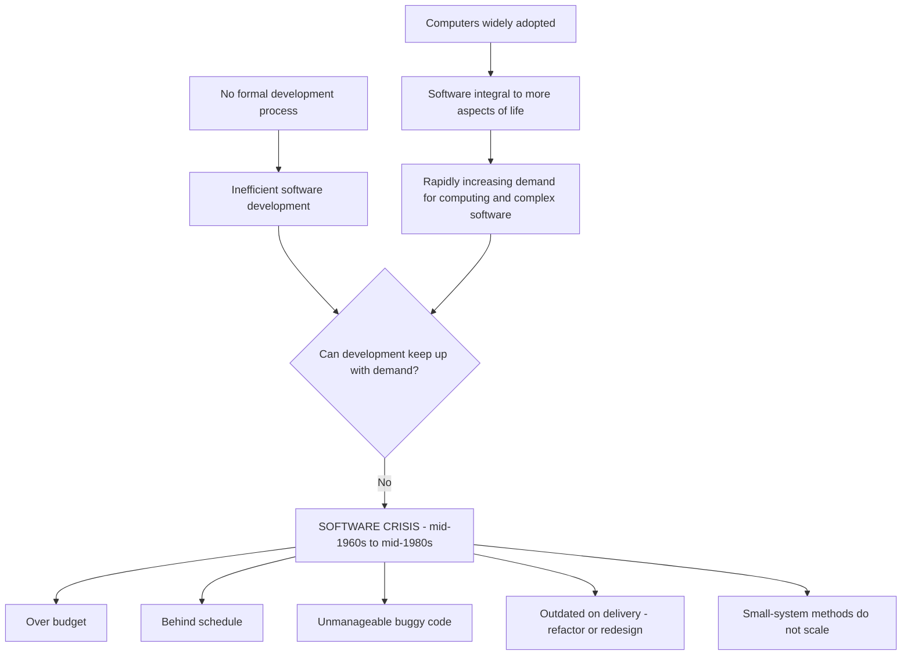
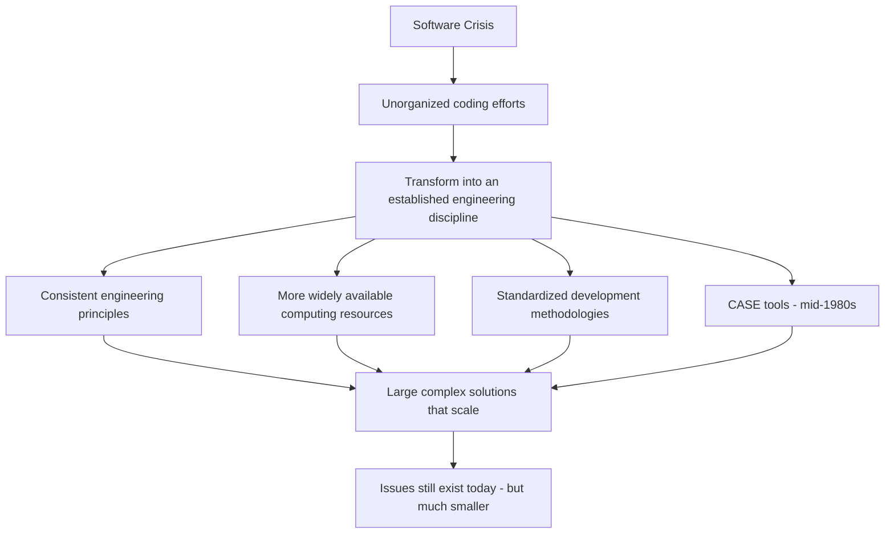
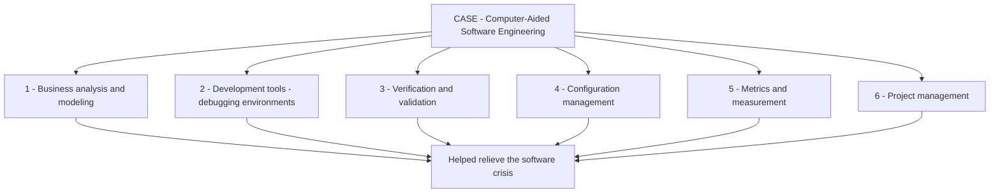
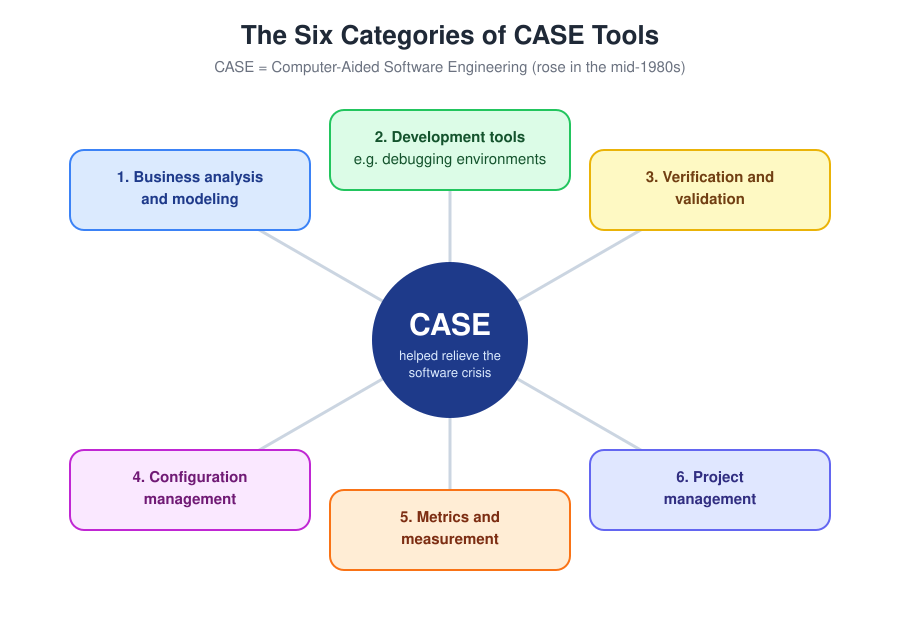
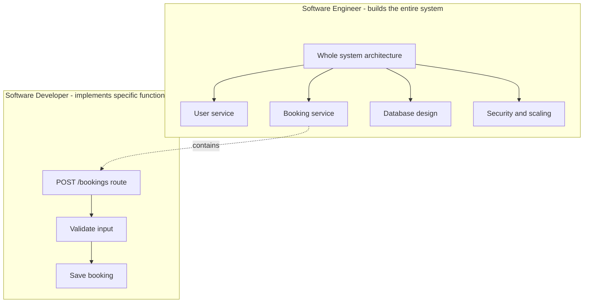
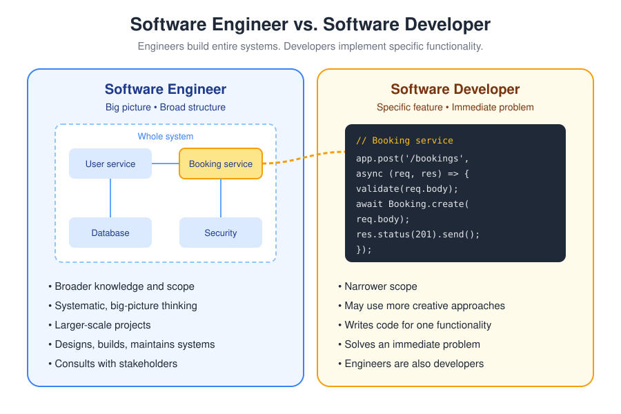
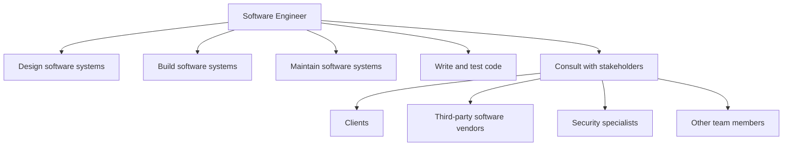
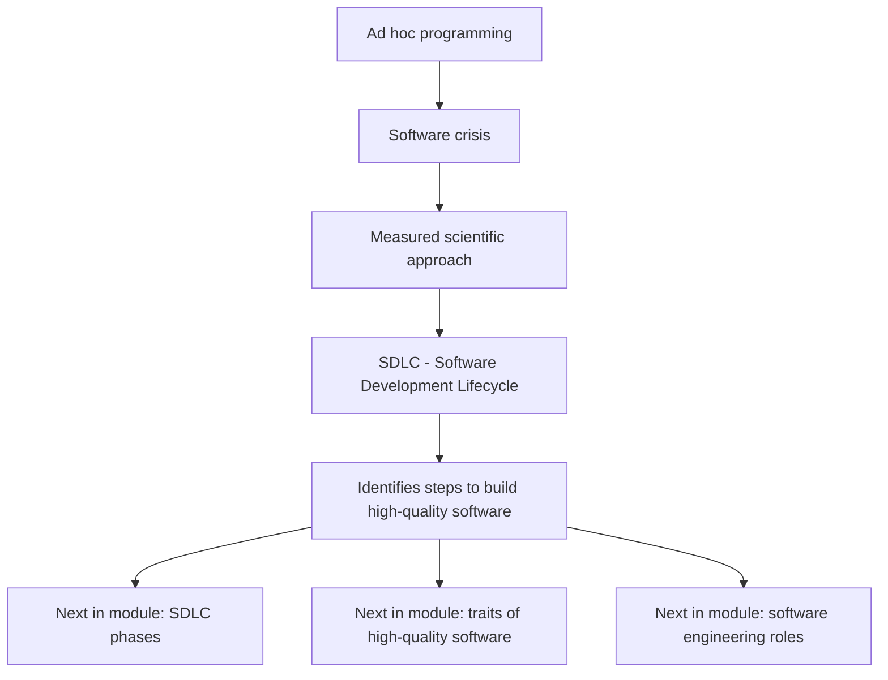

# 01 — What is Software Engineering?

**Learning goals of this lecture:**

- Define **Software Engineering**.
- List the **responsibilities** of a Software Engineer.
- **Compare and contrast** Software Developers and Software Engineers.

---

## 1. Jargon Translation

| Term | Official Definition | Simple Words | Analogy |
|------|--------------------|--------------|---------|
| **Software Engineering** | The application of scientific principles to the design and creation of software. | Building software in a planned, step-by-step, measurable way — not by guessing. | A civil engineer does not just stack bricks. They measure, plan, calculate, and test before building a bridge. A software engineer does the same with code. |
| **Systematic approach** | A method that follows a fixed, ordered set of steps that can be repeated. | You always follow the same clear steps, so the result is predictable. | Following a recipe step by step, instead of throwing random things into a pot. |
| **Business requirements** | The needs and goals that a business or client expects the software to meet. | What the customer actually wants the software to do. | The list a customer gives a house builder: "3 bedrooms, 1 kitchen, a garden." |
| **Ad hoc programming** | Writing code without a formal plan or process, solving problems only when they appear. | Coding "on the fly", with no plan. | Building a house by adding rooms whenever you feel like it — no drawing, no plan. |
| **Discipline (engineering discipline)** | An established field of study and practice with accepted rules, methods, and standards. | A proper profession with known rules. | Medicine is a discipline: doctors follow standard methods, not personal guesses. |
| **Software crisis** | The period (mid-1960s to mid-1980s) when software projects often failed because development methods could not keep up with demand and complexity. | A time when most software was late, too expensive, and full of bugs. | A city growing so fast that its roads, built with no plan, are always jammed and breaking. |
| **Bug** | A defect in code that makes software behave in a wrong or unexpected way. | A mistake in the code. | A typo in a recipe that says "10 cups of salt" instead of "1 teaspoon". |
| **Refactor** | Restructuring existing code without changing its external behavior, to improve its design or quality. | Cleaning and re-organising code so it is better, but it still does the same job. | Re-organising your kitchen cupboards — same items, better order. |
| **Scale / Scalability** | The ability of a system to handle growth (more users, more data, more features) without failing. | Software that still works well when it gets much bigger. | A small café's method works for 10 customers; a scalable method works for 10,000. |
| **CASE (Computer-Aided Software Engineering)** | The use of software tools to support and automate activities in the software development process. | Software tools that help people build software. | Power tools for a carpenter — the carpenter still builds, but faster and with fewer mistakes. |
| **Verification and Validation** | **Verification:** checking the software is built correctly against its specification. **Validation:** checking the right software was built for the user's real needs. | Verification = "Did we build it right?" Validation = "Did we build the right thing?" | Verification: the cake matches the recipe. Validation: the customer actually wanted a cake, not a pie. |
| **Configuration management** | The process of tracking and controlling changes to software, its files, and its versions. | Keeping a clear history of every change, so you can see who changed what and go back if needed. | "Track changes" in a shared document, plus saved copies of every version. |
| **Metrics and measurement** | Collecting numbers that describe the software or the process (e.g., defects, time, size). | Measuring your work with numbers. | A fitness tracker counting your steps and heart rate. |
| **Stakeholder** | Any person or group that is affected by, or has an interest in, the software project. | Everyone who cares about the project's result. | For a new school building: students, teachers, parents, the city, and the builders. |
| **Third-party software vendor** | An outside company that provides software or services used in your system. | Another company whose software you use inside yours. | A restaurant buying bread from a bakery instead of baking it itself. |
| **SDLC (Software Development Lifecycle)** | A structured process that identifies the steps (phases) needed to develop high-quality software. | The standard list of steps to build good software, from idea to maintenance. | The life of a building: plan → design → build → inspect → open → maintain. |

---

## 2. Topics Introduced in the Lecture Transcript

1. Definition of Software Engineering.
2. The systematic approach: collecting and analyzing business requirements to design, build, and test software.
3. History of the field: from the late 1950s, becoming a discipline in the 1960s.
4. The trend from ad hoc programming to formal, standardized methods.
5. The software crisis (mid-1960s to mid-1980s): causes and symptoms.
6. How the software crisis was relieved: engineering principles, more computing resources, standardized methodologies.
7. CASE (Computer-Aided Software Engineering) and its six tool categories.
8. Software Engineer vs. Software Developer: similarities and differences.
9. Responsibilities of a Software Engineer.
10. The influence of a measured scientific approach on software creation.
11. Introduction to the SDLC (Software Development Lifecycle) and what comes later in the module.

---

## 3. Exhaustive Deep Dive

### 3.1 Definition of Software Engineering

- **Official definition:** Software Engineering is the **application of scientific principles** to the **design and creation** of software.
- **What "scientific" means here:**
  - Decisions are based on **evidence, measurement, and repeatable methods** — not on luck or personal feeling.
  - Work is **planned**, **measured**, **tested**, and **improved** in a loop.
- **The systematic approach** — the field uses fixed, ordered steps to:
  1. **Collect** business requirements (find out what the client needs).
  2. **Analyze** business requirements (understand them, find problems, make them clear).
  3. **Design** the software application.
  4. **Build** the software application.
  5. **Test** the software application.
  - **Goal of all steps:** to **satisfy the business requirements**. Software is "correct" only if it solves the real business need.
- **Why it was designed this way:**
  - Software is expensive and complex. Without a system, teams repeat mistakes, miss needs, and deliver late.
  - A systematic approach makes results **predictable** and **repeatable** across projects and teams.



---

### 3.2 History: From Undefined Activity to Engineering Discipline

- **Late 1950s — computing begins (as described in the lecture):**
  - Software engineering was a **relatively undefined discipline**.
  - There were no shared rules or standard methods for building software.
- **1960s — software engineering becomes a discipline:**
  - It started to be treated as a real field with its own methods.
  - It **evolved as new technologies were developed**.
  - The approach to software development became **more scientific** over time.
- **Main trend:** a move from **ad hoc programming** → towards **formal and standardized methods**.

| Feature | Ad hoc programming | Formal, standardized methods |
|---------|-------------------|------------------------------|
| Planning | Little or none | Planned before coding |
| Process | Different every time | Same repeatable steps |
| Requirements | Guessed or unclear | Collected and analyzed |
| Testing | Done late or not at all | Built into the process |
| Results | Unpredictable | Predictable and measurable |
| Works for large projects? | No | Yes |

> ⚠️ **Correction:** "When computing began in the late 1950s" → Electronic computing actually began in the **1940s** (e.g., ENIAC — Electronic Numerical Integrator and Computer — in 1945). The **late 1950s** is when computers started to be used more widely in business and government, and software became a separate concern from hardware.
> **Lecture wording (for the quiz):** "When computing began in the late 1950s" *(wording as recorded when this note was written; module 1 predates saved transcripts, so not re-checked against the video)*

> ⚠️ **Correction (supplement):** The lecture says the field "became a discipline in the 1960s" but does not say how. → The term **"software engineering"** became widely known after the **1968 NATO (North Atlantic Treaty Organization) Software Engineering Conference** in Garmisch, Germany. This conference was organised because of the problems later called the **software crisis**. Margaret Hamilton (who led the Apollo flight software team) also used and promoted the term in the 1960s.
> **Lecture wording (for the quiz):** "became a discipline in the 1960s" *(wording as recorded when this note was written; module 1 predates saved transcripts, so not re-checked against the video)*



---

### 3.3 The Software Crisis (mid-1960s to mid-1980s)

#### 3.3.1 Why the crisis happened (causes)

- **No formal development process:** At first, the creation of software **lacked a formal development process**.
- **Fast adoption of computers:** The world **widely adopted computers**.
  - Software became **integral** (very important and built-in) to **more and more aspects of life** — banking, airlines, government, defence.
- **Demand grew faster than ability:**
  - The **inefficiencies** in the development process made it **difficult to meet the rapidly increasing demand** for:
    - **computing resources**, and
    - **complex software**.
- **Result:** the **software crisis**, which **began in the mid-1960s** and **lasted until the mid-1980s**.

#### 3.3.2 Symptoms of the crisis

- Projects often **ran over budget** (cost more money than planned).
- Projects often were **behind schedule** (delivered late).
- Code was **unmanageable** (too messy to understand or change) and **buggy** (full of defects).
- **Technology moved faster than delivery:**
  - By the time older software solutions **came to fruition** (were finally finished), **newer, better, and faster technologies** had already been developed.
  - This forced software engineers to **refactor their code** or **completely redesign their system**.
- **Solutions did not scale:**
  - Methods that **worked for small software systems** often **did not scale** to **large, complex projects**.
  - Example: one person can keep a 500-line program in their head. Nobody can keep a 5,000,000-line system in their head — you need structure, documentation, and process.



#### 3.3.3 How the crisis was relieved (the solution)

- **Core solution:** transforming **unorganized coding efforts** into an **established engineering discipline**.
- **Three supporting changes:**
  1. **Consistent application of engineering principles** to the software development process.
  2. **Computing resources became more widely available** (cheaper, faster, more common hardware).
  3. **Standardized methodologies** for software development — these allow **large, complex solutions that scale**.
- **Plus:** the rise of **CASE (Computer-Aided Software Engineering)** in the **mid-1980s** (see 3.4).
- **Is the crisis fully gone?**
  - **No.** Some of these issues **still exist today**, but **to a much lesser extent**.
  - The reason they are smaller: the **consistent application of engineering principles**.

> ⚠️ **Correction:** "The software crisis lasted until the mid-1980s" → This is an **oversimplification**. There was no single end date. In 1986, Fred Brooks wrote the famous paper *"No Silver Bullet"*, arguing that no single tool or method would solve software's problems. Studies in the 1990s (e.g., the Standish Group CHAOS Report, 1994) still found that most software projects were late, over budget, or cancelled. The mid-1980s is better seen as the point when **better methods and tools started to reduce** the crisis, not end it.
> **Lecture wording (for the quiz):** "The software crisis lasted until the mid-1980s" *(wording as recorded when this note was written; module 1 predates saved transcripts, so not re-checked against the video)*



---

### 3.4 CASE (Computer-Aided Software Engineering)

- **What:** Software tools that support and automate parts of the software development process.
- **When:** The **mid-1980s** saw a **rise in the growth** of CASE.
- **Why it mattered:** CASE **helped to relieve the software crisis** — tools reduced manual work, human error, and lost information.
- **The six categories of CASE tools:**

| # | Category | What it does | Modern examples (supplement) |
|---|----------|--------------|------------------------------|
| 1 | **Business analysis and modeling** | Helps capture requirements and draw models of the system and business processes. | UML (Unified Modeling Language) tools, draw.io, Lucidchart |
| 2 | **Development tools** (e.g., **debugging environments**) | Helps write, run, and debug code. | VS Code (Visual Studio Code), Node.js debugger, Chrome DevTools |
| 3 | **Verification and validation tools** | Checks the software is built right (verification) and is the right software (validation). | Jest, Mocha, `node:test`, ESLint, Postman |
| 4 | **Configuration management** | Tracks and controls changes to code, files, and versions. | Git, GitHub, GitLab |
| 5 | **Metrics and measurement** | Collects numbers about the code and the process. | SonarQube, code coverage reports, Grafana |
| 6 | **Project management** | Plans work, assigns tasks, and tracks progress. | Jira, Azure DevOps Boards, Trello |

- **Extra knowledge — Upper CASE vs. Lower CASE:**
  - **Upper CASE:** tools for the **early** stages — requirements, analysis, design (category 1).
  - **Lower CASE:** tools for the **later** stages — coding, testing, maintenance (categories 2–4).
  - **Integrated CASE (I-CASE):** tools that cover the whole process.





---

### 3.5 Software Engineer vs. Software Developer

#### 3.5.1 Similarities

- The two terms are **often used interchangeably** (people use them as if they mean the same thing).
- **Software engineers are also developers** — every engineer writes code.
- **Both** have **specialized knowledge**.

#### 3.5.2 Differences

- There are **subtle differences**:
  - The term **software developer** is usually seen as **narrower in scope**.
  - A **software engineer's knowledge** is usually **broader**.

| Aspect | Software Engineer | Software Developer |
|--------|-------------------|--------------------|
| **Scope** | Broader | Narrower |
| **Thinking style** | **Systematic, big-picture** approach | May have **more creative** approaches |
| **Use of specialized knowledge** | To **build entire systems** | To **write code that implements specific functionality** within a system |
| **Project size** | Often employed on **larger-scale projects** | Often focused on parts of a project |
| **Focus** | The **broad structure** of the system | **Solving an immediate problem** |

- **Backend example:**
  - **Engineer:** decides the whole booking system has an API (Application Programming Interface) gateway, a user service, a payment service, a MongoDB database, and runs in Docker containers on Kubernetes. Thinks about security, scaling, and how the parts talk.
  - **Developer:** writes the `POST /bookings` Express route that validates input and saves a booking.



> ⚠️ **Correction:** "Software engineers are systematic, whereas developers may have more creative approaches" → This is an **oversimplification**. Engineering work is also highly creative (design is a creative act), and good developers are also systematic. In industry, **job titles depend on the company**: many companies (e.g., Google, Meta) call almost everyone "Software Engineer", while others use "Developer" for the same job. The lecture's difference is about **scope and focus**, not about one group being more or less creative or skilled.
> **Lecture wording (for the quiz):** "Software engineers are systematic, whereas developers may have more creative approaches" *(wording as recorded when this note was written; module 1 predates saved transcripts, so not re-checked against the video)*



---

### 3.6 Responsibilities of a Software Engineer

- **Main task:** **designing, building, and maintaining** software systems.
  - **Designing** — planning the structure of the system before coding.
  - **Building** — creating the system.
  - **Maintaining** — fixing bugs, updating, and improving the system after release.
- **Writing and testing code.**
- **Consulting with stakeholders**, such as:
  - **Clients** — the people who need the software.
  - **Third-party software vendors** — outside companies whose software is used in the system.
  - **Security specialists** — experts who make the system safe from attacks.
  - **Other team members** — developers, testers, designers, managers.



---

### 3.7 Impact of the Scientific Approach and the SDLC

- The **adoption of a measured scientific approach** to software development has **influenced the way software is created and designed**.
- **Today**, the development process is typically **guided by the SDLC (Software Development Lifecycle)**.
- **What the SDLC does:** it **identifies the steps needed to develop high-quality software**.
- **Coming later in this module:**
  1. The SDLC (its phases in detail).
  2. The **traits of high-quality software**.
  3. **Roles common** in the field of software engineering.



---

### 3.8 Lecture Summary

- **Software engineering** is the **systematic approach** to the **design and development** of software.
- **Responsibilities** of a software engineer include:
  - designing, building, and maintaining software systems,
  - writing and testing code,
  - consulting with stakeholders, third-party vendors, security specialists, and other team members.
- **Software engineers build systems**, while **software developers implement specific functionalities**.

---

## 4. Concrete Examples

| Concept | Real-world / course example |
|---------|-----------------------------|
| **Systematic approach** | For the course's **book review API**: first collect requirements ("users can search books by ISBN (International Standard Book Number), author, and title; logged-in users can add reviews"), then design the routes and database, then build with Express, then test every route. |
| **Ad hoc programming** | Writing an Express server in one 800-line `index.js` file, adding routes whenever someone asks, with no tests and no plan. It works for a weekend project but breaks as soon as the team grows. |
| **Software crisis symptom — "outdated on delivery"** | A team spends 3 years building a desktop-only booking app. When it is finished, all customers use mobile phones. The team must redesign the system. |
| **Small methods do not scale** | Testing by hand ("I clicked around, it works") is fine for 3 routes. For 300 routes and 10 developers, you need automated tests and CI (Continuous Integration). |
| **CASE — configuration management** | Using Git and GitHub so that every change to the **travel recommendation website** is tracked and can be reverted. |
| **CASE — verification and validation** | Running automated tests on every commit to check each API route returns the right status code and data. |
| **Engineer vs. developer** | For the **multitier guestbook**: the engineer designs the tiers (frontend, backend, Redis/database), containers, and Kubernetes deployment. The developer writes the code that saves and lists guestbook entries. |
| **Stakeholder consultation** | Before adding payments to an app, the engineer talks to the **client** (which payment methods?), a **third-party vendor** (Stripe API limits), and a **security specialist** (how to store card data safely). |

---

## 5. Code Blocks

### 5.1 Ad hoc vs. systematic: the same feature, two ways

The lecture's main idea is moving from **ad hoc** code to a **systematic** approach: requirements → design → build → test. This example shows that difference in a small piece of backend logic.

**Requirement (collected and analyzed first):** "A book review must have a rating that is a whole number from 1 to 5, and a non-empty text."

```javascript
// reviews.js — systematic version: built directly from the written requirement

// Business rule written down once, in one place (easy to find and change)
const MIN_RATING = 1;
const MAX_RATING = 5;

// Validate a review object against the requirement
function validateReview(review) {
  const errors = []; // collect ALL problems, not just the first one

  // Rule 1: rating must be a whole number between 1 and 5
  if (!Number.isInteger(review.rating) || review.rating < MIN_RATING || review.rating > MAX_RATING) {
    errors.push(`rating must be a whole number from ${MIN_RATING} to ${MAX_RATING}`);
  }

  // Rule 2: text must be a non-empty string (spaces only does not count)
  if (typeof review.text !== 'string' || review.text.trim() === '') {
    errors.push('text must not be empty');
  }

  return { valid: errors.length === 0, errors }; // clear, predictable result
}

module.exports = { validateReview };
```

**Verification (testing) — a CASE "verification and validation" activity, using Node's built-in test runner:**

```javascript
// reviews.test.js — run with: node --test
const test = require('node:test');          // built-in test runner (Node 18+)
const assert = require('node:assert');      // built-in assertions
const { validateReview } = require('./reviews');

test('accepts a valid review', () => {
  assert.deepStrictEqual(validateReview({ rating: 4, text: 'Great book' }), { valid: true, errors: [] });
});

test('rejects a rating outside 1-5', () => {
  assert.strictEqual(validateReview({ rating: 6, text: 'Too good' }).valid, false);
});

test('rejects a decimal rating', () => {
  assert.strictEqual(validateReview({ rating: 3.5, text: 'Okay' }).valid, false);
});

test('rejects empty text', () => {
  assert.strictEqual(validateReview({ rating: 3, text: '   ' }).valid, false);
});
```

**What happens if... you write it ad hoc (no requirement, no tests)?**

```javascript
// ad hoc version — written quickly, "it works on my machine"
function validateReview(review) {
  if (review.rating && review.text) return true; // looks fine at first...
  return false;
}

validateReview({ rating: 99, text: 'hi' });   // true  ❌ rating 99 accepted
validateReview({ rating: '5', text: 'ok' });  // true  ❌ string accepted, not a number
validateReview({ rating: 0, text: 'bad' });   // false ❌ but with no error message - why?
validateReview({ rating: 3, text: '   ' });   // true  ❌ empty review accepted
// Small bugs like these, repeated across hundreds of functions, are exactly
// the "unmanageable, buggy code" of the software crisis.
```

### 5.2 Configuration management in practice (CASE category 4)

```bash
# Start tracking a project with Git (configuration management)
git init                                   # create a new repository
git add reviews.js reviews.test.js         # stage the files
git commit -m "Add review validation with tests"   # save a version with a message

git log --oneline                          # see the history of every change
git diff HEAD~1                            # see exactly what changed since the last version
git revert <commit-hash>                   # safely undo a bad change by creating a new commit
```

---

## 6. Related Concepts

1. **SDLC (Software Development Lifecycle):** The step-by-step process that came from the scientific approach in this lecture. It turns "collect, analyze, design, build, test" into formal phases — and adds deployment and maintenance.
2. **Software Development Methodologies (Waterfall, Agile, Scrum):** These are the **standardized methodologies** the lecture says helped end the software crisis. Each one organises the SDLC steps in a different way.
3. **Version Control (Git & GitHub):** The modern form of the **configuration management** CASE category. Every backend project in this course uses it.
4. **Software Testing (unit, integration, system, acceptance):** The modern form of the **verification and validation** CASE category. It directly fights the "buggy code" problem of the software crisis.
5. **DevOps and CI/CD (Continuous Integration / Continuous Delivery):** Automates building, testing, and deploying. It combines several CASE categories (development tools, verification, configuration management, metrics) into one automated pipeline, and helps software reach users before it becomes outdated.
