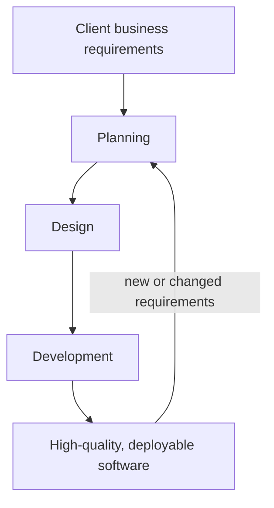
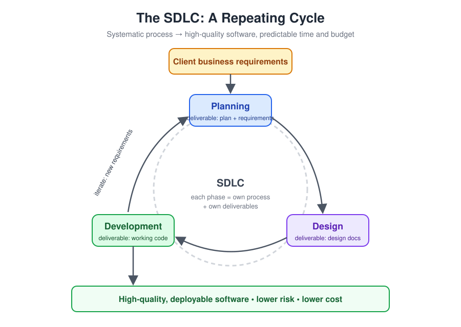
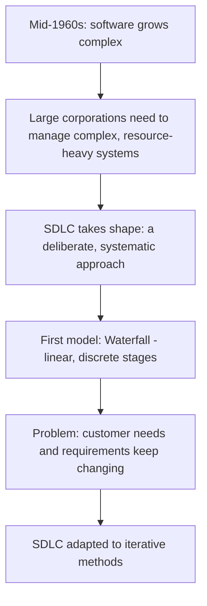
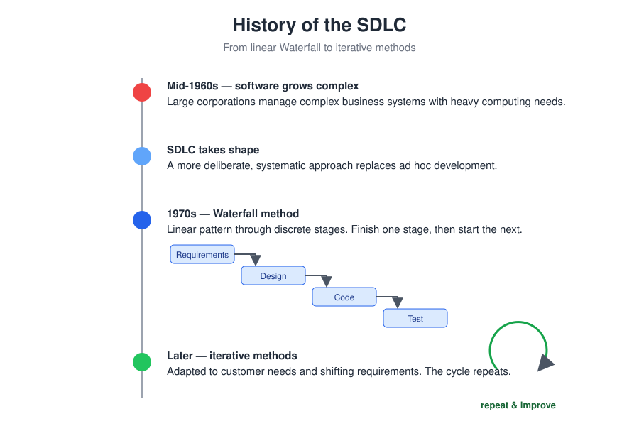
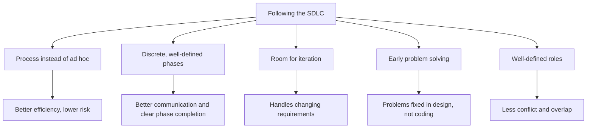
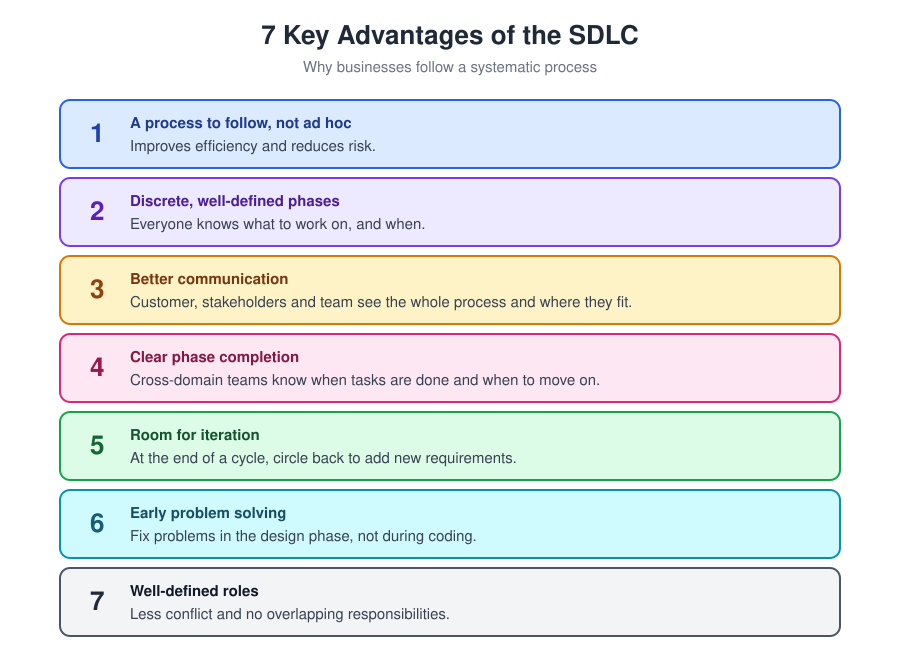

# 02 — Introduction to the Software Development Life Cycle (SDLC)

**Learning goals of this lecture:**

- Describe what the **SDLC (Software Development Life Cycle)** is.
- Explain the **history** of the SDLC.
- Discuss the **key advantages** of using the SDLC.

---

## 1. Jargon Translation

| Term | Official Definition | Simple Words | Analogy |
|------|--------------------|--------------|---------|
| **SDLC (Software Development Life Cycle)** | A systematic process to develop high-quality software in a predictable timeframe and budget. | A fixed set of steps that a team follows to build software, from the first idea to the finished product. | A recipe for a big wedding cake: plan it, design it, bake it, check it, deliver it — always in a known order. |
| **Systematic process** | A method made of ordered, repeatable steps. | You always know the next step, and you can repeat the same steps on the next project. | Following the steps of a washing machine program: wash → rinse → spin. |
| **Predictable timeframe and budget** | The time and money needed can be estimated in advance and are likely to be correct. | You know roughly **when** the software will be ready and **how much** it will cost. | A taxi with a fixed price before the trip starts. |
| **Business requirements** | The needs and goals the client's business expects the software to meet. | What the customer actually needs the software to do. | A shopping list the customer gives you before you go to the shop. |
| **Phase** | A distinct stage of the SDLC that has its own process and its own deliverables. | One clear stage of the work, with a clear start and a clear end. | One floor of a building: you finish the foundation before you build the walls. |
| **Deliverable** | A concrete output (document, design, code, test report) produced at the end of a phase. | The "thing" you hand over when a stage is done. | A homework sheet you hand to the teacher at the end of a lesson. |
| **Iterative approach** | A way of working where the same cycle is repeated many times, each time improving the product. | You go round the cycle again and again, adding or fixing things each time. | Painting a wall in several coats; each coat makes it better. |
| **Waterfall method** | A linear development model where work flows through discrete stages one after another, without going back. | Do step 1 fully, then step 2 fully, then step 3 — no going back. | Water falling down steps: it only flows down, never up. |
| **Linear pattern** | A sequence that moves in one straight direction. | A straight line from start to end. | A train on a single track from station A to station Z. |
| **Discrete stages / phases** | Stages that are separate and clearly bounded. | Each stage is its own box, with clear edges. | Chapters in a book. |
| **Ad hoc approach** | Working without a formal plan, solving problems only when they appear. | "Making it up as you go." | Cooking dinner by opening the fridge and guessing. |
| **Stakeholder** | Any person or group that has an interest in, or is affected by, the project. | Everyone who cares about the result: client, users, managers, developers, testers. | Everyone involved in a wedding: the couple, the families, the caterer, the photographer. |
| **Cross-domain team** | A group made of people from different specialties (design, development, testing, operations). | A team with different kinds of experts. | A hospital team: surgeon, nurse, anesthetist, each with a different job. |
| **Deployable software** | Software that is ready to be installed and run in the real (production) environment. | Software that is ready to "go live" for real users. | A car that has passed every safety test and can now be sold. |
| **Computational resources** | Processing power, memory and storage needed to run software. | How much "computer muscle" the software needs. | The engine size a truck needs to pull a heavy load. |

---

## 2. Topics Introduced in the Lecture Transcript

1. **Definition of the SDLC** — a systematic process for high-quality software in a predictable timeframe and budget.
2. **Goal of the SDLC** — produce software that meets the client's business requirements.
3. **Structure of the SDLC** — phases, each with its own process and deliverables; a cycle of planning, design and development.
4. **Iteration** — the SDLC can be used as an iterative approach.
5. **Risk and cost reduction** — following the SDLC minimizes risks and costs.
6. **History of the SDLC** — started in the mid-1960s because software became more complex; large corporations needed to manage complex, resource-heavy business systems.
7. **The Waterfall method** — the first SDLC approach: linear and stage-by-stage.
8. **Move to iterative methods** — the SDLC adapted to changing customer needs and shifting requirements.
9. **Key advantages of the SDLC** — a process instead of ad hoc work, discrete well-defined phases, better communication, clear phase completion, room for iteration, early problem solving, well-defined roles.
10. **Lecture summary** — systematic process, history in the 1960s–70s, and the list of key advantages.

---

## 3. Exhaustive Deep Dive

### 3.1 What is the SDLC?

- **Official definition:** The **SDLC (Software Development Life Cycle)** is a **systematic process** to develop **high-quality software** in a **predictable timeframe and budget**.
- Break the definition into its three promises:

  | Promise | What it means | Why it matters |
  |---------|---------------|----------------|
  | **Systematic process** | Ordered, repeatable steps. | Teams do not depend on luck or on one "hero" developer. |
  | **High-quality software** | Software that works correctly, is tested, and is maintainable. | Fewer bugs reach real users. |
  | **Predictable timeframe and budget** | Time and cost can be estimated early. | The client can plan money, marketing and launch dates. |

- **The goal of the SDLC:** produce software that **meets the client's business requirements**.
  - Quality alone is not enough. Beautiful code that solves the **wrong** problem is a failure.
  - So the SDLC starts with understanding **what the client needs**, and every later phase is checked against those needs.

### 3.2 How the SDLC is structured

- **Phases:** The SDLC defines **phases** of the software development process.
  - Each phase has **its own process** (how the work is done) and **its own deliverables** (what is handed over at the end).
  - Example deliverables: a requirements document, a design document, source code, a test report.
  - (The individual phases are covered in a later video.)
- **A cycle:** The SDLC is a **cycle of planning, design, and development**.
  - It is called a **life cycle** because, after one round ends, the process can **start again** for the next version.
- **Iterative use:** The cycle **can be implemented as an iterative approach** to software development.
  - **Iteration** = repeat the cycle many times. Each loop adds features or fixes problems.
- **Risk and cost:** **Adherence to** (strictly following) the SDLC **minimizes risks and costs** of building high-quality, **deployable** software.
  - **Under the hood — why:** Each phase ends with a check. Mistakes are caught at the phase where they happen, before they spread to later work.





### 3.3 History of the SDLC

#### 3.3.1 Why it appeared (mid-1960s)

- The SDLC **began to take shape in the mid-1960s**.
- **Cause:** software was becoming **more complex**, so development **needed a more detailed approach**.
- **Who pushed for it:** **large corporations**.
  - They had to manage **complex business systems** (for example payroll, banking, inventory).
  - These systems needed **heavy computational resources** — computers were very expensive, so mistakes and wasted computer time cost a lot of money.
- **Result:** the SDLC led to a **more deliberate approach** (careful and planned, not rushed).
- **Link to Lecture 01:** this is the same period as the **software crisis** (mid-1960s to mid-1980s). The SDLC was one of the answers to that crisis.

#### 3.3.2 First approach: the Waterfall method

- In its **initial conception** (first version), the SDLC used the **"waterfall method"** to manage projects.
- **How it works:** development follows a **linear pattern** through **discrete stages**.
  - Stage 1 must be fully finished before stage 2 starts.
  - There is normally **no going back** to an earlier stage.
- **Why it was designed that way:** in the 1960s–70s, changing a program was slow and expensive (punch cards, shared mainframes). So it made sense to plan everything fully **before** writing code.
- **Weakness:** if the customer changes their mind late in the project, the linear flow makes change very costly.

#### 3.3.3 Adaptation to iterative methods

- The SDLC **has since been adapted** to **more iterative methods**.
- **Why:** to respond to
  - **customer needs** (customers want to see working software early and give feedback), and
  - **shifting requirements** (business needs change while the project is running).
- Waterfall and other approaches (for example **Agile**, V-shape, Spiral) are covered in another lesson.



> ⚠️ **Correction:** The transcript says the SDLC "began to take shape in the mid-1960s", but the summary says its development was "in the 60s and 70s" → Both are true together: the ideas **started** in the mid-1960s and **matured** through the 1970s. The name **"waterfall"** itself only appeared later — Winston Royce described a staged model in **1970**, and the word "waterfall" was used for it around **1976**. Royce actually warned that a purely linear flow is **risky** and suggested feedback loops between stages.



### 3.4 Key Advantages of the SDLC

The lecture lists these advantages for businesses that follow the SDLC:

#### 3.4.1 A process to follow (instead of ad hoc)

- Teams get **a process to follow** rather than an **ad hoc approach**.
- **Benefits:** it **improves efficiency** and **reduces risks**.
- **Why:** people do not waste time deciding "what do we do next?". Known steps mean known risks.

#### 3.4.2 Discrete, well-defined phases

- The SDLC has **discrete phases**, and **each phase is well defined**.
- **Benefit:** team members **know what they should be working on and when**.

#### 3.4.3 Better communication with customers and stakeholders

- Because the phases are well defined, the SDLC **facilitates communication** between:
  - the **customer**,
  - **other stakeholders**, and
  - the **development team**.
- The SDLC gives **an overview of the whole process**, so **stakeholders know where they fit into that process**.
  - Example: the client knows they are needed most during requirements and final acceptance; the testers know when their work begins.

#### 3.4.4 Clear completion of each phase

- Since **each phase is discrete**, **cross-domain teams know when they have completed their tasks**.
- They also know **when development can move to the next phase**.
- **Under the hood:** each phase has an **exit condition** (for example "requirements document signed by the client"). Meeting it is the signal to move on.

#### 3.4.5 Room for iteration

- The SDLC **provides room for iteration**.
- **At the end of a cycle**, the process can **circle back** to include **additional requirements as needed**.

#### 3.4.6 Early problem solving

- **Problem solving is built into the early part of the cycle**, so problems are **addressed in a timely fashion**.
- Problems can be fixed **in the design phase rather than during coding**.
- **Why this matters:** a mistake fixed on paper (in a design) costs minutes. The same mistake found after the code is written — or after release — can cost days of rework.

#### 3.4.7 Well-defined roles

- **Each team member has a well-defined role**.
- **Benefit:** this **reduces conflict** and **overlapping responsibilities** (two people doing the same job, or nobody doing a job).

| # | Advantage | Problem it solves |
|---|-----------|-------------------|
| 1 | A process, not ad hoc work | Wasted effort, high risk |
| 2 | Discrete, well-defined phases | "What should I work on now?" |
| 3 | Better communication | Stakeholders do not know where they fit |
| 4 | Clear phase completion | Unclear when to move on |
| 5 | Room for iteration | Cannot handle new requirements |
| 6 | Early problem solving | Expensive fixes during coding |
| 7 | Well-defined roles | Conflict and overlapping work |





> ⚠️ **Correction:** The lecture presents "each phase is discrete" as a pure advantage → In modern iterative and Agile work, phases often **overlap** (for example, testing runs at the same time as coding in CI/CD (Continuous Integration / Continuous Delivery) pipelines). Strict boundaries help with clarity, but very rigid phases can slow a team down. The benefit is **clear responsibilities and exit criteria**, not a ban on overlap.

### 3.5 Lecture Summary

- The SDLC provides a **systematic process** for software development.
- Its **initial development in the 1960s and 1970s** was driven by the **growing complexity of software**.
- **Key advantages:**
  - A **roadmap** to the software development process → **reduces risk** and **improves efficiency**.
  - **Increased communication** between the team and stakeholders.
  - **Clearly defined and understood responsibilities** for each team member.
  - It can be **used iteratively**, allowing for **changing requirements**.

---

## 4. Concrete Examples

| Situation | Without the SDLC (ad hoc) | With the SDLC |
|-----------|---------------------------|---------------|
| **Book Review API (course project)** | A developer starts writing Express routes on day one. Halfway through, the client says reviews need star ratings and user login. Many routes are rewritten. | Planning lists the requirements (books, reviews, ratings, users). Design defines the endpoints and the database schema first. Coding follows the design. |
| **Changing requirements** | A new request ("add search by author") arrives and nobody knows who should handle it. | The request goes into the next **iteration**. The cycle circles back to planning. |
| **Bug in the data model** | Found after deployment; data must be migrated in production. | Found in the **design review**, fixed in a diagram in 10 minutes. |
| **Roles** | Two developers both build the login system; nobody writes tests. | The roles are clear: one backend developer owns authentication, one QA (Quality Assurance) engineer owns tests. |
| **1960s bank** | Payroll software is written with no plan; it wastes expensive mainframe time and is late. | A staged, deliberate plan (early Waterfall) keeps cost and timing predictable. |

---

## 5. Code Blocks

### 5.1 Design first: an API contract written before coding

The SDLC says problems should be solved **in the design phase rather than during coding**. A simple way to do this in backend work is to write the **API contract** (the list of endpoints and data shapes) before writing Express code.

```json
{
  "resource": "reviews",
  "endpoints": [
    { "method": "GET",    "path": "/books/:isbn/reviews", "auth": false },
    { "method": "PUT",    "path": "/books/:isbn/reviews", "auth": true  },
    { "method": "DELETE", "path": "/books/:isbn/reviews", "auth": true  }
  ],
  "reviewShape": { "username": "string", "rating": "integer 1-5", "text": "string" }
}
```

Then the code in the **development phase** follows the design exactly:

```javascript
// Development phase: implement exactly what the design contract says
const express = require('express');
const app = express();
app.use(express.json()); // parse JSON request bodies

const reviews = {}; // in-memory store: { isbn: { username: review } }

// GET /books/:isbn/reviews — public, as defined in the design (auth: false)
app.get('/books/:isbn/reviews', (req, res) => {
  res.json(reviews[req.params.isbn] || {}); // return empty object if no reviews
});

// PUT /books/:isbn/reviews — requires a user, as defined in the design (auth: true)
app.put('/books/:isbn/reviews', (req, res) => {
  const user = req.header('x-user'); // simplified auth for this example
  if (!user) return res.status(401).json({ error: 'Login required' });

  const { rating, text } = req.body;
  // Validation rule comes straight from the design: rating is an integer 1-5
  if (!Number.isInteger(rating) || rating < 1 || rating > 5) {
    return res.status(400).json({ error: 'rating must be an integer from 1 to 5' });
  }

  reviews[req.params.isbn] = reviews[req.params.isbn] || {};
  reviews[req.params.isbn][user] = { username: user, rating, text };
  res.status(200).json(reviews[req.params.isbn][user]);
});

app.listen(3000, () => console.log('Book Review API on port 3000'));
```

**What happens if... you skip the design phase?**

```javascript
// ❌ Ad hoc: no contract, so each developer guesses the data shape
app.put('/books/:isbn/reviews', (req, res) => {
  // Developer A stores "stars", Developer B's frontend sends "rating".
  // There is no validation, so { stars: "great!!" } is accepted.
  reviews[req.params.isbn] = req.body; // also overwrites every other user's review!
  res.send('ok');
});
// The mismatch is found only during testing or by real users —
// the expensive "fix during coding / after release" case the SDLC tries to avoid.
```

---

## 6. Related Concepts

1. **SDLC Phases** — Planning, Design, Development, Testing, Deployment, Maintenance. This lecture introduces the cycle; the next lecture explains each phase and its deliverables.
2. **Waterfall vs. Agile** — Waterfall is the original linear SDLC model; Agile is the most common iterative model today. Both are covered in a later lesson.
3. **SRS (Software Requirements Specification)** — the main deliverable of the planning/requirements phase. It writes down the client's business requirements that the SDLC aims to meet.
4. **CI/CD (Continuous Integration / Continuous Delivery)** — automates the build–test–deploy part of the cycle, so iterations can happen many times per day instead of once per year.
5. **Software Crisis (Lecture 01)** — the problems of the mid-1960s (late, over-budget, buggy software) that the SDLC was created to solve.
