# 03 — Phases of the Software Development Life Cycle (SDLC)

**Learning goals of this lecture:**

- **Name** the phases involved in the SDLC (Software Development Life Cycle).
- **Describe** each phase.
- **Identify** several tasks associated with each phase.

---

## 1. Jargon Translation

| Term | Official Definition | Simple Words | Analogy |
|------|--------------------|--------------|---------|
| **Phase** | A distinct stage of the SDLC with its own tasks and its own output (deliverable). | One clear stage of the work, with a start and an end. | One stage of building a house: plan, draw, build, inspect, move in, repair. |
| **Discrete (phase)** | Separate and clearly bounded; the tasks of one phase do not overlap with the tasks of the next. | Each phase is its own box. You finish one box before you open the next. | Courses of a dinner: starter, main, dessert — served one after another. |
| **Waterfall method** | A linear SDLC model where each phase is finished before the next phase starts, with no going back. | Step 1 fully, then step 2 fully — only forward. | Water falling down steps: it flows down, never up. |
| **Iteration** | Repeating the cycle (or part of it) many times, improving the product each time. | Go round again to add or fix things. | Painting a wall in several coats. |
| **Requirement** | A documented need: something the software must do, or a quality it must have. | A "must have" from the customer. | One item on a shopping list. |
| **Requirements gathering** | Collecting needs from stakeholders through interviews, workshops, surveys and observation. | Asking everyone what the software must do. | A wedding planner asking the couple what they want. |
| **Stakeholder** | Any person or group with an interest in, or affected by, the project. | Everyone who cares about the result: client, users, managers, developers, testers. | Everyone involved in a wedding. |
| **Regulatory compliance** | Following laws and industry rules that apply to the software (for example data-privacy laws). | Obeying the legal rules for your type of software. | A restaurant following food-safety laws. |
| **Risk identification** | Finding events that could harm the project before they happen. | Listing "what could go wrong?" early. | Checking the weather before a trip. |
| **QA (Quality Assurance)** | The set of activities that make sure the product meets agreed quality standards. | The rules and checks that keep quality high. | A factory's quality-check rules. |
| **Prototype** | A small-scale replica or preliminary mock-up of the product (or part of it), used for demonstration and feedback. | A quick, rough model of the software to show people. | A cardboard model of a building before the real one is built. |
| **SRS (Software Requirements Specification)** | A document that combines all gathered requirements; it must be understood and approved by all stakeholders. | The official "what we will build" document. | A signed contract with the builder listing every room. |
| **Software architecture** | The high-level structure of a system: its parts, how they connect, and the rules for how they work together. | The big-picture plan of the software's parts. | The architect's floor plan of a house. |
| **Design document** | The document created in the design phase that describes the architecture; developers use it to write code. | The "how we will build it" document. | The detailed construction drawings. |
| **Software stack** | The set of technologies used together to build and run an application. | The group of tools that work together. Example: MongoDB + Express + React + Node.js (MERN). | A kitchen set: oven, pans, knives — used together for one meal. |
| **Bug** | An error in software that makes it behave in a wrong or unexpected way. | A mistake in the code. | A typo in a printed book. |
| **Unit testing** | Testing the smallest pieces of code (functions, modules) on their own. | Check each small part alone. | Testing each light bulb before installing it. |
| **Integration testing** | Testing that separate parts work correctly together. | Check that the parts talk to each other correctly. | Checking that the bulb works when connected to the switch and the wires. |
| **System testing** | Testing the whole, complete system against the requirements. | Check the whole product end to end. | Turning on every light in the finished house. |
| **Acceptance testing** | Testing by (or for) the customer to decide if the software is acceptable. | The customer checks: "Is this what I asked for?" | The house owner's final walk-through before paying. |
| **Production environment** | The live environment where real users use the software. | The "real world" version of the app. | The shop open to the public (not the training room). |
| **UAT (User Acceptance Testing) platform** | A separate environment, like production, where the customer tests the software before it goes live. | A practice copy of the live system for the customer to check. | A dress rehearsal before opening night. |
| **Sign-off** | The formal approval from the customer that the work is accepted. | The customer says "Yes, this is approved." | Signing the delivery receipt. |
| **UI (User Interface)** | The part of the software that users see and interact with: screens, buttons, forms. | What the user sees and clicks. | The dashboard and buttons of a car. |
| **Enhancement** | An improvement to existing software (new feature or better behavior), not a bug fix. | Making something good even better. | Adding a new shelf to a kitchen that already works. |
| **Release** | A version of the software made available to users. | A new version that users get. | A new edition of a book. |

---

## 2. Topics Introduced in the Lecture Transcript

1. **Learning goals** — name the phases, describe each phase, identify tasks in each phase.
2. **The six SDLC phases** — planning, design, development, testing, deployment, maintenance.
3. **Discrete phases** — tasks from one phase do not overlap with the next.
4. **Origin as Waterfall and later iteration** — the original SDLC was linear; it was adapted to add iteration for shifting requirements.
5. **Different names and numbers of stages** — "planning" may be called "requirements", "strategy" or "analysis"; some organizations have more or fewer stages.
6. **Planning phase** — gather, analyze, document and prioritize requirements; eight factors to consider; cost estimation; team and role proposal.
7. **Prototyping** — used when stakeholders struggle to define requirements; can happen in any phase.
8. **SRS (Software Requirements Specification)** — combines requirements; approved by all stakeholders; developers are involved.
9. **Design phase** — architecture built from the SRS; reviewed by stakeholders and team; prototypes; the design document.
10. **Development phase** — also called "building" or "implementation"; coding tasks assigned from the design document; tools, languages, stacks, standards.
11. **Testing phase** — dedicated testing teams; stable, secure, meets the SRS; manual, automated or hybrid; bug cycle; four testing levels.
12. **Deployment phase** — release to production; staged release through a UAT platform and customer sign-off; websites, app stores, corporate distribution servers.
13. **Maintenance phase** — find remaining bugs, UI issues, missing requirements, enhancements; fix high-priority bugs or add them to a future release; the cycle starts again.
14. **Lecture summary** — the six phases and their key outputs, feeding into the next cycle.

---

## 3. Exhaustive Deep Dive

### 3.1 Overview: The Six Phases

- There are **generally six phases** in the SDLC process:

  | # | Phase | Main question | Main output (deliverable) |
  |---|-------|---------------|---------------------------|
  | 1 | **Planning** | *What* must we build, for whom, with what money and time? | **SRS (Software Requirements Specification)** |
  | 2 | **Design** | *How* will the system be structured? | **Design document** (software architecture) |
  | 3 | **Development** | Write the code. | Working source code |
  | 4 | **Testing** | Does it work, is it secure, does it match the SRS? | Stable, tested software + bug reports |
  | 5 | **Deployment** | Release it to users. | Software running in **production** |
  | 6 | **Maintenance** | What is still wrong or missing? | Fixes, enhancements, new requirements for the next cycle |

- **Each phase is discrete.**
  - This means the **tasks from a previous phase do not overlap** with the tasks in the next phase.
  - **Why:** clear boundaries tell each team **what** to work on, **when** a phase is finished, and **who** is responsible.

#### 3.1.1 From Waterfall to iteration

- The **original SDLC** was conceived as a **traditional Waterfall method**: the phases are **linear** (one after another, no going back).
- It has **since been adapted** to **introduce iteration**.
  - **Why:** so that **shifting requirements** (needs that change during the project) **can be accommodated**.
  - With iteration, the team can loop back from a later phase to an earlier one, or run the whole cycle many times in small steps.
- Waterfall and other approaches are discussed in another video.

#### 3.1.2 Different names, different numbers of stages

- **Some organizations use different names** for each stage.
  - Example: **"planning"** may be called **"requirements"**, **"strategy"** or **"analysis"**.
- **Some organizations have additional or fewer stages.**
  - Example of more stages: some split planning into "feasibility study" + "requirements analysis".
  - Example of fewer stages: some merge testing and deployment into one "release" stage.
- **Key point:** the names can change, but the **flow of work** (decide → design → build → check → release → improve) stays the same.

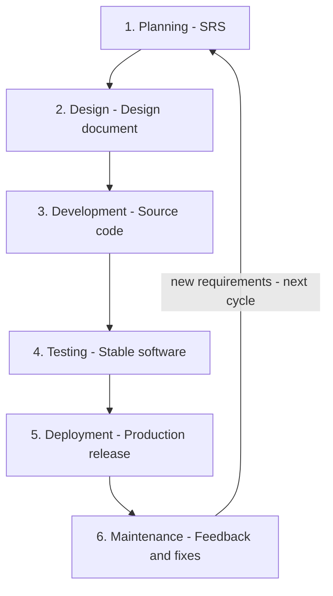

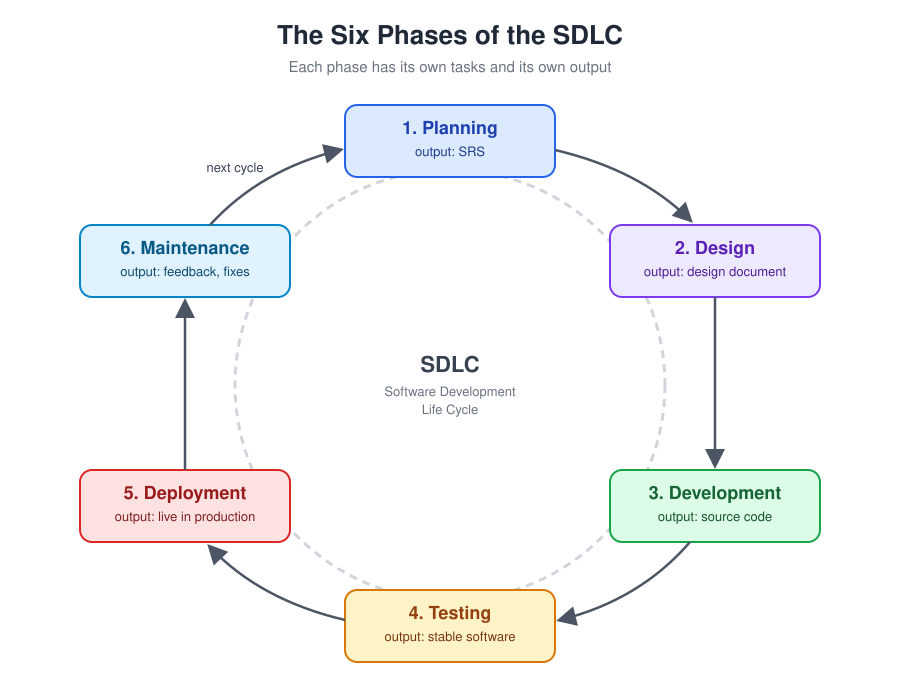

#### 3.1.3 ✅ Modern Best Practice: phases overlap and repeat in short loops

> **Lecture says:** phases are discrete; tasks from one phase do not overlap with the next.
> **Industry today:** this is true only for **strict Waterfall**. The lecture itself later says **prototyping can happen in any phase**. Modern teams treat the six phases as **types of work**, not as walls.

- **How modern teams run the SDLC:**
  - **Small slices, not one big project.** The team picks a few features, then plans, designs, builds, tests and releases **only those**. This takes days or 1–4 weeks (an **Agile sprint**), not months.
  - **Phases overlap on purpose.**
    - Tests are written **while** coding (or before it).
    - Design is refined **during** development when new facts appear.
    - Deployment happens **many times** a day through a **CI/CD (Continuous Integration / Continuous Delivery) pipeline**.
  - **What stays from the lecture:** every type of work still has a **clear output** and a clear **owner**, and a step is done only when it meets its **"Definition of Done"** (an agreed checklist, for example "code reviewed, tests pass, docs updated").
- **Why the industry changed:** requirements change all the time. If you find out in month 6 that a requirement was wrong, the fix is very expensive. With small loops, you learn the same thing in week 1, when the fix is cheap.

| | Strict Waterfall (lecture model) | Modern iterative / DevOps |
|---|---|---|
| **Order** | One pass, in a line | Many short loops |
| **Overlap** | None | Planned overlap (test while coding) |
| **Release** | Once, at the end | Often — weekly, daily, or on every merge |
| **Feedback from users** | After the whole project | After every small release |
| **Cost of a wrong requirement** | Very high | Low |

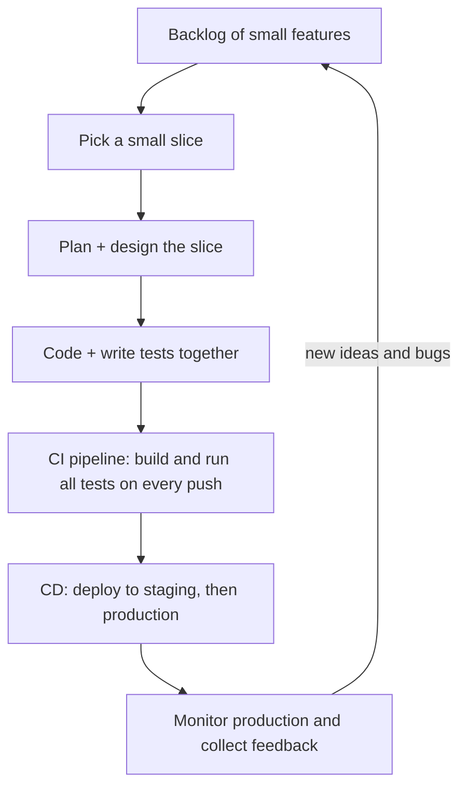

---

### 3.2 Phase 1 — Planning

- **What happens:** **requirements** are
  1. **gathered** (collected from stakeholders),
  2. **analyzed** (checked: are they clear, possible, not conflicting?),
  3. **documented** (written down), and
  4. **prioritized** (ordered by importance: "must have" first).
- **Why it is first:** every later phase depends on it. If the requirements are wrong, everything built on top of them is wrong.

#### 3.2.1 Factors to consider when planning a software solution

| # | Factor | Question it answers | Backend example |
|---|--------|---------------------|-----------------|
| 1 | **Users of the solution** | Who will use it? | Book readers, admins, other services calling the API. |
| 2 | **Overall purpose** | Why does it exist? What problem does it solve? | "Let users share and read book reviews." |
| 3 | **Data inputs and outputs** | What data goes in and comes out? | Input: review text + rating. Output: JSON list of reviews. |
| 4 | **Legal and regulatory compliance** | Which laws or rules apply? | GDPR (General Data Protection Regulation) for EU (European Union) users' personal data. |
| 5 | **Risk identification** | What could go wrong? | Database outage, data leak, key developer leaving. |
| 6 | **QA (Quality Assurance) requirements** | What quality level is required? | "95% of requests answer in under 200 ms; 80% test coverage." |
| 7 | **Allocation of human and financial resources** | Who works on it, and how much money is there? | 3 developers, 1 tester, a budget for cloud hosting. |
| 8 | **Project scheduling** | When is each part due? | Design by week 2, first release by week 8. |

#### 3.2.2 Cost, time, teams and roles

- **Labor and material costs are estimated** and **weighed against time constraints**.
  - **Labor cost:** people's time (salaries, contractors).
  - **Material cost:** licenses, hardware, cloud services, tools.
  - **Weighed against time:** a faster deadline usually needs more people or less scope. This is a **trade-off**.
- **Project teams are identified**, and the **roles of each team member are proposed**.
  - Example roles: project manager, architect, backend developer, frontend developer, tester, DevOps engineer.
  - They are only **proposed** here; they may change as the project becomes clearer.

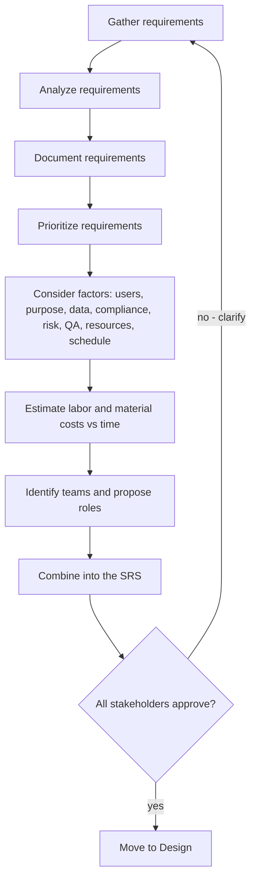

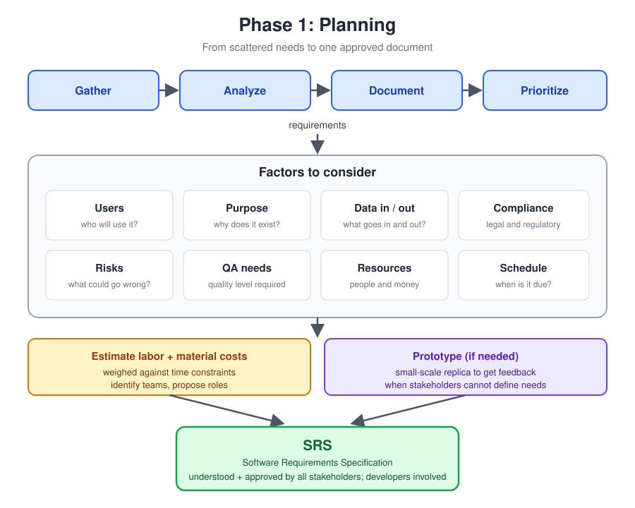

#### 3.2.3 Prototypes in the planning phase

- **When:** if **stakeholders are struggling to define requirements**, the development team may **produce prototypes** during planning to **tease out** (slowly draw out) those requirements.
- **Definition:** a **prototype** is a **small-scale replica of the end product** used to:
  - **get stakeholder feedback**, and
  - **establish requirements**.
- A prototype is used to **test basic design ideas**.
- **Why it works:** people find it hard to describe software in words, but easy to react to something they can see: "No, the button should be here", "I also need a search box".
- **Not only in planning:** prototyping **usually** occurs in the planning stage, but it **can occur at various phases** of the SDLC **whenever requirements need to be reconsidered or clarified** as the project develops.
- **Types of prototypes** (expert addition):

  | Type | What it is | What happens to it |
  |------|-----------|--------------------|
  | **Throwaway** | Quick sketch or clickable mock-up. | Thrown away after feedback. |
  | **Evolutionary** | A rough but real first version. | Improved step by step into the final product. |

#### 3.2.4 The SRS (Software Requirements Specification)

- **After requirements are gathered**, they are **combined into one document**: the **SRS (Software Requirements Specification)**.
- **Rules for the SRS:**
  - It must be **clearly understood** by **all stakeholders**.
  - It must be **approved by all stakeholders**.
  - **Developers are also involved** at this stage, so they **gain a clear understanding** of the requirements.
    - **Why involve developers early:** they can spot requirements that are impossible, too expensive, or unclear — before any code is written.
- Requirements and the SRS are discussed in more detail in a later video.

#### 3.2.5 ✅ Modern Best Practice: living requirements

> **Lecture says:** gather all requirements first, combine them into one SRS, get it approved, then move on.
> **Industry today:** a full SRS is still used where the rules demand it (banking, medical, government contracts). Most product teams instead keep **living requirements** that grow and change during the project.

- **User stories** instead of one big document.
  - Format: *"As a **[user]**, I want **[goal]**, so that **[reason]**."*
  - Example: *"As a reader, I want to rate a book from 1 to 5, so that other readers can see if it is good."*
- **Acceptance criteria** on every story: clear yes/no checks, so testers and developers agree on what "done" means (see the JSON in [5.1](#51-from-an-srs-requirement-to-code)).
- **A prioritized backlog:** an ordered list of stories, "most valuable first". The team reorders it whenever priorities change.
- **Security and privacy from day one** ("**secure by design**"): the risk and compliance factors from 3.2.1 are written as real requirements (for example *"passwords are hashed with bcrypt or argon2"*) and checked against threat lists such as the **OWASP (Open Web Application Security Project) Top 10**.
- **Measurable quality targets:** write QA requirements as numbers, not wishes. An **SLO (Service Level Objective)** looks like *"99.9% of requests succeed; 95% answer in under 200 ms"*.
- **Cheap prototypes:** clickable mock-ups in tools like Figma, or a quick AI-generated sketch app, used to get feedback within days and then thrown away.

---

### 3.3 Phase 2 — Design

- **Input:** the **requirements gathered in the SRS**.
- **What happens:** the requirements are used to **develop the software architecture**.
  - **Several team members work together** to design the architecture (for example the architect, senior developers, a database expert, a security expert).
  - The **architecture is reviewed by the stakeholders and the team**.
    - **Why review:** a mistake found in a diagram costs minutes to fix; the same mistake found in code costs days.
- **Prototypes can be designed** in this phase too.
  - Here, a **prototype** is described as a **preliminary mock-up of the system, or parts of the system, used for demonstration purposes**.
- **Output:** the **design document**.
  - It is used by **developers during the next phase** — the development phase.
- **What a backend design document usually contains** (expert addition):
  - The main components (API server, database, cache, message queue).
  - API endpoints and data formats.
  - The database schema (tables or collections and their fields).
  - How the system will be secured, scaled and deployed.

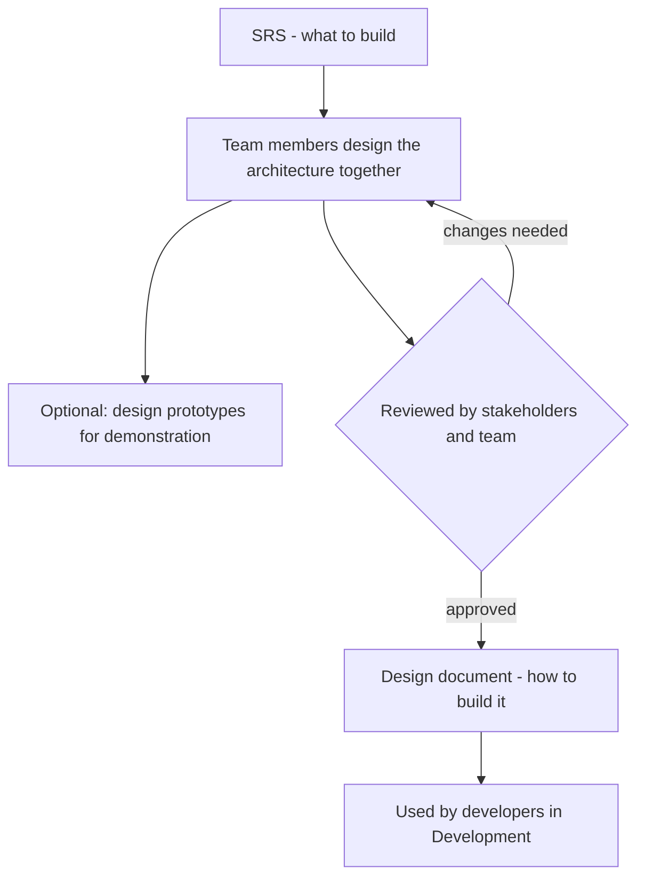

> ⚠️ **Correction:** The lecture defines a prototype twice — as a "small-scale replica of the end product" (planning) and as a "preliminary mock-up of the system, or parts of the system" (design) → These are **the same idea used for different goals**. In planning, the prototype helps **find out what** users need. In design, it helps **show and test how** a part of the system will work. A prototype is **not** a small finished product; it is usually incomplete and not production quality.
> **Lecture wording (for the quiz):** "small-scale replica of the end product"; "preliminary mock-up of the system, or parts of the system" *(wording as recorded when this note was written; module 1 predates saved transcripts, so not re-checked against the video)*

#### 3.3.1 ✅ Modern Best Practice: lightweight, versioned design

> **Lecture says:** the design phase produces one design document, then developers start coding.
> **Industry today:** design is done **before** coding, but in **small, versioned documents** kept next to the code, and it is updated as the system changes.

- **API-first design:** write the API contract first as an **OpenAPI** file (a standard YAML/JSON format for REST APIs). Frontend and backend teams can then work in parallel, and tools can create docs, mock servers and tests from that file.
- **ADRs (Architecture Decision Records):** short files (often one page) in the Git repository. Each ADR records one decision: *what* was chosen, *why*, and *what other options were rejected*. Future developers can see why the system looks the way it does.
- **Design review through pull requests:** the design document is a Markdown file in Git, and the team reviews it the same way it reviews code.
- **Threat modeling:** for each new feature, ask "how could an attacker abuse this?" and add the protections to the design.
- **Design for operations:** plan logging, metrics, health checks and configuration (with **environment variables**, never hard-coded secrets) at design time, not after release.

```yaml
# openapi.yaml — design-phase contract for one endpoint (API-first)
openapi: 3.1.0
info: { title: Book Review API, version: 1.0.0 }
paths:
  /books/{isbn}/reviews:
    post:
      summary: Add a review (REQ-07)
      security: [{ bearerAuth: [] }]        # login required
      parameters:
        - { name: isbn, in: path, required: true, schema: { type: string } }
      requestBody:
        required: true
        content:
          application/json:
            schema:
              type: object
              required: [rating]
              properties:
                rating: { type: integer, minimum: 1, maximum: 5 }
                text:   { type: string, maxLength: 2000 }
      responses:
        '201': { description: Review created }
        '400': { description: Invalid rating }
        '401': { description: Not logged in }
```

---

### 3.4 Phase 3 — Development

- **Other names:** the **"building" phase** or the **"implementation" phase**.
- **When it starts:** the developers **start coding once the design document is completed**.
- **How the work is split:** **project planners use the design document** to **determine and assign coding tasks**.
  - Example: one developer builds the `/reviews` endpoints, another builds user login, another builds the database layer.
- **What the developers need:**
  - **Programming tools** — code editors, IDEs (Integrated Development Environments), debuggers, Git.
  - **Different programming languages** — for example JavaScript for the server, SQL (Structured Query Language) for the database.
  - **Software stacks** — for example **MERN** (MongoDB, Express, React, Node.js).
- **Organization standards:** organizations **may have standards or guidelines** that must be followed.
  - Examples: a coding style guide, linting rules (ESLint), naming rules, code review before merging, security rules.
  - **Why:** many developers write code together; shared rules make the code look and behave the same, so anyone can read and fix it.

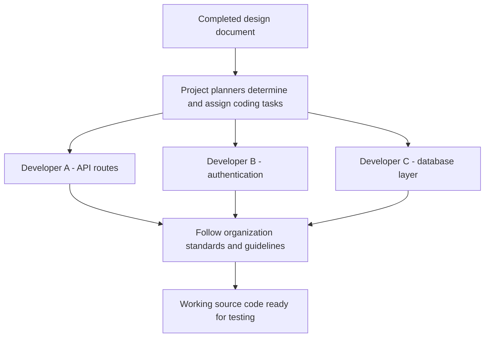

#### 3.4.1 ✅ Modern Best Practice: how code is written and merged today

> **Lecture says:** planners assign coding tasks from the design document; developers follow organization standards.
> **Industry today:** the same, plus **automated rules** check the standards on every change, so humans do not have to remember them.

- **Git workflow with small pull requests (PRs).**
  - Each task lives on a **short-lived branch**. It is merged into `main` within a day or two (**trunk-based development**).
  - Small PRs are easy to review and easy to undo.
- **Code review is required:** at least one other developer approves every PR before it is merged.
- **Standards are enforced by tools, not by memory:**
  - **Linter** (ESLint) and **formatter** (Prettier) run automatically.
  - **Type checking** (TypeScript or JSDoc types) catches wrong data shapes before the code runs.
  - **Branch protection:** GitHub blocks the merge if the CI checks fail.
- **Secure coding while building:**
  - No secrets in code — use environment variables or a secret manager.
  - **Dependency scanning** (`npm audit`, Dependabot) finds packages with known security holes.
  - Lock dependency versions with `package-lock.json`.
- **AI coding assistants** (for example Claude Code or GitHub Copilot) are now common tools in this phase. The rule: **the developer stays responsible**. AI-written code goes through the same review, tests and security checks as human code.

---

### 3.5 Phase 4 — Testing

- **When:** next in the process, **once the coding is complete**.
- **Who:** developers and testers. **Some large projects have dedicated testing teams** — QA (Quality Assurance) engineers whose only job is testing.
- **Goal:** code must be **thoroughly tested** to make sure it is:

  | Goal | Meaning | Backend example |
  |------|---------|-----------------|
  | **Stable** | Does not crash; works under normal and heavy use. | The API stays up with 1,000 users at once. |
  | **Secure** | Protects data; cannot be easily attacked. | No SQL injection; passwords are hashed. |
  | **Meets the SRS** | Does everything the requirements say. | Rating must be 1–5, as written in the SRS. |

- **How testing is done:**

  | Type | What it means | Strength | Weakness |
  |------|---------------|----------|----------|
  | **Manual** | A person uses the software and checks results. | Good for UI and "does this feel right?". | Slow, easy to forget steps. |
  | **Automated** | Code runs the tests (for example `node --test`, Jest). | Fast, repeatable, runs on every change. | Takes time to write; only checks what you wrote. |
  | **Hybrid** | A mix of both. | Uses the best of each. | Needs planning for which tests go where. |

#### 3.5.1 The bug cycle

- **Product bugs are reported, tracked and fixed**, and **code is retested until the software is stable**.
  - **Reported** — someone writes a bug report (steps to reproduce, expected result, actual result).
  - **Tracked** — the bug is stored in a tool (for example Jira or GitHub Issues) with a status.
  - **Fixed** — a developer changes the code.
  - **Retested** — the test runs again to prove the fix works and did not break anything else (**regression testing**).

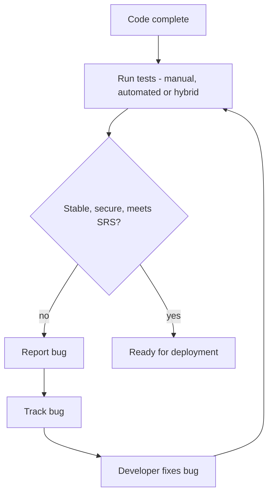

#### 3.5.2 Common levels of testing

- Some common **levels of testing** (each is described in more detail in another video):

| Level | What is tested | Example in a Node.js API |
|-------|----------------|--------------------------|
| **Unit testing** | One small piece alone (a function). | `isValidRating(6)` returns `false`. |
| **Integration testing** | Parts working together. | The route handler saves a review into the real database. |
| **System testing** | The whole system end to end. | Sign up → log in → post a review → read it back. |
| **Acceptance testing** | Does it meet the customer's needs? | The client checks the API against the SRS and accepts it. |

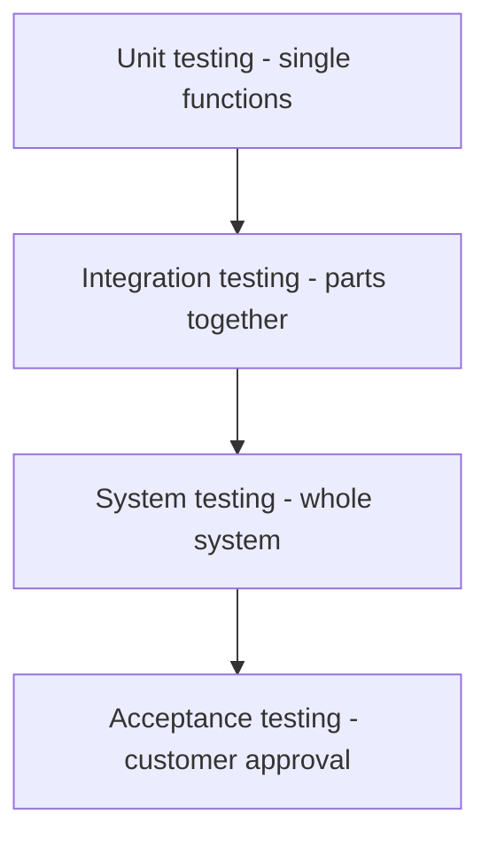

#### 3.5.3 ✅ Modern Best Practice: shift-left testing and the test pyramid

> **Lecture says:** testing comes "once the coding is complete".
> **Industry today:** testing **starts during development** and runs **continuously**. A separate stage still exists for system and acceptance testing, but most bugs are caught minutes after the code is written.

- **Shift-left testing:** move testing to the **left** (earlier) on the project timeline.
  - Developers write unit tests **while** coding.
  - In **TDD (Test-Driven Development)**, they write the test **before** the code:
    1. **Red** — write a test; it fails because the feature does not exist yet.
    2. **Green** — write the smallest code that makes the test pass.
    3. **Refactor** — clean the code; the test proves nothing broke.
- **CI (Continuous Integration):** a server (GitHub Actions, Azure Pipelines, Jenkins) builds the code and runs **all** automated tests on **every Git push and pull request**. A red build blocks the merge.
- **The test pyramid:** write **many** fast unit tests, **fewer** integration tests, and **only a few** slow end-to-end (system) tests.
- **Security testing is automated too** (**DevSecOps**):
  - **SAST (Static Application Security Testing):** scans source code for unsafe patterns.
  - **Dependency scanning:** finds vulnerable npm packages.
  - **DAST (Dynamic Application Security Testing):** attacks the running app in a test environment.
- **Shift-right testing:** some testing continues **in production** — monitoring, canary releases and feature flags (see 3.6.1 and 3.7.1).
- **Why:** a bug found by a unit test one minute after writing the code costs almost nothing to fix. The same bug found by a customer after release can cost a hotfix, lost data and lost trust.

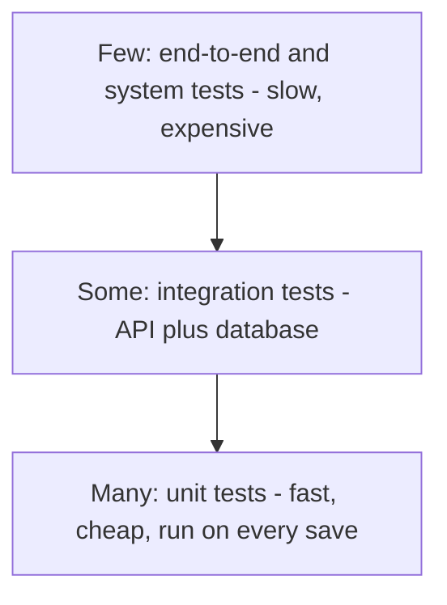

```yaml
# .github/workflows/ci.yml — runs the tests on every push and pull request
name: CI
on: [push, pull_request]
jobs:
  test:
    runs-on: ubuntu-latest
    steps:
      - uses: actions/checkout@v4          # get the code
      - uses: actions/setup-node@v4
        with: { node-version: 24 }         # a pinned, supported Node.js LTS (Long-Term Support) line
      - run: npm ci                        # clean install from package-lock.json
      - run: npm run lint                  # enforce coding standards
      - run: npm test                      # unit + integration tests
      - run: npm audit --audit-level=high  # fail on known high-risk packages
```

---

### 3.6 Phase 5 — Deployment

- **What happens:** the application is **released into the production environment** and **made available to users**.
- **Staged release:** deployment **can also happen in stages**:
  1. **First**, it is released onto a **UAT (User Acceptance Testing) platform**.
  2. The **customer tests** the functionality there.
  3. **Once the customer signs off** (approves) the functionality, it is **released to production**.
- **Why stage it:** the UAT platform looks like production but has no real users. Problems found there do not hurt real customers.
- **Where this approach can be used:**

  | Target | Example |
  |--------|---------|
  | **A website** | Deploying a new version of an Express app to a cloud server. |
  | **A mobile device app store** | Releasing an app to the Apple App Store or Google Play (often first to a beta-testing group). |
  | **A software distribution server on a corporate network** | An IT (information technology) team pushing a new internal tool to all company computers. |

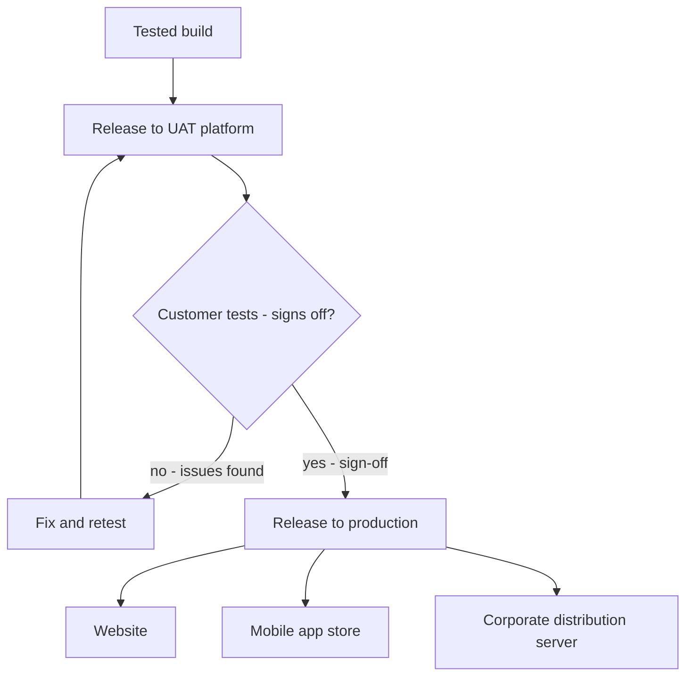

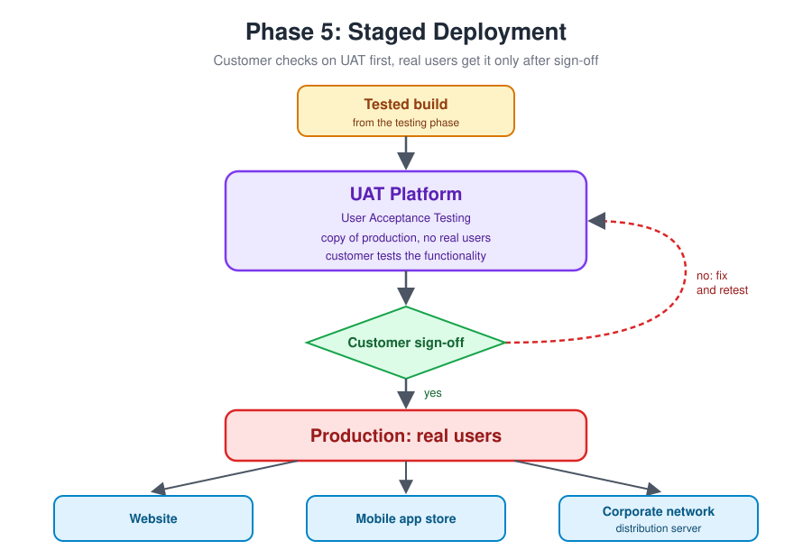

> ⚠️ **Correction:** The lecture lists "acceptance testing" in the testing phase and "UAT" in the deployment phase, which can look like two different things → They are the **same activity**: UAT **is** acceptance testing done by the customer, usually on a separate **UAT (or "staging") environment**. Many teams count it as the last step of testing.
> **Lecture wording (for the quiz):** "acceptance testing" *(wording as recorded when this note was written; module 1 predates saved transcripts, so not re-checked against the video)*

#### 3.6.1 ✅ Modern Best Practice: automated, low-risk releases

> **Lecture says:** release to a UAT platform, get customer sign-off, then release to production.
> **Industry today:** the same idea, but **automated** by a **CD (Continuous Delivery / Continuous Deployment) pipeline**, with more environments and safer ways to switch users to the new version.

- **Environments:** **development → test/CI → staging (UAT) → production**. Staging should match production as closely as possible.
- **Build once, promote everywhere:** build **one** versioned artifact (for example a Docker image tagged `1.4.0`) and move that **same** artifact through every environment (see [5.3](#53-deployment-phase-staged-release-uat-first-then-production)).
- **Continuous Delivery vs. Continuous Deployment:**

  | | Continuous Delivery | Continuous Deployment |
  |---|---|---|
  | **To staging** | Automatic | Automatic |
  | **To production** | One-click human approval (the "sign-off") | Automatic, if all checks pass |

- **Safe release strategies** — limit damage if something goes wrong:

  | Strategy | How it works | Benefit |
  |----------|--------------|---------|
  | **Rolling** | Replace servers one by one with the new version. | No downtime. |
  | **Blue-green** | Run old (blue) and new (green) side by side; switch all traffic at once. | Instant rollback: switch back to blue. |
  | **Canary** | Send a small share of users (for example 5%) to the new version first. | Problems hit only a few users. |
  | **Feature flags** | New code is deployed but hidden; turned on later with a setting. | Separate "deploy" from "release". |

- **Always have a rollback plan:** you must be able to return to the last good version in minutes.
- **Infrastructure as Code:** servers, Kubernetes manifests and config live in Git (for example Terraform, Helm), so every environment is created the same way.
- **Database migrations** are versioned scripts that run as part of the deployment and are written to be **backward compatible**, so old and new code can run at the same time.

---

### 3.7 Phase 6 — Maintenance

- **When:** **once the code has been deployed** into a production environment.
- **What this phase helps to do:**
  - **Find any other bugs** — real users find bugs that testing missed.
  - **Identify UI (User Interface) issues** — for example confusing screens or hard-to-find buttons.
  - **Identify other requirements** that **may not have been listed in the SRS**.
  - **Identify code enhancements** — improvements to make the software better.
- **What happens to bugs found in maintenance** (bugs that were **missed during testing**):

  | Bug priority | What happens |
  |--------------|--------------|
  | **High priority** (for example the payment page is broken) | **Fixed** now, often as a quick patch ("**hotfix**"). |
  | **Lower priority** (for example a small layout problem) | **Incorporated into the requirements** of a **future software release**. |

- **The cycle starts again:** the new requirements and enhancements feed into the next planning phase, and **the process can start over again**.
- **Expert addition — how backend teams find problems in maintenance:** logging, monitoring and alerts (for example Grafana dashboards), error tracking, and user feedback.

#### 3.7.1 ✅ Modern Best Practice: observability and continuous maintenance

> **Lecture says:** maintenance starts after deployment and finds bugs, UI issues, missing requirements and enhancements.
> **Industry today:** maintenance is **continuous and data-driven**. The team that builds the service also runs it ("**you build it, you run it**").

- **Observability — the three pillars:**

  | Pillar | What it is | Example tool |
  |--------|-----------|--------------|
  | **Logs** | Text records of events (structured as JSON). | Grafana Loki, ELK (Elasticsearch, Logstash, Kibana) |
  | **Metrics** | Numbers over time: request rate, error rate, latency. | Prometheus + Grafana |
  | **Traces** | The path of one request across many services. | OpenTelemetry, Jaeger |

- **Alerts on SLOs (Service Level Objectives):** the team gets alerted when users are actually hurt (for example the error rate goes above 1%), not on every small warning.
- **Incident management:** when production breaks — fix fast (rollback or **hotfix**), then write a **blameless postmortem** (what happened, why, and how to stop it happening again, without blaming people).
- **Security maintenance never stops:** update dependencies often (Dependabot / Renovate), patch known vulnerabilities (CVEs — Common Vulnerabilities and Exposures) quickly, and rotate secrets.
- **Technical debt:** reserve regular time in each iteration to clean up and refactor code, so the next change stays easy.
- **Product analytics and user feedback** feed new user stories into the **backlog**, which starts the next loop.

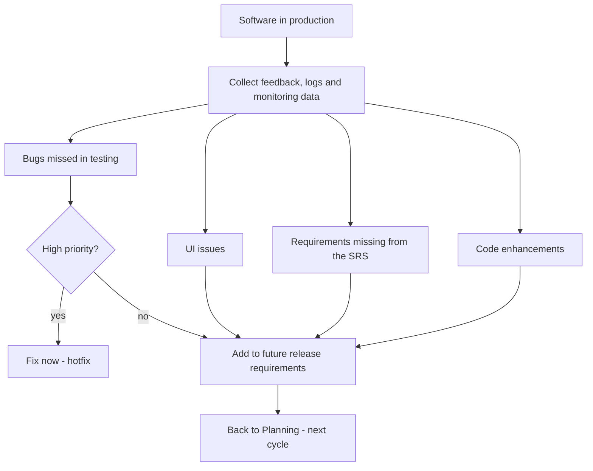

---

### 3.8 Lecture Summary

- The SDLC can be divided into **six phases**.
- **Planning** involves **requirement gathering** and development of the **SRS**.
- The **architecture** is developed during the **design phase**, and the **design document** is created.
- The **development phase** is when **coding** takes place.
- During the **testing phase**, **issues with the code are found and fixed if possible**.
- **Deployment** is when the code is **released to the production environment**.
- In the **maintenance stage**:
  - **feedback is collected from stakeholders**,
  - other **UI issues may be identified**, and
  - **code enhancements are suggested**.
- This information **can then be fed into another software development cycle** if necessary.

| Phase | Key activity (lecture) | Key output (lecture) | ✅ Modern best practice |
|-------|------------------------|----------------------|--------------------------|
| Planning | Gather, analyze, document, prioritize requirements | SRS | User stories + acceptance criteria in a living backlog; security and SLOs as requirements |
| Design | Build the architecture from the SRS | Design document | API-first (OpenAPI), ADRs in Git, threat modeling |
| Development | Write the code | Source code | Small PRs, code review, linters and types enforced by CI, AI code reviewed like human code |
| Testing | Find and fix bugs | Stable software | Shift-left: TDD, test pyramid, CI on every push, automated security scans |
| Deployment | Release to production (via UAT) | Live software | CD pipeline, build once and promote, canary / blue-green, rollback plan |
| Maintenance | Collect feedback, fix, enhance | Input for the next cycle | Observability (logs, metrics, traces), SLO alerts, blameless postmortems, dependency updates |

---

## 4. Concrete Examples

### 4.1 The Book Review API (course project) through all six phases

| Phase | What the team does |
|-------|--------------------|
| **Planning** | Users: readers and admins. Purpose: share reviews. Inputs: ISBN (International Standard Book Number), rating, text. Outputs: JSON. Compliance: protect users' emails. Risk: spam reviews. QA: every endpoint has automated tests. Resources: 2 developers, 6 weeks. The client finds it hard to explain the rating rules, so the team shows a **prototype** with a 5-star widget. All this goes into the **SRS**. |
| **Design** | The architecture: Express API + MongoDB + JWT (JSON Web Token) login. Endpoints and the `reviews` schema are written in the **design document** and reviewed by the client. |
| **Development** | The planner assigns tasks: Dev A builds `/books` routes, Dev B builds `/auth` and `/reviews`. Both follow the team's ESLint rules. |
| **Testing** | Unit tests check `isValidRating()`. Integration tests check that a review is saved in MongoDB. A bug — a user can delete someone else's review — is reported, tracked, fixed and retested. |
| **Deployment** | The API goes to a **UAT** server. The client tests it and signs off. Then it is released to production. |
| **Maintenance** | Logs show slow searches by author (enhancement → next release). A crash when the ISBN is missing is high priority → hotfixed now. |

### 4.2 Same phases, different names

| Generic name | Other names used by organizations |
|--------------|-----------------------------------|
| Planning | Requirements, Strategy, Analysis |
| Development | Building, Implementation |
| Deployment | Release, Go-live |

### 4.3 Mapping the phases to the tools in this course

| Phase | Tool or practice in the course |
|-------|-------------------------------|
| Planning | Agile user stories, backlog |
| Design | REST API design, database schemas |
| Development | Node.js, Express, Git & GitHub |
| Testing | Automated tests in a CI pipeline |
| Deployment | Docker, Kubernetes, OpenShift |
| Maintenance | Monitoring with Grafana, logs |

---

## 5. Code Blocks

### 5.1 From an SRS requirement to code

A requirement written in the **planning** phase becomes a rule in the **development** phase. Giving every requirement an ID makes it easy to check later (in **testing**) that each one was built.

```json
{
  "id": "REQ-07",
  "priority": "must-have",
  "text": "A logged-in user can add a review with a rating from 1 to 5.",
  "acceptanceCriteria": [
    "Rating below 1 or above 5 is rejected with HTTP 400",
    "Users who are not logged in get HTTP 401"
  ]
}
```

```javascript
// reviews.js — Development phase: implement REQ-07 from the SRS

// REQ-07: rating must be a whole number from 1 to 5
function isValidRating(rating) {
  return Number.isInteger(rating) && rating >= 1 && rating <= 5;
}

module.exports = { isValidRating };
```

### 5.2 Testing phase: unit and integration tests

```javascript
// reviews.test.js — run with: node --test
const test = require('node:test');          // built-in test runner (Node 18+)
const assert = require('node:assert');      // built-in assertions
const { isValidRating } = require('./reviews');

// Unit test: checks one function on its own
test('REQ-07: accepts ratings 1 to 5', () => {
  assert.strictEqual(isValidRating(1), true);
  assert.strictEqual(isValidRating(5), true);
});

// Unit test: edge cases from the acceptance criteria
test('REQ-07: rejects out-of-range and non-integer ratings', () => {
  assert.strictEqual(isValidRating(0), false);   // below range
  assert.strictEqual(isValidRating(6), false);   // above range
  assert.strictEqual(isValidRating(4.5), false); // not a whole number
  assert.strictEqual(isValidRating('5'), false); // string, not number
});
```

```javascript
// app.integration.test.js — integration test: route + validation together
const test = require('node:test');
const assert = require('node:assert');
const express = require('express');
const { isValidRating } = require('./reviews');

// Build a small app that uses the real validation function
const app = express();
app.use(express.json());
app.post('/reviews', (req, res) => {
  if (!isValidRating(req.body.rating)) {
    return res.status(400).json({ error: 'rating must be 1-5' }); // REQ-07
  }
  res.status(201).json(req.body);
});

test('POST /reviews rejects rating 9 with HTTP 400', async () => {
  const server = app.listen(0);                 // port 0 = any free port
  const { port } = server.address();
  try {
    const res = await fetch(`http://localhost:${port}/reviews`, {
      method: 'POST',
      headers: { 'Content-Type': 'application/json' },
      body: JSON.stringify({ rating: 9 }),
    });
    assert.strictEqual(res.status, 400);        // the parts work together
  } finally {
    server.close();                             // always stop the server
  }
});
```

**What happens if... you only test the "happy path"?**

```javascript
// ❌ Only checks a valid value
test('rating works', () => {
  assert.strictEqual(isValidRating(3), true);
});
// If someone changes the function to `return rating >= 1;`,
// this test still passes, but rating 99 is now accepted.
// The bug escapes testing and is found by users in the MAINTENANCE phase —
// the most expensive place to find it.
```

### 5.3 Deployment phase: staged release (UAT first, then production)

```bash
# 1. Run all automated tests — never deploy a failing build
npm test

# 2. Build one container image and tag it with a version number
docker build -t book-review-api:1.4.0 .

# 3. Deploy the SAME image to the UAT environment first
docker run -d --name api-uat -p 8081:3000 \
  -e NODE_ENV=uat -e DB_URL="$UAT_DB_URL" \
  book-review-api:1.4.0

# 4. Customer tests on the UAT URL ... and signs off.

# 5. Release the exact same image to production
docker run -d --name api-prod -p 80:3000 \
  -e NODE_ENV=production -e DB_URL="$PROD_DB_URL" \
  book-review-api:1.4.0
```

**What happens if... you rebuild the image for production instead of reusing it?**

```bash
# ❌ Building again after UAT sign-off
docker build -t book-review-api:latest .   # may pull newer dependencies
docker run -d -p 80:3000 book-review-api:latest
# The customer approved version 1.4.0, but production now runs
# something slightly different. A bug can appear that UAT never saw.
# ✅ Build once, promote the same tagged image through every environment.
```

### 5.4 Maintenance phase: logging errors so bugs can be found

```javascript
// error-logger.js — Express error-handling middleware
// Must be registered AFTER all routes: app.use(errorLogger)
function errorLogger(err, req, res, next) {
  // Structured log: monitoring tools (e.g. Grafana Loki) can search these fields
  console.error(JSON.stringify({
    level: 'error',
    time: new Date().toISOString(),
    method: req.method,          // e.g. POST
    path: req.originalUrl,       // e.g. /books/123/reviews
    message: err.message,
    stack: err.stack,            // shows where the bug happened
  }));
  res.status(500).json({ error: 'Internal server error' }); // no details to the user
}

module.exports = errorLogger;
```

**What happens if... an async route throws and nothing catches it?**

```javascript
// ❌ In Express 4, an error inside an async handler is NOT sent to errorLogger
app.get('/books/:isbn', async (req, res) => {
  const book = await db.findBook(req.params.isbn); // throws if DB is down
  res.json(book);
});
// The request hangs, nothing is logged, and the team never learns about the bug.

// ✅ Pass the error to next() so the error middleware logs it
app.get('/books/:isbn', async (req, res, next) => {
  try {
    res.json(await db.findBook(req.params.isbn));
  } catch (err) {
    next(err); // Express 5 does this automatically for rejected promises
  }
});
```

---

## 6. Related Concepts

1. **SRS (Software Requirements Specification)** — the main output of the planning phase. A later lecture explains how requirements are gathered and how the SRS is written.
2. **Waterfall vs. Agile** — Waterfall runs the six phases once, in a line. Agile runs all six phases in short loops (sprints) of 1–4 weeks, so requirements can change.
3. **Testing levels and TDD (Test-Driven Development)** — unit, integration, system and acceptance testing are covered in a later video; TDD moves testing to the start of development.
4. **CI/CD (Continuous Integration / Continuous Delivery)** — automates the testing and deployment phases, so the same build moves from test to UAT to production on every change.
5. **Monitoring and observability** — logs, metrics and alerts (for example Grafana) are the tools of the maintenance phase; they show bugs and slow parts that feed into the next cycle.
