# 04 — Building Quality Software

**Learning goals of this lecture:**

- **List** common software engineering processes.
- **Describe** the common software engineering processes required for building high-quality software.

---

## 1. Jargon Translation

| Term | Official Definition | Simple Words | Analogy |
|------|--------------------|--------------|---------|
| **Software engineering process** | A repeatable set of activities a team follows to build, check, release and support software. | A standard way of working that the team uses on every project. | A recipe a restaurant uses every day, so every plate tastes the same. |
| **Requirements gathering** | Collecting and documenting what the software must do and what qualities it must have. | Finding out and writing down what the customer needs. | A tailor taking your measurements before making a suit. |
| **SRS (Software Requirements Specification)** | The document (and the process) that collects all the requirements the software must follow. | The official "what we will build" list. | The signed order form for a custom-made car. |
| **IEEE 830 / ISO/IEC/IEEE 29148** *(industry term)* | Standards that describe what a good SRS contains and how to organize it. IEEE (Institute of Electrical and Electronics Engineers) 830 was replaced by ISO/IEC/IEEE 29148. | The official "recipe" for writing an SRS. | Building codes that say what a house plan must include. |
| **Use case** | A description of how a user (an "actor") interacts with the system to reach a goal, step by step. | A short story: "the user wants X, so they do steps 1, 2, 3." | A recipe card that says who cooks, what they want, and each step. |
| **User flow** | The path a user takes through screens or steps to finish a task. | The route a user walks through the app. | The path through a supermarket from the door to the checkout. |
| **Functional requirement** | A requirement that says what the system must **do** (a behavior or function). | A feature: "the user can reset their password." | A car must be able to brake. |
| **Non-functional requirement** | A requirement that says how **well** the system must work (speed, security, availability, and so on). | A quality: "the page loads in under 2 seconds." | The car must brake from 100 km/h in under 40 meters. |
| **Software design** | The process of turning requirements into a structure that can be built with code. | Planning **how** the software will be built. | The architect's drawings before builders start. |
| **Technical lead** | A senior engineer who guides the technical decisions and design of a team. | The engineer who decides how the parts fit together. | The head chef who plans the kitchen stations. |
| **Component** | A separate part of the system with a clear job, clear boundaries and clear ways to talk to other parts. | One building block of the software. | One LEGO brick with a fixed shape and fixed connectors. |
| **System architecture** | The high-level structure of a system: its components and how they interact. | The big-picture map of all the parts. | The floor plan of a house. |
| **Business rules** | The rules of the business that the software must enforce. | "A customer cannot order more than 10 items." | Shop rules: "no refunds after 30 days." |
| **Application logic** | The code that carries out the business rules and the work of the app. | The "brain" code that makes decisions. | The kitchen staff who follow the rules to make the meal. |
| **API (Application Programming Interface)** | A defined way for one piece of software to call another (another app or the database). | The "menu" one program offers so other programs can use it. | A restaurant waiter: you order from the menu, you don't walk into the kitchen. |
| **Database design** | Planning how data is organized and stored: tables or collections, fields, keys and relationships. | Deciding what data we keep and in what shape. | Designing the shelves and labels of a warehouse. |
| **Code quality** | How good the code is: maintainable, readable, testable, secure, and free of defects. | Code that works **and** is easy to read, change and trust. | A well-organized toolbox vs. a messy drawer. |
| **Maintainability** | How easy it is to change, fix or extend the code later. | Can someone else change this safely next year? | A car where you can change the oil without removing the engine. |
| **Readability** | How easy the code is for a human to read and understand. | Clear names, short functions, simple flow. | A book with clear chapters and short sentences. |
| **Testability** | How easy it is to write automated tests for the code. | Small parts you can check one at a time. | A machine with test buttons on each part. |
| **Defect (bug)** | A flaw that makes software behave in a wrong or unexpected way. | A mistake in the code. | A typo in a printed book. |
| **Coding standard / convention** | Agreed rules for how code is written: naming, layout, patterns. | The team's "house style" for code. | A newspaper style guide. |
| **Design pattern** | A known, reusable solution to a common design problem. | A proven "template" for solving a common problem. | A standard sewing pattern for a shirt. |
| **Linter** | An automated tool that reads source code and reports programming and style errors without running it. | A spell-checker for code. Example: **ESLint** for JavaScript. | Spell-check in a word processor. |
| **Formatter** | A tool that rewrites code layout (spaces, line breaks, quotes) automatically. Example: **Prettier**. | Auto-tidy for code. | Auto-align in a document editor. |
| **Inline comment** | A note written inside the source code to explain it to humans. | A sticky note in the code. | Notes in the margin of a textbook. |
| **Software testing** | Checking that software matches its requirements and finding bugs, gaps or missing requirements. | Trying the software to find what is wrong or missing. | A driving test before you get your license. |
| **Unit testing** | Testing the smallest isolated piece of code (a function or module). | Check each small part alone. | Testing each light bulb before you install it. |
| **Integration testing** | Testing that combined components work together. | Check that parts talk to each other correctly. | Checking the bulb works with the switch and the wires. |
| **System testing** | Testing the complete, finished product against the requirements. | Check the whole product end to end. | Turning on every light in the finished house. |
| **UAT (User Acceptance Testing)** | Testing by the intended end users (or the customer) to confirm the software meets their needs. | The users check: "Is this what we asked for?" | The house owner's final walk-through before paying. |
| **Regression testing** | Re-running tests after a change to make sure old features still work. | Check that the new change did not break old things. | After fixing the brakes, check the lights still work. |
| **Release** | Distributing the newest version of the software to an audience. | Giving users a new version. | A new edition of a book. |
| **Alpha release** | The first working version, given to a small, selected group of stakeholders. | An early, rough version for a few insiders. | A restaurant's private tasting for staff and friends. |
| **Beta release (limited release)** | A version given to the stakeholders **outside** the developing organization, to try it under real conditions. | A nearly finished version for some real users. | A "soft opening" of a restaurant for some real customers. |
| **GA (General Availability) release** | The stable version released to **all** users. | The official version for everyone. | The restaurant's grand opening. |
| **Stakeholder** | Any person or group with an interest in, or affected by, the project. | Everyone who cares about the result. | Everyone involved in a wedding. |
| **System documentation** | Documentation for technical users (engineers, developers, architects). | Docs that explain how the software is built and works. | The car's repair manual for mechanics. |
| **User documentation** | Documentation for non-technical end users. | Docs that explain how to use the product. | The car's owner's manual for drivers. |
| **README file** | A text file (often `README.md`) in a project's root that explains what the project is and how to run it. | The "start here" file of a project. | The first page of an instruction booklet. |
| **Inline help** | Help shown directly inside the product, next to the feature (tooltips, hints). | Help that appears right where you need it. | Labels on the buttons of a coffee machine. |
| **Quality gate** *(industry term)* | An automated check in the pipeline that must pass before code can move on (merge, deploy). | A locked door that opens only when the checks pass. | Airport security: no boarding until you pass the scanner. |
| **Trunk-based development** *(industry term)* | A Git workflow where everyone merges small changes into one main branch ("trunk") at least daily. | No long-lived branches; merge small and often. | Many cooks adding to one shared pot, a spoon at a time. |
| **Mutation testing** *(industry term)* | A technique that makes small changes ("mutants") to the code and checks if the tests fail. | A test for your tests: if a bug is planted and no test notices, the tests are weak. | A security team hides a fake bag to see if the guards find it. |
| **Property-based testing** *(industry term)* | Tests that check a rule ("property") holds for hundreds of generated inputs, not a few hand-picked ones. | The computer invents many inputs to try to break your rule. | A crash-test lab trying hundreds of angles, not just one. |
| **Software supply chain** *(industry term)* | Everything that goes into your software that you did not write: packages, build tools, base images, CI actions. | All the "ingredients" from other people. | A restaurant's food suppliers. |
| **SBOM (Software Bill of Materials)** *(industry term)* | A machine-readable list of every component and version inside a piece of software. | The ingredient list of your app. | The ingredients label on a food package. |
| **Provenance** *(industry term)* | Verifiable information about where and how a build was made (source commit, build system). | Proof of where the package came from. | A certificate of origin for a product. |
| **Progressive delivery** *(industry term)* | Releasing a change to a growing share of users while watching metrics, stopping automatically if they get worse. | Release slowly and watch; stop if it hurts. | Testing the water with one toe before jumping in. |
| **Error budget** *(industry term)* | The amount of unreliability an SLO allows (for example 0.1% of requests may fail per month). | How much "failure" you are allowed before you must stop and fix things. | A monthly allowance: spend it, and you stop shopping. |
| **Technical debt** *(industry term)* | The future cost of shortcuts taken in design or code today. | Quick hacks that you will "pay back" later with extra work. | Using a credit card: easy now, interest later. |

---

## 2. Topics Introduced in the Lecture Transcript

1. **Learning goals** — list and describe the common software engineering processes for building quality software.
2. **Six common processes** — requirements gathering, design, coding for quality, testing, releases, documenting.
3. **SRS (Software Requirements Specification)** — collecting and documenting requirements; may include use cases (business needs and user flows).
4. **Four categories of requirements** — functional, external and UI (User Interface), system features, non-functional.
5. **Software design** — transforming requirements into an implementable structure; the technical lead breaks requirements into components; components define the system architecture.
6. **What the design covers** — system functions, performance, security, platform characteristics; business rules and application logic, API design, user interfaces, database design.
7. **Code quality** — maintainability, readability, testability, security; no defects; clean, consistent, documented, efficient.
8. **Coding for quality practices** — coding standards, conventions, patterns and styles; linters; inline comments.
9. **Software testing** — verifying the software against requirements; finding errors, gaps and missing requirements; reliability, security, performance and efficiency; manual or automated.
10. **Levels of testing** — unit, integration, system, UAT (User Acceptance Testing), also called beta testing.
11. **Types of testing** — functional, non-functional, regression.
12. **Releases** — alpha, beta (limited release) and GA (General Availability), each for a different audience.
13. **Documentation** — system documentation for technical users; user documentation for non-technical users.
14. **Lecture summary** — one-line definition of each of the six processes.

---

## 3. Exhaustive Deep Dive

### 3.1 Overview: Six Common Software Engineering Processes

- There are **numerous processes** that are common to software engineering projects. The lecture covers **six**:

  | # | Process | Main question | Main output |
  |---|---------|---------------|-------------|
  | 1 | **Requirements gathering** | *What* must the software do? | **SRS (Software Requirements Specification)**, use cases |
  | 2 | **Design** | *How* will we structure it? | Components, system architecture, API and database design |
  | 3 | **Coding for quality** | Is the code clean, safe and easy to change? | Clean, consistent, documented code |
  | 4 | **Testing** | Does it match the requirements? Where are the bugs? | Test results, bug reports, verified software |
  | 5 | **Releases** | Who gets which version, and when? | Alpha → beta → GA (General Availability) versions |
  | 6 | **Documenting** | Can people understand and use it? | System docs + user docs |

- **Why these processes matter:** quality is not one step at the end. Each process adds quality in a different way:
  - Good **requirements** → you build the **right** thing.
  - Good **design** and **code** → you build the thing **right**.
  - **Testing** → you **prove** it works.
  - Staged **releases** → you **reduce risk** when users get it.
  - **Documentation** → people can **use, run and change** it.

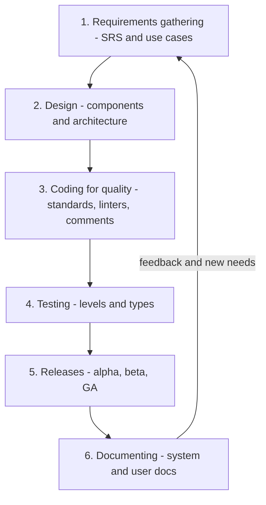

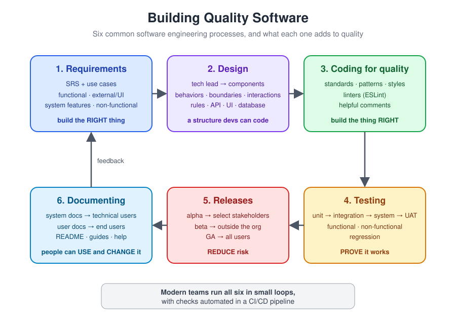

#### 3.1.1 ✅ Modern Best Practice: quality is built in, all the time

> **Lecture says:** there are six processes: requirements, design, coding, testing, releases and documenting.
> **Industry today:** the six processes still exist, but they run **in parallel and in small loops**, and much of the checking is **automated in a CI/CD (Continuous Integration / Continuous Delivery) pipeline**.

- **How it is done today:**
  - **Shift left** — move quality checks **earlier**. Tests, linting and security scans run on **every commit**, not only in a "testing phase".
  - **Definition of Done (DoD)** — a team checklist every change must pass before it counts as finished. Example: "code reviewed, tests pass, linter clean, docs updated, no high-severity vulnerabilities".
  - **Quality gates in CI** — the pipeline **blocks** a merge if the linter fails, tests fail, or test coverage drops.
  - **Code review** — every change is read by at least one other engineer through a **pull request (PR)** before it is merged.
- **Why:** a bug found while coding costs minutes to fix. The same bug found by users after the GA release costs hours or days, plus lost trust.

| | Lecture view | Modern practice |
|---|---|---|
| **When quality is checked** | In the testing process | On every commit, in every process |
| **Who checks** | Developers, then testers, then users | Automation first, then reviewers, then users |
| **Release** | Alpha → beta → GA, once | Continuous delivery, plus beta and GA for big launches |
| **Docs** | Written at the end | Written with the code, stored in Git ("docs as code") |

---

### 3.2 Process 1 — Requirements Gathering (the SRS)

- The **SRS (Software Requirements Specification)** covers the **process of collecting and documenting** the set of requirements that the software **needs to adhere to** (must follow).
  - Note: the lecture uses "SRS" for **both** the process and the document it produces.
- It **may include a set of use cases**.
  - Use cases describe the **business needs** (why the business wants this) and the **user flows** (the steps a user takes) that the software **must implement**.
- Software requirements can be classified into **four broad categories**:

  | Category | What it describes | Example (Book Review API) |
  |----------|-------------------|---------------------------|
  | **Functional** | What the system must **do** | "A logged-in user can post a review with a rating from 1 to 5." |
  | **External and UI (User Interface)** | How the system looks to users and how it connects to **outside** systems (other software, hardware, APIs) | "The review form has a 5-star widget." / "Book data comes from an external ISBN (International Standard Book Number) lookup service." |
  | **System features** | The main features or capabilities the system offers, grouped together | "Search: by title, by author, by ISBN." |
  | **Non-functional** | How **well** the system must work: performance, security, reliability, usability | "Search returns results in under 300 ms for 95% of requests." |

- These categories are discussed in more detail in another video.

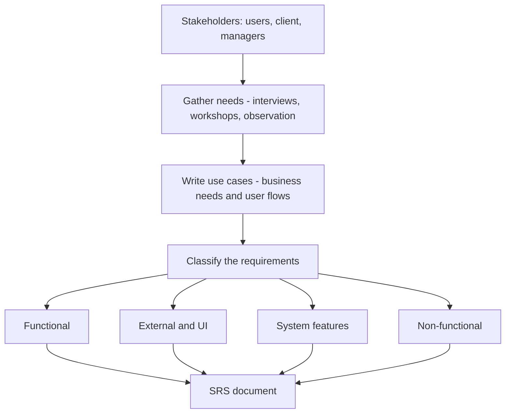

#### 3.2.1 ✅ Modern Best Practice: the full SRS document structure

> **Lecture says:** software requirements can be classified into four broad categories: functional, external and UI, system features, and non-functional.
> **Industry today:** these four are the **core** of an SRS, but a complete SRS **document** has more sections around them: an introduction, an overall description (users, constraints, assumptions) and appendices such as a glossary.

> ⚠️ **Common misunderstanding:** "The SRS document has four sections: functional, external and UI, system features, non-functional" → These four are **categories of requirements**, not the full list of sections in an SRS document. **For the quiz**, the lecture's answer is still correct: *requirements* fall into these four categories.

- **A very widely used SRS layout** is the template by **Karl Wiegers** (from his book *Software Requirements*), based on the **IEEE 830** standard:

  | # | Section | What it contains | Lecture category |
  |---|---------|------------------|------------------|
  | 1 | **Introduction** | Purpose, scope, intended readers, document conventions, references | — |
  | 2 | **Overall description** | Product overview, main functions, types of users, operating environment, design and implementation constraints, assumptions and dependencies | — |
  | 3 | **External interface requirements** | User interfaces (UI), hardware, software and communication interfaces | **External and UI** |
  | 4 | **System features** | Each feature with its description and priority, inputs and responses (stimulus/response), and its **functional requirements** | **System features** + **Functional** |
  | 5 | **Other non-functional requirements** | Performance, safety and security requirements; many versions also add software quality attributes and business rules | **Non-functional** |
  | 6 | **Other requirements and appendices** | Glossary, analysis models and diagrams, list of open questions ("to be determined") | — |

- **Sections 3–5 are where the lecture's four categories live.** Sections 1, 2 and 6 give the context that makes the requirements understandable.
- **Detail that is easy to miss: functional requirements usually do not get their own section.** They are listed **under each system feature**. A system feature is a **group of related functional requirements**:

  ```text
  4. System Features
     4.1 Reviews
         Description and priority: High — core reason users visit the site.
         Stimulus/response: user submits the review form → system saves and shows the review.
         Functional requirements:
           REQ-07: A logged-in user can post a review with a rating from 1 to 5.
           REQ-08: A user can delete their own review.
     4.2 Search
           REQ-12: A user can search books by title, author or ISBN.
  ```

  - This is why **"functional"** and **"system features"** overlap: the feature is the group, and the functional requirements are the items inside it.

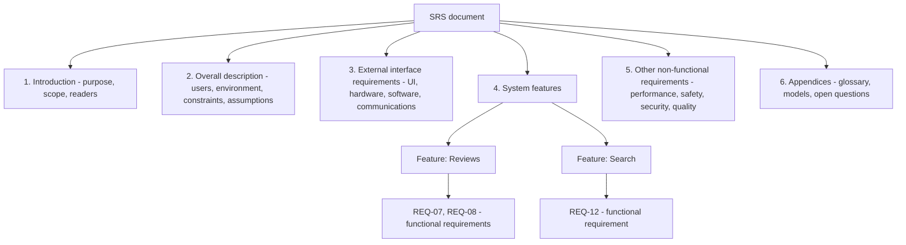

- **Where the standards stand today:**
  - **IEEE 830-1998** organized an SRS into **three main parts**: 1. Introduction, 2. Overall description, 3. Specific requirements (external interfaces, functions, performance, logical database, design constraints, software system attributes), plus appendices and an index. Wiegers' template splits part 3 into separate sections 3, 4 and 5.
  - IEEE 830 has been **replaced** by **ISO/IEC/IEEE 29148** (first published 2011, current edition 2018). Its example SRS outline also includes a part on **verification**: how each requirement will be checked, for example by inspection, analysis, demonstration or test.
- **How teams use the SRS today:**
  - **Full, formal SRS** — still the norm in **regulated industries** (medical devices, aviation, banking, government), **fixed-price contracts** and **outsourced projects**, where the document is part of the agreement and is signed off.
  - **Lighter documents** — product teams often write a short **PRD (Product Requirements Document)** per feature and keep the details as **user stories** in the backlog (see 3.2.3).
  - **Living document** — either way, keep it in **version control** (Markdown in Git, or a wiki with history), give every requirement an **ID**, and link IDs to code and tests (**traceability**, see 3.2.4).
- **Interview tip:** name the four requirement categories, then add that a full SRS also has an **introduction**, an **overall description** (users, constraints, assumptions) and a **glossary**, and that functional requirements are usually grouped **under system features**. This shows you know how the document is really built.

#### 3.2.2 What a use case looks like

- A use case names the **actor** (who), the **goal** (what they want), and the **main flow** (steps). Good use cases also list **alternative flows** (what happens when something goes wrong).

  | Part | Example |
  |------|---------|
  | **Name** | Post a book review |
  | **Actor** | Logged-in reader |
  | **Business need** | More reviews make the site more useful and bring more visitors. |
  | **Precondition** | The user is logged in. |
  | **Main flow** | 1. User opens a book page. 2. User clicks "Write review". 3. User gives 1–5 stars and text. 4. System saves the review. 5. System shows the review on the page. |
  | **Alternative flow** | 3a. Rating is missing → system shows "Please choose a rating". |

#### 3.2.3 ✅ Modern Best Practice: user stories, acceptance criteria and a living backlog

> **Lecture says:** the SRS collects and documents requirements, may include use cases.
> **Industry today:** most teams keep requirements as **user stories with acceptance criteria** in a **living backlog** (for example Jira, GitHub Issues, Linear), updated every sprint. A formal SRS is still used in regulated or contract-based projects.

- **User story** format: *"As a **[role]**, I want **[goal]**, so that **[benefit]**."*
  - Example: "As a reader, I want to rate a book from 1 to 5, so that other readers can see if it is good."
- **Acceptance criteria** say exactly when the story is done, often in **Given / When / Then** form (from **BDD — Behavior-Driven Development**):

  ```gherkin
  Scenario: Reject an invalid rating
    Given I am logged in
    When I post a review with rating 6
    Then the API responds with status 400
    And the review is not saved
  ```

- **Non-functional requirements are made measurable**, for example as **SLOs (Service Level Objectives)**: "99.9% of requests succeed each month" instead of "the system must be reliable".
- **Security requirements are written early** (for example from the **OWASP (Open Worldwide Application Security Project) ASVS — Application Security Verification Standard**), not added after the code is done.
- **Why:** a living backlog can change when users give feedback. Testable acceptance criteria let the team (and automated tests) prove a requirement is met.

#### 3.2.4 🚀 Advanced Practices: requirements (not in the lecture — industry practice)

- **Definition of Ready (DoR)** — a story may enter a sprint only when it is clear: it has acceptance criteria, designs, and no blocking unknowns.
- **INVEST** — a checklist for good user stories: **I**ndependent, **N**egotiable, **V**aluable, **E**stimable, **S**mall, **T**estable.
- **Example mapping** — a short workshop (developer + tester + product owner) that turns a story into **rules** and concrete **examples**; the examples become the acceptance tests.
- **EventStorming** — a workshop where the team maps the business as a timeline of **domain events** ("Review posted", "Review reported"). It finds hidden rules and natural component boundaries (it feeds **DDD — Domain-Driven Design**, see 3.3.3).
- **Quality attribute scenarios** — write non-functional requirements as testable scenarios:

  | Part | Example |
  |------|---------|
  | Source / stimulus | 1,000 users search at the same time |
  | Environment | Normal production load |
  | Response | Results are returned |
  | **Measure** | 95% in under 300 ms (p95 latency) |

- **Privacy by design** — list personal data in the requirements and apply laws such as **GDPR (General Data Protection Regulation)**: collect only what you need, define how long you keep it, support "delete my data".
- **Accessibility as a requirement** — for example "meets **WCAG 2.2** level AA". In the EU, the **European Accessibility Act** has applied to many digital products and services since June 2025.
- **Abuse cases / misuse stories** — "As an attacker, I want to post 10,000 fake reviews…". Each one creates a security requirement (rate limiting, CAPTCHA, moderation).
- **Traceability** — link each requirement ID → design → code (PR) → tests. Then you can prove every requirement was built and tested, and see the impact of a change.
- **Product discovery** — before building, test the idea cheaply (interviews, prototypes, A/B tests). Building the wrong thing well is still low quality.

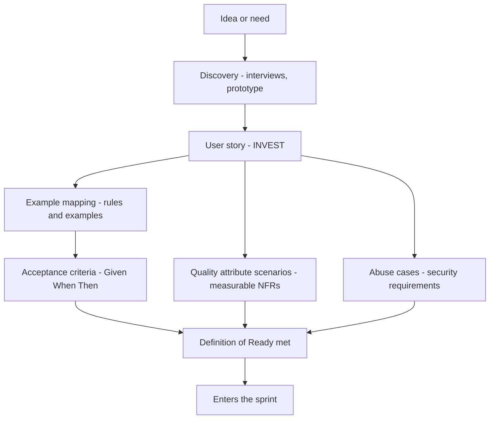

---

### 3.3 Process 2 — Software Design

- **Software design** is the process of **transforming the requirements into a structure that is implementable using code**.
  - It **translates the requirements into a language the developers can use** to write the code.
  - It **transforms the requirements into a software solution**.
- **Who does it:** the **technical lead** breaks down requirements into **sets of related components**, each with clearly defined:
  - **Behaviors** — what the component does.
  - **Boundaries** — what it is responsible for, and what it is **not** responsible for.
  - **Interactions** — how it talks to other components.
- **These components define the system architecture.**
- **The system design incorporates guidance on:**
  - **System functions** — what each part does.
  - **Performance** — how fast and how much load.
  - **Security** — how data and access are protected.
  - **Platform characteristics** — where it runs (cloud, operating system, browser, mobile, containers).
- **The design communicates:**

  | Design area | What it describes | Example |
  |-------------|-------------------|---------|
  | **Business rules and application logic** | The rules the software enforces and the code that carries them out | "One review per user per book." |
  | **API (Application Programming Interface) design** | How apps talk to each other or communicate with the database | `POST /books/:isbn/reviews` returns `201 Created` |
  | **User interfaces** | Screens, forms, navigation | Book page with review list and form |
  | **Database design** | Data structure, fields, keys, relationships | `reviews` collection: `bookIsbn`, `userId`, `rating`, `text`, `createdAt` |

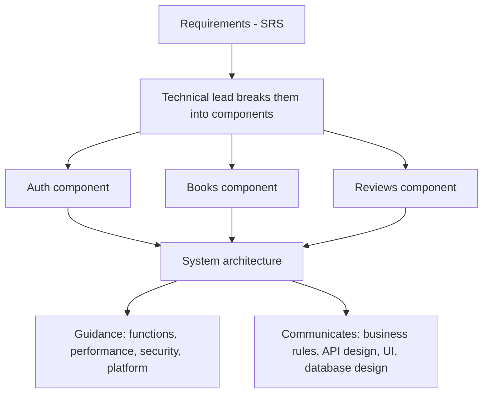

#### 3.3.1 Why components need clear boundaries

- **Low coupling** — components depend on each other as little as possible. A change inside one does not break the others.
- **High cohesion** — everything inside one component belongs to the same job.
- **Clear interactions** — components talk only through a defined interface (for example a function, an HTTP (Hypertext Transfer Protocol) API or a message queue). This is what makes the system easy to test, split across teams, and scale.

#### 3.3.2 ✅ Modern Best Practice: API-first, versioned, lightweight design (not in the lecture — industry practice)

> **Lecture says:** the technical lead breaks requirements into components and the design communicates business rules, APIs, UI and database design.
> **Industry today:** design is a **team activity**, kept **short and versioned in Git**, with the API contract written **first**.

- **API-first design** — write the API contract in **OpenAPI** before coding, so frontend, backend and testers can work in parallel and generate docs and mocks from it.
- **C4 model** — draw the architecture at four zoom levels: **Context, Containers, Components, Code**.
- **ADRs (Architecture Decision Records)** — short Markdown files that record each important decision, the options and the reason. Stored next to the code.
- **Threat modeling** — during design, ask "how could an attacker abuse this?" (for example with **STRIDE**: Spoofing, Tampering, Repudiation, Information disclosure, Denial of service, Elevation of privilege).
- **Design for operations** — plan logging, metrics, health checks and configuration from the start (see the **Twelve-Factor App** principles).

```yaml
# openapi.yaml — design contract for one endpoint (written before the code)
openapi: 3.1.0
info: { title: Book Review API, version: 1.0.0 }
paths:
  /books/{isbn}/reviews:
    post:
      summary: Add a review to a book
      parameters:
        - { name: isbn, in: path, required: true, schema: { type: string } }
      requestBody:
        required: true
        content:
          application/json:
            schema:
              type: object
              required: [rating]
              properties:
                rating: { type: integer, minimum: 1, maximum: 5 } # business rule in the contract
                text: { type: string, maxLength: 2000 }
      responses:
        "201": { description: Review created }
        "400": { description: Invalid rating }
        "401": { description: Not logged in }
```

#### 3.3.3 🚀 Advanced Practices: design (not in the lecture — industry practice)

- **DDD (Domain-Driven Design) and bounded contexts** — split the system along **business** boundaries (Reviews, Catalog, Accounts), each with its own model and words. This is the modern way the "technical lead breaks requirements into components".
- **Modular monolith first** — one deployable app with **strict internal modules**. Split into **microservices** only when a module truly needs independent scaling, deployment or a separate team. Microservices too early = distributed complexity without the benefit.
- **Hexagonal architecture (ports and adapters)** — business logic in the center does not depend on Express, MongoDB or any framework; adapters connect it to the outside. Result: logic is easy to unit-test and the database can be swapped.

  ```mermaid
  flowchart TD
      HTTP["Express route - adapter"] --> PORT_IN["Input port - addReview use case"]
      PORT_IN --> CORE["Business logic - rules only, no framework"]
      CORE --> PORT_OUT["Output port - ReviewRepository interface"]
      PORT_OUT --> MONGO["MongoDB adapter"]
      PORT_OUT --> FAKE["In-memory adapter - for tests"]
  ```

- **Design reviews / RFCs (Requests for Comments)** — for big changes, an engineer writes a short design doc; the team comments **before** coding starts. Decisions are saved as ADRs.
- **API evolution rules** — never break clients:
  - Adding optional fields is safe; removing or renaming fields is a **breaking change** → new API version (`/v2`) or a deprecation period (the `Deprecation` and `Sunset` HTTP headers).
  - **AsyncAPI** does for event/message APIs what OpenAPI does for REST.
  - **Idempotency keys** — a client can safely retry `POST /payments` without charging twice.
- **Design for failure (resilience patterns)** — every network call can be slow or fail:
  - **Timeouts** on every call (for example `fetch(url, { signal: AbortSignal.timeout(2000) })`).
  - **Retries with exponential backoff and jitter** (only for safe/idempotent calls).
  - **Circuit breaker** — stop calling a failing service for a while, return a fallback.
  - **Bulkheads and rate limits** — one slow part cannot use up all resources.
- **Zero-downtime database changes — expand/contract** (also called parallel change): add the new column → write to both → backfill → read the new one → remove the old one. Old and new app versions keep working during the rollout (see 5.7).
- **Architecture fitness functions** — automated tests for architecture rules, for example "the `reviews` module must not import from `accounts/internal`" (tools: **dependency-cruiser**, ESLint import rules).
- **Performance and cost budgets** — for example "p95 latency under 300 ms" and "cloud cost per 1,000 requests" are design inputs, measured in CI and production.

---

### 3.4 Process 3 — Coding for Quality

- **Code quality** refers to the **characteristics of the code**, including attributes such as:

  | Attribute | Question it answers |
  |-----------|---------------------|
  | **Maintainability** | Can we fix or extend it easily later? |
  | **Readability** | Can another developer understand it quickly? |
  | **Testability** | Can we test it automatically, piece by piece? |
  | **Security** | Is it safe against attacks and data leaks? |

- **Quality code must fulfill the intended requirements** of the software **without defects**.
- **Additionally, it should be:**
  - **Clean and consistent** — same style everywhere, no dead code.
  - **Easy to read and maintain.**
  - **Well documented.**
  - **Efficient** — does not waste CPU, memory or network.
- **Coding for quality** entails **following a set of coding practices during development**. These include:
  1. **Following common coding standards, conventions, patterns and styles.**
     - **Standards / conventions** — naming (`camelCase` for variables in JavaScript), file layout, error handling rules.
     - **Patterns** — known solutions (for example middleware in Express, the repository pattern for database access).
     - **Styles** — formatting (indentation, quotes, semicolons).
  2. **Using automated tools, known as linters**, to detect **programmatic** and **stylistic** errors.
     - **Programmatic errors** — real bugs, for example an unused variable, `==` instead of `===`, a missing `await`.
     - **Stylistic errors** — layout and naming problems that make code hard to read.
     - JavaScript example: **ESLint**.
  3. **Commenting in the code itself** to make it easy for others to understand and modify.

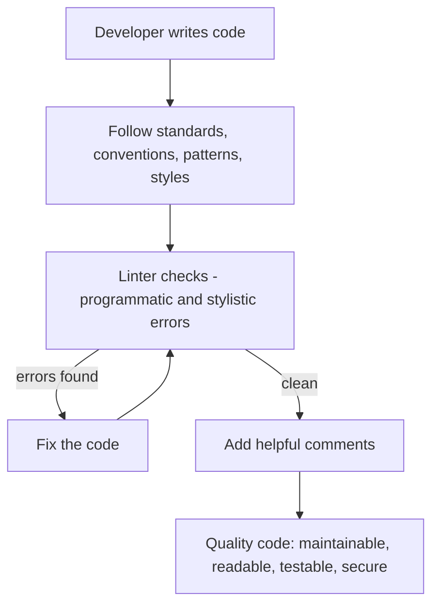

#### 3.4.1 ✅ Modern Best Practice: automate style, explain the "why", review everything

> **Lecture says:** follow standards, use linters, and comment code so others can understand it.
> **Industry today:** style is **enforced by tools automatically**, comments explain **why** (not what), and every change goes through **code review** and **CI quality gates**.

- **Linter + formatter, run automatically:**
  - **ESLint** (current versions use the "flat config" file `eslint.config.js`) finds bugs and risky patterns.
  - **Prettier** formats code, so the team never argues about spaces or quotes.
  - Run them in the editor, in a **pre-commit hook** (for example **Husky** + **lint-staged**), and in **CI** so nothing unformatted is merged.
- **Types:** many Node.js teams use **TypeScript** (or JSDoc type comments checked by TypeScript) to catch type errors before running the code.
- **Comments: "why", not "what".**
  - Prefer clear names and small functions (**self-documenting code**).
  - Write comments for **reasons, business rules, edge cases and warnings** that the code cannot show.
  - Use **JSDoc** for public functions so editors show help and docs can be generated.
- **Static analysis and security in CI:** tools such as **SonarQube / SonarCloud** or **CodeQL** (SAST — Static Application Security Testing), and dependency scanning (`npm audit`, **Dependabot**, **Snyk**).
- **Secrets never in code** — use environment variables or a secret manager; scan for leaked keys (for example GitHub secret scanning).
- **Common principles:** **DRY** (Don't Repeat Yourself), **KISS** (Keep It Simple, Stupid), **SOLID** principles, small pull requests.
- **AI coding tools:** AI-generated code is reviewed, linted and tested **exactly like** human code. The developer is still responsible for it.

| | Old way | Modern way |
|---|---|---|
| Style | Style guide document people try to remember | Prettier + ESLint, auto-fixed on save and checked in CI |
| Comments | Explain every line | Clear names; comments explain why |
| Review | Optional, or at the end | Every PR reviewed before merge |
| Security | Checked late, by a security team | SAST + dependency scans on every PR |

#### 3.4.2 🚀 Advanced Practices: coding (not in the lecture — industry practice)

- **Trunk-based development** — small branches that live hours or a day, merged into `main` behind **feature flags**. Long-lived branches create painful merges and hide integration bugs.
- **Branch protection / rulesets** — `main` cannot be pushed to directly; merges need passing CI and an approved review. **CODEOWNERS** files make sure the right team reviews each folder.
- **Good code review** — small PRs (a few hundred lines at most), review for design, correctness, tests and security first, not style (tools handle style). Many teams follow published guides such as Google's engineering practices for code review.
- **Pair and mob programming** — two or more people write the code together; review happens in real time.
- **Validate all input at the edge** — every request body, query and header is checked against a schema (for example **Zod**, **Joi**, **Ajv** with JSON Schema, or generated from OpenAPI). Reject unknown fields. This blocks many OWASP API Security Top 10 problems such as **mass assignment** (see 5.5).
- **Consistent error handling** — one central Express error middleware; errors returned in a standard format such as **RFC 9457 "Problem Details for HTTP APIs"** (`application/problem+json`); never leak stack traces to clients.
- **Structured logging** — JSON logs with a request ID (for example **pino**), no passwords or tokens in logs.
- **Complexity limits** — linter rules like ESLint `complexity`, `max-depth` and `max-lines-per-function` keep functions small.
- **Type safety** — **TypeScript** in strict mode. Recent Node.js versions can also run `.ts` files directly by stripping the types (type checking still needs `tsc`).
- **Security linting** — plugins such as `eslint-plugin-security`, plus **CodeQL** or **Semgrep** rules in CI.
- **Manage technical debt on purpose** — record it as backlog items, give it a fixed share of each sprint, and follow the **boy scout rule** ("leave the code a bit cleaner than you found it"). Refactor in small, tested steps.
- **Responsible AI-assisted coding:**
  - Treat AI output as code from an unknown contributor: review it, test it, scan it.
  - Watch for **invented packages** ("package hallucination") — attackers register these names; check every new dependency exists and is trusted.
  - Never paste secrets or customer data into AI tools that are not approved by your company.
  - If your app itself calls an LLM (Large Language Model), check the **OWASP Top 10 for LLM Applications** (for example prompt injection).

---

### 3.5 Process 4 — Software Testing

- **Software testing** is the process of **verifying that the software matches established requirements** and **is free of bugs**.

> ⚠️ **Correction:** "Testing verifies that the software is free of bugs" → Testing can **show that bugs exist**, but it can **never prove there are no bugs** (a famous point by computer scientist Edsger Dijkstra). Testing **reduces risk** and gives **confidence** that the software meets the requirements. For quizzes, remember the lecture wording; in interviews, say "testing finds defects and builds confidence".

- **Its purpose:** to **identify errors, gaps, or missing requirements** when compared with the **stated requirements**.
  - **Errors** — the software does something wrong.
  - **Gaps** — a case nobody thought about (for example an empty input).
  - **Missing requirements** — a feature in the SRS that was never built.
- **Properly tested software ensures** (helps ensure):
  - **Reliability** — it works the same way every time.
  - **Security** — it resists attacks.
  - **Performance** — it is fast enough under load.
  - **Efficiency** — it uses resources well.
- Testing can **often be automated** or **done manually**.
  - **Automated** — scripts run tests on every change; fast and repeatable.
  - **Manual** — a person explores the app; good for usability and unexpected problems (**exploratory testing**).

#### 3.5.1 Levels of testing

| Level | Who usually does it | What is tested | When |
|-------|---------------------|----------------|------|
| **Unit** | The **developer** | The **smallest component of code that can be isolated** from the rest of the system (a function, a module) | While coding |
| **Integration** | Developers / QA (Quality Assurance) — *typical, not stated in the lecture* | Components **after they are integrated** into the larger product, working together | After components are combined |
| **System** | QA / testing team — *typical, not stated in the lecture* | The **whole product**, after the larger product is **deemed completed** | When the product is complete |
| **UAT (User Acceptance Testing)** | The **intended end user** (or the customer) | Does it meet the users' real needs? | Before (or as part of) the release |

- The lecture says UAT is **sometimes called beta testing**.

> ⚠️ **Correction / clarification:** UAT and beta testing are **related but not the same**. **UAT** is usually a **formal** check by the customer or business users against the agreed requirements, ending with a **sign-off**. **Beta testing** gives a nearly finished version to **real users in real conditions** to find bugs and get feedback, and it is often **informal**. In both, the end users test the software — that is why the lecture links them.

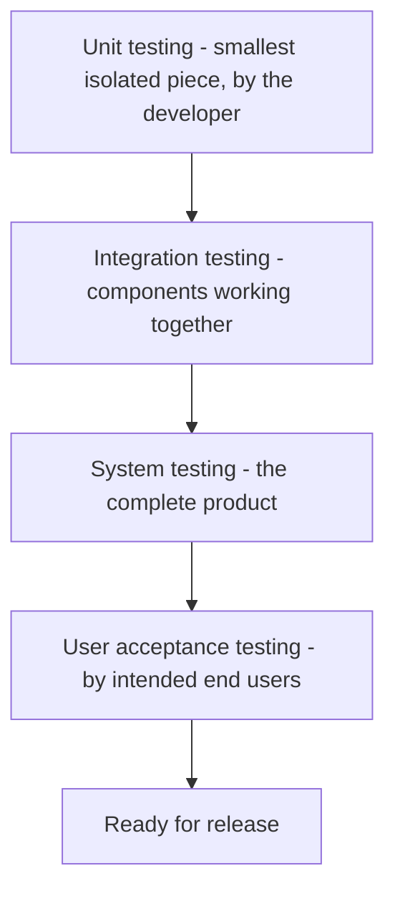

#### 3.5.2 Types of testing

- Types of testing can broadly be divided into **three categories**:

  | Type | Question it answers | Examples |
  |------|---------------------|----------|
  | **Functional** | Does each feature do what the requirement says? | Login works; a rating of 6 is rejected |
  | **Non-functional** | Does it work **well enough**? | Performance/load, security, usability, accessibility, reliability |
  | **Regression** | Did a new change **break** something that worked before? | Re-run the full test suite after every change |

- **Levels** (unit → UAT) and **types** (functional, non-functional, regression) are **two different dimensions**: for example, you can have a functional unit test or a non-functional system test.
- Testing levels and types are further explained in an upcoming video.

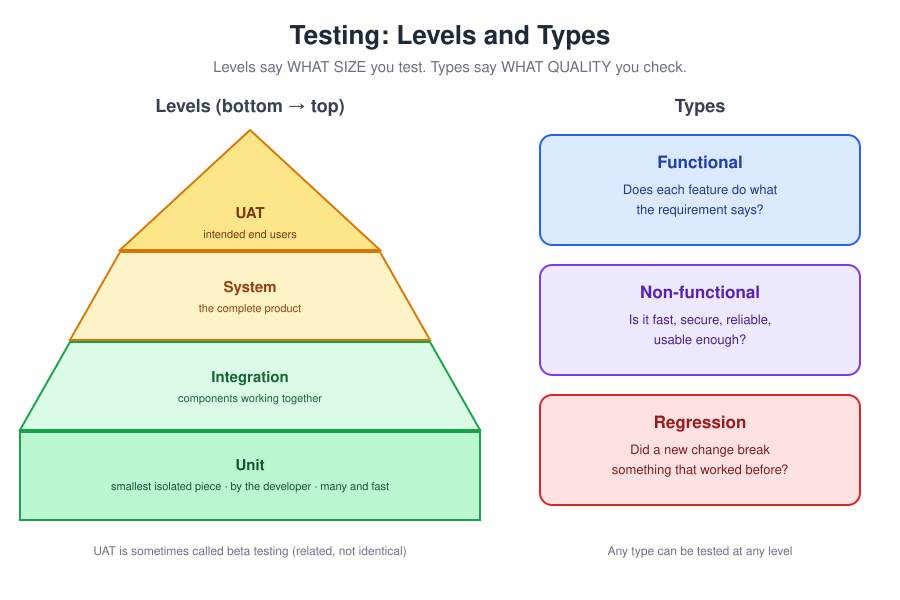

#### 3.5.3 ✅ Modern Best Practice: shift-left, the test pyramid and testing in CI

> **Lecture says:** testing has four levels (unit, integration, system, UAT) and three types (functional, non-functional, regression).
> **Industry today:** tests are **automated**, written **with or before** the code (**TDD — Test-Driven Development**), and **run on every push** in CI. Regression testing is simply "run the whole automated suite every time".

- **Test pyramid** — many fast **unit** tests, fewer **integration** tests, very few slow **E2E (End-to-End)** tests.
- **Tools in the Node.js world:** the built-in **`node:test`** runner, **Jest**, **Vitest**, **Mocha**; **Supertest** for HTTP APIs; **Playwright** or **Cypress** for E2E; **k6** for load tests.
- **Contract testing** (for example **Pact**) checks that services keep their API promises to each other — important for microservices.
- **Security testing:** SAST in CI, **DAST (Dynamic Application Security Testing)** against a running app (for example **ZAP**, formerly called OWASP ZAP), dependency scanning.
- **Test in production safely:** monitoring, synthetic checks and canary releases catch what tests miss.
- **Code coverage** shows what code the tests run. It is a useful signal, but 100% coverage does not mean bug-free.

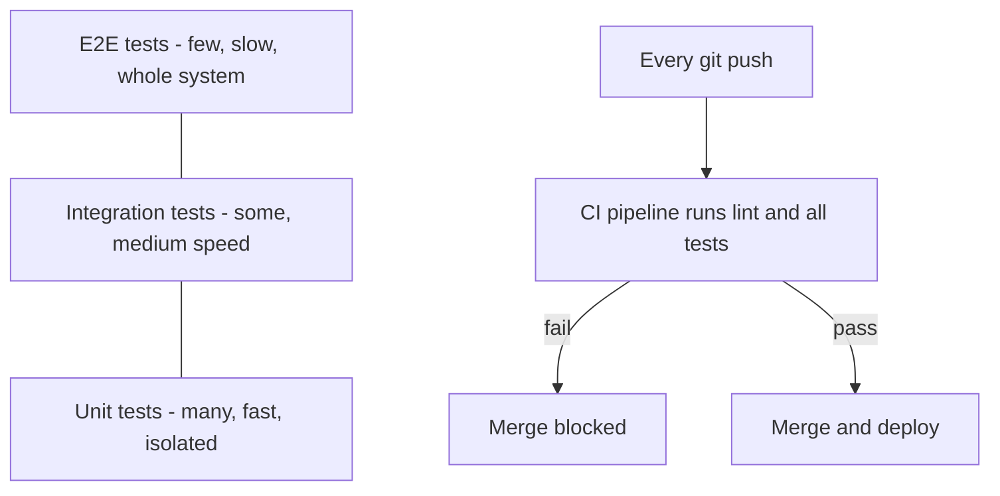

#### 3.5.4 🚀 Advanced Practices: testing (not in the lecture — industry practice)

| Technique | What it does | Node.js tools | When to use it |
|-----------|--------------|---------------|----------------|
| **Testing trophy** | A pyramid alternative: most effort on **integration** tests, plus static checks (types, lint) at the base | — | Web apps and APIs where most bugs are between parts |
| **Mutation testing** | Changes the code (e.g. `>=` → `>`) and checks a test fails; measures **test quality**, not just coverage | **Stryker Mutator** | Core business logic |
| **Property-based testing** | Generates hundreds of inputs to break a rule | **fast-check** | Validation, parsing, calculations (see 5.6) |
| **Real dependencies in tests** | Starts a real MongoDB/PostgreSQL in a container for the test run | **Testcontainers** | Integration tests that must match production |
| **Contract testing** | Consumer and provider agree on API examples; both are tested against them | **Pact** | Microservices, frontend ↔ backend |
| **Load / stress testing** | Checks performance targets under load | **k6**, Artillery | Before big releases; in CI for key endpoints |
| **Fuzzing** | Sends random or malformed input to find crashes and security bugs | Jazzer.js, API fuzzers | Parsers, public APIs |
| **Accessibility testing** | Automatically finds WCAG problems | **axe-core** (with Playwright) | Any UI |
| **Visual regression** | Compares screenshots to catch UI changes | Playwright screenshots | UI components |
| **Chaos engineering** | Injects failures (kill a pod, add latency) to check the system recovers | Chaos Mesh, LitmusChaos | Mature systems with good monitoring |
| **Synthetic monitoring** | Runs scripted user journeys against production every few minutes | Checkly, Grafana synthetic monitoring | Critical flows like login and checkout |

- **Flaky tests** — a test that sometimes passes and sometimes fails, with no code change. Fix or quarantine it fast; flaky tests teach people to ignore red builds.
- **Test data management** — never copy real customer data into test environments; use generated or anonymized data.
- **Ephemeral (preview) environments** — every pull request gets its own short-lived environment for testing and review; it is deleted after merge.
- **Coverage done right** — aim for meaningful coverage of important logic; combine with mutation testing to find tests that run code but check nothing.

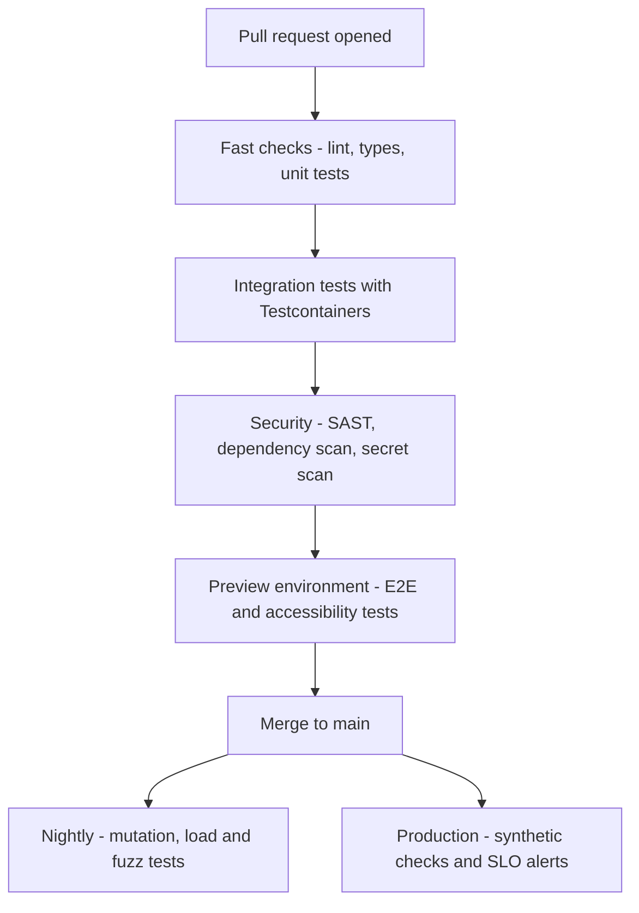

---

### 3.6 Process 5 — Releases

- **When the newest version of the software is distributed**, it is referred to as a **"release."**
- **Different types of releases are intended for different audiences.** There is generally:
  - an **"alpha"** release,
  - a **"beta"** release, and
  - a **"GA"** release — **GA stands for General Availability**.

| | Alpha | Beta (limited release) | GA (General Availability) |
|---|---|---|---|
| **Audience** | A **select group of stakeholders** | **Stakeholders outside** the developing organization | **All users** |
| **Features** | **Most** of the desired functionality; **may not contain the full feature set** | Should **meet all the functional requirements** | Complete |
| **Stability** | **Likely contains errors** | Real-world testing to find **outstanding bugs or errors** | **Stable** |
| **Design** | **Design changes may still occur** | Changes are agreed upon, made and tested | Fixed for this version |
| **Purpose** | First functioning version; early feedback | Try the software **under real conditions**, test functionality, find bugs | Official release for everyone |

- **Alpha release details:**
  - It is the **first functioning version** of the system.
  - Released to a **select group of stakeholders** (often internal people and close partners).
  - **Likely contains errors** and **may not contain the full feature set**, but **does contain most of the desired functionality**.
  - **Design changes may still occur** during this release stage.
- **Beta release details:**
  - Also called a **limited release**.
  - Given to **stakeholders outside of the developing organization**.
  - **Intents:** try out the software **under real conditions**, **test the functionality**, and **identify any outstanding bugs or errors**.
  - The beta release **should meet all the functional requirements**.
- **From beta to GA:**
  - After the beta release **changes are agreed upon, made, and tested**, a **stable version** is released.
  - **The audience for the GA release is all users.**

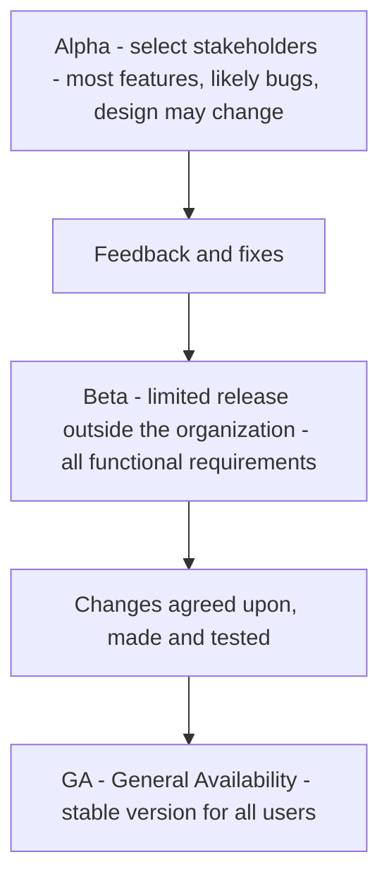

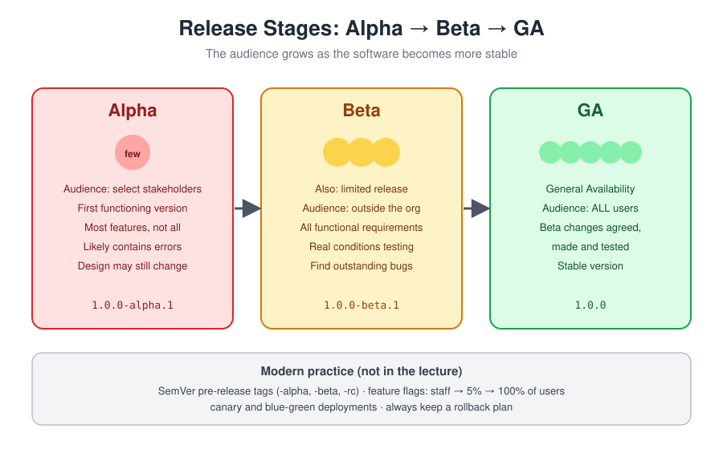

#### 3.6.1 ✅ Modern Best Practice: continuous delivery, semantic versions and safe rollouts

> **Lecture says:** releases go alpha → beta → GA.
> **Industry today:** alpha/beta/GA is still used for **big launches, products and libraries** (for example cloud services mark features "Preview" or "Beta" before GA). For web backends, teams **deploy small changes continuously** and control **who sees a feature** with **feature flags** and **gradual rollouts**.

- **Semantic Versioning (SemVer)** — `MAJOR.MINOR.PATCH`:
  - **MAJOR** — breaking changes; **MINOR** — new features that are backward compatible; **PATCH** — bug fixes.
  - Pre-release labels show the stage: `2.0.0-alpha.1` → `2.0.0-beta.3` → `2.0.0-rc.1` (**RC — Release Candidate**) → `2.0.0` (GA).
- **Release Candidate (RC)** — not in the lecture: a version that **may become GA** if no serious bugs are found.
- **LTS (Long-Term Support)** — some GA versions get fixes for a long time. Production servers should run an **Active or Maintenance LTS** version of **Node.js**.
  - **Up to Node.js 26:** two major versions per year; only **even-numbered** versions become LTS.
  - **From Node.js 27 (announced by the Node.js project):** **one** major version per year, released in April and promoted to LTS in October; **every** version becomes LTS. A six-month **alpha** channel replaces the old odd-numbered versions — a real-world example of the lecture's alpha → GA stages.
- **Feature flags** — the code is deployed but the feature is **off**; turn it on for staff (like alpha), then 5% of users (like beta), then everyone (like GA) — without a new deployment.
- **Safe deployment strategies:** **canary** (send a small % of traffic to the new version first), **blue-green** (two environments, switch traffic), **rolling updates** in Kubernetes, and a tested **rollback** plan.
- **Changelog and release notes** — every release lists what changed (for example following **Keep a Changelog**), often generated from commit messages (**Conventional Commits**).
- **Build once, promote everywhere** — the same container image moves from test → staging → production.

| | Lecture model | Modern practice |
|---|---|---|
| Unit of release | A whole version | Small changes, many times a week or day |
| Who sees new features | Defined by release stage | Controlled by feature flags and rollout % |
| Version naming | alpha, beta, GA | SemVer with `-alpha`, `-beta`, `-rc` pre-release tags |
| Going back | New release | Instant rollback or flag switch-off |

#### 3.6.2 🚀 Advanced Practices: releases and the software supply chain (not in the lecture — industry practice)

- **Progressive delivery** — canary releases where **metrics decide**: if error rate or latency gets worse, the rollout stops and rolls back automatically. Tools: **Argo Rollouts**, **Flagger** (Kubernetes), cloud-native traffic splitting.
- **GitOps** — the desired state of every environment is stored in Git; a tool (**Argo CD**, **Flux**) makes the cluster match Git. Every deployment is a reviewed commit, and rollback is a `git revert`.
- **Dark launch** — deploy new code and run it on real traffic without showing results to users (for example compare new search results with old ones in logs).
- **Feature flag hygiene** — use a standard SDK (**OpenFeature**, a CNCF project) and **remove old flags**; forgotten flags become technical debt and hidden risk.
- **Automated versioning and notes** — tools such as **semantic-release** or **Changesets** pick the next SemVer version from commit messages and write the changelog.
- **Supply-chain security** — modern attacks target the packages and build tools you depend on (in September 2025, attackers phished npm maintainers and published malware in very popular packages such as `chalk` and `debug`, and the self-spreading "Shai-Hulud" worm stole tokens; the **OWASP Top 10:2025** added **Software Supply Chain Failures** as risk A03). Defenses:
  - **Lockfile + `npm ci`** — install exact, reviewed versions in CI.
  - **Review new dependencies** — is it maintained, popular, needed? Tools such as **Socket**, **Snyk**, **Dependabot**, **Renovate**.
  - **Do not run install scripts you do not trust** (`npm ci --ignore-scripts` where possible).
  - **Cooldown for brand-new versions** — wait a few days before installing a just-published version (npm `min-release-age=7` in `.npmrc` since npm 11.10.0; Renovate `minimumReleaseAge`; Dependabot `cooldown`), but never delay **security** fixes.
  - **SBOM (Software Bill of Materials)** — generate it on every build (`npm sbom`, formats **CycloneDX** or **SPDX**) so you can answer "are we affected by this new vulnerability?" in minutes.
  - **Provenance and signing** — npm packages can be published with **provenance** from CI (`npm publish --provenance`, or npm **trusted publishing** with OIDC, which needs no long-lived token — npm revoked all classic tokens on 9 December 2025 and limits write tokens to 90 days); container images can be signed with **Sigstore cosign**.
  - **SLSA (Supply-chain Levels for Software Artifacts)** — a framework of levels for build integrity: scripted build → build service with provenance → hardened, isolated builds.
  - **Pin CI actions** to a full commit SHA and give pipelines the **least permissions** they need.
- **Rules are getting stricter** — the EU **CRA (Cyber Resilience Act)** requires makers of software products sold in the EU to handle vulnerabilities and security updates; its reporting duties (24-hour early warning, 72-hour notification for actively exploited vulnerabilities) have applied **since 11 September 2026**, and most other duties apply from **11 December 2027**.

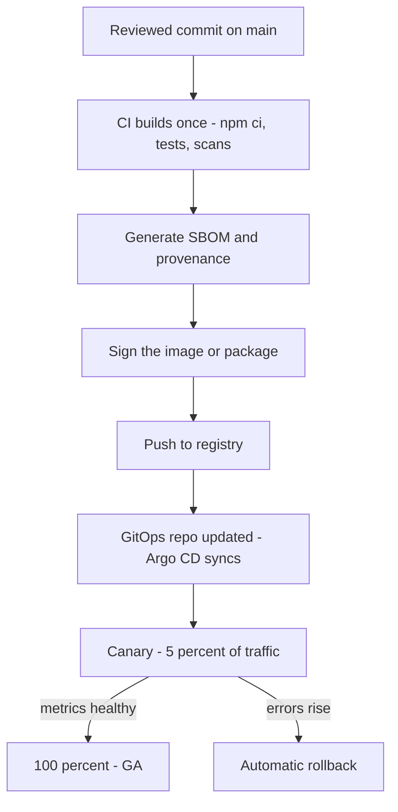

---

### 3.7 Process 6 — Documenting

- **Software documentation should be provided to both** **non-technical end users** and **technical users**.

| | System documentation | User documentation |
|---|---|---|
| **Audience** | **Technical users**: other engineers, developers, architects | **Non-technical end users** |
| **Purpose** | Explains **how the software operates** or **how to use it** (as a developer or operator) | Assists them **in the use of the product** |
| **Forms** | **README files**, **inline comments**, **architecture and design documents**, **verification information**, **maintenance guides** | **User guides**, **instructional videos and manuals**, **online help**, **inline help** |

- **System documentation, item by item:**
  - **README files** — what the project is, how to install, configure, run and test it.
  - **Inline comments** — explanations inside the code.
  - **Architecture and design documents** — components, how they connect, why decisions were made.
  - **Verification information** — how the software was tested: test plans, test results, coverage.
  - **Maintenance guides** — how to update, deploy, back up and fix the system.
- **User documentation, item by item:**
  - **User guides** — step-by-step "how to do X".
  - **Instructional videos and manuals** — longer learning material.
  - **Online help** — a searchable help center or FAQ (Frequently Asked Questions).
  - **Inline help** — tooltips and hints inside the product itself.
- More details about documentation are discussed in another video.

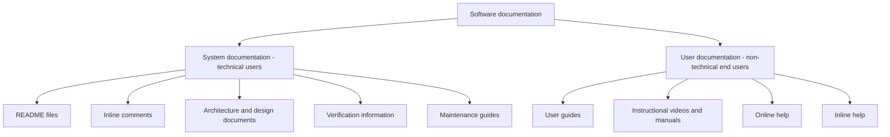

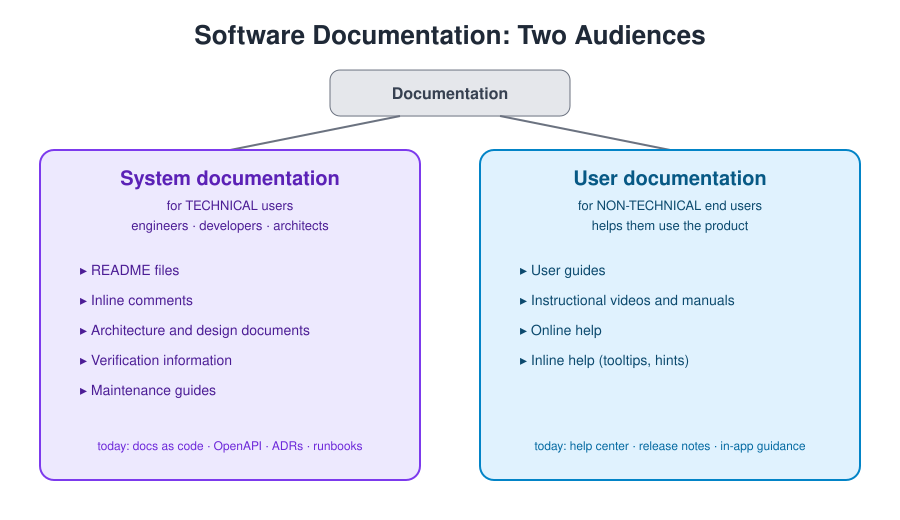

#### 3.7.1 ✅ Modern Best Practice: docs as code (not in the lecture — industry practice)

> **Lecture says:** provide system documentation for technical users and user documentation for end users.
> **Industry today:** documentation lives **in Git next to the code**, is **reviewed in pull requests**, and much of it is **generated** from the code or the API contract.

- **Docs as code** — write docs in Markdown in the repository; a change to the code and its docs goes in the **same PR**.
- **Generated API reference** — from the **OpenAPI** file (for example **Swagger UI** or **Redoc**) and from **JSDoc** comments.
- **Runbooks** — step-by-step guides for on-call engineers: "the API returns 503 — check X, then Y". A modern form of the "maintenance guide".
- **ADRs (Architecture Decision Records)** and **C4 diagrams** — modern form of "architecture and design documents".
- **CHANGELOG.md and release notes** — tell users and developers what changed in each release.
- **Diátaxis framework** — a popular way to organize docs into four kinds: **tutorials** (learning), **how-to guides** (tasks), **reference** (facts), **explanation** (understanding).
- **Other repo files:** `CONTRIBUTING.md` (how to contribute), `SECURITY.md` (how to report vulnerabilities), `.env.example` (which config values are needed, without secrets).

#### 3.7.2 🚀 Advanced Practices: documentation (not in the lecture — industry practice)

- **Lint the docs** — **markdownlint** for format, **Vale** for writing style and terms, link checkers for broken links, all in CI.
- **Lint the API contract** — **Spectral** checks the OpenAPI file against rules (naming, error format, every endpoint documented).
- **Docs that are tested** — code samples in docs are run in CI, so they never go out of date.
- **Developer portal** — a single place listing every service, its owner, API docs, runbooks and dashboards (for example **Backstage**, a CNCF project).
- **Operational docs** — runbooks linked from each alert, an on-call guide, and **blameless postmortems** after incidents (what happened, why, what we change — no blaming people).
- **Docs for AI tools and new team members** — a clear `README`, `CONTRIBUTING.md` and architecture overview help new humans and AI coding assistants follow your conventions.
- **Measure docs** — track "time to first successful API call" for new developers, help-center searches with no result, and support tickets that docs could have prevented.

---

### 3.8 Often-Missed Parts: What a Senior Engineer Adds (not in the lecture — industry practice)

| Area | What to add | Why |
|------|-------------|-----|
| **Code review** | Every PR reviewed by at least one person | Catches bugs and spreads knowledge |
| **CI/CD pipeline** | Lint, test, scan and build on every push; automated deploy | Quality checks that never get skipped |
| **Security by design (DevSecOps)** | Threat modeling, OWASP Top 10:2025 awareness, SAST, dependency scanning, secret management | Security is part of quality |
| **Observability** | Structured logs, metrics, traces (for example **OpenTelemetry**), dashboards (for example **Grafana**), alerts on SLOs | You find problems in production before users report them |
| **Accessibility** | Follow **WCAG (Web Content Accessibility Guidelines)** for any UI | Quality for all users, often a legal need |
| **Quality model** | **ISO/IEC 25010** — an international standard that lists software quality characteristics (for example reliability, security, maintainability, performance efficiency) | A shared vocabulary for "quality" |
| **Measuring delivery** | **DORA (DevOps Research and Assessment) metrics**: change lead time, deployment frequency, change fail rate, failed deployment recovery time (earlier called "time to restore service"), and the newest one, **deployment rework rate** (share of deployments that are unplanned fixes) | Shows if the processes really work |
| **Feedback loop** | Bug reports, analytics and user feedback go back into the backlog | Quality improves release after release |

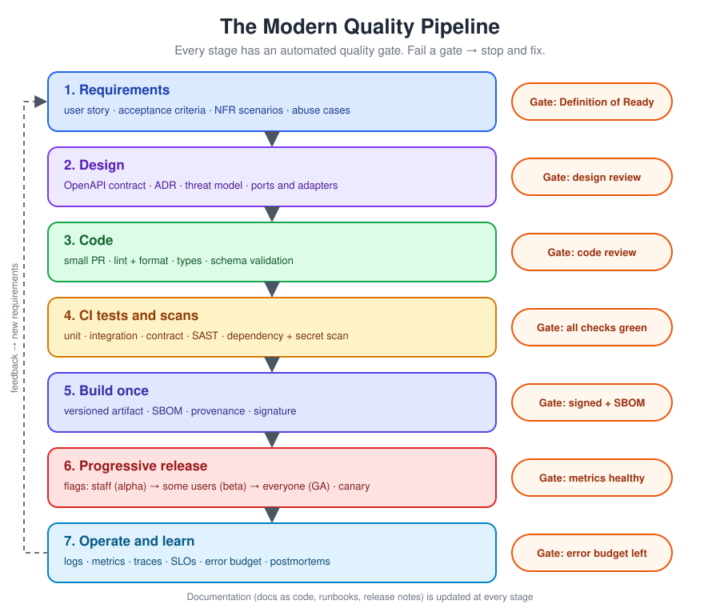

#### 3.8.1 🚀 Reliability engineering: SLOs, error budgets and incidents

- **SLI (Service Level Indicator)** — a measured number, for example "percentage of requests that succeed in under 300 ms".
- **SLO (Service Level Objective)** — the target for that number, for example "99.9% per 30 days".
- **SLA (Service Level Agreement)** — a **contract** with customers, with penalties; it should be looser than the SLO.
- **Error budget** — 100% − SLO. With 99.9%, about **43 minutes** of failure per 30 days is allowed.
  - Budget left → ship features fast.
  - Budget used up → freeze risky releases and spend time on reliability.
  - This turns "quality vs. speed" into a **data-based** decision.
- **Golden signals** — latency, traffic, errors, saturation (also the **RED** method: Rate, Errors, Duration for services).
- **Incident process** — on-call rotation, alert → runbook → fix → **blameless postmortem** → action items in the backlog.

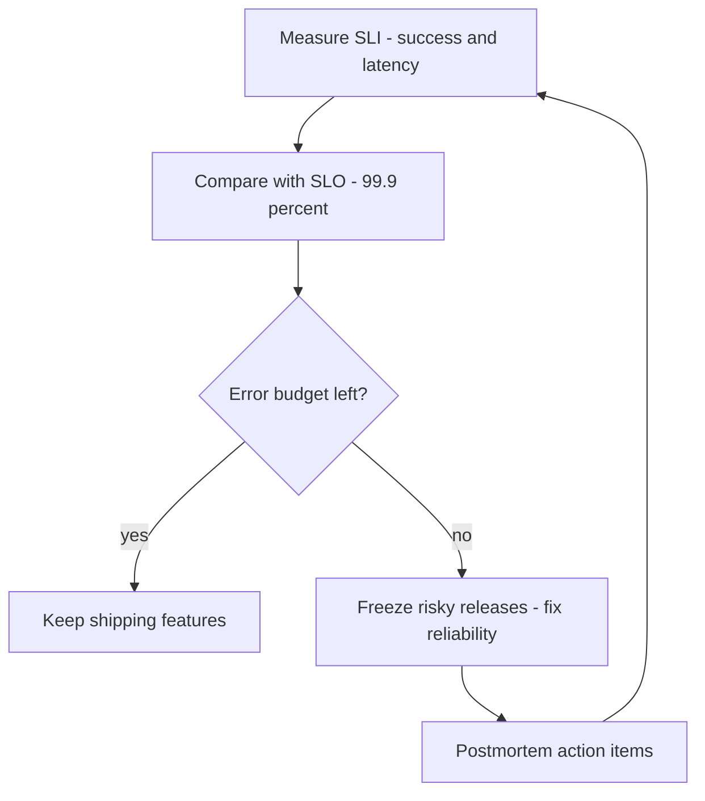

#### 3.8.2 🚀 Secure SDLC frameworks and maturity models

| Framework | What it is | Use it to… |
|-----------|-----------|------------|
| **NIST SSDF (Secure Software Development Framework, SP 800-218)** | A US government list of secure development practices | Check your process covers prepare, protect, produce and respond |
| **OWASP SAMM (Software Assurance Maturity Model)** | A model to measure and improve security maturity | Score your team and plan the next steps |
| **OWASP ASVS 5.0** (May 2025) | A list of security requirements to verify in an application, in three levels | Write security requirements and test cases |
| **OWASP Top 10:2025 / API Security Top 10 (2023)** | The most common web and API risks | Train developers and focus reviews |
| **SLSA** | Levels for build and supply-chain integrity | Harden your CI/CD pipeline |

#### 3.8.3 🚀 Measuring quality and team health

- **DORA metrics** (see the table above) show if delivery is **fast and stable at the same time** — high-performing teams are good at both.
- **SPACE framework** — measures developer productivity from several sides: **S**atisfaction, **P**erformance, **A**ctivity, **C**ommunication and collaboration, **E**fficiency and flow. Never judge people by one number such as lines of code.
- **Quality signals to watch:** escaped defects (bugs found by users), change failure rate, flaky-test count, mean PR review time, age of open vulnerabilities, SLO compliance.
- **Platform engineering and "golden paths"** — a platform team gives product teams ready-made templates (CI pipeline, Dockerfile, logging, dashboards). Quality becomes the **default**, not extra work.

#### 3.8.4 "Done enough when…" checklist for building quality software

- [ ] Every requirement has an ID and **testable acceptance criteria**; non-functional needs are **measurable**.
- [ ] The design defines **components, boundaries and interactions**, plus an **API contract** and a **data model**; key decisions are in ADRs.
- [ ] **Linter and formatter** run in the editor, the pre-commit hook and CI; the build fails on errors.
- [ ] Every change goes through a **reviewed pull request**.
- [ ] **Unit and integration tests** run automatically on every push; regression is covered by the full suite.
- [ ] **Security scans** (dependencies + static analysis) run in CI; no secrets in the code.
- [ ] Releases use **SemVer**, have **release notes**, and can be **rolled back**.
- [ ] The repo has a **README**, API docs, and a **runbook**; users have a guide or in-app help.
- [ ] Production has **logs, metrics and alerts**.
- [ ] *(Advanced)* Stories meet a **Definition of Ready**; NFRs are written as **quality attribute scenarios**; abuse cases and privacy needs are listed.
- [ ] *(Advanced)* Business logic is independent of frameworks (**ports and adapters**); every outbound call has a **timeout**; API changes are **backward compatible**; DB changes use **expand/contract**.
- [ ] *(Advanced)* **Trunk-based** flow with **branch protection** and **CODEOWNERS**; all input **validated by schema**; errors use **Problem Details**.
- [ ] *(Advanced)* Integration tests use **real dependencies** (Testcontainers); core logic is checked with **mutation** or **property-based** tests; flaky tests are tracked.
- [ ] *(Advanced)* Every build produces an **SBOM** and **provenance**; dependencies are pinned by lockfile; CI actions are pinned and least-privilege.
- [ ] *(Advanced)* Rollouts are **progressive** with automatic rollback; **SLOs and error budgets** guide release decisions; incidents end in **blameless postmortems**.

---

### 3.9 Lecture Summary

- **Requirement gathering** is collecting and documenting the set of requirements that the software needs to adhere to.
- **Designing** transforms requirements into a structure that developers can use.
- **Coding for quality** entails following a set of coding practices during development.
- **Testing** is the process of verifying that the software matches established requirements and is free of bugs (see the ⚠️ correction in 3.5).
- There are **three types of releases**: **alpha**, **beta** and **general availability (GA)**.
- **Documenting** requires text or video that explains the software to **technical** and **non-technical** users.

| Process | Lecture definition | ✅ Modern best practice |
|---------|--------------------|--------------------------|
| Requirements gathering | Collect and document requirements (SRS, use cases) | Full SRS layout (Wiegers template based on IEEE 830; ISO/IEC/IEEE 29148 today) with the four categories at its core; user stories + acceptance criteria in a living backlog; measurable NFRs (Non-Functional Requirements) and SLOs; security requirements early; 🚀 DoR, example mapping, quality attribute scenarios, abuse cases, privacy by design, traceability |
| Design | Turn requirements into an implementable structure | API-first (OpenAPI), C4 diagrams, ADRs in Git, threat modeling; 🚀 DDD bounded contexts, modular monolith first, ports and adapters, resilience patterns, expand/contract migrations, fitness functions |
| Coding for quality | Standards, linters, comments | ESLint + Prettier enforced in CI, TypeScript/JSDoc, code review, SAST, AI code reviewed like human code; 🚀 trunk-based development, branch protection, schema validation, Problem Details errors, structured logs, managed tech debt |
| Testing | Verify against requirements; unit → integration → system → UAT | Shift-left, TDD, test pyramid, CI on every push, contract and security tests; 🚀 mutation and property-based tests, Testcontainers, preview environments, chaos and synthetic monitoring |
| Releases | Alpha → beta → GA | Continuous delivery, SemVer pre-release tags, feature flags, canary/blue-green, rollback; 🚀 progressive delivery, GitOps, SBOM, provenance and signing, SLSA, error budgets |
| Documenting | System docs + user docs | Docs as code, generated API reference, runbooks, changelog, Diátaxis; 🚀 docs and OpenAPI linting, tested samples, developer portal, blameless postmortems |

---

## 4. Concrete Examples

### 4.1 The Book Review API (course project) through the six processes

| Process | What the team does |
|---------|--------------------|
| **Requirements gathering** | Use case "Post a review". Functional: rating 1–5. External/UI: 5-star widget; ISBN lookup from an external service. System features: search, reviews, login. Non-functional: search under 300 ms; passwords hashed. |
| **Design** | The tech lead splits the system into `auth`, `books` and `reviews` components. Business rule: one review per user per book. API: `POST /books/:isbn/reviews`. Database: `reviews` collection with a unique index on `{ bookIsbn, userId }`. |
| **Coding for quality** | ESLint + Prettier in CI. Clear names (`isValidRating`). A comment explains *why* the unique index exists. |
| **Testing** | Unit: `isValidRating(6)` returns `false`. Integration: Supertest posts a review and checks MongoDB. System: full flow on staging. UAT: the client tries it and signs off. Regression: the full suite runs on every PR. |
| **Releases** | `1.0.0-alpha.1` to the internal team (no search yet). `1.0.0-beta.1` to 50 invited readers. Bugs fixed, then `1.0.0` GA for everyone. |
| **Documenting** | System: `README.md`, OpenAPI docs at `/docs`, ADR "Why MongoDB", a runbook. User: a help page "How to write a review" and tooltips on the form. |

### 4.2 Real-world release stages

| Example | How alpha/beta/GA appears |
|---------|---------------------------|
| **Node.js** | From Node.js 27: an **alpha** channel for early testing → a "Current" release in April → **LTS** (Long-Term Support) in October, the version recommended for production. (Up to Node.js 26, only even-numbered versions became LTS.) |
| **npm packages** | Pre-release versions published with a tag, e.g. `npm install my-lib@beta` or `my-lib@next`. |
| **Cloud services** | New features are labeled "Preview" or "Beta" before they are announced as **GA** with full support. |
| **Mobile apps** | Beta builds through TestFlight (iOS) or Google Play testing tracks before the public release. |

### 4.3 Classifying requirements — quick practice

| Requirement | Category |
|-------------|----------|
| "Users can delete their own reviews." | Functional |
| "The app must send emails through the company's SMTP (Simple Mail Transfer Protocol) server." | External interface |
| "The review page shows stars in yellow, large enough to tap on mobile." | UI |
| "The system offers search, reviews, and user profiles." | System features |
| "The API must be available 99.9% of the time." | Non-functional |

---

## 5. Code Blocks

### 5.1 Coding for quality: ESLint flat config and npm scripts

```js
// eslint.config.js — ESLint "flat config" (the current config format)
import js from "@eslint/js";      // ESLint's recommended rule set
import globals from "globals";    // Lists of known global variables (Node, browser...)

export default [
  js.configs.recommended,          // Turn on the recommended rules (find common bugs)
  {
    files: ["**/*.js"],            // Apply these settings to all .js files
    languageOptions: {
      ecmaVersion: "latest",       // Understand the newest JavaScript syntax
      sourceType: "module",        // Files use import/export
      globals: globals.node,       // Allow Node globals like process and Buffer
    },
    rules: {
      eqeqeq: "error",             // Programmatic error: force === instead of ==
      "no-unused-vars": "error",   // Programmatic error: catch dead variables
      "no-console": "warn",        // Style/ops rule: use a logger instead of console.log
    },
  },
];
```

`package.json` — `"type": "module"` is needed because `eslint.config.js` and the tests use `import`/`export`:

```json
{
  "type": "module",
  "scripts": {
    "lint": "eslint .",
    "format": "prettier --write .",
    "test": "node --test",
    "check": "npm run lint && npm test"
  }
}
```

**What happens if…** the linter only runs on developers' laptops?

```js
// ❌ Someone skips the linter, and this reaches the main branch:
if (req.query.limit == 10) { /* ... */ }  // "10" == 10 is true; types are mixed silently
const unusedSecret = process.env.API_KEY; // dead code, and a hint of a leaked secret
// ✅ Fix: run `npm run check` in CI on every pull request and block the merge if it fails.
```

### 5.2 Comments: "what" vs. "why", and JSDoc

```js
// ❌ Comment repeats the code — adds nothing, and goes out of date
// add 1 to count
count = count + 1;

// ✅ Comment explains WHY — a business rule the code alone cannot show
// Ratings are limited to 1–5 because the mobile app's star widget has 5 stars (REQ-07).
const MIN_RATING = 1;
const MAX_RATING = 5;

/**
 * Checks if a rating is valid.          // JSDoc: editors show this as help text
 * @param {unknown} rating - The value sent by the client.
 * @returns {boolean} true if rating is a whole number from 1 to 5.
 */
export function isValidRating(rating) {
  return Number.isInteger(rating) && rating >= MIN_RATING && rating <= MAX_RATING;
}
```

### 5.3 Testing: unit and integration tests

```js
// test/rating.test.js — UNIT test with Node's built-in test runner (run: node --test)
import { test } from "node:test";
import assert from "node:assert/strict";
import { isValidRating } from "../src/rating.js";

test("accepts ratings from 1 to 5", () => {
  for (const r of [1, 3, 5]) assert.equal(isValidRating(r), true); // functional check
});

test("rejects edge cases", () => {
  assert.equal(isValidRating(0), false);    // below the range
  assert.equal(isValidRating(6), false);    // above the range
  assert.equal(isValidRating(4.5), false);  // not a whole number
  assert.equal(isValidRating("5"), false);  // wrong type — a "gap" the SRS may miss
});
```

```js
// test/reviews.int.test.js — INTEGRATION test: route + validation + app together
import { test } from "node:test";
import assert from "node:assert/strict";
import request from "supertest";          // Sends HTTP requests to the Express app in memory
import { app } from "../src/app.js";

test("POST /books/:isbn/reviews rejects rating 6", async () => {
  const res = await request(app)
    .post("/books/9780140449136/reviews")
    .set("Authorization", "Bearer test-token") // assumes the test setup accepts this fake token
    .send({ rating: 6, text: "Too good!" });
  assert.equal(res.status, 400);           // acceptance criterion from the user story
});
```

**What happens if…** the test forgets `await`?

```js
// ❌ No await and no return: the test function ends before the request returns.
test("rejects rating 6", () => {
  request(app).post("/books/1/reviews").send({ rating: 6 })
    .then((res) => assert.equal(res.status, 201)); // wrong expectation...
});
// ...so this test is marked as PASSED. The failed assertion happens later, outside the test.
// At best the runner prints a confusing extra error; in some runners it is easy to miss.
// ✅ Make the test async and await the request, so a failed assertion fails THIS test.
```

### 5.4 Releases: pre-release versions and a feature flag

```bash
# Alpha: first working version for a select group
npm version prerelease --preid=alpha     # 1.0.0 -> 1.0.1-alpha.0 (use premajor/preminor for new majors)
npm publish --tag alpha                  # users must opt in: npm install my-lib@alpha

# Beta: limited release outside the team
npm version prerelease --preid=beta      # e.g. 1.0.1-alpha.0 -> 1.0.1-beta.0
npm publish --tag beta

# GA: stable version for all users
npm version patch                         # 1.0.1-beta.0 -> 1.0.1
npm publish                               # gets the default "latest" tag
```

```js
// Feature flag: the code is deployed, but only some users see the feature
const BETA_USERS = new Set((process.env.SEARCH_BETA_USERS ?? "").split(","));

app.get("/books/search", (req, res, next) => {
  const useNewSearch =
    process.env.NEW_SEARCH === "on" ||          // GA: on for everyone
    BETA_USERS.has(req.user?.id);               // beta: on for selected users only
  return useNewSearch ? newSearch(req, res, next) : oldSearch(req, res, next);
});
```

**What happens if…** a beta version is published without `--tag beta`?

```bash
# ❌ npm publish   (on 1.0.1-beta.0, older npm versions)
# The beta becomes the "latest" tag, so every user who runs `npm install my-lib`
# gets an unstable version. (Newer npm versions refuse to publish a prerelease
# without an explicit --tag, to prevent this mistake.)
# ✅ Always publish pre-releases with --tag alpha / beta / next.
```

### 5.5 Coding: schema validation at the edge (blocks mass assignment)

```js
// src/routes/reviews.js
import { z } from "zod";

// The schema IS the business rule from the design: rating 1–5, text up to 2000 chars.
const ReviewInput = z
  .object({
    rating: z.number().int().min(1).max(5),
    text: z.string().max(2000).optional(),
  })
  .strict(); // reject any field that is not listed (for example userId or isApproved)

router.post("/books/:isbn/reviews", requireAuth, async (req, res) => {
  const parsed = ReviewInput.safeParse(req.body);           // never throws; returns success or error
  if (!parsed.success) {
    return res.status(400).type("application/problem+json").json({
      type: "https://example.com/problems/invalid-review",   // RFC 9457 Problem Details format
      title: "Invalid review",
      status: 400,
      errors: parsed.error.issues,                           // which field failed and why
    });
  }
  const review = await reviews.create({
    ...parsed.data,               // only the validated fields
    bookIsbn: req.params.isbn,    // set by the server, not the client
    userId: req.user.id,          // from the verified login, not the body
  });
  res.status(201).json(review);
});
```

**What happens if…** you save `req.body` directly?

```js
// ❌ Mass assignment: the client controls every field
await reviews.create({ ...req.body, bookIsbn: req.params.isbn });
// Attacker sends: { "rating": 5, "userId": "someone-else", "isApproved": true }
// → a fake review in another user's name that skips moderation.
// ✅ Validate with a strict schema and set owner fields on the server (see above).
```

### 5.6 Testing: property-based test with fast-check

```js
// test/rating.property.test.js
import { test } from "node:test";
import assert from "node:assert/strict";
import fc from "fast-check";
import { isValidRating } from "../src/rating.js";

test("isValidRating never accepts a value outside 1–5", () => {
  fc.assert(
    fc.property(fc.anything(), (value) => {     // fast-check generates ~100 random values of any type
      if (isValidRating(value)) {
        // The PROPERTY: anything accepted must be a whole number from 1 to 5
        assert.ok(Number.isInteger(value) && value >= 1 && value <= 5);
      }
    })
  );
});

test("every whole number from 1 to 5 is accepted", () => {
  fc.assert(fc.property(fc.integer({ min: 1, max: 5 }), (n) => isValidRating(n) === true));
});
```

**What happens if…** someone "simplifies" the code to `rating >= 1 && rating <= 5`?
- `isValidRating("3")` and `isValidRating(2.5)` now return `true`.
- Hand-written tests might miss this. fast-check finds a failing value (for example `"1"` or `1.5`) and **shrinks** it to the smallest example, so the bug is easy to see.
- **Mutation testing** (`npx stryker run`) finds the same weakness from the other side: it replaces `Number.isInteger(rating)` with `true` and reports a "survived mutant" if no test fails.

### 5.7 Design: zero-downtime database change (expand/contract)

```sql
-- Goal: rename reviews.text → reviews.body without breaking running app versions.

-- Step 1 — EXPAND (deploy with app v1 still running): add the new column
ALTER TABLE reviews ADD COLUMN body TEXT;

-- Step 2 — deploy app v2: it WRITES to both text and body, still READS text

-- Step 3 — backfill old rows (in small batches on big tables)
UPDATE reviews SET body = text WHERE body IS NULL;

-- Step 4 — deploy app v3: it READS and WRITES body only

-- Step 5 — CONTRACT (after v3 is stable and v2 is gone): remove the old column
ALTER TABLE reviews DROP COLUMN text;
```

**What happens if…** you run `ALTER TABLE reviews RENAME COLUMN text TO body;` in one step?
- During a rolling deployment, **old pods still query `text`** → errors for users until every pod is updated.
- A rollback to the old app version is now broken too, because the old column is gone.

### 5.8 CI pipeline: quality gates, SBOM and provenance

```yaml
# .github/workflows/ci.yml
name: ci
on:
  pull_request:
  push:
    branches: [main]
    tags: ["v*"]

permissions:
  contents: read                      # least privilege by default

jobs:
  quality:
    runs-on: ubuntu-latest
    steps:
      - uses: actions/checkout@v4     # in real projects, pin to a full commit SHA
      - uses: actions/setup-node@v4
        with:
          node-version: 24            # an LTS line
          cache: npm
      - run: npm ci                   # exact versions from package-lock.json
      - run: npm run lint             # gate 1: lint
      - run: npm test -- --experimental-test-coverage   # gate 2: tests + coverage report
      - run: npm audit --audit-level=high               # gate 3: known vulnerable dependencies
      - run: npm sbom --sbom-format cyclonedx > sbom.json
      - uses: actions/upload-artifact@v4
        with:
          name: sbom
          path: sbom.json

  publish:                            # only for a library, only on version tags
    needs: quality
    if: startsWith(github.ref, 'refs/tags/v')
    runs-on: ubuntu-latest
    permissions:
      contents: read
      id-token: write                 # lets npm verify this exact workflow (trusted publishing / provenance)
    steps:
      - uses: actions/checkout@v4
      - uses: actions/setup-node@v4
        with:
          node-version: 24
          registry-url: https://registry.npmjs.org
      - run: npm install -g npm@latest   # trusted publishing needs a recent npm
      - run: npm ci
      - run: npm publish --provenance --access public
```

**What happens if…** the workflow has `permissions: write-all` and uses `some-action@main`?
- If that third-party action is compromised, the attacker's code runs with **write access** to your repository and secrets.
- ✅ Pin actions to a commit SHA, keep `permissions` minimal, and let Dependabot or Renovate propose updates.

---

## 6. Related Concepts

1. **SRS and requirement categories** — the next lectures go deeper into functional, external/UI, system-feature and non-functional requirements; good requirements are the base of every other process here.
2. **Testing levels and types** — an upcoming video explains unit, integration, system and acceptance testing, and functional, non-functional and regression testing in detail; in Node.js these become `node:test`/Jest + Supertest suites.
3. **CI/CD (Continuous Integration / Continuous Delivery)** — automates "coding for quality", "testing" and "releases": linters, tests and security scans run on every push, and the same build is promoted to production.
4. **Semantic Versioning and release strategies** — SemVer pre-release tags map to alpha/beta/GA; feature flags, canary and blue-green deployments in Kubernetes make releases safe.
5. **Secure coding (OWASP)** — security is one of the four code-quality attributes in this lecture; the OWASP Top 10 and DevSecOps tools turn it into concrete checks during design, coding and testing.
