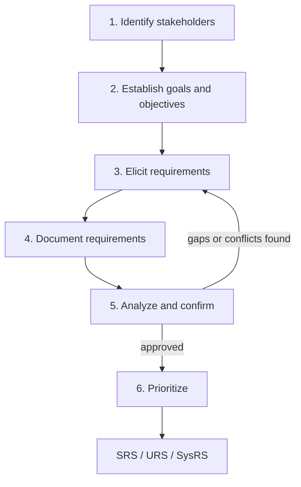
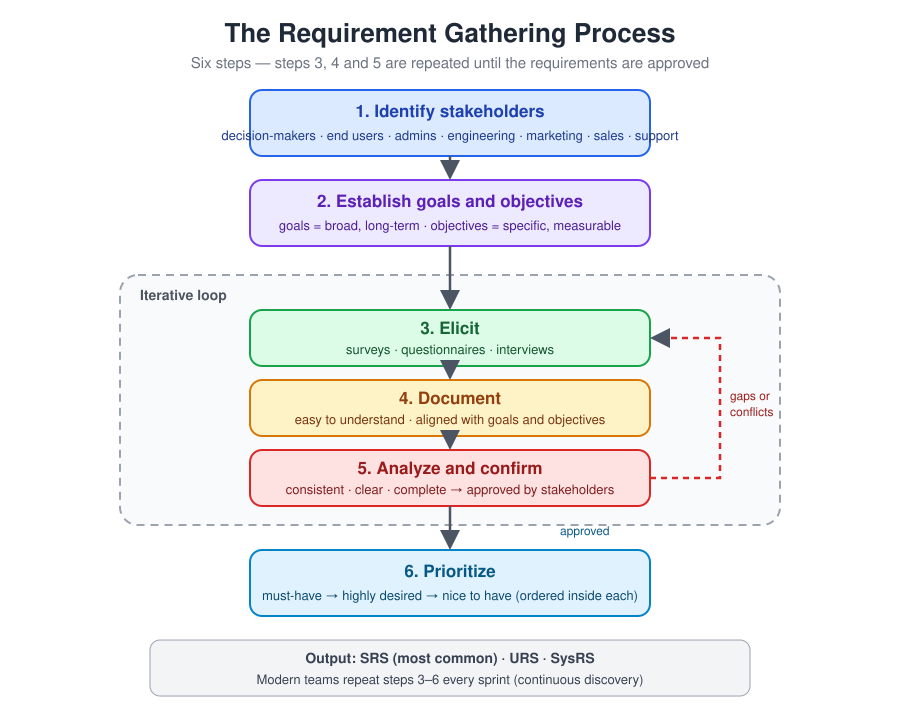
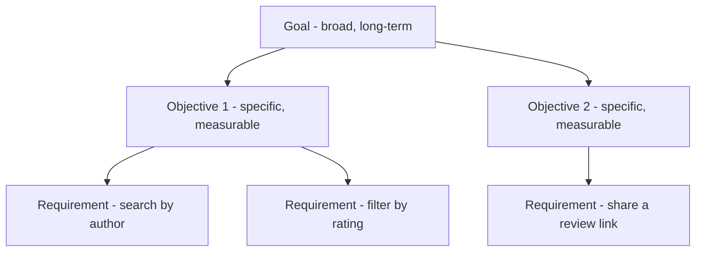
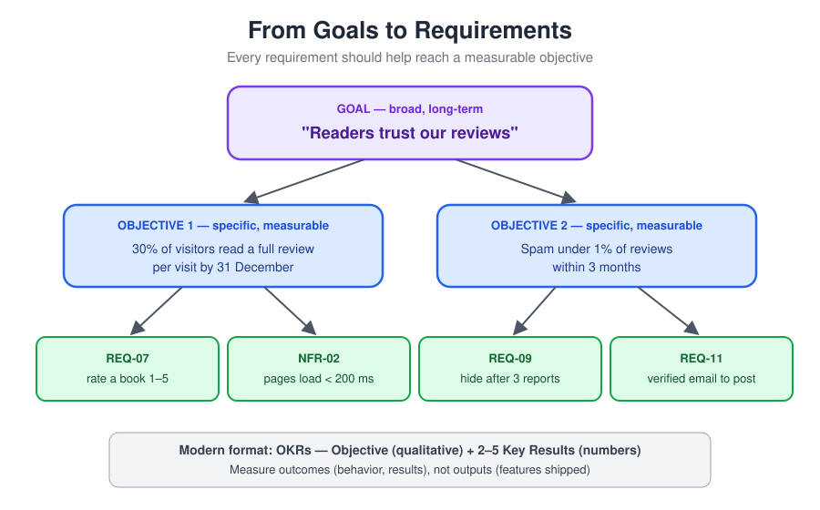
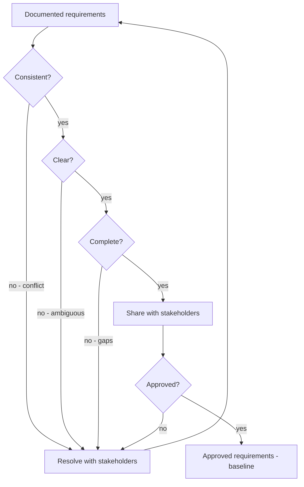
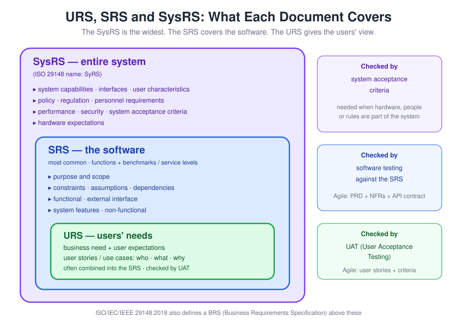
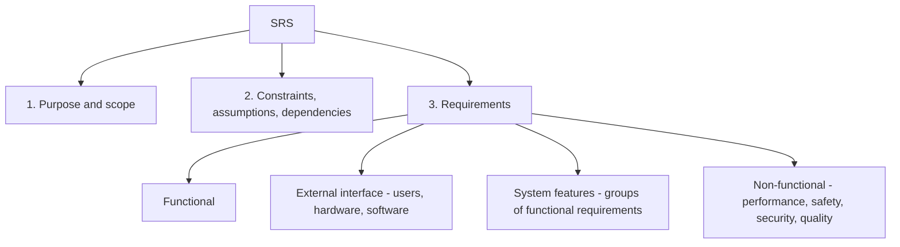
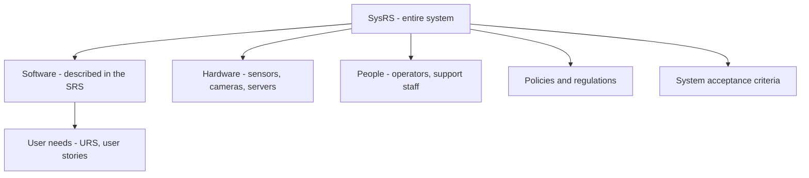

# 05 — Requirements

**Learning goals of this lecture:**

- **Describe** the steps of the requirement gathering process.
- **Explain** the purpose of a **URS (User Requirements Specification)** document.
- **Explain** the purpose of an **SRS (Software Requirements Specification)** document.
- **Explain** the purpose of a **SysRS (System Requirements Specification)** document.

> This note builds on [04 — Building Quality Software](04-building-quality-software.md), which already covers the full SRS **document template** (§3.2.1), user stories (§3.2.3) and advanced requirement practices (§3.2.4). Here we go deeper into the **process** and the **three document types**.

---

## 1. Jargon Translation

| Term | Official Definition | Simple Words | Analogy |
|------|--------------------|--------------|---------|
| **Requirement** | A statement of a need, a capability or a condition the software must meet. | One thing the software must do or be. | One item on a shopping list. |
| **Requirement gathering** | The process of defining a problem, then finding and documenting what the solution must do. Also called **requirements engineering** or **requirements elicitation and analysis**. | Finding out what to build, and writing it down. | A tailor measuring you before making a suit. |
| **Stakeholder** | Any person or group who affects, or is affected by, the product. | Everyone who cares about the result. | Everyone involved in a wedding: couple, families, caterer, venue. |
| **Decision-maker** | The stakeholder with the authority to approve scope, budget and priorities. | The person whose "yes" counts. | The couple choosing the wedding menu. |
| **End user** | The person who will actually use the software. | The person who clicks the buttons. | The guest who eats the food. |
| **Goal** | A broad, long-term outcome the organization wants to achieve. | The big "why". | "Become a fit person." |
| **Objective** | A specific, measurable result that shows progress toward a goal. | A concrete target with a number and a date. | "Run 5 km in under 30 minutes by June." |
| **Elicitation** | Drawing out requirements from stakeholders through techniques such as interviews, surveys and workshops. | Asking the right questions to find the real needs. | A doctor asking questions to find the real problem. |
| **Survey / questionnaire** | A fixed set of written questions sent to many people. | The same questions for many people. | A customer-feedback form in a hotel. |
| **Interview** | A conversation with one person or a small group to explore their needs. | A deep talk with one person. | A journalist interviewing an expert. |
| **Iterative** | Done in repeated cycles, improving each time. | Do it, check it, improve it, repeat. | Painting a wall in several coats. |
| **Consistency** | No two requirements contradict each other. | The requirements agree with each other. | A recipe that does not say both "bake 20 min" and "bake 40 min". |
| **Clarity** | Each requirement has only one possible meaning. | Everyone understands it the same way. | "Turn left at the red door", not "turn somewhere near there". |
| **Completeness** | Nothing needed is missing. | All the needs are there. | A packing list that includes your passport. |
| **Prioritization** | Ordering requirements by importance or value. | Deciding what comes first. | Packing the most important things first. |
| **URS (User Requirements Specification)** | A document describing the business needs and the end users' expectations of the system. | "What the users need", in their words. | A family's wish list for a new house. |
| **SRS (Software Requirements Specification)** | A document describing what the software must do and how well it must do it. | "What the software must do", in detail. | The architect's detailed plan for the house. |
| **SysRS (System Requirements Specification)** | A document describing the requirements of the **whole system**: software, hardware, people, policies and rules. (The ISO standard abbreviates it **SyRS**.) | "What the whole system must do", not only the software. | The plan for the whole house: building, plumbing, electricity, and who lives there. |
| **Benchmark / service level** | A measurable target for performance or quality. | A number the software must reach. | "Pizza delivered in under 30 minutes." |
| **Constraint** | A limit that the solution must respect and that restricts design options. | A rule you cannot break. | "The house must fit on this plot of land." |
| **Assumption** | Something believed to be true that has not been proven. | A guess we are treating as true. | "We assume the guests eat meat." |
| **Dependency** | Something the product needs from outside itself to work. | Something we rely on. | A house depends on the city water supply. |
| **Functional requirement** | What the system must **do**. | A feature. | A car must brake. |
| **External interface requirement** | How the software interacts with users, hardware and other software. | How it connects to the outside world. | The car's pedals, dashboard and charging plug. |
| **System feature** | A major capability of the system, described with its group of related functional requirements. | A big feature box with its smaller requirements inside. | "Climate control" (with heating, cooling, fan speed inside). |
| **Non-functional requirement (NFR)** | How **well** the system must work: performance, safety, security, quality. | A quality. | The car must brake from 100 km/h in under 40 m. |
| **User story** | A short requirement from the user's point of view: *"As a [who], I want [what], so that [why]."* | One small user need. | "As a driver, I want heated seats, so that I am warm in winter." |
| **Use case** | A step-by-step description of how a user (actor) interacts with the system to reach a goal. | The steps a user follows. | A recipe card with each cooking step. |
| **UAT (User Acceptance Testing)** | Testing by the intended users to confirm the software meets their needs. | Users check: "Is this what we asked for?" | The owner's final walk-through before buying the house. |
| **Acceptance criteria** | Conditions a requirement must meet to be accepted. | The checklist for "done". | "The tap does not leak; hot and cold both work." |
| **System acceptance criteria** | Conditions the whole system must meet before the customer accepts it. | The final checklist for the whole system. | The building inspector's checklist before people can move in. |
| **Baseline** *(industry term)* | An approved version of the requirements; later changes go through change control. | The "official" version everyone agreed on. | The signed version of a contract. |
| **Traceability** *(industry term)* | Linking each requirement to its source, design, code and tests. | Being able to follow a requirement from "who asked" to "how it was tested". | A parcel's tracking number from sender to door. |

---

## 2. Topics Introduced in the Lecture Transcript

1. **Learning goals** — the steps of requirement gathering; the purpose of the URS, SRS and SysRS.
2. **Requirement gathering is a six-step process** — defining a problem and documenting how to solve it.
3. **Step 1: Identify stakeholders** — usually from the requesting organization; key personnel; a representative from every affected group.
4. **Step 2: Establish goals and objectives** — goals are broad and long-term (customer outcomes, business goals); objectives are specific, actionable and measurable.
5. **Steps 3–5 are iterative** — eliciting, documenting and confirming are repeated.
6. **Step 3: Elicit requirements** — surveys, questionnaires and interviews.
7. **Step 4: Document requirements** — as they emerge; check alignment with goals and objectives; easy to understand.
8. **Step 5: Analyze and confirm** — consistency, clarity, completeness; shared with and approved by stakeholders.
9. **Step 6: Prioritize** — "must-have", "highly desired", "nice to have"; order within each category.
10. **Three resulting documents** — SRS, URS and SysRS; the SRS is the most common.
11. **The SRS** — functions plus benchmarks/service levels; parts: purpose, scope, constraints, assumptions, dependencies, and four requirement categories.
12. **The four requirement categories** — functional, external interface, system features (a subset of functional), non-functional (performance, safety, security, quality).
13. **The URS** — business needs and user expectations; user stories or use cases (who, what, why); verified by UAT; often combined into the SRS.
14. **The SysRS** — requirements of the entire system; broader than the SRS; often confused with it; capabilities, interfaces, user characteristics, policy, regulation, personnel, performance, security, acceptance criteria, hardware.
15. **Lecture summary** — the six steps and what each document contains.

---

## 3. Exhaustive Deep Dive

### 3.1 The Requirement Gathering Process — Overview

- **Requirement gathering** is a **six-step process** of:
  - **defining a problem** to be solved, and
  - **documenting how to go about solving** that problem.

  | # | Step | Main question | Output |
  |---|------|---------------|--------|
  | 1 | **Identify stakeholders** | Who cares about this product? | List of stakeholders (and a representative per group) |
  | 2 | **Establish goals and objectives** | Why are we building it? How will we measure success? | Goals + measurable objectives |
  | 3 | **Elicit requirements** | What do the stakeholders need? | Raw needs, notes, survey answers |
  | 4 | **Document requirements** | How do we write the needs down clearly? | Written requirements |
  | 5 | **Analyze and confirm** | Are they consistent, clear, complete? Do stakeholders agree? | Approved requirements |
  | 6 | **Prioritize** | What comes first? | Ordered list: must-have → highly desired → nice to have |

- **Steps 3, 4 and 5 are usually completed iteratively** — you elicit some needs, write them down, check them with stakeholders, discover new needs, and repeat.





#### 3.1.1 ✅ Modern Best Practice: requirements are discovered continuously, not gathered once

> **Lecture says:** requirement gathering is a six-step process; steps 3–5 are iterative.
> **Industry today:** the six steps still apply, but in Agile teams they run **broadly once at the start** and then **again every sprint** for the next small set of features. This is often called **continuous discovery**.

- **How it is done today:**
  - **Project start:** steps 1–2 fully (stakeholders, goals, success metrics), and steps 3–6 only at a **high level** (epics).
  - **Every sprint:** steps 3–6 again for the top of the backlog, in **backlog refinement** (developers and testers take part).
  - **After every release:** real usage data, support tickets and user feedback start a new round of step 3.
- **Why:** many requirements cannot be known until users see working software. Gathering everything up front creates documents that are out of date by the time the code is written.

| | Lecture model | Modern practice |
|---|---|---|
| When | Mostly at the start | At the start (broad) + every sprint (detailed) + after every release |
| Who elicits | Analysts | Product owner, designers, developers and testers together |
| Sources | Surveys, questionnaires, interviews | Those + workshops, prototypes, observation, product analytics, support tickets |
| Output | Large documents | Living backlog + short documents, all versioned |

---

### 3.2 Step 1 — Identify Stakeholders

- **Generally**, the stakeholders **work for the organization that requests the development** of the software product.
- **Key personnel** from that organization may include:

  | Stakeholder group | What they care about | Example question to ask them |
  |-------------------|----------------------|------------------------------|
  | **Decision-makers** | Budget, business value, deadlines | "What result makes this project worth the money?" |
  | **End users** | Ease of use, speed, solving their daily task | "Walk me through how you do this task today." |
  | **System administrators** | Installation, security, backups, user management | "How will you manage accounts and access?" |
  | **Engineering** | Feasibility, integration with existing systems | "Which systems must this connect to?" |
  | **Marketing** | Brand, positioning, features that attract customers | "What will make customers choose us?" |
  | **Sales** | Features customers ask for, pricing tiers | "Which missing feature loses us deals?" |
  | **Customer support** | Common problems, help tools, error messages | "What do customers complain about most?" |

- **It is good to have a representative from every group that the product affects.**
  - **Why:** a missing group means missing requirements. For example, if nobody from customer support is asked, the product may have no way to look up a customer's account — and support finds out only after launch.

#### 3.2.1 ✅ Modern Best Practice: stakeholder analysis, personas and the groups people forget

> **Lecture says:** stakeholders usually work for the requesting organization; include a representative from every affected group.
> **Industry today:** teams also **analyze** stakeholders (how much influence and interest they have), describe **end users as personas**, and always include groups that are easy to forget.

- **Power/interest grid** (a common stakeholder-analysis tool):

  | | **Low interest** | **High interest** |
  |---|---|---|
  | **High power** | **Keep satisfied** (for example a finance director) | **Manage closely** (sponsor, decision-maker) |
  | **Low power** | **Monitor** (for example a vendor's account manager) | **Keep informed** (end users, support team) |

- **Personas:** short, research-based profiles of typical users ("Priya, 34, reads on her phone during her commute, wants quick reviews"). They keep the team focused on real people.
- **Groups that are often forgotten:**
  - **Security, legal and compliance** (privacy laws, accessibility laws, contracts).
  - **Operations / SRE** (who runs and monitors the system).
  - **Data and analytics** teams (who need events and reports).
  - **External stakeholders:** regulators, partners, and **end users who are not employees** (for example the public using a website).
- **One named decision-maker:** many people give input, but one person approves scope and priorities. Record this in a **stakeholder register**.

---

### 3.3 Step 2 — Establish Goals and Objectives

- **The goals of the product should be clearly defined.**
  - **Goals** are **broad, long-term, achievable outcomes**.
  - Goals can include **customer outcomes** and **business goals**.
- **Next, objectives should be identified.**
  - **Objectives** are **more specific than goals**.
  - They are **actionable and measurable** and they **achieve the stated goals**.

  | | Goal | Objective |
  |---|---|---|
  | **Level** | Broad | Specific |
  | **Time** | Long-term | Short to medium term, with a date |
  | **Measurable?** | Usually not directly | **Yes** — has a number |
  | **Example (customer outcome)** | "Readers find good books faster." | "Users find a book with 4+ star reviews in under 30 seconds by Q3." |
  | **Example (business goal)** | "Become the top book-review site in our region." | "Reach 50,000 monthly active users within 12 months." |

> ⚠️ **Correction (wording):** the lecture calls objectives "actionable and measurable **actions**". More precisely, an objective is a measurable **result** (an outcome), not the action itself. "Run an ad campaign" is an action; "50,000 monthly active users by December" is the objective the action should achieve. Keeping this difference clear stops teams from measuring "work done" instead of "results achieved".
> **Lecture wording (for the quiz):** "actionable and measurable **actions**"; "Run an ad campaign"; "50,000 monthly active users by December"; "work done"; "results achieved" *(wording as recorded when this note was written; module 1 predates saved transcripts, so not re-checked against the video)*

- **Why goals and objectives come before requirements:** every requirement should help reach an objective. If a requested feature supports **no** objective, it is a candidate for "nice to have" or "not now".





#### 3.3.1 ✅ Modern Best Practice: SMART objectives, OKRs and success metrics

> **Lecture says:** goals are broad; objectives are specific, actionable and measurable.
> **Industry today:** objectives are written as **SMART** targets or as **OKRs**, and the product is judged by **outcomes** (changed user behavior, business results), not by the number of features shipped.

- **SMART objectives:** **S**pecific, **M**easurable, **A**chievable, **R**elevant, **T**ime-bound.
- **OKRs (Objectives and Key Results):** a popular format in tech companies.
  - **Objective** = what we want (qualitative, inspiring).
  - **Key results** = 2–5 measurable numbers that prove we got there.

  ```text
  Objective:   Readers trust our reviews.
  Key result 1: 30% of visitors read at least one full review per visit (today 12%).
  Key result 2: Fewer than 1% of reviews are reported as spam.
  Key result 3: App store rating of 4.5 or higher by 31 December.
  ```

  - Note: in OKRs, the word "objective" means the **qualitative** part — the measurable part is the **key result**. In the lecture's terms, key results are the "objectives".
- **Outcome over output:** "Shipped the search feature" is **output**. "Users find books 40% faster" is an **outcome**. Modern teams set targets on outcomes.
- **Success metrics go into the product brief** and are checked after each release (product analytics such as event tracking and funnels).

---

### 3.4 Steps 3–5 — Elicit, Document, Confirm (done iteratively)

- **The next three steps — eliciting, documenting and requirement confirmation — are usually completed iteratively.**

#### 3.4.1 Step 3 — Elicit requirements

- **Elicitation** can be accomplished through:

  | Technique | How it works | Strength | Weakness |
  |-----------|--------------|----------|----------|
  | **Surveys** | Short set of questions to many people, often online | Reaches many people cheaply; gives numbers | Shallow; people answer only what you ask |
  | **Questionnaires** | A more detailed, structured set of written questions | Consistent answers you can compare | Low response rates; no follow-up questions |
  | **Interviews** | Conversation with one person or a small group | Deep understanding; you can ask "why?" | Slow; depends on the interviewer's skill |

#### 3.4.2 ✅ Modern Best Practice: a wider elicitation toolbox

> **Lecture says:** elicitation is done through surveys, questionnaires and interviews.
> **Industry today:** these three are still used, but they only capture what people **say**. Teams add techniques that show what people **do** and that make ideas **visible**.

| Technique (not in the lecture) | What it is | Best for |
|--------------------------------|-----------|----------|
| **Workshops** (story mapping, example mapping, EventStorming) | Stakeholders and the team work together in one session | Agreeing on scope and rules quickly; resolving conflicts |
| **Observation / contextual inquiry** | Watch users do their real work, in their real place | Finding needs users forget to mention ("work-arounds") |
| **Prototyping** | Clickable mock-ups (for example in Figma) that users try | Non-technical stakeholders; UI (User Interface) requirements |
| **Document analysis** | Read existing manuals, forms, laws, old system specs | Business rules and legal requirements |
| **Product analytics** | Look at real usage data (funnels, drop-off points) | Finding what really happens, not what people say |
| **Support tickets and reviews** | Read customer complaints and app-store reviews | Pain points and missing features |
| **Competitor analysis** | Study similar products | Expected "basic" features |
| **Jobs To Be Done (JTBD) interviews** | Ask what "job" the user is trying to get done and what they use today | Understanding the real motivation behind a request |

- **Interview tips:**
  - Ask about **past behavior** ("Tell me about the last time you…"), not about the future ("Would you use…?"). People are poor at predicting what they will do.
  - Keep asking **"why?"** to find the real need behind a requested feature.
  - Ask for **examples** and **exceptions** ("What happens when it goes wrong?").
  - **Record** (with permission) and **summarize in writing** the same day.

#### 3.4.3 Step 4 — Document requirements

- **As the requirements emerge, they should be documented.**
- They should be **checked to ensure they align with the goals and objectives.**
- **Documented requirements should be easily understood by stakeholders and the project team.**
  - Stakeholders must understand them to **approve** them.
  - The team must understand them to **build and test** them.

#### 3.4.4 ✅ Modern Best Practice: write requirements that can be tested

> **Lecture says:** document requirements so stakeholders and the team can understand them.
> **Industry today:** every requirement also gets an **ID**, a **source**, a **priority** and **acceptance criteria**, and is written in a **pattern** that removes ambiguity.

- **User stories with acceptance criteria** for user-facing needs (see [note 04 §3.2.3](04-building-quality-software.md)):

  ```gherkin
  # REQ-07 — As a reader, I want to rate a book from 1 to 5, so that others can judge it.
  Scenario: Rating outside the range is rejected
    Given I am logged in
    When I submit a rating of 6
    Then I see "Rating must be between 1 and 5"
    And the rating is not saved
  ```

- **EARS (Easy Approach to Requirements Syntax)** for system behavior. Developed at **Rolls-Royce** (Alistair Mavin and colleagues, 2009), it uses five sentence patterns:

  | Pattern | Keyword | Template | Example |
  |---------|---------|----------|---------|
  | **Ubiquitous** (always true) | — | The `<system>` shall `<response>`. | The API shall return all dates in ISO 8601 format. |
  | **Event-driven** | **When** | When `<trigger>`, the `<system>` shall `<response>`. | When a review is reported 3 times, the system shall hide it for moderation. |
  | **State-driven** | **While** | While `<state>`, the `<system>` shall `<response>`. | While the database is in maintenance mode, the API shall return HTTP (HyperText Transfer Protocol) 503 with a `Retry-After` header. |
  | **Unwanted behavior** | **If … then** | If `<unwanted condition>`, then the `<system>` shall `<response>`. | If a login fails 5 times in 10 minutes, then the system shall lock the account for 15 minutes. |
  | **Optional feature** | **Where** | Where `<feature is included>`, the `<system>` shall `<response>`. | Where single sign-on is enabled, the system shall redirect users to the identity provider. |

- **Bad vs. good requirements:**

  | ❌ Vague | ✅ Testable |
  |---------|-------------|
  | "The system should be fast." | "95% of search requests shall respond in under 300 ms with 1,000 concurrent users." |
  | "The app must be secure." | "Passwords shall be hashed with Argon2id; the API shall meet OWASP ASVS 5.0 level 2." |
  | "Users can easily find books." | "A user shall find a book by title, author or ISBN (International Standard Book Number) from the home page in at most 2 clicks." |
  | "The system should handle errors." | "If the payment provider does not respond within 5 s, then the system shall show 'Payment delayed' and retry once." |

- **Words to avoid** (they cannot be tested): *fast, easy, user-friendly, flexible, robust, etc., and/or, as appropriate, should (when you mean "must")*.

#### 3.4.5 Step 5 — Analyze and confirm requirements

- **To confirm the requirements, they should be analyzed to ensure:**
  - **Consistency** — no requirement contradicts another.
  - **Clarity** — each has only one meaning.
  - **Completeness** — nothing needed is missing.
- **After analysis, the requirements should be shared with and approved by the stakeholders.**



#### 3.4.6 ✅ Modern Best Practice: quality characteristics, validation vs. verification, and baselines

> **Lecture says:** analyze for consistency, clarity and completeness, then get stakeholder approval.
> **Industry today:** teams check a fuller list of quality characteristics, separate **validation** from **verification**, and **baseline** approved requirements so later changes are controlled.

- **Characteristics of a good individual requirement** (the international standard **ISO/IEC/IEEE 29148** lists characteristics like these):

  | Characteristic | Question |
  |----------------|----------|
  | **Necessary** | If we remove it, is something important missing? |
  | **Unambiguous** (clear) | Can it be read only one way? |
  | **Complete** | Does it contain everything needed to build and test it? |
  | **Singular** | Does it state **one** thing (no "and/or")? |
  | **Feasible** | Can it be built with the time, money and technology we have? |
  | **Verifiable** | Can we prove it with a test, inspection, demonstration or analysis? |
  | **Correct** | Does it describe what the stakeholder really needs? |
  | **Consistent** (as a set) | Does it agree with all other requirements? |

- **Validation vs. verification of requirements:**
  - **Validation** — "Are we building the **right** thing?" Check requirements against the stakeholders' real needs (reviews, prototypes, demos).
  - **Verification** — "Are the requirements **written right**?" Check them against the quality characteristics above.
- **Review techniques:** walkthroughs with stakeholders, peer reviews by developers and testers ("can I build this? can I test this?"), and **prototype reviews** (users react to screens).
- **Written approval:** confirmation is recorded (a signed document, an approval in the tracking tool, or a written email) — not only said in a meeting.
- **Baseline and change control:** once approved, the set is a **baseline**. Later changes are tracked: in Agile, by editing the backlog with the product owner; in contract or regulated projects, by a formal **change request** with cost and time impact.

---

### 3.5 Step 6 — Prioritize

- **After confirmation, requirements should be prioritized.**
- **Labels** such as these are helpful:
  - **"Must-have"** — required; the product fails without it.
  - **"Highly desired"** — important, but the product can work without it for now.
  - **"Nice to have"** — extra value if there is time.
- **If possible, order the requirements within those categories** — so the team knows which "must-have" comes first.

#### 3.5.1 ✅ Modern Best Practice: prioritization frameworks and a continuously ordered backlog

> **Lecture says:** label requirements "must-have", "highly desired", "nice to have", and order them within each label.
> **Industry today:** teams use named frameworks that add **value, cost and risk**, and keep **one ordered backlog** that is re-ordered every sprint.

| Framework | How it works | Best for |
|-----------|--------------|----------|
| **MoSCoW** | **M**ust have, **S**hould have, **C**ould have, **W**on't have (this time). The modern version of the lecture's three labels, plus an explicit "won't" list. Guideline: Must haves no more than about 60% of the effort | Agreeing scope with clients; fixed-date projects |
| **RICE** | Score = **R**each × **I**mpact × **C**onfidence ÷ **E**ffort | Product teams comparing many feature ideas |
| **WSJF** (Weighted Shortest Job First) | **Cost of delay ÷ job size** — do small, urgent, valuable work first (used in SAFe, the Scaled Agile Framework) | Large organizations with many teams |
| **Kano model** | Sorts features into **basic** (expected — missing them makes users angry), **performance** (more is better) and **delighters** (unexpected joy) | Deciding which features users expect vs. which make them happy |
| **Value vs. effort matrix** | 2×2 grid: quick wins (high value, low effort) first | Fast, simple decisions in a workshop |

- **One ordered backlog:** labels are useful, but in the end there is **one list in order**, owned by the product owner, and it is **re-ordered every sprint** as new information arrives.
- **Prioritize by objective:** a requirement that moves a key result is worth more than one that does not.
- **Risk first:** risky or uncertain items are often done early, so problems appear while they are still cheap to fix.

---

### 3.6 The Three Requirement Documents

- **Typically, there may be three documents** that result from the requirements gathering process:
  1. **SRS — Software Requirements Specification**
  2. **URS — User Requirements Specification**
  3. **SysRS — System Requirements Specification**
- **The most common of these is the SRS.**

| | **URS** | **SRS** | **SysRS** |
|---|---|---|---|
| **Point of view** | The **users and the business** | The **software** | The **whole system** (software + hardware + people + rules) |
| **Main content** | Business needs and user expectations, as **user stories** or **use cases** | Software functions + **benchmarks / service levels**; four requirement categories | System capabilities, interfaces, user characteristics, policy, regulation, personnel, performance, security, **hardware**, system acceptance criteria |
| **Answers** | Who needs what, and why? | What must the software do, and how well? | What must the entire system do, with which hardware, people and rules? |
| **Checked by** | **UAT (User Acceptance Testing)** | Software testing against the SRS | **System acceptance** against the system acceptance criteria |
| **How common** | Often **combined into the SRS** | **Most common** | Less common; many software projects write an SRS instead |



#### 3.6.1 ✅ Modern Best Practice: the standard names, and how Agile teams map them

> **Lecture says:** there are three documents — SRS, URS and SysRS.
> **Industry today:** the international standard uses slightly different names, the URS is mainly a term from **regulated industries**, and Agile teams usually replace these documents with lighter, living artifacts.

- **Names in ISO/IEC/IEEE 29148:2018** (the requirements engineering standard; it replaced IEEE 830 and was re-confirmed by ISO in 2024; a revision is under way, per iso.org). It describes **four** requirement documents ("information items"), from the business view down to the software:

  | ISO 29148 name | Closest lecture term | Content |
  |----------------|----------------------|---------|
  | **BRS** — Business Requirements Specification | (part of the URS / SRS scope) | Business purpose, goals, business processes |
  | **StRS** — Stakeholder Requirements Specification | **URS** | Needs of users and other stakeholders |
  | **SyRS** — System Requirements Specification | **SysRS** | The whole system (hardware, software, people) |
  | **SRS** — Software Requirements Specification | **SRS** | The software part |

  - The standard allows combining documents (for example StRS with SyRS) when that is simpler.
- **Where "URS" is the standard term:** in **pharmaceutical and medical** companies that must **validate** computer systems for regulators, the **URS** is a core document. The industry guide **GAMP 5 (2nd edition, 2022)** treats the URS as the starting point of validation, requires **objective, verifiable** user requirements, and explicitly supports **Agile, iterative** work.
- **How Agile product teams map the three documents:**

  | Classic document | Agile equivalent |
  |------------------|------------------|
  | URS | **User stories + acceptance criteria** in the backlog; personas; a short **PRD** (Product Requirements Document) per feature |
  | SRS | PRD + **non-functional requirements as numbers** (SLOs) + **API contract** (OpenAPI) + design docs |
  | SysRS | **Architecture docs** (C4 diagrams), **infrastructure as code**, operational requirements (SLOs, backups, security) |

---

### 3.7 The SRS (Software Requirements Specification) in Detail

- The **SRS** is a document that:
  - **captures the functionalities** that the software should perform, and
  - **establishes benchmarks or service levels** for its performance (for example "99.9% uptime", "responds in under 200 ms").
- **Parts of an SRS** (as listed in the lecture):
  1. A **purpose statement** — the **intended use of the SRS**, its **audience** and **scope**.
  2. **Constraints, assumptions and dependencies.**
  3. **Requirements**, sorted into **four categories**: functional, external interface, system features, non-functional.
- For the full, widely used SRS layout (introduction, overall description, interfaces, features, non-functional requirements, appendices), see [note 04 §3.2.1](04-building-quality-software.md).

#### 3.7.1 Part 1 — Purpose and scope

- **The product's purpose** describes **who will have access to the SRS** and **how they should use it**.

> ⚠️ **Correction (confusing wording):** the lecture says "the **product's** purpose describes who will have access to the SRS and how they should use it". That describes the **document's** purpose (its intended audience and use) — not the product's purpose. In a real SRS, the **Purpose** section says what the *document* is for and who reads it (developers, testers, the client); the **product's** purpose (what problem it solves) belongs in the **Scope** or **Product overview** section.
> **Lecture wording (for the quiz):** "the **product's** purpose describes who will have access to the SRS and how they should use it" *(wording as recorded when this note was written; module 1 predates saved transcripts, so not re-checked against the video)*

- **The scope** describes the **benefits** of the software, its **goals** and its **objectives**.

#### 3.7.2 Part 2 — Constraints, assumptions and dependencies

| Item | Lecture definition | Example |
|------|--------------------|---------|
| **Constraints** | Describe **how the product must operate under given conditions** that may **limit options in the design phase** | Conformance to standards (for example WCAG 2.2 AA, PCI DSS for card payments), hardware limitations, a required cloud provider, a fixed budget |
| **Assumptions** | May include things like a **required operating system or hardware** needed by the software to function | "Users have a modern browser"; "the client's server runs Linux" |
| **Dependencies** | **Dependencies on other software products** should be noted | A payment provider's API; an email service; the client's identity provider |

> ⚠️ **Correction (transcription):** the lecture text says constraints may include "**confirmation** to standards". The correct term is **conformance** (or conformity) to standards — meaning the product must follow a standard.
> **Lecture wording (for the quiz):** "**confirmation** to standards" *(wording as recorded when this note was written; module 1 predates saved transcripts, so not re-checked against the video)*

> ⚠️ **Clarification:** the lecture's assumption example ("a required operating system or hardware") is really an **environment requirement or constraint** once it is *required*. An **assumption** is something we **believe is true but have not confirmed** — for example "*we assume* all users already have a company account". The difference matters: a constraint is a fixed fact, while an assumption is a **risk** that must be checked, because if it is wrong, the plan changes.

#### 3.7.3 Part 3 — The four requirement categories

| Category | Lecture definition | Example (Book Review API) |
|----------|--------------------|---------------------------|
| **Functional** | Requirements that cover the **functionalities** of the software | "A logged-in user can post a review with a rating from 1 to 5." |
| **External interface** | The **behavior of the software in relation to external entities** such as **users** and **interactions with other hardware or software** | "Book data is loaded from an external ISBN lookup API." "The review form works with a screen reader." |
| **System features** | A **subset of functional requirements**; **required features for the system to function** | "Reviews" feature: post, edit, delete, report a review. |
| **Non-functional** | Performance, **safety**, **security** and **quality** standards | "95% of requests under 200 ms." "All traffic uses TLS (Transport Layer Security)." |

> ⚠️ **Clarification:** the lecture calls system features "a **subset** of functional requirements". In the common SRS template (IEEE 830 / Karl Wiegers), a **system feature is a group** that **contains** related functional requirements — for example the feature "Reviews" groups REQ-07 (post), REQ-08 (delete) and REQ-09 (report). So it is better to say: functional requirements are **organized under** system features. For the quiz, remember the lecture wording: "a subset of functional requirements".



#### 3.7.4 ✅ Modern Best Practice: a living, measurable, traceable SRS

> **Lecture says:** the SRS captures functions and sets benchmarks or service levels.
> **Industry today:** where an SRS is used, it is **kept in version control**, its numbers are written as **SLOs**, and every requirement is **traceable** to tests.

- **Service levels as SLOs:** write "99.9% of requests succeed per 30 days" (an **SLO — Service Level Objective**) instead of "the system must be reliable". The **SLA (Service Level Agreement)** is the looser, contractual version promised to the customer.
- **Non-functional checklist from a quality model:** use **ISO/IEC 25010** (software quality model) as a checklist so no quality area is forgotten — for example performance efficiency, reliability, security, maintainability, compatibility, and usability (called *interaction capability* in the 2023 edition).
- **Security requirements from a standard:** pick an **OWASP ASVS 5.0** level (1, 2 or 3) and use its requirements as testable security requirements.
- **Docs as code:** the SRS (or PRD) is Markdown in Git, reviewed in pull requests, with a change history.
- **RTM (Requirements Traceability Matrix):** a table linking each requirement ID → design → code → tests → test result. Required in regulated industries; useful everywhere (see the script in §5.2).

---

### 3.8 The URS (User Requirements Specification)

- **User requirements** describe the **business need** and the **expectations of the end users** from the software system.
- They are written as **"user stories"** or **"use cases"** that answer **three questions**:
  1. **Who** is the user?
  2. **What** is the function that needs to be performed?
  3. **Why** does the user want this functionality?
- **User acceptance testing (UAT) determines if these requirements have been met.**
- **Often, the user requirements and software requirements are combined into a single SRS document.**
- **The SRS details the expectations of the software system.**

| Format | Template | Example |
|--------|----------|---------|
| **User story** | As a **[who]**, I want **[what]**, so that **[why]**. | As a **reader**, I want to **filter books by rating**, so that **I only see well-reviewed books**. |
| **Use case** | Actor, goal, preconditions, main flow, alternative flows | **Actor:** reader. **Goal:** find a well-rated book. **Main flow:** 1. Open search. 2. Choose "4+ stars". 3. See results. **Alternative:** 3a. No results → show "Try fewer filters". |

> ⚠️ **Clarification:** the "who / what / why" pattern is the **user story** format. A **use case** clearly states **who** (the actor) and **what** (the goal and the steps), but often does **not** state **why** — add the business reason separately when you use use cases.

#### 3.8.1 ✅ Modern Best Practice: user requirements as stories with acceptance criteria — tested automatically and by people

> **Lecture says:** user requirements are user stories or use cases, checked by UAT.
> **Industry today:** user stories carry **acceptance criteria** written before building; many criteria are **automated** as acceptance tests in CI (Continuous Integration), and humans still do a final **UAT** for usability and fit.

- **Three Cs of a user story** (Ron Jeffries): **Card** (the short story), **Conversation** (the details discussed with the team), **Confirmation** (the acceptance criteria).
- **Acceptance criteria in Given/When/Then** (BDD — Behavior-Driven Development) can run as automated tests, so "has this requirement been met?" is answered on **every** commit, not only in UAT.
- **UAT is still needed:** automated tests prove the software does what was written; UAT proves that what was written is what users actually need.
- **Jobs To Be Done** phrasing is sometimes used instead of personas: *"When I [situation], I want to [motivation], so I can [expected outcome]."*

---

### 3.9 The SysRS (System Requirements Specification)

- The **System Requirement Specification** document is abbreviated **SysRS** here, **to differentiate it from the SRS**.
- It **clearly outlines the requirements of an entire system**.
- The SysRS is **often used interchangeably** with the software requirement specification, but the **SysRS is actually broader in scope** than the SRS.
- **Many software projects develop an SRS rather than a SysRS.**
- **The SysRS contains:**
  - **System capabilities** — what the whole system can do.
  - **Interfaces** — between subsystems, hardware, software and people.
  - **User characteristics** — who the users are (skills, training, environment).
- **It may also include:**

  | Requirement type | Example (smart parking system) |
  |------------------|--------------------------------|
  | **Policy requirements** | "Parking data is deleted after 30 days (company data policy)." |
  | **Regulation requirements** | "Payment terminals meet PCI DSS (Payment Card Industry Data Security Standard)." |
  | **Personnel requirements** | "Two trained operators monitor the system during opening hours." |
  | **Performance requirements** | "A gate opens within 2 seconds after a valid ticket is scanned." |
  | **Security requirements** | "Only administrators can change parking prices; all access is logged." |
  | **System acceptance criteria** | "The system runs 30 days in the pilot garage with fewer than 1 gate failure per 1,000 cars." |
  | **Hardware expectations** | "Each gate has a camera with at least 1080p resolution and works from −20 °C to +50 °C." |

- **It outlines expectations of the hardware needed** for the system **in addition to software requirements**.



#### 3.9.1 ✅ Modern Best Practice: when you really need a SysRS today

> **Lecture says:** the SysRS covers the whole system, including hardware; many software projects write an SRS instead.
> **Industry today:** a full SysRS is common in **systems engineering** — products that combine hardware and software — while cloud software projects describe "the system" through architecture docs and **infrastructure as code**.

- **Write a SysRS (SyRS) when** the product includes **hardware, devices or people-based operations**:
  - IoT (Internet of Things) and embedded systems (smart parking, factory sensors).
  - Medical devices, cars, aircraft, defense and space systems (often required by regulators or contracts).
  - Systems engineering teams often model these requirements with **SysML (Systems Modeling Language)** and follow guidance from **INCOSE** (International Council on Systems Engineering).
- **For a typical cloud backend** (like the course projects), "hardware" becomes **cloud infrastructure**:
  - Capacity and scaling requirements (CPU, memory, autoscaling limits).
  - Environments, regions, backups and disaster recovery (RPO — Recovery Point Objective, RTO — Recovery Time Objective).
  - All of it described as **infrastructure as code** (for example Terraform, Kubernetes manifests) and reviewed like software.

---

### 3.10 Often-Missed Parts: What a Senior Engineer Adds (not in the lecture — industry practice)

| Area | What to add | Why |
|------|-------------|-----|
| **Change management** | A baseline + a clear process for changes (backlog for internal work; change requests with cost and time for contracts) | Requirements **will** change; uncontrolled change ("scope creep") breaks budgets |
| **Traceability** | Requirement IDs linked to code (PRs, commits) and tests; an RTM in regulated projects | Prove every requirement is built and tested; see the impact of a change |
| **Security requirements** | OWASP ASVS level; **abuse cases** ("As an attacker, I want…"); threat model input | Security added late is expensive and weak |
| **Privacy requirements** | List personal data, purpose, retention and deletion; **GDPR** (General Data Protection Regulation) where it applies | Legal duty; users' trust |
| **Accessibility** | **WCAG 2.2 AA** as a requirement; in the EU (European Union), the **European Accessibility Act** applies to many consumer products since June 2025 | Legal duty in many markets; quality for all users |
| **Operational requirements** | SLOs, logging, monitoring, backups, support hours | The system must be **run**, not only built |
| **Data requirements** | Data sources, volumes, quality rules, migration of old data | Data problems are a top reason projects are late |
| **Requirements tools** | Jira, Azure DevOps, GitHub Issues; in regulated industries, tools such as **Jama Connect**, **IBM DOORS Next** or **Siemens Polarion** that manage traceability | The tool holds the single source of truth |
| **AI-assisted requirements** | AI can summarize interviews, draft stories, find missing edge cases and spot contradictions — **a human checks every requirement**; no confidential data in unapproved tools | Faster drafts; humans stay responsible |

#### 3.10.1 "Done enough when…" checklist for requirements

- [ ] Every affected stakeholder group has a **representative**, and one **decision-maker** is named.
- [ ] **Goals** are written, and each has **measurable objectives** (SMART or OKR key results).
- [ ] Elicitation used **more than one technique** (for example interviews + prototype + data).
- [ ] Every requirement has an **ID**, a **source**, a **priority** and **acceptance criteria**.
- [ ] Requirements pass the quality check: **necessary, unambiguous, singular, feasible, verifiable, consistent, complete**.
- [ ] **Non-functional** requirements are **numbers** (SLOs), including security (ASVS level), privacy and accessibility.
- [ ] Constraints, **assumptions** (each one checked) and **dependencies** are listed.
- [ ] Stakeholders **approved in writing**; the approved set is a **baseline**, and the **change process** is agreed.
- [ ] Requirements are **prioritized** (MoSCoW or another framework) into **one ordered backlog**.
- [ ] Each requirement is **traceable** to its tests.

---

### 3.11 Lecture Summary

- The **requirement gathering process** entails **identifying stakeholders**, **establishing goals and objectives**, and **eliciting**, **documenting**, **confirming**, and then **prioritizing** requirements.
- The **SRS** documents **functional**, **external**, **system** (features) and **non-functional** requirements.
- The **URS** documents **user stories**.
- The **SysRS** documents **system capabilities** and **acceptance criteria**, and **policy**, **regulation**, **personnel**, **performance**, **security** and **hardware** requirements.

| Topic | Lecture | ✅ Modern best practice |
|-------|---------|--------------------------|
| Process | Six steps; steps 3–5 iterative | Continuous discovery: broad at the start, detailed every sprint, new input after every release |
| Stakeholders | Representative from every affected group | Power/interest grid, personas, forgotten groups (security, legal, ops), one named decision-maker |
| Goals and objectives | Broad goals, measurable objectives | SMART objectives, OKRs, outcome over output |
| Elicitation | Surveys, questionnaires, interviews | + workshops, observation, prototypes, analytics, support tickets, JTBD |
| Documentation | Easy to understand | IDs, acceptance criteria (Given/When/Then), EARS patterns, no vague words |
| Confirmation | Consistency, clarity, completeness; approval | ISO 29148 quality characteristics; validation vs. verification; written approval; baseline + change control |
| Prioritization | Must-have, highly desired, nice to have | MoSCoW, RICE, WSJF, Kano; one ordered backlog |
| Documents | SRS, URS, SysRS | ISO 29148 names (BRS, StRS, SyRS, SRS); URS in regulated pharma (GAMP 5); Agile: backlog + PRD + architecture docs |

---

## 4. Concrete Examples

### 4.1 The Book Review API (course project) through the six steps

| Step | What the team does |
|------|--------------------|
| **1. Stakeholders** | Decision-maker: the site owner. End users: readers and reviewers. Admins: moderators. Support: handles spam complaints. Marketing: wants shareable review links. Security/legal: personal data (emails). |
| **2. Goals and objectives** | Goal: "Readers trust our reviews." Objectives: "30% of visitors read a full review by Q4"; "spam under 1% of reviews". |
| **3. Elicit** | Interviews with 5 readers and 2 moderators; a survey to 500 newsletter users; a clickable prototype of the review form; reading the old site's support tickets. |
| **4. Document** | REQ-07 (rate 1–5) as a user story with Given/When/Then; NFR-02 "95% of requests under 200 ms"; EARS: "If a review is reported 3 times, then the system shall hide it for moderation." |
| **5. Analyze and confirm** | Conflict found: marketing wants anonymous reviews, moderators want real names → decided: display names, verified emails. The site owner approves the list in writing. |
| **6. Prioritize** | Must: post/read reviews, login, spam reporting. Should: search by author. Could: share links. Won't (this time): mobile app. |
| **Documents** | One **SRS** (with the user stories inside it — the URS is combined); no SysRS, because there is no special hardware. |

### 4.2 Which document? Three projects

| Project | Main document(s) | Why |
|---------|------------------|-----|
| Book Review API (web backend) | **SRS** (user stories included) or, in Agile, PRD + backlog | Software only |
| Smart parking garage (cameras, gates, payment terminals, operators) | **SysRS** + an **SRS** for each software part | Hardware, people and regulations are part of the system |
| Laboratory system in a pharmaceutical company | **URS** first (GAMP 5 validation), then functional specification / SRS | Regulators expect a verified URS as the start of validation |

### 4.3 Quick practice: constraint, assumption or dependency?

| Statement | Type |
|-----------|------|
| "The site must meet WCAG 2.2 AA." | **Constraint** (conformance to a standard) |
| "We assume readers already have an email address." | **Assumption** (not confirmed yet — a risk) |
| "Book details come from the Open Library API." | **Dependency** (another software product) |
| "The system must run on the client's existing Azure subscription." | **Constraint** (limits design options) |
| "The payment provider must be available for checkout to work." | **Dependency** |

### 4.4 Quick practice: goal or objective?

| Statement | Type |
|-----------|------|
| "Make reviewing books fun." | **Goal** |
| "Increase reviews per active user from 0.5 to 1.2 per month by 30 June." | **Objective** |
| "Be the most trusted review site." | **Goal** |
| "Reduce spam reports to under 1% of reviews within 3 months." | **Objective** |

---

## 5. Code Blocks

### 5.1 Requirements as data (docs as code)

Keeping requirements in a structured file in Git gives you IDs, review by pull request, history and automated checks.

```json
{
  "requirements": [
    {
      "id": "REQ-07",
      "type": "functional",
      "feature": "Reviews",
      "priority": "must",
      "source": "Interview with readers, 2026-11-02",
      "objective": "OBJ-1",
      "story": "As a reader, I want to rate a book from 1 to 5, so that others can judge it.",
      "acceptance": [
        "Given I am logged in, when I submit rating 4, then the rating is saved",
        "Given I am logged in, when I submit rating 6, then I get HTTP 400 and nothing is saved"
      ]
    },
    {
      "id": "REQ-09",
      "type": "functional",
      "feature": "Reviews",
      "priority": "must",
      "source": "Moderator workshop, 2026-11-04",
      "objective": "OBJ-2",
      "ears": "If a review is reported 3 times, then the system shall hide it for moderation."
    },
    {
      "id": "NFR-02",
      "type": "non-functional",
      "priority": "must",
      "source": "Site owner",
      "objective": "OBJ-1",
      "ears": "The API shall respond to 95% of requests in under 200 ms at 500 requests per second."
    }
  ]
}
```

### 5.2 Traceability check: is every requirement tested?

A small Node.js script that reads `requirements.json`, scans the `test/` folder for requirement IDs in test names, and fails CI if a **must** requirement has no test.

```js
// scripts/check-traceability.js — run with: node scripts/check-traceability.js
// Uses ES modules and top-level await: package.json needs "type": "module" (or name the file .mjs)
import { readFile, readdir } from "node:fs/promises";
import path from "node:path";

const { requirements } = JSON.parse(await readFile("requirements.json", "utf8")); // load the requirement list
const ids = new Set(requirements.map((r) => r.id));                               // all known IDs

// Read every .js file under test/ (recursive: true needs Node 20+)
const files = (await readdir("test", { recursive: true })).filter((f) => f.endsWith(".js"));
const tested = new Set();
const unknown = [];

for (const file of files) {
  const text = await readFile(path.join("test", file), "utf8");
  for (const [id] of text.matchAll(/\b(?:REQ|NFR)-\d+\b/g)) {   // find IDs like REQ-07 or NFR-02
    if (ids.has(id)) tested.add(id);
    else unknown.push(`${id} in ${file}`);                        // test points to a requirement that does not exist
  }
}

const untestedMust = requirements.filter((r) => r.priority === "must" && !tested.has(r.id));

for (const r of untestedMust) console.error(`❌ ${r.id} (must) has no test`);
for (const u of unknown) console.error(`⚠️  Unknown requirement ID: ${u}`);

// Exit code 1 fails the CI job, so untested must-have requirements block the merge
process.exitCode = untestedMust.length > 0 || unknown.length > 0 ? 1 : 0;
console.log(`Traceability: ${tested.size}/${ids.size} requirements have at least one test.`);
```

```js
// test/reviews.test.js — put the requirement ID in the test name so it can be traced
import { test } from "node:test";
import assert from "node:assert/strict";
import { isValidRating } from "../src/rating.js";

test("REQ-07: rating 6 is rejected", () => {
  assert.equal(isValidRating(6), false);
});
```

**What happens if…** a requirement is renamed in `requirements.json` (REQ-07 → REQ-07a) but the tests are not updated?
- The script reports `Unknown requirement ID: REQ-07` **and** `REQ-07a (must) has no test`, and CI fails.
- ✅ That is the goal: a change in requirements cannot silently break the link to its tests. Change the ID and the test name in the **same pull request**.

**What happens if…** you only check that a test *mentions* the ID?
- A test named "REQ-07" that asserts nothing would still "pass" the trace check.
- ✅ Traceability shows **coverage of requirements**, not **quality of tests** — code review and mutation testing are still needed (see [note 04 §3.5.4](04-building-quality-software.md)).

### 5.3 Prioritization: RICE scores in code

```js
// scripts/rice.js — score feature ideas: (Reach × Impact × Confidence) ÷ Effort
const ideas = [
  // reach = users per quarter; impact: 3 massive, 2 high, 1 medium, 0.5 low, 0.25 minimal
  // confidence as a fraction (0.8 = 80%); effort in person-months
  { id: "REQ-12 search by author", reach: 8000, impact: 1, confidence: 0.8, effort: 1 },
  { id: "REQ-15 share review link", reach: 3000, impact: 0.5, confidence: 1.0, effort: 0.5 },
  { id: "REQ-20 mobile app", reach: 6000, impact: 2, confidence: 0.5, effort: 6 },
];

const rice = ({ reach, impact, confidence, effort }) => (reach * impact * confidence) / effort;

ideas
  .map((idea) => ({ ...idea, score: Math.round(rice(idea)) }))
  .sort((a, b) => b.score - a.score)                       // highest score first
  .forEach((i) => console.log(`${String(i.score).padStart(6)}  ${i.id}`));
// Output:
//   6400  REQ-12 search by author
//   3000  REQ-15 share review link
//   1000  REQ-20 mobile app
```

**What happens if…** someone enters confidence as `80` instead of `0.8`?
- That idea's score becomes **100 times** too large and jumps to the top of the list.
- ✅ Validate inputs (for example `if (confidence > 1) throw new Error("confidence must be 0–1")`), and remember: a score **supports** a decision — the product owner still decides.

---

## 6. Related Concepts

1. **SRS document structure** — the full template (introduction, overall description, interfaces, features, non-functional, appendices) is covered in [note 04 §3.2.1](04-building-quality-software.md); this lecture explains where its content comes from.
2. **User stories, BDD and acceptance testing** — user requirements become Given/When/Then acceptance criteria that run as automated tests in CI, with a final human UAT.
3. **Non-functional requirements and SLOs** — the SRS "benchmarks and service levels" become SLOs that are monitored in production (Grafana dashboards, alerts) in the maintenance phase.
4. **Agile backlog management** — prioritized requirements live in one ordered backlog (Jira, GitHub Issues, Azure Boards) that is refined every sprint.
5. **Security and privacy by design (OWASP, GDPR)** — security (ASVS) and privacy requirements are gathered in this phase, not added after coding.
