# 06 — Software Development Methodologies

**Learning goals of this lecture:**

- **List** several commonly used approaches to the SDLC (Software Development Life Cycle).
- **Explain** the **Waterfall**, **V-shape model** and **Agile** methods.
- **Compare** the **pros and cons** of each of these three methods.

> This note builds on [02 — Introduction to the SDLC](02-introduction-to-the-sdlc.md) and [03 — Phases of the SDLC](03-phases-of-the-sdlc.md). Those notes explain **what** the six phases are. This note explains the different **ways teams move through those phases**.

---

## 1. Jargon Translation

| Term | Official Definition | Simple Words | Analogy |
|------|--------------------|--------------|---------|
| **Methodology** (software development methodology) | A defined approach that tells a team how to organize, run and communicate the work of building software. | The team's "way of working". | The rules of a sport: everyone knows when to pass and who does what. |
| **SDLC (Software Development Life Cycle)** | A systematic process to build high-quality software in a predictable time and budget, through phases such as planning, design, development, testing, deployment and maintenance. | The steps from idea to running software. | A recipe for a big meal. |
| **Waterfall** | A **sequential** model where each phase is finished before the next starts, and the output of one phase is the input of the next. | Do everything in one straight line, one phase at a time. | Water falling down steps — it never flows back up. |
| **Sequential** | Done in a fixed order, one step after another. | First A, then B, then C. | Reading a book page by page. |
| **Phase gate** (stage gate) *(industry term)* | A formal review at the end of a phase that decides if the project may move to the next phase. | A checkpoint you must pass before going on. | A border check between two countries. |
| **V-shape model** (V-model) | A sequential model where each design phase on the left of a "V" has a matching test phase on the right. | Waterfall with a test plan for every design step. | Building a bridge: every drawing comes with the inspection that will check it. |
| **Verification** | Checking that a product is built **correctly** — that it matches its specification and design. | "Did we build it **right**?" | Checking the cake follows the recipe exactly. |
| **Validation** | Checking that a product meets the **user's real needs** in its real use. | "Did we build the **right thing**?" | Checking that the guests actually like the cake. |
| **Requirements analysis** | The phase where the customer's needs are found and written as requirements. (In the V-model, the lecture calls this first phase "planning".) | Writing down what the system must do. | Writing the guest list and menu before cooking. |
| **Module design** (low-level design) | The detailed design of each small part (module) of the software: its logic, functions and data. | The plan for each small piece. | The plan for one room of a house. |
| **Unit testing** | Testing the smallest pieces of code (functions, classes) on their own. | Testing one brick. | Checking each brick before you build the wall. |
| **Integration testing** | Testing that modules work correctly **together**. | Testing that the bricks fit. | Checking that the wall stands up. |
| **System testing** | Testing the complete, integrated system against its requirements. | Testing the whole house. | A full inspection of the finished house. |
| **Acceptance testing** (UAT — User Acceptance Testing) | Testing by or for the customer to confirm the system meets their needs and can be accepted. | The customer says "yes, this is what we wanted". | The owner's final walk-through before buying the house. |
| **Agile** | A family of approaches that build software in **short, repeated cycles** with close customer collaboration and fast feedback. | Build a little, show it, learn, repeat. | Cooking one dish at a time and tasting each one. |
| **Iterative** | Repeating a cycle many times and improving the product each time. | Do it again, better. | Painting a wall in several coats. |
| **Incremental** *(industry term)* | Delivering the product in small pieces that add up over time. | Add one more working piece each time. | Building a LEGO model one section at a time. |
| **Sprint** (iteration) | A fixed time-box, usually 1–4 weeks, in which a team builds a small, working piece of the product. | One short loop of work. | One lap of a running track. |
| **Sprint Review** (the lecture calls it the "sprint demo") | The Scrum event at the end of a sprint where the team and stakeholders inspect the new work and decide together what to do next. | "Show, discuss, adjust" at the end of the sprint. | A chef letting guests taste a new dish and agreeing on tomorrow's menu. |
| **Stakeholder** | Any person or group who affects, or is affected by, the product. | Everyone who cares about the result. | Everyone involved in a wedding. |
| **Feedback** | Information from users or stakeholders about what works and what should change. | What people tell you after they try it. | Guests saying "a bit more salt". |
| **MVP (Minimum Viable Product)** | The smallest version of a product that delivers real value and lets the team test its assumptions with real users. | The simplest useful first version. | A food truck before opening a full restaurant. |
| **Agile Manifesto** | A short statement of four values and twelve principles for software development, written by 17 developers in 2001. | The "founding rules" of Agile. | A team's constitution. |
| **Scrum** *(industry term)* | The most widely used Agile framework, with fixed roles, events (sprints) and artifacts (backlogs). | One popular "recipe" for doing Agile. | One specific diet plan inside the general idea of "eating healthy". |
| **Kanban** *(industry term)* | An Agile method that visualizes work on a board and **limits work in progress** to improve flow, without fixed sprints. | A board of cards that move from "to do" to "done". | A restaurant's order rail: only so many orders on the grill at once. |
| **Backlog** | An ordered list of the work still to do, most valuable first. | The team's to-do list, always in order. | A shopping list sorted by "need most". |
| **Modular design** | Building software from small, independent parts with clear interfaces. | Many small pieces that plug together. | LEGO bricks instead of one big carved block. |
| **Resource allocation** | Deciding which people, time and money go to which work. | Who works on what, with what budget. | Deciding which cooks work which shift. |
| **Hybrid approach** *(industry term)* | Mixing parts of different methodologies, for example Agile delivery inside a fixed contract. | Taking the best parts of each method. | A hybrid car: petrol engine plus electric motor. |
| **DevOps** *(industry term)* | A culture and set of practices where development and operations work as one team, with heavy automation of build, test and release. | The people who build it also release and run it. | A chef who also serves the food and hears what guests think. |

---

## 2. Topics Introduced in the Lecture Transcript

1. **Learning goals** — list common SDLC approaches; explain Waterfall, V-shape and Agile; compare their pros and cons.
2. **Why teams use a methodology** — to clarify communication among team members and decide **how and when information is shared**.
3. **The three approaches discussed** — Waterfall, V-shape model, Agile.
4. **Waterfall** — the first widely used SDLC method; sequential; output of one phase is the input of the next; a phase starts only when the previous one is complete.
5. **Waterfall planning and feedback** — all planning (requirements, architecture design) up front; the customer usually sees the product only in testing; major releases repeat the whole process, so releases are **years** apart.
6. **The V-shape model** — named for its V shape; the left side specifies and designs, the right side tests (the lecture labels them **verification** and **validation**); sequential like Waterfall.
7. **The V-shape phases** — down the left: requirements analysis (the lecture says "planning"), system design, architecture design, module design; bottom: coding; up the right: unit, integration, system and acceptance testing; each left phase matches a right phase.
8. **Tests in the V-shape model** — written during the left-side phases, executed during the right-side test phases.
9. **Agile** — collaborative; many short cycles instead of one top-down linear process; iterative and incremental; still follows the SDLC, but each phase is short.
10. **Sprints** — cycles of 1–4 weeks; testing (the lecture names unit testing) in every sprint to reduce the risk of failure; each sprint ends with **feedback**.
11. **Sprint Review** (the lecture says "sprint demo") — working code is shown at the end of each sprint; stakeholders see the new features and give feedback; the cycle repeats.
12. **MVP** — after several sprints, a minimum viable product with a basic feature set is used to validate assumptions.
13. **The Agile Manifesto** — its four core values.
14. **Sequential vs. cyclical** — Waterfall and V-shape build the whole product before customer feedback; Agile works in quick, short bursts.
15. **Popularity** — Agile (today usually Agile and hybrid approaches) is the most common way to build software.
16. **Waterfall pros and cons** — easy to understand, clear stages and roles, easier budgeting; but inflexible — changed or missed requirements are hard to add later.
17. **V-shape pros and cons** — simple; even more rigid than Waterfall; early test plans save time; but changing requirements is very hard once testing starts.
18. **Agile pros and cons** — ongoing research, planning and testing; changes handled quickly because planning happens every sprint; most resources go to building; working code each cycle for QA (Quality Assurance), stakeholders and the customer; modular design makes small releases possible; but up-front budgeting and scheduling are hard because the full scope is not clearly defined.
19. **Lecture summary** — three common approaches; sequential vs. iterative; easy but inflexible vs. flexible but harder to plan resources.

---

## 3. Exhaustive Deep Dive

### 3.1 Why Teams Use a Software Development Methodology

- **There are many ways to approach software development.**
- A team commonly picks **a specific methodology** in order to:
  - **clarify communication among team members** — everyone knows who talks to whom, and about what, and
  - **determine how and when information is shared** — for example "the full design is shared once, at the end of the design phase" (Waterfall) or "progress is shown to stakeholders every two weeks" (Agile).
- The lecture covers **three** approaches:

  | # | Methodology | Shape | One-line idea |
  |---|-------------|-------|---------------|
  | 1 | **Waterfall** | A straight line down | Finish each phase fully, then move on |
  | 2 | **V-shape model** | A "V" | Like Waterfall, but every design phase has a matching test phase |
  | 3 | **Agile** | A loop that repeats | Build in short cycles, get feedback, adjust |

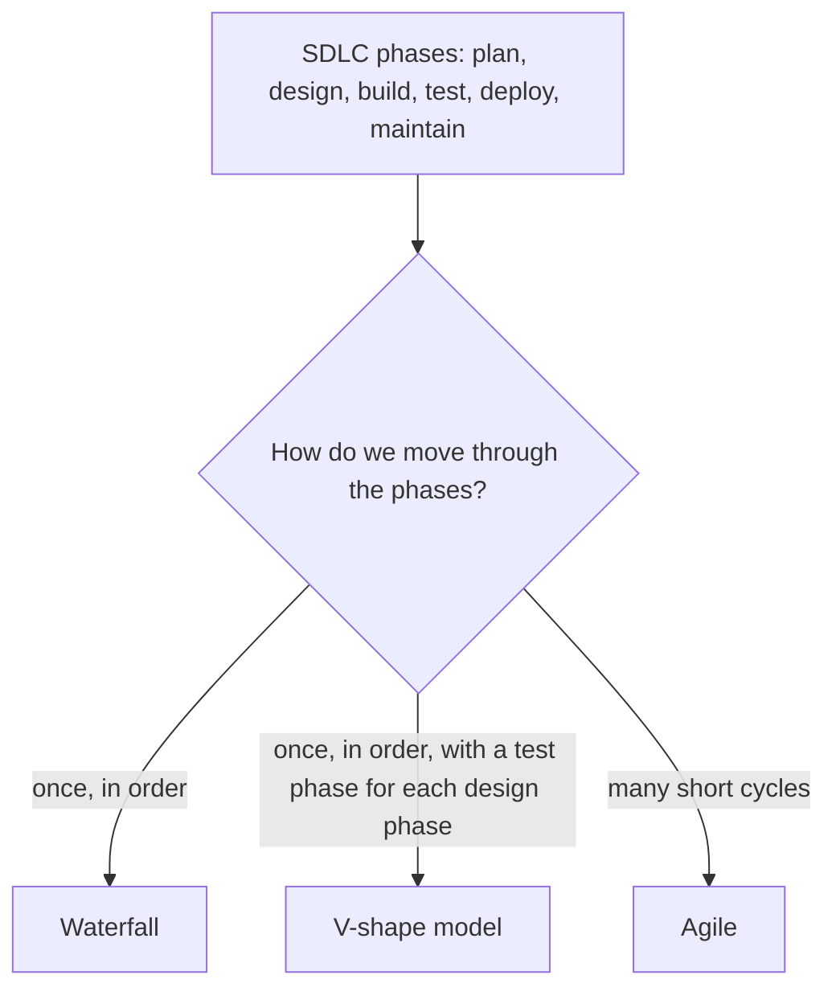

#### 3.1.1 ✅ Modern Best Practice: methodology, framework and practices are different things

> **Lecture says:** a team uses a specific methodology to clarify communication and decide how and when information is shared.
> **Industry today:** teams separate three layers — a **mindset/approach** (for example Agile), a **framework** (for example Scrum or Kanban) and **engineering practices** (for example test-driven development, continuous integration) — and **tailor** them to their context.

- **How it is done today:**

  | Layer | What it decides | Examples |
  |-------|-----------------|----------|
  | **Approach / mindset** | The big idea: plan everything first, or learn in small steps? | Waterfall (plan-driven), Agile (adaptive), Lean |
  | **Framework** | Roles, meetings and artifacts | Scrum, Kanban, XP (Extreme Programming), SAFe (Scaled Agile Framework) |
  | **Engineering practices** | How the code is built, tested and released | TDD (Test-Driven Development), code review, CI/CD (Continuous Integration / Continuous Delivery), trunk-based development, feature flags |

  - A team can "do Scrum" and still ship poor software if the **engineering practices** are missing. Modern teams treat practices such as automated testing and CI/CD as part of the methodology, not as an extra.
  - **Communication is designed, not left to chance:** fixed rhythms (daily stand-up, review, retrospective), shared tools (boards, chat channels, pull requests) and written decisions (ADRs — Architecture Decision Records).
- **Why:** naming the layers stops common confusion, such as "Agile = Scrum" or "Agile = no documentation".

---

### 3.2 The Waterfall Method

#### 3.2.1 How Waterfall works

- **Waterfall was the first widely used SDLC model.** It became the standard way to run large software projects in the 1970s and 1980s.
- **Waterfall is a sequential method** of software development:
  - **The output of one phase is the input for the next phase** of the cycle (for example, the approved requirements document is the input for design).
  - **Development and work on the next phase start only after the previous phase is complete.**
- **All planning is done up front** — for example **defining requirements** and **architectural design**.
- **The customer usually does not see the product until the testing phase.**
- **For a major version release, the same process is repeated**, resulting in **long intervals — such as years — between releases**.

| Phase | Input | Output (input for the next phase) |
|-------|-------|-----------------------------------|
| **Planning / requirements** | Business idea, stakeholder needs | Approved requirements document (SRS — Software Requirements Specification) |
| **Design** | SRS | Architecture and detailed design documents |
| **Development** (coding) | Design documents | Source code |
| **Testing** | Code + SRS | Tested build, bug reports — **customer sees the product here** |
| **Deployment** | Tested build | Running system in production |
| **Maintenance** | Running system | Fixes and small changes; big changes wait for the **next major version** |

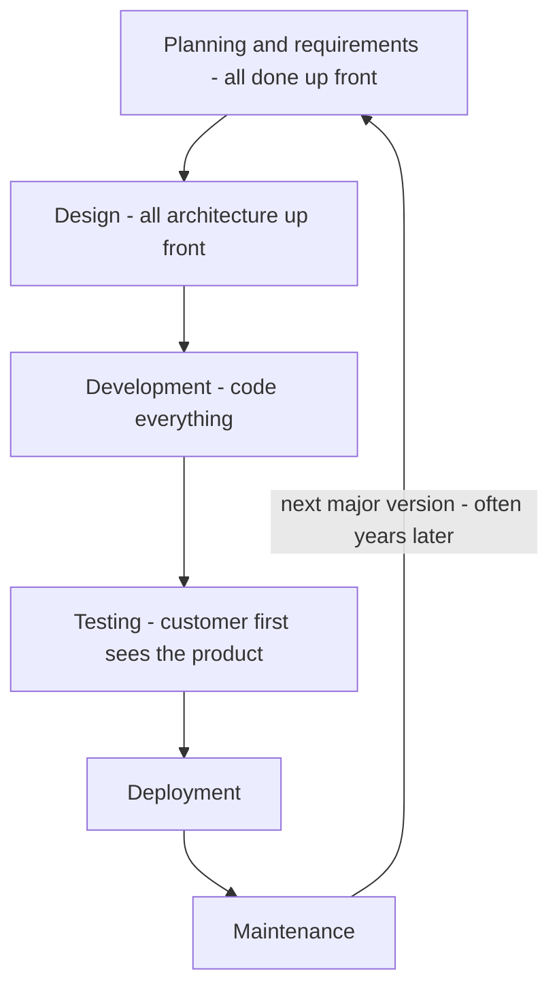

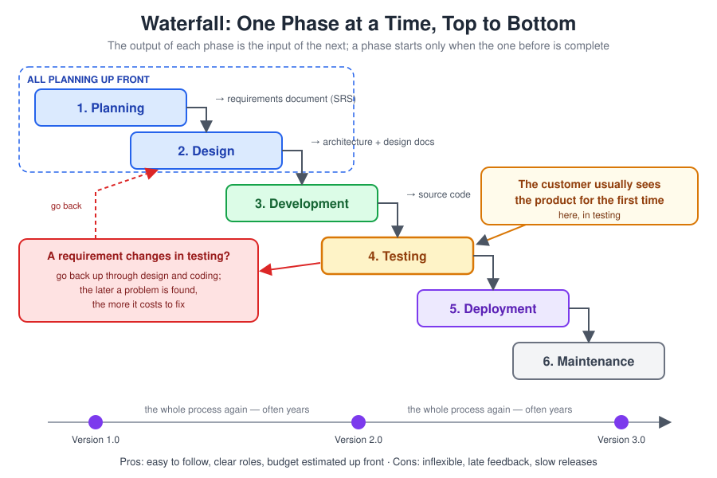

> ⚠️ **Correction (history):** "Waterfall was the original, intended design of the SDLC" → Waterfall was the first **widely used** model, but the paper usually cited for it — **Winston Royce, "Managing the Development of Large Software Systems" (1970)** — actually **warned** that a pure one-pass sequence is "risky and invites failure", and recommended feedback loops between phases and building a first version that you throw away. The name "waterfall" came later. So even the "father" of Waterfall did not recommend strict Waterfall.
> **Lecture wording (for the quiz):** "In the beginning, when the SDLC was conceived, it implemented what is known as the waterfall method."

#### 3.2.2 Pros and cons of Waterfall (lecture)

| ✅ Pros | ❌ Cons |
|---------|---------|
| **Easy to understand and follow.** | **Lacks flexibility.** |
| **Each stage is discrete and well-defined**, so all team members easily understand their **roles**. | Because all planning is up front, a **changed or overlooked requirement** is **hard to add later**. |
| Planning is up front, so it is **easier** than iterative methods to **estimate a budget** and **allocate resources**. | **Unforeseen complications** happen, and agreed functionality **shifts** from what was first imagined. |

- **Why the cons matter:** in Waterfall, a wrong requirement found in testing means going back through design and coding — the **cost of change** grows the later a problem is found.

#### 3.2.3 ✅ Modern Best Practice: where Waterfall still fits, and why its budget advantage is weaker than it looks

> **Lecture says:** Waterfall is easy to follow and makes budgets easier to estimate; its weakness is inflexibility.
> **Industry today:** pure Waterfall is rare in software product teams. Plan-driven, **phase-gated** work is still used where requirements are fixed and change is very expensive — usually **combined** with iterative delivery inside the phases.

- **Where a plan-driven approach still makes sense:**
  - **Fixed, well-understood scope** that will not change (for example a regulatory report with a legal format).
  - **Safety-critical or regulated systems** where each phase needs formal sign-off (medical devices, cars, aircraft) — but these teams usually use the **V-model** (see [3.3.4](#334--modern-best-practice-test-first-lives-on-and-the-v-model-is-still-used-where-safety-matters)) and often iterate inside it.
  - Work tied to **hardware or construction**, where "undoing" a step is physically expensive.
- **The budget advantage is weaker than it looks:**
  - An up-front estimate is made when the team knows the **least** about the project. This is called the **cone of uncertainty**: early estimates can be far off, and they get better only as work is done.
  - A "fixed" Waterfall budget often turns into **change requests** and overruns when reality differs from the plan.
- **How modern teams get budget predictability without Waterfall:** fix **time and cost**, and let **scope** flex (see [3.4.10](#3410--modern-best-practice-budgeting-and-scheduling-in-agile)).
- **Hybrid in practice:** many organizations run a **phase-gated governance** layer (funding, compliance sign-offs) on top of **Agile delivery** teams.

| | Pure Waterfall | Modern plan-driven / hybrid |
|---|---|---|
| Requirements | All frozen at the start | Baseline at the start; changes through a controlled backlog or change requests |
| Customer feedback | In testing, near the end | Demos of working parts during the build |
| Testing | A phase after coding | Automated tests written with the code, every day |
| Release | One big release | Several releases or a pilot before the full launch |

---

### 3.3 The V-Shape Model

#### 3.3.1 The shape: specify and design down the left, test up the right

- **The V-shape model is named that way because the phases form the shape of a V.**
- **The left side goes down:** the team **specifies and designs** the system, from the big picture (requirements) to the smallest parts (modules). Each step is checked against the step above it, and **a test plan is written for it**.
- **The right side goes up:** the team **tests** the system, from the smallest parts back up to the whole system, by **running** those test plans.
- **The V-shape model is like Waterfall in that it is also sequential.**
- **Each phase on the left corresponds with a test phase on the right.**
- **What each test phase does:**
  - **Unit, integration and system testing verify** the product — "did we build it **right**, as specified and designed?"
  - **Acceptance testing validates** the product — "did we build the **right thing** for the customer?"

> ⚠️ **Correction (terms):** "the whole left side is verification and the whole right side is validation" → **verification** means checking against the **specification** ("built right?"), and **validation** means checking against the **user's real needs** ("right thing?") — these are the standard IEEE / ISO meanings. So on the right side, **unit, integration and system testing are verification**, and only **acceptance testing is validation**. The left-side reviews of requirements and designs are also verification.
> **Lecture wording (for the quiz):** "The phases going down the left side of the V are called 'verification'. Then, going up the right side of the V, those phases are called 'validation'." Many course materials use these labels, so expect them in quizzes; in interviews, give the precise meaning.

#### 3.3.2 The four pairs of phases

- **Four stages occur on each side of the V.**
  - **Going down the V:** **requirements analysis**, **system design**, **architecture design**, **module design**.
  - **The bottom of the V:** the **coding** phase.
  - **Going back up the V:** the four matching phases — **unit testing**, **integration testing**, **system testing**, **acceptance testing**.
- **The tests are written (planned) during the phases on the left and executed during the test phases on the right.**

| Left side — specify and design (test is **written** here) | ↔ | Right side — test (test is **run** here) | Verification or validation? | What the test checks |
|-----------------------------------------------------------|---|-------------------------------------------|-----------------------------|----------------------|
| **Requirements analysis** | ↔ | **Acceptance testing** | **Validation** | Does the system meet the customer's real needs? |
| **System design** | ↔ | **System testing** | Verification | Does the whole system meet the system specification? |
| **Architecture design** (high-level design) | ↔ | **Integration testing** | Verification | Do the modules work together through their interfaces? |
| **Module design** (low-level design) | ↔ | **Unit testing** | Verification | Does each module do exactly what its design says? |
| | **Coding** (bottom of the V) | | | |

> ⚠️ **Correction (wording):** "the first phase of the V is planning" → it is **requirements analysis**: the phase where the customer's requirements are written, and where the **acceptance test plan** is created from them. Planning in the wider sense (budget, schedule, team) happens **before** the V starts.
> **Lecture wording (for the quiz):** "Going down the V are planning, system design, architecture design, and then module design."

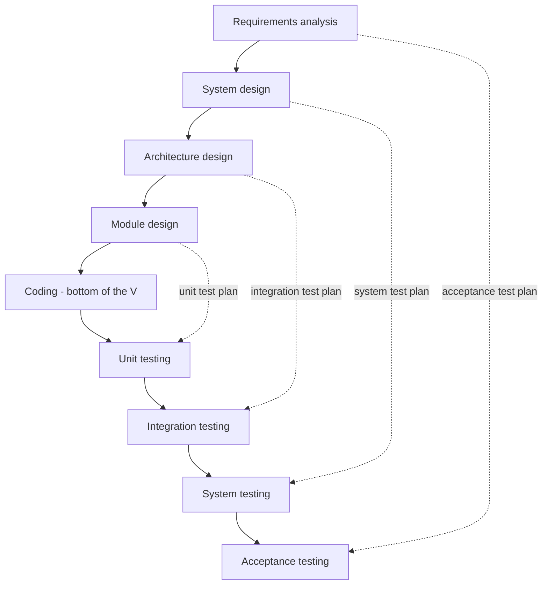

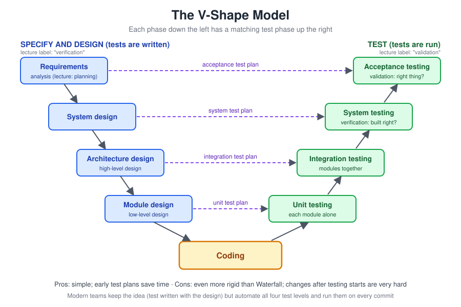

#### 3.3.3 Pros and cons of the V-shape model (lecture)

| ✅ Pros | ❌ Cons |
|---------|---------|
| Like Waterfall, it is **simple and easy to use**. | It is **even more rigid than Waterfall**. |
| **Designing test plans during the left-side (design) phases saves considerable time** during the coding and test phases. | Drawbacks are **similar to Waterfall**: it does **not readily accommodate changing requirements**. |
| Every requirement and design decision has a planned test, so gaps are found **early**. | **Once an application is in the testing phase, it is extremely difficult to go back and change functionality.** |

- **Why early test plans save time:** writing the test forces the team to make each requirement and design **clear and testable** before any code exists. Vague requirements are found on paper, where they are cheap to fix.

#### 3.3.4 ✅ Modern Best Practice: test-first lives on, and the V-model is still used where safety matters

> **Lecture says:** tests are written on the left of the V and executed on the right, after coding.
> **Industry today:** the V-model's best idea — **plan the test together with the requirement or design** — is now done **continuously** with **TDD**, **BDD** (Behavior-Driven Development) and **automated test pipelines**. The full V-model is still common in **safety-critical, regulated industries**, often run in short iterations.

- **How the V's idea is done today in product teams:**
  - **Acceptance tests from requirements:** acceptance criteria are written in **Given/When/Then** (BDD) **before** coding, and run automatically (see [note 05 §3.4.4](05-requirements.md)).
  - **Unit tests from module design:** with **TDD** the developer writes a failing unit test first, then the code (red → green → refactor).
  - **All four test levels run on every commit** in the CI pipeline — not once, at the end (see [§5.2](#52-the-v-models-test-levels-as-a-ci-pipeline)).
  - This is part of **shift-left testing**: testing moves earlier ("left") in the process.
- **Where the V-model itself is still used:**

  | Industry | Standard or guide (examples) | Why the V fits |
  |----------|------------------------------|----------------|
  | Automotive | **ISO 26262** (functional safety), **Automotive SPICE** | Every safety requirement must be traced to a test |
  | Medical device software | **IEC 62304** (software life cycle for medical devices) | Regulators expect documented verification of each step |
  | Pharmaceutical computerized systems | **GAMP 5** (2nd edition, 2022) | Specifications on the left, verification on the right; GAMP 5 also supports Agile, iterative work |
  | Aerospace, rail, defense | Industry safety standards and contracts | High cost of failure; formal sign-offs |

  - Modern teams in these industries often run **many small Vs** — one per increment — instead of one big V for the whole product.
- **Why:** the old V tests only at the end, so late defects are expensive. Running the same test levels **continuously** keeps the V's discipline but removes its slow feedback.

| | Classic V-model | Modern practice |
|---|---|---|
| When tests are written | In the left-side phases | With each story or requirement, before the code (TDD/BDD) |
| When tests run | After coding, in the right-side phases | On every commit in CI, plus final acceptance on staging |
| Traceability | Documents linking requirements to test plans | Requirement IDs in test names, checked automatically |
| Change | Very hard after testing starts | Normal; the automated tests show what a change breaks |

---

### 3.4 The Agile Method

#### 3.4.1 What makes Agile different

- **The Agile model is different.**
- It **focuses on a collaborative software development process over multiple short cycles**, **rather than a strictly top-down linear process**.
- **Agile is an iterative and incremental approach to development:**
  - **iterative** — the team repeats the cycle and improves the product each time;
  - **incremental** — each cycle adds a new working **piece** of the product.
- It **still aligns with the SDLC, but each phase is short** — the team still plans, designs, builds, tests and releases, just in small amounts each cycle.
- **Agile is a family of approaches**, not one method. **Scrum** (with sprints), **Kanban** (continuous flow, no sprints) and **XP** all share the values of the Agile Manifesto.

> ⚠️ **Correction:** "Agile is an iterative approach" (and, implied, "Agile = sprints") → Agile is **iterative and incremental**, and it is a **family** of methods. "Sprints" belong to **Scrum**; Kanban teams, for example, work in a continuous flow without sprints.
> **Lecture wording (for the quiz):** "Agile is what is called an iterative approach to development."

#### 3.4.2 Sprints (Scrum)

- **Scrum teams work in cycles called sprints, which are usually one to four weeks long** (the Scrum Guide: one month or less).
- **Testing happens in every sprint to minimize the risk of failure** — problems are found within weeks, not at the end of the project. The lecture names **unit testing**; modern teams run **all test levels** (unit, integration, acceptance) inside the sprint (see [3.3.4](#334--modern-best-practice-test-first-lives-on-and-the-v-model-is-still-used-where-safety-matters)).
- **The final stage of each sprint is a feedback stage** (the Sprint Review), instead of a separate "maintenance" phase at the end of the project. **Maintenance work does not disappear:** bug fixes, security updates and dependency upgrades go into the **same backlog** as new features, and the team that builds the software also maintains and runs it.

| Inside one sprint | What happens |
|-------------------|--------------|
| **Plan** | Choose the most valuable items from the backlog for this sprint |
| **Design** | Design just enough for those items |
| **Build** | Write the code |
| **Test** | Unit tests (and, in modern teams, integration and acceptance tests) |
| **Feedback** (Sprint Review) | Show working software to stakeholders; agree what to change in the backlog for the next sprint |

> ⚠️ **Correction:** "Agile has a feedback stage *instead of* maintenance" → the **sprint** ends with feedback, but the **software** still needs maintenance; in Agile/DevOps teams it is planned in the same backlog and done by the same team.
> **Lecture wording (for the quiz):** "Rather than the 'maintenance' stage of the SDLC, the final stage of the sprint is a feedback stage."

#### 3.4.3 The Sprint Review and feedback

- **At the end of each sprint, the team shows the working code it built** at the **Sprint Review**, where **stakeholders see the new functionality, give feedback**, and agree with the team **what to do next** — so the backlog may change.
- **Releasing is not tied to this meeting.** Working code can go to users **any time** during the sprint (with CI/CD, even many times a day); the Sprint Review should never be a gate to releasing value (Scrum Guide 2020).
- **After the Sprint Review, the process repeats** for every sprint cycle.

> ⚠️ **Correction (terms and release timing):** "working code is released at a meeting called the sprint demo" → the official Scrum name is the **Sprint Review**. It is a **working session**, not only a demo, and it is **not** the release moment — releases can happen at any time.
> **Lecture wording (for the quiz):** "At the end of each sprint, a chunk of working code is released at a meeting called the 'sprint demo'."

#### 3.4.4 The MVP (Minimum Viable Product)

- **After several sprint cycles, a minimum viable product (MVP) is developed**, so **stakeholders can provide feedback on the basic feature set**.
- **The MVP contains a feature set to validate assumptions about the software** — for example "people will actually post reviews" or "users will pay for this".

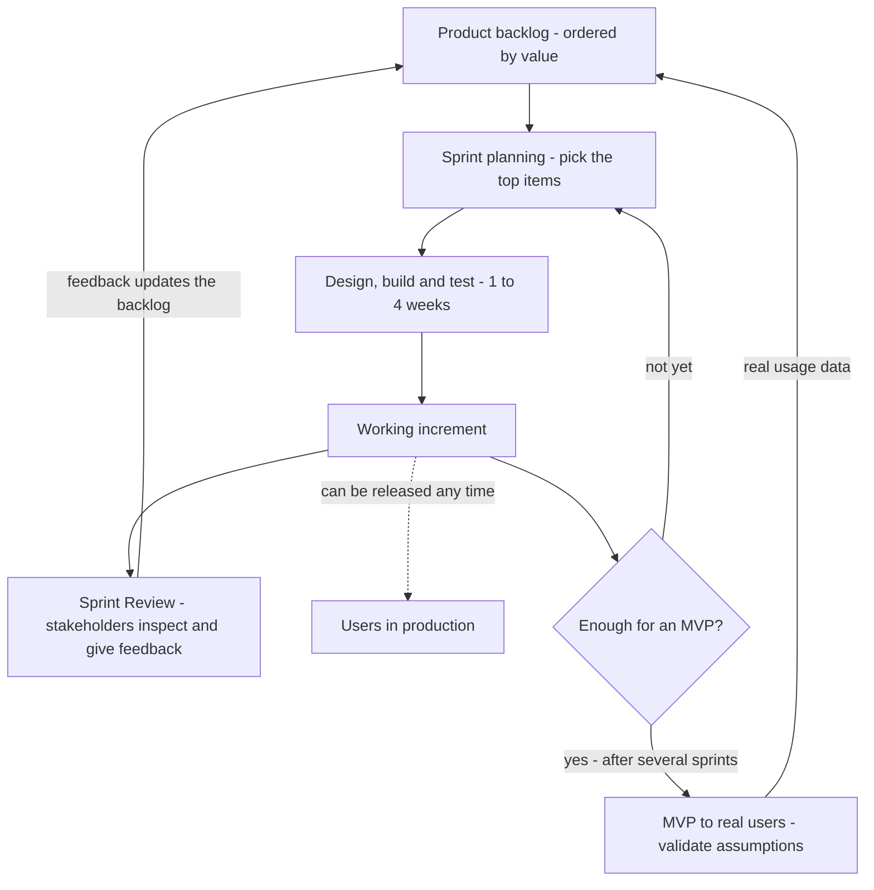

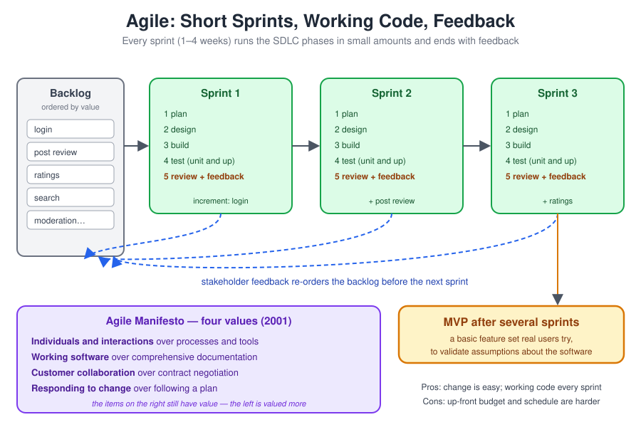

#### 3.4.5 The Agile Manifesto

- **The four core values of Agile development** are written in the **"Agile Manifesto"**:

  | We value… | …**over** | Meaning in simple words |
  |-----------|-----------|-------------------------|
  | **Individuals and interactions** | processes and tools | Good people talking to each other solve more than any tool. |
  | **Working software** | comprehensive documentation | Progress = software that works, not pages written. |
  | **Customer collaboration** | contract negotiation | Work **with** the customer, not against them. |
  | **Responding to change** | following a plan | When we learn something new, we change the plan. |

> ⚠️ **Often-missed detail (not in the lecture):** the Manifesto ends with: *"while there is value in the items on the right, we value the items on the left more."* Agile does **not** mean "no documentation", "no plan" or "no contracts" — it means those things serve the work instead of controlling it. The Manifesto was written in **February 2001** by **17 software developers** at a meeting in **Snowbird, Utah (USA)**.

- **The twelve principles behind the Manifesto** (not in the lecture — summarized in simple words):
  1. Our top priority is to satisfy the customer through **early and continuous delivery** of valuable software.
  2. **Welcome changing requirements**, even late in development.
  3. **Deliver working software frequently** — weeks rather than months.
  4. **Business people and developers work together daily.**
  5. Build projects around **motivated people**; give them support and **trust** them.
  6. **Face-to-face conversation** is the most effective way to share information.
  7. **Working software is the main measure of progress.**
  8. Keep a **sustainable pace** — the team should be able to keep going indefinitely.
  9. Continuous attention to **technical excellence and good design** makes the team faster.
  10. **Simplicity** — maximizing the amount of work **not** done — is essential.
  11. The best architectures, requirements and designs come from **self-organizing teams**.
  12. At regular intervals, the team **reflects** on how to become more effective and **adjusts** (the retrospective).

#### 3.4.6 Pros and cons of Agile (lecture)

| ✅ Pros | ❌ Cons |
|---------|---------|
| Relies on **ongoing research, planning and testing** during development. | **Up-front planning** such as **budgeting and scheduling** can be **challenging**… |
| New features still go through the **same SDLC phases**, but **new and changing requirements are handled quickly and easily**, because **planning starts again at the beginning of each sprint**. | …because the **overall scope of the product is not clearly defined** at the start. |
| **Most resources are spent on the building phase** (not on large up-front documents). | **Resource allocation** can be challenging (lecture summary). |
| At the end of each cycle, the **QA team, stakeholders and the customer** have **working code to test against requirements**, and are **encouraged to give feedback**. | |
| **Modular design** plus **modern tooling** (package managers such as npm, automated tests, CI/CD pipelines, containers, cloud platforms) let developers focus on **smaller chunks of code** that are **readily integrated** into the larger product and released safely — for example to provide the **MVP**. | |

> ⚠️ **Correction (modular design):** "modern languages and technologies now allow modular design" → modular design is **not new** — the classic paper on splitting software into modules was published by **David Parnas in 1972**. What changed in recent years is the **tooling** that makes small, frequent releases cheap and safe.
> **Lecture wording (for the quiz):** "As coding languages and technologies have developed in recent years, they now allow for modular design."

#### 3.4.7 ✅ Modern Best Practice: Scrum as described in the Scrum Guide 2020

> **Lecture says:** Agile teams work in sprints of 1–4 weeks and end each sprint with a demo.
> **Industry today:** most Agile teams use **Scrum** or a Scrum variant. The current **Scrum Guide (2020)** defines exactly **three accountabilities**, **five events** and **three artifacts**, each with a **commitment**.

- **The Scrum Team** (typically **10 or fewer** people):

  | Accountability | Responsible for |
  |----------------|-----------------|
  | **Product Owner** | Maximizing the product's value; ordering the **Product Backlog** |
  | **Scrum Master** | The team's effectiveness; coaching Scrum; removing blockers (a coach, **not** a manager) |
  | **Developers** | Building a usable **Increment** each sprint (this includes testers, designers — everyone who does the work) |

- **The five events:**

  | Event | When / how long (for a one-month sprint; shorter for shorter sprints) | Purpose |
  |-------|-----------------------------------------------------------------------|---------|
  | **The Sprint** | Fixed length, **one month or less** | The container for all other events |
  | **Sprint Planning** | Start of the sprint, up to **8 hours** | Why (Sprint Goal), what (items) and how (plan) |
  | **Daily Scrum** | Every day, **15 minutes** | Check progress toward the Sprint Goal; adjust the plan |
  | **Sprint Review** | End of the sprint, up to **4 hours** | Inspect the Increment with stakeholders; adapt the backlog |
  | **Sprint Retrospective** | After the review, up to **3 hours** | Improve how the team works |

- **The three artifacts and their commitments:**

  | Artifact | Commitment | Meaning |
  |----------|------------|---------|
  | **Product Backlog** | **Product Goal** | The long-term objective the backlog works toward |
  | **Sprint Backlog** | **Sprint Goal** | The one objective for this sprint |
  | **Increment** | **Definition of Done** | The quality bar every increment must meet |

  - **Backlog refinement** is an **ongoing activity**, not a formal event.

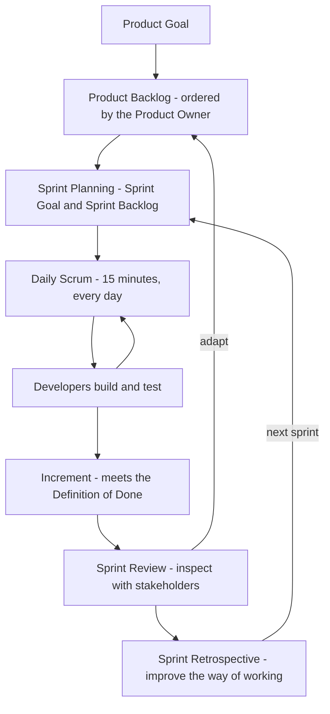

#### 3.4.8 ✅ Modern Best Practice: Kanban, XP and Lean — the rest of the Agile family

> **Lecture says:** Agile = short sprints with a demo.
> **Industry today:** many teams use **Kanban** (no sprints, continuous flow), add **XP engineering practices**, and use **Lean** thinking to remove waste. Many combine them (for example "Scrumban").

| Method | Core idea | Key practices | Best for |
|--------|-----------|---------------|----------|
| **Kanban** | Make work visible and **limit work in progress (WIP)** so work flows | Kanban board (To do → In progress → Review → Done); **WIP limits** per column; measure **cycle time** and **throughput** | Support, operations and maintenance teams; work that arrives unpredictably |
| **XP (Extreme Programming)** — Kent Beck, late 1990s | Take good engineering practices to the extreme | **TDD**, **pair programming**, **continuous integration**, small releases, refactoring, collective code ownership | Any team that wants high code quality with frequent change |
| **Lean software development** | Deliver value fast by removing **waste** | Remove waiting, hand-offs, half-done work and unused features; deliver fast; build quality in | Improving the whole flow from idea to user |

- **Why Kanban matters for backend teams:** a team that handles bugs, incidents and small requests cannot always plan two weeks ahead. Kanban's **WIP limit** ("no more than 3 items in progress") stops the team from starting many things and finishing none.
- **Why XP matters:** Agile without strong engineering practices becomes slow over time — the code gets harder to change. XP practices (automated tests, CI, refactoring) keep the code **easy to change**, which is what Agile depends on.

#### 3.4.9 ✅ Modern Best Practice: Agile + DevOps — release continuously, not once per sprint

> **Lecture says:** at the end of each sprint, a chunk of working code is released at the sprint demo.
> **Industry today:** with **DevOps** and **CI/CD**, code is **integrated many times a day** and can be **released at any time** — sprints are for planning and feedback, not a release schedule.

- **How it is done today:**
  - **Continuous Integration:** every developer merges small changes into the main branch at least daily; an automated pipeline builds and tests each change.
  - **Continuous Delivery / Deployment:** every change that passes the pipeline **can** go (Delivery) or **does** go (Deployment) to production automatically.
  - **Feature flags** separate **deploying** code from **releasing** a feature: unfinished work can be deployed but hidden.
  - **Measuring delivery performance** with the **DORA** (DevOps Research and Assessment) metrics: change lead time, deployment frequency, change fail rate, failed deployment recovery time and deployment rework rate.
- **Why:** Agile shortened the feedback loop from **years** to **weeks**. DevOps shortens it from **weeks** to **hours**, and smaller releases are also **less risky** — if something breaks, the change is small and easy to find.

| Feedback loop | Typical time from idea to real user |
|---------------|-------------------------------------|
| Waterfall | Months to years |
| Agile (release per sprint) | 1–4 weeks |
| Agile + DevOps (continuous delivery) | Hours to days |

#### 3.4.10 ✅ Modern Best Practice: budgeting and scheduling in Agile

> **Lecture says:** in Agile, up-front budgeting and scheduling can be challenging because the overall scope is not clearly defined.
> **Industry today:** this is a real challenge, and teams solve it by **fixing time and budget and letting scope flex**, forecasting from **measured data**, and re-planning often.

- **How it is done today:**
  - **Fix time and cost, flex scope:** "We have 4 developers for 6 months." The Product Owner orders the backlog so the **most valuable** features are built first; if time runs out, the least valuable ones are left out — not the testing.
  - **Roadmaps with ranges:** "Search: likely in March, at the latest in April" instead of one fixed date.
  - **Estimate with relative sizes** (story points, T-shirt sizes S/M/L) and re-forecast every sprint from the team's **actual speed**.
  - **Forecast from throughput:** count how many items the team finished per week, then simulate the remaining backlog many times (**Monte Carlo forecasting**) to get dates with probabilities — "85% chance we finish by 14 June" (see [§5.3](#53-forecasting-an-agile-delivery-date-from-throughput)).
  - **Agile-friendly contracts:** fixed price per **phase** or per **sprint**, a paid **discovery phase** before the build, or "time and materials" with a budget cap.
- **Why:** a single up-front estimate is made when the team knows the least. Forecasts based on **measured** progress get more accurate every week.

---

### 3.5 Comparing Waterfall, V-Shape and Agile

- **The main difference:** traditional SDLC methods such as **Waterfall and the V-shape model are sequential**, whereas **Agile is cyclical**.
- **Waterfall and V-shape center around the whole product being developed before asking for customer feedback**, whereas **Agile focuses on quick, short bursts of development**.
- **There are pros and cons to each method.** **Agile and hybrid (mixed) approaches are the most common** in software teams today — but the best choice depends on how **certain** the requirements and technology are (see [3.5.1](#351--modern-best-practice-choosing-a-methodology-and-avoiding-fake-agile)).

| | **Waterfall** | **V-shape model** | **Agile** |
|---|---|---|---|
| **Flow** | Sequential, one pass | Sequential, one pass, test phase per design phase | Cyclical — iterative and incremental short cycles (sprints in Scrum) |
| **Planning** | All up front | All up front, including test plans | A little up front; again every cycle |
| **Customer sees the product** | In testing, near the end | In acceptance testing, near the end | Every cycle (Sprint Review); MVP after several sprints; releases any time |
| **Testing** | A phase after coding | Planned early, run after coding | In every cycle, at all levels |
| **Changing requirements** | Hard | Very hard (even more rigid) | Handled quickly and easily |
| **Budget and schedule** | Easier to estimate up front | Easier to estimate up front | Hard to fix up front; scope is not fully defined |
| **Roles** | Clear, by phase | Clear, by phase | Cross-functional team; shared responsibility |
| **Release interval** | Long — major versions can be years apart | Long | Short — working code every sprint |
| **Main risk** | Building the wrong thing; late surprises | Late, expensive changes | Scope and cost drift without discipline |

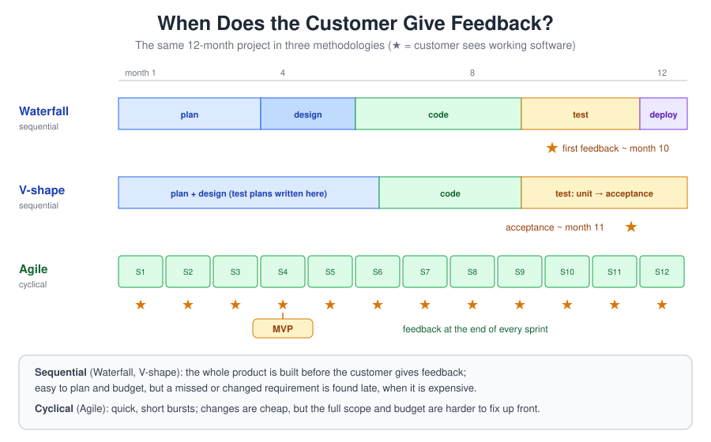

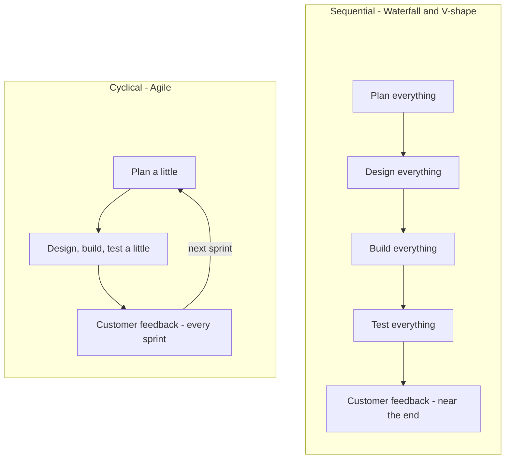

> ⚠️ **Correction (popularity):** "Agile is the most popular method" → **Agile and hybrid approaches** (often Agile delivery inside plan-driven governance) are the most common. "Popular" does not mean "always right" — choose by uncertainty and cost of change.
> **Lecture wording (for the quiz):** "Agile is probably the most popular method used in modern software development."

#### 3.5.1 ✅ Modern Best Practice: choosing a methodology, and avoiding "fake Agile"

> **Lecture says:** Waterfall and V-shape are easy to implement but handle change badly; Agile handles change but makes resource planning harder.
> **Industry today:** teams choose based on **uncertainty** and **cost of change**, often use a **hybrid**, and watch out for common anti-patterns.

- **Choose by uncertainty** (an idea popularized by the **Stacey matrix**: how well do we know **what** to build, and **how** to build it?):

  | Requirements known? | Technology known? | Good fit |
  |---------------------|-------------------|----------|
  | Yes, and stable | Yes | Plan-driven (Waterfall / V-model) can work; Kanban also works well |
  | Partly; will change | Mostly | **Agile (Scrum)** — learn in short cycles |
  | No — new product, new market | Unknown | **Agile + experiments**: prototypes, MVP, product discovery |
  | Fixed by law or safety rules | Known | **V-model** with traceability, often in iterations |

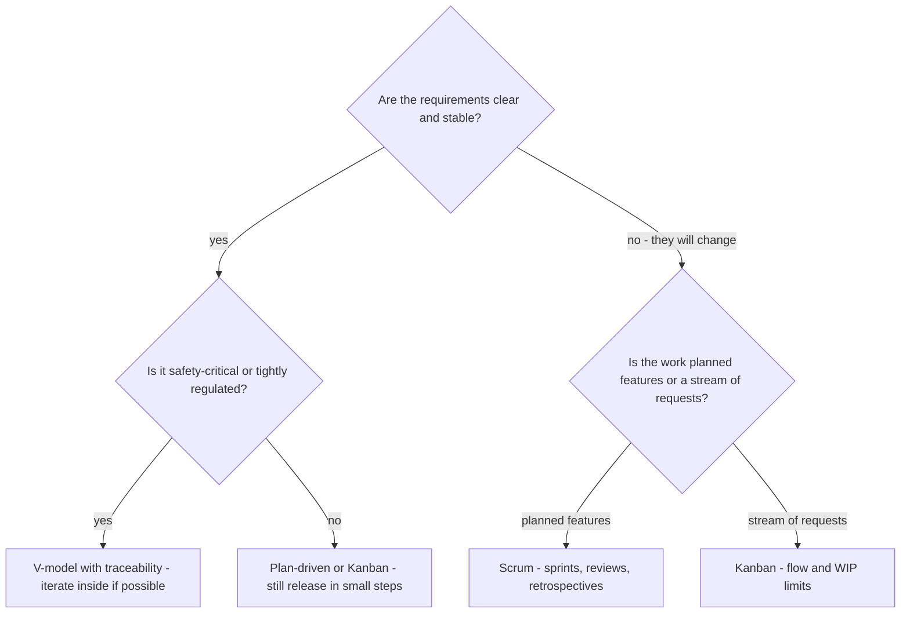

- **Anti-patterns to avoid:**

  | ❌ Anti-pattern | What it looks like | ✅ Fix |
  |----------------|--------------------|-------|
  | **Water-Scrum-Fall** | Big up-front requirements, then "sprints" for coding, then a long test and release phase at the end | Test and release **inside** each sprint; release small changes often |
  | **Cargo-cult Agile** | Stand-ups and sprints happen, but nothing is shown to users and nothing changes from feedback | Ship working software; let feedback change the backlog |
  | **"Agile means no documentation"** | No design notes, no decisions written down | **Just enough** docs: README, API contract, ADRs, kept in Git |
  | **"Agile means no plan"** | No roadmap; the team cannot say when anything will be ready | Product Goal, roadmap with ranges, forecasts from data |
  | **Velocity as a target** | Managers compare teams by story points; points inflate | Use velocity only for the team's own forecasting |
  | **Mini-Waterfall inside the sprint** | Developers code for 9 days, testers test on day 10 | Developers and testers work on the same story together; automate tests |

---

### 3.6 Often-Missed Parts: What a Senior Engineer Adds (not in the lecture — industry practice)

The lecture promises to "list several commonly used approaches" but explains three. A senior engineer should also know these:

| Approach | Core idea | Where you meet it |
|----------|-----------|-------------------|
| **Iterative and incremental development** | Build the product in repeated cycles, adding pieces each time — the older parent idea of Agile | Large projects since the 1950s–60s; the base of all modern methods |
| **Spiral model** — Barry Boehm, 1986 | Repeated loops, each starting with **risk analysis**; build prototypes to reduce the biggest risks first | Large, high-risk projects (defense, large systems) |
| **Prototyping model** | Build a quick mock-up, get feedback, refine, then build the real system | Unclear user interfaces; non-technical clients |
| **RAD (Rapid Application Development)** | Fast prototypes and user feedback instead of long planning | Internal business apps; today often low-code tools |
| **Scaled Agile** — SAFe, LeSS (Large-Scale Scrum) | Coordinate many Agile teams on one product | Large companies with many teams |
| **DevOps** | Development and operations as one team; automate build, test, release and monitoring | Almost every modern cloud team |

- **Security in every cycle (DevSecOps):** security is not a phase at the end. Each sprint includes security work — threat-model updates for new features, dependency scanning (for example Dependabot, `npm audit`), secret scanning and SAST (Static Application Security Testing) in CI. OWASP (Open Worldwide Application Security Project) guidance is applied story by story.
- **Observability as part of "done":** a feature is done when it is **monitored** — logs, metrics and traces (for example with OpenTelemetry) and alerts tied to SLOs (Service Level Objectives). Feedback comes not only from demos but also from **production data**.
- **Remote and distributed teams:** the Manifesto's "face-to-face" principle today often means **video calls**, shared boards and **written** communication (pull requests, design docs) that work across time zones.
- **Responsible use of AI coding tools:** AI assistants can make each cycle faster (drafting code, tests and stories), but they do **not** replace the methodology: every AI-generated change still goes through **code review, tests and CI**, the team stays responsible for it, and no confidential code or data goes into unapproved tools.
- **Retrospectives drive improvement:** the methodology itself is **tuned** every sprint. A team that never changes its way of working is not really Agile.

#### 3.6.1 "Done enough when…" checklist for choosing and running a methodology

- [ ] The team can say **which approach** it uses (Waterfall, V-model, Scrum, Kanban, hybrid) and **why** it fits this project.
- [ ] Everyone knows **how and when information is shared** — meetings, boards, documents, channels.
- [ ] The **customer or stakeholders see working software regularly** (at least every few weeks), not only at the end.
- [ ] **Testing happens in every cycle**, at all levels, and is **automated** in CI.
- [ ] **Changing requirements** have a clear path (backlog for internal work; change requests for contracts).
- [ ] There is a **forecast** for scope, time and cost, given as **ranges**, and it is updated from real progress.
- [ ] **Security, observability and documentation** are part of the Definition of Done, not a later phase.
- [ ] The team runs **retrospectives** and actually changes its way of working.
- [ ] Anti-patterns (Water-Scrum-Fall, cargo-cult Agile, velocity as a target) are checked for and avoided.

---

### 3.7 Lecture Summary

- **Three of the common approaches to software development** are **Waterfall**, the **V-shape model** and **Agile**.
- **Waterfall and V-shape are sequential**, whereas **Agile is iterative and incremental**.
- **Both Waterfall and V-shape are easy to implement**, but **neither accommodates changing requirements well**.
- **Agile allows for changing requirements**, but **resource allocation can be challenging**.

| Topic | Lecture | ✅ Modern best practice |
|-------|---------|--------------------------|
| Why a methodology | Clarifies communication; decides how and when information is shared | Separate mindset, framework and engineering practices; tailor them; design communication rhythms |
| Waterfall | Sequential; all planning up front; customer sees product in testing; years between releases | Rare in pure form; plan-driven governance + iterative delivery; cone of uncertainty weakens the "easy budget" benefit |
| V-shape model | Verification left, validation right; tests written left, run right | Test-first continues as TDD/BDD; all test levels run on every commit; full V still used in safety-critical industries (ISO 26262, IEC 62304, GAMP 5) |
| Agile | Short sprints (1–4 weeks), unit tests each sprint, demo + feedback, MVP | Scrum Guide 2020 (3 accountabilities, 5 events, 3 artifacts); Kanban, XP, Lean; all test levels every sprint |
| Sprint demo (Sprint Review) | Working code released at the demo | Sprint Review is a working session; releases happen any time through CI/CD and feature flags |
| Agile Manifesto | Four values | Plus "we value the items on the left **more**" and the twelve principles |
| Agile cons | Budgeting and scheduling are hard | Fix time and cost, flex scope; roadmaps with ranges; throughput forecasting; Agile-friendly contracts |
| Choosing | Agile is the most popular | Choose by uncertainty and cost of change; hybrids are common; avoid Water-Scrum-Fall and cargo-cult Agile |

---

## 4. Concrete Examples

### 4.1 The Book Review API (course project) built three ways

| | **Waterfall** | **V-shape model** | **Agile (Scrum, 2-week sprints)** |
|---|---|---|---|
| **Months 1–2** | Write the full SRS for accounts, reviews, search, moderation | Write the SRS **and** the acceptance test plan | Sprint 1: sign-up and login. Sprint 2: post and read reviews. Sprint Review with the site owner after each sprint |
| **Months 2–3** | Design the full database and all API endpoints | System and architecture design **plus** system and integration test plans | Sprints 3–4: ratings and search. **MVP** goes to 50 real readers |
| **Months 3–5** | Code everything | Module design + unit test plans, then code everything | Readers say "search by author matters more than moderation tools" → the backlog is re-ordered |
| **Month 6** | Testing — the site owner sees the product for the **first time** and asks for changes | Run unit → integration → system → acceptance tests; changing a feature now is very hard | Sprints 5–12: moderation, sharing, performance; each sprint is released to users |
| **Result** | Late changes cost extra time and money | High test coverage, but late changes are painful | Working product from month 2; priorities follow real user feedback |

### 4.2 Which approach fits the course projects?

| Project | Best-fit approach | Why |
|---------|-------------------|-----|
| **Travel recommendation website** | Agile (Scrum) | User interface ideas change after users try them |
| **Book review API** | Agile + CI/CD | Small features, frequent releases, feedback from readers |
| **Multitier guestbook** (containers on Kubernetes/OpenShift) | Agile + DevOps | The focus is automated build, deploy and scaling |
| **MongoDB backend application** | Agile (Kanban works well for a solo developer) | Steady flow of small tasks; no need for formal sprint events |
| **Insulin pump controller** (not a course project) | V-model (IEC 62304), iterated | Safety-critical; every requirement must be traced to a test |

### 4.3 Quick practice: which methodology is described?

| Statement | Answer |
|-----------|--------|
| "Tests are written during design and run after coding; each design phase has a matching test phase." | **V-shape model** |
| "The next phase begins only after the previous one is complete; the customer first sees the product in testing." | **Waterfall** |
| "Every two weeks the team shows working software and the plan changes based on feedback." | **Agile** |
| "There are no sprints; the team limits work in progress to 3 items and measures cycle time." | **Kanban** (an Agile method — not in the lecture) |
| "Each loop starts with a risk analysis and builds a prototype to reduce the biggest risk." | **Spiral model** (not in the lecture) |

---

## 5. Code Blocks

### 5.1 The V-model's left side, done the modern way: write the test before the code (TDD with Express)

In the V-model, the test plan is written **before** coding. With TDD, a developer does the same thing in minutes instead of months: write a failing test from the acceptance criteria, then write the code.

```js
// test/reviews.test.js — written FIRST, from the acceptance criteria of REQ-07
// Run with: node --test   (node:test is built into current Node.js LTS versions)
import { test } from "node:test";
import assert from "node:assert/strict";
import request from "supertest";              // sends HTTP requests to the app without starting a server
import { app } from "../src/app.js";          // the Express app (does not call app.listen)

test("REQ-07: a valid rating is saved", async () => {
  const res = await request(app)
    .post("/reviews")
    .send({ bookId: "978-0132350884", rating: 4 }); // JSON body
  assert.equal(res.status, 201);                     // 201 Created
  assert.equal(res.body.rating, 4);
});

test("REQ-07: a rating outside 1 to 5 is rejected", async () => {
  const res = await request(app)
    .post("/reviews")
    .send({ bookId: "978-0132350884", rating: 6 });
  assert.equal(res.status, 400);                     // 400 Bad Request
  assert.match(res.body.error, /between 1 and 5/);
});
```

```js
// src/app.js — written SECOND, just enough code to make the tests pass (Express 5)
import express from "express";

export const app = express();
app.use(express.json());                              // parse JSON request bodies

const reviews = [];                                   // in-memory store for the example (a real app uses MongoDB or SQL)

app.post("/reviews", (req, res) => {
  const { bookId, rating } = req.body ?? {};          // req.body is undefined if no JSON body was sent
  if (!Number.isInteger(rating) || rating < 1 || rating > 5) {
    return res.status(400).json({ error: "Rating must be between 1 and 5" });
  }
  const review = { id: reviews.length + 1, bookId, rating };
  reviews.push(review);
  res.status(201).json(review);                       // return the created review
});

// Error handler — must have FOUR parameters so Express knows it handles errors
app.use((err, req, res, next) => {
  console.error(err);                                 // in production: a structured logger
  res.status(500).json({ error: "Internal server error" });
});
```

**What happens if…** a route is `async` and the database call fails?

```js
// ❌ Risky in Express 4 — a rejected promise is NOT passed to the error handler
app.get("/reviews/:id", async (req, res) => {
  const review = await db.findReview(req.params.id); // throws if the database is down
  res.json(review);
});
```

- **Express 4:** the rejected promise is not caught by Express. The client gets **no response** and waits until it times out, and Node.js reports an **unhandled rejection** — which, in current Node.js versions, **crashes the process** by default.
  - ✅ Fix in Express 4: wrap the body in `try { … } catch (err) { next(err); }`.
- **Express 5** (the current major version): a rejected promise from a route handler is **automatically passed to `next(err)`**, so the error handler above returns a clean `500`.
- ✅ Either way, **write a test for the failure case too** (for example, mock `db.findReview` to throw and assert `500`). In the V-model's words, that is a test for the "unwanted behavior" your design must handle.

### 5.2 The V-model's test levels as a CI pipeline

The four right-side phases of the V (unit → integration → system → acceptance) become **pipeline stages that run on every push**, instead of one long test phase at the end.

```yaml
# .github/workflows/ci.yml — the V-model's test levels, run automatically
name: ci
on:
  push:
    branches: [main]
  pull_request:

jobs:
  unit:                                   # matches MODULE DESIGN
    runs-on: ubuntu-latest
    steps:
      - uses: actions/checkout@v4
      - uses: actions/setup-node@v4
        with:
          node-version: lts/*              # current Node.js LTS line
          cache: npm
      - run: npm ci                        # clean, reproducible install from package-lock.json
      - run: npm run test:unit             # fast tests of single modules

  integration:                            # matches ARCHITECTURE DESIGN
    needs: unit                           # runs only if unit tests pass
    runs-on: ubuntu-latest
    services:
      mongo:                              # a real database, not a mock
        image: mongo:7
        ports: ["27017:27017"]
    steps:
      - uses: actions/checkout@v4
      - uses: actions/setup-node@v4
        with:
          node-version: lts/*
          cache: npm
      - run: npm ci
      - run: npm run test:integration      # API + database together
        env:
          MONGO_URL: mongodb://localhost:27017/test

  system:                                 # matches SYSTEM DESIGN
    needs: integration
    runs-on: ubuntu-latest
    steps:
      - uses: actions/checkout@v4
      - run: docker compose up -d --build   # start the whole system in containers
      - run: npm ci && npm run test:e2e     # end-to-end tests against the running system
      - if: always()
        run: docker compose down

  acceptance:                             # matches REQUIREMENTS ANALYSIS
    needs: system
    if: github.ref == 'refs/heads/main'
    runs-on: ubuntu-latest
    environment: staging                  # can require a human approval (UAT sign-off)
    steps:
      - uses: actions/checkout@v4
      - run: npm ci && npm run test:acceptance   # Given/When/Then scenarios against staging
```

**What happens if…** the team skips the lower levels and only runs the slow end-to-end tests?
- Every failure shows up late and is **hard to locate** ("something in the whole system broke"), and the pipeline takes much longer.
- ✅ Keep the **test pyramid**: many fast unit tests, fewer integration tests, a few end-to-end and acceptance tests. The `needs:` lines stop slow stages from running when a fast stage already failed.

### 5.3 Forecasting an Agile delivery date from throughput

The lecture's main con of Agile is that budgeting and scheduling are hard. Teams answer "when will it be done?" with **data**, not guesses.

```js
// scripts/forecast.js — "When will the remaining 40 backlog items be done?"
// Monte Carlo forecast: replay random past weeks thousands of times.
const weeklyThroughput = [4, 6, 3, 5, 7, 4, 5, 2, 6, 5]; // items FINISHED per week, last 10 weeks
const remainingItems = 40;
const runs = 10_000;

if (weeklyThroughput.length === 0 || weeklyThroughput.every((n) => n === 0)) {
  throw new Error("Need some weeks with finished items to forecast"); // avoid an endless loop
}

function simulateWeeks() {
  let done = 0;
  let weeks = 0;
  while (done < remainingItems) {
    const randomWeek = weeklyThroughput[Math.floor(Math.random() * weeklyThroughput.length)];
    done += randomWeek;                                  // pretend next week looks like a random past week
    weeks += 1;
  }
  return weeks;
}

const results = Array.from({ length: runs }, simulateWeeks).sort((a, b) => a - b);
const percentile = (p) => results[Math.floor(p * (runs - 1))];  // value below which p of the runs fall

console.log(`50% chance: done in ${percentile(0.5)} weeks or less`);
console.log(`85% chance: done in ${percentile(0.85)} weeks or less`);
console.log(`95% chance: done in ${percentile(0.95)} weeks or less`);
// Example output (yours will vary slightly):
// 50% chance: done in 9 weeks or less
// 85% chance: done in 10 weeks or less
// 95% chance: done in 10 weeks or less
```

**What happens if…** new items keep being added to the backlog while the team works?
- The forecast is based on **40** items. If the backlog grows to 55, the old date is simply **wrong**.
- ✅ Re-run the forecast **every week** with the current backlog size, and show stakeholders the **85% date**, not the 50% one. When the date is too late, the Product Owner **removes or splits** low-value items (fix time, flex scope).

**What happens if…** the throughput history is all zeros (for example a brand-new team)?
- Without the guard, `while (done < remainingItems)` would **never end**.
- ✅ The guard throws a clear error. For a new team, use a **range estimate** for the first few sprints until real data exists.

---

## 6. Related Concepts

1. **SDLC phases** — every methodology moves through the same phases (plan, design, build, test, deploy, maintain); they differ in **order, size and repetition** (see [note 03](03-phases-of-the-sdlc.md)).
2. **Requirements and the backlog** — Waterfall freezes requirements in an SRS; Agile keeps them in an ordered backlog refined every sprint, with acceptance criteria that become tests (see [note 05](05-requirements.md)).
3. **Test levels and the test pyramid** — the V-model's unit, integration, system and acceptance levels are the same levels modern CI pipelines automate (see [note 04](04-building-quality-software.md)).
4. **CI/CD and DevOps** — the engineering practices that let Agile teams release small, safe changes every day; covered later in the course with Azure DevOps and Grafana.
5. **Microservices and modular design** — small, independent services (Node.js/Express in Docker containers on Kubernetes) let separate Agile teams build, test and release their parts on their own schedule.
