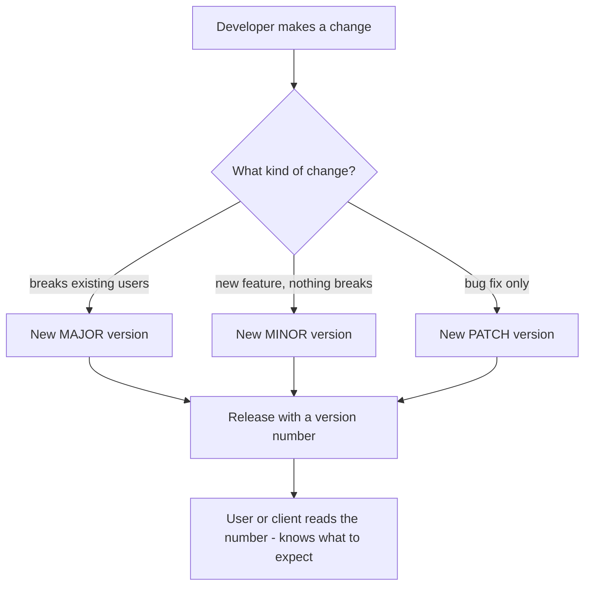
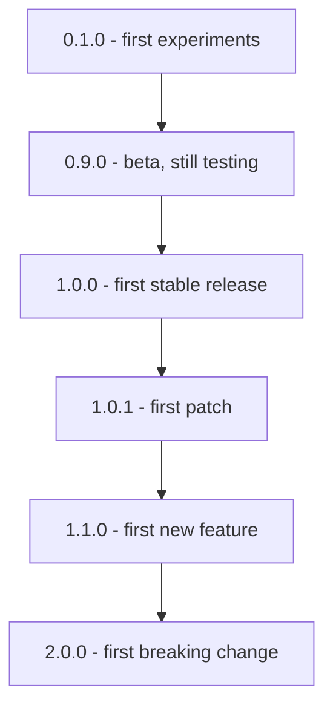
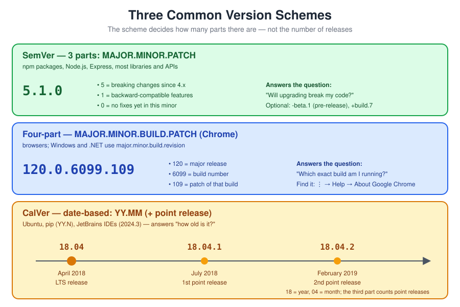
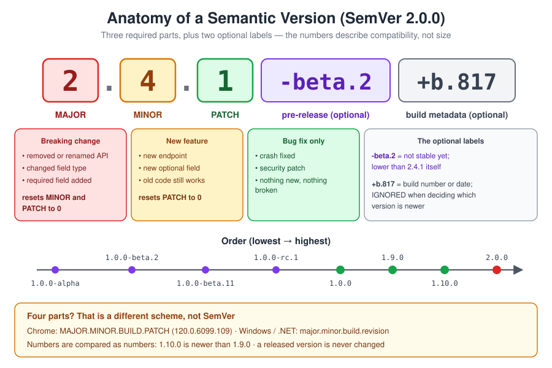
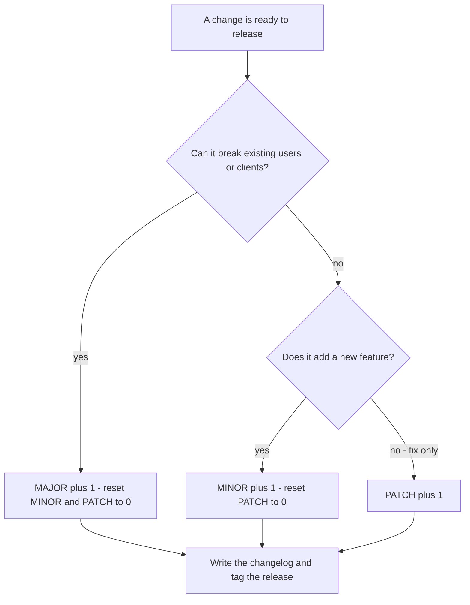
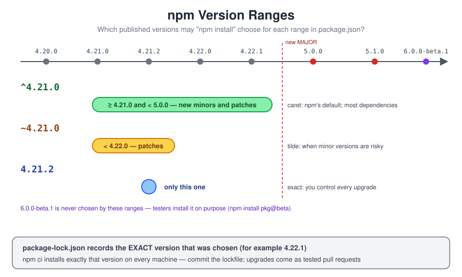
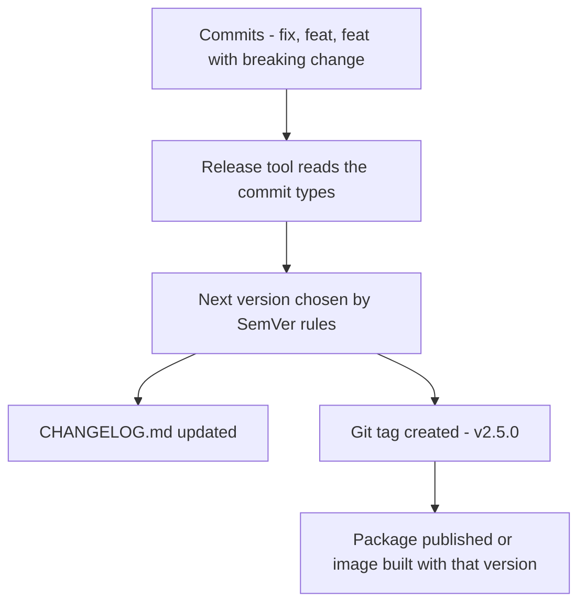
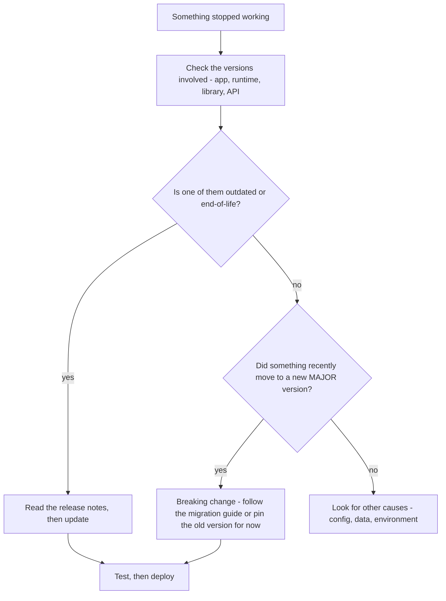
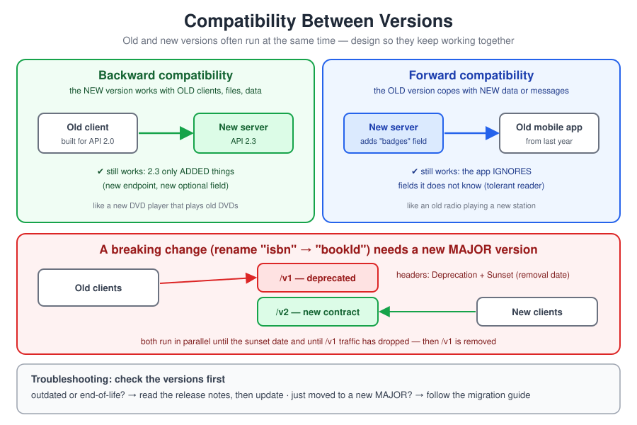

# 07 — Software Versions

**Learning goals of this lecture:**

- **Discuss** software versions on computing platforms.
- **Identify** software versions and version numbering.

> This note builds on [04 — Building Quality Software](04-building-quality-software.md), which introduces releases and pre-release names (alpha, beta, RC). Here we go deeper into **what a version number means**, the **numbering schemes**, how to **find** a version, and **compatibility** between versions — the everyday problems of a backend developer working with Node.js, npm packages and APIs.

---

## 1. Jargon Translation

| Term | Official Definition | Simple Words | Analogy |
|------|--------------------|--------------|---------|
| **Software version** | A unique label for one specific state of a program, usually a number such as `2.4.1`. | The "name" of one exact release of the software. | The edition number of a book. |
| **Software versioning** | The practice of giving each release a unique version label in a consistent way, to track new software, updates and patches. | How developers keep track of every release. | A library's system for numbering book editions. |
| **Version scheme** | The rules that say what each part of a version label means. | The "grammar" of the version number. | The format of a car's number plate. |
| **Release** | A version of the software that is made available to users. | A version you can download or use. | A new book edition reaching the shops. |
| **Update** | A newer version that replaces an older one. | Moving to a newer version. | Swapping your old phone app for the new one. |
| **Patch** | A small update that fixes bugs or security problems without adding features. | A small fix. | Sewing up a hole in a jacket. |
| **SemVer (Semantic Versioning)** | A widely used scheme, `MAJOR.MINOR.PATCH`, where each part tells users what **kind** of change was made (specification at semver.org, version 2.0.0). | Three numbers that say "breaking / new feature / fix". | Traffic lights: red (breaking), amber (new), green (fix). |
| **MAJOR version** | In SemVer, the first number; it increases when a change is **not backward compatible** (a breaking change). | "Careful — your code may need changes." | A new edition of a textbook with different chapter numbers. |
| **MINOR version** | In SemVer, the second number; it increases when **new features** are added in a **backward-compatible** way. | "New things, nothing broken." | A new chapter added at the end of the book. |
| **PATCH version** | In SemVer, the third number; it increases for **backward-compatible bug fixes**. | "Fixes only." | Typo corrections in a reprint. |
| **Build number** | A number that identifies one specific **build** (compiled package) of the software, often from a build server or a date. | Which exact package was made. | The batch number printed on a medicine box. |
| **Build metadata** | In SemVer, extra information after a `+` sign (for example `1.4.0+build.17`); it does **not** change which version is newer. | A note attached to the version. | A sticker on the box that says which factory made it. |
| **Pre-release version** | In SemVer, a version with a `-` label (for example `2.0.0-beta.1`) that is **not yet stable**. | A test version before the real one. | A film preview shown before the official premiere. |
| **Alpha / beta / RC (Release Candidate)** | Common pre-release stages: **alpha** (early, incomplete), **beta** (feature-complete, still testing), **RC** (may become the final version if no serious bug is found). | Early test → late test → almost final. | Rehearsal → dress rehearsal → opening night. |
| **CalVer (Calendar Versioning)** | A scheme where the version is based on the **release date**, for example Ubuntu `18.04` = year 2018, month 04. | The version number is a date. | A magazine called "April 2018 issue". |
| **Point release** | A small follow-up release of a version (for example Ubuntu `18.04.2`), usually collecting fixes and updates. | A refreshed version with fixes. | A reprint of a book with corrections. |
| **Compatibility** | The ability of different versions of software, files or systems to work together correctly. | Do these versions work together? | Does this charger fit this phone? |
| **Backward compatibility** | A **newer** version still works with **older** files, programs, systems or clients. | New works with old. | A new DVD (Digital Versatile Disc) player that still plays old DVDs. |
| **Forward compatibility** *(industry term)* | An **older** version can still handle data or messages made by a **newer** version (usually by ignoring what it does not understand). | Old works with new. | An old radio that still plays a new station, without the new extras. |
| **Breaking change** *(industry term)* | A change that makes existing users, code or clients stop working unless they change too. | A change that breaks other people's code. | Moving a door in a house: everyone walks into the wall. |
| **Deprecation** *(industry term)* | Marking a feature as "will be removed in a future version" while it still works. | "Still works, but stop using it." | A shop's sign: "This entrance closes next month." |
| **LTS (Long-Term Support)** *(industry term)* | A version line that receives bug and security fixes for a long, published period. | A version you can safely stay on for years. | A car model the maker promises spare parts for. |
| **EOL (End of Life)** *(industry term)* | The date after which a version gets **no more fixes**, not even security fixes. | "No more help after this day." | A phone that no longer gets updates. |
| **Dependency** | Another package your software needs to work (for example Express in a Node.js app). | Code you rely on from someone else. | The ingredients you buy for a recipe. |
| **Version range** *(industry term)* | A rule that says which versions of a dependency are allowed, for example `^4.21.0` in npm. | "Any version between here and there is OK." | "Any size-42 shoe from this brand." |
| **Lockfile** *(industry term)* | A file (`package-lock.json`) that records the **exact** version of every installed package. | A photo of exactly what was installed. | A receipt listing every item you bought. |
| **Changelog** *(industry term)* | A file that lists the notable changes in each version (for example `CHANGELOG.md`). | The history of what changed in each release. | The "what's new" page of an app. |
| **Git tag** *(industry term)* | A named pointer to one commit, used to mark a release (for example `v2.4.1`). | A bookmark on the exact code of a release. | A label on the box that holds one edition. |

---

## 2. Topics Introduced in the Lecture Transcript

1. **Learning goals** — discuss software versions on computing platforms; identify versions and numbering.
2. **Why versions matter** — users can find which version they use; developers share useful information through version numbers.
3. **Common format** — version numbers differ in length and meaning, but most follow a similar format and carry similar information: releases, updates and small changes or patches.
4. **Software versioning** — how developers keep track of new software, updates and patches.
5. **Length and separators** — 2, 3 or 4 number sets, separated by periods; the length depends on the software and the developer's chosen scheme.
6. **First release and beta** — `1.0` marks the first stable release; a version still in beta or testing can be below 1 (for example `0.9`).
7. **Date-based versions** — some developers use dates, for example Ubuntu `18.04.2` (18.04 = April 2018; `.2` = the second point release with updates).
8. **What the numbers mean** — the first number = major changes, the second = minor changes (new features in SemVer), the third = patches and bug fixes, and in some schemes a fourth number = build number or build date.
9. **Semantic versioning** — SemVer has **three** parts (`MAJOR.MINOR.PATCH`), with optional pre-release and build labels; four-part numbers come from other schemes.
10. **Finding the version** — in the **About** or **Help** section; practice in a web browser (Chrome: three dots → Help → About Google Chrome).
11. **Compatibility** — old and new versions often do not work together; check your version to troubleshoot; updating often fixes the problem.
12. **Backward compatibility** — newer versions still work with older files, programs and systems.
13. **Lecture summary** — versions show the history of changes; numbering schemes; compatibility is a common problem; check your version.

---

## 3. Exhaustive Deep Dive

### 3.1 What Software Versions Are For

- **Software versions tell us a lot about programs and applications.**
  - **Users** can determine **what software version they are using** (for example to check if they have the latest security fixes).
  - **Developers** can provide **useful information** with version numbers (for example "this update only fixes bugs — safe to install").
- **Software version numbers vary in length and meaning**; however, **most version numbers follow a similar format and represent similar information.**
- **Version numbers show the order and the kind of each release**: a new release, an update, or a small change or patch. They do **not** usually show **when** the software was released — only **date-based** schemes (CalVer, see [3.3](#33-date-based-versions-calver)) put the date into the number.
- **Software versioning is how software developers keep track of new software, updates and patches** for programs and applications.

> ⚠️ **Correction:** "version numbers indicate **when** the software was released and updated" → a version number shows the **order** and the **kind** of change (major, minor, patch). It shows the **date** only when the developer uses a calendar-based scheme (CalVer). To find a release **date**, look at the release notes, the changelog or the Git tag.
> **Lecture wording (for the quiz):** "Version numbers indicate when the software was released, when it was updated, and if any minor changes or patches were made to the software."

| Who | What the version tells them | Example |
|-----|-----------------------------|---------|
| **User** | Do I have the latest fixes? Is my version still supported? | "The advisory says the fix is in version 2.7.3 — I have 2.7.1, so I must update." |
| **Developer using a library** | Is it safe to upgrade? Will my code break? | `express` 4.21.1 → 4.21.2 is a patch (safe); 4 → 5 is a major (read the migration guide). |
| **Support / operations** | Which exact code is running in production? | "The error started with API version 2.7.0, deployed yesterday." |



#### 3.1.1 ✅ Modern Best Practice: a version number is a promise about compatibility

> **Lecture says:** version numbers carry information about releases, updates and patches.
> **Industry today:** for libraries, APIs and services, the version number is a **contract**: it tells every user **whether the new version can break their code**. Tools (npm, Dependabot, Renovate) make automatic decisions based on that promise.

- **How it is done today:**
  - **SemVer** is the default for npm packages, Node.js itself and most open-source libraries: `MAJOR.MINOR.PATCH` (see [3.4](#34-what-the-numbers-mean-semantic-versioning)).
  - **Package managers** use the number to choose upgrades automatically: `npm install` accepts any newer **minor** or **patch** version inside the allowed range, but never a new **major** (see [3.4.2](#342--modern-best-practice-npm-version-ranges-and-lockfiles)).
  - **Marketing names are kept separate** from technical versions. A product can be called "Version 2026" in advertising while its API is `3.2.0`.
- **Why:** if developers increase the MAJOR number only for breaking changes, users can **upgrade fixes and features safely and quickly** — including security patches — without reading every line of every changelog.

---

### 3.2 How Version Numbers Are Displayed

- **Version numbers can be short or long**, depending on the software and the **version scheme the developer chooses**, with **2, 3 or 4 number sets**.
- **Each number set is divided by a period** (`.`).

  | Number sets | Example | Typical use |
  |-------------|---------|-------------|
  | **2** | `1.0`, `18.04` | First releases of small programs; date-based versions (Ubuntu) |
  | **3** | `2.4.1` | **SemVer** — npm packages, Node.js, most libraries and APIs |
  | **4** | `120.0.6099.109` | Browsers (Chrome: `MAJOR.MINOR.BUILD.PATCH`), Windows and .NET assemblies (`major.minor.build.revision`) |

- **The length of the number comes from the scheme, not from the number of releases.** A program with hundreds of releases can still have a 3-part number (Node.js), and a brand-new program can start with 4 parts if its scheme uses them.

> ⚠️ **Correction:** "a program with many releases and updates will have a **longer** number" → the **number of parts is fixed by the version scheme**, not by how many releases there were. More releases make the numbers **bigger** (for example `1.2.0` → `1.27.3`), not **longer**.
> **Lecture wording (for the quiz):** "A program or application with many releases and updates will have a longer number, sometimes 4 different number sets within the version number."

#### 3.2.1 The first release and versions below 1

- **The first release of an application or program might have `1.0` as the version number**, to show it is the **first stable release** — no updates, patches or fixes have been released on top of it yet. In SemVer this is written in full as **`1.0.0`**.
- **A version still in beta or testing could have a version number lower than 1, such as `0.9`.**



#### 3.2.2 ✅ Modern Best Practice: `0.y.z` means "anything can change", and pre-release labels mark betas

> **Lecture says:** a version still in beta or testing could have a version number lower than 1, such as 0.9.
> **Industry today:** SemVer gives both ideas exact rules: **`0.y.z`** is for **initial development**, and **pre-release labels** (`-alpha.1`, `-beta.2`, `-rc.1`) mark test versions of **any** major version.

- **`0.y.z` (major version zero):** the software is in early development; **anything may change at any time**, and the public API should not be considered stable. Version **`1.0.0` defines the first stable public API**.
- **Pre-release versions** add a hyphen and a label: `2.0.0-alpha.1` → `2.0.0-beta.1` → `2.0.0-rc.1` → `2.0.0`.
  - A pre-release is **lower** than the normal version: `2.0.0-rc.1` < `2.0.0`.
  - Labels are compared part by part: `alpha` < `beta` < `rc` (alphabetical), and numbers are compared as numbers (`beta.2` < `beta.11`).
  - So a beta of version 3 is `3.0.0-beta.1` — **not** `2.9`.
- **npm and pre-releases:** a normal range such as `^2.0.0` **does not** install `3.0.0-beta.1`. Publish test versions with a **dist-tag** so normal users do not get them by accident: `npm publish --tag beta`, then testers run `npm install my-lib@beta`.
- **Why:** the old "below 1 = beta" idea cannot express "beta of version 3". Pre-release labels can, and tools understand them.

| Version | Meaning | Installed by `npm install my-lib` (dist-tag `latest`)? |
|---------|---------|---------------------------------------------------------|
| `0.9.0` | Initial development — API may change anytime | Only if it is the latest published version |
| `3.0.0-beta.1` | Test version of the coming major 3 | **No** (published with `--tag beta`) |
| `3.0.0-rc.1` | Release candidate — may become final | **No** |
| `3.0.0` | Stable release | **Yes** |

---

### 3.3 Date-Based Versions (CalVer)

- **Some software developers use dates for their versioning.** This is called **CalVer (Calendar Versioning)**.
- **Example: Ubuntu Linux.**
  - **`18.04`** means the release came out in **2018, April** (`YY.MM`).
  - **`18.04.2`** is the **second point release** of 18.04. The third number set, **`.2`**, marks an **additional update**: new installation images that include all the fixes and updates released since April 2018. Ubuntu 18.04.2 itself was released in **February 2019**.

> ⚠️ **Correction:** "Ubuntu Linux version 18.04.2 was released in 2018 April" → **18.04** was released in **April 2018**. **18.04.2** is a later **point release** (February 2019). In CalVer, only the **first two** number sets are the date; the third set counts point releases.
> **Lecture wording (for the quiz):** "Ubuntu Linux version 18.04.2 was released in 2018 April. The third number set, point-2, designates an additional change or update."

| Version | Released | What the parts mean |
|---------|----------|---------------------|
| `18.04` | April 2018 | `18` = year 2018, `04` = month April (an **LTS** release — Ubuntu publishes an LTS every two years, in April of even years) |
| `18.04.1` | July 2018 | First point release: fixes and updates collected since April |
| `18.04.2` | February 2019 | Second point release |



#### 3.3.1 ✅ Modern Best Practice: when CalVer is the right choice

> **Lecture says:** some developers use dates for their versioning.
> **Industry today:** CalVer is common for products on a **fixed release schedule** (operating systems, tools, apps), while **SemVer** is the standard for **libraries and APIs**, because other code needs to know about breaking changes.

| | **SemVer** | **CalVer** |
|---|---|---|
| Tells you | **What kind** of change (breaking / feature / fix) | **When** it was released |
| Best for | Libraries, npm packages, APIs, SDKs | Products on a time-based schedule; long-lived platforms |
| Examples | Node.js, Express, React, most npm packages | Ubuntu (`YY.MM`), pip (`YY.N`), JetBrains IDEs (`2024.3`) |
| Weakness | Says nothing about age | Says nothing about breaking changes |

- **Many projects mix both:** a time-based **release schedule** with **SemVer numbers**. Node.js, for example, releases on a published calendar, but its version numbers follow SemVer.
- **Why:** pick the scheme that answers the question your users ask most. A library user asks "will this break my code?" (SemVer); an operating-system user asks "how old is this, and is it still supported?" (CalVer + LTS dates).

---

### 3.4 What the Numbers Mean: Semantic Versioning

- **Many version numbers follow the semantic versioning system (SemVer).** SemVer has **three** required parts separated by periods: **`MAJOR.MINOR.PATCH`**.
  - **First number — MAJOR:** increases for **incompatible (breaking) changes**, for example a big new release that changes how the software is used.
  - **Second number — MINOR:** increases when **new features** are added **in a backward-compatible way**.
  - **Third number — PATCH:** increases for **backward-compatible bug fixes** (patches or minor bug fixes).
  - **Optional labels:** a **pre-release** label after `-` (for example `2.0.0-beta.1`), and **build metadata** after `+` (for example `2.0.0+build.17`), which can record a **build number** or **build date**.
- **Not all numbering systems follow SemVer.** Some use a **fourth number** set for a **build number** or **build date**, or for **less significant changes**:
  - **Chrome:** `MAJOR.MINOR.BUILD.PATCH` (for example `120.0.6099.109`).
  - **Windows / .NET assemblies:** `major.minor.build.revision`.

> ⚠️ **Correction:** "semantic numbering has **4 parts** — major, minor, patch, build" → **SemVer has 3 parts** (`MAJOR.MINOR.PATCH`). A build number or date is **optional build metadata** written after a `+` (for example `1.4.2+20260316`), and SemVer **ignores it** when deciding which version is newer. Four-part numbers belong to **other** schemes (Chrome, Windows/.NET).
> **Lecture wording (for the quiz):** "Some version numbers follow the semantic numbering system and have 4 parts separated by a period … Finally, the fourth number indicates a build number or a build date, and it can indicate less significant changes made."

> ⚠️ **Correction:** "the first number indicates major changes, **such as a new release**; the second number indicates that **minor changes** were made" → in SemVer, what matters is **compatibility**, not size. **MAJOR** = a **breaking** change (even a small one, like renaming one function). **MINOR** = **new features that do not break** anything (even a large one). Every version is a new release, so "a new release" does not explain MAJOR.
> **Lecture wording (for the quiz):** "In semantic numbering, the first number indicates major changes to the software, such as a new release. The second number indicates that minor changes were made to the software. The third number in the version number indicates patches or minor bug fixes."



| Part | Increase it when… | Reset | Example (Express-style library) |
|------|-------------------|-------|----------------------------------|
| **MAJOR** | You make a change that can **break** existing users | MINOR and PATCH → 0 | `4.21.2` → `5.0.0` (removed old APIs, changed route path syntax) |
| **MINOR** | You **add** a feature; old code still works | PATCH → 0 | `5.0.1` → `5.1.0` (new option added) |
| **PATCH** | You **fix** a bug; nothing new, nothing broken | — | `5.1.0` → `5.1.1` (security fix) |
| **Pre-release** (`-…`) | You want testers to try a coming version | — | `6.0.0-beta.1` |
| **Build metadata** (`+…`) | You want to record the build number or date | — | `5.1.1+build.482` |



- **Version order (precedence) in SemVer**, from lowest to highest:

  ```text
  1.0.0-alpha < 1.0.0-alpha.1 < 1.0.0-beta < 1.0.0-beta.2 < 1.0.0-beta.11 < 1.0.0-rc.1 < 1.0.0 < 1.0.1 < 1.1.0 < 2.0.0
  ```

- **Other important SemVer rules:**
  - Once a version is released, its **contents must never change**. A fix is always a **new** version.
  - Numbers have **no leading zeros** (`1.02.0` is not valid) and are compared **as numbers** (`1.10.0` is newer than `1.9.0`).

#### 3.4.1 What counts as a breaking change for a backend developer?

| Change to a REST (Representational State Transfer) API or library | Breaking? | Version bump |
|---------------------------------|-----------|--------------|
| Add a new endpoint or a new **optional** field | No | MINOR |
| Fix a bug so the API now matches its documentation | Usually no | PATCH |
| Remove or rename an endpoint, a field or a function | **Yes** | MAJOR |
| Make an optional request field **required** | **Yes** | MAJOR |
| Change a field's type (`"price": "9.99"` → `9.99`) | **Yes** | MAJOR |
| Change an error status code clients depend on (`404` → `400`) | **Yes** | MAJOR |
| Drop support for an old Node.js version (`engines` field) | **Yes**, for a library | MAJOR |

#### 3.4.2 ✅ Modern Best Practice: npm version ranges and lockfiles

> **Lecture says:** version numbers show major changes, minor changes and patches.
> **Industry today:** npm uses those three numbers to decide **which dependency versions your project may install**, and a **lockfile** pins the exact result so every machine installs the same code.

- **Version ranges in `package.json`:**

  | Range | Means | Allows | Use it for |
  |-------|-------|--------|------------|
  | `^4.21.0` (caret — npm's default) | Same MAJOR | `4.21.0` up to, but not including, `5.0.0` | Most dependencies |
  | `~4.21.0` (tilde) | Same MAJOR.MINOR | `4.21.0` up to, but not including, `4.22.0` | Packages that break things in minor versions |
  | `4.21.2` (exact) | Only this version | `4.21.2` | Critical tools; when you must control every upgrade |
  | `^0.4.2` (caret on 0.x) | Same **0.MINOR** | `0.4.2` up to, but not including, `0.5.0` | Caret is stricter for `0.y.z`, because anything may change |



- **The lockfile (`package-lock.json`):** records the **exact** version (and a checksum) of **every** package, including dependencies of dependencies.
  - **Commit it to Git.**
  - In CI (Continuous Integration) and production builds use **`npm ci`**: it installs exactly what the lockfile says, and **fails** if `package.json` and the lockfile do not match.
- **Automated, controlled upgrades:** tools such as **Dependabot** or **Renovate** open pull requests for new versions, so CI tests every upgrade before it is merged. A **cooldown** (waiting a few days before adopting a brand-new version, for example npm's `min-release-age` setting) protects against hijacked package releases.
- **Why:** a range alone can install **different** versions on Monday and on Friday. "It works on my machine" bugs and supply-chain attacks both become more likely without a lockfile.

#### 3.4.3 ✅ Modern Best Practice: automated versioning and changelogs

> **Lecture says:** developers keep track of new software, updates and patches with version numbers.
> **Industry today:** teams **automate** the version number and the changelog from their commit messages, and mark each release with a **Git tag**.

- **Conventional Commits:** commit messages start with a type that maps to SemVer:

  | Commit message | Version bump |
  |----------------|--------------|
  | `fix: return 404 when the book does not exist` | PATCH |
  | `feat: add search by author` | MINOR |
  | `feat!: remove the /books/all endpoint` (or a `BREAKING CHANGE:` footer) | MAJOR |
  | `docs:`, `test:`, `chore:` | No release |

- **Release tools** read these commits, choose the next version, update `CHANGELOG.md`, create the **Git tag** (`v2.5.0`) and publish: for example **semantic-release**, **release-please** or **Changesets**.
- **Human-readable changelog:** for example in the **"Keep a Changelog"** format — sections **Added**, **Changed**, **Deprecated**, **Removed**, **Fixed**, **Security** for each version.



---

### 3.5 Finding the Version of Software

- **Software version numbers are identified in the "About" or "Help" section of software.**
- **Practice in a web browser.** The example uses the **Google Chrome desktop browser**; other browsers use the same or similar steps:
  1. Select the **three dots** (Chrome, Edge) or **three lines** (Firefox) in the **top-right corner** of the browser.
  2. Select the menu item **"Help"**.
  3. Select **"About"** (in Chrome: "About Google Chrome") to view the version information.
  4. **The version of your web browser is displayed** — and Chrome also checks for updates on this page.
- **Shortcut (not in the lecture):** type `chrome://settings/help` in Chrome's address bar, or `about:support` in Firefox.

| Where | How to see the version |
|-------|------------------------|
| **Desktop app** | Help → About (Windows, Linux) or *App name* → About (macOS) |
| **Operating system** | Windows: `winver`; macOS: Apple menu → About This Mac; Linux: `cat /etc/os-release` |
| **Command-line tools** | `node -v`, `npm -v`, `git --version`, `docker --version` |
| **npm packages in a project** | `npm ls express` (installed), `npm view express version` (latest published), `npm outdated` (current vs. wanted vs. latest) |
| **A running web service** | A `/health` or `/version` endpoint, the logs, or the monitoring dashboard (see [3.5.1](#351--modern-best-practice-every-running-service-reports-its-version)) |

```bash
node -v                    # Node.js version, for example v24.x.x
npm -v                     # npm version
npm ls express             # which express version is installed in this project
npm view express version   # the latest version published on the npm registry
npm outdated               # every dependency: Current, Wanted (allowed by the range), Latest
git describe --tags        # the nearest release tag of the code you have checked out
```

#### 3.5.1 ✅ Modern Best Practice: every running service reports its version

> **Lecture says:** find the version in the About or Help section.
> **Industry today:** backend services have no "About" menu, so they **report their version** through an endpoint, their **logs** and their **telemetry**, and every container image is **tagged** with the version.

- **How it is done today:**
  - A **`/version`** (or `/health`) endpoint returns the app version **and** the **Git commit SHA** of the build (see [§5.3](#53-a-version-endpoint-and-api-versioning-in-express)).
  - Every log line and trace carries the version. In **OpenTelemetry**, the standard attribute is **`service.version`**, so dashboards (for example Grafana) can show "errors per version" — very useful right after a deployment.
  - **Container images are tagged with the version** (`book-api:2.5.0`), never only `latest`. In production, teams often pin the image **digest** (`@sha256:…`), which can never change.
- **Why:** when an error starts, the first question is "**which version** is running where?". If the service cannot answer it, every incident starts with guessing.

---

### 3.6 Compatibility Between Versions

- **Are newer versions of software compatible with older versions?** Not always: **lack of compatibility between old and new versions of software is a common problem.**
- **Troubleshoot compatibility issues by viewing the software version**, to find out if you are using an **outdated** version.
- **Sometimes updating software to a newer version will resolve compatibility issues.** But an update can also **cause** a problem, when it is a **new major version** with breaking changes — so read the release notes first.
- **Some software is backward compatible.** If a program or application is backward compatible, **older versions of files, programs and systems work properly with newer versions** — for example, a new version of a word processor still opens files saved by the old version.





#### 3.6.1 ✅ Modern Best Practice: designing for compatibility in backend systems

> **Lecture says:** compatibility is a common problem; check your version, update, and prefer backward-compatible software.
> **Industry today:** backend teams **design** for compatibility, so clients and services on different versions keep working while they are upgraded one by one.

- **Backward compatibility of APIs:** a new API version keeps working for **old clients**. Only **add** things (new endpoints, new optional fields); never silently remove or rename.
- **Forward compatibility (tolerant reader):** clients **ignore fields they do not know**, so the server can add fields without breaking old clients.
- **API versioning for breaking changes:** put the major version in the path (`/v1/books`, `/v2/books`) or in a header, and run **both versions in parallel** for a while.
- **Deprecation with a timetable:** announce, then remove.
  - Send a **`Deprecation`** header (RFC 9745) and a **`Sunset`** header (RFC 8594, the date the old version stops working) on the old version, and link to the migration guide.
  - Track which clients still call the old version, and contact them before the sunset date.
- **Database changes without downtime — expand → migrate → contract:** first **add** the new column (old and new code both work), then move the data and the code, and only then **remove** the old column. During a rolling deployment, old and new app versions run **at the same time**.
- **Runtime versions:** declare the Node.js versions you support in `package.json` → `"engines"`, run CI on those versions, and use only **LTS** (Long-Term Support) Node.js lines in production. Upgrade **before** a line reaches **end-of-life**: after EOL there are no security fixes. (Node.js publishes its release schedule on nodejs.org; from Node.js 27 on, there is one major release per year and every major becomes LTS.)
- **Why:** in a system of many services and clients (web, mobile apps, partners), you **cannot** upgrade everything at the same moment. Compatibility rules let each part move at its own speed.

| | Backward compatibility | Forward compatibility |
|---|---|---|
| Question | Does the **new** version work with **old** clients, files, data? | Does the **old** version work with **new** data or messages? |
| Example | API v2.3 still accepts requests from a client built for v2.0 | A mobile app from last year ignores a new `"badges"` field in the response |
| How to get it | Only add; never remove or rename without a new major | Ignore unknown fields; use defaults for missing ones |

---

### 3.7 Often-Missed Parts: What a Senior Engineer Adds (not in the lecture — industry practice)

| Area | What to know | Why |
|------|--------------|-----|
| **Security updates depend on versions** | Vulnerability databases and `npm audit` list **affected version ranges**; the fix is "upgrade to version X or later" | Knowing your exact versions is the first step of every security response |
| **SBOM (Software Bill of Materials)** | A machine-readable list of every component and its **version** in a release (CycloneDX or SPDX format) | Lets you answer "are we affected?" in minutes when a new vulnerability appears |
| **End-of-life tracking** | Every runtime, framework, database and OS (operating system) version has an EOL date; track them (for example on endoflife.date) | Running EOL software means no security fixes |
| **Immutable releases** | A published version (npm package, Git tag, image digest) is **never changed**; fixes get a new version | Two different builds with the same number make bugs impossible to trace |
| **Several versions live at once** | Mobile apps, partner integrations and rolling deployments mean old and new versions run side by side | Compatibility must be designed, not hoped for |
| **Feature flags vs. versions** | A new feature can ship **inside** a version but stay switched off | Releasing a feature no longer requires a new version for every user |
| **Monorepos** | Many packages in one repository, each with its own version (tools such as Changesets manage them) | Each package keeps an honest SemVer promise |
| **AI coding tools** | AI assistants may suggest **outdated** APIs or package versions from their training data, or package names that do not exist | Check the version and the official docs before using a suggestion |

#### 3.7.1 "Done enough when…" checklist for software versions

- [ ] Every release has a **unique version** that follows **one documented scheme** (SemVer for libraries and APIs).
- [ ] **MAJOR** is increased for every **breaking change**, and only then.
- [ ] Pre-releases use **labels** (`-beta.1`, `-rc.1`) and are published so normal users do not install them by accident.
- [ ] Each release has a **Git tag** and a **changelog** entry.
- [ ] `package-lock.json` is committed, and CI installs with **`npm ci`**.
- [ ] Dependency upgrades arrive as **pull requests** (Dependabot or Renovate) and are tested in CI.
- [ ] The running service reports its **version and commit SHA** (endpoint, logs, `service.version` in telemetry).
- [ ] Container images are tagged with the version (and pinned by digest in production), never only `latest`.
- [ ] Breaking API changes get a **new API version**, with **Deprecation** and **Sunset** headers on the old one.
- [ ] Runtime and framework versions are **supported (LTS)**, with EOL dates tracked.

---

### 3.8 Lecture Summary

- **Version numbers show the history of changes, updates and patches** to software.
- **Many version numbers follow semantic versioning (SemVer)**, which has **three** parts (`MAJOR.MINOR.PATCH`) separated by periods, plus optional pre-release and build labels. Some other schemes use **four** parts.
- **Compatibility between old and new versions of software is a common problem.**
- **Check the version of the software you are using** to find out if the versions are compatible.

| Topic | Lecture | ✅ Modern best practice |
|-------|---------|--------------------------|
| Purpose | Versions show releases, updates and patches; users and developers both use them | A version is a **compatibility promise**; tools act on it automatically |
| Format | 2, 3 or 4 number sets separated by periods | The **scheme** fixes the length; SemVer (3 parts) for libraries and APIs |
| First release / beta | `1.0` first release; below 1 (for example `0.9`) for beta | `0.y.z` = initial development; pre-release labels `-alpha`, `-beta`, `-rc` for any major |
| Dates | Ubuntu `18.04.2` | CalVer `YY.MM` for time-based products; the third part counts point releases |
| Meaning of the numbers | Major, minor, patch, build | MAJOR = breaking, MINOR = compatible features, PATCH = compatible fixes; build metadata after `+` |
| Finding the version | About / Help menu | CLI (command-line interface) commands, `npm ls` / `npm outdated`, `/version` endpoint, `service.version` in telemetry |
| Compatibility | Check versions; update; backward compatibility | Ranges + lockfiles; API versioning; Deprecation/Sunset headers; expand → migrate → contract; LTS runtimes |
| Tracking releases | Versioning tracks new software, updates, patches | Conventional Commits → automated version, changelog and Git tag |

---

## 4. Concrete Examples

### 4.1 The Book Review API (course project) through its versions

| Version | What changed | Why this number |
|---------|--------------|-----------------|
| `0.3.0` | Early prototype: list and post reviews | Initial development — the API may still change |
| `1.0.0` | First stable public API: `/v1/books`, `/v1/reviews`, login | The API is now a promise to clients |
| `1.0.1` | Fix: rating 6 was accepted | Bug fix only → PATCH |
| `1.1.0` | New: `GET /v1/books?author=…` search; new optional `"tags"` field | New features, nothing broken → MINOR |
| `2.0.0-beta.1` | Test version: reviews now need a `bookId` instead of `isbn` | Breaking change being tested → pre-release of MAJOR 2 |
| `2.0.0` | `/v2/reviews` released; `/v1` still runs with `Deprecation` and `Sunset` headers | Breaking change → MAJOR, with a parallel old version |
| `2.0.1+build.812` | Security patch; build 812 from CI | PATCH; build metadata does not change the version order |

### 4.2 Reading real-world version numbers

| Version | Scheme | How to read it |
|---------|--------|----------------|
| `5.1.0` (an npm package) | SemVer | Major 5, its first minor feature release, no patches yet |
| `120.0.6099.109` (Chrome) | 4-part: `MAJOR.MINOR.BUILD.PATCH` | Chrome 120, build 6099, patch 109 |
| `18.04.2` (Ubuntu) | CalVer + point release | Released April 2018 (LTS); second point release (February 2019) |
| `3.0.0-rc.2` | SemVer pre-release | Second release candidate of major version 3 — not final yet |
| `0.9.4` | SemVer, major zero | Initial development — expect breaking changes in any release |

### 4.3 Quick practice: which number do you increase?

The current version of a library is `3.4.2`.

| Change | New version |
|--------|-------------|
| Fix a crash when the input is empty | `3.4.3` |
| Add a new optional `timeout` option | `3.5.0` |
| Rename the function `getBook()` to `fetchBook()` | `4.0.0` |
| Update only the README | No new version needed (or a docs-only release) |
| Drop support for an old Node.js line | `4.0.0` |
| Publish a test version of the rename for early users | `4.0.0-beta.1` |

---

## 5. Code Blocks

### 5.1 Comparing versions correctly in JavaScript

```js
// compare-versions.js — run with: node compare-versions.js  (after: npm install semver)
// semver is the same library npm itself uses to understand versions and ranges.
import semver from "semver";

console.log(semver.valid("2.4.1"));                    // "2.4.1"  — a valid SemVer version
console.log(semver.valid("2.4"));                      // null     — SemVer needs all three parts
console.log(semver.gt("1.10.0", "1.9.0"));             // true     — 10 > 9, compared as numbers
console.log(semver.lt("2.0.0-rc.1", "2.0.0"));         // true     — a pre-release is lower than the release
console.log(semver.satisfies("4.22.1", "^4.21.0"));    // true     — same major, newer minor
console.log(semver.satisfies("5.0.0", "^4.21.0"));     // false    — a new major is never allowed by ^4
console.log(semver.inc("3.4.2", "minor"));             // "3.5.0"  — next minor resets the patch to 0
console.log(semver.inc("3.4.2", "premajor", "beta"));  // "4.0.0-beta.0" — first pre-release of the next major
```

**What happens if…** you compare versions as plain strings?

```js
// ❌ Wrong: strings are compared character by character, not as numbers
console.log("1.10.0" > "1.9.0");        // false! "1" vs "9" at the third character → "9" is bigger
console.log(["1.10.0", "1.9.0", "1.2.0"].sort());   // [ '1.10.0', '1.2.0', '1.9.0' ] — wrong order

// ✅ Right: use a SemVer-aware comparison
console.log(["1.10.0", "1.9.0", "1.2.0"].sort(semver.compare)); // [ '1.2.0', '1.9.0', '1.10.0' ]
```

- A string comparison can make an "is the client too old?" check **block new clients** or **let old ones through**.
- ✅ Always use a SemVer library (or at least compare each part as a number) — and remember that pre-release labels need special rules, which the library already handles.

### 5.2 `package.json`: version, ranges and engines

```json
{
  "name": "book-review-api",
  "version": "2.0.1",
  "type": "module",
  "engines": {
    "node": ">=22"
  },
  "dependencies": {
    "express": "^5.1.0",
    "mongodb": "~6.10.0",
    "semver": "^7.6.0"
  },
  "devDependencies": {
    "supertest": "^7.0.0"
  }
}
```

- `"version"` — this project's own SemVer version (shown by the `/version` endpoint below).
- `"engines"` — the Node.js versions the project supports. npm reads the `engines` field of the **packages it installs** and warns when they do not support your Node.js (an error with the `engine-strict=true` setting). For your **own** app, enforce it at startup ([§5.4](#54-checking-the-runtime-version-at-startup)) and in CI.
- `"^5.1.0"` — any Express `5.x.y` from `5.1.0` up; never Express 6.
- `"~6.10.0"` — only MongoDB driver `6.10.x` patches.

```bash
npm install express@^5.1.0   # add or change a dependency (saves a ^ range by default)
npm ci                       # CI / production: install exactly what package-lock.json says
npm outdated                 # see which dependencies have newer versions
npm version minor            # bump "version" 2.0.1 → 2.1.0, commit, and create the Git tag v2.1.0
git push --follow-tags       # push the commit and its release tag
```

**What happens if…** the project has no `package-lock.json` and CI runs `npm install`?
- Each build can install **different** dependency versions — whatever is newest inside each range that day.
- A bug or a malicious release in a dependency can reach production **without any code change** in your repository.
- ✅ Commit `package-lock.json`, use `npm ci` in CI and Docker builds, and let Dependabot or Renovate propose upgrades as tested pull requests.

### 5.3 A version endpoint and API versioning in Express

```js
// src/app.js — the service reports its version, and an old API version is deprecated (Express 5)
import express from "express";
import { readFile } from "node:fs/promises";

const pkg = JSON.parse(await readFile(new URL("../package.json", import.meta.url), "utf8")); // read our own version
export const app = express();

// 1) Which version is running? (support, monitoring and smoke tests call this)
app.get("/version", (req, res) => {
  res.json({
    version: pkg.version,                     // e.g. "2.0.1" from package.json
    commit: process.env.GIT_SHA ?? "unknown", // set by the CI pipeline at build time
    node: process.versions.node,              // the Node.js runtime version
  });
});

// 2) Mark every /v1 response as deprecated, with a removal date
const v1Deprecation = (req, res, next) => {
  res.set("Deprecation", "@1767225600");                         // RFC 9745: deprecated since 2026-01-01 (Unix time)
  res.set("Sunset", "Thu, 31 Dec 2026 23:59:59 GMT");            // RFC 8594: v1 stops working after this date
  res.set("Link", '<https://api.example.com/docs/migrate-v2>; rel="deprecation"'); // where to read the migration guide
  next();
};

const v1 = express.Router();
v1.get("/books/:isbn", (req, res) => res.json({ isbn: req.params.isbn, title: "Clean Code" }));

const v2 = express.Router();
v2.get("/books/:bookId", (req, res) => res.json({ bookId: req.params.bookId, title: "Clean Code" }));

app.use("/v1", v1Deprecation, v1);   // old clients keep working until the sunset date
app.use("/v2", v2);                  // new clients use the new contract
```

**What happens if…** the team changes `/v1` in place (renames `isbn` to `bookId`) instead of adding `/v2`?
- Every existing client — web app, mobile apps that users have not updated, partner integrations — breaks **at the moment of deployment**.
- ✅ A breaking change gets a **new major API version** that runs **in parallel**; the old one is removed only after the sunset date and after its traffic has dropped (check the logs or metrics per version).

### 5.4 Checking the runtime version at startup

```js
// src/check-runtime.js — stop early with a clear message if Node.js is too old
import semver from "semver";
import { readFile } from "node:fs/promises";

const { engines } = JSON.parse(await readFile(new URL("../package.json", import.meta.url), "utf8"));

if (!semver.satisfies(process.versions.node, engines.node)) {     // e.g. "20.11.0" vs ">=22"
  console.error(`Node.js ${process.versions.node} is not supported. Required: ${engines.node}`);
  process.exit(1);                                                // fail fast with a clear reason
}
```

**What happens if…** there is no check, and production runs an older Node.js than the developers used?
- The app may crash later with a confusing error (for example a missing built-in API), or behave differently only in production.
- ✅ Check at startup, **pin the runtime** in the Docker image (for example `FROM node:24-alpine`, a current LTS line), and run CI on the same Node.js versions as production.

---

## 6. Related Concepts

1. **Releases and pre-release stages** — alpha, beta and release candidates are SemVer pre-release labels; release management is covered in [note 04](04-building-quality-software.md).
2. **npm and dependency management** — ranges, lockfiles and `npm ci` decide which versions of Express, MongoDB drivers and other packages run in your Node.js backend.
3. **REST API design and versioning** — `/v1` vs. `/v2`, backward-compatible changes, and `Deprecation`/`Sunset` headers keep API clients working while the API evolves.
4. **CI/CD and release automation** — Conventional Commits, Git tags and tools such as semantic-release turn every merge into a correctly numbered, documented release; container images carry the same version.
5. **Software supply-chain security** — exact versions, lockfiles, SBOMs and `npm audit` let a team know which vulnerable versions it runs and upgrade fast.
