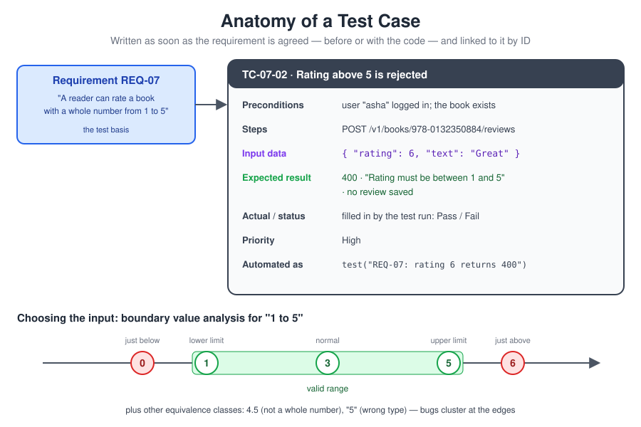
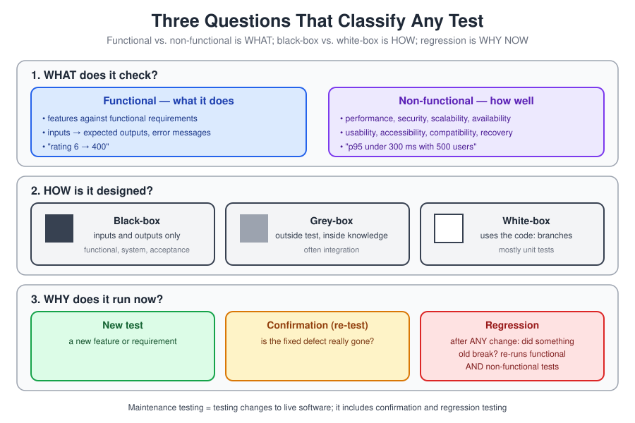
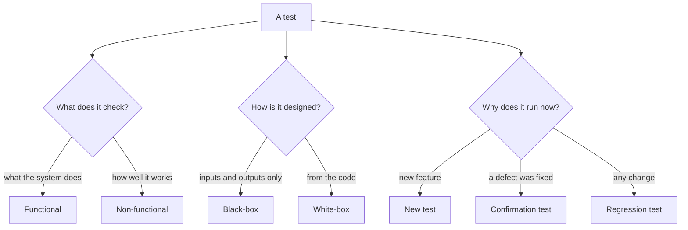
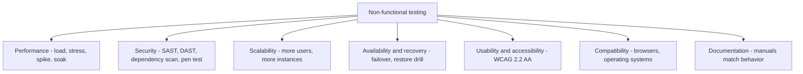
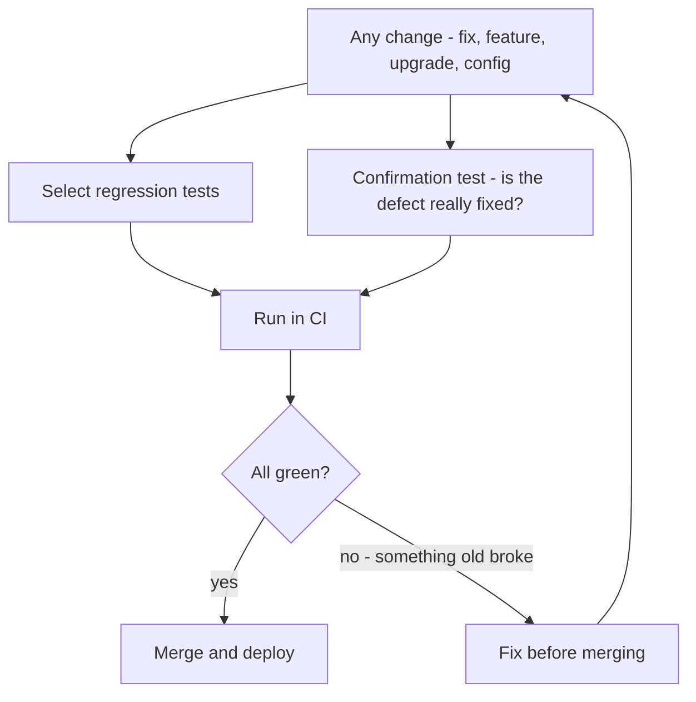
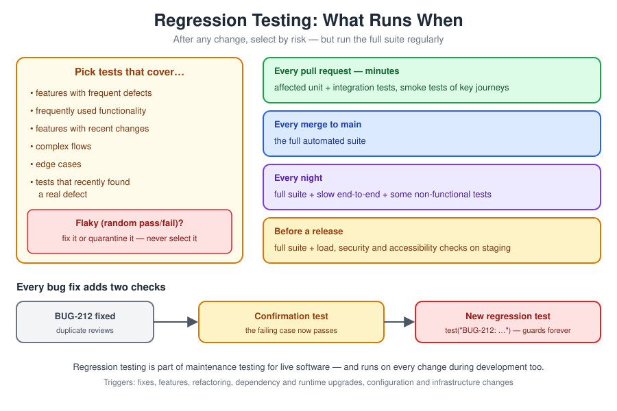
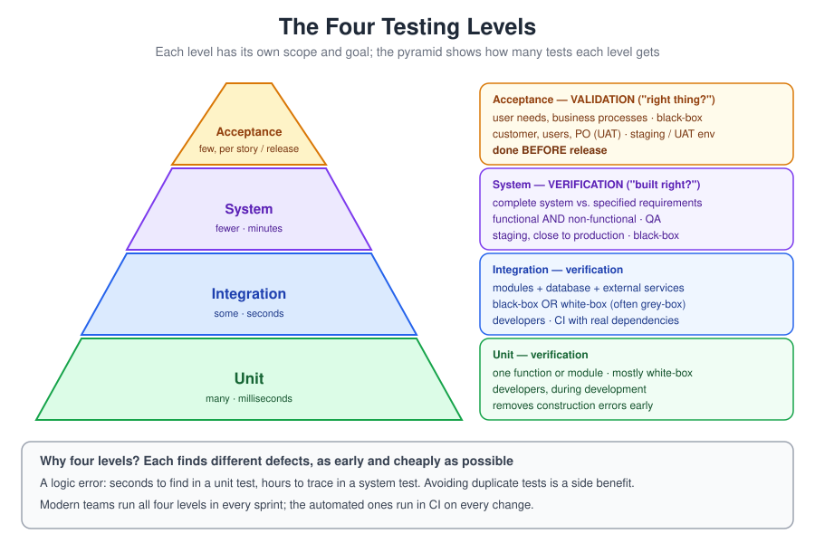
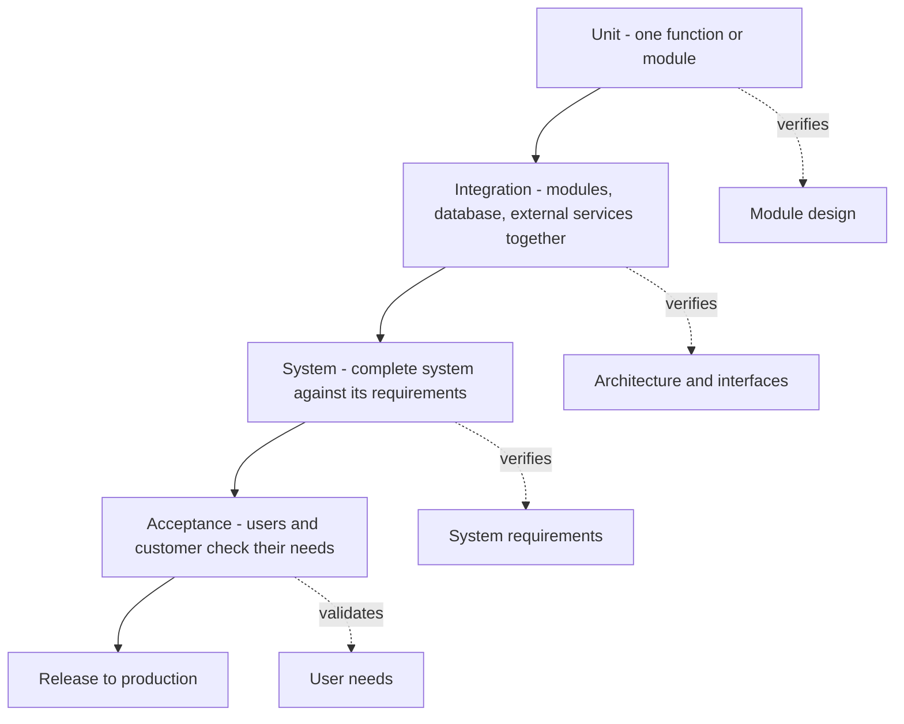
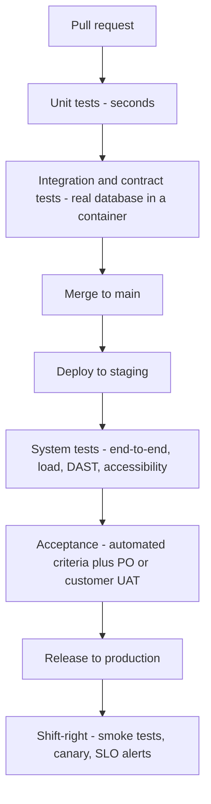

# 08 — Software Testing

**Learning goals of this lecture:**

- **Define** the terms **functional testing**, **non-functional testing** and **regression testing**.
- **Compare and contrast** the typical **testing levels**.

> This note builds on [04 — Building Quality Software](04-building-quality-software.md) (testing as one of six quality processes, the test pyramid, shift-left) and [06 — Software Development Methodologies](06-software-development-methodologies.md) (the V-model's test levels, verification vs. validation). Here we go deeper into **test cases**, the **types** of testing, **regression testing** and the **four testing levels**.

---

## 1. Jargon Translation

| Term | Official Definition | Simple Words | Analogy |
|------|--------------------|--------------|---------|
| **Software testing** | The process of evaluating software to find defects and to check that it meets its requirements, done throughout the SDLC (Software Development Life Cycle). | Checking the software works as it should, again and again. | A car factory checking parts, the engine and the finished car. |
| **Defect** (bug) | A flaw in the software that can make it fail to do what it should. | A mistake in the software. | A crack in a cup. |
| **Test case** | A set of preconditions, steps, inputs (test data) and **expected results**, written to check one specific behavior. | One small, exact "try this, expect that" check. | One question on an exam, with its correct answer. |
| **Expected result** | What the software **should** do or return for a given input. | The correct answer. | The answer in the answer key. |
| **Test data** | The input values a test uses. | The values you type in. | The ingredients for a test recipe. |
| **SUT (System Under Test)** | The part of the software that a test is checking. | The thing being tested. | The car on the testing track. |
| **Test basis** *(industry term)* | The documents a test is based on, such as requirements, user stories or designs. | What tells you the "right answer". | The rulebook a referee uses. |
| **Functional testing** | Testing **what** the system does, against its **functional requirements**. | Does each feature work? | Does the car start, brake and turn? |
| **Non-functional testing** | Testing **how well** the system works: performance, security, scalability, availability, usability, compatibility and more. | Is it fast, safe, stable, easy to use? | How fast does the car go, how safe is it in a crash? |
| **Black-box testing** | Testing through inputs and outputs only, **without looking** at the source code or internal structure. | Test from the outside. | Testing a vending machine by pressing buttons. |
| **White-box testing** | Testing that **uses knowledge of the code** and internal structure (for example checking every branch). | Test from the inside. | A mechanic testing each part of the engine. |
| **Grey-box testing** *(industry term)* | Testing from the outside, but **using some knowledge** of the inside (for example the database design). | Outside test, inside knowledge. | Testing the vending machine while knowing how its coin sensor works. |
| **Edge case** | An input at the extreme or unusual end of what is allowed. | A tricky, unusual input. | Ordering 0 pizzas, or 10,000. |
| **Boundary value** *(industry term)* | A value just inside or just outside an allowed range (for example 0, 1, 5 and 6 for a rating of 1–5). | The values right at the limits. | The exact height line at a theme-park ride. |
| **Regression** | When a change makes something that **used to work** stop working. | Something old broke because of something new. | Fixing the kitchen tap floods the bathroom. |
| **Regression testing** | Re-running existing tests after a change to make sure **existing** functionality still works. | Check that old features still work after a change. | After fixing the tap, check every other tap in the house. |
| **Confirmation testing** (re-testing) *(industry term)* | Running the test that failed before, to confirm a defect is really fixed. | Check that the fix fixed it. | Turning on the fixed tap to see if it still leaks. |
| **Maintenance testing** | Testing changes to software that is **already in use** (fixes, upgrades, migrations); it includes confirmation and regression testing. | Testing when you change software that is already live. | Inspecting a house after a renovation. |
| **Testing level** | A group of tests with the same scope and goal: **unit**, **integration**, **system**, **acceptance**. | How big a piece you test at once. | Check the brick, the wall, the house, then the owner's walk-through. |
| **Unit testing** | Testing the smallest pieces of code (functions, classes, modules) on their own. | Test one small piece. | Checking one brick. |
| **Integration testing** | Testing that modules, services, databases or hardware work correctly **together**. | Test the pieces together. | Checking the bricks hold together as a wall. |
| **System testing** | Testing the **complete, integrated** system against its specified requirements, both functional and non-functional. | Test the whole product. | A full inspection of the finished house. |
| **Acceptance testing** | Formal testing against **user needs, requirements and business processes**, to decide if the system can be accepted. | The users or customer say "yes, this is what we need". | The owner's final walk-through before buying. |
| **UAT (User Acceptance Testing)** | Acceptance testing done by real users or the customer. | Real users try it before release. | Guests tasting the menu before the wedding. |
| **Verification** | Checking that a product is built **right** — as specified. | "Did we build it right?" | Checking the cake follows the recipe. |
| **Validation** | Checking that the product is the **right thing** for the users' real needs. | "Did we build the right thing?" | Checking the guests like the cake. |
| **Staging environment** | A pre-production environment that is set up as close to production as possible. | A copy of the real system, for testing. | A dress rehearsal on the real stage. |
| **Flaky test** *(industry term)* | A test that sometimes passes and sometimes fails **without any code change**. | A test you cannot trust. | A smoke alarm that goes off at random. |
| **Test automation** | Using tools and scripts to run tests without manual steps. | The computer runs the tests for you. | A dishwasher instead of washing by hand. |

---

## 2. Topics Introduced in the Lecture Transcript

1. **Learning goals** — define functional, non-functional and regression testing; compare the testing levels.
2. **What software testing is** — quality checks integrated throughout the SDLC.
3. **The purpose of testing** — check that the software matches the requirements, and find defects (testing reduces risk; it cannot prove the software has no errors).
4. **Test cases** — written to verify functionality and check that requirements are met; written in different SDLC stages; depend on the test type and the development method (Agile or Waterfall).
5. **What a test case contains** — steps, inputs, data and expected outputs.
6. **When test cases are written** — as early as possible, from each requirement as soon as it is agreed, before or with the code.
7. **Types of testing** — functional and non-functional testing (what is tested), and regression testing (testing again after a change).
8. **Functional testing** — usually black-box; inputs and outputs of the SUT; based on functional requirements; manual or automated; error handling for user errors and edge cases.
9. **Non-functional testing** — performance, security, scalability, availability, usability and accessibility, compatibility, documentation, disaster recovery.
10. **Regression testing** — confirms a change did not break existing functionality; run after every change; part of maintenance testing (not another name for it).
11. **Regression test selection** — selection and prioritization are hard; select by frequent defects, frequent use, recent changes, complexity and edge cases, and tests that recently found defects.
12. **The four testing levels** — unit, integration, system, acceptance; each has its own scope and goal.
13. **Unit testing** — function-level; by developers during development; removes construction errors early; improves quality and efficiency.
14. **Integration testing** — modules combined; black-box or white-box; communication, logic differences, missing unit tests, poor exception handling.
15. **System testing** — complete system against its specified requirements (verification); functional and non-functional; in staging.
16. **Acceptance testing** — formal testing against user needs and business processes (validation); by the customer or stakeholders, before release.
17. **Lecture summary** — the test types and the four levels.

---

## 3. Exhaustive Deep Dive

### 3.1 What Software Testing Is, and Why We Do It

- **Software testing is the practice of integrating quality checks throughout the software development cycle** — not one phase at the end.
- **The purpose of testing is to check whether the software matches the expected requirements, and to find defects before users do.**
- Software testing **helps evaluate the software** to identify **whether or not the product meets its requirements**, and **how many defects remain**.
- Testing **reduces risk** and **builds confidence**. It **cannot prove** that software is error-free: a test can show that a defect **exists**, but passing tests never show that **no** defects exist.

> ⚠️ **Correction:** "the purpose of testing is to **ensure error-free software**" → testing **finds** defects and **reduces the risk** of failure; it can **never guarantee** that software has no errors (computer scientist Edsger Dijkstra: testing can show the presence of bugs, never their absence). The goal is "good enough quality for the risk", checked against the requirements.
> **Lecture wording (for the quiz):** "The purpose of testing is to check whether the software matches expected requirements and ensure error-free software." and "Software testing helps evaluate the software to identify whether or not the software product meets requirements and is error-free."

#### 3.1.1 ✅ Modern Best Practice: the seven testing principles

> **Lecture says:** testing checks requirements and finds errors.
> **Industry today:** professional testers follow a short list of widely taught principles (from the ISTQB — International Software Testing Qualifications Board — syllabus) that explain **how much** and **when** to test.

| # | Principle | What it means for a backend team |
|---|-----------|----------------------------------|
| 1 | **Testing shows the presence, not the absence, of defects** | Green tests reduce risk; they are not a guarantee |
| 2 | **Exhaustive testing is impossible** | You cannot test every input; choose tests by **risk** and with **test design techniques** (boundary values, equivalence classes) |
| 3 | **Early testing saves time and money** | Write tests with the requirement and the code (shift-left) |
| 4 | **Defects cluster together** | A few modules hold most bugs — test them harder |
| 5 | **Tests wear out** ("pesticide paradox") | The same tests stop finding new bugs; add and change tests over time |
| 6 | **Testing depends on context** | A payment API needs more and different testing than an internal admin page |
| 7 | **Absence-of-defects fallacy** | Bug-free software that does not meet user needs is still a failure — that is why acceptance testing exists |

---

### 3.2 Test Cases

- **To test software, the team writes "test cases".**
- **Test cases are written to verify the functionality of a software application and ensure the requirements have been satisfied.**
- **Test cases can be written in different stages of the SDLC**, and they **vary depending on the type of test** or the **development method** (for example Agile or Waterfall).
- **A test case contains:** **steps**, **inputs**, **data**, and the **expected corresponding outputs**.
- **When to write them:** as **early** as possible — as soon as a requirement or acceptance criterion is **agreed**, and **before or together with** the code. When a requirement changes, its test cases change in the **same** story or pull request.

> ⚠️ **Correction:** "test cases should **always** be written **after** requirements are **finalized**" → test cases are written **as early as possible**, from each requirement **as soon as it is agreed** — in Agile, acceptance criteria and their tests are written in backlog refinement, before coding (BDD — Behavior-Driven Development, TDD — Test-Driven Development); even the V-model writes test plans **during** the design phases. Waiting for "final" requirements delays testing and lets unclear requirements survive until coding. Writing a test often **reveals** that a requirement is unclear.
> **Lecture wording (for the quiz):** "Regardless of the test type or development method, test cases should always be written after requirements are finalized."

| Field | Example (Book Review API) |
|-------|---------------------------|
| **ID and title** | `TC-07-02` — Rating above 5 is rejected |
| **Requirement link** | `REQ-07` (rate a book 1–5) |
| **Preconditions** | User `asha` is logged in; book `978-0132350884` exists |
| **Steps** | 1. Send `POST /v1/books/978-0132350884/reviews` 2. Body `{ "rating": 6, "text": "Great" }` |
| **Input data** | `rating = 6` |
| **Expected result** | Status `400`; error message "Rating must be between 1 and 5"; no review saved |
| **Actual result / status** | Filled in when the test runs: Pass / Fail |
| **Priority** | High (validation of user input) |



#### 3.2.1 ✅ Modern Best Practice: test cases as executable specifications, designed with techniques

> **Lecture says:** a test case contains steps, inputs, data and expected outputs.
> **Industry today:** most test cases are **automated code** that runs in CI, many are written as **Given/When/Then** scenarios, and their inputs are chosen with **test design techniques** — not by guessing.

- **Executable specifications (BDD):** the acceptance criterion **is** the test.

  ```gherkin
  # TC-07-02 for REQ-07
  Scenario: Rating above 5 is rejected
    Given I am logged in as "asha"
    When I post a review with rating 6 for book "978-0132350884"
    Then the response status is 400
    And no review is saved
  ```

- **Black-box test design techniques** (choose a **few** good inputs instead of all inputs):

  | Technique | Idea | Example for "rating must be 1–5" |
  |-----------|------|-----------------------------------|
  | **Equivalence partitioning** | Inputs in the same group behave the same; test one per group | Too low (≤ 0), valid (1–5), too high (≥ 6), not a number |
  | **Boundary value analysis** | Bugs hide at the edges | 0, 1, 5, 6 (plus 3 as a normal value) |
  | **Decision tables** | List every combination of conditions and the expected outcome | Logged in? × book exists? × already reviewed? |
  | **State transition** | Test allowed and forbidden moves between states | Review: draft → published → hidden; "hidden → draft" is not allowed |

- **White-box techniques:** **statement** and **branch coverage** (did every line and every `if/else` branch run?). Coverage shows what is **not** tested; a high number does not prove the tests are good.
- **Every test case links to a requirement ID** (for example `REQ-07` in the test name), so traceability can be checked automatically (see [note 05 §5.2](05-requirements.md)).

---

### 3.3 Types of Testing

- **The lecture groups testing types into three categories:** **functional testing**, **non-functional testing** and **regression testing**.
- **These are not three groups of the same kind.** Functional and non-functional testing describe **what** is tested. Regression testing describes **when and why** tests run — **after a change** — and a regression suite contains **both** functional and non-functional tests.
- **A complete picture uses three questions:**

  | Question | Options |
  |----------|---------|
  | **What** quality is tested? | **Functional** (what it does) or **non-functional** (how well it does it) |
  | **How** is the test designed? | **Black-box** (from inputs and outputs), **white-box** (from the code), **grey-box** (outside test, inside knowledge) |
  | **Why** does it run now? | New behavior, **confirmation** of a fix, or **regression** after a change |

> ⚠️ **Correction:** "types of testing are classified into **three categories**: functional, non-functional and regression" → **functional** and **non-functional** are **test types** (what you test); **regression testing** is **change-related** testing (why you test again), and it re-runs functional **and** non-functional tests. A fourth common type, **white-box (structural) testing**, is missing from the lecture's list.
> **Lecture wording (for the quiz):** "Types of testing can be broadly classified into three categories: Functional testing, Non-Functional testing, and Regression testing."





---

### 3.4 Functional Testing

- **Functional testing usually involves black-box testing** — a method of testing **without looking at the source code or internal structure**.
- **Functional testing is only concerned with the inputs and corresponding outputs of the system under test (SUT).**
- **It is entirely based on functional requirements.**
- **It can be carried out manually or with automated tools.**
- **The goal is to test the functionality of the application** — that each feature does what its requirement says.
- **Functional testing makes sure the SUT meets its functional requirements.**
- **Functional testing makes sure that when user errors or input edge cases occur, the software handles those exceptions seamlessly by displaying appropriate error messages.**
- **Usability and accessibility are checked by non-functional testing** (see [3.5](#35-non-functional-testing)) — they describe **how well** people can use the features, not **what** the features do.

> ⚠️ **Correction:** "the goal of functional testing is … making sure the application is **usable and accessible**" → **usability** and **accessibility** are **non-functional** quality characteristics (for example in the ISO/IEC 25010 quality model, where usability is called *interaction capability* in the 2023 edition). Functional testing checks **what** the system does; non-functional testing checks **how well** — including whether people, also people with disabilities, can use it.
> **Lecture wording (for the quiz):** "The goal is to test the functionality of the application making sure the application is usable and accessible."

| Input to the Book Review API | Expected output | Type of check |
|------------------------------|-----------------|---------------|
| Valid review, rating 4 | `201 Created`, review returned | Normal (happy path) |
| Rating 6 | `400`, "Rating must be between 1 and 5" | Edge case / invalid input |
| No login token | `401 Unauthorized` | User error |
| Book does not exist | `404`, Problem Details error body | Error handling |
| Same user reviews the same book twice | `409 Conflict` | Business rule |

#### 3.4.1 ✅ Modern Best Practice: functional tests at every level, mostly automated

> **Lecture says:** functional testing is black-box, based on functional requirements, manual or automated.
> **Industry today:** functional tests are written at **every level** (unit, integration, system, acceptance) and are **mostly automated** in CI; manual effort goes to **exploratory testing**.

- **Automate the repeatable checks:** every acceptance criterion and every error case becomes an automated test (for example `node:test` or Vitest for units, **Supertest** for API tests, **Playwright** for browser flows).
- **Exploratory testing** (manual, time-boxed, guided by a goal — "try to break the review form") finds the problems nobody wrote a test for.
- **Error responses are part of the contract:** test the status code **and** the error format (for example RFC 9457 **Problem Details**, `application/problem+json`), so clients can rely on them.
- **Why:** manual functional testing is slow and is skipped under time pressure; automated tests run on every change for free.

---

### 3.5 Non-Functional Testing

- **Non-functional testing tests the application for attributes like performance, security, scalability and availability.**
- **It checks whether the SUT's non-functional behavior is performing properly.**
- **Non-functional testing should answer questions like:**

  | Question (lecture) | Kind of non-functional test | Example tools (not in the lecture) |
  |--------------------|-----------------------------|------------------------------------|
  | How does the application behave **under stress**? | **Stress testing** (beyond normal load, until it breaks) | k6, JMeter, Gatling |
  | What happens when **many users log in at the same time**? | **Load testing** (expected peak load), **spike testing** | k6, Artillery |
  | Are the **instructions in documents and user manuals consistent** with the application's behavior? | **Documentation testing** | Manual review; API docs checked against the OpenAPI contract |
  | Does the application behave similarly **under different operating systems**? | **Compatibility** (portability) testing | Playwright browser matrix, CI matrix (Linux/Windows/macOS) |
  | How does the application handle **disaster recovery**? | **Recovery / DR (Disaster Recovery) testing** | Restore drills, failover tests, chaos experiments |
  | **How secure** is the application? | **Security testing** | SAST, DAST (OWASP ZAP), dependency scanning, penetration tests |
  | (added) Can **all people** use it, including people with disabilities? | **Usability** and **accessibility** testing | axe-core, screen readers, user tests (WCAG 2.2 AA) |
  | (added) Does it stay up when parts fail? | **Availability / reliability / resilience** testing | Chaos engineering, failover tests |
  | (added) Does it keep working over many hours? | **Soak (endurance)** testing — finds memory leaks | k6 long runs |



#### 3.5.1 ✅ Modern Best Practice: non-functional requirements as numbers, tested automatically

> **Lecture says:** non-functional testing checks performance, security, scalability and availability, and answers questions such as "what happens when many users log in?".
> **Industry today:** each non-functional requirement is written as a **number** (an SLO — Service Level Objective), and the tests **fail the build** when the number is missed. Many checks run in CI; others run before releases and **in production**.

- **Performance thresholds in code:** a load test passes only if, for example, **95% of requests answer in under 300 ms** and **fewer than 1% fail** (see [§5.4](#54-non-functional-a-load-test-with-thresholds-k6)).
- **Security in every pipeline (DevSecOps):** SAST (Static Application Security Testing) on every PR, dependency and secret scanning, DAST (Dynamic Application Security Testing) against staging, and penetration tests before major releases.
- **Accessibility in CI:** automated checks (for example **axe-core** with Playwright) catch many WCAG problems; manual checks with a keyboard and a screen reader catch the rest.
- **Disaster recovery is practiced, not assumed:** a **restore drill** (restore last night's backup into a test environment and measure the time) proves the RPO (Recovery Point Objective) and RTO (Recovery Time Objective).
- **Shift-right:** some non-functional testing continues **in production** — canary releases, synthetic monitoring and SLO alerts.
- **Why:** "the app should be fast" cannot fail a test; "p95 < 300 ms" can. Numbers make non-functional quality visible on every change.

---

### 3.6 Regression Testing

- **Regression testing confirms that a recent change to the application, such as a bug fix, does not adversely affect already existing functionality.**
- **It is part of maintenance testing** (testing changes to software that is already in use) — and it is also used **during development**, on every change.
- **Regression testing should occur after any change** — when requirements change, when defects are fixed, when features are added, and when the environment changes (dependency upgrades, configuration, infrastructure, a new Node.js version).
- **To conduct regression testing, all or some of the test cases are selected and run against the application.**
- **Regression test case selection and prioritization can be challenging** and **depend on several factors.**
- **A different test, the confirmation test**, checks that the fixed defect is really gone; the **regression** tests check that **nothing else** broke.

> ⚠️ **Correction:** "regression testing, **also called maintenance testing**" → they are **not** the same. **Maintenance testing** is testing changes to software that is **already in operation** (fixes, upgrades, migrations); it **includes** confirmation testing **and** regression testing. Regression testing is also done long before go-live, on every change during development.
> **Lecture wording (for the quiz):** "Regression testing, also called maintenance testing, confirms that a recent change to the application, such as a bug fix, does not adversely affect already existing functionality."

> ⚠️ **Correction:** "regression testing should occur when there has been a **change in requirements** or when **defects have been fixed**" → regression testing should occur after **any** change: new features, fixes, refactoring, dependency and runtime upgrades, configuration and infrastructure changes. In modern teams it runs **automatically on every commit**.
> **Lecture wording (for the quiz):** "Regression testing should occur when there has been a change in requirements or when defects have been fixed."



#### 3.6.1 Selecting regression test cases

- **Common reasons for choosing a test case for the regression suite** — test cases that:
  1. cover features with **frequent defects**,
  2. cover **frequently used** functionality,
  3. cover features with **recent changes**,
  4. are **complex** test cases,
  5. cover **edge cases**,
  6. have **recently failed** and found a real defect.
- **Tests with random results are not selected — they are fixed.** A test that passes and fails at random (a **flaky** test) cannot tell you whether a change broke something. It is **fixed**, or **quarantined** with a ticket and an owner, never used to judge a release.

> ⚠️ **Correction:** "select … **randomly successful or failed** test cases" → a test that passes or fails **at random** (a **flaky test**) is **not** a good regression test, because its result says nothing about the change. Fix it or quarantine it. Good candidates are tests that **recently failed because of a real defect**, and areas where defects were found before.
> **Lecture wording (for the quiz):** "Common reasons for regression test case selection include cases that: have frequent defects, contain frequently used functionality, contain features with recent changes, or are complex test cases, edge cases, and randomly successful or failed test cases."



#### 3.6.2 ✅ Modern Best Practice: automated regression on every commit, selected by risk

> **Lecture says:** select all or some test cases; selection is challenging and depends on several factors.
> **Industry today:** the **whole automated suite is the regression suite**, and it runs on **every pull request**. When it grows too slow, teams **select by risk and by impact** — but run everything **at least** nightly and before releases.

| When | What runs | Why |
|------|-----------|-----|
| **Every pull request** | Unit + integration tests (all, or only the ones **affected** by the change), smoke tests of critical journeys | Fast feedback — minutes, not hours |
| **Every merge to `main`** | Full automated suite | Nothing old broke |
| **Nightly** | Full suite + slow end-to-end + some non-functional tests | Catches what the fast selection missed |
| **Before a release** | Full suite + load, security and accessibility checks on staging | Confidence for go-live |

- **Every bug fix adds a regression test** that would have caught the bug, named after it (for example `test("BUG-212: duplicate review returns 409")`).
- **Test impact analysis:** tools run only the tests related to the changed files (for example `vitest --changed`, Jest `--changedSince`, build tools such as Nx).
- **Flaky tests are fixed or quarantined within a day**, never "re-run until green".
- **Why:** manual regression selection is slow and misses things. Automated suites make "did I break something?" a question CI answers on every change.

---

### 3.7 The Four Testing Levels

- **There are four testing levels: unit, integration, system and acceptance.**
- **Each level has its own scope, goal, test basis and owner**, and catches different kinds of defects. In the classic model each level happens at a different time in the SDLC; in modern teams all four run **continuously** in the pipeline (see [3.7.5](#375--modern-best-practice-all-four-levels-in-every-sprint-and-in-ci)).
- **Why four levels:** each level finds the defects it is **best and cheapest** at finding — a logic error in one function is found in seconds by a unit test, but takes hours to trace in a system test. Separate levels also **avoid duplicate tests** (overlap), which saves time.

> ⚠️ **Correction:** "there are 4 levels **in order to reduce the amount of time spent on testing by preventing overlap**" → the **main** reason for separate levels is that each one has a **different goal and scope** and finds **different kinds of defects**, as early and as cheaply as possible. Avoiding overlap is a useful **side benefit**, not the purpose.
> **Lecture wording (for the quiz):** "There are 4 different levels in order to reduce the amount of time spent on testing by preventing overlap."

| | **Unit** | **Integration** | **System** | **Acceptance** |
|---|---|---|---|---|
| **Scope** | One function, class or module | Two or more modules together; database; external services or hardware | The complete, integrated system | The system in the users' business processes |
| **Goal** | Remove construction errors early | Find errors in how parts work together | Check compliance with the specified requirements (**verification**) | Check it meets user needs (**validation**) |
| **Test basis** | Module design, code | Architecture, interfaces, API contracts | System requirements (functional + non-functional) | User needs, requirements, business processes |
| **Who** | Developers | Developers (and testers) | Testers / QA (Quality Assurance) | Customer, users, stakeholders (with QA) |
| **Design** | Mostly **white-box** | **Black-box or white-box** (often grey-box) | Mostly **black-box** | **Black-box** |
| **Where** | Developer machine, CI | CI with real dependencies | **Staging**, close to production | Staging / UAT environment |
| **Speed / number** | Milliseconds; many | Seconds; some | Minutes; fewer | Per story / per release |





#### 3.7.1 Unit testing

- **Unit testing verifies the functionality of a specific section of code, usually at the function level.**
- **It is performed by the software developer or engineer during the development phase.**
- **It aims to eliminate construction errors before code is integrated with other modules.**
- **It increases the quality of the software and the efficiency of the overall development process** — a bug found in a unit test costs minutes; the same bug found by a user costs much more.
- **Design:** unit tests are usually **white-box** — the developer knows the code and tests its branches.

#### 3.7.2 Integration testing

- **Integration testing seeks to identify errors when two or more smaller, independent code modules are combined.**
- **It can be black-box** (testing the combined modules through their public API) **or white-box** (using knowledge of the interfaces and data flows between them) — in practice it is often **grey-box**.
- **Before integration testing,** the modules that **passed unit testing** are **incorporated into the larger application**. **After the modules are integrated**, integration testing can occur.
- **Integration testing exposes bugs that occur when smaller units of code interact with each other**, for example:
  - **deficiencies in communication** between a new module and **existing modules, databases or external hardware** (wrong field names, wrong data formats, timeouts);
  - bugs caused by **differing programming logic between modules** (one module stores prices in cents, another in euros);
  - modules that were **not fully unit tested** because **requirements changed** during their development;
  - **poor exception handling** — an error in one module is not handled by the module that calls it.

> ⚠️ **Correction:** "integration testing is **another type of black-box testing**" → integration testing can be **black-box or white-box**. It is a **testing level**, not a design technique. ("Another" also suggests unit testing is black-box — unit testing is usually **white-box**.)
> **Lecture wording (for the quiz):** "Integration testing is another type of black-box testing."

#### 3.7.3 System testing

- **System testing occurs after integration testing** and is **conducted on a complete, integrated system** to evaluate the **system's compliance with its specified requirements**.
- **It verifies the complete product as a whole** — "did we build the system right, as specified?". (The user's view — "is it the right system?" — is checked by acceptance testing.)
- **System testing is both functional and non-functional** (for example end-to-end user journeys **and** load and security tests).
- **System testing is done in a staging environment, which should be similar to the production environment** (same container image, same configuration shape, realistic data volume — but no real personal data).

> ⚠️ **Correction:** "system testing **validates** the system as a fully completed software product" → system testing **verifies** the complete system against its **specified requirements** ("built right?"). **Validation** against real user needs ("right thing?") is the job of **acceptance testing** (see [note 06 §3.3.1](06-software-development-methodologies.md)).
> **Lecture wording (for the quiz):** "It validates the system as a fully completed software product." and, in the summary, "System testing validates the system as a fully completed software product."

#### 3.7.4 Acceptance testing

- **Acceptance testing is formal testing with respect to user needs, requirements and business processes.**
- **It determines whether a system satisfies the needs of the users, customers and other stakeholders** — it **validates** the product.
- **It is usually done by the customer or the stakeholders before the release**, at the end of the testing phase (in Agile: for each story, and before each release to production). After go-live, acceptance tests are run again for **changes** to the live system, as part of maintenance testing.

> ⚠️ **Correction:** "acceptance testing is usually done … **during the maintenance stage** of the SDLC" → acceptance testing is done **before release** — it decides **whether** the system can go live. Maintenance only starts after deployment; there, acceptance tests are repeated only for **changes**.
> **Lecture wording (for the quiz):** "Acceptance testing is usually done by the customer or the stakeholders during the maintenance stage of the SDLC."

| Kind of acceptance testing (not in the lecture) | Who | Checks |
|--------------------------------------------------|-----|--------|
| **UAT (User Acceptance Testing)** | Real users, customer | Does it support their work and business processes? |
| **Operational acceptance testing (OAT)** | Operations / SRE (Site Reliability Engineering) | Backups, monitoring, alerts, runbooks, failover |
| **Contract / regulatory acceptance** | Customer, auditors | Does it meet the contract or the law (for example accessibility, data protection)? |
| **Alpha / beta testing** | Internal users (alpha), selected real users (beta) | Real-world feedback before full release |

#### 3.7.5 ✅ Modern Best Practice: all four levels in every sprint, and in CI

> **Lecture says:** each level occurs at a different time in the SDLC.
> **Industry today:** all four levels run **in every sprint** and the automated parts run **in the CI/CD pipeline on every change**; the **test pyramid** (or **testing trophy**) decides how many tests each level gets.

- **The test pyramid:** **many** fast unit tests, **fewer** integration tests, **few** slow end-to-end (system) tests. The **testing trophy**, popular in JavaScript, puts more weight on **integration** tests, because they give high confidence for their cost. Both avoid the **"ice-cream cone"** (mostly manual and end-to-end tests — slow and fragile).
- **Integration tests use real dependencies** where possible — for example a real MongoDB in a container with **Testcontainers** — instead of mocks that can hide real problems (see [§5.3](#53-integration-test-with-a-real-database-testcontainers)).
- **Contract testing** (OpenAPI schema checks, consumer-driven contracts with **Pact**) checks integration between services **without** running them all together.
- **Acceptance criteria are automated** (BDD), and **UAT** by real users is still done for usability and fit.
- **Why:** running levels one after the other at the end of a project is the **mini-waterfall** anti-pattern. Running all of them on every change finds defects within minutes, while they are cheap to fix.



---

### 3.8 Often-Missed Parts: What a Senior Engineer Adds (not in the lecture — industry practice)

| Area | What to add | Why |
|------|-------------|-----|
| **Test doubles** | Mocks, stubs, fakes and spies — use them only at system **boundaries** (payment provider, email, clock) | Over-mocking makes tests pass while the real system fails |
| **Test data** | Synthetic or anonymized data; **no real personal data** in test environments; each test creates and cleans its own data | Privacy law (GDPR — General Data Protection Regulation) and reliable, independent tests |
| **Test environments** | **Preview environments** per pull request; staging that matches production | "Works in test, fails in production" comes from different environments |
| **Mutation testing** | A tool (for example **Stryker**) changes the code on purpose and checks the tests fail | Measures test **quality**, not only coverage |
| **Property-based testing** | A tool (for example **fast-check**) generates hundreds of random inputs to check a rule | Finds edge cases humans do not think of |
| **Contract testing** | Pact, OpenAPI validation | Safe integration between independently deployed services |
| **Bug reports** | Steps to reproduce, expected vs. actual, environment and **version**, severity and priority | A good bug report is half the fix |
| **Testing in production (shift-right)** | Smoke tests after deploy, canary analysis, synthetic monitoring, feature flags | Some problems only appear with real traffic |
| **AI-assisted testing** | AI can suggest test cases and edge cases and draft test code — a human checks that each test checks a **requirement** (AI tests often only repeat what the code does) | Faster test writing without false confidence |
| **Testing AI features** | If the product uses an AI model, add **evaluations ("evals")**: example inputs with scoring rules, run on every prompt or model change | AI answers vary, so normal assertions are not enough |

#### 3.8.1 "Done enough when…" checklist for testing

- [ ] Every requirement and acceptance criterion has **test cases**, written **before or with** the code, linked by **requirement ID**.
- [ ] Inputs are chosen with **test design techniques** (boundary values, equivalence classes, decision tables).
- [ ] **Functional** tests cover the happy path, user errors, edge cases and the **error format**.
- [ ] **Non-functional** requirements are **numbers**, and tests (load, security, accessibility, recovery) check them.
- [ ] All **four levels** exist, in pyramid (or trophy) proportions, and the automated ones run in **CI on every change**.
- [ ] Integration tests use **real dependencies** (for example Testcontainers) where possible.
- [ ] Every bug fix has a **confirmation** test and a new **regression** test.
- [ ] The **full regression suite** runs at least on every merge and before every release.
- [ ] **Flaky tests** are fixed or quarantined within a day.
- [ ] **Acceptance testing** (automated criteria + UAT) is done **before** release.
- [ ] No real personal data in test environments.

---

### 3.9 Lecture Summary

- **There are two main test types — functional and non-functional — plus regression testing, which re-runs tests after a change.**
- **Unit testing** verifies small, independent pieces of code.
- **Integration testing** looks for errors when two or more pieces of code are combined.
- **System testing verifies** the complete system against its specified requirements.
- **Acceptance testing validates** that the system meets user needs, requirements and business processes, **before release**.

| Topic | Lecture | ✅ Modern best practice |
|-------|---------|--------------------------|
| Purpose | Check requirements; "error-free" software | Find defects and reduce risk — testing cannot prove there are no defects; the seven testing principles |
| Test cases | Steps, inputs, data, expected outputs; written after requirements are finalized | Written early (with acceptance criteria, before or with the code); automated; Given/When/Then; test design techniques; linked to requirement IDs |
| Test types | Functional, non-functional, regression | What (functional / non-functional), how (black / white / grey box), why (new, confirmation, regression) |
| Functional | Black-box; inputs and outputs; usable and accessible | Functional tests at every level, mostly automated; usability and accessibility belong to non-functional testing |
| Non-functional | Performance, security, scalability, availability, stress, many users, documents, operating systems, disaster recovery | Requirements as numbers (SLOs); thresholds fail the build; DevSecOps; accessibility checks; restore drills; shift-right |
| Regression | "Also called maintenance testing"; after requirement changes or fixes; select some or all tests | Part of maintenance testing, run after **any** change, on every commit; risk- and impact-based selection; flaky tests fixed or quarantined |
| Levels | Unit, integration, system, acceptance; different times; prevent overlap | Each level has its own goal and catches different defects; all four run in every sprint and in CI; pyramid / trophy |
| Acceptance timing | During the maintenance stage | **Before release**; repeated for changes after go-live |

---

## 4. Concrete Examples

### 4.1 The Book Review API (course project) at every level

| Level | Example test | Type | Design |
|-------|--------------|------|--------|
| **Unit** | `isValidRating(6)` returns `false`; `isValidRating(5)` returns `true` | Functional | White-box |
| **Integration** | `POST /v1/books/:isbn/reviews` saves the review in a real MongoDB; a second review by the same user returns `409` (unique index) | Functional | Grey-box |
| **Integration (contract)** | Every response matches the OpenAPI schema | Functional | Black-box |
| **System** | End-to-end: sign up → log in → post review → see it on the book page (Playwright, on staging) | Functional | Black-box |
| **System** | 500 virtual users browse and post for 10 minutes; p95 < 300 ms; errors < 1% (k6) | Non-functional (load) | Black-box |
| **System** | OWASP ZAP scan of staging finds no high-risk issues | Non-functional (security) | Black-box |
| **Acceptance** | The site owner and 5 readers use staging for a week and confirm the review flow fits how they work (UAT) | Validation | Black-box |
| **Regression** | After fixing BUG-212 (duplicate reviews), the full suite runs in CI, plus the new test `BUG-212` | Change-related | Both |

### 4.2 Quick practice: which type and which level?

| Statement | Answer |
|-----------|--------|
| "A developer tests the `calculateAverage()` function with an empty list." | **Unit**, functional, white-box |
| "The checkout service is tested together with the real payment-provider sandbox." | **Integration**, functional |
| "1,000 users log in at the same moment; we measure the response time." | **System** level, **non-functional** (load) |
| "After a dependency upgrade, all existing tests are run again." | **Regression** testing |
| "The bug that let ratings of 6 through is fixed; we run the failing test again." | **Confirmation** testing (re-testing) |
| "The customer's staff try the system with real business tasks before go-live." | **Acceptance** (UAT) |
| "We check that a keyboard-only user can post a review." | **Non-functional** (accessibility), system level |

### 4.3 Integration bugs from the lecture, in a Node.js backend

| Lecture cause | Real example |
|---------------|--------------|
| Communication deficiency with a database | The service writes `createdAt` as a string; the reporting module expects a `Date` and sorts wrongly |
| Differing programming logic between modules | The orders module stores prices in cents (`999`), the invoice module expects euros (`9.99`) |
| Requirements changed, module not fully unit tested | `rating` became optional, but the average-rating module still divides by the number of ratings, including empty ones |
| Poor exception handling | The email module throws when the provider is down; the review route does not catch it, so posting a review fails with 500 |

---

## 5. Code Blocks

### 5.1 Unit test with boundary values (`node:test`)

```js
// src/rating.js — the unit under test
export function isValidRating(value) {
  return Number.isInteger(value) && value >= 1 && value <= 5;   // valid range: 1 to 5, whole numbers only
}
```

```js
// test/rating.test.js — run with: node --test
import { test } from "node:test";
import assert from "node:assert/strict";
import { isValidRating } from "../src/rating.js";

// Boundary value analysis: just outside, on, and just inside each limit
const cases = [
  { input: 0, expected: false },      // just below the lower limit
  { input: 1, expected: true },       // lower limit
  { input: 3, expected: true },       // a normal value inside the range
  { input: 5, expected: true },       // upper limit
  { input: 6, expected: false },      // just above the upper limit
  { input: 4.5, expected: false },    // equivalence class: not a whole number
  { input: "5", expected: false },    // equivalence class: wrong type (a string from a form)
];

for (const { input, expected } of cases) {
  test(`REQ-07: isValidRating(${JSON.stringify(input)}) is ${expected}`, () => {
    assert.equal(isValidRating(input), expected);
  });
}
```

**What happens if…** the tests only check one "happy" value, and the code has an off-by-one bug?

```js
// ❌ Bug: "< 5" instead of "<= 5" — a rating of 5 is now rejected
return Number.isInteger(value) && value >= 1 && value < 5;
```

- A test with only `isValidRating(3)` still **passes**, and the bug reaches users who give 5 stars.
- ✅ The boundary test `{ input: 5, expected: true }` **fails at once**. Bugs cluster at the edges — always test the boundaries.

### 5.2 Functional API test: user errors and the error format (Supertest)

```js
// test/reviews.api.test.js — black-box: only HTTP in, HTTP out
import { test } from "node:test";
import assert from "node:assert/strict";
import request from "supertest";
import { app } from "../src/app.js";

test("REQ-07: rating 6 returns 400 with a Problem Details body", async () => {
  const res = await request(app)
    .post("/v1/books/978-0132350884/reviews")
    .set("Authorization", "Bearer test-token-asha")   // a test user (no real personal data)
    .send({ rating: 6, text: "Great" });

  assert.equal(res.status, 400);
  assert.match(res.headers["content-type"], /application\/problem\+json/); // RFC 9457 error format
  assert.equal(res.body.title, "Invalid rating");
  assert.match(res.body.detail, /between 1 and 5/);
});

test("REQ-09: posting without a token returns 401", async () => {
  const res = await request(app).post("/v1/books/978-0132350884/reviews").send({ rating: 4 });
  assert.equal(res.status, 401);
});
```

**What happens if…** the test checks only the status code?
- A change that returns `400` with an **empty body** or a different error shape still passes — and every client that shows `detail` to users breaks.
- ✅ Test the **status and the error format**: the error response is part of the API contract.

### 5.3 Integration test with a real database (Testcontainers)

```js
// test/reviews.integration.test.js — needs Docker; run with: node --test
import { test, before, after } from "node:test";
import assert from "node:assert/strict";
import { MongoDBContainer } from "@testcontainers/mongodb";
import { MongoClient } from "mongodb";
import { createReviewRepo } from "../src/review-repo.js";   // the module that talks to MongoDB

let container, client, repo;

before(async () => {
  container = await new MongoDBContainer("mongo:7").start();          // a real MongoDB in Docker
  client = new MongoClient(container.getConnectionString(), { directConnection: true });
  await client.connect();
  repo = await createReviewRepo(client.db("test"));                   // creates the unique index (userId + bookId)
});

after(async () => {
  await client?.close();
  await container?.stop();                                            // clean up: nothing left behind
});

test("BUG-212: the same user cannot review the same book twice", async () => {
  await repo.add({ userId: "u1", bookId: "b1", rating: 4 });
  await assert.rejects(
    () => repo.add({ userId: "u1", bookId: "b1", rating: 5 }),
    (err) => err.code === 11000,                                      // MongoDB duplicate-key error
  );
});
```

**What happens if…** this test uses a **mock** database instead?
- The mock happily saves the second review, because it does not know about the **unique index**. The test passes, and production still allows duplicate reviews (or crashes with an unhandled duplicate-key error).
- ✅ Use a real database for integration tests; keep mocks for true external boundaries (payment provider, email).

### 5.4 Non-functional: a load test with thresholds (k6)

```js
// load/reviews-load.js — k6 scripts are JavaScript; run with: k6 run load/reviews-load.js
import http from "k6/http";
import { check, sleep } from "k6";

export const options = {
  stages: [
    { duration: "2m", target: 100 },   // ramp up to 100 virtual users
    { duration: "5m", target: 500 },   // expected peak: "many users at the same time"
    { duration: "2m", target: 0 },     // ramp down
  ],
  thresholds: {
    http_req_duration: ["p(95)<300"],  // NFR-02: 95% of requests faster than 300 ms
    http_req_failed: ["rate<0.01"],    // fewer than 1% of requests may fail
  },
};

export default function () {
  const res = http.get(`${__ENV.BASE_URL}/v1/books/978-0132350884/reviews`);
  check(res, { "status is 200": (r) => r.status === 200 });
  sleep(1);                            // each virtual user waits 1 s between requests
}
```

```bash
# Run against staging — never against production without a plan and approval
k6 run -e BASE_URL=https://staging.example.com load/reviews-load.js
# k6 exits with a non-zero code when a threshold fails, so CI marks the job red
```

**What happens if…** there are no `thresholds`?
- k6 prints numbers, but the run always "passes" — a release that is **twice as slow** goes out unnoticed.
- ✅ Put the non-functional requirement **into the test** as a threshold; the build fails when the number is missed.

### 5.5 Regression in CI: fast on every PR, full every night

```yaml
# .github/workflows/tests.yml
name: tests
on:
  pull_request:
  push:
    branches: [main]
  schedule:
    - cron: "0 2 * * *"                 # every night at 02:00 UTC: the full regression suite

jobs:
  test:
    runs-on: ubuntu-latest
    steps:
      - uses: actions/checkout@v4
        with:
          fetch-depth: 0                # full history, so the changed files can be compared with main
      - uses: actions/setup-node@v4
        with:
          node-version: lts/*
          cache: npm
      - run: npm ci
      - name: Affected tests only (pull requests)
        if: github.event_name == 'pull_request'
        run: npx vitest run --changed origin/main   # tests related to files changed since main
      - name: Full regression suite (main and nightly)
        if: github.event_name != 'pull_request'
        run: npx vitest run
```

**What happens if…** the team only ever runs the affected tests?
- Impact analysis is not perfect (for example a change in configuration or a shared fixture), so some regressions slip through.
- ✅ Always run the **full** suite on `main`, every night and before releases; use affected-only runs just to make pull requests fast.

---

## 6. Related Concepts

1. **Requirements and acceptance criteria** — test cases come from requirements and acceptance criteria, linked by requirement IDs for traceability (see [note 05](05-requirements.md)).
2. **The V-model and verification vs. validation** — the four testing levels pair with the design phases; unit, integration and system tests verify, acceptance tests validate (see [note 06](06-software-development-methodologies.md)).
3. **CI/CD pipelines** — automated tests at every level are the quality gates of the pipeline; a red build blocks the merge or the deployment.
4. **Software versions and compatibility** — regression tests protect backward compatibility, and contract tests catch breaking API changes before a new major version is needed (see [note 07](07-software-versions.md)).
5. **Observability and SLOs** — non-functional requirements tested before release (latency, error rate) are the same SLOs monitored in production with tools such as Grafana.
