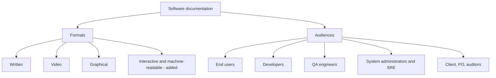
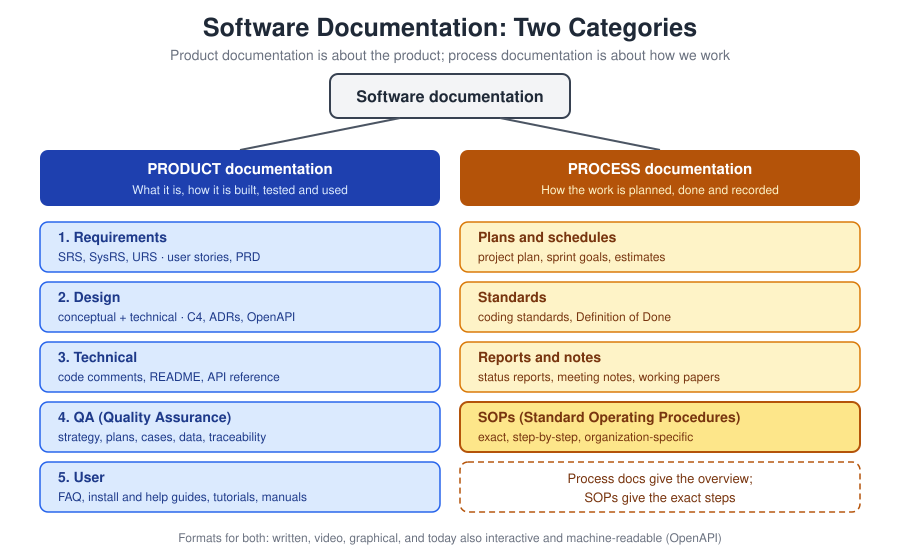
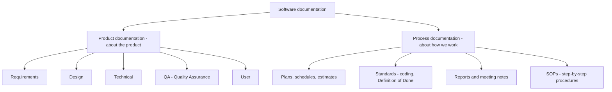
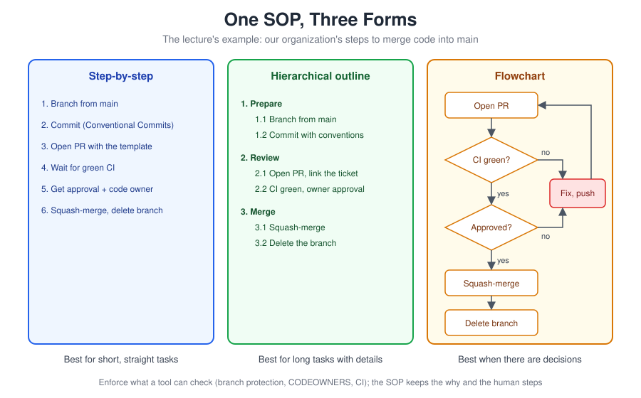
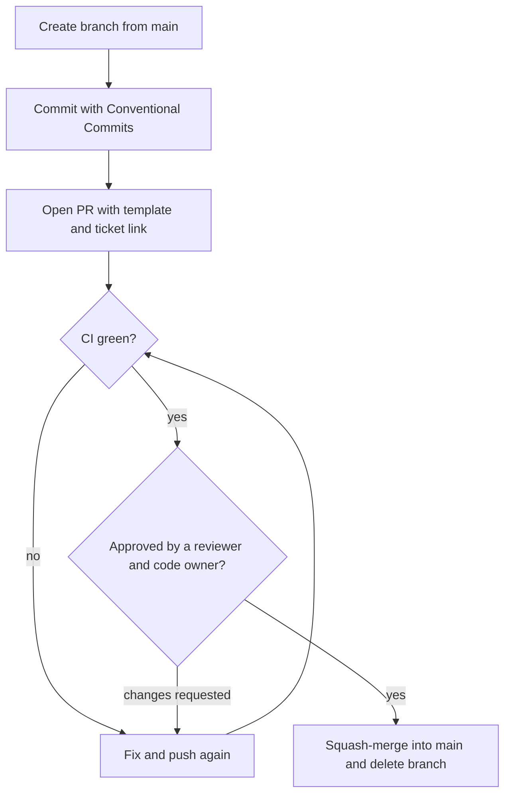
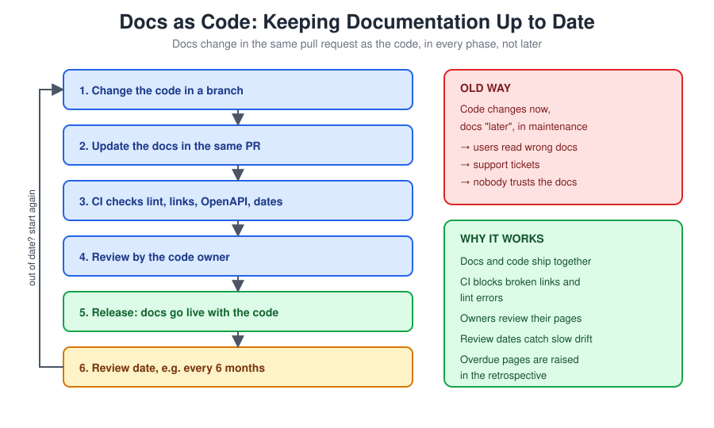
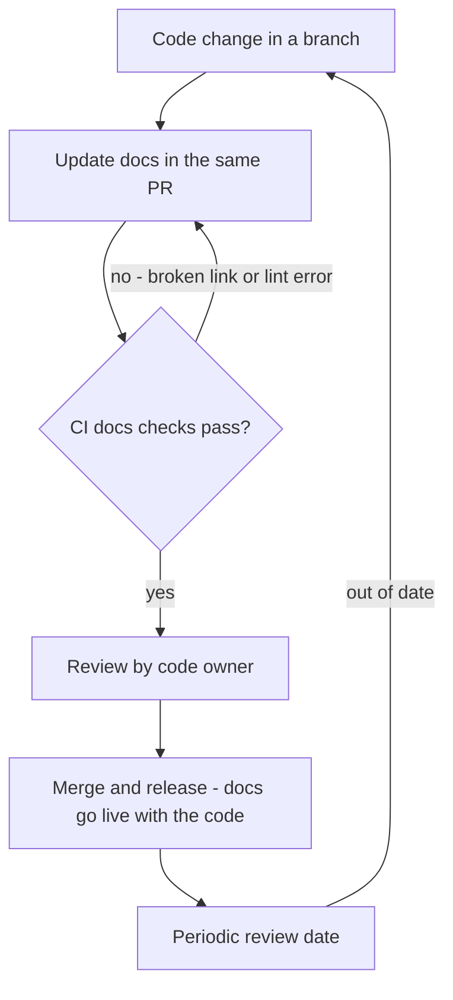

# 09 — Software Documentation

**Learning goals of this lecture:**

- **List** the documentation formats.
- **Compare and contrast** product documentation and process documentation.
- **Describe** the categories and types of documentation.
- **Explain** the purpose of standard operating procedures (SOPs).

> This note builds on [04 — Building Quality Software §3.7](04-building-quality-software.md#37-process-6--documenting) (system vs. user documentation, docs as code, Diátaxis, runbooks), [05 — Requirements](05-requirements.md) (SRS, URS, SysRS) and [08 — Software Testing](08-software-testing.md) (test cases, traceability). Here we go deeper into **formats**, **audiences**, **product vs. process documentation**, the **five types of product documentation**, **SOPs** and **keeping documentation up to date**.

---

## 1. Jargon Translation

| Term | Official Definition | Simple Words | Analogy |
|------|--------------------|--------------|---------|
| **Software documentation** | Information about a software product — written, video, graphical or interactive — that explains what it is, how it is built, how to run it and how to use it. | Everything people read or watch to understand, build, run or use the software. | The manuals, plans and labels that come with a house. |
| **Documentation format** | The form the information takes: written text, video, graphics (diagrams, screenshots), or interactive / in-product help. | The shape of the docs: text, video, picture, or help inside the app. | A recipe as a card, a cooking video, a picture, or a smart oven that shows the next step. |
| **Audience** | The group of people a document is written for, such as end users, developers, QA engineers, system administrators or the client. | Who will read it. | A children's book and a textbook explain the same topic for different readers. |
| **Product documentation** | Documents that describe the **product**: what it does, how it is built, how it is tested, how to use it. | Docs about the thing we build. | The car's owner manual and its engineering drawings. |
| **Process documentation** | Documents that describe and record **how the work is done**: plans, schedules, standards, reports, meeting notes and procedures such as SOPs. | Docs about how we work. | The factory's work plan and safety rules. |
| **Requirements documentation** | Documents that describe the expected features, functions and qualities of the system, for example the SRS (Software Requirements Specification). | What the software must do. | The customer's order for a custom cake. |
| **Design documentation** | Documents that explain **how** the software will be built to meet the requirements — conceptual (big picture) and technical (detailed). | The building plan. | An architect's sketch, then the detailed construction drawings. |
| **Technical documentation** | Documentation for developers about the code itself: code comments, README files, API reference, architecture notes. | Docs that help developers understand and change the code. | The wiring diagram inside a machine's cover. |
| **QA (Quality Assurance) documentation** | Documents about testing: test strategy, test plans, test cases, test data, test scenarios, traceability matrices, test reports and metrics. | The testing team's paperwork. | A car inspector's checklist and the inspection report. |
| **Traceability matrix** (RTM — Requirements Traceability Matrix) | A table that links each requirement to the test cases that check it (and back). | Which test checks which requirement. | A packing list that shows which box holds each ordered item. |
| **User documentation** | Documentation for end users: how to install, use and troubleshoot the software — FAQ (Frequently Asked Questions), guides, tutorials, manuals, in-app help. | Help for the people who use the product. | The instruction booklet with a new phone. |
| **SOP (Standard Operating Procedure)** | A set of written, step-by-step instructions for a routine or repeated task, written the way **this organization** does it. | "How we do this here", step by step. | A restaurant's exact steps for closing the kitchen at night. |
| **Runbook** *(industry term)* | An SOP for operations: the steps to handle one alert or one operational task. | The checklist for "this alarm went off". | The emergency card in an airplane cockpit. |
| **Docs as code** *(industry term)* | Writing documentation in plain-text files (for example Markdown) in the same Git repository as the code, reviewed in pull requests and checked by CI (Continuous Integration). | Treat docs like code. | Keeping the recipe book in the same kitchen drawer as the tools, and updating it every time the recipe changes. |
| **Docs drift** *(industry term)* | When documentation no longer matches the real software. | The docs are out of date. | A map that still shows a road that was closed last year. |
| **ADR (Architecture Decision Record)** *(industry term)* | A short document that records one important technical decision, the options, and why it was chosen. | A note that says "we chose X, because…". | A diary entry about a big family decision. |
| **Diátaxis** *(industry term)* | A framework that sorts documentation into four kinds by reader need: tutorials, how-to guides, reference, explanation. | Four kinds of docs for four kinds of questions. | A school has lessons, task sheets, a dictionary and background reading. |

---

## 2. Topics Introduced in the Lecture Transcript

1. **Learning goals** — documentation formats; product vs. process documentation; categories and types; the purpose of SOPs.
2. **What software documentation is** — information that describes what the product is and how to use it.
3. **Documentation formats** — written, video, graphical (plus interactive and machine-readable formats today).
4. **Documentation across the SDLC** — an essential part of software engineering in every phase.
5. **Audiences** — end users, developers, QA engineers, system administrators and other stakeholders.
6. **Two categories** — product documentation and process documentation.
7. **Five types of product documentation** — requirements, design, technical, QA and user documentation.
8. **Requirements documentation** — expected features and functions; SRS, SysRS, URS; started in planning.
9. **Design documentation** — written by architects and the development team; conceptual and technical.
10. **Technical documentation** — code comments and other docs that explain the code.
11. **QA documentation** — strategy, progress, metrics; test plans, test data, test scenarios, test cases, test strategies, traceability matrices.
12. **User documentation** — operate, install, troubleshoot; FAQ, installation and help guides, tutorials, user manuals.
13. **SOPs** — step-by-step, organization-specific instructions; more detail than process documentation; the code-merge example.
14. **SOP forms** — flowchart, hierarchical outline, step-by-step instructions.
15. **Keeping documentation up to date** — the online-manual example; resources; periodic reviews.
16. **Lecture summary.**

---

## 3. Exhaustive Deep Dive

### 3.1 What Software Documentation Is

- **Software documentation is information about the software that describes what the product is and how to use it.**
- **It can be written, video or graphical assets** associated with a software product's **development** and **use**.
- (added) A complete definition also covers **how the product is built**, **why** it was built that way, and **how to run it** — the lecture's own list of types (design, technical, QA) shows this.
- **Documentation is an essential aspect of software engineering, applicable across all the phases of the SDLC** (Software Development Life Cycle) — planning writes requirements, design writes design docs, development writes technical docs, testing writes QA docs, deployment and maintenance write release notes, runbooks and user help.

#### 3.1.1 Documentation formats

| Format | Examples | Good for |
|--------|----------|----------|
| **Written** | README, user manual, API (Application Programming Interface) reference, SOP, release notes | Searching, copying commands, exact details |
| **Video** | Product tour, onboarding screencast, recorded demo | Showing a flow once; first-time users |
| **Graphical** | Architecture diagrams (C4), flowcharts, screenshots, sequence diagrams | Structure and flows at a glance |
| (added) **Interactive / in-product** | Tooltips, guided tours, in-app help, "Try it out" API consoles (Swagger UI) | Help at the moment of need |
| (added) **Machine-readable** | OpenAPI file, JSON Schema, generated reference from code comments | Tools generate docs, clients and tests from it |

#### 3.1.2 ✅ Modern Best Practice: interactive and machine-readable documentation

> **Lecture says:** documentation can be in any of three formats — written, video or graphical.
> **Industry today:** those three are still the base, and products add **interactive, in-product** help and **machine-readable** documentation from which other docs are generated.

- **Interactive / in-product:** tooltips, guided tours, in-app help, "Try it out" API consoles — help at the moment of need (the "inline help" in [note 04 §3.7](04-building-quality-software.md#37-process-6--documenting)).
- **Machine-readable:** an **OpenAPI** file (or JSON Schema) is documentation that tools read: they generate the reference pages, client code, mock servers and contract tests from it (see [§5.4](#54-machine-readable-documentation-openapi-as-the-source)).

- **Why written stays the base format:** text can be searched, versioned in Git, reviewed in a pull request and translated. Videos go out of date quickly and cannot be searched — keep a written version of every step a video shows.

#### 3.1.3 Audiences

- **Software documentation can be written for different types of audiences**, such as:

  | Audience | What they need | Typical documents |
  |----------|----------------|-------------------|
  | **End users** | Do their task; fix common problems | User guide, FAQ, tutorials, in-app help |
  | **Software developers** | Understand and change the code safely | README, code comments, API reference, ADRs, design docs |
  | **QA engineers** | Know what to test and what "correct" means | Requirements, acceptance criteria, test strategy, test cases |
  | **System administrators** (today often DevOps / SRE — Site Reliability Engineering) | Install, configure, run, back up, recover | Installation guide, configuration reference, runbooks |
  | **Other stakeholders** (client, product owner, management, auditors) | Decide, approve, check compliance | Project brief, PRD, release notes, test reports, sign-offs |
  | (added) **API consumers** (developers in other teams or companies) | Call the API correctly | OpenAPI reference, quickstart, error catalog, changelog |



#### 3.1.4 ✅ Modern Best Practice: write for one reader and one need

> **Lecture says:** documentation can be written for different audiences.
> **Industry today:** every page names its **audience** and its **purpose**, and pages are sorted by the reader's need with a framework such as **Diátaxis**.

- **One page, one audience:** a page that tries to serve end users and developers at once serves neither.
- **Diátaxis** (diataxis.fr) — four kinds of documentation, kept separate:

  | Kind | Reader's need | Example (Book Review API) |
  |------|---------------|---------------------------|
  | **Tutorial** | "Teach me" (learning) | "Post your first review in 5 minutes" |
  | **How-to guide** | "Help me do this task" | "How to rotate an API key" |
  | **Reference** | "Give me the facts" | The OpenAPI reference of `POST /v1/books/{isbn}/reviews` |
  | **Explanation** | "Help me understand" | "Why reviews are hidden after 3 reports" |

- **Why:** readers come with one question. Mixing a tutorial with reference tables, or explanation with setup steps, makes every page long and hard to use.

---

### 3.2 Product Documentation vs. Process Documentation

- **Documentation can be divided into two categories: product and process.**
- **Product documentation relates to the product's functionality** — what the product does, how it is built, how it is tested and how to use it.
- **Process documentation describes and records how the work is done** — how the team plans, builds, tests, releases and supports the product.
- **Process documentation should provide the requirements for the quality implementation of a business process** — it says what must happen, in which order, and to which standard, so the process gives the same good result every time (the idea behind quality systems such as ISO 9001).

> ⚠️ **Correction:** "process documentation **describes how to complete a task**" → that is too narrow and also fits user how-to guides, which are **product** documentation. Process documentation **describes and records the development and maintenance process**: plans, estimates and schedules, standards (coding standards, the Definition of Done), status and test reports, meeting notes, working papers — and **SOPs** for the organization's repeated tasks.
> **Lecture wording (for the quiz):** "Product documentation relates to the product's functionality, whereas process documentation describes how to complete a task." and, in the summary, "Process documentation describes how to complete a task."

| | **Product documentation** | **Process documentation** |
|---|---|---|
| **About** | The **product** — what it does and how it works | The **work** — how the team builds and supports it |
| **Question it answers** | "What is it, how is it built, how do I use it?" | "How do we work, what was planned, what happened?" |
| **Examples** | SRS, design docs, API reference, code comments, test cases, user manual | Project plan, sprint goals, coding standards, Definition of Done, status reports, meeting notes, SOPs |
| **Main readers** | Developers, QA, operators, end users | The team, managers, auditors, new team members |
| **Lifetime** | Lives as long as the product; updated with each change | Plans and reports are snapshots; standards and SOPs are living documents |
| **Lecture's five types** | Requirements, design, technical, QA, user | — (SOPs "accompany" process documentation) |





---

### 3.3 The Five Types of Product Documentation

- **There are many types of documentation**; the lecture discusses **five categories** of product documentation: **requirements**, **design**, **technical**, **quality assurance** and **user** documentation.

| Type | Written by | For | Classic documents | ✅ Modern form |
|------|-----------|-----|-------------------|----------------|
| **Requirements** | PO (Product Owner), business analyst, client | Client, developers, architects, QA | SRS, SysRS, URS | Backlog of user stories with acceptance criteria, short PRD (Product Requirements Document), NFRs (non-functional requirements) as numbers |
| **Design** | Architects + development team | Developers, reviewers | Conceptual and technical design documents | Design doc / RFC (Request for Comments), C4 diagrams (the C4 model: Context, Containers, Components, Code), ADRs, OpenAPI contract |
| **Technical** | Developers | Developers | Code comments | README, JSDoc/TSDoc (comment formats that tools turn into docs), generated API reference, `CONTRIBUTING.md` |
| **QA** | QA engineers + developers | QA, developers, PO, auditors | Test plans, test data, scenarios, test cases, strategies, traceability matrix | Test strategy, automated tests named with requirement IDs, CI reports, generated traceability |
| **User** | Technical writers, PO, developers | End users | FAQ, installation and help guides, tutorials, user manuals | Help center, in-app help, Diátaxis-sorted docs site, release notes |

#### 3.3.1 Requirements documentation

- **Requirements documentation describes the expected features and functionality of the software system** (and its qualities — the non-functional requirements).
- **It is written during the planning phase of the SDLC.**
- **It is intended for the development team**, including the **developers**, **architects** and **QA personnel**.
- **It includes:** the **SRS** (Software Requirements Specification), the **SysRS** (System Requirements Specification) and the **URS** (User Requirements Specification) — see [note 05](05-requirements.md).

> ⚠️ **Correction:** "it includes … **user acceptance specifications**" → the requirement document for users' needs is the **URS (User Requirements Specification)** ([note 05 §3.8](05-requirements.md#38-the-urs-user-requirements-specification)). **Acceptance test** specifications (UAT — User Acceptance Testing — scripts) are **QA documentation**: they check the requirements, they do not state them.
> **Lecture wording (for the quiz):** "It includes the software requirements specifications, system requirement specifications, and user acceptance specifications."

##### ✅ Modern Best Practice: living requirements with more readers

> **Lecture says:** requirements documentation is written during the planning phase and is intended for the development team.
> **Industry today:** it is **started** in planning and **refined every sprint** (backlog refinement), and the **client and stakeholders** read and **approve** it too.

- **Living, not finished:** user stories and acceptance criteria are added and sharpened every sprint; the SRS (where one is needed) is versioned in Git and changed by pull request or change request.
- **More readers:** the client or PO (Product Owner) approves it, testers derive their test cases from it, and operators read its non-functional requirements (NFRs — for example "95% of requests in under 300 ms").

#### 3.3.2 Design documentation

- **Design documentation is written by the software architects and the development team** to **explain how the software will be built to meet the requirements.**
- **It consists of both conceptual and technical design documents:**
  - **Conceptual design** — the big picture in plain language: main parts, users, data, how they connect (for example a C4 **context** diagram).
  - **Technical design** — the details developers build from: components, API contracts, data models, technology choices (C4 **container** and **component** diagrams, OpenAPI, database schema).
- (added) **Modern form:** a short **design doc** (also called an RFC — Request for Comments) reviewed **before** coding, plus **ADRs** for each important decision.

#### 3.3.3 Technical documentation

- **Technical documentation includes comments written in the code to help other developers read the code and understand its behavior.**
- (added) It also includes the **README** (what it is, how to run, test and deploy), **API reference** (generated from OpenAPI or JSDoc), **architecture notes**, `CONTRIBUTING.md` and configuration reference (`.env.example`).
- **Good comments explain "why", not "what"** — the code already says what it does (see [note 04 §5.2](04-building-quality-software.md#52-comments-what-vs-why-and-jsdoc)).
- **The lecture also places working papers and engineers' notes here** — see the correction below: they are process documentation.

> ⚠️ **Correction:** working papers and documents that record engineers' ideas and thoughts are **process documentation** — they record **how the work went**, not how the finished product works. They are usually informal and go out of date. When a working paper explains **how the code works** and stays true, its content moves into **technical** (product) documentation — the README, an architecture note or code comments — and the working paper itself stays a process record. Decisions move into **ADRs**, design ideas into the **design doc**.
> **Lecture wording (for the quiz):** "It also may include working papers that explain how the code works and documents that record engineers' ideas and thoughts during project implementation."

#### 3.3.4 Quality assurance documentation

- **Quality assurance documentation includes all documents that pertain to a testing team's strategy, progress and metrics.**
- **Types of test documentation:** **test plans**, **test data**, **test scenarios**, **test cases**, **test strategies** and **traceability matrices**.

  | Document | What it says |
  |----------|--------------|
  | **Test strategy** | The general approach: test levels, tools, environments, quality goals (usually one per project) |
  | **Test plan** | Scope, schedule, people and exit criteria for a release or test phase |
  | **Test scenario** | One high-level thing to test ("a user posts a review") |
  | **Test case** | Exact preconditions, steps, data and expected result (see [note 08 §3.2](08-software-testing.md#32-test-cases)) |
  | **Test data** | The input values and data sets tests use — synthetic, never real personal data |
  | **Traceability matrix** | Requirement ↔ test case links |
  | (added) **Test report / metrics** | Results, defects found, coverage, pass rate — the "progress and metrics" |

- **Traceability matrices map test cases to their requirements** — and back, so you can see that **every requirement has a test** and **every test has a reason**.
- (added) **Standard:** **ISO/IEC/IEEE 29119-3:2021** (Software testing — Part 3: Test documentation) gives templates for these documents. Its first edition (2013) took over from the older **IEEE 829** test documentation standard.

#### 3.3.5 User documentation

- **User documentation is intended for end users** and **explains how to operate the software**, or helps them **install** or **troubleshoot** the system.
- **End-user documentation includes** **frequently asked questions** (FAQ), **installation and help guides**, **tutorials** and **user manuals**.
- (added) **Modern form:** a searchable **help center**, **in-app help** and tooltips, **release notes** ("what's new"), and docs that meet accessibility rules (WCAG 2.2 AA — Web Content Accessibility Guidelines) like the product itself. **ISO/IEC/IEEE 26514:2022** is the international standard for designing and developing information for users.

#### 3.3.6 ✅ Modern Best Practice: just enough documentation, generated where possible

> **Lecture says:** there are five types of product documentation, each with its classic documents.
> **Industry today:** teams keep **just enough** documentation **in Git**, **generate** what they can from code and contracts, and write by hand only what cannot be generated: the **why**, the **how-to** and the **decisions**.

| Instead of… | Teams today use… | Why |
|-------------|------------------|-----|
| A 100-page SRS written once | User stories + acceptance criteria + a short PRD, updated each sprint | Requirements change; a living backlog stays true |
| A Word design document | A Markdown design doc + C4 diagrams + ADRs, reviewed in a PR | Versioned with the code; decisions keep their reasons |
| A hand-written API manual | An **OpenAPI** file → generated reference (Swagger UI, Redoc) | The docs cannot drift from the contract |
| A traceability spreadsheet | Test names with requirement IDs + a CI report | Always current; checked on every change |
| A printed user manual | A help center + in-app help + release notes | Users find help where they are |

- **The Agile Manifesto** values "working software **over** comprehensive documentation" — this means **less, better** documentation, **not** no documentation.

---

### 3.4 Standard Operating Procedures (SOPs)

- **Standard operating procedures, called SOPs, often accompany process documentation.**
- **Process documentation provides an overview of a process, but SOPs go into much greater detail.**
- **An SOP is written documentation that explains step by step how to accomplish a common, yet complex task that is organization specific.**
- **Example from the lecture:**
  - **Checking in code using a code repository is common knowledge** for a software engineer.
  - **However, an organization might have its own specific steps** to get code **merged into the main branch**.
  - **The SOP explains those steps in detail.**
- **SOPs can be in the form of a flowchart, a hierarchical outline, or step-by-step instructions.**

| SOP form | Best for | Example |
|----------|----------|---------|
| **Step-by-step instructions** (numbered list) | Short, straight procedures | "Rotate the API key": 6 numbered steps |
| **Hierarchical outline** (steps with sub-steps) | Long procedures with many details per step | "Release a new version": 1. Prepare → 1.1 update CHANGELOG, 1.2 tag… |
| **Flowchart** | Procedures with **decisions** ("if the tests fail, then…") | "Merge to main" with branches for failed checks |



**The lecture's example as an SOP (step-by-step form):**

1. Create a short-lived branch from `main`: `feat/<ticket-id>-short-name`.
2. Commit with Conventional Commits messages (`feat:`, `fix:`, …).
3. Open a pull request (PR) using the PR template; link the ticket.
4. Wait for CI: lint, tests and security scans must be green.
5. Get **one approval** from a person who is not the author (and from the code owner of the changed files).
6. **Squash-merge** into `main`; delete the branch.



- (added) **What a good SOP contains** (based on the US EPA — Environmental Protection Agency — guidance for preparing SOPs, QA/G-6): title, **purpose and scope**, **roles** (who does it), **prerequisites**, the **steps**, what to do when something goes wrong, **references**, an **owner**, a **version** and a **last reviewed** date. The EPA guidance defines an SOP as "a set of written instructions that document a routine or repetitive activity followed by an organization".

#### 3.4.1 ✅ Modern Best Practice: SOPs as code, runbooks and automation

> **Lecture says:** an SOP explains an organization's specific steps, for example to get code merged into the main branch.
> **Industry today:** the steps that a tool can **enforce** are put into the tool (branch protection, CI, PR templates); the SOP keeps the **why** and the steps that need a human, and lives in Git.

- **Enforce, then document:** branch protection or GitHub **rulesets** ("require a pull request", "require status checks", "require review from Code Owners"), a `CODEOWNERS` file and a PR template make the merge SOP happen **automatically** — nobody can skip a step (see [§5.3](#53-an-sop-enforced-by-the-repository-pr-template-and-codeowners)).
- **Runbooks are SOPs for operations:** one per alert ("API returns 503: check X, then Y"), linked from the alert itself.
- **Automate repeated SOPs:** a release SOP becomes a release pipeline; a "create a new service" SOP becomes a template repository.
- **Keep SOPs short and tested:** a new team member follows the SOP once, and every step that was unclear is fixed in the same week.
- **Why:** a written-only SOP is skipped under time pressure; a rule enforced by the tool is not. Humans keep the judgment steps.

---

### 3.5 Keeping Documentation Up to Date

- **Documentation, in any form, must be kept up to date.**
- **Example from the lecture:** **online user manuals** — **if a cloud-based application's user interface changes, the online documentation must be updated accordingly.**
- **Businesses need to make sure they allot resources** (time and people) for this step.
- **Documentation is updated in the same change that changes the software** — in every phase, not later.
- **Ideally, documentation should also be reviewed periodically to ensure its accuracy.** The EPA SOP guidance suggests a review "e.g. every 1–2 years" for SOPs, and an update **whenever** the procedure changes; this note uses **6 months** as a default for key software docs (README, runbooks, SOPs).

> ⚠️ **Correction:** "**updating documentation happens during the maintenance phase**" → documentation is updated **together with each change**, in the **same pull request** and the same release, in **every** phase (docs as code). The maintenance phase also keeps docs current (for example after an incident or an upgrade), but waiting for maintenance means users read **wrong** docs in between — exactly the problem in the lecture's own UI example.
> **Lecture wording (for the quiz):** "With regards to the software development and the SDLC, updating documentation happens during the maintenance phase."

#### 3.5.1 ✅ Modern Best Practice: docs as code, with owners and checks

> **Lecture says:** keep documentation up to date, allot resources, and review it periodically.
> **Industry today:** docs live in Git, are changed in the **same PR** as the code, have an **owner** and a **review date**, and **CI** checks them on every change.

- **Same PR rule:** a PR that changes behavior also changes its docs (README, OpenAPI, user guide, runbook). The PR template asks "Docs updated?" and the **Definition of Done** includes it — that is how "allot resources" works in practice.
- **Generate what you can:** API reference from OpenAPI, CLI help from code, changelog from Conventional Commits.
- **Check in CI:** Markdown lint (markdownlint), broken-link check (for example lychee), OpenAPI lint (Spectral), style check (Vale), and a **freshness check** that fails when a page's "last reviewed" date is too old (see [§5.1](#51-a-docs-freshness-check-in-nodejs)).
- **Owners:** each doc has an owning role; `CODEOWNERS` sends doc changes to the right reviewer.
- **Periodic review:** a fixed date on each important page ("Last reviewed … · Next review due …"); overdue pages are raised in the retrospective.
- **Delete what is wrong:** an outdated page is worse than no page — fix it, or remove it and link to the right one.





---

### 3.6 Often-Missed Parts: What a Senior Engineer Adds (not in the lecture — industry practice)

| Area | What to add | Why |
|------|-------------|-----|
| **Docs in Git** | Markdown next to the code; one docs folder per repo; reviewed in PRs | Versioned, reviewed and released with the code |
| **Operational docs** | Runbooks per alert, on-call guide, backup and restore steps, postmortems | Operators need them at 3 a.m., not the code |
| **API docs** | OpenAPI as the source; examples for every endpoint; an **error catalog** (RFC 9457 Problem Details types); a changelog and deprecation notices | API consumers cannot read your code |
| **Decision records** | ADRs for every significant decision | Six months later, nobody remembers why |
| **Onboarding** | "Day one" guide: run the app locally in under 30 minutes | New people (and AI coding assistants) learn the conventions fast |
| **Security of docs** | No secrets, internal hostnames or real personal data in docs, screenshots or examples; a `SECURITY.md` with how to report a vulnerability | Docs are often public; leaked keys are a common incident |
| **Accessibility** | Alt text on images, headings in order, captions on videos | Docs are part of the product; the same accessibility rules apply |
| **Versioned docs** | Docs for each supported major version of an API or product | Users of v1 need v1 docs |
| **Measuring docs** | Help-center searches with no result, support tickets docs could prevent, time to first successful API call | Shows which docs are missing |
| **Tested docs and portals** | Code samples in docs run in CI; a developer portal lists every service (see [note 04 §3.7.2](04-building-quality-software.md#372--advanced-practices-documentation-not-in-the-lecture--industry-practice)) | Samples that run never go out of date |
| **AI and docs** | AI can draft docs and summaries — a human checks every fact and command; clear docs also help AI assistants give correct answers about the codebase | AI drafts sound confident even when wrong |

#### 3.6.1 "Done enough when…" checklist for documentation

- [ ] Each document has a named **audience**, **purpose** and **owner**.
- [ ] **Product** documentation covers all five types (requirements, design, technical, QA, user) at the depth the project needs; **process** documentation covers plans, standards and the SOPs people need.
- [ ] Docs live **in Git** and are updated **in the same PR** as the change; the Definition of Done includes docs.
- [ ] The API reference is **generated** from the OpenAPI contract; the README lets a new developer run the app.
- [ ] Every important decision has an **ADR**; every alert has a **runbook**.
- [ ] Organization-specific procedures have **SOPs**, and the steps a tool can enforce are enforced (branch protection, CODEOWNERS, CI).
- [ ] CI checks docs: lint, links, OpenAPI lint, freshness.
- [ ] Important pages show **Last reviewed / Next review due**; overdue pages are fixed.
- [ ] No secrets or real personal data in docs; images have alt text.

---

### 3.7 Lecture Summary

- **Documentation comes in three formats: written, video or graphical** — and today products add interactive and machine-readable documentation.
- **Process documentation describes and records how the work is done** (plans, standards, reports, SOPs).
- **Product documentation relates to how the product functions.**
- **The types of product documentation are requirements, design, technical, QA and user documentation.**
- **SOPs are written, step-by-step instructions for an organization's specific procedure.**

| Topic | Lecture | ✅ Modern best practice |
|-------|---------|--------------------------|
| Formats | Written, video, graphical | Plus interactive / in-product help and machine-readable docs (OpenAPI); written text stays the base |
| Audiences | End users, developers, QA, sysadmins, stakeholders | One page, one audience; Diátaxis (tutorial, how-to, reference, explanation) |
| Categories | Product = functionality; process = "how to complete a task" | Process docs record and guide **how the work is done** (plans, standards, reports, SOPs) |
| Requirements docs | Planning phase; for the dev team; SRS, SysRS, "user acceptance specifications" | Started in planning, refined every sprint; also read and approved by the client; SRS, SysRS, **URS**; backlog + PRD |
| Design docs | Architects and team; conceptual and technical | Design doc / RFC, C4 diagrams, ADRs, OpenAPI contract, reviewed in PRs |
| Technical docs | Code comments, working papers, engineers' ideas | Comments explain "why"; README, generated API reference; working papers are **process** docs — lasting decisions go into ADRs |
| QA docs | Test plans, data, scenarios, cases, strategies, traceability matrices | ISO/IEC/IEEE 29119-3 templates; automated tests with requirement IDs; generated traceability and CI reports |
| User docs | FAQ, installation and help guides, tutorials, manuals | Help center, in-app help, release notes, accessible docs (ISO/IEC/IEEE 26514, WCAG 2.2) |
| SOPs | Step-by-step, organization-specific; flowchart, outline or steps | SOPs in Git with owner and review date; enforce steps with tools (branch protection, CODEOWNERS, CI); runbooks for operations |
| Keeping docs current | Updated in the maintenance phase; periodic review | Updated **in the same PR** as the change, in every phase; CI checks; review dates |

---

## 4. Concrete Examples

### 4.1 The Book Review API (course project): its documentation set

| Category / type | Document | Where it lives |
|-----------------|----------|----------------|
| Product — **requirements** | User stories with acceptance criteria (`REQ-07` rate a book 1–5, found by its ISBN — International Standard Book Number); NFR "p95 < 300 ms" (95% of requests faster than 300 ms) | Backlog; `docs/requirements.md` |
| Product — **design** | C4 context and container diagrams; ADR `0003-use-mongodb.md` | `docs/design/`, `docs/adr/` |
| Product — **technical** | `README.md`, JSDoc on public functions, `openapi.yaml`, `.env.example` | Repository root, `src/` |
| Product — **QA** | `docs/test-strategy.md`, tests named `REQ-07: …`, CI test report | `docs/`, `test/`, CI |
| Product — **user** | Help page "How to write a review", FAQ "Why was my review hidden?" | Help center |
| **Process** | Sprint goals, Definition of Done, coding standards, meeting notes | Wiki / `docs/process/` |
| **SOP** | "How we merge to main", "How we release", runbook "API returns 503" | `docs/sop/`, `docs/runbooks/` |

### 4.2 Quick practice: product or process? Which type?

| Document | Answer |
|----------|--------|
| "The `POST /reviews` endpoint returns 409 if the user already reviewed the book." | **Product** — technical (API reference) |
| "Every PR needs one approval and green CI before merging." | **Process** — SOP / standard |
| "Sprint 4 goal: users can report a review." | **Process** — plan |
| "Test case TC-07-02: rating 6 returns 400." | **Product** — QA |
| "How to reset your password." | **Product** — user (how-to guide) |
| "We chose MongoDB because reviews have flexible fields." | **Product** — design (ADR) |
| "Notes from Tuesday's design discussion: ideas for caching." | **Process** — working paper (move the final decision into an ADR) |

### 4.3 The lecture's "UI changed" example, done right

| Step | Old way | Modern way |
|------|---------|------------|
| UI change merged | Docs team told "later" | The **same PR** updates the help page and its screenshots |
| Release | Users see the new UI and the old manual | Docs go live **with** the release; release notes say what changed |
| After release | Support tickets: "the manual is wrong" | A help-center search report shows missing topics; the next review date catches the rest |

---

## 5. Code Blocks

### 5.1 A docs freshness check in Node.js

```js
// scripts/check-doc-review-dates.mjs — run with: node scripts/check-doc-review-dates.mjs docs
// Fails (exit code 1) when a Markdown page has no "Last reviewed" date, or the date is too old.
import { readdir, readFile } from "node:fs/promises";
import { join } from "node:path";

const MAX_AGE_DAYS = 183;                                  // about 6 months
const DATE = /Last reviewed:\*{0,2}\s*(\d{4}-\d{2}-\d{2})/;  // matches "Last reviewed: 2026-11-16" (bold allowed)

async function* markdownFiles(dir) {
  for (const entry of await readdir(dir, { withFileTypes: true })) {
    const path = join(dir, entry.name);
    if (entry.isDirectory()) yield* markdownFiles(path);  // walk sub-folders too
    else if (entry.name.endsWith(".md")) yield path;
  }
}

const root = process.argv[2] ?? "docs";
const today = new Date();
let problems = 0;

for await (const file of markdownFiles(root)) {
  const match = (await readFile(file, "utf8")).match(DATE);
  if (!match) {
    console.error(`MISSING  ${file}: no "Last reviewed: YYYY-MM-DD" line`);
    problems++;
    continue;
  }
  const ageDays = (today - new Date(match[1])) / 86_400_000; // milliseconds per day
  if (Number.isNaN(ageDays) || ageDays < 0) {               // "2026-13-45" or a date in the future
    console.error(`INVALID  ${file}: "${match[1]}" is not a real past date`);
    problems++;
  } else if (ageDays > MAX_AGE_DAYS) {
    console.error(`OVERDUE  ${file}: last reviewed ${match[1]} (${Math.floor(ageDays)} days ago)`);
    problems++;
  }
}

console.log(`${problems} problem(s)`);
process.exitCode = problems ? 1 : 0;                       // a non-zero exit code makes the CI job red
```

**What happens if…** the script only warns and always exits with `0`?
- CI stays green, nobody reads the warnings, and pages stay overdue for years — the "review periodically" rule exists only on paper.
- ✅ Make the check **fail** the job (`process.exitCode = 1`), and let the page owner fix it or update the date after a real review.
- **Edge case:** without the `Number.isNaN` check, a typo such as `2026-13-45` gives `NaN`, the `>` comparison is `false`, and the broken page passes silently.

### 5.2 Docs checks in CI (GitHub Actions)

```yaml
# .github/workflows/docs.yml — runs on every pull request that touches docs or the API contract
name: docs
on:
  pull_request:
    paths: ["docs/**", "**/*.md", "openapi.yaml"]

jobs:
  docs:
    runs-on: ubuntu-latest
    steps:
      - uses: actions/checkout@v4                # pin actions to a version or a commit SHA
      - uses: actions/setup-node@v4
        with:
          node-version: lts/*
      - run: npx markdownlint-cli2 "**/*.md" "#node_modules"   # Markdown format rules
      - run: npx @redocly/cli lint openapi.yaml                # the API contract is valid and complete
      - run: node scripts/check-doc-review-dates.mjs docs      # §5.1: no overdue pages
```

**What happens if…** the `paths` filter is too narrow (for example only `docs/**`)?
- A PR that changes `openapi.yaml` or `README.md` skips the checks, and a broken API contract reaches the generated reference.
- ✅ Include every file that **is** documentation — Markdown anywhere and the API contract.

### 5.3 An SOP enforced by the repository: PR template and CODEOWNERS

```markdown
<!-- .github/pull_request_template.md — the merge SOP, step by step, in every PR -->
## What and why
<!-- one or two sentences; link the ticket: LV-123 -->

## Checklist (our merge SOP)
- [ ] Tests added or updated (names carry the requirement or bug ID)
- [ ] **Docs updated in this PR** (README / OpenAPI / user guide / runbook) — or "no docs change" with a reason
- [ ] CHANGELOG entry if users will notice the change
- [ ] No secrets or real personal data in code, tests or docs
```

```text
# .github/CODEOWNERS — who must review changes to which files
# With branch protection "Require review from Code Owners" (or the same option in a ruleset), a code owner must approve.
# Several owners on one line: ONE approval from any of them is enough.
# The LAST matching pattern wins: /docs/runbooks/ is owned only by @lumenventure/sre.
*                 @lumenventure/backend-team
/docs/            @lumenventure/backend-team @lumenventure/tech-writers
/openapi.yaml     @lumenventure/api-owners
/docs/runbooks/   @lumenventure/sre
```

**What happens if…** the SOP exists only as a wiki page?
- Under time pressure people skip steps ("docs later"), and nobody notices until a user reads the wrong manual.
- ✅ Put the steps **into the repository**: the PR template shows them in every PR, CODEOWNERS sends doc changes to the right reviewers, and branch protection blocks the merge until the checks pass.

### 5.4 Machine-readable documentation: OpenAPI as the source

```yaml
# openapi.yaml (excerpt) — the reference docs are generated from this file
openapi: 3.1.0
info:
  title: Book Review API
  version: 1.4.0
paths:
  /v1/books/{isbn}/reviews:
    post:
      summary: Post a review for a book
      description: >
        A user can review each book once. A second review returns 409.
        Ratings are whole numbers from 1 to 5 (REQ-07).
      security: [{ bearerAuth: [] }]                # only logged-in users can post
      parameters:
        - { name: isbn, in: path, required: true, schema: { type: string } }  # every {placeholder} must be declared
      requestBody:
        required: true
        content:
          application/json:
            schema:
              type: object
              required: [rating]
              properties:
                rating: { type: integer, minimum: 1, maximum: 5 }
                text: { type: string, maxLength: 2000 }
      responses:
        "201": { description: Review created }
        "400": { description: Invalid rating, content: { application/problem+json: {} } }
        "409": { description: The user already reviewed this book }
components:
  securitySchemes:
    bearerAuth: { type: http, scheme: bearer }
```

```bash
# Build a static HTML reference from the contract (Redocly CLI)
npx @redocly/cli build-docs openapi.yaml --output docs/api/index.html
```

**What happens if…** the team writes the API reference by hand in a separate document?
- A developer adds the `409` response in code but not in the manual; client teams do not handle it and show users a generic error.
- ✅ Keep **one source** — the OpenAPI file — and generate the reference from it; CI lints the file and contract tests check that the code matches it.

---

## 6. Related Concepts

1. **Requirements (SRS, URS, SysRS)** — requirements documentation is the first type of product documentation; in Agile it lives in the backlog and short PRDs (see [note 05](05-requirements.md)).
2. **Test documentation and traceability** — test cases, test strategy and the traceability matrix are the QA documentation; automated tests named with requirement IDs keep it current (see [note 08](08-software-testing.md)).
3. **API design with OpenAPI** — the contract is machine-readable documentation from which reference docs, mock servers and contract tests are generated.
4. **CI/CD and branch protection** — CI checks docs on every change, and branch protection turns the merge SOP into rules nobody can skip.
5. **Observability and incident response** — runbooks (operational SOPs) are linked from alerts; postmortems are process documentation that improve the runbooks.
