# 10 — Roles in Software Engineering Projects

**Learning goals of this lecture:**

- **List** the common roles on a software engineering project.
- **Describe** each role.
- **Explain** the responsibilities of each role.

> This note builds on [05 — Requirements](05-requirements.md) (stakeholders, SRS, UAT), [06 — Software Development Methodologies](06-software-development-methodologies.md#347--modern-best-practice-scrum-as-described-in-the-scrum-guide-2020) (Scrum accountabilities), [08 — Software Testing](08-software-testing.md) and [09 — Software Documentation](09-software-documentation.md). Here we look at **who** does the work: nine common roles, what each one is responsible for, and how real teams combine and name them today.

---

## 1. Jargon Translation

| Term | Official Definition | Simple Words | Analogy |
|------|--------------------|--------------|---------|
| **Role** | A named set of responsibilities on a project. One person can hold several roles, and one role can be shared by several people. | A "hat" someone wears on the project. | In a small restaurant, the owner can be the cook and the cashier — two hats, one person. |
| **Job title** | The name a company gives a position, for example "Senior Software Engineer". | What your contract or LinkedIn says. | "Chef" on a name badge — the real tasks depend on the kitchen. |
| **Accountability** *(Scrum Guide 2020 term)* | The Scrum Guide's word for the three things a Scrum Team must cover: Product Owner, Scrum Master, Developers. It replaced the word "role" in 2020. | Who **owns** the result of an area. | The captain owns the ship's safety, even when others steer. |
| **Project manager** (PM) | The person who plans and controls a project's scope, schedule, budget, people and communication, mostly in traditional (plan-driven) projects. | The person who keeps the plan, money and dates on track. | A wedding planner. |
| **Scrum Master** | "Accountable for establishing Scrum as defined in the Scrum Guide" and "for the Scrum Team's effectiveness" (Scrum Guide 2020). | A coach who helps the team work well and removes blockers. | A sports coach — does not play, but makes the team better. |
| **Stakeholder** | "An individual, group, or organization that may affect, be affected by, or perceive itself to be affected by a decision, activity, or outcome of a portfolio, program, or project" (PMI Lexicon of Project Management Terms, v5.0). | Anyone who cares about, pays for, uses, runs or is affected by the software. | Everyone with an interest in a new road: drivers, neighbors, the city, the builders. |
| **Sponsor** *(industry term)* | The person or group who pays for the project and has the final say on its goals and budget. | The one with the money and the final "yes". | The client who pays for the house. |
| **Software architect** | The person who designs the main structure of a software system — its parts, how they talk, and the technical choices — and explains it to the team. | The person who draws the big technical plan. | A building architect. |
| **UX (User Experience) designer** | The person who designs how the product **works and feels** for the user: flows, screens, wording and interactions, based on user research. | The person who makes the software easy and pleasant to use. | The person who designs a kitchen so that the cook can reach everything. |
| **Software developer** | The person who designs, writes, tests and maintains the code. | The person who builds the software. | The builder who turns the plan into a house. |
| **QA (Quality Assurance) engineer / tester** | The person who plans and runs tests, finds defects and helps the team build quality in. | The person who checks that the software works as required. | A car inspector. |
| **SRE (Site Reliability Engineer)** | A software engineer who works on the reliability of running systems: SLOs (Service Level Objectives), monitoring, incident response, automation. "SRE is what happens when you ask a software engineer to design an operations team" (Google SRE book). | An engineer who keeps the live service up — mainly by writing software, not by doing tasks by hand. | A building engineer who installs sensors and automatic fire doors, instead of walking the halls all night. |
| **Ops (operations) engineer / system administrator** | The person who installs, configures, patches, backs up and monitors servers and systems. | The person who runs the machines. | The building caretaker. |
| **Product owner** (PO) | The Scrum accountability for "maximizing the value of the product" and for "effective Product Backlog management" (Scrum Guide 2020). | The one person who decides **what** the team builds next, and why. | The head chef who decides the menu. |
| **Product manager** | A job title: the person who owns the product's strategy — market, users, goals, roadmap and success metrics — often across several teams and releases. | The person who decides where the product should go. | The restaurant owner who decides what kind of restaurant it is. |
| **Technical writer / information developer** | The person who writes documentation such as user guides, API (Application Programming Interface) reference and help pages. "Information developer" is IBM's job title for this role. | The person who explains the software in clear words. | The person who writes the manual that comes with a new washing machine. |
| **RACI** *(industry term)* | A matrix that shows, for each activity, who is **R**esponsible (does it), **A**ccountable (owns the result — exactly one), **C**onsulted and **I**nformed. | A table of "who does what". | A family chore chart. |
| **Cross-functional team** *(industry term)* | A team that has all the skills it needs to deliver the product without waiting for other teams. | One team, all skills. | A film crew: camera, sound and lights all on set together. |

---

## 2. Topics Introduced in the Lecture Transcript

1. **Learning goals** — list, describe and explain the responsibilities of the common roles.
2. **Roles and their names** — names change with the approach (Agile or Waterfall) and with the company; not every project has every role.
3. **The nine roles** of the lecture.
4. **Project manager and Scrum Master** — the PM's planning, scheduling, budgeting, resourcing and communication work; the Scrum Master's focus on team success and communication; the four Agile values.
5. **Stakeholders** — who they are; requirements input and feedback; beta testing and acceptance testing.
6. **System / software / solution architect** — designs, describes and communicates the architecture; technical support across the SDLC (Software Development Life Cycle).
7. **UX designer** — balance between intuitive and robust; how the software behaves and communicates from the user's point of view.
8. **Software developer** — writes the code; implements the design document, the SRS (Software Requirements Specification) and the UX requirements.
9. **Tester / QA engineer** — quality and customer requirements; writes and runs test cases; reports bugs.
10. **Site reliability engineer (SRE)** — and how it differs from an ops engineer; bridges development and operations; incidents, automation, troubleshooting, reliability.
11. **Product manager / product owner** — product vision; client and user needs; value for stakeholders.
12. **Technical writer / information developer** — documentation for end users; helps the customer give timely feedback; user manuals, reports, white papers and press releases.
13. **Lecture summary** — many roles, each with its own responsibilities.

---

## 3. Exhaustive Deep Dive

### 3.1 Roles on a Software Project: the Big Picture

- **There are several common roles on a software development project.**
- **The names of these roles can change with the approach** the project uses, **such as Agile or Waterfall** — for example, a Waterfall project has a **project manager**, and in a Scrum project the **Product Owner**, the **Developers** and the **Scrum Master** share that work (see [§3.2](#32-project-manager-and-scrum-master)).
- **Different companies use different names for similar jobs** — "QA engineer", "SDET (Software Development Engineer in Test)" and "quality engineer" can mean almost the same job; "technical writer" is "information developer" at IBM.
- **Not all projects have all these roles.** A 4-person startup team usually has no technical writer or SRE; a bank's platform program may have all of them and more.
- **The nine roles in the lecture:**

  | # | Role | One-line job |
  |---|------|--------------|
  | 1 | **Project manager** (traditional) or **Scrum Master** (Scrum) — different jobs, see [§3.2](#32-project-manager-and-scrum-master) | PM: runs the plan, budget and schedule · Scrum Master: coaches the team and removes blockers |
  | 2 | **Stakeholder** | Has an interest in the product; gives needs and feedback |
  | 3 | **System / software / solution architect** | Designs the technical structure |
  | 4 | **UX designer** | Designs how users experience the product |
  | 5 | **Software developer** | Builds the software |
  | 6 | **Tester / QA engineer** | Checks quality against the requirements |
  | 7 | **Site reliability engineer (SRE)** — or, in traditional setups, an **ops engineer** (a different job, see [§3.8](#38-site-reliability-engineer-sre)) | Keeps the live service reliable |
  | 8 | **Product manager / product owner** | Owns the vision and the value |
  | 9 | **Technical writer / information developer** | Writes the documentation |

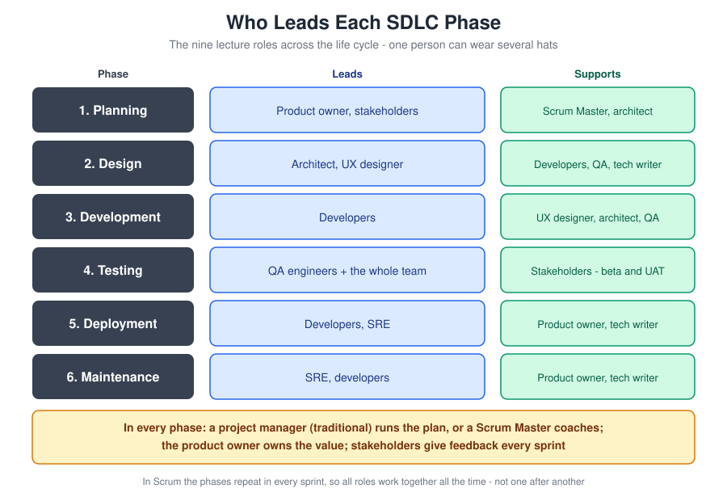

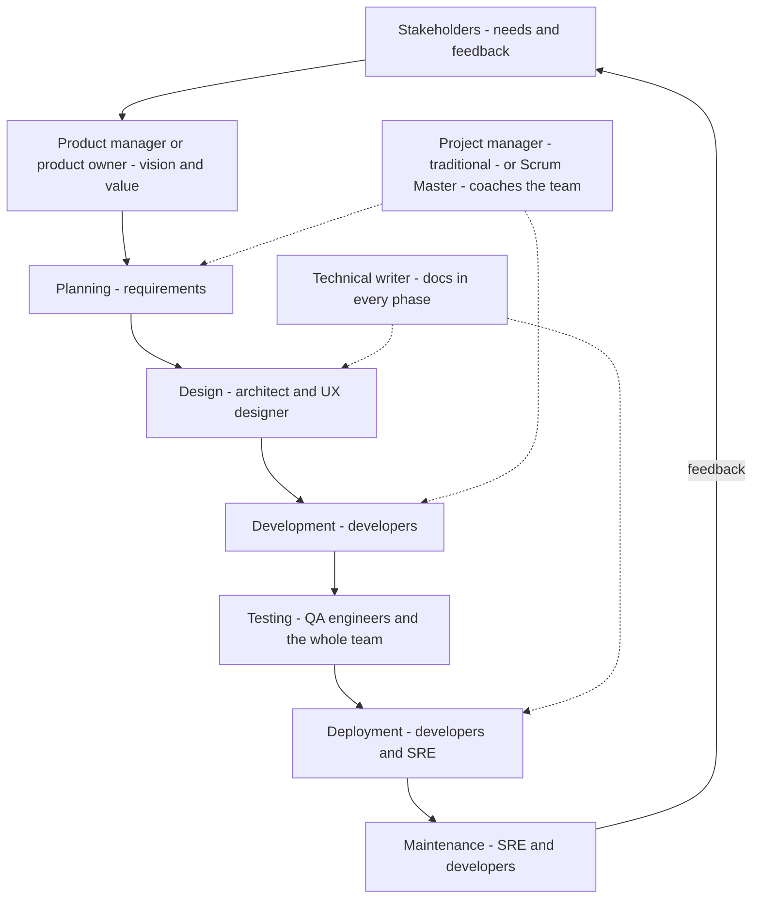

#### 3.1.1 ✅ Modern Best Practice: roles are hats, not people

> **Lecture says:** there are several common roles, with different names, and not every project has all of them.
> **Industry today:** teams plan **roles** (hats) and **accountabilities**, not one person per role. A small **cross-functional** team covers all the hats, and a **RACI** table makes clear who owns each result.

- **One person, several hats:** in a 5-person team, the tech lead may also be the architect and the security champion; a developer may also write the API docs.
- **Some hats must never be combined for the same change:** the **author** and the **reviewer** of a change are different people (**separation of duties** — the "four-eyes principle"). Big companies and regulated industries (finance, health) require it.
- **One owner per result:** every activity has **exactly one Accountable** person in the RACI table, even if many people do the work ([§5.1](#51-a-raci-check-in-nodejs)).
- **Scrum's view:** the Scrum Guide 2020 has only **three accountabilities** — Product Owner, Scrum Master, Developers. All the people who build the product (developers, testers, UX designers, architects, writers) are **"Developers"** in Scrum terms. A Scrum Team is "typically 10 or fewer people".
- **Why:** job titles differ between companies, but the **work** that must be covered is the same. Planning by hats avoids two gaps: work that nobody owns, and work that two people think they own.

---

### 3.2 Project Manager and Scrum Master

#### 3.2.1 Project manager (traditional SDLC)

- **Traditional SDLC methods (for example Waterfall) have project managers.**
- **A project manager makes sure the project runs smoothly** and **facilitates communication about the project**.
- **The project manager often deals with bigger-picture issues, such as:**
  - **Planning, scheduling and budgeting** — the project plan, the timeline with milestones, and the cost.
  - **Allocating personnel and resources** — who works on what, and which tools, environments and money the team gets.
  - **Executing the software plan** — tracking progress against the plan and correcting course.
  - **Team communication** — status reports, meetings, keeping everyone informed.
- (added) Project managers also manage **risks** (a risk register), **scope changes** (change requests) and **stakeholder communication**. Common certifications: **PMP** (Project Management Professional, from PMI — Project Management Institute) and **PRINCE2** (PRojects IN Controlled Environments).

#### 3.2.2 Scrum Master (Scrum)

> ⚠️ **Correction:** the Scrum Master is **not** "the Agile version" of a project manager. (1) **Scrum Master** is a **Scrum** accountability, not an Agile-wide one — Kanban and XP (Extreme Programming) do not define it. (2) Scrum has **no project manager**: the PM's work is **split**. The **Product Owner** owns scope, value and the order of the backlog; the **Developers** plan the sprint's work and estimate it; the **Scrum Master** is accountable for the team's **effectiveness** and for removing impediments (Scrum Guide 2020). The Scrum Guide does not cover budget or contracts; in practice they stay with the sponsor or a delivery manager outside the Scrum Team.
> **Lecture wording (for the quiz):** "Traditional SDLC methods have project managers but in Agile the equivalent role is called a Scrum master."

- **Scrum teams have a Scrum Master.**
- **Rather than focusing on planning, the Scrum Master focuses on team and individual success.** In the words of the Scrum Guide 2020, the Scrum Master is accountable "for establishing Scrum" and "for the Scrum Team's effectiveness". The Scrum Master:
  - coaches the team in **self-management** and **cross-functionality**;
  - helps the team focus on **valuable increments** that meet the **Definition of Done**;
  - causes the **removal of impediments** (blockers);
  - makes sure the Scrum events take place, are **positive and productive**, and stay **within their time limit**;
  - helps the Product Owner with backlog management and helps the wider organization adopt Scrum.
- **The four core Agile values put people and communication before process, and the Scrum Master is responsible for facilitating that communication.**
- (added) **The exact four values** of the Agile Manifesto (2001) — "while there is value in the items on the right, we value the items on the left **more**":

  | We value… | …more than | Link to this lecture |
  |-----------|-----------|----------------------|
  | **Individuals and interactions** | processes and tools | The Scrum Master's focus on people and communication |
  | **Working software** | comprehensive documentation | Developers and QA deliver working increments |
  | **Customer collaboration** | contract negotiation | Stakeholders and the PO work with the team all the time |
  | **Responding to change** | following a plan | The PO re-orders the backlog when needs change |

  - Only the **first** value is literally "people over process"; together, the values put **people, collaboration and feedback** first.

| Project-management work | Traditional project | Scrum |
|-------------------------|---------------------|-------|
| Scope and priorities | Project manager (with a fixed plan) | **Product Owner** (ordered Product Backlog) |
| Detailed plan and estimates | Project manager | **Developers** (Sprint Planning, Sprint Backlog) |
| Schedule | Project manager (Gantt chart) | Fixed-length **sprints**; forecast from the team's measured pace |
| Removing blockers, team process | Project manager | **Scrum Master** |
| Budget, contracts, reporting to management | Project manager | Sponsor / delivery manager (outside the Scrum Team) |
| Team communication | Project manager | The whole Scrum Team; Scrum Master facilitates the events |

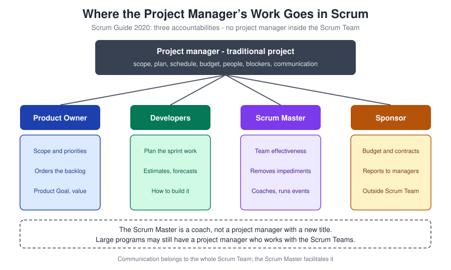

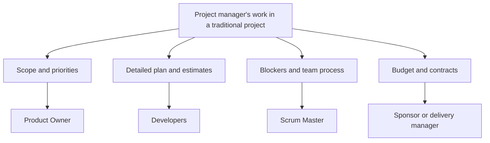

#### 3.2.3 ✅ Modern Best Practice: delivery leads and coaches, not command-and-control

> **Lecture says:** project managers plan and control; Scrum Masters focus on team success.
> **Industry today:** most software teams have **no classic project manager inside the team**. A **Scrum Master**, **agile coach** or **delivery lead** helps the team work well; plans are **forecasts from real data**, updated every sprint.

- **Delivery lead / delivery manager:** a common title in agencies and consulting companies. The person runs the working rhythm, risks, reporting and change requests, and often is the Scrum Master too.
- **Forecasts, not promises:** dates come from the team's measured **throughput** (items finished per week), shown as a range ("8–11 weeks"), not from a fixed Gantt chart made on day one.
- **Project managers still exist** — for **large programs** (many teams, vendors and contracts), **fixed-price client contracts** and **regulated** projects. They work **with** Scrum teams on budget, contracts and dependencies, and do not assign daily tasks to developers.
- **Anti-pattern:** a "Scrum Master" who assigns tasks, sets deadlines and reports on each developer's hours is a project manager with a new title — the team stops managing itself.
- **Why:** software work is uncertain. A team that plans together every sprint, with a coach who removes blockers, adapts faster than a team that follows a plan made months ago.

---

### 3.3 Stakeholders

> ⚠️ **Correction:** stakeholders are **not only** the people the product is designed for. A stakeholder is **anyone who may affect, be affected by, or feel affected by** the project or its outcome (PMI). That includes users and customers, but also the **sponsor** who pays, **managers** who decide, **operations and support** staff, **security and legal** teams, **regulators**, and the **project team** itself.
> **Lecture wording (for the quiz):** "The stakeholders are the people for whom the product is being designed."

- **Stakeholders include people such as:**
  - the **customer** (the client who orders and pays),
  - **end users** (the people who use the software every day),
  - **decision-makers** (managers, the sponsor),
  - **system administrators** (the people who will run it),
  - **other key personnel** (for example support, security, legal, marketing).
- **Their main responsibilities:**
  - **Giving the requirements** — stakeholders are the **source** of the project's requirements: they say what they need (see [note 05](05-requirements.md)).
  - **Giving feedback** when **team members need clarification on requirements**, or when **a proposed solution cannot be done as planned** and a choice must be made.
  - **Testing:** stakeholders **sometimes take part in beta testing and acceptance testing** before the software is released — for example **UAT (User Acceptance Testing)** ([note 08](08-software-testing.md)).

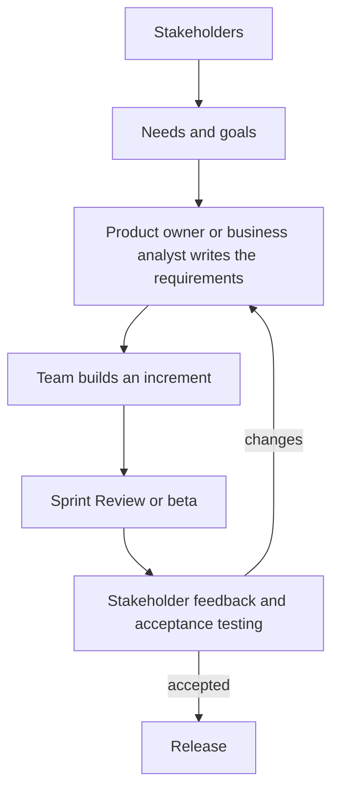

#### 3.3.1 ✅ Modern Best Practice: map stakeholders and keep them in the loop

> **Lecture says:** the stakeholder is mainly responsible for defining the requirements and giving feedback.
> **Industry today:** stakeholders give **needs** and **feedback**; a **product owner** or **business analyst** turns them into clear, testable requirements, and the team meets stakeholders **every sprint**, not only at the start and the end.

- **Stakeholder register:** a list of every stakeholder with their interest, influence, what they need from the project, and how often they get updates.
- **Power/interest grid:** high power + high interest → **manage closely** (involve in every Sprint Review); high power + low interest → **keep satisfied**; low power + high interest → **keep informed**; low power + low interest → **monitor**.
- **Requirements are written by the team side:** stakeholders often describe solutions ("add a button") instead of needs ("I must approve orders faster"). The PO or business analyst asks "why?" and writes **user stories with acceptance criteria**.
- **Feedback is continuous:** the **Sprint Review** shows working software to stakeholders every sprint; **beta programs** and **feature flags** let real users try features early.
- **Conflicting stakeholders:** when two stakeholders want different things, the **PO decides** (or escalates to the sponsor) — the team does not choose silently.
- **Why:** late feedback is expensive. A stakeholder who sees the product every two weeks finds misunderstandings when they cost hours, not months.

---

### 3.4 System, Software and Solution Architects

- **The architect designs and describes the architecture of a project, and communicates that architecture to the team.**
- **The lecture uses three titles: system architect, software architect, solution architect** — and many companies use them loosely. In large companies they are **different jobs** (see the table below).
- **The architect is responsible for designing the essential characteristics of the inner structure and the technical aspects of the software** — the main parts, how they communicate, where data lives, and the **quality attributes** (performance, security, availability, scalability).
- **The architect gives technical support across the stages of the SDLC** — from feasibility in planning, through design and code reviews, to deployment and production problems.
- **Software architecture is covered in more detail in a later module.**

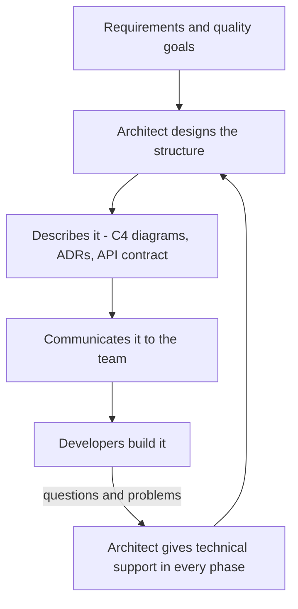

#### 3.4.1 ✅ Modern Best Practice: which architect, and the architect who codes

> **Lecture says:** the system architect is sometimes also called a software architect or a solution architect.
> **Industry today:** these titles are used loosely in small companies, but in larger organizations they name **different scopes**. In small teams, the **tech lead** does the architecture work and still writes code.

| Title | Scope | Typical questions |
|-------|-------|-------------------|
| **Software (application) architect** | The structure of **one application or system**: modules, services, patterns, data model | "Monolith or services? Which database? How do the modules talk?" |
| **Solution architect** | A solution for **one business problem**, often across several systems, vendors and cloud services; often works with the client | "How do our CRM (Customer Relationship Management) system, the payment provider and the new app fit together?" |
| **Enterprise architect** | **All** of the organization's systems, standards and long-term technology roadmap | "Which platforms do all teams use? What do we retire?" |
| **System architect** | A whole **system**, including hardware, networks and software (common in embedded, telecom and systems engineering) | "Which parts run on the device and which in the cloud?" |
| **Cloud architect** *(added)* | Cloud infrastructure: accounts, networks, security, cost | "How do we run this on AWS, Azure or Google Cloud safely and cheaply?" |

- **Architecture is documented in small, living pieces:** **C4 diagrams** (Context, Containers, Components, Code), **ADRs** (Architecture Decision Records) and an **OpenAPI** contract, all in Git ([note 09](09-software-documentation.md#332-design-documentation)).
- **Security by design:** the architect leads a **threat model** (for example with STRIDE — Spoofing, Tampering, Repudiation, Information disclosure, Denial of service, Elevation of privilege) before building, and checks the design against **OWASP** (Open Worldwide Application Security Project) guidance.
- **Architect who codes:** an architect who never writes code loses touch with the real system; teams prefer architects who pair with developers and review pull requests.
- **Why:** big up-front architecture documents go out of date. Small decisions, recorded with their reasons and reviewed by the team, stay true.

---

### 3.5 UX Designer

- **UX means user experience.**
- **The goal of a UX designer is to balance two things:** making the software **intuitive** (easy to understand without help) and making it **as robust as it needs to be** to meet the requirements (enough features, options and error handling).
- **UX designers define how the software behaves from the user's point of view.**
- **The UX designer decides how the software communicates its functionality to the end user, and how the end user interacts with it** — the flows, screens, buttons, messages and error texts.

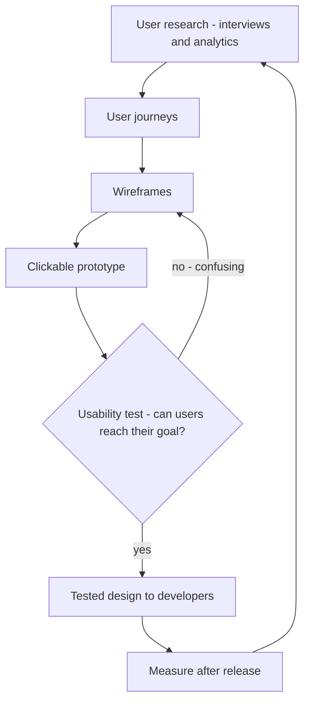

#### 3.5.1 ✅ Modern Best Practice: research-based, accessible, inside the team

> **Lecture says:** the UX designer defines how the software behaves and communicates from the user's perspective.
> **Industry today:** UX starts with **user research**, is tested with **prototypes** before code, follows a shared **design system**, meets **accessibility** standards (WCAG — Web Content Accessibility Guidelines — 2.2 AA), and the designer works **inside** the team every sprint.

- **UX vs. UI (User Interface):** **UX** is the whole experience (can the user reach their goal easily?); **UI** is the visual layer (colors, layout, components). Many teams have a **product designer** who does both, and some have a separate **UX researcher**.
- **The UX process:** research (interviews, analytics) → user journeys → wireframes → clickable **prototype** (for example in Figma) → **usability test** with a few real users (about 5 per round finds most big problems) → hand over a tested design → measure after release.
- **Design systems:** one shared library of components (buttons, forms, colors) used by designers and developers, so every screen looks and behaves the same.
- **Accessibility:** design for keyboard use, screen readers, color contrast and clear error messages — **WCAG 2.2 level AA** is the usual target.
- **UX for APIs too:** for a backend team, the **"user"** is often another developer. Clear endpoint names, consistent errors (RFC — Request for Comments — 9457 Problem Details) and good examples are **developer experience (DX)**.
- **Why:** fixing a confusing flow in a prototype takes hours; fixing it after release takes a sprint and annoys real users.

---

### 3.6 Software Developer

- **Developers write the code that powers the software.**
- **Their responsibilities include:**
  - **implementing the architecture** described in the **design document**;
  - **building in the requirements** described in the **SRS (Software Requirements Specification)** — or, in Agile teams, in the **user stories and acceptance criteria**;
  - **applying the UX requirements** from the **UX designers**.

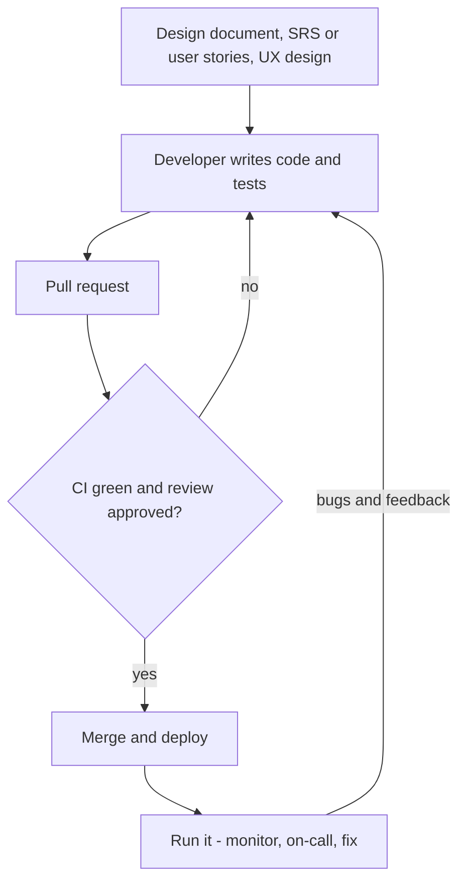

#### 3.6.1 ✅ Modern Best Practice: developers own quality, security and operations too

> **Lecture says:** developers write the code that implements the design, the SRS and the UX requirements.
> **Industry today:** developers also **test**, **review**, **secure** and **run** what they build — "**You build it, you run it**" (Werner Vogels, Amazon CTO — Chief Technology Officer — in an interview in *ACM Queue*, the magazine of the ACM — Association for Computing Machinery, 2006).

- **Tests with the code:** unit and integration tests in the same pull request; often **TDD** (Test-Driven Development) ([note 08](08-software-testing.md)).
- **Code review:** every change is reviewed by another developer before merge.
- **Security:** developers follow secure-coding rules (OWASP Top 10), keep **secrets out of code**, and fix findings from **dependency scanning** (for example `npm audit`, Dependabot).
- **Operations:** developers add **logs, metrics and traces** (for example with OpenTelemetry), join the **on-call** rotation and fix their own production problems.
- **Design input:** developers take part in design and estimation — they are not only "coders" who receive finished documents.
- **AI coding assistants:** developers may use them, but the **developer who commits the code is responsible for it**: review it, test it, check licenses, and never paste secrets or client data into a tool the company has not approved.
- **Why:** when the builder also tests and runs the software, problems are found earlier and fixed by the person who understands the code best.

---

### 3.7 Tester / QA Engineer

- **Testers or QA engineers help ensure the quality of the product** and that the **software solution meets the customer's requirements**.
- **They write and run test cases** to **find bugs or deficiencies** (missing or weak parts), and **give this feedback to the development team** (bug reports).

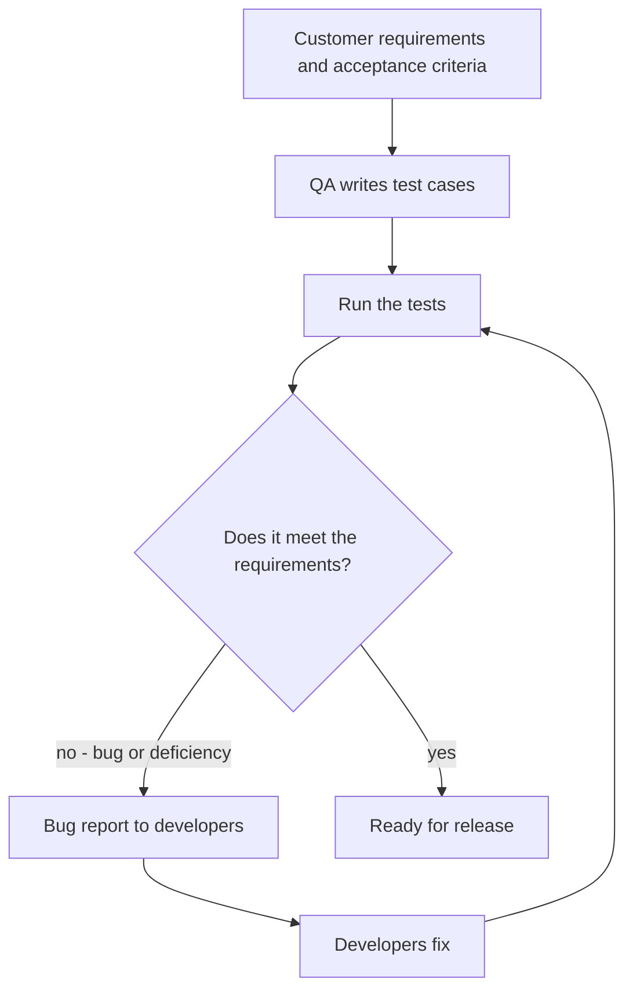

#### 3.7.1 ✅ Modern Best Practice: quality is the whole team's job

> **Lecture says:** testers or QA engineers are in charge of ensuring the quality of the product.
> **Industry today:** **the whole team** owns quality ("whole-team approach"). QA engineers lead the **test strategy**, build **test automation**, do **exploratory testing** and **coach** developers — they are not a gate at the end.

| Old model | Modern model |
|-----------|--------------|
| Developers "throw code over the wall" to QA | Developers and QA work on the same story at the same time |
| QA writes all tests, after the code | Developers write unit and integration tests; QA designs the strategy, end-to-end and exploratory tests |
| Testing phase at the end of the project | Testing **inside** every sprint and every pull request (**shift-left**) |
| Quality = "QA found no bugs" | Quality = acceptance criteria met, automated checks green in CI (Continuous Integration), SLOs met in production |

- **SDET (Software Development Engineer in Test):** a QA engineer who mainly writes test code and test tools — common in larger companies.
- **Tools:** Jest or the built-in `node:test` runner for unit tests, Supertest for API tests, Playwright for browser end-to-end tests, k6 for load tests.
- **Why:** if only QA owns quality, developers stop thinking about it, and QA becomes a bottleneck at the end of every sprint.

---

### 3.8 Site Reliability Engineer (SRE)

> ⚠️ **Correction:** an **SRE** and an **ops engineer** are **not** the same role. An **ops engineer** (or system administrator) runs systems — install, configure, patch, back up, often by hand. An **SRE** is a **software engineer** who makes running systems reliable **with software and data**: SLOs (Service Level Objectives), error budgets, monitoring, automation and blameless postmortems. Google, where SRE started (2003, Ben Treynor Sloss), caps an SRE's manual ops work at **50%**; the rest is engineering. Some companies use the titles loosely, but they describe different jobs.
> **Lecture wording (for the quiz):** "A site reliability engineer, sometimes called an SRE or ops engineer, bridges development and operations by combining software engineering expertise with IT systems management."

- **SREs bridge development and operations** by **combining software engineering skills with IT systems management**.
- **They track incidents and facilitate meetings to discuss them** — the **incident review** or **postmortem**, written **blameless** (it asks "what in the system allowed this?", not "who is to blame?").
- **They automate systems, procedures and processes** — for example automatic scaling, deployments, backups, and alerts that open a ticket.
- **They help with troubleshooting** — finding the cause of production problems with logs, metrics and traces.
- **They ensure reliability for the customer** — the service is available and fast enough, as promised.

#### 3.8.1 ✅ Modern Best Practice: SLOs, error budgets, and the roles around operations

> **Lecture says:** the SRE bridges development and operations, tracks incidents, automates and ensures reliability.
> **Industry today:** SREs work with **numbers**: **SLIs** (Service Level Indicators) measure the service, **SLOs** set the target, and the **error budget** decides when the team must stop releasing features and fix reliability. Several related roles share operations work.

- **SLI → SLO → error budget:**
  - **SLI:** what you measure — for example "the share of requests that return a non-5xx answer in under 300 ms".
  - **SLO:** the target — "99.9% of requests in a 30-day window".
  - **Error budget:** what is allowed to fail — 100% − 99.9% = **0.1%** of requests (or, for an availability SLO, about **43 minutes** of downtime in 30 days; see [§5.2](#52-sre-an-error-budget-calculator)).
  - When the budget is **used up**, the team pauses risky releases and works on reliability until the service is back within its SLO.
- **Toil:** manual, repetitive work that a machine could do. SREs measure it and automate it away.
- **On-call and runbooks:** a fair on-call rotation, an alert for each SLO problem, and a **runbook** for each alert ([note 09 §3.4.1](09-software-documentation.md#341--modern-best-practice-sops-as-code-runbooks-and-automation)).

| Role | Main focus | Typical work |
|------|-----------|--------------|
| **Ops engineer / system administrator** | Keeping servers and systems running | Install, patch, back up, monitor, often by hand |
| **SRE** | Reliability of a live service, measured by SLOs | SLOs and error budgets, automation, incident response, postmortems, capacity planning |
| **DevOps engineer** *(job title)* | The delivery pipeline and infrastructure automation | CI/CD (Continuous Integration / Continuous Delivery) pipelines, Infrastructure as Code (Terraform), containers |
| **Platform engineer** | An **internal developer platform** that other teams use as a product | Self-service environments, golden paths, Kubernetes platform, templates |

- **DevOps is a culture, not only a job title:** developers and operations share responsibility for the running service. "DevOps engineer" is a common title, but every team member is expected to work this way.
- **Why:** "reliable" must be a number. Without an SLO, the team argues about feelings; with an error budget, the PO and SRE share one rule for when to slow down.

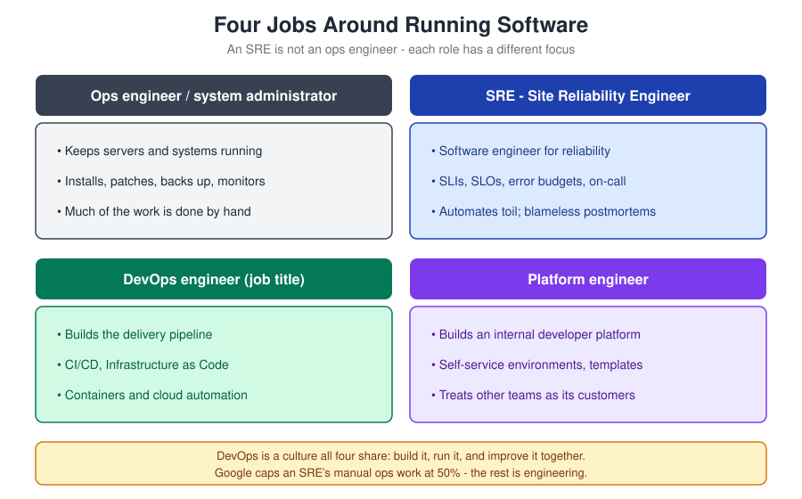

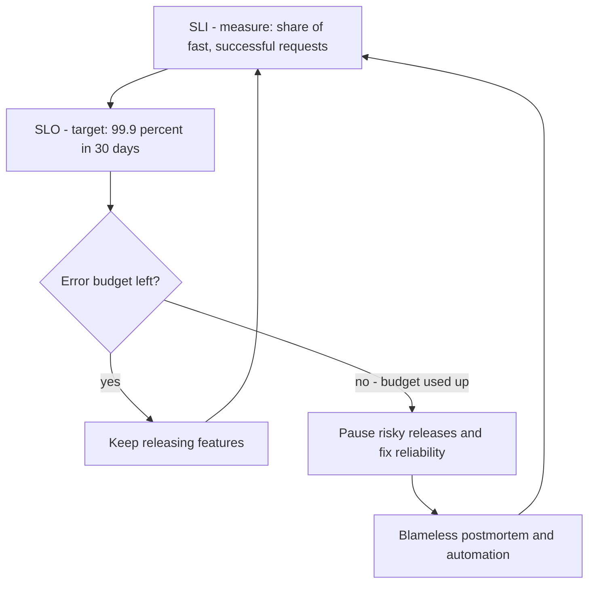

---

### 3.9 Product Manager and Product Owner

- **The product manager or product owner has the vision of what the product should look like.**
- **They understand the client's requirements and the end users' needs very well** (the lecture says "an intimate understanding").
- **They are responsible for making sure the product provides the value stakeholders are looking for.**

> ⚠️ **Correction:** the product manager / product owner does **not** lead the development work. They own the **what** and the **why** — the vision, the goals and the order of the backlog (and, in common practice, accepting finished stories — not a Scrum Guide duty; the Definition of Done decides when work is complete). **How** to build it is decided by the **Developers** (with the tech lead or architect), and people are managed by an **engineering manager**. Also, **product manager** and **product owner** are not the same: "product owner" is a **Scrum accountability** for the Product Backlog of one product; "product manager" is a **job title** that usually also covers market research, strategy, pricing and the roadmap across releases. In many companies one person does both.
> **Lecture wording (for the quiz):** "They are responsible for leading development efforts to create the software and for ensuring the product provides the value stakeholders are looking for."

- **What the Product Owner does in Scrum (Scrum Guide 2020):**
  - develops and explicitly communicates the **Product Goal**;
  - creates and clearly communicates **Product Backlog items**;
  - **orders** the Product Backlog items;
  - makes sure the Product Backlog is **transparent, visible and understood**.
- **The Product Owner is one person, not a committee.** Others can influence the backlog by convincing the PO.

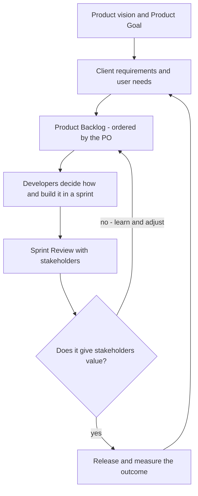

| | **Product manager** (job title) | **Product owner** (Scrum accountability) |
|---|---|---|
| **Focus** | Market, users, strategy, roadmap, success metrics | Product Goal, Product Backlog, value of each sprint |
| **Time horizon** | Months to years | Sprints to a few months |
| **Works mostly with** | Customers, sales, marketing, leadership | The Scrum Team and stakeholders |
| **In small companies** | Often the same person as the PO | Often the same person as the product manager |

#### 3.9.1 ✅ Modern Best Practice: outcomes over output, discovery before delivery

> **Lecture says:** the product manager or owner has the vision and ensures the product gives stakeholders value.
> **Industry today:** product people work on **outcomes** (changes in user behavior and business results, measured by metrics) and run **product discovery** (experiments, prototypes, user interviews) **before** the team builds a feature.

- **Measurable goals:** "reduce checkout time from 3 minutes to 1 minute", not "build a new checkout page"; often written as **OKRs** (Objectives and Key Results).
- **Discovery and delivery together:** the PO, a designer and the tech lead (the "product trio") test ideas cheaply before the team commits a sprint to them.
- **Data after release:** product analytics, A/B tests and feature-flag rollouts show whether a feature really helped.
- **Why:** building what was asked is not the same as solving the problem. Measuring outcomes stops teams from shipping features nobody uses.

---

### 3.10 Technical Writer / Information Developer

- **The technical writer (or information developer) writes documentation for the end user.**
- **They explain technical material for a non-technical audience.**
- **This documentation helps the end user use the software, and it also helps the customer give timely feedback to the development team** — when the customer can read clearly what the software does, they can quickly say what is missing or wrong.
- **Technical writers may be asked to write user manuals, reports, white papers and press releases.**

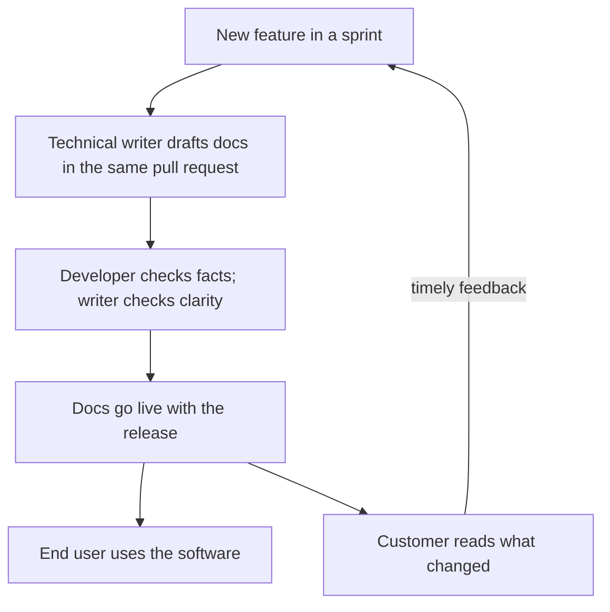
  - (added) In many companies, **press releases** come from the **marketing or communications** team, and **white papers** are written with product marketing; the technical writer often checks them for technical accuracy.

#### 3.10.1 ✅ Modern Best Practice: docs as code, for every audience

> **Lecture says:** the technical writer writes documentation for end users, on technical material for a non-technical audience.
> **Industry today:** technical writers write for **many audiences** — end users, **developers** (API reference, SDK — Software Development Kit — guides), operators and the client — and work **docs as code**: in Git, reviewed in pull requests, released with the software.

- **Developer documentation is a big part of the job:** API reference generated from **OpenAPI**, SDK guides, quickstarts, tutorials and error catalogs ([note 09 §5.4](09-software-documentation.md#54-machine-readable-documentation-openapi-as-the-source)).
- **Inside the team:** the writer joins refinement and Sprint Reviews, and the Definition of Done includes "docs updated".
- **Structure:** the **Diátaxis** framework — tutorials, how-to guides, reference, explanation ([note 09 §3.1.4](09-software-documentation.md#314--modern-best-practice-write-for-one-reader-and-one-need)).
- **No writer on the team?** Then developers and the PO share the work — documentation is still required.
- **AI drafting:** AI tools can draft docs and release notes; a person checks every fact, command and screenshot before publishing.
- **Why:** documentation written at the end is late and often wrong; documentation written in the same pull request as the change is current.

---

### 3.11 Often-Missed Parts: What a Senior Engineer Adds (not in the lecture — industry practice)

| Area | What to add | Why |
|------|-------------|-----|
| **Tech lead** | A senior developer who leads technical decisions for one team and still codes; in small teams also the architect | Most small teams have a tech lead, not a separate architect |
| **Engineering manager** | Manages people: hiring, 1:1 meetings, growth, performance | Keeps people management separate from product decisions (PO) and team process (Scrum Master) |
| **Business analyst** (BA) | Elicits and writes requirements, models business processes | Common on client and enterprise projects; works with the PO |
| **Security champion / security engineer** | Threat models, security reviews, dependency and vulnerability follow-up (DevSecOps) | Security is built in from design, not tested in at the end |
| **Data and ML (Machine Learning) engineers** | Data pipelines, analytics, ML models in production | Many products now have data and AI features |
| **Sponsor** | Owns the budget and the final go/no-go | Somebody must be able to say "stop" or "go" |
| **RACI and separation of duties** | One Accountable per activity; author ≠ reviewer; deployers ≠ approvers where rules require | Prevents gaps, double ownership and fraud or mistakes in regulated work |
| **Team structure** | **Team Topologies**: stream-aligned, platform, enabling and complicated-subsystem teams | Clear team types reduce hand-offs and cognitive load as a company grows |
| **Cross-functional, T-shaped people** | Deep skill in one area, basic skills in several | Small teams can cover for each other (holidays, sickness) |
| **Responsible AI use** | Every role may use AI tools; the person remains accountable for the result; approved tools only; no secrets or client data in prompts | AI output can be wrong or leak data |
| **Bus factor** | No knowledge held by only one person; pair work, docs, rotation | A team must survive one person leaving |

#### 3.11.1 "Done enough when…" checklist for project roles

- [ ] Every hat is covered: product (PO), process (Scrum Master / delivery lead), technical leadership (tech lead or architect), build (developers), quality (QA and the whole team), operations (SRE or the team on call), UX, documentation, security.
- [ ] A **RACI** table exists, and every activity has **exactly one Accountable** person.
- [ ] The **author** of a change is never its only reviewer; the **PO** is not the only tester.
- [ ] Stakeholders are listed in a **stakeholder register**, and the important ones see working software at every Sprint Review.
- [ ] Reliability is measured with **SLOs**, and someone owns on-call and incident reviews.
- [ ] People management (engineering manager) is separate from the product decision (PO).
- [ ] The team agreed how it uses **AI tools**, and who reviews AI-generated work.
- [ ] No critical knowledge sits with only one person (bus factor > 1).

---

### 3.12 Lecture Summary

- **There are many job roles on a software development project, and each role has its own responsibilities.**

| Role | Lecture | ✅ Modern best practice |
|------|---------|--------------------------|
| Roles in general | Names change with approach and company; not all projects have all roles | Plan **hats**, not people; RACI with one Accountable; author ≠ reviewer; Scrum has 3 accountabilities |
| Project manager / Scrum Master | PM: planning, scheduling, budgeting, resources, execution, communication. Scrum Master: team and individual success, communication | Scrum Master is a **Scrum** accountability and **not** a PM equivalent; PM work is split between PO, Developers and Scrum Master; delivery leads; forecasts from data |
| Stakeholders | Customer, end users, decision-makers, sysadmins, key personnel; requirements, feedback, beta and acceptance testing | **Anyone who affects or is affected** by the project (PMI); stakeholder register and power/interest grid; feedback every sprint |
| Architect | Designs, describes and communicates the architecture; technical support across the SDLC | Software, solution, enterprise and system architects have **different scopes**; tech lead who codes; C4, ADRs, threat models |
| UX designer | Intuitive yet robust; how software behaves and communicates | Research, prototypes, usability tests, design systems, WCAG 2.2 AA; DX for APIs |
| Developer | Implements design document, SRS and UX requirements | Also tests, reviews, secures and runs the code ("you build it, you run it"); responsible for AI-assisted code |
| Tester / QA | Ensures quality; writes and runs test cases; reports bugs | **Whole-team quality**; QA leads strategy, automation, exploratory testing; shift-left |
| SRE | Bridges dev and ops; incidents, automation, troubleshooting, reliability | SRE ≠ ops engineer; SLIs, SLOs, error budgets, toil, blameless postmortems; DevOps and platform engineers |
| Product manager / owner | Vision; client and user needs; value for stakeholders | PO/PM own **what and why**, Developers own **how**; PM ≠ PO; outcomes and discovery |
| Technical writer | Docs for end users; user manuals, reports, white papers, press releases | Many audiences incl. developers; docs as code; Diátaxis; docs in the Definition of Done |

---

## 4. Concrete Examples

### 4.1 The Book Review API (course project): a 6-person team

| Person | Hats (roles) | Example work |
|--------|--------------|--------------|
| **Asha** | Product Owner | Orders the backlog; writes "REQ-07: rate a book 1–5"; checks finished stories against their acceptance criteria (common practice) |
| **Ben** | Scrum Master (delivery lead) + part-time developer | Runs the events; removes the blocker "staging database is down"; reports progress to the sponsor |
| **Chen** | Tech lead + architect + security champion | Writes ADR `0003-use-mongodb.md`; leads the threat model; reviews pull requests |
| **Dina, Eli** | Developers (Eli also on call this week) | Build `POST /v1/books/{isbn}/reviews` (ISBN — International Standard Book Number) with tests; add OpenTelemetry traces |
| **Farah** | QA engineer + writes the API docs | Test strategy, Playwright and Supertest suites, exploratory testing; OpenAPI examples |
| (outside the team) | Sponsor, end users, client support team | Budget; beta testing; feedback on the help pages |

- **Not in this team:** a separate UX designer (the team uses the company design system and a shared designer for one day per sprint), an SRE (the team runs its own service with the company's platform team), a technical writer (Farah and the developers write the docs).

### 4.2 Who handles it? Quick practice

| Situation | Who is accountable |
|-----------|-------------------|
| "Should we build reviews or wish lists first?" | **Product Owner** |
| "Should we use MongoDB or PostgreSQL?" | **Tech lead / architect** (written as an ADR) |
| "The team keeps getting blocked by another team's slow approvals." | **Scrum Master** (removes impediments) |
| "Can the client sign that the feature does what they need?" | **Stakeholder / client** (UAT), organized by the PO |
| "The API is down at 3 a.m." | **On-call engineer** (developer or SRE), then a blameless postmortem |
| "The error budget for this month is used up." | **SRE and PO** agree to pause risky releases |
| "Write the 'How to post a review' help page." | **Technical writer** (or a developer if there is none) |
| "The signup form cannot be used with a keyboard." | **UX designer** + developers (accessibility) |

---

## 5. Code Blocks

### 5.1 A RACI check in Node.js

```js
// scripts/check-raci.mjs — run with: node scripts/check-raci.mjs
// Checks a team's RACI table: exactly ONE Accountable per activity, at least one Responsible,
// and the "author is not the only reviewer" rule from separation of duties.
const raci = {
  "Backlog and priorities":  { PO: "A/R", SM: "C", TL: "C", DEV: "C", QA: "C" },
  "Architecture and ADRs":   { PO: "C", TL: "A/R", DEV: "R", QA: "C" },
  "Test strategy":           { TL: "C", DEV: "R", QA: "A/R" },
  "Incidents and postmortems": { TL: "A", DEV: "R", SRE: "R", PO: "I" },
};

const problems = [];
for (const [activity, roles] of Object.entries(raci)) {
  const codes = Object.entries(roles);                       // [["PO","A/R"], ["SM","C"], ...]
  const accountable = codes.filter(([, c]) => c.includes("A")).map(([r]) => r);
  const responsible = codes.filter(([, c]) => c.includes("R")).map(([r]) => r);

  if (accountable.length !== 1) {                              // zero owners or two owners are both wrong
    problems.push(`${activity}: needs exactly 1 Accountable, found ${accountable.length} (${accountable.join(", ") || "none"})`);
  }
  if (responsible.length === 0) {                              // somebody must actually do the work
    problems.push(`${activity}: nobody is Responsible`);
  }
}

// Separation of duties: a pull request's author may not be its only approver.
function canMerge(pr) {
  const others = pr.approvers.filter((name) => name !== pr.author); // ignore self-approval
  return others.length >= 1;
}
console.log("PR by Dina, approved by Eli:", canMerge({ author: "Dina", approvers: ["Eli"] }));   // true
console.log("PR by Dina, approved by Dina:", canMerge({ author: "Dina", approvers: ["Dina"] })); // false

problems.forEach((p) => console.error("RACI problem:", p));
process.exitCode = problems.length ? 1 : 0;                    // non-zero exit fails a CI job
```

**What happens if…** two roles are both marked `A` for the same activity (for example `PO: "A"` and `TL: "A"` on "Architecture and ADRs")?
- Both people think the other one decides; the decision waits, or is made twice in two different ways.
- ✅ The script reports `needs exactly 1 Accountable, found 2 (PO, TL)` and exits with code `1`. Fix the table: one Accountable, the other one **Consulted**.
- **Edge case:** `canMerge` without the `filter` would accept a PR that only its author approved. GitHub blocks this on its own (a PR author cannot approve their own pull request), and branch protection or a ruleset makes at least one approval required before merge.

### 5.2 SRE: an error budget calculator

```js
// scripts/error-budget.mjs — run with: node scripts/error-budget.mjs
// Turns an SLO into an error budget, and checks how much of it is used.
function errorBudget({ sloPercent, windowDays }) {
  const allowedFailure = 1 - sloPercent / 100;                 // 99.9% -> 0.001 (0.1%)
  const windowMinutes = windowDays * 24 * 60;                  // 30 days = 43,200 minutes
  return { allowedFailure, downtimeMinutes: windowMinutes * allowedFailure };
}

function budgetStatus({ sloPercent, totalRequests, failedRequests }) {
  const allowedFailures = totalRequests * (1 - sloPercent / 100); // failures we may have
  const used = failedRequests / allowedFailures;                   // 1.0 = 100% of the budget used
  return { allowedFailures: Math.round(allowedFailures), usedPercent: Math.round(used * 100) };
}

const b = errorBudget({ sloPercent: 99.9, windowDays: 30 });
console.log(`99.9% over 30 days allows ${b.downtimeMinutes.toFixed(1)} minutes of downtime`); // 43.2

const s = budgetStatus({ sloPercent: 99.9, totalRequests: 2_000_000, failedRequests: 2_600 });
console.log(s); // { allowedFailures: 2000, usedPercent: 130 }
if (s.usedPercent >= 100) {
  console.log("Error budget used up: pause risky releases, work on reliability.");
}
```

**What happens if…** the team sets the SLO to **100%**?
- `allowedFailure` becomes `0`, so the budget is **zero** and `used` divides by zero: after the first failure it is `Infinity`. No release is ever "safe", and the team can never change anything.
- **Edge case:** with **zero** failures, `0 / 0` is `NaN`, and `NaN >= 100` is `false` — the check silently says "fine". Guard it: `if (allowedFailures === 0) throw new Error("SLO must be below 100%")`.
- ✅ No real service is 100% available (networks, clouds and users' own devices fail). Pick an SLO slightly **below** what users really need — for example 99.9% — and use the remaining budget for releases and experiments.

---

## 6. Related Concepts

1. **Scrum framework** — the Scrum Guide 2020 defines the three accountabilities (Product Owner, Scrum Master, Developers) that replace the classic project manager inside the team (see [note 06](06-software-development-methodologies.md)).
2. **Requirements engineering** — stakeholders are the source of requirements, and the PO or business analyst turns them into user stories, the SRS and acceptance criteria (see [note 05](05-requirements.md)).
3. **DevOps and CI/CD** — "you build it, you run it" makes developers, QA and SREs share one pipeline and one responsibility for production.
4. **Observability and SLOs** — logs, metrics and traces give SREs and developers the SLIs they need to keep SLOs and manage the error budget.
5. **Team Topologies and Conway's Law** — systems tend to copy the communication structure of the teams that build them, so how roles and teams are organized shapes the architecture.
