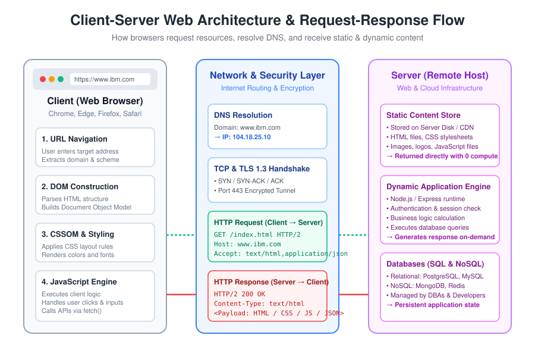
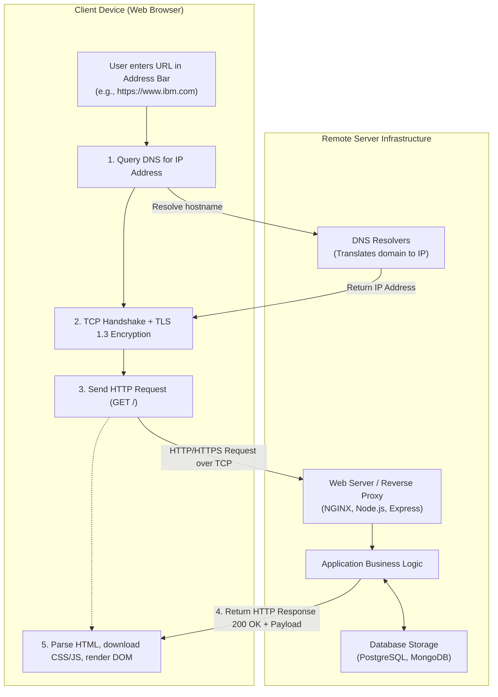
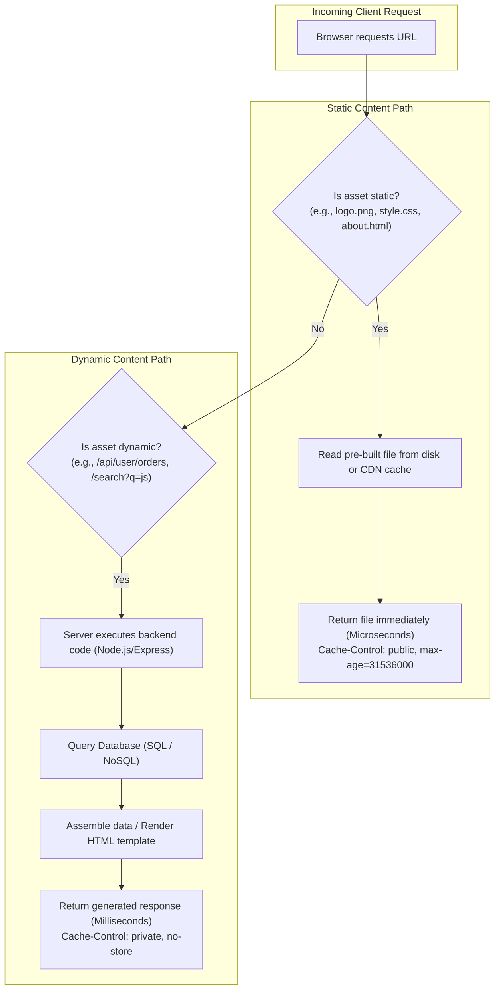
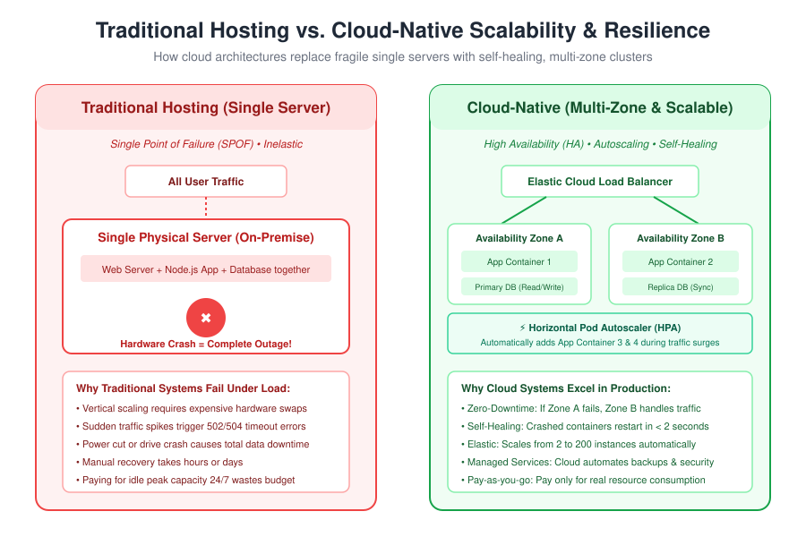
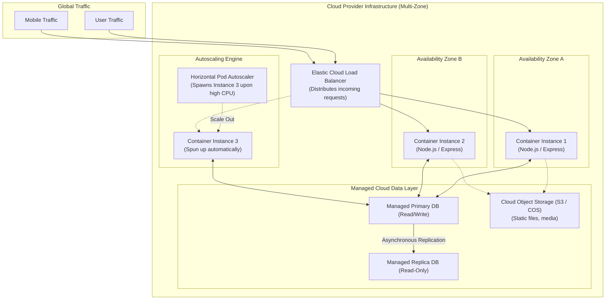
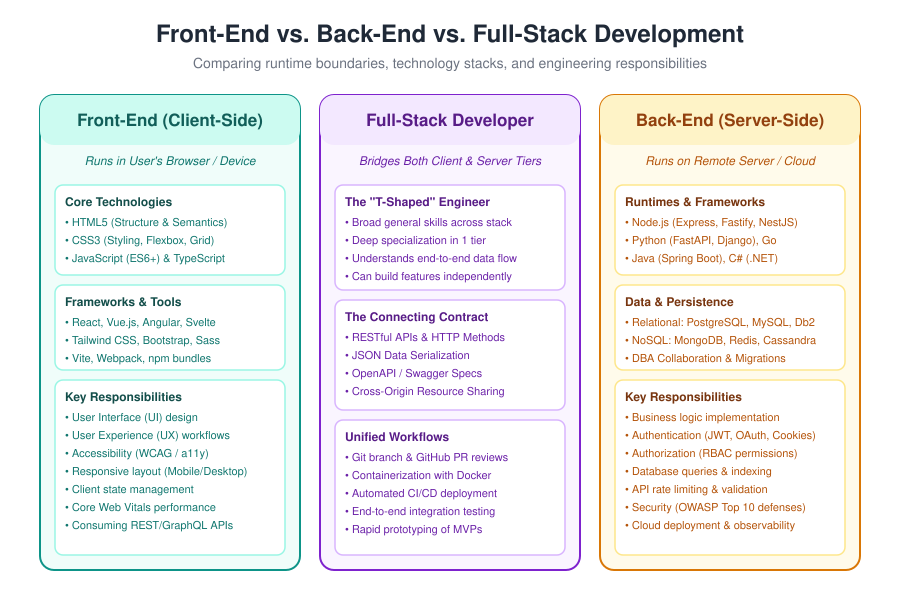
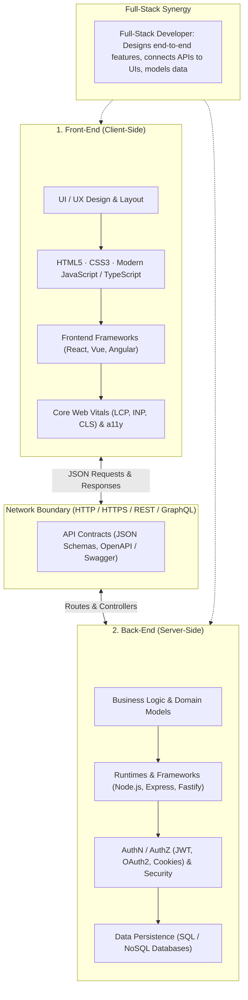
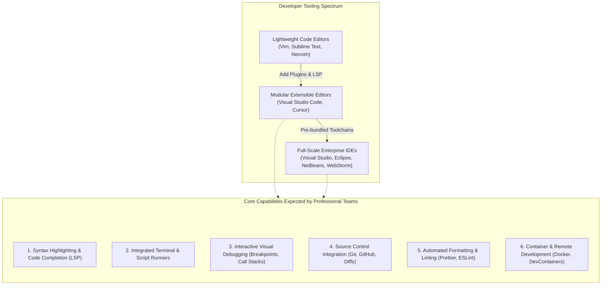
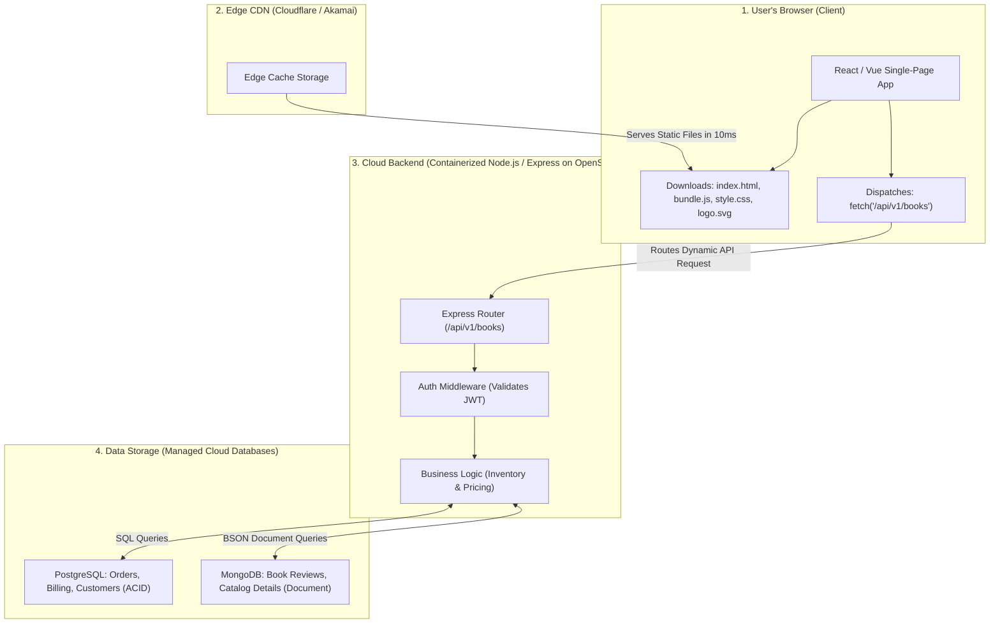

# 01 — Overview of Web and Cloud Development

**Learning goals of this lecture:**

- **Describe** the basic communication between web browsers (clients) and servers.
- **Explain** how websites are constructed and delivered using HTML, CSS, and JavaScript.
- **Differentiate** between static and dynamic web content.
- **Explain** what makes cloud applications scalable and resilient.
- **Compare** front-end, back-end, and full-stack software development roles.
- **Identify** essential developer tools, including code editors and Integrated Development Environments (IDEs).

---

## 1. Jargon Translation (Read This First)

| Term | Official Definition | Simple Words | Analogy |
|---|---|---|---|
| **Client** | A hardware device or software application (such as a web browser) that requests resources or services from a server across a network. | The customer who asks for something. | A diner customer who orders food from the menu. |
| **Server** | A computer system or program that stores, processes, and delivers data or services to other computers (clients) over a network. | The machine that holds the data and answers requests. | The kitchen in a restaurant that prepares the food. |
| **URL (Uniform Resource Locator)** | A standardized address used to locate and access a unique resource (such as a webpage or file) on the internet. | The exact internet web address. | The postal address written on an envelope. |
| **DNS (Domain Name System)** | A hierarchical, decentralized naming system that translates human-readable domain names (like `ibm.com`) into numerical IP (Internet Protocol) addresses (like `104.18.25.10`). | The internet's address book. | The contact list on your phone that turns a person's name into a phone number. |
| **Request-Response Cycle** | The fundamental communication pattern of the web where a client sends a request message to a server, and the server returns a response message. | A two-way conversation: "Can I have this?" followed by "Here it is." | Sending a question in a letter and receiving a letter with the answer. |
| **HTML (HyperText Markup Language)** | The standard markup language used to structure web pages and their content (headings, paragraphs, links, images). | The skeleton or bones of a webpage. | The wooden framing and walls of an unfurnished house. |
| **CSS (Cascading Style Sheets)** | A stylesheet language used to describe the visual presentation, styling, colors, and layout of a document written in HTML. | The skin, paint, and clothing of a webpage. | The paint, wallpaper, and furniture that make the house look beautiful. |
| **JavaScript (JS)** | A lightweight, high-level, interpreted programming language that provides interactivity, dynamic behaviors, and logic on the web. | The muscles and brain of a webpage that allow it to move and act. | The electrical wiring, light switches, and smart thermostat in the house. |
| **Static Content** | Web assets (HTML, CSS, images, client scripts) stored on a server or CDN (Content Delivery Network) that do not change when requested, serving the exact same content to every visitor. | Pre-made files that are delivered exactly as they were written. | A printed newspaper; everyone who buys today's issue reads the exact same page. |
| **Dynamic Content** | Web content that is generated on-demand at runtime by server code or client logic, often pulling customized data from databases or APIs (Application Programming Interfaces). | Information created fresh at the moment you ask for it. | An ATM receipt showing your personal bank balance right now. |
| **Database** | An organized, electronic collection of structured or unstructured data stored and accessed electronically from a computer system. | A secure electronic filing cabinet for saving application data permanently. | A library storage room where books and records are cataloged and kept safe. |
| **Relational Database (SQL)** | A database that organizes data into tables with predefined columns and rows, using SQL (Structured Query Language) and strict mathematical relationships between tables. | A database shaped like a collection of linked spreadsheets. | An Excel workbook with linked sheets for "Customers", "Orders", and "Products". |
| **NoSQL Database** | A non-relational database that stores data in flexible formats (such as JSON documents, key-value pairs, or graphs) without requiring rigid tabular schemas. | A database that stores flexible records directly as documents. | A folder of separate paper profiles where each person can have different details. |
| **Cloud Computing** | The on-demand delivery of computing resources (servers, storage, databases, networking, software) over the internet with pay-as-you-go pricing. | Renting computing power over the internet instead of buying physical computers. | Renting an apartment with utilities included rather than buying and building a whole house yourself. |
| **Scalability** | The ability of a software system to handle increased workloads (more users, more requests, more data) by adding compute resources. | The ability to grow smoothly when many visitors arrive at once. | A supermarket opening more cash registers when a long queue forms. |
| **Resilience** | The capacity of a system to recover quickly from difficulties, server crashes, or network failures without losing data or stopping the entire service. | Staying up and working even when parts break. | An airplane with multiple engines that can keep flying safely even if one engine stops. |
| **Front-End (Client-Side)** | Everything in an application that runs directly on the user's device (inside the browser or mobile app) that the user can see, click, and interact with. | The user-facing part of an app. | The steering wheel, dashboard, and pedals of a car that the driver touches. |
| **Back-End (Server-Side)** | The server-side portion of an application that runs on remote computers, handling business logic, calculations, authentication, database operations, and API routing. | The hidden engine room of an app. | The engine, fuel injection system, and transmission under the car's hood. |
| **Full-Stack Developer** | A software engineer who possesses skills, knowledge, and hands-on experience across both front-end (client-side) and back-end (server-side) development. | A developer who can build both the user interface and the server engine. | A home builder who can do both the interior decorating and the foundation plumbing. |
| **Code Editor** | A specialized text editor designed specifically for writing and editing program source code, featuring syntax highlighting and basic formatting. | A lightweight writing tool built for code. | A digital notepad that understands programming grammar. |
| **IDE (Integrated Development Environment)** | A comprehensive software suite that combines a source code editor, local build automation tools, a compiler or interpreter, and a visual debugger into a single application. | A complete, all-in-one software workshop for developers. | A fully equipped professional garage containing all tools, lifts, and diagnostic computers needed to fix a car. |

---

## 2. Topics Introduced in the Lecture Transcript

1. **Challenges for beginner web developers** — deciding what technologies to learn first and understanding the logical learning sequence.
2. **The web browser and URL navigation** — how a user inputs a URL (Uniform Resource Locator) and how popular browsers (Chrome, Edge, Firefox, Safari) request websites.
3. **The client-server interaction** — how the client initiates a request and the server returns the necessary data to render the page.
4. **The three foundational web technologies** — HTML (structure), CSS (style and presentation), and JavaScript (interactivity and dynamic content).
5. **Static versus dynamic content** — pre-stored files versus runtime generation using backend logic and databases.
6. **Cloud applications** — how cloud-based backend infrastructure, storage, and managed services provide high scalability and resilience.
7. **The two core development specializations** — front-end (client-side user experience) and back-end (server-side logic, authentication, and databases).
8. **Relational and NoSQL databases** — data storage choices for backend developers and collaboration with Database Administrators (DBAs).
9. **Full-stack development** — mastering both front-end and back-end environments.
10. **Developer tooling and IDEs** — distinguishing simple code editors from feature-rich IDEs that offer build, debugging, language support, Git integration, and extensions.


---

## 3. Exhaustive Deep Dive

### 3.1 How the Web Works: The Client-Server Model and Request-Response Cycle

The web operates on the **client-server architecture**, a distributed application structure that partitions tasks between resource providers (**servers**) and service requesters (**clients**).





#### 3.1.1 The Anatomy of a URL

In the lecture, entering `www.IBM.com` into the browser address bar is introduced as the starting point for accessing a website.

A complete **URL (Uniform Resource Locator)** consists of several distinct components:

$$\text{URL} = \underbrace{\text{https://}}_{\text{Scheme/Protocol}} \underbrace{\text{www.ibm.com}}_{\text{Domain / Hostname}} : \underbrace{\text{443}}_{\text{Port}} \underbrace{\text{/learning/backend}}_{\text{Path}} ? \underbrace{\text{course=js\&module=2}}_{\text{Query String}} \# \underbrace{\text{overview}}_{\text{Anchor/Fragment}}$$

- **Scheme / Protocol (`https://`):** Specifies the protocol used to transfer data. Modern browsers require `https` (HyperText Transfer Protocol Secure), which encrypts traffic with TLS (Transport Layer Security).
- **Domain Name (`www.ibm.com`):** The human-readable name of the server hosting the website.
- **Port (`:443` for HTTPS, `:80` for HTTP):** The specific networking port on the host to which the request is routed (usually omitted by users because standard ports are implied).
- **Path (`/learning/backend`):** The specific resource path or endpoint on the server.
- **Query String (`?course=js&module=2`):** Optional key-value parameters passed to the server to filter or customize data.
- **Fragment / Anchor (`#overview`):** An internal bookmark pointing to a specific element ID within the webpage (processed purely on the client side, never sent to the server).

#### 3.1.2 What Happens Under the Hood When You Enter a URL

The lecture describes the browser reaching out to the server to request website data. In reality, a browser cannot connect using only a domain name.

In professional backend engineering and technical interviews, "what happens when you type a URL into a browser" is a classic question. Here are the precise micro-mechanics:

1. **DNS (Domain Name System) Resolution:**
   - Computers do not route internet traffic using names; they use numerical **IP (Internet Protocol) addresses** (e.g., `104.18.25.10` for IPv4 or `2606:4700::` for IPv6).
   - The browser first checks its local cache, then the OS (Operating System) DNS cache, then the router cache, and finally asks a recursive DNS resolver. The resolver queries Root, TLD (Top-Level Domain, `.com`), and Authoritative nameservers until it finds the server's IP address.

2. **TCP (Transmission Control Protocol) Connection:**
   - The client initiates a **three-way handshake** with the server's IP address to guarantee reliable, ordered data delivery:
     1. Client sends `SYN` (Synchronize).
     2. Server responds with `SYN-ACK` (Synchronize-Acknowledge).
     3. Client returns `ACK` (Acknowledge).

3. **TLS (Transport Layer Security) Handshake:**
   - Over port 443, the client and server negotiate cryptographic ciphers, verify the server's X.509 digital certificate, and exchange shared encryption keys (using TLS 1.3) so that all transmitted data remains private and tamper-proof.

4. **HTTP Request Transmission:**
   - The browser sends a structured plaintext or binary HTTP request:
     ```http
     GET / HTTP/1.1
     Host: www.ibm.com
     User-Agent: Mozilla/5.0 (Windows NT 10.0; Win64; x64)
     Accept: text/html,application/xhtml+xml
     ```

5. **Server Processing and HTTP Response:**
   - The server processes the request and sends back a response containing a status code (e.g., `200 OK`, `404 Not Found`, `500 Internal Server Error`), headers, and the body payload (HTML, CSS, JavaScript, or JSON data).

> ⚠️ **Correction:** Browsers cannot contact servers directly by name → Computers on the internet communicate via numerical IP (Internet Protocol) addresses, not plain text names. When you enter a URL, the browser first queries the DNS (Domain Name System) to translate the human-readable domain name (like `www.ibm.com`) into an IP address (such as `104.18.25.10`) before initiating a network connection.
> **Lecture wording (for the quiz):** "The browser has an address bar, into which you enter a URL, like www.IBM.com. The browser then contacts the server with the name and requests the information that makes up the website."

#### 3.1.3 The Three Core Client Technologies

For most standard websites, the server returns three foundational technologies that the browser engine compiles and displays:

| Technology | Role | What It Does Under the Hood | Analogy |
|---|---|---|---|
| **HTML (HyperText Markup Language)** | **Structure** | Defines elements using hierarchical tags (`<header>`, `<main>`, `<article>`, `<button>`). Parsed by the browser engine into the **DOM (Document Object Model)** tree. | The steel framing, walls, and doorways of an office building. |
| **CSS (Cascading Style Sheets)** | **Presentation** | Defines layout rules, box models (Flexbox, CSS Grid), colors, typography, and responsive media queries (`@media`). Parsed into the **CSSOM (CSS Object Model)** and combined with the DOM into a **Render Tree**. | The interior design, paint, lighting, and glass exterior of the building. |
| **JavaScript (JS)** | **Behavior** | Executes client-side logic, handles DOM events (clicks, inputs), manipulates the page dynamically, and exchanges asynchronous data with servers using the `fetch()` API. | The elevators, automatic doors, lighting sensors, and security badges. |

#### 3.1.4 ✅ Modern Best Practice: HTTPS, HTTP/2, and Modern Protocol Standards

> **Lecture says:** The browser enters a URL like `www.IBM.com` and requests information over the internet.
> **Industry today:** Unencrypted plain HTTP is obsolete and blocked by modern browsers. All production web traffic is strictly encrypted using HTTPS via TLS 1.3, and delivered over multiplexed HTTP/2 or HTTP/3 (QUIC) protocols.

- **Mandatory HTTPS & HSTS:** Modern backend services enforce **HSTS (HTTP Strict Transport Security)** headers (`Strict-Transport-Security: max-age=31536000; includeSubDomains; preload`). This instructs browsers never to send unencrypted plain HTTP requests.
- **HTTP/1.1 vs. HTTP/2 and HTTP/3:**
  - *HTTP/1.1 (1997):* Suffers from "Head-of-Line Blocking"; a browser could only open 6 parallel TCP connections per domain.
  - *HTTP/2 (2015):* Introduces binary framing and **multiplexing**, allowing hundreds of CSS, JS, and image assets to download simultaneously over a single TCP connection.
  - *HTTP/3 (2022):* Uses **QUIC** over UDP (User Datagram Protocol), eliminating TCP connection delays and packet-loss head-of-line blocking on mobile networks.

---

### 3.2 Static versus Dynamic Web Content

The lecture explains that content displayed by websites is either **static** (previously stored on the server) or **dynamic** (generated each time it is requested by the client).



#### 3.2.1 Mechanics of Static Content

- **How it works:** A file (HTML, CSS, JavaScript bundle, JPEG image, PDF) is stored on disk or in an object storage bucket (such as AWS S3, Google Cloud Storage, or IBM Cloud Object Storage).
- **Processing overhead:** Zero server computation. The web server (like NGINX, Apache, or a Node.js file handler) simply reads the binary stream from disk or RAM and transmits it over the network.
- **Caching:** Highly cacheable. Headers like `ETag` and `Cache-Control: public, max-age=31536000, immutable` allow browsers and edge proxies to store the file for months, eliminating subsequent server hits.

#### 3.2.2 Mechanics of Dynamic Content

- **How it works:** When a client sends a request (for instance, searching for products or viewing an account dashboard), the server cannot simply return a static file.
- **Processing steps:**
  1. The server receives the HTTP request and runs application code (e.g., an Express route handler in Node.js).
  2. The server authenticates the user via a session cookie or JWT (JSON Web Token).
  3. The server executes queries against a relational database (PostgreSQL, MySQL) or a NoSQL database (MongoDB).
  4. The server formats the retrieved records (either injecting data into an HTML template on the server, or serializing data into JSON for a single-page frontend application).
  5. The server sends the response back to the client.

#### 3.2.3 Static vs. Dynamic Content Comparison

| Dimension | Static Content | Dynamic Content |
|---|---|---|
| **Origin of Content** | Pre-written and saved on the server's filesystem or cloud storage. | Computed on demand at runtime by application code. |
| **Resource Consumption** | Minimal CPU and memory usage; primarily bounded by network bandwidth. | High CPU, memory, and database I/O (Input/Output) load. |
| **Speed & Latency** | Extremely fast (5–20 ms via CDN edge caches). | Higher latency (50–300+ ms due to database queries and compute). |
| **Personalization** | Identical for every user who visits the URL. | Tailored to individual users, query filters, and live permissions. |
| **Database Required?** | No database access needed. | Almost always requires database queries or third-party API calls. |
| **Examples** | Company logo (`logo.svg`), documentation articles, CSS styling, privacy policy page. | E-commerce shopping cart, user profile, live stock prices, search results. |

#### 3.2.4 ✅ Modern Best Practice: Jamstack, Edge CDNs, and Decoupled APIs

> **Lecture says:** Most websites contain static and dynamic elements to provide the best user experience.
> **Industry today:** Modern architectures separate static frontend assets from dynamic backend APIs. Static assets are pushed to global CDNs (Cloudflare, AWS CloudFront, Vercel), while backends operate as lightweight, headless REST/GraphQL microservices.

1. **Edge Caching via CDNs (Content Delivery Networks):** Instead of serving static files from a single centralized server in one country, files are duplicated across hundreds of "Point of Presence" (PoP) edge servers worldwide. A user in Tokyo downloads assets from a Tokyo edge server in 5 milliseconds instead of waiting 250 milliseconds for a server in New York.
2. **Decoupled (Headless) Architecture:** Rather than having the backend server construct full HTML pages using legacy server-side templates, the backend exposes **pure JSON APIs**. The client (a React, Vue, or Angular Single-Page Application, or a mobile app) requests only the raw data it needs and constructs the UI on the client device.
3. **ISR (Incremental Static Regeneration) & SSR (Server-Side Rendering):** Modern frameworks (such as Next.js or Nuxt) statically pre-render pages ahead of time and automatically re-validate them in the background when database data changes, combining the raw speed of static files with the freshness of dynamic data.


---

### 3.3 Cloud Applications: Scalability, Resilience, and Cloud Infrastructure

The lecture highlights that **Cloud Applications** are similar to websites in requesting content from servers, but are engineered to work seamlessly with cloud-based infrastructure, cloud data storage, and managed cloud services. This architecture provides high **scalability** and **resilience**.





#### 3.3.1 Scalability: Vertical vs. Horizontal

Scalability is the measure of a system's ability to handle growing amounts of work by adding execution capacity.

- **Vertical Scaling ("Scale Up"):** Adding more computing power (more CPU cores, more RAM, faster NVMe storage) to an existing single physical or virtual machine.
  - *Limitation:* Physical hardware limits exist; you cannot expand a single server infinitely. Furthermore, upgrading often requires downtime, and a single server remains a **SPOF (Single Point of Failure)**.
- **Horizontal Scaling ("Scale Out"):** Adding more parallel server instances or containers behind an **Elastic Load Balancer (ELB)**.
  - *Why the Cloud Excels Here:* Cloud platforms (such as IBM Cloud, AWS, Google Cloud, Azure) allow backend systems to scale horizontally on demand using **Autoscaling Groups** or **Kubernetes HPA (Horizontal Pod Autoscaler)**. When traffic surges, new container instances boot up in seconds; when traffic drops, excess instances terminate to reduce costs.

#### 3.3.2 Resilience and High Availability (HA)

Resilience is the ability of an application to withstand infrastructure failures, software crashes, and network partitions without interrupting service to the end user.

- **Redundancy Across Availability Zones:** A cloud application does not run on a single machine. It is distributed across multiple distinct data centers (called **Availability Zones** or **AZs**) with independent power, cooling, and networking. If an entire data center loses power, traffic automatically routes to running instances in another zone.
- **Self-Healing Containers:** Cloud-native platforms like Docker, Kubernetes, and OpenShift monitor running application processes via **health checks** (`livenessProbe` and `readinessProbe`). If an application instance crashes due to an unhandled exception or memory leak, the orchestrator automatically restarts it or replaces it immediately.
- **Stateless Application Architecture:** For horizontal scaling and resilience to work, backend servers must be **stateless**. No session data or uploaded files may be saved to the local container filesystem. User sessions are stored in an external shared cache (such as Redis), and persistent files are stored in **Cloud Object Storage**.

#### 3.3.3 Core Categories of Cloud Services

| Cloud Service Category | What It Provides | Examples |
|---|---|---|
| **Compute Services** | On-demand CPU and RAM for executing backend code. Ranges from raw Virtual Machines (IaaS) to containers (CaaS) and serverless execution (FaaS). | IBM Code Engine, Red Hat OpenShift, Kubernetes (EKS/GKE), AWS Lambda, Virtual Server Instances (VSIs). |
| **Cloud Storage** | Highly durable, distributed storage for binary objects, backups, user uploads, and media. | IBM Cloud Object Storage (COS), Amazon S3, Google Cloud Storage (GCS). |
| **Managed Databases (DBaaS)** | Cloud-managed relational and document databases with automated patching, automated backups, and multi-region replication. | IBM Cloud Databases for PostgreSQL, MongoDB Atlas, Amazon RDS, Google Cloud Spanner. |
| **Networking & Edge** | Global traffic routing, SSL/TLS termination, DDoS (Distributed Denial of Service) protection, and edge caching. | Cloudflare, AWS CloudFront, IBM Cloud Internet Services (CIS). |

#### 3.3.4 ✅ Modern Best Practice: The Twelve-Factor App Methodology

> **Lecture says:** Cloud Apps are built to work seamlessly with cloud-based backend infrastructure, data storage, and data processing.
> **Industry today:** Professional backend engineers design cloud applications following the **Twelve-Factor App** principles (12factor.net) to guarantee portability, seamless autoscaling, and cloud resilience.

1. **Config in the Environment (Factor III):** Never hardcode database credentials, API keys, or port numbers in code. Store them in environment variables (`process.env.PORT`, `process.env.DATABASE_URL`) injected at runtime via Kubernetes Secrets or cloud secret managers.
2. **Stateless Processes (Factor VI):** Execute backend applications as one or more stateless processes. Share nothing. Any data that needs to persist must be stored in a stateful backing service (databases or caches).
3. **Port Binding (Factor VII):** Cloud-native backend services export HTTP by binding directly to a network port specified in the environment (e.g., `app.listen(process.env.PORT || 3000)`).
4. **Concurrency via the Process Model (Factor VIII):** Scale out by spawning multiple lightweight Node.js worker processes or container replicas, rather than relying on massive single-server multithreading.
5. **Disposability (Factor IX):** Maximize robustness with fast startup and graceful shutdown. Applications must listen for `SIGTERM` signals, close open database connections cleanly, and finish processing in-flight requests before exiting.

---

### 3.4 Front-End, Back-End, and Full-Stack Development

The lecture explains that the environment for building web and cloud applications is divided into two primary disciplines: **front-end** (client-side) and **back-end** (server-side), with **full-stack** developers bridging both domains.





#### 3.4.1 Front-End Development (Client-Side)

- **Domain Scope:** Everything that executes inside the user's web browser, mobile webview, or desktop client.
- **Core Technologies:** HTML5, CSS3, modern JavaScript (ES6+), TypeScript.
- **Modern Libraries and Frameworks:** React, Vue.js, Angular, Svelte, Tailwind CSS.
- **Key Responsibilities:**
  - Building responsive, visual user interfaces that adapt across mobile phones, tablets, and desktop displays.
  - Ensuring web accessibility (**a11y**) and compliance with **WCAG (Web Content Accessibility Guidelines)**.
  - Optimizing user experience (UX) and client performance metrics such as **Core Web Vitals** (Largest Contentful Paint, Interaction to Next Paint, Cumulative Layout Shift).
  - Interacting with backend REST and GraphQL APIs using asynchronous network calls (`fetch` or `axios`).

#### 3.4.2 Back-End Development (Server-Side)

- **Domain Scope:** Everything that executes on remote servers, cloud virtual machines, or container clusters before data is transmitted to the client.
- **Core Technologies:** Node.js (with Express, Fastify, or NestJS), Python, Go, Java, or C#.
- **Key Responsibilities:**
  1. **Business Logic & Functionality:** Implementing application rules (e.g., computing shipping costs, processing payments, checking inventory levels, validating workflows).
  2. **Authentication & Authorization (AuthN/AuthZ):** Verifying user identity (via hashed passwords with bcrypt/argon2, session cookies, or JWTs) and validating permissions (RBAC — Role-Based Access Control).
  3. **Data Management:** Designing database schemas, writing optimized queries, and ensuring data integrity across transactions.
  4. **API Design & Integration:** Creating standardized RESTful or GraphQL endpoints documented with OpenAPI specifications.
  5. **Security & Data Protection:** Sanitizing inputs to prevent SQL Injection and XSS (Cross-Site Scripting), setting security headers (CORS, CSP), and encrypting sensitive data at rest and in transit.

#### 3.4.3 Database Types and DBA Collaboration

The lecture specifically notes: *"Back-end developers may also work with relational or noSQL databases, even collaborating with database administrators in bigger projects."*

Backend developers must understand the two primary database paradigms:

| Database Paradigm | Core Characteristics | Data Model | Schema | Common Engines | When to Choose |
|---|---|---|---|---|---|
| **Relational (SQL)** | ACID (Atomicity, Consistency, Isolation, Durability) compliant; uses tables with rows and columns; enforces foreign key relationships. | Relational Tables | Rigid, predefined schema | PostgreSQL, MySQL, MariaDB, IBM Db2, Oracle | High data integrity requirements: banking, billing, inventory, user accounts. |
| **NoSQL (Document / Key-Value)** | BASE (Basically Available, Soft state, Eventual consistency) model; horizontal scaling; stores unstructured or semi-structured data. | JSON/BSON documents, Key-Value pairs, or Graphs | Flexible, dynamic schema | MongoDB, Redis, Apache Cassandra, CouchDB | Rapid prototyping, unstructured catalogs, real-time analytics, caching, chat logs. |

##### Collaborating with Database Administrators (DBAs)

In enterprise teams, a **DBA (Database Administrator)** is a specialized professional responsible for the health, performance, security, and maintenance of database systems.
- **What Backend Developers Own:** Writing application queries, defining Object-Relational Mappings (ORMs) or Object-Document Mappings (ODMs, e.g., Mongoose), writing migration scripts, and indexing frequently searched columns.
- **What DBAs Own:** Physical database server provisioning, clustering, automated backup and recovery plans, failover testing, enterprise security compliance, and analyzing slow query execution plans (`EXPLAIN ANALYZE`).
- **How They Collaborate:** Developers share upcoming data models and migration scripts with DBAs before major production deployments to ensure queries will not lock tables or exhaust database connection pools.

#### 3.4.4 Full-Stack Development

A **Full-Stack Developer** is comfortable and proficient working across all layers of an application architecture:
- On the front-end, they can build components, style layouts, and manage client-side state.
- On the back-end, they can set up web servers, create API endpoints, write business logic, and integrate databases.
- In modern cloud environments, full-stack engineers frequently write Docker container definitions and basic CI/CD pipeline automation as well.

> **Industry Context (The T-Shaped Engineer):** While full-stack developers understand the entire system, most engineers are "T-shaped": they possess broad general knowledge across the full stack, but have deep, specialized expertise in either the back-end or the front-end.


---

### 3.5 Developer Tooling: Code Editors and Integrated Development Environments (IDEs)

The lecture explains that developers need specialized tools to write, integrate, build, compile, and debug code. It introduces **code editors** as the starting tool and **IDEs (Integrated Development Environments)** as feature-rich environments that bundle deeper development capabilities.



#### 3.5.1 Code Editors versus Integrated Development Environments (IDEs)

Understanding the distinction between a pure code editor and an IDE is an essential baseline for software engineers:

| Feature | Code Editor | Integrated Development Environment (IDE) |
|---|---|---|
| **Primary Purpose** | Fast, lightweight text editing with syntax highlighting. | All-in-one software development suite covering writing, building, compiling, debugging, and profiling. |
| **Startup Speed & Memory** | Instant startup; very low memory footprint (10–50 MB). | Slower startup; higher memory usage (500 MB – 2+ GB). |
| **Compiler / Build Tools** | Not built in; developer runs build commands in an external terminal. | Built in; includes integrated build systems, compilers, and project wizards. |
| **Debugger** | Basic or requires custom configuration. | Rich, out-of-the-box visual debugger with breakpoints, watch expressions, memory inspection, and step-through controls. |
| **Language Support** | Universal text file editing. | Often deeply optimized for specific languages or ecosystems (e.g., Eclipse for Java, Visual Studio for C#/.NET). |
| **Historical & Modern Examples** | Vim, Neovim, Sublime Text, TextMate. | Visual Studio, Eclipse, NetBeans, IntelliJ IDEA, WebStorm. |

> **Note on Modern Hybrids:** Modern tools like **Visual Studio Code (VS Code)** blur this boundary. VS Code starts as a fast, lightweight code editor, but through its rich marketplace of extensions and the **Language Server Protocol (LSP)**, it transforms into a full-featured IDE for JavaScript, Node.js, Python, and cloud infrastructure.

#### 3.5.2 Tooling Examples Mentioned in the Lecture

The lecture provides several prominent examples of code editors and IDEs:

1. **Sublime Text:** A fast, proprietary text editor known for its speed, minimal interface, and "Goto Anything" fuzzy search shortcuts.
2. **Vim:** A highly configurable, modal command-line text editor included by default on Unix-like operating systems (Linux and macOS). It enables developers to edit code efficiently without using a computer mouse. (Its modern community fork is **Neovim**).
3. **Visual Studio Code (VS Code):** An open-source, cross-platform editor developed by Microsoft. It is currently the most popular development tool in the worldwide software industry, offering native Git integration, an integrated terminal, and thousands of extensions.
4. **Visual Studio:** Microsoft's flagship enterprise IDE, primarily used for large-scale enterprise development in C#, .NET, and C++.
5. **Eclipse:** An open-source, extensible IDE traditionally famous for Java development and enterprise plugin architectures.
6. **NetBeans:** An Apache-governed open-source IDE providing out-of-the-box project templates and tooling for Java, PHP, and web standards.
7. **Atom:** An open-source desktop code editor originally developed by GitHub that introduced modern web-based desktop editor concepts.

> ⚠️ **Correction:** Atom editor is retired and unmaintained → GitHub officially sunset and archived the Atom text editor on December 15, 2022. It no longer receives bug fixes, security updates, or official package registry support. Modern developers use active, supported tools such as VS Code, Cursor, Neovim, or Zed.
> **Lecture wording (for the quiz):** "Examples for code editors and IDEs include Sublime Text, Atom, Vim, VS Code, Visual Studio, Eclipse and NetBeans."

#### 3.5.3 Key Capabilities of Modern IDEs

A professional development environment provides four major productivity pillars:

- **Multi-Language Support & LSP (Language Server Protocol):** Modern editors use LSP (developed by Microsoft) to separate the editor user interface from language analysis engines. The same underlying JavaScript engine (TypeScript Server / TSServer) powers autocompletion, type hinting, and refactoring across VS Code, Neovim, and Sublime Text.
- **Source Control Management (Git & GitHub):** Direct visual integration with Git allows engineers to view branch status, inspect side-by-side file diffs, resolve merge conflicts, and stage commits without leaving their editing window.
- **Integrated Debugging:** Setting breakpoints directly on lines of code, stepping into functions (`Step Over`, `Step Into`, `Step Out`), and inspecting runtime variable values and call stacks in real time, replacing fragile `console.log()` statements.
- **Extensions and Themes:** Customizing linters, syntax themes, color palettes, and cloud deployment plugins (such as Docker, Kubernetes, and IBM Cloud CLI extensions).

#### 3.5.4 ✅ Modern Best Practice: DevContainers and Reproducible Developer Environments

> **Lecture says:** Developers install code editors or IDEs locally and customize them with themes and extensions to match their working style.
> **Industry today:** Professional engineering teams use **DevContainers** and cloud-hosted development workspaces (like GitHub Codespaces or Gitpod) to ensure that every team member develops against the exact same runtime versions and toolchains, eliminating the "works on my machine" bug.

1. **DevContainers (`.devcontainer/devcontainer.json`):** Instead of installing Node.js, databases, and linters directly onto a developer's local operating system, the development environment is defined as a Docker container. When a developer opens the repository in VS Code, the editor boots inside the container with the exact specified Node.js version, database clients, and extensions pre-installed.
2. **Standardized Code Quality Enforcement:** Development environments integrate automated linters (**ESLint**) and formatters (**Prettier** or **Biome**) configured in project dotfiles (`eslint.config.js`, `.prettierrc`). Code is automatically formatted on save, and Git pre-commit hooks (via tools like Husky) block unformatted code before it reaches the shared repository.
3. **Responsible AI-Assisted Development:** Modern editors integrate AI pair-programming tools (such as GitHub Copilot, Gemini Code Assist, or Cursor). Senior engineers use AI tools to generate boilerplate, write regular expressions, and draft unit test cases, but always manually review and verify every generated line for security vulnerabilities and logic defects.

---

### 3.6 Often-Missed Senior Engineer Knowledge

A complete understanding of web and cloud systems requires grasping several foundational principles that introductory courses often skip:

#### 3.6.1 The 4 Architectural Boundaries of Web Systems

When designing or debugging a web application, senior engineers isolate failures across four distinct boundaries:

1. **The Client Boundary (Browser/Device):** Device memory, network latency, browser rendering engine quirks, and local storage limits.
2. **The Edge & Network Boundary (DNS/CDN/Load Balancers):** SSL/TLS termination, DDoS filtering, caching rules, and cross-region routing.
3. **The Application Boundary (Node.js/Express):** Request routing, authentication middleware, business validation, CPU-bound event loop bottlenecks, and memory management.
4. **The Persistence Boundary (Databases & Object Storage):** Connection pool limits, query optimization, indexing, transaction deadlocks, and disk I/O bottlenecks.

#### 3.6.2 Web & Cloud Development "Done Enough When..." Checklist

Before marking any web or cloud service ready for development or production deployment, verify this quality baseline:

- [ ] **DNS & Transport Security:** The application domain resolves correctly via DNS and enforces HTTPS with a valid, auto-renewing certificate. The server supports TLS 1.3 (TLS 1.2 is the minimum; TLS 1.0 and 1.1 are off). Plain HTTP automatically redirects to HTTPS (301 Moved Permanently).
- [ ] **Decoupled Asset Delivery:** Static assets (images, CSS bundles, JS bundles) specify explicit cache headers (`Cache-Control: public, max-age=31536000, immutable`) and are offloaded to a CDN.
- [ ] **Stateless Backend Design:** The Node.js application process stores no session state or local files on the container filesystem; all persistent data is externalized to a database or shared cache.
- [ ] **Environment Configuration:** All database credentials, secrets, and listening ports are read strictly from environment variables (`process.env`), with a `.env.example` file provided in the repository.
- [ ] **Graceful Shutdown Implemented:** The backend process handles `SIGINT` and `SIGTERM` signals, closes active HTTP listeners and database connection pools cleanly, and avoids dropping user requests during deployments.
- [ ] **Health Check Endpoints:** The service exposes a lightweight `/healthz` or `/status` endpoint returning `200 OK` for cloud load balancer and Kubernetes liveness probes.
- [ ] **Developer Tooling Standardized:** The repository contains `.editorconfig`, `.prettierrc`, and an ESLint flat config (`eslint.config.js`) so all contributors maintain uniform code formatting and linting rules.


---

## 4. Concrete Real-World Example: An Online Bookstore Architecture

To anchor the concepts from this lecture, let us examine how a modern online bookstore (similar to the projects built later in this IBM certificate) is constructed and delivered:



1. **Client-Side:** The user launches Google Chrome and types `https://bookstore.example.com`. The browser downloads the static shell (`index.html`, `style.css`, and a bundled JavaScript file) directly from a nearby CDN edge server.
2. **Dynamic Data Fetch:** Once the JavaScript loads in the browser, it makes an asynchronous HTTP `GET` request to `https://bookstore.example.com/api/v1/books?category=javascript`.
3. **Server-Side Execution:** The request hits a containerized Node.js application running in Red Hat OpenShift. The Express server validates the user's session token, executes a search query against a MongoDB cluster holding book metadata, and checks inventory counts in a PostgreSQL relational database.
4. **Response Delivery:** The server serializes the result into a JSON payload and returns an HTTP `200 OK` status. The client-side JavaScript receives the JSON and dynamically renders the book cards on the screen without reloading the entire page.

---

## 5. Minimal Working Code Blocks

The following Node.js script demonstrates how a modern backend service built with Express handles both **static file delivery** and **dynamic JSON API routing**, including environment port binding and centralized error handling.

### 5.1 Basic Web Server (`server.js`)

```javascript
// server.js - Minimal production-ready Express server
// Import express and path modules (Built-in Node.js runtime)
const express = require('express');
const path = require('path');

const app = express();

// Twelve-Factor Factor III: Read port from environment variable, fallback to 3000
const PORT = process.env.PORT || 3000;

// Middleware 1: Parse incoming JSON request bodies
app.use(express.json());

// Middleware 2: Serve static files (HTML, CSS, images) from the 'public' directory
// Demonstrates Static Content handling (Lecture Concept)
app.use(express.static(path.join(__dirname, 'public'), {
    maxAge: '1d', // Cache static assets for 1 day
    etag: true    // Generate HTTP ETags for cache re-validation
}));

// Route 1: Dynamic API Endpoint (Lecture Concept: Dynamic Content & Backend Logic)
// Simulates retrieving dynamic data from a database
app.get('/api/v1/system-info', (req, res) => {
    // Dynamic payload generated fresh at runtime on every single request
    const responsePayload = {
        status: 'online',
        serverTime: new Date().toISOString(),
        nodeVersion: process.version,
        environment: process.env.NODE_ENV || 'development',
        memoryUsageMb: Math.round(process.memoryUsage().heapUsed / 1024 / 1024)
    };

    // Return HTTP 200 OK with JSON headers
    res.status(200).json(responsePayload);
});

// Route 2: Health check endpoint required by Cloud Orchestrators (Kubernetes / OpenShift)
app.get('/healthz', (req, res) => {
    res.status(200).send('OK');
});

// Centralized Error Handling Middleware (Catches unhandled errors)
app.use((err, req, res, next) => {
    console.error(`[Error]: ${err.message}`);
    res.status(500).json({
        error: 'Internal Server Error',
        message: process.env.NODE_ENV === 'production' ? 'An unexpected error occurred' : err.message
    });
});

// Start listening for incoming TCP requests
const server = app.listen(PORT, () => {
    console.log(`Web and Cloud server listening on port ${PORT}`);
});

// Graceful Shutdown: Handle termination signals from cloud orchestrators
process.on('SIGTERM', () => {
    console.log('SIGTERM signal received: closing HTTP server gracefully...');
    server.close(() => {
        console.log('HTTP server closed. Exiting process.');
        process.exit(0);
    });
});
```

### 5.2 What Happens If... (Edge Case & Common Mistake)

**Scenario: Missing Asynchronous Error Handling in a Route**

What happens if an asynchronous database query inside a route handler throws an error, but the developer does not catch it?

```javascript
// ❌ DANGEROUS PATTERN (Legacy Express 4):
app.get('/api/v1/books', async (req, res) => {
    // If the database connection drops or query fails:
    const books = await database.getBooks(); // Throws unhandled rejection!
    res.json(books);
});
```

- **The Problem:** In Express 4, unhandled promise rejections inside route handlers bypass the global error-handling middleware. In modern Node.js runtimes (Node.js 16+), an unhandled rejection causes the **entire Node.js process to crash immediately** (`ERR_UNHANDLED_REJECTION`), taking down the server for all connected users!
- **The Modern Solution (Express 5 or `try/catch`):**
  - In **Express 5**, route handlers automatically catch rejected promises and forward them to the error middleware.
  - In **Express 4**, you must wrap async logic in a `try/catch` block or use a wrapper utility:
    ```javascript
    // ✅ SAFE PATTERN:
    app.get('/api/v1/books', async (req, res, next) => {
        try {
            const books = await database.getBooks();
            res.status(200).json(books);
        } catch (error) {
            next(error); // Safely forwards error to the centralized error middleware!
        }
    });
    ```

---

## 6. Related Concepts

1. **DNS (Domain Name System) & Record Types:** The underlying protocol that translates domain names into IP addresses. Understanding `A` records (mapping domains to IPv4 addresses), `AAAA` records (IPv6), and `CNAME` records (canonical name aliases) is essential for configuring cloud custom domains and CDNs.
2. **RESTful API Design & HTTP Methods:** The standard architectural pattern for building web services. Connects directly to the client-server model by utilizing standardized HTTP verbs (`GET` for reading, `POST` for creating, `PUT`/`PATCH` for updating, `DELETE` for removing) and numeric status codes.
3. **Containerization with Docker:** Packaging backend applications, runtimes, and dependencies into lightweight, standalone container images. Directly enables cloud scalability and guarantees that applications behave identically across local developer laptops and cloud production clusters.
4. **Content Delivery Networks (CDNs) & Edge Caching:** Distributed networks of proxy servers positioned between the client browser and the origin server. Caches static assets close to end users, offloading traffic from backend servers and mitigating distributed denial-of-service (DDoS) attacks.
5. **The Twelve-Factor App Methodology:** A proven set of 12 architectural principles for engineering scalable, reliable cloud-native web applications. Directly governs how modern developers configure environments, manage stateless processes, and handle disposability.

---

## 7. Lecture Summary & Quick Reference Table

| Lecture Topic | Traditional / Lecture Description | ✅ Modern Best Practice | Key Takeaway for Backend Engineers |
|---|---|---|---|
| **Client-Server Communication** | Browser contacts server by name; server returns HTML, CSS, and JS. | Browser resolves domain via DNS to an IP; establishes TLS 1.3 encrypted HTTPS connection over HTTP/2 or HTTP/3; receives HTML/JS bundle or headless JSON API payload. | Never assume direct communication by name; understand DNS, TCP handshakes, and strict HTTPS/HSTS requirements. |
| **Static vs. Dynamic Content** | Static content is pre-stored on disk; dynamic content is generated on-the-fly, often using databases. | Static assets are globally cached on CDN edge servers with long cache lifetimes; dynamic logic is decoupled into stateless REST/GraphQL microservices querying managed cloud databases. | Separate static assets from compute workloads to optimize performance, cost, and server load. |
| **Cloud Applications** | Websites hosted on cloud infrastructure that are scalable and resilient. | Cloud-native containerized applications orchestrated by Kubernetes/OpenShift, following 12-Factor App design with automated horizontal autoscaling (HPA) and multi-zone failover. | Build stateless services so containers can be scaled out or restarted without dropping user state. |
| **Front-End vs. Back-End** | Front-end handles client-side UI (HTML/CSS/JS); Back-end handles server logic, authentication, and databases. | Front-end utilizes component frameworks (React/Vue) and manages Core Web Vitals; Back-end builds secure API gateways, manages AuthN/AuthZ (OAuth2/JWT), models data, and collaborates with DBAs. | Specialize deeply in server-side micro-mechanics (Node.js/Express) while maintaining full-stack empathy. |
| **Developer Tools & IDEs** | Developers use code editors and IDEs (Sublime Text, Atom, Vim, VS Code, Visual Studio, Eclipse, NetBeans) to build and debug. | Atom is retired (Dec 2022). VS Code dominates the market; teams standardize environments using Docker DevContainers, ESLint, Prettier, and responsible AI coding assistants. | Standardize team tooling with DevContainers and automated linters to prevent environment discrepancies and syntax defects. |
