# 02 — Learning Front-End Development

> **How to read these notes:** facts from the lecture are the base. Blocks marked **✅ Modern Best Practice** or **Not in the lecture — industry practice** are added so you learn how teams work today. Blocks marked **⚠️ Correction** fix something the lecture says that is wrong or outdated. If you read only the corrected text, you learn only correct facts. The lecture's own words are kept only in the quiz lines under each correction, in the "Lecture says" quotes and in the "Lecture" table columns.

---

## 1. Jargon Translation (Read This First)

| Term | Official definition | Simple words | Analogy |
|---|---|---|---|
| **Front end (client side)** | The part of a web application that runs in the user's browser or device. It is everything the user sees and uses (the UI, or user interface). | The part of the website you look at and click. | The shop floor of a store: shelves, signs, checkout screen. |
| **API (Application Programming Interface)** | A defined way for one program to ask another for data or actions. On the web it is usually a set of HTTP URLs that return JSON. | The menu of requests the server accepts. | A waiter who takes your order to the kitchen. |
| **Front-end developer** | A software engineer who builds and maintains the user-facing part of a website or web app. | The person who builds what you see and touch. | A shop-fitter who builds the shelves and the shop window. |
| **HTML (HyperText Markup Language)** | The standard markup language that describes the **structure and meaning** of content on a web page: headings, paragraphs, links, images, forms, buttons. | The skeleton of a page. It says "this is a heading, this is a button". | The walls, doors and rooms of a house. |
| **CSS (Cascading Style Sheets)** | The style sheet language that describes how HTML content **looks**: colors, fonts, spacing and layout. | The paint, furniture and decoration. | The interior designer's work. |
| **JavaScript (JS)** | A dynamically typed, multi-paradigm programming language that runs in browsers (and on servers with Node.js). It adds behavior to a page. | The part that makes the page react when you click. | The electricity: lights, switches and doorbell. |
| **Markup language** | A language that "marks up" text with tags to give it structure and meaning. It describes content; it does not run logic. | Labels on text. | Highlighter colors in a textbook: title, definition, example. |
| **Element and tag** | An HTML **element** is one building block of a page, such as a button or a heading. A **tag** is the code that marks where it starts and ends, for example `<button>` and `</button>`. | The element is the brick; the tag is its label. | One LEGO brick and the sticker on it. |
| **Semantic HTML** | Choosing the HTML element that matches the **meaning** of the content (`<nav>`, `<main>`, `<button>`), not only its looks. | Using the right label for the right thing. | A door labeled "Exit", not just "a rectangle". |
| **DOM (Document Object Model)** | The browser's live, tree-shaped model of the page. JavaScript reads and changes the page through it. | The browser's "map" of the page that code can edit. | A family tree that you can add people to or remove from. |
| **Style sheet preprocessor** | A tool with its own language that is **compiled into plain CSS** before the browser sees it. Sass and Less are preprocessors. | A smarter way to write CSS, turned into normal CSS later. | Writing in shorthand, then having a typist write it out in full. |
| **Sass (Syntactically Awesome Style Sheets)** | A CSS preprocessor. Its `.scss` syntax is a superset of CSS: valid CSS is valid SCSS. Adds variables, nesting, mixins, functions and modules. | CSS with extra tools: variables, nesting, reusable parts. | A cooking recipe with ingredient names defined once at the top. |
| **Less (Leaner Style Sheets)** | A backwards-compatible CSS language extension with variables, mixins, nesting and functions. Compiled by `lessc` (Node.js) or by `less.js` in the browser. | Another "CSS with extra tools", similar to Sass. | A second brand of the same kitchen tool. |
| **Adaptive design** | A layout approach that prepares **separate fixed layouts** for chosen screen sizes and picks the one that fits. | Several ready-made versions of the page. | Buying a suit in sizes S, M and L. |
| **Responsive design** | A layout approach where **one flexible layout** stretches, shrinks and re-flows to fit any screen. | One page that bends to fit. | A tailored suit that is adjusted to your body. |
| **Breakpoint** | The screen width where the layout changes, for example 768 px. | The width at which the page changes shape. | The point where a river splits in two. |
| **Viewport** | The visible area of the page in the browser window. | The size of the window you look through. | A window frame. |
| **Cross-browser compatibility** | A page looks and works correctly in the browsers (and devices) that its users use. | It works in Chrome, Safari, Firefox, Edge, on phone and laptop. | A plug that fits sockets in several countries. |
| **Library** | A set of reusable code that **you call** when you need it. You stay in control of the app's structure. | A toolbox. You pick the tool. | A box of kitchen tools. |
| **Framework** | A larger set of code that gives your app its structure and **calls your code** at the right time (inversion of control). | A ready-made structure you fill in. | A kit house: walls and plan are given, you add your rooms. |
| **Component** | A reusable piece of user interface (UI) with its own markup, style and behavior, such as a product card. | A reusable block of the page. | A LEGO brick that you can use many times. |
| **Routing** | Choosing which page or component to show for a given URL (Uniform Resource Locator). | Page number → page content. | A signpost at a crossing. |
| **Form validation** | Checking user input (for example "email must contain @") before it is used. | Checking that the form is filled in correctly. | A cashier checking that a coupon is still valid. |
| **Open source** | Software whose source code is public and can be used under a license. | Anyone can read the code and often improve it. | A public recipe book. |
| **SPA (Single-Page Application)** | A web app that loads one HTML page and then updates it with JavaScript, without full page reloads. | The page changes without refreshing. | A TV screen that changes channels without turning off. |
| **SSR (Server-Side Rendering)** | The server builds the HTML for a page and sends it ready to show. | The server prepares the page before you get it. | A restaurant that serves a cooked meal, not raw food. |
| **HTTP and HTTPS** | **HTTP (HyperText Transfer Protocol)** is the set of rules a browser and a server use to exchange requests and responses. **HTTPS (HTTP Secure)** is HTTP inside an encrypted TLS (Transport Layer Security) connection. | The language browsers and servers speak; HTTPS is the same language in a sealed envelope. | A normal letter vs. a sealed, signed letter. |
| **Accessibility (a11y)** | Making a site usable by people with disabilities (screen reader, keyboard only, low vision). | Everyone can use the site. | A building with stairs **and** a ramp. |
| **CDN (Content Delivery Network)** | A network of servers around the world that keeps copies of your static files close to users. | A nearby copy of your files, so pages load faster. | Local branches of a shop instead of one big warehouse. |
| **Core Web Vitals** | Google's three user-experience metrics for loading (LCP, Largest Contentful Paint), interactivity (INP, Interaction to Next Paint) and visual stability (CLS, Cumulative Layout Shift). | Numbers that show if a page feels fast and stable. | The speed, braking and steering test of a car. |

---

## 2. Topics Introduced in the Lecture Transcript

1. **The front end of a website** — what users touch when they shop online, and who builds it (front-end developers).
2. **How a website is made** — three languages that work together: HTML, CSS and JavaScript.
3. **HTML** — the structure of a page: text, links, images, videos, page dividers and buttons.
4. **CSS** — the style of a page: fonts, colors, layout, uniform look, cross-browser and cross-device support.
5. **JavaScript** — interactivity (the login button example).
6. **CSS extensions (preprocessors)** — **Sass** (variables, nested rules, imports) and **Less** (extra styles and functions, `less.js` compiler).
7. **Adaptive and responsive design** — one version per screen size, or one page that resizes itself.
8. **JavaScript frameworks and libraries** — what they are, and three examples: **Angular**, **React** and **Vue**.
9. **The changing job of a front-end developer** — technologies change, and sites must work in many browsers, operating systems and devices.

---

## 3. Exhaustive Deep Dive & Structured Notes

### 3.1 What the Front End Is and How a Website Is Made

#### 3.1.1 The front end, from the user's point of view

- **Websites offer many services.** Online shopping is one of the most popular.
- When you **move between pages**, **choose a product category** or **compare products** on a shop site, you are using the **front end**.
- The front end is **built by front-end developers**.
- To understand their work, first understand **how a website is made**.

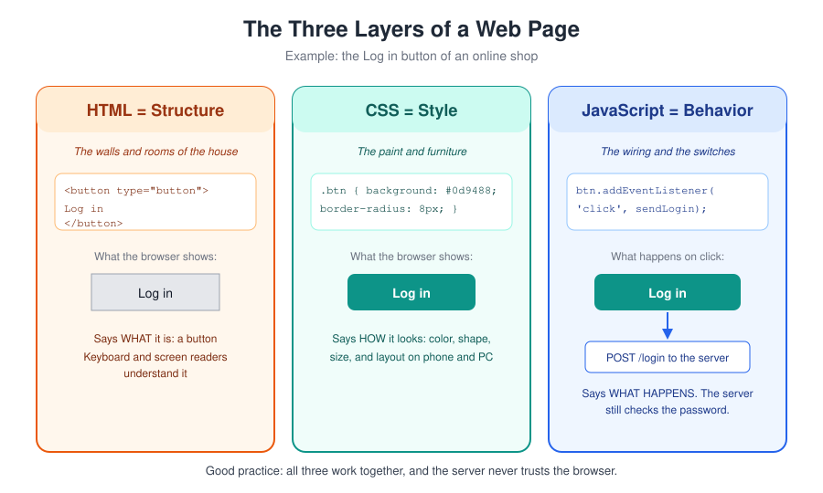

#### 3.1.2 The three languages and the house analogy

- Web developers usually use three languages: **HTML** (Hypertext Markup Language), **CSS** (Cascading Style Sheets) and **JavaScript**.
- The lecture says they are **designed to work in conjunction with each other** (each has a different job).
- **House analogy from the lecture:**
  - HTML builds the house. The house is "only constructed": walls and rooms, but no style.
  - **Interior designers** add style to a space. In the same way, **CSS** adds "glamour and appeal" to a website.
  - JavaScript (our extension of the analogy) is the **electricity and the switches**: it makes things work when you press them.

| Layer | Language | Job | House analogy | Shop example |
|---|---|---|---|---|
| **Structure** | HTML | What is on the page, and what it means | Walls, doors, rooms | A `<button>` labeled "Log in" |
| **Presentation** | CSS | How it looks | Paint, furniture | A teal, rounded button with a hover color |
| **Behavior** | JavaScript | What happens when the user acts | Switches, wiring | Click → send login → show the account page |

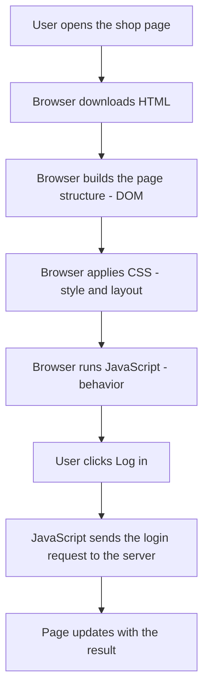

#### 3.1.3 The login button example (from the lecture)

- Use **HTML** to add a login button to a page.
- Use **CSS** to style that button.
- Use **JavaScript** to add the **login functionality** to that button.
- **Not in the lecture — industry practice:** the JavaScript only **collects the data and sends it**. The **server** must check the password. Never trust the browser to decide who is logged in (see 3.8 and 3.10).

#### 3.1.4 The role of the front-end developer

- The front-end developer **codes the structure** of the site (HTML) and also its **look and behavior** (CSS and JavaScript).
- Users notice good front-end work when pages have a **pleasing font**, **attractive colors** and are **easy to navigate**.
- **Not in the lecture — industry practice:** a modern front-end developer also owns accessibility, performance, browser support, testing, and the connection to the back-end API (Application Programming Interface) (see 3.8 to 3.10).

---

### 3.2 HTML — The Structure of a Website

#### 3.2.1 What HTML contains

⚠️ **Correction:** HTML does not create a "physical" structure. It describes the **structure and meaning of content** (this is a heading, this is a list, this is a button). The browser then shows that content. The word "physical" suggests the look, but the look is the job of CSS.
> **Lecture wording (for the quiz):** "HTML is used to create the physical structure of a website."

The lecture lists these elements. The table shows the HTML tag for each:

| Element in the lecture | HTML tag (examples) | Notes |
|---|---|---|
| **Text** | `<h1>`–`<h6>` headings, `<p>` paragraph, `<ul>` / `<ol>` / `<li>` lists, `<strong>`, `<em>` | Headings give the page an outline. Screen readers and search engines use it. |
| **Links** | `<a href="…">` | Go to another page or file. |
| **Images** | `` | Always write meaningful `alt` text. |
| **Videos** | `<video>`, `<audio>`, `<source>` | Built into HTML. No plug-in is needed. |
| **Page dividers (sections)** | `<header>`, `<nav>`, `<main>`, `<section>`, `<article>`, `<aside>`, `<footer>`; plain `<div>` when no meaning fits | The lecture's "page dividers" are these **sectioning and grouping elements**. |
| **Buttons** | `<button>`, and form controls `<input>`, `<select>`, `<textarea>` inside `<form>` | Use `<button>`, not a clickable `<div>`. |

```html
<!-- A tiny shop page skeleton -->
<header>
  <h1>Book Shop</h1>
  <nav><a href="/books">Books</a> <a href="/cart">Cart</a></nav>
</header>
<main>
  <article>
    <h2>Learning Node.js</h2>
    
    <p>A practical guide to backend JavaScript.</p>
    <button type="button">Add to cart</button>
  </article>
</main>
<footer>© 2026 Book Shop</footer>
```

#### 3.2.2 Does HTML "format" the page?

⚠️ **Correction:** HTML does **not** ensure "proper formatting". HTML says **what** the content is. The browser gives every element a **default style** (for example, headings are bold and big) and **CSS changes that style**. Pages look similar in different browsers because the browsers follow the **same standard** (the HTML Living Standard, kept by WHATWG), because developers use CSS, and because they **test in several browsers**. HTML alone does not guarantee a consistent look.
> **Lecture wording (for the quiz):** "The HTML code ensures a proper formatting of all text and image elements so that browsers display the page consistently."

- **What HTML does guarantee:** a clear **document structure**. Browsers, search engines and assistive technology (such as screen readers) can understand it.
- **Why it matters:** if you use the wrong tag, the page can look right but still be broken for people who use a keyboard or screen reader.

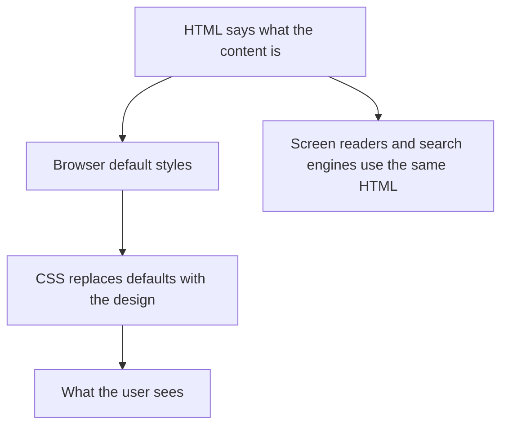

#### 3.2.3 ✅ Modern Best Practice: semantic HTML and accessibility

> **Lecture says:** HTML creates the structure; the lecture lists text, links, images, videos, page dividers and buttons.
> **Industry today:** teams choose elements for their **meaning** (semantic HTML) and build for **accessibility** from the start, aiming at **WCAG (Web Content Accessibility Guidelines) 2.2, level AA** as the default target.

- **Use the right element.**
  - A button that performs an action is `<button>`. A link that goes to a page is `<a href>`. Both work with the keyboard and screen readers for free.
  - A `<div onclick>` does neither, until you add a lot of extra code.
- **Landmarks** (`<header>`, `<nav>`, `<main>`, `<footer>`) let screen reader users jump around the page.
- **Headings** form an outline: one `<h1>`, then `<h2>`, and so on. Do not choose a heading level for its size; style it with CSS.
- **Images** need `alt` text. A purely decorative image gets `alt=""`.
- **Forms:** every input needs a `<label>`. Show clear error messages.
- **ARIA (Accessible Rich Internet Applications) attributes** fill gaps for custom widgets. The first rule of ARIA: **use native HTML first**; ARIA only when no native element exists.
- **Keyboard and focus:** every action must work with the keyboard, and the focus outline must stay visible.
- **Why it matters (industry):** accessibility is a legal duty for many products (for example the **European Accessibility Act**, which has applied since 28 June 2025; see the LumenVenture SDLC (Software Development Life Cycle) guide) and it also improves SEO (Search Engine Optimization) and usability for everyone.
- **Test it:** automated checks (axe, Lighthouse) find only part of the problems. Add a manual keyboard test and a screen reader test.

| Anti-pattern | Better |
|---|---|
| `<div class="btn" onclick="…">Buy</div>` | `<button type="button">Buy</button>` |
| `<span class="title">` styled as a heading | `<h2>` styled with CSS |
| `` | `` |
| Placeholder text as the only label | `<label for="email">Email</label>` plus the input |

---

### 3.3 CSS — The Style of a Website

#### 3.3.1 What CSS does

- The lecture calls CSS the tool for **stylish websites**: CSS makes pages look good and appealing, like the interior designer in the house analogy.
- CSS gives front-end developers **a standard method to define, apply and manage different sets of style characteristics** for the **whole website and each of its components**.
- CSS ensures **uniformity** (the same look and feel) in:
  - **style**, **colors**, **fonts**, **designs** and **layouts**.
- **Summary line from the lecture:** *HTML creates the structure; CSS designs it and makes it appealing.*

```css
/* One rule: select the element, then set its properties */
.btn {
  background: #0d9488;     /* teal background */
  color: #fff;             /* white text */
  padding: 0.75rem 1.25rem;/* space inside the button */
  border-radius: 8px;      /* rounded corners */
}
.btn:hover { background: #0f766e; } /* darker teal when the mouse is over it */
```

#### 3.3.2 How CSS works under the hood

- **Selector → property: value.** The selector picks elements; the declarations style them.
- **"Cascading" means conflicts are solved by rules.** When two rules style the same element, the browser picks the winner by:
  1. **Origin and importance** (browser defaults, then author styles; `!important` raises a rule);
  2. **Specificity** (an `id` beats a `class`, a `class` beats an element name);
  3. **Order** (the later rule wins when the rest is equal);
  - Modern CSS also has **cascade layers** (`@layer`) to control this order on purpose.
- **Inheritance:** some properties (such as `color` and `font-family`) pass from a parent element to its children. This is how one rule on `body` can set the font for the whole site.
- **Style the whole site once.** Put the styles in an **external style sheet** (`<link rel="stylesheet" href="styles.css">`). Many pages share it, and the browser caches it. This is the "define, apply and manage" idea in the lecture.

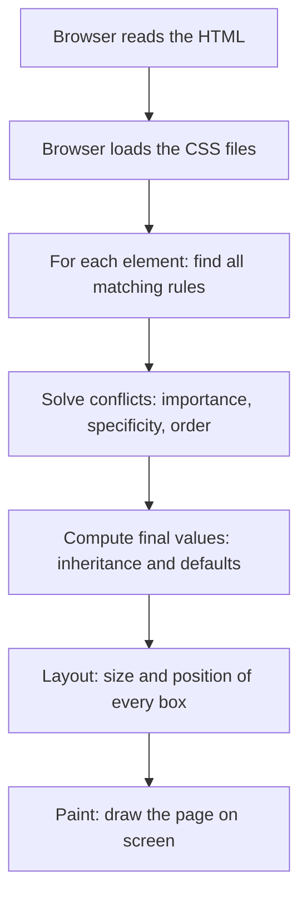

#### 3.3.3 CSS and cross-browser, cross-device support

- The lecture says CSS is used to create sites with **cross-browser compatibility**: they work in **multiple browsers** and on **multiple devices** (PC, mobile phones, iPads, and so on).
- Also from the lecture: a front-end developer's sites **must work in multiple browsers, multiple operating systems and multiple devices** (see 3.11).

#### 3.3.4 ✅ Modern Best Practice: how cross-browser and cross-device support is really achieved

> **Lecture says:** CSS is used to create websites that have cross-browser compatibility, meaning they work in many browsers and on many devices.
> **Industry today:** CSS **alone** does not make a site compatible. Compatibility comes from **web standards, a written browser support policy, careful feature use, build tools and testing**.

- **Standards first.** Write standard HTML, CSS and JavaScript. All major browsers follow them closely, but **not at the same speed**.
- **Check support before you use a feature.** Use **MDN (Mozilla Developer Network)** and **Can I use** tables. The **Baseline** label shows a feature is available in all major current browsers.
- **Write a support policy.** Example: "last 2 versions of Chrome, Edge, Firefox and Safari, and iOS Safari". Put it in **browserslist** (a config file read by build tools) so the tools know the target.
- **Let tools add the boring parts.** **PostCSS** with **Autoprefixer** adds vendor prefixes; the build tool (for example **Vite**) transforms newer syntax where needed.
- **Progressive enhancement.** Build a basic working version first, then add better features for browsers that support them. Use `@supports` in CSS to test for a feature.
- **Test on real browsers and devices.** Use tools such as **Playwright** (runs tests in Chromium, Firefox and WebKit), cloud device labs, and real phones.
- **Resets and defaults.** A small CSS reset or `normalize` removes small differences between browser default styles.

```css
/* Progressive enhancement: use the new feature only where it is supported */
.gallery { display: flex; flex-wrap: wrap; gap: 1rem; }   /* works everywhere */
@supports (display: grid) {
  .gallery { display: grid; grid-template-columns: repeat(auto-fill, minmax(200px, 1fr)); }
}
```

#### 3.3.5 Not in the lecture — industry practice: modern CSS

Modern CSS can now do things that once needed a preprocessor or JavaScript. These features are supported in current browsers (check **Baseline** on MDN before relying on any one of them):

| Feature | What it does | Replaces |
|---|---|---|
| **Flexbox** (`display: flex`) | Lays out items in one row or column | Old float hacks |
| **Grid** (`display: grid`) | Lays out items in rows and columns | Table and float layouts |
| **Custom properties** (`--brand: #0d9488; color: var(--brand)`) | Variables that live in the browser and can change at runtime (for example for dark mode) | Part of what Sass variables did |
| **Native nesting** (`.card { &:hover { … } }`) | Nest rules inside rules | Part of what Sass nesting did |
| **Container queries** (`@container`) | Style a component based on the size of its **container**, not the whole screen | Many screen-wide media queries |
| **`clamp()`, `min()`, `max()`** | Fluid sizes without breakpoints | Several media queries |
| **`prefers-color-scheme`, `prefers-reduced-motion`** | Respect the user's system settings (dark mode, less motion) | Custom switches |

**CSS architecture at scale (industry):** teams keep CSS maintainable with a **naming method** (BEM, Block Element Modifier, for example `.card__title--large`), **CSS Modules** (class names scoped to one component), **utility-first CSS** such as **Tailwind CSS**, or a **design system** with shared **design tokens** (colors, spacing and fonts stored as variables).

#### 3.3.6 Done enough when… (HTML and CSS)

- [ ] Each page has one `<h1>`, landmarks (`<header>`, `<nav>`, `<main>`, `<footer>`), and headings in order.
- [ ] Every image has correct `alt` text; every form field has a `<label>`.
- [ ] All actions work with the keyboard; the focus outline is visible.
- [ ] Colors meet the **WCAG 2.2 AA** contrast level (text at least 4.5:1).
- [ ] Styles live in shared style sheets, not copy-pasted into every page.
- [ ] A written browser support policy exists and is tested.


---

### 3.4 JavaScript — The Behavior of a Website

#### 3.4.1 What JavaScript adds

- The lecture's point: good shop sites are **intuitive** and **interactive**. This is where **JavaScript** comes in.
- JavaScript is used **together with HTML and CSS** to add **interactivity**. It does the jobs HTML and CSS cannot do:
  - react to **events** (click, type, scroll, submit);
  - **change the page** (show a menu, update the cart count, validate a form) through the **DOM**;
  - **talk to the server** in the background (load products, send the login) without a full page reload.
- **Login button, in full:** HTML makes the button, CSS styles it, JavaScript adds the **login behavior** (read the fields, call the server, show the result).

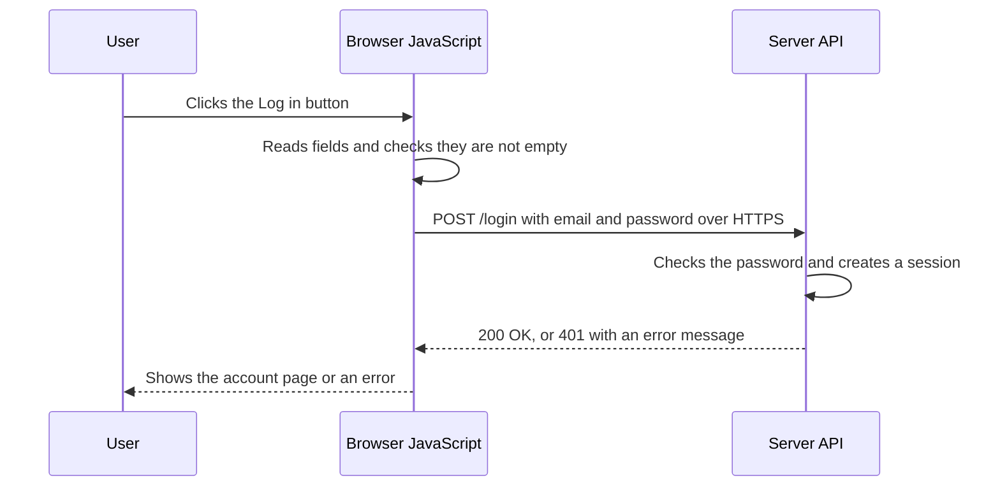

#### 3.4.2 What kind of language is JavaScript?

⚠️ **Correction:** JavaScript is not only "object-oriented". It is a **dynamically typed, garbage-collected, prototype-based, multi-paradigm** language. It supports **imperative**, **functional** and **object-oriented** styles. Objects inherit from other objects through **prototypes**; the `class` keyword (since ES2015) is a cleaner way to write this, not a different system. It runs in the browser **and** outside it (for example Node.js on the server).
> **Lecture wording (for the quiz):** "JavaScript is an object-oriented programming language that is used in conjunction with HTML and CSS to add interactivity to a website."

| Idea | What it means for you |
|---|---|
| **Dynamically typed** | Variables have no fixed type; a value has a type at run time. (TypeScript adds types before run time.) |
| **First-class functions** | Functions are values: you can store them and pass them (callbacks, event handlers). |
| **Prototype-based** | Objects inherit directly from other objects. |
| **Event-driven, single-threaded** | One main thread runs your code. The **event loop** is the browser's waiting line: it takes the next event (a click, a network reply) and runs its handler. A long task freezes the page. |
| **Standardized** | The language standard is **ECMAScript** (ECMA-262), updated every year. |

#### 3.4.3 ✅ Modern Best Practice: JavaScript for production front ends

> **Lecture says:** online shopping sites are intuitive, interactive and quick to load, and JavaScript makes the site interactive.
> **Industry today:** JavaScript gives **interactivity**, but it does **not** make a site fast. Every kilobyte of JavaScript must be **downloaded, parsed and run**, so too much JavaScript makes pages **slower**. Teams measure speed with **Core Web Vitals** and ship **less JavaScript**.

- **Core Web Vitals** (from Google's web.dev; "good" values are measured at the **75th percentile** of real page loads):

| Metric | Measures | "Good" value |
|---|---|---|
| **LCP (Largest Contentful Paint)** | Loading: when the main content appears | **2.5 seconds or less** |
| **INP (Interaction to Next Paint)** | Interactivity: how fast the page reacts to clicks and keys | **200 milliseconds or less** |
| **CLS (Cumulative Layout Shift)** | Visual stability: does content jump around? | **0.1 or less** |

  - INP became a stable Core Web Vital in 2024 and **replaced FID (First Input Delay)**.
- **How teams keep JavaScript small and fast:**
  - **Code splitting** and **lazy loading**: load the checkout code only when the user goes to checkout.
  - **Tree shaking** (a bundler removes code you do not use) and **minification**.
  - Do not ship a big library for a small job; check bundle size in CI (Continuous Integration).
  - **Defer** non-critical scripts (add `defer`; `<script type="module">` is deferred by default) so they do not block the page.
  - Use **real-user monitoring (RUM)** to see Core Web Vitals from real visitors.
- **Write modern JavaScript** (ES2015 and later, also called ES6+): `const` / `let`, arrow functions, `async` / `await`, **ES modules** (`import` / `export`), optional chaining (`?.`). Do not use the old `var`.
- **TypeScript:** most professional front-end teams write **TypeScript** (JavaScript with static types) and compile it to JavaScript. It catches many mistakes before run time.
- **Progressive enhancement:** the core content and links should work even before JavaScript has loaded.

#### 3.4.4 Not in the lecture — industry practice: the front end is untrusted

- Everything in the browser can be **read and changed by the user** (DevTools, `curl`, a proxy). So:
  - **Client-side validation** is for **user experience** only. The **server must validate again**, always.
  - **Never** put secrets (API keys with write power, database passwords) in front-end code or bundles.
  - **Authorization** (who may do what) is decided on the **server**, never in JavaScript on the page.
- **XSS (Cross-Site Scripting):** an attacker gets their script to run in your page. Prevent it by treating user data as **text, not HTML**: use `textContent`, not `innerHTML`; let your framework escape output; add a **CSP (Content Security Policy)** header.
- See [3.10](#310-not-in-the-lecture--industry-practice-security-performance-and-quality-of-a-front-end) for the full checklist.

---

### 3.5 CSS Extensions: Sass and Less

#### 3.5.1 Why they exist

- Plain CSS had **no variables, no nesting and no reuse** for many years. Large style sheets became hard to keep organized.
- **Preprocessors** are languages that **extend CSS**. You write them in a special file, a **compiler** turns them into normal CSS, and the browser only ever sees CSS.

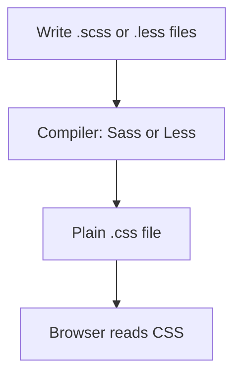

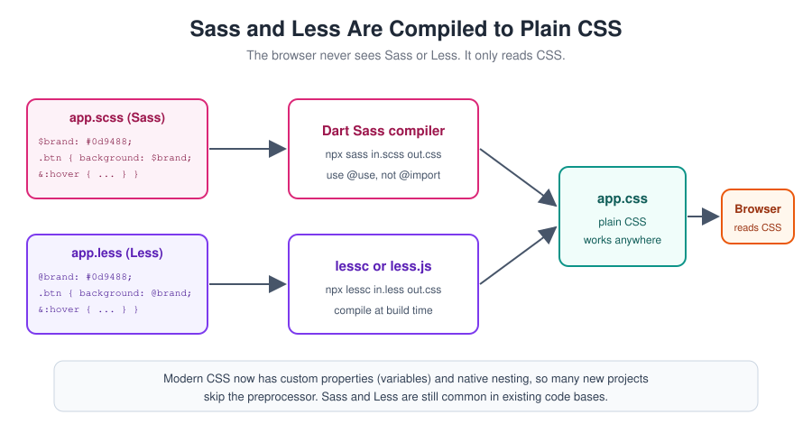

#### 3.5.2 Sass (Syntactically Awesome Style Sheets)

⚠️ **Correction:** the language is called **Sass** (the official spelling), short for "Syntactically Awesome Style Sheets". It is **not** called "SAS" ("SAS" is a different thing). Also, Sass is **not new**: it first appeared in **2006**, so it is a mature tool.
> **Lecture wording (for the quiz):** "A new front-end development language is Syntactically Awesome Style Sheets, SASS, called SAS."

- **What it is:** an **extension of CSS**, compatible with CSS (the lecture says "all versions of CSS"). It has **two syntaxes**: **SCSS** (`.scss`, the most popular) and the original **indented syntax** (`.sass`). SCSS is a **superset of CSS**: essentially all valid CSS is valid SCSS. This is why Sass is "compatible with" CSS.
- **Features the lecture names:**
  - **Variables** (`$brand: #0d9488;`).
  - **Nested rules** (write child selectors inside the parent).
  - **Imports** (the lecture's "inline imports") to split styles into small files and keep things organized. Today you write them with `@use` (see 3.5.3).
- **Other features:** **mixins** (reusable blocks), **functions**, **placeholder selectors** (`%name` with `@extend`), math and control directives.
- **Benefit from the lecture:** you create style sheets **faster and more easily**.
- **Compiler:** **Dart Sass** is the main implementation (`npm i -D sass`, then `sass in.scss out.css`).

```scss
// scss/_tokens.scss  - a "partial": a file that only holds shared values
$brand: #0d9488;
$radius: 8px;
```

```scss
// scss/app.scss
@use "tokens";                       // load the module (modern way)
.btn {
  background: tokens.$brand;         // variable from the module
  border-radius: tokens.$radius;
  &:hover { filter: brightness(0.9); }   // nested rule: .btn:hover
  &--login { font-weight: 700; }         // nested rule: .btn--login
}
```

Compiled with `npx sass scss/app.scss` (tested with Dart Sass 1.108):

```css
.btn { background: #0d9488; border-radius: 8px; }
.btn:hover { filter: brightness(0.9); }
.btn--login { font-weight: 700; }
```

#### 3.5.3 ✅ Modern Best Practice: Sass `@use` replaces `@import`

> **Lecture says:** Sass enables variables, nested rules and inline imports to keep things organized.
> **Industry today:** use the **module system**: `@use` (and `@forward` for library authors). The old `@import` rule is **deprecated** since **Dart Sass 1.80.0** and will be **removed in Dart Sass 3.0.0**.

- **Why `@import` was replaced:** it made **everything global** (hard to see where a variable comes from), and it ran a file again every time it was imported, which slowed builds and bloated CSS. **`@use` loads each file once** and keeps names in a **namespace** (`tokens.$brand`).
- **What to do:** write new code with `@use`; migrate old code with the official **Sass migrator** tool.
- **What happens if you still use `@import`:** the compiler prints `DEPRECATION WARNING [import]: Sass @import rules are deprecated and will be removed in Dart Sass 3.0.0.` (we saw this when testing). The build still works today, but it will break after the removal.

#### 3.5.4 Less (Leaner Style Sheets)

⚠️ **Correction:** **Less** stands for **"Leaner Style Sheets"**, not "Learner". It is written "Less" (not "LESS") in its own documentation.
> **Lecture wording (for the quiz):** "Another language that is being used now is Learner Style Sheets, LESS or LESS."

- **What it is:** a **backwards-compatible language extension for CSS**. Valid CSS is valid Less.
- **What it adds (lecture: "more styles and functions"):** **variables** (`@brand: #0d9488;`), **mixins**, **nesting**, **operations** (math), **built-in functions** (for example `lighten()`), **maps** and **imports**.
- **`less.js`:** the lecture says it is a **JavaScript tool that converts Less to CSS**. That is correct. It can run **in the browser** (convenient for tests) or in **Node.js** as the command `lessc` (the right way for production).
- **Not in the lecture:** compiling in the visitor's browser is slow and not for production. Compile **at build time** (`npx lessc app.less app.css`).

```less
// app.less
@brand: #0d9488;                       // variable
.btn { background: @brand; &:hover { opacity: .9; } }  // nested rule
```

Compiled with `npx lessc app.less` (tested with lessc 4.9):

```css
.btn { background: #0d9488; }
.btn:hover { opacity: 0.9; }
```

#### 3.5.5 Sass vs Less vs plain CSS today

| | **Plain CSS (modern)** | **Sass (SCSS)** | **Less** |
|---|---|---|---|
| **Needs a compile step?** | No | Yes | Yes |
| **Variables** | Yes: custom properties (`var(--x)`), live in the browser | Yes: compile-time `$x` | Yes: compile-time `@x` |
| **Nesting** | Yes (native nesting) | Yes | Yes |
| **Mixins, functions, loops** | No (limited functions) | Yes | Yes (mixins and functions, fewer controls) |
| **Modules** | `@import` of CSS files (`@layer` controls the cascade order; it is not a module system) | `@use` / `@forward` | `@import` |
| **Main compiler** | Browser | Dart Sass | `lessc` (Node.js), `less.js` |
| **Typical use today** | New projects, small and mid-size sites | Large or older code bases, design-system libraries | Older code bases (for example some UI libraries) |

#### 3.5.6 ✅ Modern Best Practice: do you still need a preprocessor?

> **Lecture says:** Sass and Less make CSS faster and easier to write, with variables and nesting.
> **Industry today:** because browsers now support **custom properties** and **native nesting**, many new projects use **plain modern CSS**, **PostCSS**, **CSS Modules** or **Tailwind CSS** and skip Sass or Less. Sass and Less are still very common in existing projects, so you must be able to read them.

- **Choose by need:** keep Sass if you rely on its mixins, functions or the code base already uses it; start new small projects with plain CSS.
- **Do not mix three systems** in one project without a reason; one style approach is easier to maintain.
- **Lint your styles** with **Stylelint** and format with **Prettier**.

---

### 3.6 Adaptive and Responsive Design

#### 3.6.1 What the lecture says

- Using HTML, CSS and JavaScript, websites are designed to be **adaptive** and **responsive**.
- **Adaptive design:** the site shows **the version designed for a specific screen size**. Lecture example: a site can show **more information on a PC** than on a **mobile device** (an example only; do not hide content on phones, see 3.6.2).
- **Responsive design:** the site **automatically resizes** to the device that opens it. Lecture example: open a product site on a **mobile phone**; it **adapts to the small screen** and still shows **all the features**.

| | **Adaptive** | **Responsive** |
|---|---|---|
| **Idea** | Several fixed layouts, one per screen size | One flexible layout that re-flows |
| **How the right one is chosen** | A layout is picked for the screen width (or device) | The layout stretches and shrinks smoothly; CSS rules change it at breakpoints |
| **Work** | More: you design and maintain each version | Less: one set of content and code |
| **Risk** | Sizes between the fixed layouts look wrong; versions drift apart | Needs careful design of how content re-flows |
| **Lecture example** | More information on a PC than on a phone | Same site on a phone adapts to the small screen |

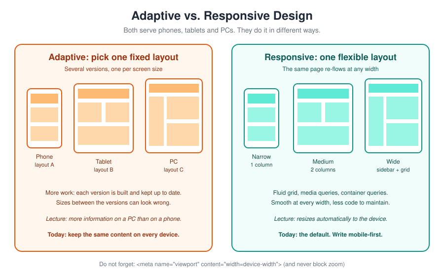

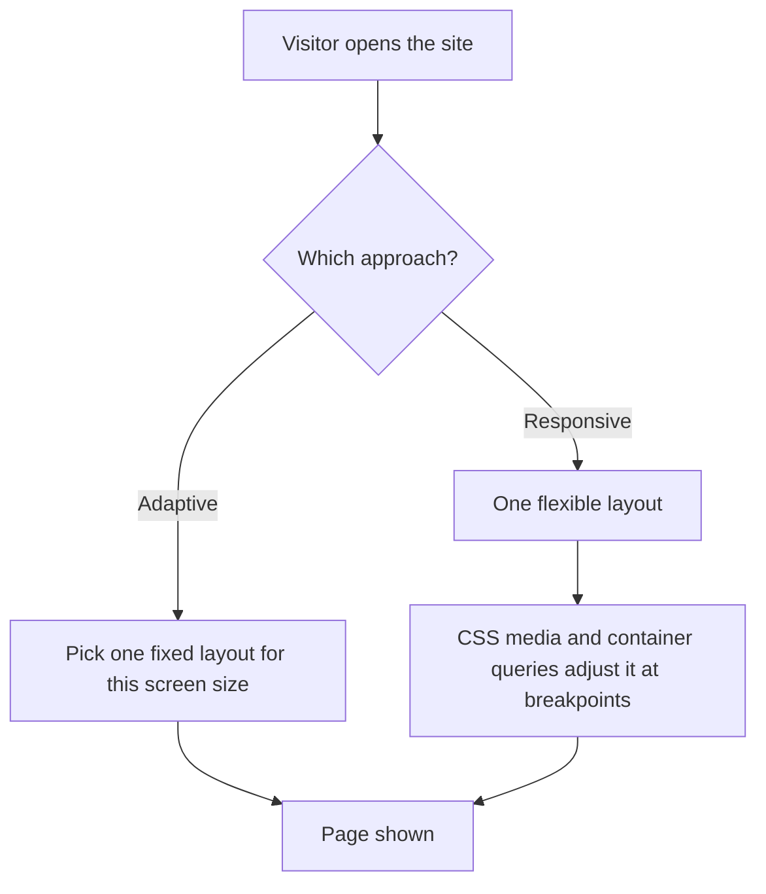

#### 3.6.2 ✅ Modern Best Practice: responsive and mobile-first, with the same content

> **Lecture says:** an adaptive site can show more information on a PC than on a mobile device; a responsive site resizes and still shows all features on a phone.
> **Industry today:** the default is **responsive, mobile-first design**, and the **mobile page must carry the same important content and features as the desktop page**. Hiding content on phones is a mistake.

- **Mobile-first:** write the small-screen styles first, then add rules with `min-width` media queries for bigger screens. Mobile phones are a very large part of web traffic, and the small layout forces you to focus on the most important content.
- **Same content on every device.** Google **indexes the mobile version first** (mobile-first indexing). If content exists only on the desktop page, search engines may not see it. Phone users also expect all features.
- **The viewport meta tag** is required. Without it, phones show a zoomed-out desktop layout:

```html
<meta name="viewport" content="width=device-width, initial-scale=1">
```

  - MDN's recommended minimum is `width=device-width`; most teams also add `initial-scale=1`. **Never** add `user-scalable=no` or a maximum scale: it stops people with low vision from zooming.

- **The toolbox of responsive design:**
  - **Fluid layouts** with Flexbox and Grid, and relative units (`rem`, `%`, `fr`, `vw`).
  - **Media queries** (`@media (width >= 48rem) { … }`) change styles by viewport size or user preference.
  - **Container queries** (`@container`) change a **component** by the size of its container, so the same card works in a sidebar and in a main column.
  - **Responsive images:** `srcset` and `sizes` (or `<picture>`) so a phone downloads a small file, not a big desktop image.
  - **Fluid type and spacing** with `clamp()`.
  - **Touch targets** big enough for fingers (WCAG 2.2 sets a minimum target size of 24×24 CSS pixels at level AA).
- **When adaptive thinking is still useful:** when the experience must truly differ (for example a phone-only scanner view). Even then, the shared content stays the same.

```css
/* Mobile-first: base styles are for small screens */
.products { display: grid; grid-template-columns: 1fr; gap: 1rem; }

/* From 48rem (about 768 px) up: two columns */
@media (width >= 48rem) {
  .products { grid-template-columns: repeat(2, 1fr); }
}

/* A component that adapts to its container, not the screen */
.card-wrap { container-type: inline-size; }
@container (width > 30rem) {
  .card { display: flex; gap: 1rem; }
}
```

- **What happens if you forget the viewport tag?** Many phones then treat the page as a wider virtual screen (often about 980 px) and shrink it to fit. Your media queries for small screens never apply.
- **Test:** browser DevTools device mode, real phones, and tests with **Playwright** at several viewport sizes.

#### 3.6.3 Done enough when… (responsive design)

- [ ] The `viewport` meta tag is set.
- [ ] Styles are written mobile-first; no horizontal scroll at 320 px width.
- [ ] Phone and desktop show the **same content and features**.
- [ ] Images use `srcset` / `sizes` and have width and height set (prevents layout shift).
- [ ] Touch targets are large enough; text can be zoomed to 200% without loss.
- [ ] The layout was checked in at least one real phone and a desktop browser.


---

### 3.7 JavaScript Frameworks and Libraries

#### 3.7.1 What a JavaScript framework is

- **Lecture definition:** a JavaScript framework is an **application framework written in JavaScript**. Programmers can **manipulate the different functions**, **use them wherever required** and build **device-responsive applications**.
- In simple words: the framework gives you **ready-made building blocks and a structure**. You **reuse** them (as components) instead of writing the same DOM code again and again.
- **What problem it solves:** in a big app, keeping the page in sync with the data (state), splitting the UI into reusable parts, changing pages without reloading (routing), and handling forms are hard to do by hand. Frameworks solve these in a standard way.

| | **Library** | **Framework** |
|---|---|---|
| **Who is in control?** | **You** call the library when you want | The **framework calls your code** at the right time (inversion of control) |
| **Scope** | One focused job (for example, build the UI) | A full structure: UI, routing, forms, data fetching, tests |
| **Freedom** | High: you choose the other tools | Lower: it has an opinion on how to do things |
| **Typical example** | React (UI library) | Angular (full framework) |

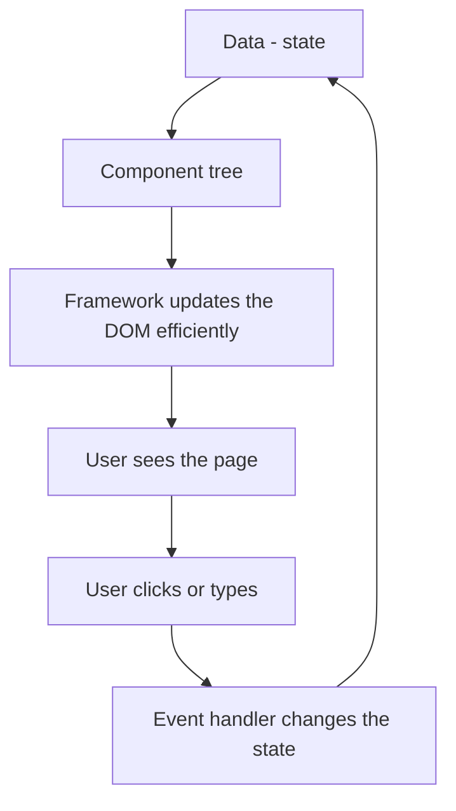

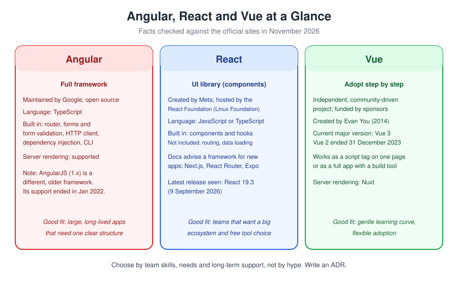

#### 3.7.2 Angular

- **Lecture facts:** Angular is an **open-source** framework **maintained by Google**. It lets sites **render HTML pages quickly and efficiently**. It has **built-in tools for routing and form validation**.
- **Under the hood and today (not in the lecture — industry practice):**
  - "Angular" means the modern framework (version 2 and later), written in **TypeScript**. It is **"batteries included"**: router, forms (template-driven and reactive), an HTTP client, **dependency injection**, a command-line tool (**Angular CLI**) and a testing setup.
  - The old **AngularJS** (version 1.x) is a different, older framework. Its support **ended in January 2022**. Do not start new work with it.
  - According to the official releases page (angular.dev), v20 was released on **28 May 2025**, v21 on **19 November 2025** and v22 on **3 June 2026**. Up to v22 Angular shipped a major version every 6 months; from v22 the plan is **one major release every 12 months**, with a long-term-support (LTS) period for older versions. Always plan **upgrades** (see 3.11).
  - **SSR (Server-Side Rendering)** and pre-rendering are supported, which helps first load speed and SEO.
- **Good fit:** large teams and long-lived enterprise apps that want one clear structure.

#### 3.7.3 React

⚠️ **Correction:** React was created at **Meta** (the company was called Facebook until 2021). It is **no longer maintained by one company alone**: the **React Foundation**, hosted by the **Linux Foundation**, launched on **24 February 2026** to be the new home of React. The old claim that Facebook develops and maintains React is outdated.
> **Lecture wording (for the quiz):** "React.js has been developed and maintained by Facebook."

- **Lecture facts:**
  - React is a **JavaScript library** that **builds and renders components** for a web page.
  - It is **not a complete suite of tools**. For example, **routing is not part of it** and needs a **third-party tool**. (The lecture says "this framework"; React calls itself a library.)
  - React **only helps build and drop components into a page**.
- **Under the hood and today (not in the lecture — industry practice):**
  - A **component** is a function that returns **JSX** (a syntax that looks like HTML inside JavaScript). **Hooks** (`useState`, `useEffect`, and others) add state and side effects.
  - React keeps a **virtual (in-memory) description of the UI** and updates only the parts of the real DOM that changed.
  - The latest release at the time of writing is **React 19.3** (9 September 2026), according to the official React blog.
- **Good fit:** teams that want a large ecosystem and freedom to choose their own tools.

#### 3.7.4 ✅ Modern Best Practice: start React projects with a framework

> **Lecture says:** React is only a library; routing and other parts must be added with third-party tools.
> **Industry today:** the official React documentation (react.dev) recommends that **new apps start with a framework** that already includes routing, data loading, rendering modes and build tools. The documented options are **Next.js**, **React Router (v7)** and **Expo** (for native apps); other frameworks that are still working towards React's full-stack vision (for example **TanStack Start**, in beta) are also listed. Building from scratch is for special cases or learning.

- Why: you would otherwise **assemble and maintain** a router, data fetching, bundler and server rendering yourself.
- These frameworks support **client-side rendering (CSR)**, **single-page apps (SPA)** and **static-site generation (SSG)**, and add **SSR** per route when you need it.

#### 3.7.5 Vue

⚠️ **Correction:** the part is called the **view layer** ("Vue" is the framework's name; the "view" is the user interface). Also, Vue is **not only a view layer** today. The official FAQ calls Vue a **framework** that handles efficient DOM rendering, reactive state, tooling, **client-side routing** and **server-side rendering**. It can still be **adopted step by step** (see below).
> **Lecture wording (for the quiz):** "Vue.js is maintained by the community and its main focus is the Vue layer, which includes user interface, buttons, and visual components."

- **Lecture facts:**
  - Vue is **maintained by the community**.
  - It focuses on the user interface: **buttons and visual components**.
  - It is **flexible, scalable** and **integrates well with other frameworks**; it is **very adaptable**.
  - It **can be a library or a framework**.
- **Under the hood and today (not in the lecture — industry practice):**
  - Vue is an **independent, community-driven project**. It was created by **Evan You in 2014**; a team of full-time and volunteer members maintains it, with Evan You as project lead. It is **funded mainly by sponsorships**.
  - **Vue 3** is the current major version. **Vue 2 reached end of life on 31 December 2023**; new projects should use Vue 3.
  - "Library or framework" is Vue's **incremental adoption**: add it to one part of an existing page with a script tag, or build a complete app with a build tool, router and state library.
  - **Single-file components** (`.vue` files) keep the template, script and style of a component together. **Nuxt** is the common meta-framework for server rendering.
- **Good fit:** teams that value a gentle learning curve and flexibility.

#### 3.7.6 Angular, React and Vue compared

| | **Angular** | **React** | **Vue** |
|---|---|---|---|
| **Type** | Full framework | UI library | Framework you can adopt step by step |
| **Lecture: who maintains it** | Google | "Facebook" (outdated; see correction) | The community |
| **Industry today** | Google (open source) | Created by Meta; hosted by the React Foundation under the Linux Foundation | Independent open-source project led by Evan You, sponsor-funded |
| **Language** | TypeScript | JavaScript or TypeScript (JSX) | JavaScript or TypeScript (single-file components) |
| **Routing** | Built in | Not included; use a framework or a router (for example React Router) | Official router library |
| **Form validation** | Built in (template-driven and reactive forms) | Not included; use a form library or write it | Not built in; use a library or write it |
| **Server rendering** | Built-in support | Through a framework (Next.js, React Router) | Through Nuxt |
| **Key idea** | Everything included, one clear way | Components first, you choose the rest | Flexible, easy to start |

- This table follows the lecture where it is right. Where the lecture's wording is outdated, the "Industry today" row has the correct fact.

#### 3.7.7 Not in the lecture — industry practice: choosing and using a framework

- **Other popular choices** exist, for example **Svelte** and **SolidJS**. The lecture lists only three examples ("a few examples of several frameworks").
- **How teams choose** (do not choose by hype):
  - **Team skills and hiring** in your market.
  - **Ecosystem and long-term support** (company or foundation backing, release policy).
  - **Needs:** SEO and first-load speed (use SSR or SSG), offline use, size of the app, accessibility libraries.
  - **Cost of changing later:** write an **ADR (Architecture Decision Record)** for the choice.
- **Rendering modes:**

| Mode | Where HTML is built | Good for |
|---|---|---|
| **CSR (Client-Side Rendering)** | In the browser, with JavaScript | Logged-in apps and dashboards |
| **SSG (Static Site Generation)** | At build time | Marketing pages, docs, blogs |
| **SSR (Server-Side Rendering)** | On the server for each request | Pages that need fresh data and good SEO |

- **Around the framework:** a **state** solution only when needed (start with local component state), a **UI component library** or **design system**, **form** and **data-fetching** libraries, and **tests** (unit tests with Vitest or Jest, component tests with Testing Library, end-to-end tests with Playwright).
- **Do not forget the web platform:** a simple content site often needs **no framework**. HTML and CSS with a little JavaScript are faster and easier to maintain.

---

### 3.8 Not in the Lecture — Industry Practice: How the Front End Talks to the Back End

This course is about backend development, so this connection is the most important part for you.

- The browser runs **JavaScript** that sends **HTTP requests** (usually with the **Fetch API**) to a **REST (Representational State Transfer) API** that returns **JSON (JavaScript Object Notation)**. The back end (Node.js and Express in this course) holds the business rules and the database.
- **The API contract** (for example an **OpenAPI** file) is the agreement between the two sides. Front-end developers can build against a mock of it before the back end is ready.

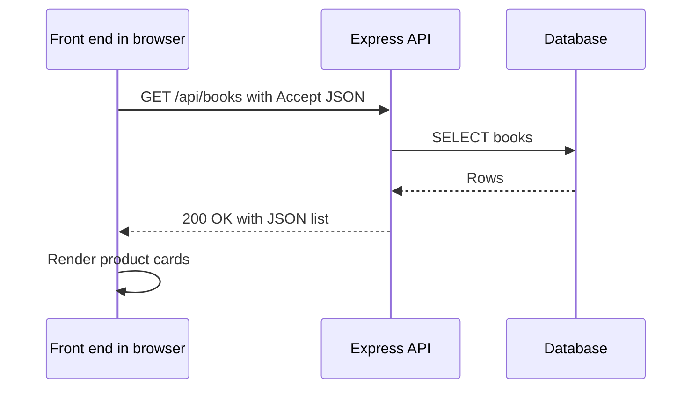

- **Important rules for front-end code that calls an API:**
  - **`fetch` does not throw on HTTP errors.** A `404` or `500` answer is still a "successful" fetch. **Check `response.ok`** yourself (see the code in section 5).
  - Always show **loading**, **empty** and **error** states.
  - Set a **timeout** and let the user **cancel** (`AbortController`).
  - **CORS (Cross-Origin Resource Sharing):** a browser blocks a page from reading a response from **another origin** unless the **server** allows it with `Access-Control-Allow-Origin` headers. The fix is on the **server**, not in front-end code. Allow only the origins you trust, never `*` together with cookies.
  - **Sessions and tokens:** store a session ID in a cookie with **`HttpOnly`**, **`Secure`** and **`SameSite`** so JavaScript cannot read it. Avoid keeping long-lived tokens in `localStorage`, because an XSS attack can steal them.
  - **Never** let the browser talk to the database. The browser only talks to your API.
- **Why this matters for the SDLC:** the API design and security rules are in the [Design guide](../../../SDLC/02-Design/Design.md), and the front-end release steps (CDN (Content Delivery Network) and cache headers) are in the [Deployment guide](../../../SDLC/05-Deployment/Deployment.md#410-go-live-web-baseline-dns-https-and-cdn).

---

### 3.9 Not in the Lecture — Industry Practice: The Front-End Toolchain

A modern front end is not written as loose files. It is **built** by tools.

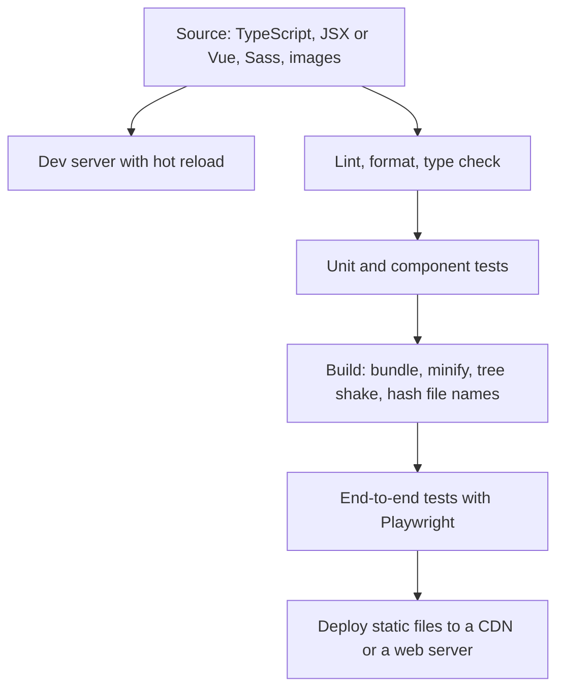

| Tool type | Purpose | Examples |
|---|---|---|
| **Runtime and package manager** | Run build tools; install packages from a **lockfile** | Node.js LTS (Long-Term Support), npm, pnpm |
| **Dev server and bundler** | Fast local server; combine and shrink files for production | **Vite** (also Webpack, esbuild, Rspack) |
| **Language** | Types and modern syntax | **TypeScript** |
| **Linter and formatter** | Find mistakes; keep one style | **ESLint** (flat config `eslint.config.js`), **Prettier**, **Stylelint** |
| **Tests** | Catch bugs early | Vitest or Jest, Testing Library, **Playwright** |
| **Browser tools** | Inspect DOM, network, performance; accessibility checks | Browser **DevTools**, Lighthouse, axe |
| **CI (Continuous Integration)** | Run all checks on every pull request | GitHub Actions |

- Connect this to [note 01, section 3.5](01-overview-of-web-and-cloud-development.md): `.editorconfig` and DevContainers make the whole team's tools match.
- **Hashed file names** (`app.3f9a1c.js`) let the CDN (Content Delivery Network) cache files for a year ("immutable") while users still get new versions: the build changes the name when the content changes.

---

### 3.10 Not in the Lecture — Industry Practice: Security, Performance and Quality of a Front End

| Area | What a senior engineer checks |
|---|---|
| **XSS** | User data is never inserted as HTML; use `textContent` or the framework's escaping; avoid `innerHTML`, `dangerouslySetInnerHTML` and `v-html` with untrusted data; send a **CSP** header |
| **Dependencies** | Install from the **lockfile**; run `npm audit` or a scanner in CI; keep dependencies few and updated. Supply-chain attacks through packages are a top web risk (A03:2025 Software Supply Chain Failures in the OWASP, Open Worldwide Application Security Project, Top 10:2025) |
| **Secrets** | No secrets in the bundle. Public keys only. Everything in a front-end bundle is public |
| **Third-party scripts** | Each tag, widget or analytics script runs with your page's rights. Add only what you need; use **SRI (Subresource Integrity)** for scripts loaded from a CDN |
| **Transport** | HTTPS only, with HSTS (HTTP Strict Transport Security) (see the Deployment guide) |
| **CORS and cookies** | Correct CORS on the server; `HttpOnly`, `Secure`, `SameSite` cookies |
| **Performance** | Core Web Vitals in the "good" range; image sizes and formats; code splitting; budgets in CI |
| **Accessibility** | WCAG 2.2 AA; automated and manual checks |
| **Error tracking** | Capture JavaScript errors with **source maps** so you can read the stack trace; track real-user metrics |
| **Testing** | Many unit tests, fewer component tests, a few end-to-end tests on key flows (login, checkout) |
| **AI coding tools** | Useful for drafts and tests. **Read, understand and test** the output; check that packages they suggest really exist; never paste secrets or customer data into unapproved tools |

#### Done enough when… (a front end is ready to release)

- [ ] Works in the browsers on the support policy, on a real phone and a desktop.
- [ ] Core Web Vitals are good for real users (or the lab test is good and RUM is planned).
- [ ] No known XSS paths; CSP set; no secrets in the bundle; `npm audit` has no unresolved high issues.
- [ ] Accessibility checks pass (automated plus keyboard plus screen reader on key flows).
- [ ] All calls handle loading, empty and error states; the server validates everything the browser sends.
- [ ] CI runs lint, type check, tests and a build; the build output has hashed file names and correct cache headers.

---

### 3.11 The Changing Job of a Front-End Developer

- **Lecture facts:**
  - The task of a front-end developer **evolves continuously**.
  - Technologies are **upgraded constantly**, so developers must **keep upgrading** the websites they create.
  - The sites must work in **multiple browsers, multiple operating systems and multiple devices**.
- **Real examples of forced change** (verified on the official sites):
  - **AngularJS** support ended in **January 2022**, so apps built on it had to move to modern Angular or another framework.
  - **Vue 2** reached end of life on **31 December 2023**.
  - Sass **`@import`** is deprecated since Dart Sass 1.80.0 and will be removed in 3.0.0.
  - **INP** replaced **FID** as a Core Web Vital in 2024.

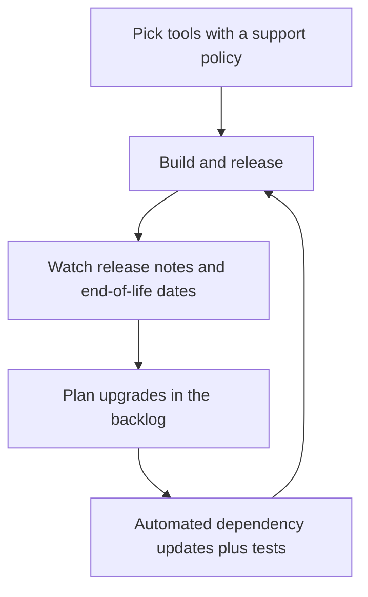

#### ✅ Modern Best Practice: manage change on purpose

> **Lecture says:** technologies are upgraded constantly, so front-end developers need to keep upgrading the websites they create.
> **Industry today:** teams **plan and automate** upgrades instead of reacting.

- **Automate** dependency updates (**Dependabot** or **Renovate**) and let **CI tests** prove that they are safe.
- **Track end-of-life dates** for your framework, Node.js LTS line and browser support policy. Put upgrade work in the **backlog**, not only in emergencies.
- **Keep the support policy written** and review it often (browsers, operating systems and devices change).
- **Learn the platform first** (HTML, CSS, JavaScript, HTTP). Frameworks change often; the web standards change slowly, so they are the best long-term investment.
- **Keep a decision record** (ADR) for the framework choice and for each big upgrade.

---

## 4. Concrete Real-World Example: The Book Shop Front End

We use the **Book Review API** idea from this course. A reader visits a book shop, browses books, and logs in to write a review.

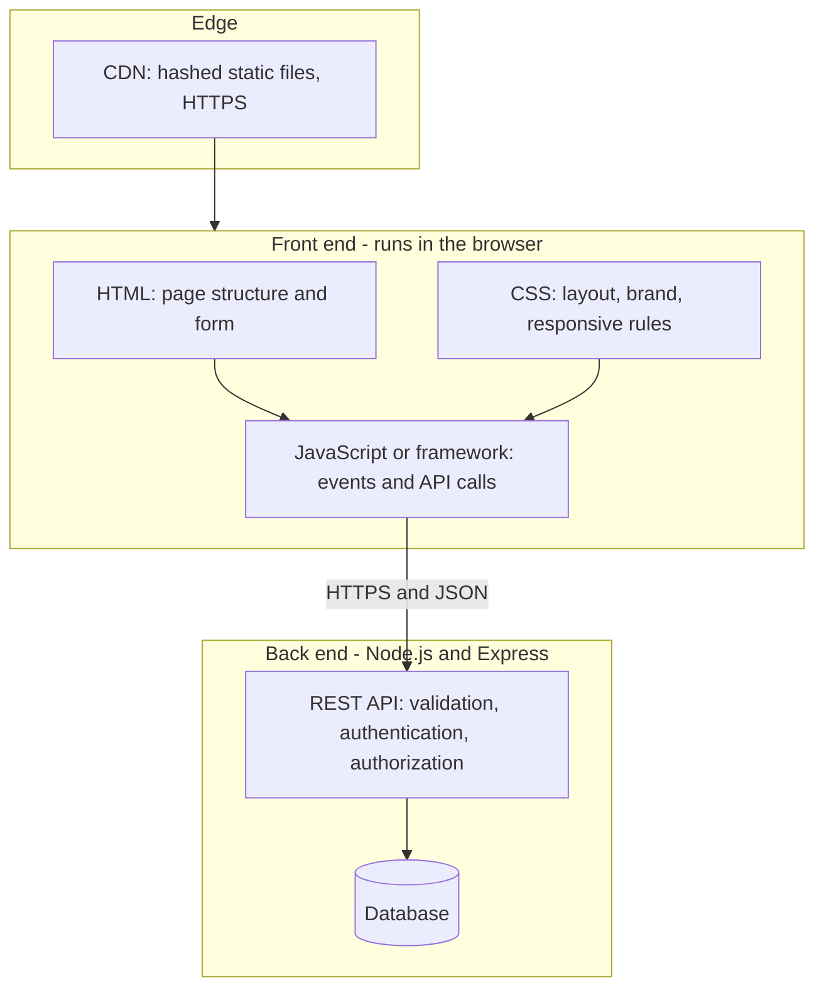

| Need | Who does it | How |
|---|---|---|
| Show the list of books and a "Log in" button | **HTML** | `<ul>`, `<li>`, `<button>` |
| Brand colors, spacing, a layout that works on a phone | **CSS** (plain, or Sass) | Custom properties, Grid, a mobile-first media query |
| Load books and show an error if the server is down | **JavaScript** | `fetch('/api/books')`, check `res.ok`, show states |
| Log in | **JavaScript** sends, the **server** decides | `POST /login`; the server checks the password and sets an `HttpOnly` cookie |
| Reuse a "book card" in many places | **Framework component** | One `BookCard` component (Angular, React or Vue) |
| Fast first load | **Build tools + CDN** | Code splitting, hashed files, `Cache-Control: immutable` |
| Works for everyone | **Semantic HTML + WCAG** | Labels, alt text, keyboard support |

**Step by step:** the reader opens `https://books.example.com`. The CDN sends HTML, CSS and JavaScript. The browser builds the page, applies the styles and runs the script, which calls `/api/books`. Express reads the database and returns JSON. The script creates a card for each book. When the reader clicks "Log in", the script sends the form data, and the server answers with a cookie or a `401` error. The page then shows the result.

---

## 5. Minimal Working Code Blocks

### 5.1 HTML + CSS + JavaScript together (the login button idea)

```html
<!-- index.html: structure (HTML) -->
<!doctype html>
<html lang="en">
<head>
  <meta charset="utf-8">
  <meta name="viewport" content="width=device-width, initial-scale=1"> <!-- needed for phones -->
  <title>Book Shop</title>
  <link rel="stylesheet" href="styles.css">   <!-- style (CSS) -->
</head>
<body>
  <main>
    <h1>Books</h1>
    <p id="status" role="status"></p>          <!-- screen readers announce changes here -->
    <ul id="books"></ul>
    <button id="reload" type="button" class="btn">Reload</button>
  </main>
  <script type="module" src="card.js"></script> <!-- behavior (JavaScript) -->
</body>
</html>
```

```css
/* styles.css: presentation (CSS) */
:root { --brand: #0d9488; }                     /* custom property (CSS variable) */
.btn { background: var(--brand); color: #fff; border: 0; padding: .75rem 1.25rem; border-radius: 8px; }
.btn:focus-visible { outline: 3px solid #1d4ed8; outline-offset: 2px; } /* visible keyboard focus */
```

```javascript
// card.js: behavior (JavaScript)
const list = document.querySelector('#books');
const status = document.querySelector('#status');

async function load() {
  status.textContent = 'Loading…';                       // loading state
  try {
    const res = await fetch('/api/books');
    if (!res.ok) throw new Error(`HTTP ${res.status}`);  // fetch does not throw on 404 or 500
    const books = await res.json();
    list.replaceChildren(...books.map((b) => {
      const li = document.createElement('li');
      li.textContent = b.title;                          // text, not HTML: prevents XSS
      return li;
    }));
    status.textContent = books.length ? '' : 'No books yet.'; // empty state
  } catch (err) {
    status.textContent = 'Could not load books. Try again.';  // error state
  }
}
document.querySelector('#reload').addEventListener('click', load);
load();
```

*(The JavaScript was syntax-checked with `node --check`; it needs a browser and an `/api/books` endpoint to run.)*

### 5.2 A safe API helper (tested in Node.js 24)

```javascript
// fetch-json.mjs
export async function fetchJson(url, { timeoutMs = 5000, ...options } = {}) {
  const controller = new AbortController();                      // lets us cancel the request
  const timer = setTimeout(() => controller.abort(), timeoutMs); // give up after a timeout
  try {
    const res = await fetch(url, { ...options, signal: controller.signal });
    if (!res.ok) throw new Error(`HTTP ${res.status} ${res.statusText}`); // turn HTTP errors into exceptions
    return await res.json();
  } finally {
    clearTimeout(timer);                                         // always clean up
  }
}
```

**What happens if... you forget the `res.ok` check?** We ran this against a small local server:

```text
ok     : [ { id: 1, title: 'Learning Node.js' } ]
404    : HTTP 404 Not Found                       <- fetchJson: a clear error
unsafe : { error: 'Not found' } <- looks like data! <- no check: the error body is used as if it were books
timeout: AbortError                               <- a slow server is cut off after 300 ms
```

Without the check, the page might show an empty list or crash later, far from the real problem. This is one of the most common front-end bugs.

### 5.3 Sass and Less compiled (tested)

See 3.5.2 and 3.5.4 for the source and the CSS output. Commands:

```bash
npm i -D sass less              # install the compilers as dev dependencies
npx sass scss/app.scss out.css  # Sass to CSS (use @use, not @import)
npx lessc app.less out.css      # Less to CSS (use at build time, not in the visitor's browser)
```

**What happens if... you use `@import` in Sass?** Dart Sass prints `DEPRECATION WARNING [import]: Sass @import rules are deprecated and will be removed in Dart Sass 3.0.0.` Move to `@use`.

---

## 6. Related Concepts

1. **REST APIs and JSON (backend):** the front end is a client of your API. A clear contract (OpenAPI), correct status codes and a stable error format make front-end work simple.
2. **CORS and cookies (backend and browser security):** the server decides which origins may read its responses and how sessions are stored. A wrong CORS setup is the most common "it works in Postman but not in the browser" bug.
3. **Node.js and Express serving static files:** in this course, Express can serve the built front end with `express.static`, or a CDN or web server can do it. Hashed file names and cache headers link to the Deployment guide.
4. **CI/CD (Continuous Integration and Continuous Delivery) and Docker:** the front end is built in CI (lint, test, build) and shipped as static files or a small container (for example a multi-stage Docker build that ends in a web server image).
5. **OWASP (Open Worldwide Application Security Project) and secure coding:** XSS, supply-chain risks and broken access control show up in the front end first. The server-side checks are the real protection.

---

## 7. Lecture Summary & Quick Reference Table

| Topic | Lecture | ✅ Modern best practice |
|---|---|---|
| **Front end** | What users see and use on a site, built by front-end developers | Also owns accessibility, performance, security habits, testing and the API connection |
| **HTML** | Creates the "physical structure": text, links, images, videos, dividers, buttons; ensures proper formatting | HTML describes **structure and meaning**; use **semantic elements**; formatting is CSS; follow **WCAG 2.2 AA** |
| **CSS** | Styles the site; uniform look; cross-browser and cross-device compatibility | CSS plus standards, a browser support policy, progressive enhancement and testing give compatibility; modern CSS (Grid, custom properties, nesting, container queries) |
| **JavaScript** | An object-oriented language that adds interactivity (login button) | A **multi-paradigm, prototype-based** language; ship **less** JS; measure **Core Web Vitals**; use **TypeScript**; never trust the browser |
| **Sass** | "Called SAS"; variables, nested rules, inline imports; faster style sheets | Name is **Sass**; use **`@use`** (`@import` is deprecated); consider plain modern CSS |
| **Less** | "Learner Style Sheets"; more styles and functions; `less.js` converts to CSS | **Leaner** Style Sheets; compile at build time with `lessc` |
| **Adaptive design** | A version for a specific screen size; more information on PC than on mobile | Default is **responsive, mobile-first**, with the **same content** on every device |
| **Responsive design** | Resizes automatically to the device | Fluid layouts, media and container queries, responsive images, viewport meta tag |
| **JS framework** | An application framework written in JavaScript for reusable, device-responsive apps | Components, rendering modes (CSR, SSR, SSG), choose by team and needs, write an ADR |
| **Angular** | Open source, Google; fast rendering; built-in routing and form validation | Modern Angular (TypeScript); AngularJS ended in 2022; regular major releases |
| **React** | Library by Facebook; components; no routing | Created by Meta, now under the **React Foundation**; react.dev recommends starting with a **framework** (Next.js, React Router) |
| **Vue** | Community-maintained; "Vue layer"; flexible; library or framework | **View** layer; **Vue 3** is current; Vue 2 ended 31 Dec 2023; independent, sponsor-funded |
| **Developer's job** | Evolves continuously; must support many browsers, operating systems and devices | Plan upgrades, automate dependency updates, track end-of-life dates, keep a written support policy |
