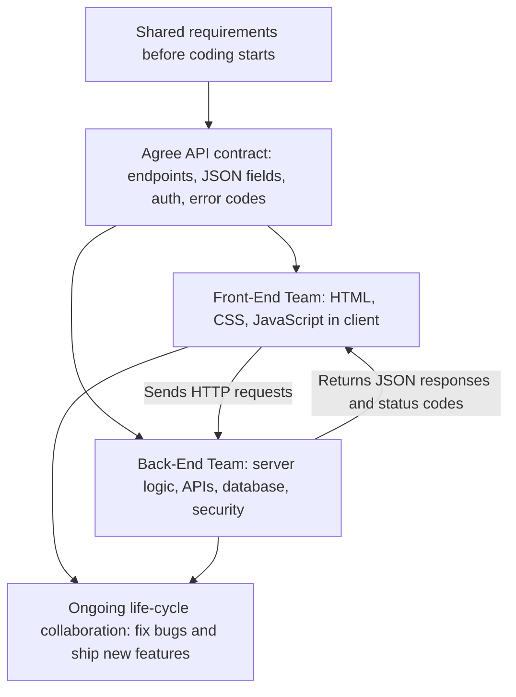
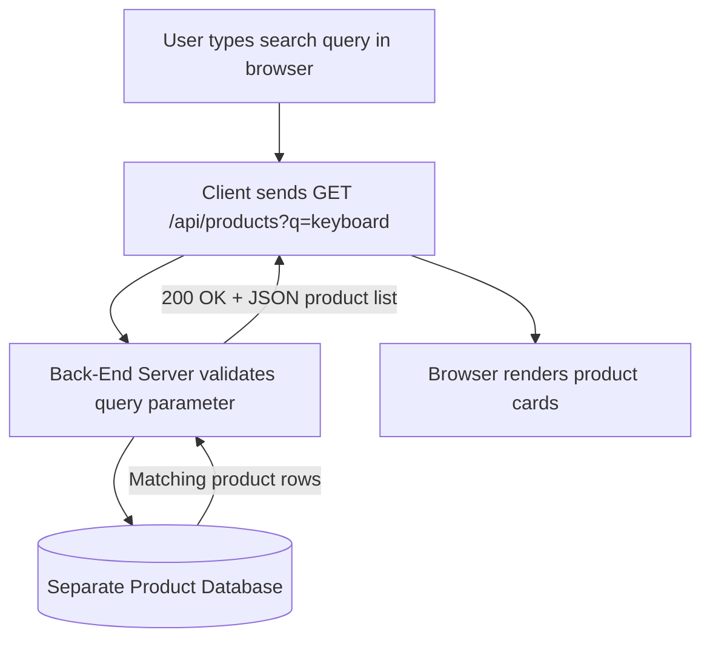
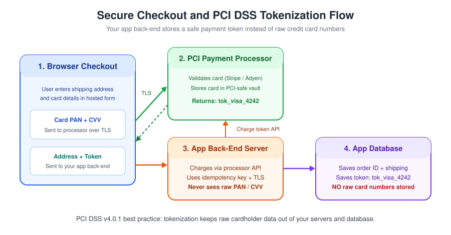
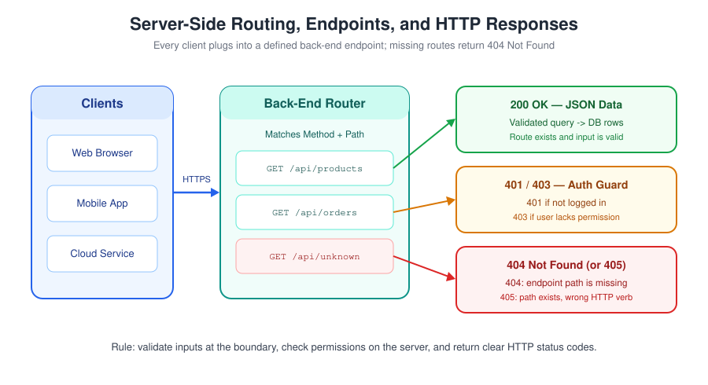
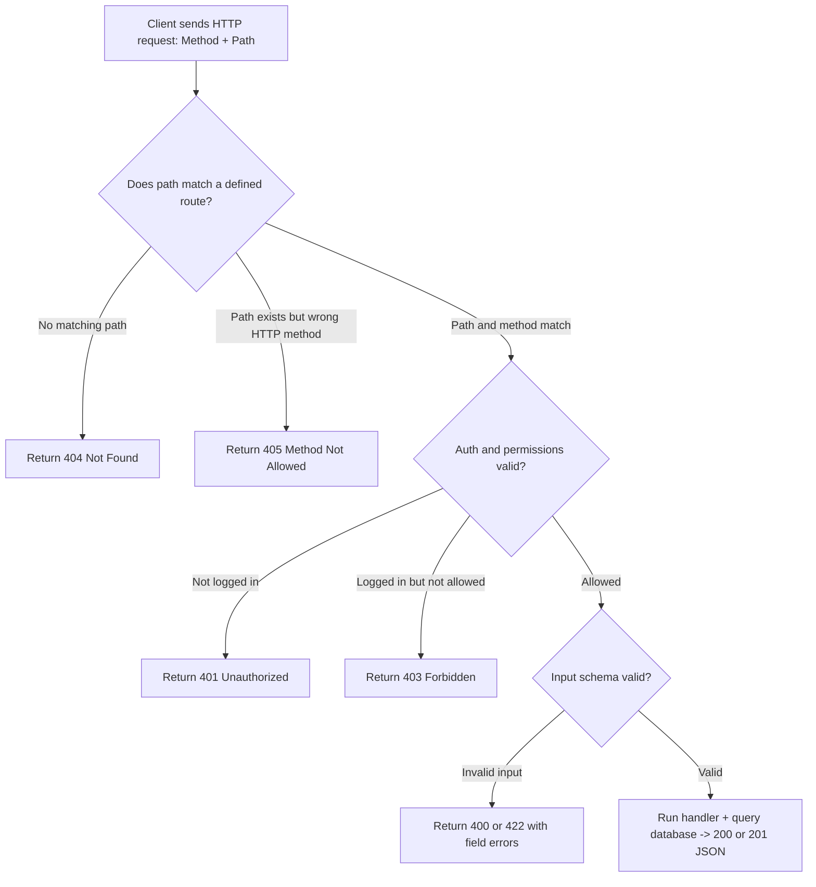
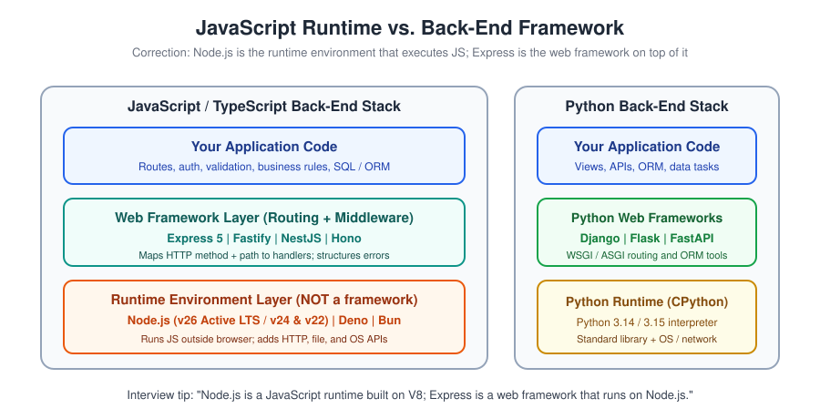
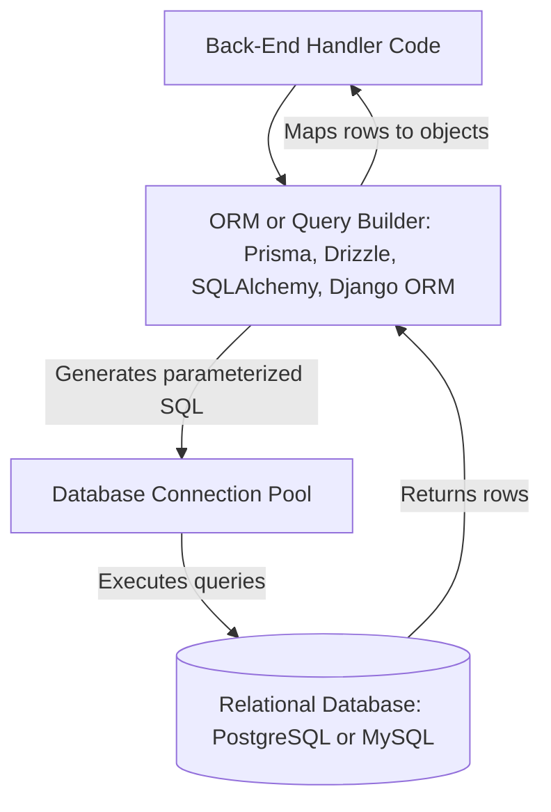
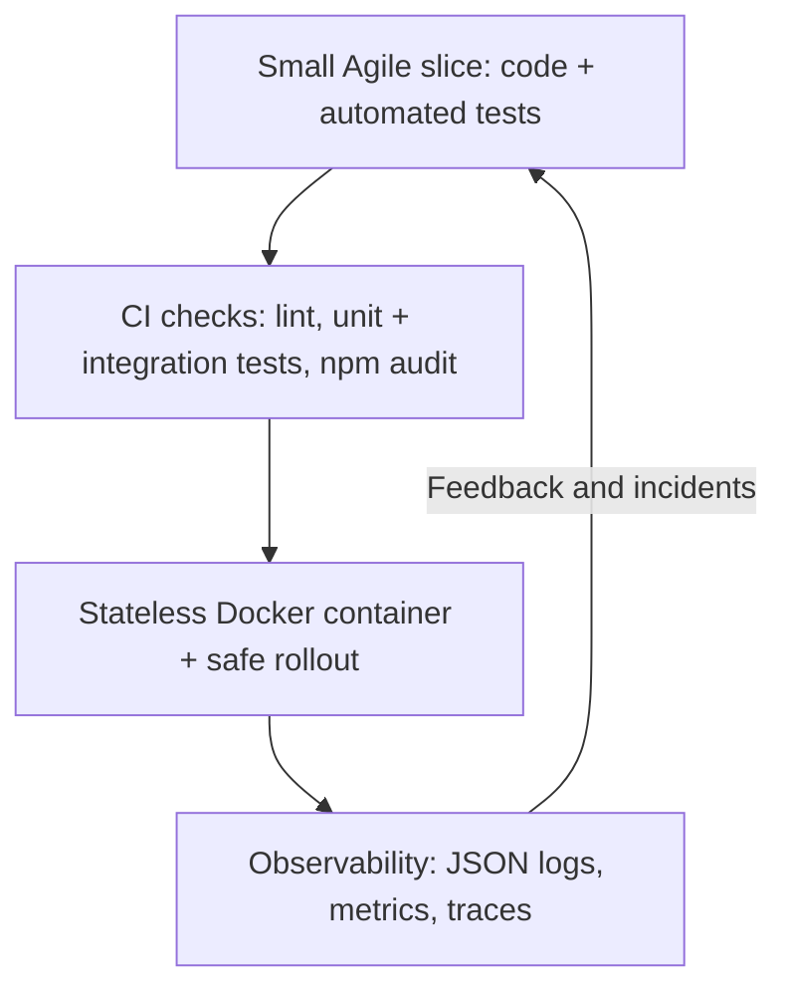
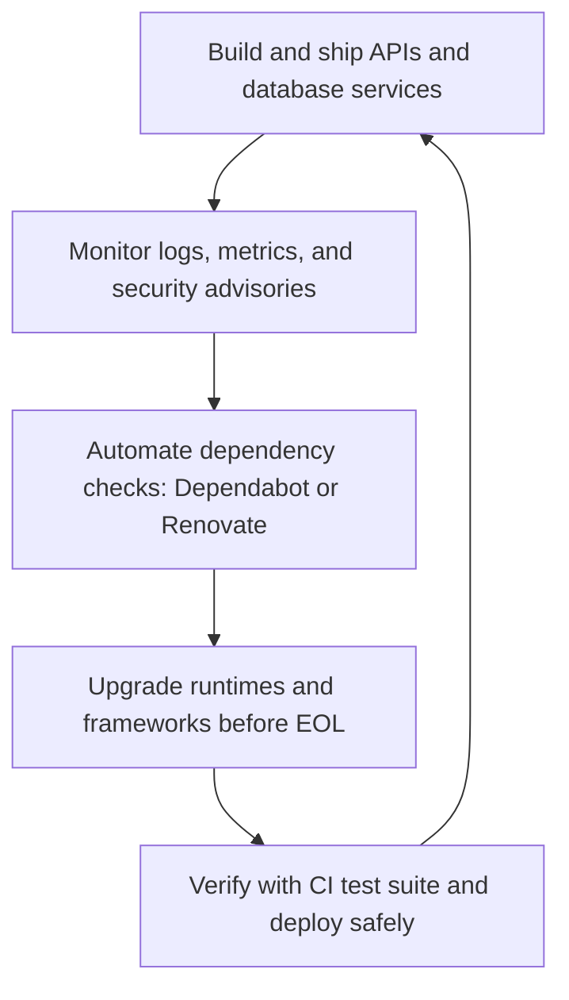
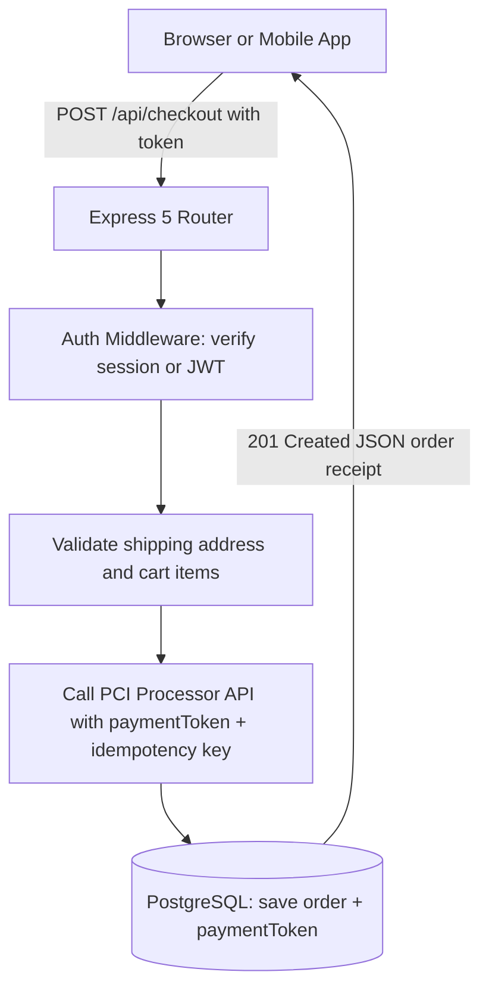

# 03 — The Importance of Back-End Development

> **How to read these notes:** facts from the lecture are the base. Blocks marked **✅ Modern Best Practice** or **Not in the lecture — industry practice** are added so you learn how teams work today. Blocks marked **⚠️ Correction** fix something the lecture says that is wrong or outdated. If you read only the corrected text, you learn only correct facts. The lecture's own words are kept only in the quiz lines under each correction, in the "Lecture says" quotes and in the "Lecture" table columns.

---

## 1. Jargon Translation (Read This First)

| Term | Official definition | Simple words | Analogy |
|---|---|---|---|
| **Front-End (Client-Side)** | The part of a website or cloud application that runs on the user's device using HTML (HyperText Markup Language), CSS (Cascading Style Sheets), and JavaScript to show the UI (User Interface). | The visible part of an app that the user looks at and clicks. | The dining room, menu, and table in a restaurant. |
| **Back-End (Server-Side)** | The server infrastructure, application code, and databases that run behind the scenes to process client requests, supply data, and enforce security. | The hidden engine room that handles requests, checks rules, and stores data. | The restaurant kitchen and storeroom behind the swinging doors. |
| **Client** | A hardware device or software app (such as a web browser or mobile app) that sends requests to a server over a network. | The app on your phone or computer that asks for data. | The customer placing an order at the counter. |
| **Server** | A computer system or program that listens for requests from clients, runs application logic, and sends back responses. | The remote computer that answers requests and runs the back-end. | The kitchen staff who cook the order and send it back out. |
| **API (Application Programming Interface)** | A defined contract of rules, endpoints, methods, and data formats (usually JSON, JavaScript Object Notation, or XML, Extensible Markup Language) that allows software programs to communicate. | The agreed menu of requests and replies between two programs. | A restaurant menu plus order rules that the waiter and kitchen both follow. |
| **Route** | A server-side rule that maps an HTTP (HyperText Transfer Protocol) method and URL (Uniform Resource Locator) path pattern (such as `GET /api/products`) to a handler function. | A traffic rule on the server that sends each incoming URL to the right piece of code. | The mailroom sorter who puts each letter into the right department's tray. |
| **Endpoint** | A specific exposed network URL/URI (Uniform Resource Identifier) and operation where an API or server listens for and answers requests. | The exact server address you call to ask for or send something. | The specific counter window labeled "Returns" or "Pickup". |
| **HTTP 404 (Not Found)** | A standard HTTP status code meaning the server could not find a matching route or resource for the requested URL. | The server's way of saying "nothing exists at that address". | Knocking on Room 99 when the building only has Rooms 1 to 10. |
| **JSON (JavaScript Object Notation)** | A lightweight, human-readable text format for representing structured data as key-value pairs and lists. | A simple text format that almost all web APIs use to pass data. | A clean, labeled shipping form that both sender and receiver can read. |
| **XML (Extensible Markup Language)** | A tag-based markup language used to store and transport structured data, common in older enterprise APIs (such as SOAP, Simple Object Access Protocol). | An older, tag-heavy text format for sharing structured data. | A formal paper form full of labeled boxes and folders. |
| **Authentication (AuthN)** | The process of verifying who a user or client is, usually with a password, passkey, or token. | Checking "Are you really who you say you are?" | Showing your passport or photo ID at an airport gate. |
| **Authorization (AuthZ)** | The process of checking what an authenticated user is allowed to view or do. | Checking "Are you allowed to enter this room or do this action?" | Your boarding pass showing whether you can sit in Economy or enter the lounge. |
| **Database** | An organized electronic system for storing, searching, updating, and protecting application data. | The permanent digital storage cabinet for app data. | A locked archive room with indexed shelves. |
| **SQL (Structured Query Language)** | The standard programming language used to query, insert, update, and manage data in relational databases (databases made of linked tables). | The language used to ask questions and save rows in table-based databases. | Speaking the exact filing code to pull matching records from a spreadsheet cabinet. |
| **ORM (Object-Relational Mapping)** | A library or tool that lets back-end code read and write database tables using the programming language's own objects instead of raw SQL strings. | A translator between your code objects and SQL database tables. | A bilingual assistant who turns your plain request into the archive's filing language. |
| **JavaScript Runtime Environment** | Software (such as Node.js, Deno, or Bun) that executes JavaScript outside a web browser and gives it access to files, networks, and the operating system. | The engine + OS (Operating System) toolkit that lets JavaScript run on a server. | A power generator that lets a kitchen appliance run outside the house. |
| **Back-End Framework** | A code framework (such as Express, Fastify, NestJS, Django, Flask, or FastAPI) that provides routing, middleware, and structure for building server applications. | A ready-made scaffolding for handling routes, requests, and errors faster. | A pre-built food-truck frame with counters and plumbing already wired in. |
| **Tokenization (Payments)** | Replacing a sensitive credit card number (PAN, Primary Account Number) with a meaningless surrogate token generated by a PCI-compliant (Payment Card Industry) payment processor. | Swapping a real card number for a safe dummy ID so your server never holds the real card. | Trading cash for a coat-check ticket — the ticket is useless to a thief outside the club. |

---

## 2. Topics Introduced in the Lecture Transcript

1. **Front-end vs. back-end roles and collaboration** — how client-side developers (HTML, CSS, JavaScript) and server-side developers define requirements together and collaborate throughout the application life cycle.
2. **How the back-end powers everyday online shopping** — processing user inputs behind the scenes: product search (querying a database and returning data), user account management, authentication and authorization for restricted areas, and checkout/payment handling.
3. **APIs, routes, endpoints, and server-side routing** — how different client requests (images, forms, sensitive payment data) reach the right back-end service, what happens when a route matches or is missing (`404` error), and how APIs connect web, cloud, and mobile apps to back-end resources.
4. **Back-end languages and frameworks** — JavaScript on the server (Node.js runtime and Express framework) and Python (Django and Flask frameworks) for web pages, databases, and data analysis.
5. **Databases, SQL, and ORMs (Object-Relational Mapping)** — why learning SQL matters, how ORMs help query databases, and why knowing database fundamentals is still essential for troubleshooting.
6. **The day-to-day life of a back-end developer** — keeping websites, cloud apps, and mobile apps running, securing sensitive data in storage and transit, managing accounts, and adapting to ever-changing technology.

---

## 3. Exhaustive Deep Dive & Structured Notes

### 3.1 Front-End vs. Back-End Roles and Collaboration

- **Two halves of one application:**
  - **Front-end developers** build websites and cloud applications using **HTML**, **CSS**, and **JavaScript**. They control everything the user sees and interacts with inside the **client software** (such as a web browser or mobile app).
  - **Back-end developers** create and manage all server-side resources needed to answer every request the client sends. Their work focuses on enabling the **server infrastructure** (the back-end) to:
    1. **Process incoming requests** from clients.
    2. **Supply data** cleanly and reliably.
    3. **Provide other services securely** (such as authentication, payments, and file handling).
- **Why close collaboration is mandatory:**
  - **Before development starts:** Both front-end and back-end developers must understand the **requirements of the solution** and agree on **how their respective parts will interact** (data shapes, error codes, and auth rules).
  - **Throughout the entire life cycle:** Collaboration does not stop after kickoff. Throughout the life of the website or cloud app, front-end and back-end teams work together to **resolve issues** (bugs, slow endpoints, mismatched fields) and **add new functionality**.



#### ✅ Modern Best Practice: contract-first collaboration with OpenAPI

> **Lecture says:** front-end and back-end developers need to understand the requirements and how their parts will interact before development begins, and collaborate throughout the life cycle.
> **Industry today:** teams formalize that agreement in a machine-readable **API contract** (such as **OpenAPI 3.2** for REST, Representational State Transfer, APIs) before writing feature code, so both sides can build and test in parallel.

- **How it is done today:**
  - **Write the contract first:** Describe every endpoint, HTTP method, request body, response schema, and error format in an `openapi.yaml` file stored in Git.
  - **Mock servers from day one:** Use tools like **Prism** or **MSW (Mock Service Worker)** so front-end developers can build against realistic fake responses while the back-end is still being built.
  - **Generated types and clients:** Generate **TypeScript** types or client SDKs (Software Development Kits) directly from the OpenAPI file so field-name mismatches fail at build time instead of in production.
  - **Contract tests in CI (Continuous Integration):** Run schema checks on every pull request so a back-end change cannot silently break a front-end screen.

| Collaboration approach | How teams coordinate | Main risk |
|---|---|---|
| **Ad-hoc / verbal agreement** | Developers message each other or guess JSON field names | Integration breaks late; "works on my machine" surprises |
| **Contract-first (OpenAPI + mocks)** | Shared `openapi.yaml` reviewed in PR (Pull Request), mocked for front-end, checked in CI | Small upfront design step, prevents costly rework |

---

### 3.2 How the Back-End Powers Everyday Online Shopping

When you browse the internet or use a cloud app—such as an online shopping site—the back-end processes every important input you send: **login details**, **product searches**, and **payment information**. Back-end developers write and maintain the parts of the application that process these inputs.

#### 3.2.1 Product Search and Database Retrieval

- **What happens step by step:**
  1. You type a search term (for example, `"wireless keyboard"`) in the browser.
  2. The client submits your search request to the **web application** (the back-end server).
  3. The back-end application queries a **separate database** for matching products.
  4. The database returns matching records to the back-end, which formats and **serves the data back to the client** for display.
- **What the back-end developer must know to make this work:**
  - The **programming language** (and framework) used by the web application.
  - How to **query the database** accurately for the needed data.
  - How to **connect the two together** cleanly (parsing input, running queries safely, and formatting the results as JSON).



##### ✅ Modern Best Practice: safe, fast product search

> **Lecture says:** the web application receives a search request, queries a separate database, and serves the result back to the client.
> **Industry today:** back-ends protect database queries against injection, avoid slow full-table scans, and control load with pagination and caching.

- **Parameterized queries (never string concatenation):** Always pass user search input as a bound parameter (`$1`, `?`), or via a safe ORM method, to block **SQL injection** (**A05:2025 Injection** in the OWASP, Open Worldwide Application Security Project, Top 10:2025).
- **Pagination and limits:** Never return 50,000 rows at once. Enforce `limit` and `offset`/cursor pagination (for example max 50 items per request).
- **Search indexing and caching:** For large catalogs, teams use database **full-text indexes** (like PostgreSQL `tsvector`) or dedicated search engines (like **OpenSearch** or **Meilisearch**) and cache popular searches in **Redis** instead of hitting the primary database with `LIKE '%term%'` on every keystroke.
- **Connection pooling:** Reuse a pool of open database connections instead of opening and closing a new TCP (Transmission Control Protocol) connection per request.

#### 3.2.2 Navigation, User Accounts, Authentication, and Authorization

- **Why even simple navigation involves the back-end:**
  - Many websites have **restricted areas** (such as "My Orders", "Account Settings", or "Admin Dashboard") available **only to users who have an account and are logged in**.
  - **User account management**, **authentication** (proving who you are), and **authorization** (checking what you are permitted to see or do) are core back-end responsibilities.

##### ✅ Modern Best Practice: server-side access control and modern auth

> **Lecture says:** user account management, authentication, and authorization can be the responsibility of the back-end developer to protect restricted areas.
> **Industry today:** access control is **always** enforced on the back-end for every request—front-end route guards are only for UX (User Experience), never security.

- **Authentication (AuthN):**
  - Hash passwords with **Argon2id** (OWASP's first choice) or **bcrypt** using an asynchronous implementation—never store plaintext passwords or use fast hashes like MD5 (Message-Digest Algorithm 5) or SHA-256 (Secure Hash Algorithm 256-bit).
  - Issue **`HttpOnly`** (hidden from browser JavaScript), **`Secure`** (sent only over encrypted connections), and **`SameSite`** (helps block cross-site request forgery) session cookies, or short-lived **JWTs (JSON Web Tokens)** with refresh token rotation (issuing a fresh refresh token and revoking the old one on each use). Support **MFA (Multi-Factor Authentication)** or **OAuth 2.0 (Open Authorization) with PKCE (Proof Key for Code Exchange) / OAuth 2.1 draft** and **OIDC (OpenID Connect)** where appropriate.
- **Authorization (AuthZ) on every object:**
  - **Broken Access Control** is **#1 in the OWASP Top 10:2025 (A01:2025)**, and **Broken Object Level Authorization (BOLA, API1:2023)** is **#1 in the OWASP API Security Top 10**.
  - Do not just check "is the user logged in?". Check **ownership**: when User A requests `/api/orders/105`, the back-end must verify that order `105` actually belongs to User A (or that User A is an authorized admin).

#### 3.2.3 Checkout, Payments, and Sensitive Data

- **What happens in the shopping flow:**
  - After picking a product, the user adds it to their **shopping cart** and moves to payment.
  - Checkout requires sensitive user inputs such as a **shipping address** and **credit card details**.

> ⚠️ **Correction:** **Never store raw credit card numbers in your application's database** → Under **PCI DSS v4.0.1** (Payment Card Industry Data Security Standard), a standard web application back-end should **never directly store raw credit card numbers (PAN, Primary Account Number) or security codes (CVV, Card Verification Value / CVC, Card Verification Code)**. Instead, the front-end sends card details straight to a PCI-certified payment processor (such as **Stripe** or **Adyen**) over **TLS (Transport Layer Security)** and receives a **payment token**. Your back-end receives and stores only that token plus non-card order details (like shipping address, encrypted at rest).
> **Lecture wording (for the quiz):** `"Once you've decided what you want to purchase, you must add it to your card and make a payment. The purchase process requires you to submit sensitive information such as your address and credit card number. The back-end developer must ensure that this data is securely handled and stored."` *(Note: "card" in the transcript is a speech-to-text typo for "cart".)*



- **Why tokenization matters:**
  - If an attacker breaches your application database, they find meaningless payment tokens instead of usable credit card numbers.
  - Keeping raw cardholder data out of your servers drastically shrinks your **PCI DSS compliance scope** and legal liability.
  - **For data you *do* store** (names, addresses, order history): encrypt in transit (**HTTPS, HyperText Transfer Protocol Secure / TLS 1.3**), encrypt at rest (database/disk encryption), mask sensitive fields in logs, and use **idempotency keys** on payment requests so a retried network call never charges a customer twice.

---

### 3.3 APIs, Routes, Endpoints, and Server-Side Routing

Different client requests need different back-end services. Fetching a product image, accepting input from a form, and securing sensitive payment details like a credit card number each interact with the server in a different way. Back-end developers organize and handle all incoming requests using **APIs**, **routes**, and **endpoints**.

#### 3.3.1 What an API Is (and Is Not)

> ⚠️ **Correction:** **An API is a contract, not "code that works with data"** → An **API (Application Programming Interface)** is a **defined contract and interface**—a set of rules specifying which URLs, HTTP methods, request formats, response schemas, and status codes a client can use to talk to a server. The **handler code** inside your server implements that contract, and **JSON** (or **XML** in older systems) is the data format carried inside the messages, not the API itself.
> **Lecture wording (for the quiz):** `"An API is code that works with data, usually using JSON or XML. APIs have set rules and structure."`

- **Why APIs matter across clients:**
  - The same back-end API gives **web apps**, **cloud apps**, **mobile apps** (iOS and Android), and **other back-end services** one consistent way to request resources without knowing how the database or server code works internally.
  - **Data formats today:** Modern web APIs mostly use **JSON** (REST, and **GraphQL** — Graph Query Language, where clients ask for the exact JSON fields they need — *not in the lecture, industry practice*) or compact binary **Protocol Buffers** (**gRPC**, Google Remote Procedure Call, used for fast internal service-to-service calls — *not in the lecture, industry practice*). **XML** is still supported in older enterprise integrations and **SOAP** (Simple Object Access Protocol) services, but is rarely chosen for new web APIs.

#### 3.3.2 Routes, Endpoints, and the `404` Path

> ⚠️ **Correction:** **Route vs. Endpoint on the back-end** → On a back-end server, a **route** is the internal mapping rule `(HTTP method + URL path pattern) → handler function` (for example, `GET /api/products/:id` runs `getProductById`). An **endpoint** is the specific exposed network address and operation (`https://api.example.com/v1/products/42`) where a client sends a request. Client-side apps also have browser "page routes", which are separate from server-side API routing.
> **Lecture wording (for the quiz):** `"A route is a path to a website or page that the user interacts with. Routes generally take user input and show results based on the input and end point maybe an API or may simply be a path."`

- **How server-side routing works:**
  1. A client request arrives at the back-end server (for example, `GET /api/products?q=keyboard`).
  2. The server's **router** inspects the HTTP method and URL path.
  3. **Match found:** If the back-end has a matching route and endpoint defined, the request is dispatched to the right handler or service, processed, and replied to (for example, `200 OK` with JSON).
  4. **No match found:** If no route matches the requested path, the server returns an **HTTP `404 Not Found`** error.
- **Why developers maintain routing carefully:**
  - Along with APIs, routes let the front-end client **"plug into the correct socket"** at the back-end—just like plugging an appliance into the right power outlet.
  - Back-end developers create, organize, and maintain these routes so every client action lands on the intended handler.





##### ✅ Modern Best Practice: predictable REST APIs, validation, and error formats

> **Lecture says:** if an endpoint is defined by routing, it replies; if the endpoint is missing, the server returns a 404 error.
> **Industry today:** back-ends use explicit HTTP methods, full status codes, schema validation, rate limiting, and standardized JSON error payloads.

- **Use the right HTTP status codes:** `200 OK` (read/update), `201 Created` (new resource), `400 Bad Request` / `422 Unprocessable Content` (validation error), `401 Unauthorized` (not logged in), `403 Forbidden` (logged in, no permission), `404 Not Found` (missing route or record), `405 Method Not Allowed` (path exists for a different HTTP verb), `429 Too Many Requests` (rate limit hit), and `500 Internal Server Error` (unexpected server crash without leaking stack traces).
- **Validate all inputs at the boundary:** Never trust client data. Validate query parameters, path parameters, and JSON bodies with a schema library (such as **Zod** or **JSON Schema**).
- **Standardize errors:** Return structured JSON errors (such as **RFC (Request for Comments) 9457 Problem Details for HTTP APIs**, `application/problem+json`) so front-end apps can show helpful messages reliably.
- **Version public APIs and protect endpoints:** Prefix breaking API changes (such as `/v1/orders`, `/v2/orders`) and apply **rate limiting** (capping how many requests one client can send in a time window) to protect login, search, and checkout endpoints against abuse (**OWASP API4:2023 Unrestricted Resource Consumption**).

---

### 3.4 Back-End Languages, Runtimes, Frameworks, Databases, and ORMs

To build back-end services, a developer needs at least **one server-side programming language** and its ecosystem of **runtimes, frameworks, and database tools**.

#### 3.4.1 JavaScript on the Back-End: Runtime vs. Framework

- **Origin of JavaScript:** JavaScript was originally built to run inside **web browsers**, adding interactivity and dynamic content to web pages.

> ⚠️ **Correction:** **Server-side capabilities come from a runtime environment, not JavaScript language releases** → The JavaScript language standard (**ECMAScript**) defines syntax, functions, and built-in data types—it does not include file system access or HTTP servers. JavaScript runs on the back-end because **runtime environments** (such as **Node.js**, **Deno**, or **Bun**) wrap a JavaScript engine (like V8) with C++/Rust operating-system APIs for networking, files, and processes.
> **Lecture wording (for the quiz):** `"JavaScript is also being used on the back-end with new releases adding server-side functionality."`

> ⚠️ **Correction:** **Node.js is a runtime environment, NOT a framework** → Calling Node.js and Express "two of the most well-known JavaScript frameworks" mixes up two completely different layers. **Node.js** is the **JavaScript runtime environment** that executes JavaScript on a server. **Express** (along with **Fastify**, **NestJS**, **Koa**, and **Hono**) is a **back-end web framework** that runs *inside* Node.js (or another runtime) to handle routing and middleware.
> **Lecture wording (for the quiz):** `"JavaScript has many frameworks, but two of the most well-known are Node.js and Express."`



| Layer | Role | Current examples (2026) |
|---|---|---|
| **Language** | Syntax, types, and standard language features | **JavaScript** (ECMAScript) / **TypeScript** (typed superset compiled to JavaScript) |
| **Runtime Environment** | Executes JS outside the browser; provides HTTP, filesystem, crypto, and process APIs | **Node.js** (**v26 Active LTS**, Long-Term Support; **v24 & v22 Maintenance LTS**; v20 **EOL**, End of Life, April 30, 2026), **Deno**, **Bun** |
| **Web Framework** | Structured routing, middleware pipelines, request/response helpers | **Express 5** (default stable on npm; supports automatic async error forwarding), **Fastify**, **NestJS**, **Hono** |

#### 3.4.2 Python on the Back-End

- **Why Python is popular:**
  - **Flexible and easy to learn**, with readable syntax and wide functionality: building web pages, connecting to databases, automation, and **data analysis / machine learning**.
- **Well-known Python web frameworks:**
  - **Django:** Full-featured, "batteries-included" framework with built-in ORM, admin panel, and authentication (**Django 6.1** current stable; **Django 5.2 LTS** widely used).
  - **Flask:** Lightweight, minimalist **WSGI** (Web Server Gateway Interface, the standard interface connecting web servers to synchronous Python apps) micro-framework where you choose only the extensions you need (**Flask 3.1** current stable).
  - **FastAPI** *(not in the lecture — industry practice)*: Modern **ASGI** (Asynchronous Server Gateway Interface, the async Python web-server interface) framework built on Python type hints and **Pydantic** (a Python data-validation library), generating interactive **OpenAPI** docs automatically (**FastAPI 0.165.x**).

#### 3.4.3 Databases, SQL, and ORMs

- **Why SQL and database fundamentals matter:**
  - Almost every back-end retrieves, processes, and stores data in databases (relational SQL databases like **PostgreSQL** or **MySQL**, or **NoSQL** — Not Only SQL / non-relational — stores like **MongoDB** and **Redis**).
  - Even if you use an **ORM (Object-Relational Mapping)** tool to connect to a database and read/write records as objects in your language, **learning SQL and database fundamentals is essential** so you can find and fix slow queries, broken joins, locking issues, or data corruption when the ORM's shortcuts hide problems or behave unexpectedly.



##### ✅ Modern Best Practice: choosing and operating ORMs safely

> **Lecture says:** ORMs hide some database complexity, though understanding database fundamentals helps you troubleshoot issues.
> **Industry today:** teams pair typed ORMs or query builders with versioned schema migrations, query logging, and N+1 prevention.

- **Know the ORM trade-offs:**
  - **ORMs** (**Prisma**, **Drizzle ORM**, **TypeORM**, **Django ORM**, **SQLAlchemy**) speed up **CRUD** (Create, Read, Update, Delete) code and prevent SQL injection by default when used properly.
  - **The N+1 query trap:** Loading 100 orders in 1 query and then running 100 extra queries inside a loop to fetch each order's user (`1 + N` queries) kills database performance. Always inspect generated SQL logs in development and use eager loading (loading related rows upfront in one query instead of inside a loop) or explicit SQL `JOIN`s.
  - **Versioned migrations:** Track every table and index change in Git using migration tools (**Prisma Migrate**, **Drizzle Kit**, **Knex**, or **Alembic** for Python) instead of editing production tables by hand.
  - **Know when to drop to raw SQL:** Complex analytics reports, bulk updates, and tuned indexes are often clearer and faster in plain parameterized SQL than through an ORM wrapper.

---

### 3.5 Not in the Lecture — Industry Practice: What Senior Engineers Check on Every Back-End

The lecture explains *what* a back-end does (routing, APIs, auth, databases). In production, senior engineers check these areas too:



| Area | What a senior engineer checks |
|---|---|
| **Agile & iterative delivery** | Ship small vertical API slices behind feature flags every sprint instead of one big release, using contract-first OpenAPI checks so front-end and back-end stay aligned. |
| **Observability (logs, metrics, traces)** | Emit structured JSON logs with a unique `requestId` (never log passwords, tokens, or card data); expose `/healthz` (**liveness**, is the server process alive?) and `/readyz` (**readiness**, can it reach its **DB**, Database, and accept traffic?) endpoints; collect latency and error-rate metrics plus **OpenTelemetry** **traces** (end-to-end timing across services) to track **SLOs (Service Level Objectives)**—numeric reliability targets such as 99.9% successful responses. |
| **Testing pyramid (shift-left & TDD)** | Use **TDD (Test-Driven Development)** where helpful (write a failing test first, then make it pass); write fast **unit tests** (for business rules and validation), **integration tests** using Node's built-in `node:test` runner against a real database (for example started in Docker with **Testcontainers**), and **API route tests** (for example with **Supertest**) checking status codes (`200`, `400`, `401`, `403`, `404`). |
| **CI/CD (Continuous Integration / Continuous Delivery)** | Run lint, type checks, tests, `npm audit`, and container builds automatically on every pull request (for example with **GitHub Actions**). |
| **Supply chain & secrets** | Install dependencies from a **lockfile** (`npm ci`); keep secrets in environment variables or a cloud secrets manager (never committed to Git); guard against **A03:2025 Software Supply Chain Failures** (OWASP Top 10:2025). |
| **Cloud-native & safe releases** | Keep app servers **stateless** (no user session or uploaded file stored only in local server memory or disk—store sessions in Redis or a DB and files in object storage like S3, Simple Storage Service); package in **Docker** containers orchestrated by **Kubernetes**; roll out updates safely (**rolling updates**, **blue-green**, or **canary** releases with fast rollback); handle `SIGTERM` (Termination Signal) so **in-flight** (currently running) HTTP requests and DB connections finish cleanly before exit. |
| **Responsible AI (Artificial Intelligence) coding tools** | Helpful for **boilerplate** (repetitive starter code) routes and tests, **but** AI tools often output outdated **Express 4** patterns in an **Express 5** project or invent package names. Always read, test, and verify every line, and never paste secrets or customer **PII (Personally Identifiable Information)** into unapproved tools. |

#### Done enough when… (a back-end service is ready to ship)

- [ ] Every endpoint validates inputs at the boundary and returns standard HTTP status codes and structured JSON errors.
- [ ] Authentication and per-object authorization (`A01:2025` / `API1:2023`) are enforced on the server for every protected route.
- [ ] All database queries use bound parameters or safe ORM calls (no string concatenation), and all schema changes run via versioned migrations.
- [ ] No raw credit card numbers or secrets are stored in the application database or Git history.
- [ ] Structured logs, health/readiness endpoints (`/healthz`, `/readyz`), and graceful `SIGTERM` shutdown are in place.
- [ ] Automated unit, integration, and API tests pass in CI against the pinned Node.js LTS line.

---

### 3.6 The Changing Day-to-Day Job of a Back-End Developer

- **Lecture facts:**
  - Day-to-day back-end tasks focus on the **behind-the-scenes functionality** that keeps **websites, cloud apps, and mobile apps** up and running.
  - Back-end development covers a **wide range of technologies**—from **managing user accounts, authentication, and authorization**, to ensuring **sensitive data is stored and transferred securely**, to **retrieving, processing, and storing data** in databases.
  - Life for a back-end developer is **challenging and ever-changing** as tools, threats, and scale requirements evolve.



#### ✅ Modern Best Practice: plan upgrades and security maintenance continuously

> **Lecture says:** life for a back-end developer is very challenging and ever-changing.
> **Industry today:** teams turn constant change into a calm, repeatable routine instead of emergency firefighting.

- **Track runtime and framework lifecycles:** Pin your Node.js LTS line (in `.nvmrc`, `package.json` `"engines"`, CI, and Docker) and schedule upgrades well before **EOL (End of Life)** (for example planning upgrades off Node.js 22 Maintenance LTS before its April 30, 2027 EOL onto Node.js 24 or 26 LTS, since Node.js 20 already reached EOL on April 30, 2026).
- **Automate dependency updates:** Use **Dependabot** or **Renovate** with automated CI tests to catch breaking updates early.
- **Record architectural choices:** Write short **ADRs (Architecture Decision Records)** when picking databases, frameworks, or auth patterns so the team remembers *why* each choice was made.

---

## 4. Concrete Examples

### 4.1 Online Shopping vs. the Course Book Review API

Both an **online store** (from the lecture) and the **Book Review API** (from this course) use the exact same back-end building blocks:

| Action in the app | HTTP Endpoint | What the back-end does |
|---|---|---|
| Search for a book or keyboard | `GET /api/products?q=keyboard` | Validates `q`, runs a parameterized SQL query with a `LIMIT`, returns `200 OK` + JSON list. |
| View restricted order history or post a review | `GET /api/orders` or `POST /api/books/12/reviews` | Checks authentication (`401` if not logged in) and ownership/role (`403` if not allowed), then updates or reads the database. |
| Pay at checkout | `POST /api/checkout` | Front-end sends card details to Stripe/Adyen and receives a `paymentToken`. Back-end charges the token with an idempotency key and saves the order + token (never the raw card number). |
| Visit a misspelled path | `GET /api/ordres` | Router finds no matching route and returns `404 Not Found`. |



---

## 5. Code Blocks

### 5.1 Server-Side Routing, Auth, Parameterized SQL, and `404` (Tested in Node.js 24)

This minimal server uses Node.js 24's built-in `node:http` and `node:sqlite` modules (no external packages needed) to show routing, boundary validation, a protected endpoint, parameterized SQL, and `404` handling:

```javascript
// backend-demo.mjs — tested on Node.js v24.18.0
import http from 'node:http';
import { DatabaseSync } from 'node:sqlite';

const db = new DatabaseSync(':memory:');                         // In-memory SQLite database for the demo
db.exec('CREATE TABLE products (id INTEGER PRIMARY KEY, name TEXT, price REAL)');
const insert = db.prepare('INSERT INTO products (name, price) VALUES (?, ?)');
insert.run('Wireless Keyboard', 49.99);
insert.run('USB-C Hub', 29.50);

// Parameterized query (? placeholder) blocks SQL injection
const searchProducts = db.prepare(
  'SELECT id, name, price FROM products WHERE name LIKE ? LIMIT 20'
);

function sendJson(res, status, data) {
  res.writeHead(status, { 'Content-Type': 'application/json' }); // Always return structured JSON
  res.end(JSON.stringify(data));
}

const server = http.createServer((req, res) => {
  const url = new URL(req.url, 'http://localhost');

  // Route 1: public product search endpoint
  if (req.method === 'GET' && url.pathname === '/api/products') {
    const q = (url.searchParams.get('q') ?? '').trim();
    if (q.length > 50) return sendJson(res, 400, { error: 'Query too long' }); // Boundary validation
    const rows = searchProducts.all(`%${q}%`);
    return sendJson(res, 200, { count: rows.length, items: rows });
  }

  // Route 2: restricted endpoint requiring authentication
  if (req.method === 'GET' && url.pathname === '/api/orders') {
    if (req.headers.authorization !== 'Bearer demo-token') {
      return sendJson(res, 401, { error: 'Authentication required' }); // Reject unauthenticated requests
    }
    return sendJson(res, 200, {
      orders: [{ id: 101, total: 49.99, paymentToken: 'tok_visa_4242' }] // Token stored, never raw PAN
    });
  }

  // Fallback: missing endpoint returns 404 Not Found
  return sendJson(res, 404, { error: 'Endpoint not found' });
});

server.listen(3000, '127.0.0.1');
```

Output when tested in Node.js v24.18.0 against five test requests:

```text
search ok  -> HTTP 200: {"count":1,"items":[{"id":1,"name":"Wireless Keyboard","price":49.99}]}
sqli safe  -> HTTP 200: {"count":0,"items":[]}
no auth    -> HTTP 401: {"error":"Authentication required"}
auth ok    -> HTTP 200: {"orders":[{"id":101,"total":49.99,"paymentToken":"tok_visa_4242"}]}
missing    -> HTTP 404: {"error":"Endpoint not found"}
```

**What happens if... you build SQL with string concatenation instead of `?` parameters?** If you wrote `` `... WHERE name LIKE '%${q}%'` ``, sending `q=' OR '1'='1` turns the condition into `TRUE` for every row and returns the entire table (or lets an attacker read passwords and orders in a real SQL query). With `?` parameters, SQLite treats `' OR '1'='1` as harmless search text and safely returns `0` items.

### 5.2 Express 5 Routing and Automatic Async Error Handling (Course Stack)

In **Express 5** (running inside the **Node.js** runtime), rejected promises inside `async` route handlers go straight to your error middleware without needing manual `try/catch` boilerplate in every route:

```javascript
// app.js — Express 5 minimal route structure (runs on Node.js 18+)
import express from 'express';

const app = express();
app.use(express.json({ limit: '100kb' }));                      // Parse JSON bodies safely with a size limit

const books = [{ id: 1, title: 'Learning Node.js' }];
async function findBooksInDb(q) {
  return books.filter((b) => b.title.toLowerCase().includes(q.toLowerCase()));
}

// Route: GET /api/books?q=... (public read endpoint)
app.get('/api/books', async (req, res) => {
  const q = String(req.query.q ?? '').trim();
  const matchingBooks = await findBooksInDb(q);                  // If this rejects, Express 5 catches it automatically
  res.json({ items: matchingBooks });
});

// 404 handler must sit AFTER all valid routes
app.use((req, res) => {
  res.status(404).json({ title: 'Endpoint not found', status: 404 });
});

// Central error middleware (4 arguments) catches thrown or rejected errors
app.use((err, req, res, _next) => {
  res.status(500).json({ title: 'Internal server error', status: 500 }); // Never leak stack traces to clients
});

app.listen(3000);
```

**What happens if... you register the `404` middleware *above* `app.get('/api/books', ...)`?** Express checks middleware in top-to-bottom order. Every request—including `GET /api/books`—would hit the `404` handler first and return `404 Endpoint not found`, never reaching your routes.

---

## 6. Related Concepts

1. **REST APIs and OpenAPI Contracts:** Formalizing endpoints, HTTP methods, status codes, and JSON schemas in an `openapi.yaml` contract lets front-end, mobile, and back-end teams work in parallel without breaking integrations.
2. **Authentication, Authorization, and Sessions (`OWASP A01:2025` & `API1:2023`):** Keeping accounts safe requires Argon2id password hashing, `HttpOnly` / `Secure` / `SameSite` cookies or short-lived JWTs, and server-side ownership checks on every object.
3. **Relational Databases, SQL, and Migrations:** Understanding tables, indexes, joins, and versioned migrations ensures your ORM stays fast, avoids `N+1` query traps, and stays safe from SQL injection.
4. **Containers, Docker, and Kubernetes:** Packaging stateless Node.js or Python back-ends into Docker images with `/healthz` and `/readyz` probes and `SIGTERM` handling allows safe scaling and zero-downtime rollouts.
5. **CI/CD and Software Supply Chain Security (`OWASP A03:2025`):** Automated tests (`node:test`, Supertest, Testcontainers), lockfile installs (`npm ci`), and vulnerability scanning in GitHub Actions keep every change verified before it reaches users.

---

## 7. Lecture Summary & Quick Reference Table

| Topic | Lecture | ✅ Modern best practice |
|---|---|---|
| **Front-end vs. back-end** | Front-end builds client UI (HTML, CSS, JS); back-end manages server resources, data, and security; both collaborate before start and across the life cycle | Contract-first collaboration using **OpenAPI 3.2**, mock servers (Prism / MSW), and CI contract checks |
| **Product search** | Web app submits search to back-end, which queries a separate database and returns data to the client | Use **parameterized queries**, pagination limits, connection pooling, and full-text indexes or Redis caching |
| **Restricted areas & accounts** | Back-end manages user accounts, authentication, and authorization for restricted areas | Enforce access control on the server for **every object** (**OWASP A01:2025**, **API1:2023**); hash passwords with **Argon2id**; use `HttpOnly` cookies or short-lived JWTs |
| **Checkout & payment data** | User adds items to cart and submits address and credit card number; back-end stores and handles it securely | **Never store raw card numbers (PAN / CVV)** — use **PCI DSS v4.0.1 tokenization** via Stripe/Adyen, TLS 1.3 in transit, encryption at rest, and idempotency keys |
| **APIs** | "Code that works with data, usually using JSON or XML", with set rules and structure; used by web, cloud, and mobile apps | An API is a **contract/interface** (not the handler code itself); mostly **JSON** (REST / GraphQL) or **Protocol Buffers** (gRPC), with XML in legacy systems |
| **Routes & endpoints** | Route is a webpage path; endpoint may be an API or path; missing endpoint returns `404` | Server **route** = `(HTTP method + path pattern) → handler`; **endpoint** = exposed URL; return full status codes (`200`, `201`, `400`, `401`, `403`, `404`, `405`, `429`), validate inputs, use **RFC 9457** errors |
| **JavaScript back-end** | "New JS releases add server-side functionality"; "Node.js and Express are JS frameworks" | Server APIs come from the **runtime environment** (**Node.js** v26/24/22 LTS, Deno, Bun), **not** JS language releases; **Node.js is a runtime**, while **Express 5** (Fastify, NestJS, Hono) is a **framework** |
| **Python back-end** | Flexible, easy to learn (web, databases, data analysis); frameworks **Django** and **Flask** | **Django 6.1 / 5.2 LTS**, **Flask 3.1**, and **FastAPI 0.165.x** (async ASGI + Pydantic + automatic OpenAPI docs) on Python 3.14 / 3.15 |
| **SQL & ORMs** | Learn SQL; ORMs help query databases, though database fundamentals remain useful for troubleshooting | Pair typed ORMs (**Prisma**, **Drizzle**, **SQLAlchemy**) with **versioned migrations**, SQL query logging, and `N+1` prevention |
| **Day-to-day back-end work** | Keeps websites, cloud, and mobile apps running across a wide range of technologies; challenging and ever-changing | Add structured logs, OpenTelemetry traces, `/healthz` & `/readyz`, CI/CD + TDD, Docker/Kubernetes, and automated **Dependabot/Renovate** runtime upgrades before EOL |
