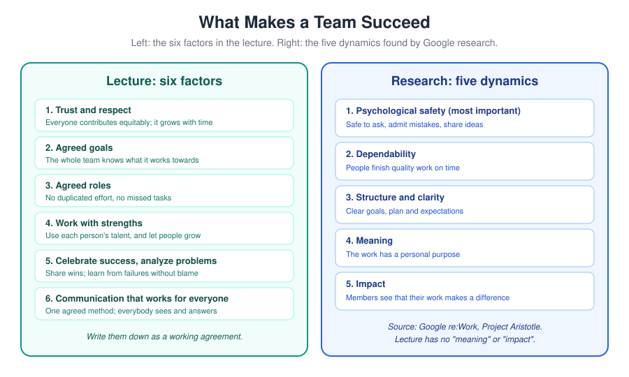
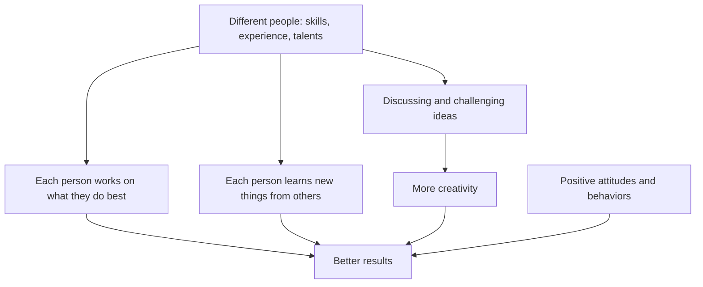
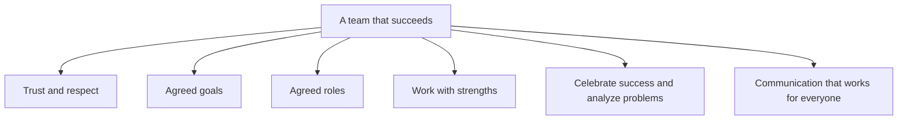
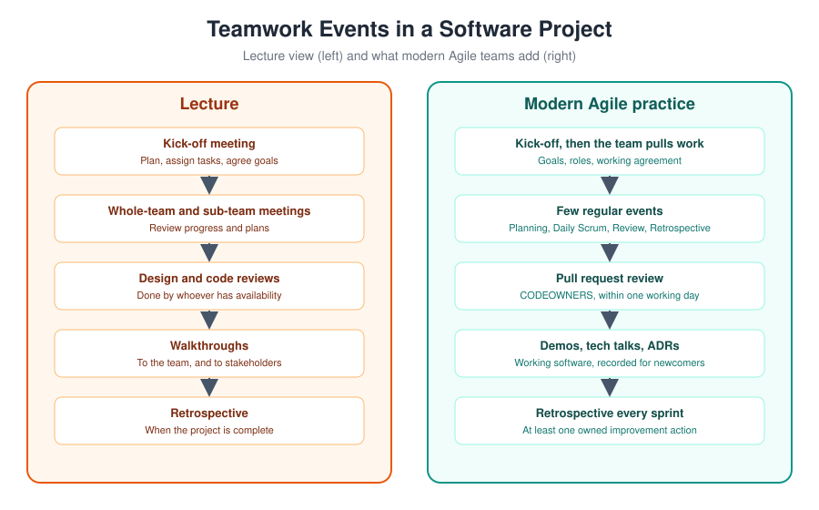
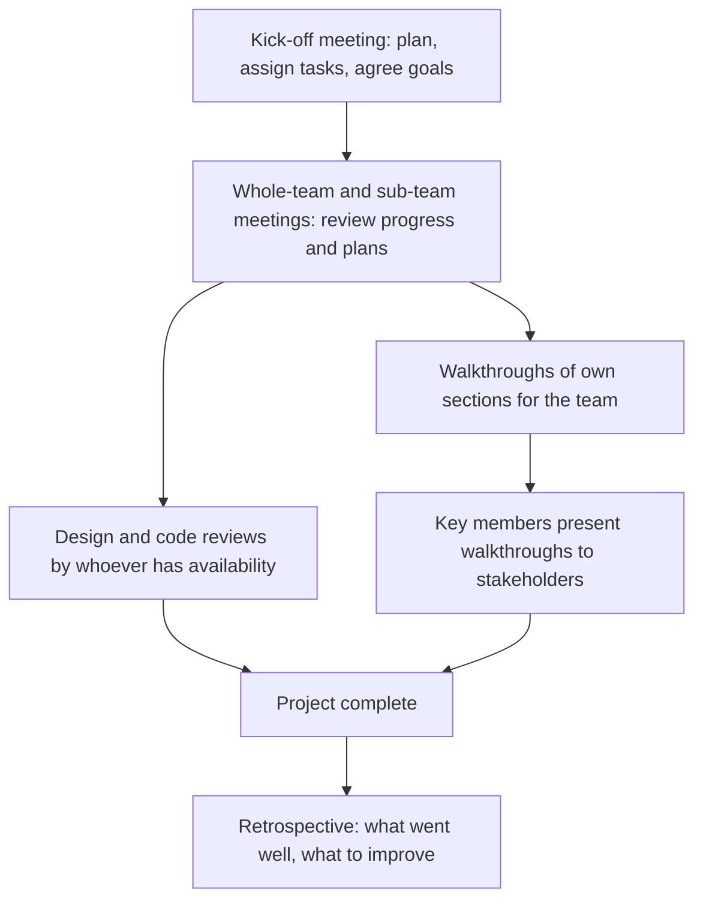
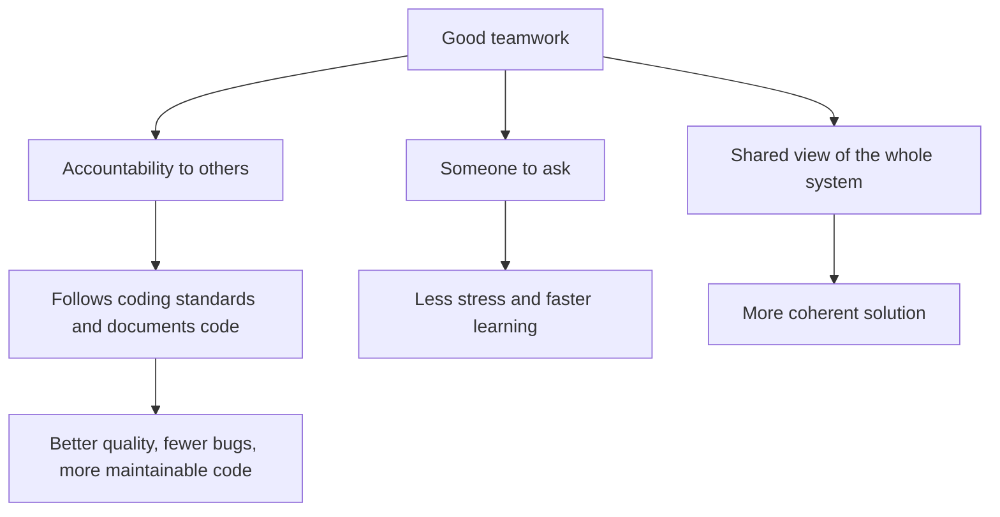
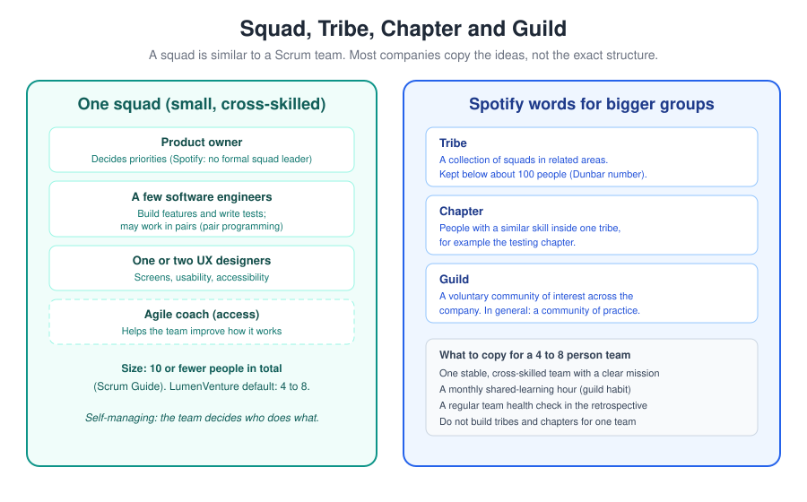
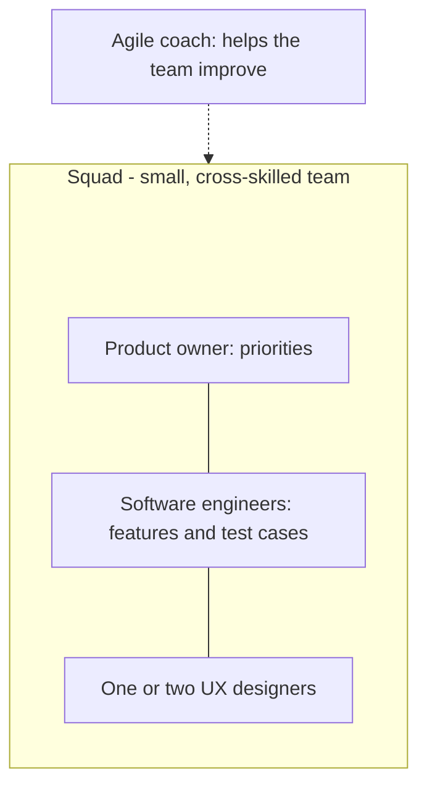
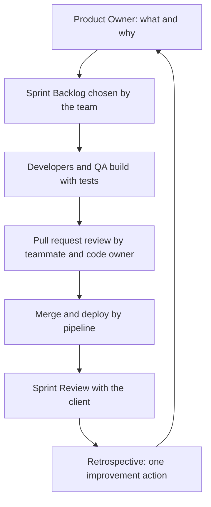

# 04 — Teamwork and Squads

**Learning goals of this lecture:** after this lecture you can **define teamwork**, **describe the advantages of collaboration** in software engineering, and **describe squads**.

> **How to read these notes:** facts from the lecture are the base. Blocks marked **✅ Modern Best Practice** or **Not in the lecture — industry practice** are added so you learn how teams work today. Blocks marked **⚠️ Correction** fix something the lecture says that is wrong or outdated. The lecture's own words are kept only in the quiz lines under each correction, in the "Lecture says" quotes and in the "Lecture" table columns.

---

## 1. Jargon Translation (Read This First)

| Term | Official definition | Simple words | Analogy |
|---|---|---|---|
| **Team** | A group of people working together towards a common aim. | People who share one goal and work on it together. | A football team: different positions, one match to win. |
| **Teamwork** | The way team members combine their skills, effort and communication to reach the shared goal. | Doing the job *together*, not just next to each other. | Rowers in one boat who pull at the same rhythm. |
| **Collaboration** | Working with others, sharing ideas and tasks, to produce something together. | Helping each other and combining ideas. | Cooking a meal together in one kitchen. |
| **Stakeholder** | A person or group affected by the project or able to affect it (clients, users, managers). | Someone who cares about the result of the project. | The people who will live in the house you build. |
| **Kick-off meeting** | The first meeting of a project: the team agrees on goals, plans how to work and starts. | The "opening whistle" meeting. | The team talk before a match. |
| **Walkthrough** | A short presentation where a person explains their part of the work, step by step, so others understand it. | "Let me show you how my part works." | A guided tour of one room of the house. |
| **Code review** | Teammates read and check a change before it is merged. Also called a peer review. | A second pair of eyes on every change. | A co-pilot checking the pilot's flight plan. |
| **Retrospective** | A meeting where the team looks back at how it worked and agrees on improvements. | "What went well, what can we do better?" | A coach and the team watching the match video after the game. |
| **Mentor** | A more experienced person who advises and supports another person's growth. | A guide who shares what they have learned. | An older climber who knows the mountain. |
| **Coach** | A person who helps a team or a person improve how they work, mostly by asking questions and giving feedback. | Helps you find your own better way. | A personal trainer. |
| **Agile** | A way of building software in short cycles, with close teamwork, regular feedback and change. | Build in small steps, learn, adjust. | Steering a bike: many small corrections. |
| **Squad** | In Agile organizations, the name for a small, cross-skilled team. The word comes from the Spotify way of working, where a squad is similar to a Scrum team. | A small Agile team. | A small special-forces unit with all the skills for one mission. |
| **Scrum team** | The Scrum Guide's name for a small, self-managing team: Product Owner, Scrum Master and Developers. It has no sub-teams and no hierarchy. | A small team that decides by itself who does what. | A band that plays without a conductor. |
| **Tribe, chapter, guild** | Spotify terms. A **tribe** is a group of related squads. A **chapter** is people with a similar skill inside one tribe. A **guild** is a wider community of interest across the company. | Ways to connect squads so skills and ideas travel. | Tribe = a neighbourhood. Chapter = the same trade on one street. Guild = a hobby club for the whole town. |
| **Pair programming** | Two people write code together at one computer. One is the **driver** (types), the other is the **navigator** (reviews and thinks ahead). | Two brains, one keyboard. | Driver and co-driver in a rally car. |
| **Psychological safety** | The shared belief that you will not be punished or embarrassed for asking a question, admitting a mistake or sharing an idea. | You can speak up without fear. | A classroom where it is safe to say "I don't understand." |
| **Working agreement** | A short written set of rules the team makes for itself: how we communicate, review, decide and meet. | The team's own "house rules". | The rules on the fridge of a shared flat. |
| **Bus factor** | The number of people who would have to disappear before nobody on the team knows how a part of the system works. A low number is a risk. | How many people hold the key knowledge? | Only one person has the key to the shop. |

---

## 2. Topics Introduced in the Lecture Transcript

1. **What a team is** — a group of people working together towards a common aim, with different skills, experience and talents.
2. **Why teamwork helps** — strengths and growth, creativity, and an empowering effect of positive behavior.
3. **What makes a team succeed** — trust and respect, agreed goals, agreed roles, working with strengths, celebrating success and analyzing problems, and good communication.
4. **Teamwork in a software project** — kick-off meeting, whole-team and sub-team meetings, design and code reviews, walkthroughs for the team and for stakeholders, retrospectives.
5. **Mentoring** — having a mentor, being a mentor, team mentoring.
6. **Internal team projects** — code standards, legacy cross-project code, and reviewing new software.
7. **Benefits of good teamwork** — creativity, strengths, learning, coding standards and documentation, better quality code, less stress, deeper understanding, a coherent solution.
8. **Squads** — the Agile name for a small team: size, squad leader, software engineers, user experience designers, pair programming.
9. **Summary** — teams meet regularly, teamwork encourages creativity and shares knowledge, and squads are small teams used in Agile development.

---

## 3. Exhaustive Deep Dive & Structured Notes

### 3.1 What a Team Is and Why Teamwork Matters

#### 3.1.1 Definition

- **By definition, a team is a group of people working together towards a common aim.**
- Inside a team you find **a range of different people**, with different **skills**, **experience** and **talents**.
- The three words are different:
  - **Skills:** things a person has learned to do (for example writing SQL queries).
  - **Experience:** things a person has already lived through (for example running a release).
  - **Talents:** natural strengths (for example explaining hard ideas simply).



#### 3.1.2 Strengths and growth

- Each person can give **attention and effort to the things they are good at**. This uses the team's talent well.
- By working with others on **tasks outside their current repertoire** (the things they usually do), people can **expand their skillset**.
- **Not in the lecture — industry practice: T-shaped skills.** A **T-shaped** engineer is deep in one area (the vertical bar) and knows enough about neighbouring areas (the horizontal bar) to work with others. Teams grow T-shaped people on purpose with pairing, code review and rotating tasks. This also lowers the **bus factor** risk (see 3.4.3).

#### 3.1.3 Creativity and empowerment

- **Working in a team promotes creativity.** Collaborating gives you the chance to **discuss ideas** and **challenge one another's thinking** about a subject.
- **Good teamwork is empowering:** **positive attitudes and behaviors** affect the rest of the team and **create positive results**. One person's good habits can lift the whole team.
- ⚠️ A warning from industry practice: the same effect works for **negative** behavior. Blame, sarcasm and silence spread too (see 3.2.3).



---

### 3.2 What Makes a Team Succeed

#### 3.2.1 The six factors from the lecture

The lecture says that working well as a team **does not always come naturally**, but some things help:

| Factor | What the lecture says | In practice (software team example) |
|---|---|---|
| **Trust and respect** | Each member must **trust and respect** the others. It grows **with time** and depends on all members **contributing equitably** (fairly). | People do what they promise; nobody does all the hard work alone; opinions are heard. |
| **Goals** | **Define and agree** the project goals so everyone knows what they work towards. | A written project goal and a Sprint Goal for each sprint. |
| **Roles** | **Define and agree** roles to avoid **duplication of effort** and **missed tasks**. | Who is Product Owner, Tech Lead, Delivery Lead, on-call? (See `team-roles` in the SDLC guide.) |
| **Strengths** | **Work with each member's strengths** to use the talent in the team. | Put the database expert on the schema; also give them chances to grow. |
| **Success and problems** | **Celebrate success** and **analyze problems**. | Share wins in the channel; blameless review of failures. |
| **Communication** | Communication is vital. Choose **a method that works for everyone**, so the whole team sees and responds to information. | One agreed channel for decisions; written summaries after meetings. |



#### 3.2.2 ✅ Modern Best Practice: research shows what makes teams effective

> **Lecture says:** trust and respect, goals, roles, strengths, celebrating success, analyzing problems and communication help a team to succeed.
> **Industry today:** teams use **research and written agreements** instead of hoping that good teamwork "comes naturally". The best-known study is **Google's Project Aristotle**.

- **Google's research (re:Work, "Understand team effectiveness")** found **five dynamics** of effective teams. Psychological safety was found to matter most; the other four follow it:
  1. **Psychological safety** — people feel safe to admit mistakes, ask questions and offer new ideas.
  2. **Dependability** — members reliably finish quality work on time.
  3. **Structure and clarity** — people know the goals, the plan and what is expected.
  4. **Meaning** — the work has a personal purpose for the members.
  5. **Impact** — members believe their work makes a difference.
- The same research reports that things like **being in the same place**, **seniority** and **extroversion** were **not significantly linked** to team effectiveness. *How* the team works matters more than *who* is on it.
- **Compare with the lecture:** "trust and respect" ≈ psychological safety and dependability; "goals" and "roles" ≈ structure and clarity. The lecture does not mention **meaning** or **impact**, which are about *why* the work matters.
- **Make it real with a working agreement.** A short document, written by the whole team, that covers:
  - how we communicate (channels, response times, meeting hours);
  - how we review (who, how fast, how to write comments);
  - how we decide (who decides what, how we disagree and then commit);
  - our Definition of Done and our meeting rules;
  - how we help each other (asking for help is normal).
- **Review the agreement in the retrospective** and change it when it does not work. A rule that nobody follows is removed or fixed.

#### 3.2.3 Not in the lecture — industry practice: psychological safety in daily work

| Habit that builds safety | Habit that destroys it |
|---|---|
| "Thanks for raising this." | Mocking a "stupid question" |
| **Blameless** reviews: "What allowed this to happen?" | "Who broke production?" |
| The leader admits their own mistakes first | Leaders who are never wrong |
| Questions are welcome in reviews | Only seniors may comment |
| Disagreement is about ideas, not people | Personal attacks, sarcasm |

- **Conflict is normal.** A healthy team **disagrees about ideas** and then **decides**. Common method: write the options and reasons (for example in an **ADR (Architecture Decision Record)**), let the person responsible decide, and **disagree and commit** (everyone supports the decision even if they would have chosen another).
- **Team stages (a classic model, Tuckman):** many teams find it useful to think of **forming** (meeting), **storming** (conflict about how to work), **norming** (agreeing rules) and **performing** (working well). Real teams do not always follow these steps in order, but the model helps: conflict is a normal step, not a failure.

---

### 3.3 Teamwork Across a Software Project





#### 3.3.1 Kick-off meeting

- Teams **often start a project with a kick-off meeting**. There they:
  - **plan how they will complete the project**;
  - **assign tasks**;
  - **agree on goals**.

#### 3.3.2 ✅ Modern Best Practice: kick-off, and who decides who does what

> **Lecture says:** at the kick-off meeting the team plans, assigns tasks and agrees goals.
> **Industry today:** the kick-off agrees **goals, roles, working agreement and first steps**. In Agile teams, **people are not handed tasks by a manager**. The team **plans its own work** and members **pick** work from the backlog.

- The **Scrum Guide** says a Scrum Team is **self-managing**: it **internally decides who does what, when, and how**.
- In the LumenVenture guide: the Product Owner decides **what** is built and in which order; the Tech Lead and Developers decide **how**; the Delivery Lead (Scrum Master) **does not assign tasks** ([README §3.3](../../../SDLC/README.md#33-role-rules)).
- A good **kick-off checklist**: shared goal and success measures; who is who (roles and backups); how we work (working agreement, tools, meeting times); stakeholders and how we keep them informed; first sprint plan; risks.
- **Why it matters:** people who choose their work feel ownership. Assigned work can lead to "not my idea" and to hidden problems.

#### 3.3.3 Meetings during the project

- Through the project, **whole-team** and/or **sub team** (small group) meetings **review progress and plans**.
- **Modern view (not in the lecture):** Agile teams use a **small set of regular meetings** (Scrum events): Sprint Planning, **Daily Scrum** (15 minutes), Sprint Review and Sprint Retrospective. Extra meetings are kept to a minimum.
- **Meeting hygiene:** every meeting has a purpose, an agenda, a time limit and a written summary with actions and owners. If a message can replace a meeting, send the message.

#### 3.3.4 Design and code reviews

- **Design and code reviews can be requested at the team level** and done by **whoever has availability** at that moment.
- Idea behind it: reviews are a team duty, not one person's job, and the work does not wait for one specific reviewer.

#### 3.3.5 ✅ Modern Best Practice: reviews with clear owners and speed

> **Lecture says:** reviews are requested at the team level and done by whoever has availability.
> **Industry today:** reviews are done by **pull request (PR)**, with **clear ownership**, **fast response times** and **automation** for the boring parts.

- **Rules that work:**
  - **Nobody approves their own change.** A teammate reviews every PR (GitHub also blocks self-approval).
  - **Review soon.** LumenVenture default: start within **one working day** ([Development rule 9](../../../SDLC/03-Development/Development.md#64-rules)).
  - **Small PRs** are reviewed faster and better.
  - **CODEOWNERS:** a file that lists the people or teams responsible for parts of the code. GitHub requests their review automatically on non-draft PRs. With branch protection "Require review from Code Owners", a change to those files needs an approval from an owner.
  - **Let tools do the style checks** (formatters, linters, tests in CI (Continuous Integration)) so people review design, logic and security.
  - **Write kind, clear comments:** question or suggestion, not command; explain why; praise good solutions.
  - Reviews are **learning**: reviewers learn the code, authors learn from feedback. This is a form of mentoring.
- "Whoever has availability" works for **general** reviews, but **risky** areas (security, payments, database changes) should always include the **owner** of that area.

#### 3.3.6 Walkthroughs

- Team members **may present walkthroughs of their sections of responsibility** to the rest of the team. The goal: **the whole team has oversight of all parts of the project**.
- **Key team members** also present walkthroughs **to stakeholders** at various times in the project.
- **Modern practice (not in the lecture):**
  - Walkthroughs to stakeholders are mostly **Sprint Reviews and demos** of **working software**, not slides.
  - Walkthroughs inside the team become **tech talks**, **design reviews**, **ADRs** and **short recorded demos** that new people can watch later.
  - They reduce the **bus factor** (3.4.3).

#### 3.3.7 Retrospectives

- **When a project is complete, retrospective meetings may be held** to look at **what went well** and **what could be improved in future projects**.

#### 3.3.8 ✅ Modern Best Practice: retrospectives every sprint, not only at the end

> **Lecture says:** retrospective meetings may be held when a project is complete, to improve future projects.
> **Industry today:** the **Sprint Retrospective happens at the end of every Sprint** (the Scrum Guide says it concludes the Sprint) so the team improves **now**, not only on the *next* project. A review at the **end of a project** is still useful as an extra.

- **Purpose (Scrum Guide):** to **plan ways to increase quality and effectiveness**.
- **Good retrospective:** safe space; look at facts (data, cycle time, incidents); pick **one to three improvements** with an **owner** and a date; **check them in the next retrospective**. LumenVenture rule: every retrospective has at least one improvement action ([README §6.6](../../../SDLC/README.md#66-working-rhythm-rules)).
- **Anti-pattern:** "Retrospectives that change nothing" (the same problems every sprint).
- **After incidents:** a **blameless postmortem** works like a retrospective for one event.

#### 3.3.9 Mentoring

- You may have a **mentor**, who may or may not be **in your current project team**.
- You might also be **asked to be a mentor**.
- Sometimes **team mentoring** is used so **everyone learns from each other**.

| Term | Focus | Typical form |
|---|---|---|
| **Mentoring** | Long-term career and skill growth, experience shared | Regular 1:1 talks with a more experienced person |
| **Coaching** | Improving how you work now, by questions and feedback | Short, goal-focused sessions |
| **Team mentoring** | Everyone teaches and learns | Pairing, brown-bag talks, review comments |

- **Not in the lecture — industry practice:** good mentoring has a **goal**, a **regular schedule** and **mutual respect**. A **buddy** for the first weeks helps new people (see the onboarding checklist idea in 3.7). A mentor outside the project can give honest advice that a line manager cannot.

#### 3.3.10 Internal projects

- Some groups have teams working on **internal projects**, such as:
  - **defining code standards**;
  - **maintaining or updating legacy cross-project code** (old code used by many projects);
  - **reviewing potential new software for usefulness to the team**.

#### 3.3.11 ✅ Modern Best Practice: communities of practice, platform teams, inner source

> **Lecture says:** some groups have teams working on internal projects like code standards, shared legacy code and checking new software.
> **Industry today:** these jobs have known forms, so they do not stay "side projects" that nobody has time for.

| Lecture's internal project | Common modern form |
|---|---|
| Defining code standards | A **community of practice** (Spotify calls it a **guild**): volunteers across teams who agree standards, linters and templates, and keep them in a repository. |
| Maintaining shared legacy code | A **platform team** or **owned shared library** with a named owner, a **CODEOWNERS** file, a roadmap and a support route. Or **inner source** (internal code that any team can improve through pull requests). |
| Reviewing new software | A **technology radar** or a short **ADR** per new tool, with a trial period, checking license, security, cost and exit plan (see the SDLC Design guide, rule 5). |

- **Give internal work time and an owner** (for example 10–20% of a sprint, as the SDLC Maintenance guide suggests for preventive work). Unowned shared code is the main source of "legacy" problems.

---

### 3.4 Benefits of Good Teamwork

#### 3.4.1 What the lecture lists

1. **Creativity** — working with others encourages new ideas.
2. **Strengths and learning** — you use each person's strengths and members **gain knowledge and skills** from each other.
3. **Standards and documentation** — in a team, software engineers are **more likely to follow corporate coding standards** and to **document their code regularly**.
4. **Better code** — the extra **accountability** (being answerable to others) gives **better quality code, fewer bugs and more maintainable code**.
5. **Less stress** — working as a team can reduce stress, because there is always someone to **turn to and get help from**.
6. **Understanding** — discussing problems **increases your understanding** and helps you **resolve more issues by yourself**.
7. **The bigger picture** — each member knows more of the **bigger picture**, so the result is a more coherent overall solution.



#### 3.4.2 ✅ Modern Best Practice: benefits are not automatic

> **Lecture says:** teamwork leads to better quality code, fewer bugs and more maintainable code.
> **Industry today:** teamwork **can** give these results, but only with **practices that create the accountability**: code review, CI (Continuous Integration) with tests, a Definition of Done, and clear ownership. A group without these can be **slower and worse** than one careful person.

- **Well-known team problems:**

| Problem | What it looks like | Fix |
|---|---|---|
| **Social loafing** | Some members do less because "the others will do it" | Clear roles, visible work, small tasks |
| **Groupthink** | Everyone agrees too fast, no one challenges | Ask for the opposite view; psychological safety |
| **Hero culture** | One person saves everything; others stay passive | Share knowledge, rotate tasks, thank the team |
| **Communication overload** | Too many meetings and channels | Working agreement, async-first, fewer meetings |
| **Too many people** | More people means more connections to manage | Small teams (see 3.5.2); Brooks's law: adding people to a late project can make it later (from *The Mythical Man-Month*, 1975) |

- **Conway's law:** the way your teams talk to each other will show up in your software. "Organizations which design systems … are constrained to produce designs which are copies of the communication structures of these organizations" (Melvin Conway, 1968). So team design is also **architecture design**: teams that own clear parts produce clear modules. Related: **Team Topologies** names four team types (stream-aligned, enabling, complicated-subsystem, platform); see the LumenVenture [README §3.2](../../../SDLC/README.md#32-optional-and-shared-roles).

#### 3.4.3 Not in the lecture — industry practice: knowledge sharing and the bus factor

- **Bus factor:** if one person is the only one who understands the payment code, the team has a bus factor of 1. If they leave or fall ill, the project is at risk.
- **How teams raise the bus factor:** pair or mob programming, code review across the team, walkthroughs and demos, **written documentation and runbooks**, ADRs, and **rotating** who works on what.
- **A rough check:** `git shortlog -sn --no-merges -- <folder>` counts commits per person for a folder. If one name has almost all of them, share that knowledge. (It is only a hint; commits are not understanding.)

---

### 3.5 Squads

#### 3.5.1 What the lecture says

- Some organizations that follow **Agile development methodologies** may call a team a **squad**.
- Typically a squad is a small team with **up to 10 developers**.
- It is likely to consist of:
  - **a squad leader** who acts as the **anchor developer and coach** for the squad;
  - **a few software engineers** who **develop and implement the product features and test cases**;
  - possibly **one or two user experience developers or designers**.
- In some squads the developers may work in **pairs** to practice **pair programming** (explained in another lecture).

#### 3.5.2 ⚠️ Corrections about squad size and leader

⚠️ **Correction:** a squad is **not defined by "up to 10 developers"**. The size limit counts **all members** (not only developers). The Scrum Guide says a Scrum Team is **typically 10 or fewer people**, including the Product Owner and Scrum Master. LumenVenture's default is **4–8 people** in total.
> **Lecture wording (for the quiz):** "Typically, a squad is a small team of up to 10 developers."

⚠️ **Correction:** "squad leader" is **not a standard Agile role**. The word "squad" comes from **Spotify's way of working**, where a squad is **similar to a Scrum team**. In that model a squad has **no formally appointed squad leader**. It has a **Product Owner** (decides priorities) and access to an **Agile coach** (helps the team improve). In Scrum, the team is **self-managing**, with **no sub-teams or hierarchies**. Some companies do give a squad a technical lead or coach, but the title and duties differ from company to company, so always check how your own organization defines the role.
> **Lecture wording (for the quiz):** "A squad leader who acts as the anchor developer and coach for the squad."

- **Why this matters:** if you think "a squad has a boss", you may expect someone to assign you tasks. In Agile teams, the **team decides how to do the work**, and leadership is shared. In LumenVenture terms the **Tech Lead** guides technical decisions, the **Delivery Lead** coaches the process, and the **Product Owner** decides priorities.

| Lecture's squad member | Standard role in this guide |
|---|---|
| Squad leader (anchor developer and coach) | Not a standard role. Split between **Tech Lead** (technical direction) and **Delivery Lead / Scrum Master** (coaching the process). The Spotify model also has a **Product Owner** and an **Agile coach**. |
| Software engineers (features and test cases) | **Developers**; in Agile everyone builds quality in, and **QA (Quality Assurance) Engineer** is a specialist inside the team |
| UX (user experience) developers or designers | **UX / product designer** (README §3.2) |



*The diagram shows the Spotify view of a squad, not the lecture's list (which has a squad leader).*



#### 3.5.3 ✅ Modern Best Practice: squads, the Spotify model, and what to copy

> **Lecture says:** some organizations that follow Agile may call a team a squad, a small team with a squad leader, engineers and designers.
> **Industry today:** "squad" comes from the **Spotify engineering model** (a 2012 description of how Spotify worked at that time). The paper says itself that it is **a snapshot of one company's current way of working**, "a journey in progress, not journey completed". Most companies copy the **ideas**, not the exact structure.

| Spotify term | What it is | In this guide |
|---|---|---|
| **Squad** | Basic unit of development, **similar to a Scrum team**; self-organizing, with all skills to design, develop, test and release | The project team (README §3) |
| **Tribe** | A collection of squads in related areas; kept small (the paper uses the "Dunbar number", about 100 people) | A product group or department |
| **Chapter** | People with similar skills in the same tribe (for example the testing chapter) who meet to share expertise | Skill group, e.g. QA or backend developers |
| **Guild** | A wider, voluntary **community of interest** across the company (for example a web technology guild) | A **community of practice** |

- **What to copy:** small, cross-skilled, stable teams with **autonomy** and a **clear mission**; a way to share skills across teams (chapters, guilds); regular health checks of each team.
- **What not to copy blindly:** tribe and chapter structures need many teams. For 4–8 people you need only **one good team** and a **guild-like habit** (a monthly shared learning hour).
- **Team shape check (Team Topologies):** most product teams are **stream-aligned** (own a flow of value end to end); a **platform team** supports them; an **enabling team** coaches. Keep teams small enough to know each other and the whole system.
- **Whole-team quality:** the lecture says engineers write "test cases". In Agile the **whole team owns quality**: developers write tests with the code, and the **QA Engineer** helps with test strategy and exploratory testing.

#### 3.5.4 Pair programming (mentioned in the lecture)

- The lecture: in some squads developers may work together **in pairs** to practice **pair programming**. This is taught in more detail later.
- **Fowler's description:** two people write code together on one machine; the **driver** types and thinks about the small goal, the **navigator** reviews as the work happens and keeps the bigger picture. They **swap roles regularly**.
- **Good for:** sharing knowledge, onboarding new members, catching errors early, spreading code ownership, and tricky problems.
- **Less useful for:** very routine tasks, or large unknowns where a **spike** (a short research task) is better. Pairing all day is tiring; the article suggests at most about **six hours** a day with breaks.
- **Mob programming** (also called ensemble programming): the whole team works on one task at one computer. It is useful for hard problems and for teaching.
- LumenVenture rule: pair or mob programming is **optional** for complex or risky work and for onboarding ([Development rule 11](../../../SDLC/03-Development/Development.md#64-rules)).

---

### 3.6 Not in the Lecture — Industry Practice: Communication Between People

- The lecture says: **choose a method that works for everyone**, so the whole team sees and answers information. Here is how teams do that.

| Need | Good habit |
|---|---|
| **Quick questions** | A team chat channel; agreed "response time" (for example within a few working hours, not minutes) |
| **Decisions** | Written down in one place (ADR, ticket, or decisions log), not only in chat or a call |
| **Meetings** | Purpose, agenda, time limit, summary with owners (see the `meeting-summary` template in the SDLC guide) |
| **Remote or time-zone work** | **Async-first:** write clearly, state what you need and by when; overlap hours for real-time talks; record demos |
| **Urgent problems** | A clear on-call route and incident channel, separate from normal chat |
| **Feedback** | Specific, kind, about the work. Say what you observed and what you suggest |

- **Common mistakes:** important decisions only in private messages; too many channels; "urgent" for everything; meetings with no result.
- **Inclusion:** make sure quieter people and people in other time zones can contribute (agenda before the meeting, written input, rotating meeting times).

---

### 3.7 Often-Missed Parts

- **Onboarding is teamwork:** a new member needs access, a buddy, a first small task and the working agreement in the first week. A written onboarding checklist (an SOP) saves many hours.
- **Team health is measurable:** use a short team survey every few sprints (for example Google's five dynamics) and talk about the results in the retrospective.
- **Stakeholders are part of the system:** keep them informed with demos and short written updates; do not only talk to them at the end.
- **One backlog, one goal:** a team with several unrelated goals acts like several teams.
- **Leaders set the tone:** leaders model the behavior they expect (admit mistakes, ask questions, thank people).
- **People who leave:** exit handover is a team task. Update docs, share keys and passwords through the secret manager, never in chat.

#### Done enough when… (a healthy team)

- [ ] The team has **one shared goal** and everybody can say it in a sentence.
- [ ] **Roles and backups** are written down and known (`docs/team-roles.md`).
- [ ] The team has a **working agreement** that it reviews in retrospectives.
- [ ] Every sprint ends with a **retrospective** with at least one improvement action and an owner.
- [ ] Every change is **reviewed** by someone else within about one working day; owners of risky areas are always included.
- [ ] At least **two people** understand every important part of the system (the bus factor is not 1).
- [ ] **Decisions** are written down in one place.
- [ ] New people get a **buddy** and an onboarding checklist.
- [ ] People feel safe to ask questions and report mistakes (check with a short survey).

---

## 4. Concrete Real-World Example: A Squad Building the Book Review API (Application Programming Interface)

**Team (7 people, default for LumenVenture):** one Product Owner, one Tech Lead (also a Developer), three Developers, one QA Engineer, one UX designer (part time). The Delivery Lead role is held by one Developer (a "hat").

| Moment | What the team does | Lecture idea |
|---|---|---|
| **Kick-off** | Agree the goal "readers can post and read reviews"; fill in `team-roles`; agree the working agreement (reviews within one working day, decisions in `docs/adr`); plan sprint 1 | Kick-off meeting, define goals and roles |
| **Every day** | 15-minute daily stand-up in chat or call; pairs on the hardest story | Meetings; pair programming |
| **Pull request** | A developer opens a PR; CODEOWNERS adds the database owner for schema changes; a teammate reviews within a day | Design and code reviews |
| **Wednesday** | Tech talk: "How the review ranking query works" (20 min, recorded) | Walkthroughs for the team |
| **End of sprint** | Sprint Review: demo of working API and screens to the client; then Sprint Retrospective | Walkthroughs to stakeholders; retrospective |
| **Monthly** | Backend guild hour across projects: update the shared ESLint config and the API error format | Internal projects; code standards |
| **New joiner** | Buddy, onboarding checklist, first small bug fix paired with a senior | Mentoring |



---

## 5. Minimal Working Code Blocks

This lecture is about people, so only a few small files help. They are **configuration and process files** that a team keeps in Git.

### 5.1 `CODEOWNERS` — who must review what

```text
# .github/CODEOWNERS
# Pattern          Owners (people or teams). The LAST matching line wins.
*                  @lumen/backend-team          # default: any backend developer can review
/db/migrations/    @lumen/db-owners             # schema changes need a database owner
/.github/          @lumen/tech-leads            # protect the pipeline and this file itself
/docs/security/    @lumen/security-champions
```

- Needs: the file on the **base branch**, owners with **write access**, and branch protection **"Require review from Code Owners"**.
- **What happens if…** the file is missing, is on the wrong branch, or the owner team has no write access? **No review is requested automatically**, and a risky change can be merged with a normal approval. Also, if the file does not protect itself (`/.github/` line), a developer can change the rules in the same PR.

### 5.2 A short working agreement

```markdown
# Working agreement — Book Review API team (reviewed every 3 sprints)
- Chat: #book-review for questions (answer within 4 working hours); decisions go to docs/adr.
- Reviews: every PR gets a reviewer within 1 working day; nobody approves their own PR.
- Disagreement: we write the options and reasons, the Tech Lead decides, we all support the decision.
- Meetings: daily 10:00 (15 min); every meeting ends with owners and dates in the summary.
- Asking for help is normal. We do blameless reviews of mistakes.
```

**What happens if…** the agreement is written once and never reviewed? People ignore it, new people do not know it, and the same problems return. Put "check the working agreement" on the retrospective agenda.

### 5.3 Rough bus-factor check

```bash
# Commits per person in one folder (example output; names are fictional)
git shortlog -sn --no-merges -- src/payments/
#   58  Alex Rivera
#    3  Sam Okoye
```

**What happens if…** 95% of commits come from one person? The bus factor is about 1. Plan pairing and a walkthrough for that part. (Commit counts are only a hint, not proof of who understands the code.)

---

## 6. Related Concepts

1. **Scrum events and roles (Agile):** Sprint Planning, Daily Scrum, Sprint Review and Sprint Retrospective are the regular team meetings; the Scrum Team is self-managing and has no sub-teams.
2. **Code review and CI/CD (DevOps):** reviews, CODEOWNERS and automatic tests turn "teamwork" into daily accountability.
3. **DevOps culture and "you build it, you run it":** the team that builds a service also runs it (on-call). This needs shared ownership, runbooks and blameless postmortems.
4. **Conway's law and Team Topologies (architecture):** the shape of teams and their communication shapes the system; design teams to match the architecture you want.
5. **Git collaboration (pull requests, branches, protected `main`):** the backend tool for teamwork. Branch protection, required reviews and small PRs make teamwork safe and fast.

---

## 7. Lecture Summary & Quick Reference Table

| Topic | Lecture | ✅ Modern best practice |
|---|---|---|
| **Team** | A group working together towards a common aim, with different skills, experience and talents | Same, plus research (Project Aristotle) shows **psychological safety**, dependability, clarity, meaning and impact matter most |
| **Success factors** | Trust and respect, goals, roles, strengths, celebrate success and analyze problems, communication | Write them as a **working agreement**, review it in retrospectives, make communication **async-first** |
| **Kick-off** | Plan, assign tasks, agree goals | Agree goals, roles and ways of working; **the team pulls work**, it is not assigned by a manager |
| **Meetings** | Whole-team and sub-team meetings | A **small set of regular events** (Daily Scrum, Review, Retrospective); every meeting has a purpose and a summary |
| **Reviews** | Requested at team level, done by whoever has availability | **Pull requests**, nobody approves their own change, **CODEOWNERS** for risky areas, review within one working day, tools check style |
| **Walkthroughs** | Presented to the team and to stakeholders | **Demos of working software**, tech talks, ADRs, recorded sessions; lowers the bus factor |
| **Retrospective** | When a project is complete | **Every sprint**, with owned improvement actions; plus blameless postmortems after incidents |
| **Mentoring** | Mentor in or outside the team; team mentoring | Mentoring, coaching, buddies and pairing, each with goals and a schedule |
| **Internal projects** | Code standards, legacy shared code, new software review | **Communities of practice or guilds**, platform teams or inner source with owners, ADR and technology radar |
| **Benefits** | Creativity, learning, standards, better code, less stress, bigger picture | Benefits need **practices** (review, CI, Definition of Done); watch for groupthink, social loafing and a low bus factor |
| **Squad** | Small Agile team of up to 10 developers with a squad leader | Name from the **Spotify model** (a squad is similar to a Scrum team); **10 or fewer people in total**; no standard "squad leader" role |
| **Pair programming** | Developers in some squads pair up | **Driver and navigator**, swap often, not all day; **mob programming** for hard problems |
