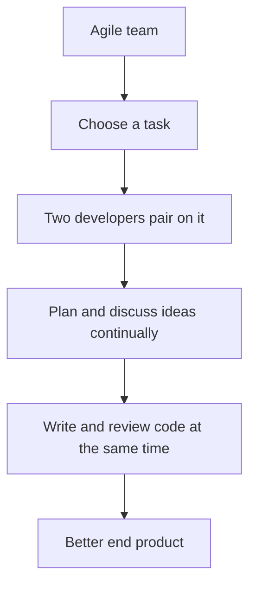
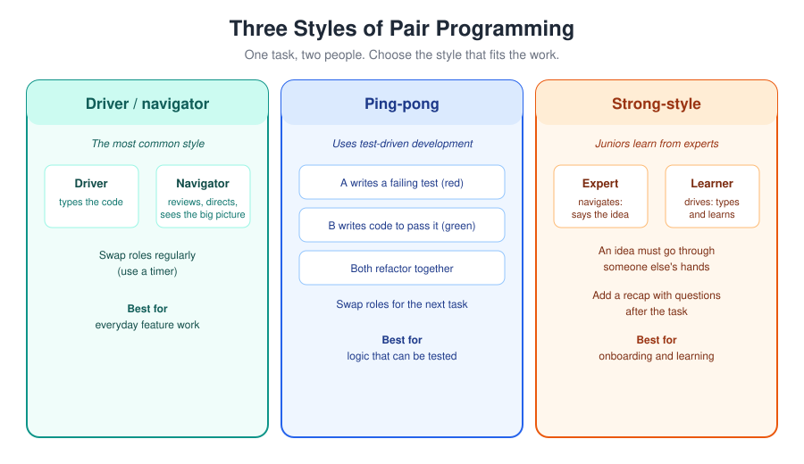
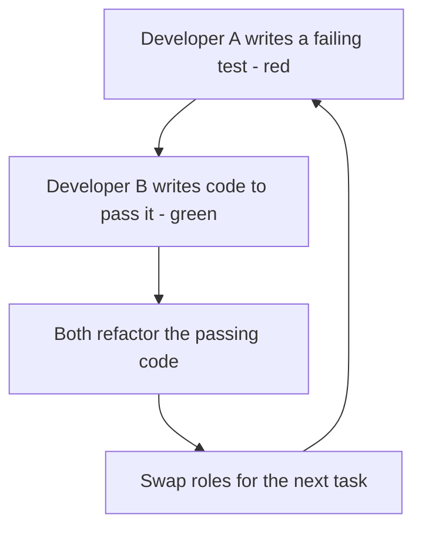
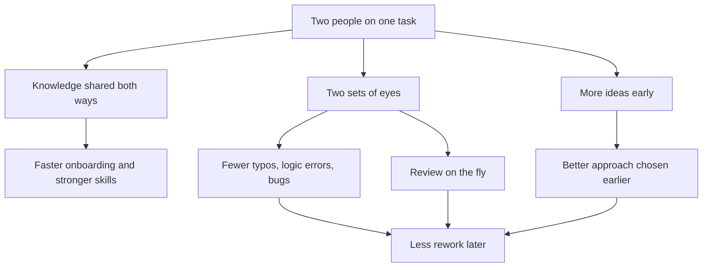
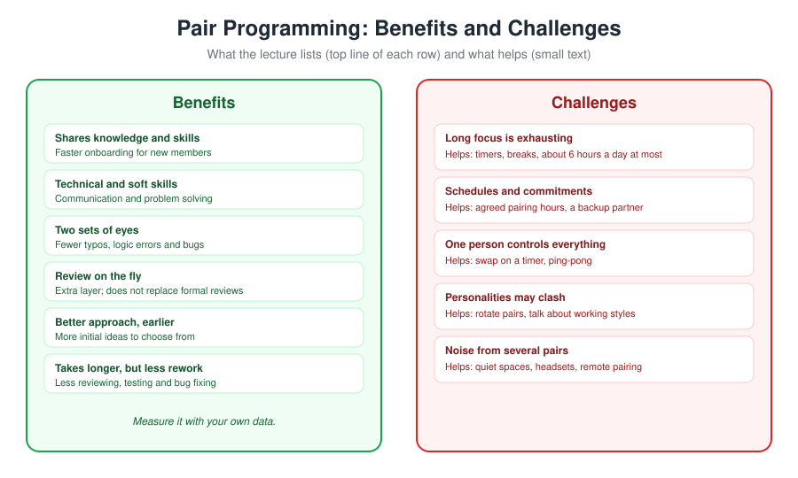
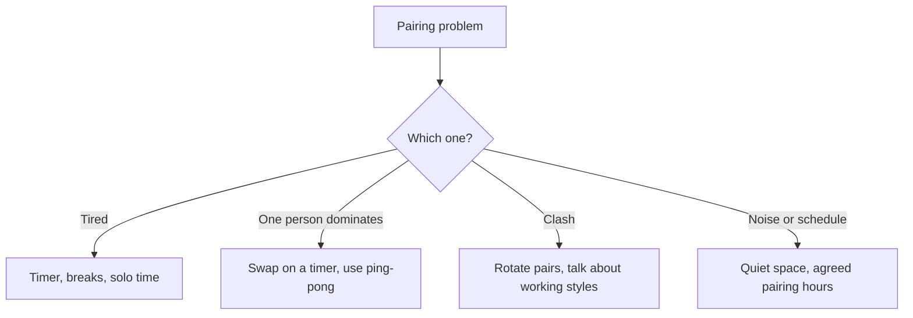

# 05 — Pair Programming

**Learning goals of this lecture:** after this lecture you can **describe pair programming**, **compare different styles**, and **list the benefits and challenges** of pair programming.

> **How to read these notes:** facts from the lecture are the base. Blocks marked **✅ Modern Best Practice** or **Not in the lecture — industry practice** add how teams work today. **⚠️ Correction** blocks fix a lecture statement. The lecture's own words appear only in quiz lines, "Lecture says" quotes and "Lecture" table columns.

---

## 1. Jargon Translation (Read This First)

| Term | Official definition | Simple words | Analogy |
|---|---|---|---|
| **Pair programming** | Two developers work together on one task at one computer, planning, discussing and reviewing as they go. | Two brains, one keyboard. | Driver and co-driver in a rally car. |
| **Driver** | The person who types the code and thinks about the small step in front of them. | The one with the keyboard. | The person holding the steering wheel. |
| **Navigator** | The person who reviews the code as it is written, gives directions, and keeps the bigger picture in mind. | The one who watches the map. | The co-driver reading the map. |
| **TDD (Test-Driven Development)** | A way of working where you write a failing automated test first, then the code that makes it pass, then clean up the code. | Test first, code second. | Writing the exam question before the lesson. |
| **Ping-pong pairing** | A pairing style that uses TDD: one person writes a failing test, the other makes it pass, and the roles swap. | Players hit the ball back and forth. | Table tennis. |
| **Strong-style pairing** | A style where every idea must travel from one person's head to the computer through the **other** person's hands. The expert navigates; the learner types. | "Tell me what to type." | A teacher dictating while the student writes. |
| **Refactoring** | Improving the structure of working code without changing what it does. | Tidy the code, same behavior. | Reorganizing a cupboard without buying new things. |
| **Mob programming** | The whole team works on one task at one computer (one driver, many navigators). Also called ensemble programming. | Pairing with more people. | A group solving one puzzle at one table. |
| **Soft skills** | Personal skills such as communication, listening and problem solving. | How you work with people. | Being a good teammate, not only a good coder. |
| **Agile** | A way of building software in short cycles with close teamwork and regular feedback. | Small steps, learn, adjust. | Steering a bike with many small corrections. |
| **Code review** | Teammates read and check a change before it is merged. | A second pair of eyes after the work. | A proofreader checking an essay. |
| **Remote pairing** | Pairing through video calls, shared screens or a shared editor, with the people in different places. | Pairing over the internet. | Playing chess online instead of at one board. |

---

## 2. Topics Introduced in the Lecture Transcript

1. **What pair programming is** — two developers side by side at one computer, in person or virtual.
2. **Pair programming and Agile** — continual planning and discussion, usually a better end product.
3. **Driver/navigator style** — the most common style; swap roles regularly.
4. **Ping-pong style** — TDD with swapping roles and refactoring together.
5. **Strong-style** — a way for juniors to learn from experienced engineers.
6. **Benefits** — shared knowledge, faster onboarding, technical and soft skills, fewer errors, review on the fly, a better approach earlier, less rework.
7. **Challenges** — exhausting focus, schedules, one person taking over, personality clashes, noise.

---

## 3. Exhaustive Deep Dive & Structured Notes

### 3.1 What Pair Programming Is

- **Pair programming is an extension of teamwork:** two developers work side-by-side at one computer.
- **Two ways to do it:**
  - **Physically** at the same computer.
  - **Virtually**, by **video link** or **shared screens**.
- The lecture says the **physical way is preferred**, but **virtual pair programming can also be productive**.
- **Why it helps (lecture):** the two developers **plan and discuss ideas continually** while they build the solution, which **generally results in a better end product**.

⚠️ **Correction:** pair programming is a **technique (a practice) used in Agile teams**, not a kind of Agile itself. Agile is the way of working; pairing is one practice inside it. It was made popular by **Extreme Programming (XP)**, an Agile method.
> **Lecture wording (for the quiz):** "Pair programming is a type of Agile development where two developers can plan and discuss their ideas continually as they create a solution, generally resulting in a better end product."



#### ✅ Modern Best Practice: remote pairing is normal, and tools matter

> **Lecture says:** physical pairing is the preferred option; virtual pairing can also be productive.
> **Industry today:** many teams are remote or hybrid, so **remote pairing is a normal, well-supported way to work**. Co-located pairing is easier, but remote pairing works well with the right setup.

- **Good remote setup:** a shared editor or screen share with low delay (for example a shared-editing feature of your IDE (Integrated Development Environment)), a good headset, a video call, and a timer for switching roles.
- **Agree the basics:** who drives first, how long before swapping, and how to take breaks.
- **Keep it human:** cameras on if people are comfortable, and short breaks away from the screen.

---

### 3.2 Styles of Pair Programming



#### 3.2.1 Driver/navigator style

- **The most common style.**
- The **driver** types the code. The **navigator** reviews the code **as it is written** and **gives directions** on where to go next.
- The navigator also **keeps an eye on the bigger picture** of the overall solution.
- **Swap roles regularly** so that **both people stay engaged** for the whole task.

| | Driver | Navigator |
|---|---|---|
| **Focus** | The next few lines (tactics) | Direction and design (strategy) |
| **Does** | Types, explains aloud what they do | Reviews, spots mistakes, thinks ahead, notes next steps |
| **Risk** | Tunnel vision | Taking over or going passive |

#### 3.2.2 Ping-pong style

- Ping-pong **uses test-driven development (TDD)**.
- **For each task:** one developer **writes a failing test**; the second developer **writes code to pass that test**.
- **For each new task they swap roles**, so the person who writes the test and the person who writes the code change regularly.
- At the **end of each task** both **refactor** the working code together to refine and improve it.



> **Not in the lecture — industry practice:** in the usual ping-pong, B, after making the test pass, writes the **next failing test** and A makes it pass. That is the "ball" going back and forth. Keep each step very small (minutes, not hours).

#### 3.2.3 Strong-style pairing

- **Strong style** pair programming is a good way for **junior software engineers** to learn from **more experienced** ones.
- **Defining rule:** for an idea to go **from your head to the computer, it must go through someone else’s hands**.
- **Roles:** the **more experienced person is the navigator**; the **driver learns** by watching their implementation and **thought processes**.
- **Lecture detail:** the driver shouldn’t challenge ideas until the full implementation is complete, so the navigator's flow is not interrupted.
- **Where it comes from (not in the lecture):** the rule is Llewellyn Falco's "strong-style pairing" (blog post, 30 June 2014). Falco says the expert almost always navigates and everything goes through the novice's hands.

#### ✅ Modern Best Practice: use the style that fits the task

> **Lecture says:** three styles; strong-style is for juniors learning from experts; the driver does not challenge until the end.
> **Industry today:** teams **mix styles** and treat them as tools, not rules. Strong-style is a **learning phase**, and "do not challenge" is not a license to stay silent forever.

| Situation | Good style |
|---|---|
| Normal feature work, both people know the code | Driver/navigator, swap about every 10–30 minutes |
| New logic that can be tested | Ping-pong (TDD) |
| Junior or new joiner learning | Strong-style, then move to driver/navigator as they grow |
| Large unknown (new tool) | Do a short **spike** (research task) first, maybe alone, then pair on the real work |
| Hard problem for the whole team | **Mob programming** |

- **After a strong-style task,** do a short **recap** and let the driver ask questions and give opinions. Learning needs two-way talk.
- **Swap often.** A **timer** (for example every 15–25 minutes) makes it easy and fair.
- **Avoid long solo tasks inside a pair.** If you split up, set a time to meet again.

---

### 3.3 Benefits of Pair Programming

#### 3.3.1 What the lecture lists

1. It is a good way to **share knowledge and skills** from one developer to another, or in both directions.
2. A **new team member gets up to speed** on a project faster.
3. **Technical skills improve**, and so do **soft skills** such as **communication and problem solving**.
4. **Two sets of eyes** on the code often mean **fewer typos, logic errors and bugs**.
5. It enables **code reviews to be done on the fly**: this **does not replace formal code reviews**, but it adds **another layer of review**.
6. Two people create **several initial ideas**, so the **optimal approach** is likely chosen **earlier**.
7. Pairing **can take longer** than one person writing the same solution, but it is **likely to produce better code**, with **less time spent reviewing, testing, and bug fixing**.



#### ✅ Modern Best Practice: benefits are real but not automatic

> **Lecture says:** pairing is likely to give better code with less time spent reviewing, testing and bug fixing.
> **Industry today:** pairing is a **strong default for risky, complex or learning work**, but not a guaranteed saving for every task. Teams decide **when** to pair.

- **Good for:** onboarding, spreading domain knowledge, complex or unclear problems, catching errors early, building shared code ownership, and reducing the **bus factor** (how many people must leave before nobody knows a part of the system).
- **Less useful for:** very routine, well-understood tasks, and big unknowns that need quiet research first.
- **Cost:** two people on one task is a real cost, so choose the work where the benefit is highest. The claim "less rework later" depends on the team and the task; measure it with your own data (defects, review time, cycle time) instead of assuming it.
- **Pairing does not replace the rest:** keep **pull request reviews**, CI (Continuous Integration) and tests. Pairing is an extra layer (as the lecture says). A paired change still gets a review from someone who did not write it when the risk is high.
- **Credit both people in Git:** add a `Co-authored-by:` line to the commit message (GitHub shows both as authors; use a blank line before the trailers):

```text
Add review rating validation

Co-authored-by: Sam Okoye <sam@example.com>
```

---

### 3.4 Challenges of Pair Programming



#### 3.4.1 What the lecture lists

| Challenge | Meaning | What helps (industry practice) |
|---|---|---|
| **Exhausting focus** | Pairing needs **long periods of focus**, which tires both people | **Breaks**, timers, no all-day pairing: aim for at most about **6 hours** a day, with solo time for email, thinking and admin |
| **Schedules and commitments** | **Personal or other work commitments** disturb the pair schedule | Agree pairing hours (for example 10:00–15:00), plan pairs in the sprint, keep a **backup** pair partner |
| **One person controls everything** | The pairing becomes **typist/programmer**: one types, the other only watches, and **none of the benefits** appear | **Swap roles on a timer**, use ping-pong, ask the quiet person to drive, the navigator must talk and think |
| **Personalities that clash** | Two people may **not work well together** | Rotate pairs, set working agreements, ask a mentor or the Delivery Lead for help, respect different styles |
| **Noise** | Several pairs talking can create a **noisy environment** and **disturb others** | Quiet rooms or bookable pairing spots, headphones for others, remote pairing with a headset |



#### 3.4.2 Not in the lecture — industry practice: other things to watch

- **Power differences:** a senior and a junior may find it hard to speak openly. The navigator (often the senior) should ask questions, not only give orders.
- **Pair rotation:** change pairs every few days so knowledge spreads. Do not rotate for its own sake; each change costs some onboarding time.
- **Different working styles and needs:** some people need more breaks, quiet time or a different setup. Ask, and do not force one way. Accessibility needs (for example screen readers) must be planned in remote tools.
- **Good habits for the driver and the navigator:** the driver talks while typing; the navigator keeps notes of next steps and "later" ideas so they do not interrupt the flow.

---

### 3.5 Not in the Lecture — Industry Practice: AI Assistants and Pairing

- **AI coding assistants** can feel like a pair partner (they suggest code and explain it). They are **a tool, not a teammate**: they do not know your real context, can be wrong with confidence, and cannot share responsibility.
- **You stay responsible.** Read, understand, test and review every AI suggestion like code from any other person. The LumenVenture guide says this in [Development rule 6](../../../SDLC/03-Development/Development.md#64-rules).
- **Do not replace human pairing for learning.** A junior who only accepts AI output does not learn the thought process that strong-style pairing teaches. Use AI **inside** a human pair: the driver asks the AI, the navigator checks the answer.
- **Never paste secrets or confidential data** into unapproved tools.

---

### 3.6 Often-Missed Parts and "Done Enough When…"

- **Pairing agreement:** before the first session, say who drives first, the swap time, break times, how to disagree, and how to end the session.
- **Mob programming** is the next step up: one keyboard, the whole team, one driver, rotating every few minutes.
- **Remote tools:** share an editor or screen, use a timer, and agree what happens when the connection drops.
- **Measure what matters:** watch defects, review time and cycle time for paired and solo work, and talk about the results in the retrospective.

**Done enough when…**

- [ ] Everyone on the team knows the three styles and when to use each.
- [ ] A short **pairing agreement** exists (swap time, breaks, schedule).
- [ ] Pairs **swap roles** on a timer; nobody is stuck as a typist.
- [ ] Pairing is used for **onboarding and risky work**, not forced on every task.
- [ ] Both people are **credited in Git** (`Co-authored-by:`).
- [ ] **Formal reviews and tests still run** on paired work.
- [ ] The team looks at how pairing is going in each retrospective.

---

## 4. Concrete Real-World Example: Pairing on the Book Review API

**Situation:** Priya is new. She and Marco, a senior developer, must add a "rating must be 1 to 5" rule to the Book Review API (Application Programming Interface).

| Step | What happens | Style |
|---|---|---|
| 1 | Marco navigates and tells Priya what to type; Priya drives and learns how the team structures validation | Strong-style |
| 2 | They write a failing test: `POST /reviews` with rating 7 must return 400 | Ping-pong |
| 3 | Priya writes the validation code to pass it; then she writes the next failing test (rating 0) and Marco passes it | Ping-pong |
| 4 | Both refactor the validation into a shared function | Ping-pong refactor |
| 5 | After 25 minutes the timer rings; they swap and recap | Driver/navigator |
| 6 | They open a pull request with a `Co-authored-by:` line; a third teammate reviews it | Formal review still happens |

---

## 5. Minimal Working Code Blocks

A tiny **ping-pong** round with Node.js's built-in test runner (tested with Node.js 24).

```javascript
// slug.test.mjs  — A writes the tests first (RED: they fail)
import { test } from 'node:test';
import assert from 'node:assert/strict';
import { slugify } from './slug.mjs';

test('turns a title into a url slug', () => {
  assert.equal(slugify('Pair Programming 101'), 'pair-programming-101');
});
test('trims dashes at both ends', () => {
  assert.equal(slugify('  Hello, World!  '), 'hello-world');
});
```

```javascript
// slug.mjs  — B writes the code to make them pass (GREEN)
export const slugify = (s) =>
  s.toLowerCase().trim()              // lower case, no spaces at the ends
   .replace(/[^a-z0-9]+/g, '-')       // every run of other characters becomes one dash
   .replace(/^-|-$/g, '');            // no dash at the start or end
```

```bash
node --test            # run all tests
```

**Real results from our run:** with a stub (`slugify = (s) => s`) the run shows `tests 2, pass 0, fail 2` (red). With the code above it shows `tests 2, pass 2, fail 0` (green). Then both refactor, swap roles, and write the next test.

**What happens if…** the pair skips the red step and writes code first? You never see the test fail, so you cannot be sure the test checks anything. A test that was never red may pass for the wrong reason.

---

## 6. Related Concepts

1. **Test-Driven Development (TDD):** ping-pong pairing is TDD split between two people (red, green, refactor).
2. **Code review and pull requests:** pairing is review while writing; the pull request is the formal, recorded review.
3. **Mob programming:** the same idea with the whole team at one keyboard; good for hard problems and teaching.
4. **Git collaboration (`Co-authored-by`, small commits):** how paired work is credited and kept understandable in history.
5. **Mentoring and onboarding (teamwork):** strong-style pairing is a fast, hands-on form of mentoring for new team members (see note 04, Teamwork and Squads).

---

## 7. Lecture Summary & Quick Reference Table

| Topic | Lecture | ✅ Modern best practice |
|---|---|---|
| **What it is** | Two developers side by side at one computer, in person or virtual | A technique used in Agile teams (not a "type of Agile"), popularized by XP; remote pairing is normal |
| **Driver/navigator** | Most common; driver types, navigator reviews and keeps the bigger picture; swap regularly | Swap on a timer (about 15–30 minutes); driver talks aloud; navigator keeps notes |
| **Ping-pong** | TDD; one writes a failing test, the other makes it pass; swap each task; refactor together | Red, green, refactor in very small steps; B writes the next failing test |
| **Strong-style** | Idea goes through someone else's hands; expert navigates; driver does not challenge until the end | A learning phase: do a recap with questions; move on to normal pairing as the learner grows |
| **Benefits** | Shared knowledge, onboarding, soft skills, fewer bugs, review on the fly, better approach, less rework | Strong for risky or learning work; measure results; pairing adds a review layer but does not replace pull requests |
| **Challenges** | Tiring, schedules, one person dominates, personalities, noise | Timers and breaks (about 6 hours a day at most), agreed hours, rotate pairs, quiet spaces |
| **AI assistants** | Not mentioned | A tool inside the pair, never a replacement; the human stays responsible |
