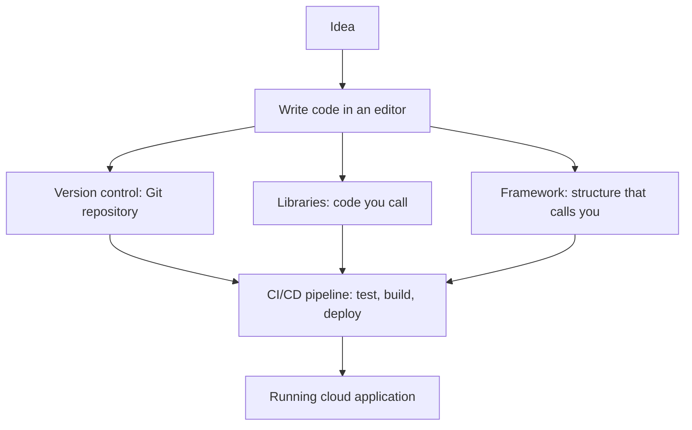
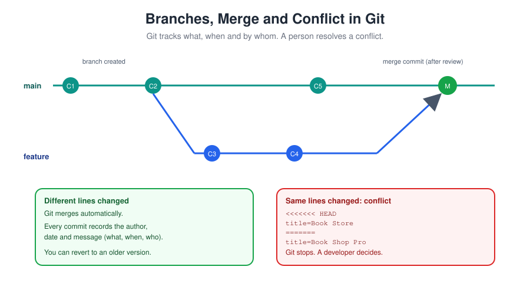
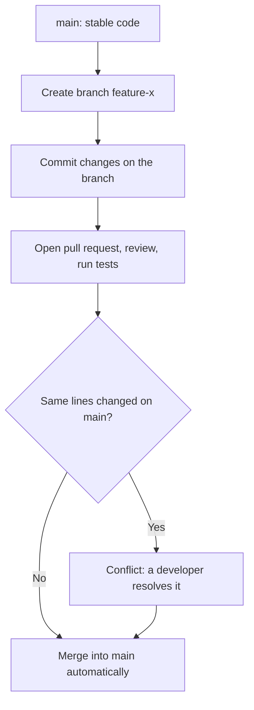
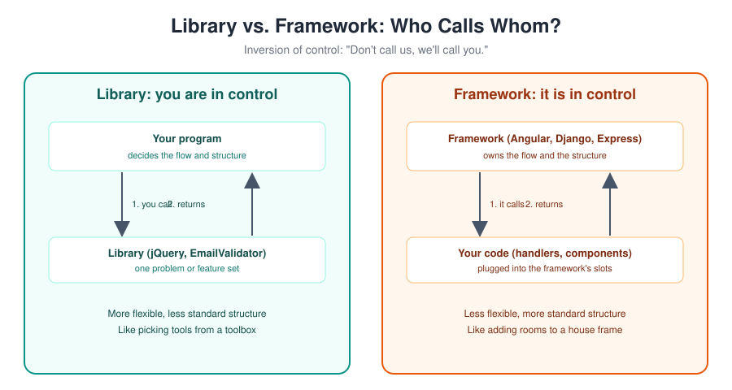
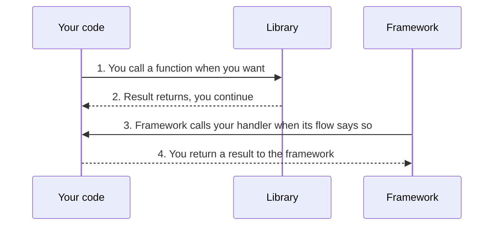

# 06 — Introducing Application Development Tools

> **How to read these notes:** facts from the lecture are the base. **✅ Modern Best Practice** and **Not in the lecture — industry practice** blocks add how teams work today. **⚠️ Correction** blocks fix a lecture statement. The lecture's own words appear only in quiz lines, "Lecture says" quotes and "Lecture" table columns.

---

## 1. Jargon Translation (Read This First)

| Term | Official definition | Simple words | Analogy |
|---|---|---|---|
| **Version control system (VCS)** | A tool that records every change to files over time, so you can see who changed what and when, compare versions and go back. | A time machine and diary for your code. | The "version history" of a shared document. |
| **Git** | A **distributed** version control system (the Pro Git book lists Git as a DVCS: clients fully mirror the repository, including its full history). It is very widely used: git-scm.com cites the 2022 Stack Overflow survey, where 96% of professional developers use Git. | The tool that tracks your code. | A notebook that you can copy and compare. |
| **GitHub** | A website and platform that **hosts Git repositories** and adds teamwork features (pull requests, issues, automation). It is built on Git, but it is not Git. | A shared online home for Git projects. | Git is the camera; GitHub is the photo-sharing site. |
| **Repository (repo)** | A folder of project files together with its full change history. | The project folder plus its memory. | A filing cabinet with a logbook. |
| **Branch** | A separate line of changes, so you can work on one feature without touching the main code. | A safe copy to experiment on. | A side road that later joins the highway. |
| **Merge and merge conflict** | **Merging** combines the changes of two branches. A **conflict** happens when both changed the same lines and Git cannot choose. | Joining two versions of a text; sometimes you must decide. | Two people edited the same sentence. |
| **Library** | A collection of reusable code that **you call** when you need it. You stay in control. | A toolbox: you pick the tool. | A box of kitchen tools. |
| **Framework** | A ready-made structure for an application. It **calls your code** at the right time. | A skeleton you fill in. | The frame of a house. |
| **Inversion of control (IoC)** | The control flow is turned around: instead of your code calling the library, the framework calls your code. Fowler: "Don't call us, we'll call you." | The framework is in charge of the order. | A theatre director who tells actors when to enter. |
| **Opinionated framework** | A framework that decides for you how to structure files, names and workflow. | It has strong "house rules". | A flat-pack kit with one right way to build. |
| **API (Application Programming Interface)** | The set of functions or URLs that a piece of software offers to other code. | The "buttons" a library or service gives you. | The controls on a machine. |
| **DOM (Document Object Model)** | The browser's tree model of a web page, which JavaScript can read and change. | The page as a tree of objects. | A family tree you can edit. |
| **Dependency** | A library or package your project needs. | Code you borrow. | An ingredient from another shop. |
| **Package manager** | A tool that downloads, installs and updates dependencies (for example npm, the Node.js package manager). | An app store for code libraries. | A supply delivery service. |

---

## 2. Topics Introduced in the Lecture Transcript

1. **The developer's workbench** — version control, libraries and frameworks.
2. **Version control** — what it tracks, why it helps even a solo developer, repositories, Git and GitHub, branches and merging.
3. **Libraries** — reusable code that you call; examples jQuery, EmailValidator, Apache Commons Proper.
4. **Frameworks** — a skeleton that calls your code; examples Angular, Vue.js, Django.
5. **Inversion of control and opinionated frameworks.**
6. **Library vs framework** — control, flexibility, standardization.

---

## 3. Exhaustive Deep Dive & Structured Notes

### 3.1 The Workbench and Why Tools Matter

- Getting a cloud app **from the idea stage to fully formed, written and deployed** is a **long process**. Many tools help.
- A cloud application developer's workbench includes version control, libraries, and frameworks.
- **Not in the lecture — industry practice:** the real workbench is bigger: an editor or IDE (Integrated Development Environment), a **package manager** (npm), a test runner, a linter, CI/CD (Continuous Integration and Continuous Delivery) pipelines, containers (Docker), and cloud tools. Version control is the base for most of them, because pipelines start from a Git push (see [Development](../../../SDLC/03-Development/Development.md)).



---

### 3.2 Version Control

#### 3.2.1 What the lecture says

- **Why:** when **many developers** work on the same project, knowing **the order in which changes were made** (each one creates a **new version** of the source code) becomes extremely important.
- **A version control system keeps track of what changes were made, when, and by whom**, and **resolves conflicts** between changes (see the correction below).
- **Useful even for a sole contributor.** Used properly it lets you **revert to an older version** if something goes wrong and gives **basic information about how the code developed** over time.
- The lecture links version control to the storage system and recommends a **code repository, even for beginners** (see the correction below).
- **Git and GitHub** are extremely popular for source code storage and management.
- **Git stores files in repositories** where you can **track changes**, **split code into branches** for more focused development, and then **merge them back into the main body of code**.

⚠️ **Correction:** version control and storage are **separate things**. **Git** is the version control tool and works **fully on your own computer** (a local repository), with no internet needed. **GitHub** is a **hosting and collaboration service** built on Git: it stores a shared copy online and adds pull requests, issues and automation. You need a **repository** for version control, but not GitHub. We host the repository to **share** it and to **back it up**.
> **Lecture wording (for the quiz):** "Version control functionality is generally tied to the storage system you are using, which is why a code repository is recommended, even for beginners."

⚠️ **Correction:** a version control system **detects** conflicts but does **not resolve** them. When two changes touch the same lines, Git **stops the merge and marks the conflict**, and a **developer decides** which text is correct.
> **Lecture wording (for the quiz):** "Version control systems keep track of what changes were made when, and by whom, and resolve any conflicts between changes."





#### 3.2.2 What a repository records

| Idea | Meaning |
|---|---|
| **Commit** | A saved snapshot of the changes, with the author, date and a message. This answers "what, when, by whom". |
| **History** | The chain of commits. You can see old versions and compare them. |
| **Branch** | A separate line of commits (for example `feature/rating-validation`). |
| **Merge** | Joining a branch back into `main`. |
| **Tag** | A fixed name for a version, for example `v1.4.0`. |

#### 3.2.3 ✅ Modern Best Practice: version control is a team workflow, not only a history

> **Lecture says:** version control tracks changes, lets you revert, and supports branches that merge back into the main code.
> **Industry today:** teams add rules and automation around Git, so the main branch stays always working.

- **Protect `main`:** changes arrive by **pull request (PR)**, need a review and passing tests (CI), and nobody pushes directly.
- **Short-lived branches:** merge small changes often (trunk-based development or GitHub Flow) to avoid big, painful conflicts.
- **Clear commit messages** (Conventional Commits) and **small commits** make history useful. Use **tags** for releases.
- **`.gitignore`:** never commit secrets, `node_modules` or build output. A secret that was committed must be **rotated** (replaced), because history keeps it.
- **Reverting safely:** `git revert` creates a new commit that undoes a change (safe for shared branches); history rewriting is for local work only.
- The LumenVenture rules for branching, reviews and commits are in [Development §4.1–4.3](../../../SDLC/03-Development/Development.md#41-branching-strategies).

---

### 3.3 Libraries

#### 3.3.1 What the lecture says

- **Libraries are collections of code**, such as standard programs and **subroutines** (functions), that you use inside your code.
- **Example:** a navigation feature like a **carousel** (a slider of items). A library can supply the code, so you **do not spend time and energy creating one from scratch**.
- **Reuse** makes building your app **quicker and easier**.
- **Many libraries** can be added to one project. When you **discover a need** for a function or feature, you **research an appropriate library**.
- **You determine when to call** the method you need. The **control returns to the program flow** when the subroutine is finished. **When you use a library, you are in control.**
- Libraries solve **a specific problem** or add **a specific feature set**. There are **many to choose from, so do your research**.

**Lecture examples**

| Library | What the lecture says | Notes |
|---|---|---|
| **jQuery** | A JavaScript library that simplifies **DOM manipulation** | Older but still on many sites. See the block below |
| **EmailValidator** | A small library that checks that an email address is correctly constructed and valid | It checks the **format** only; it cannot know if the mailbox exists. Confirm with a verification email |
| **Apache Commons Proper** | A repository of **reusable Java components** | A Java example; the Node.js equivalent is packages from npm |

#### 3.3.2 ✅ Modern Best Practice: choose and manage libraries with care

> **Lecture says:** libraries are a quick way to reuse code, and you should research which one to use.
> **Industry today:** every library is a **dependency**, and a dependency is also a **risk**. Teams research on purpose and manage dependencies with tools.

- **jQuery today:** browsers now have built-in DOM tools (`querySelector`, `fetch`, `classList`), so new projects usually do not need jQuery. It is still maintained (official jQuery blog): jQuery 4.0.0 came out on 17 January 2026 and 4.1.0 on 17 November 2026 (jQuery blog). You will meet it in older code, so you should be able to read it.
- **How to "do your research":** a short checklist before adding a library.

| Check | Question |
|---|---|
| **Need** | Can the platform or a few lines of code do this without a library? |
| **Maintenance** | Recent releases? Active maintainers? Open issues handled? |
| **Security** | Known vulnerabilities (`npm audit`)? Few or no install scripts? |
| **License** | Does the license fit our use (MIT, Apache-2.0, GPL)? |
| **Size and fit** | How large is it? Does it work with our runtime (Node.js LTS)? |
| **Exit plan** | How hard is it to replace later? |

- **Package manager and lockfile:** install with **npm**, commit `package-lock.json`, and install from the lockfile (`npm ci`) so every machine gets the same versions. Use **SemVer ranges** carefully (see [Development §4.8](../../../SDLC/03-Development/Development.md#48-dependencies-and-supply-chain-security)).
- **Supply-chain risk:** malicious or hijacked packages are a real danger; check names, keep few dependencies, scan in CI, and update on purpose.

---

### 3.4 Frameworks

#### 3.4.1 What the lecture says

- **Frameworks provide a standard way to build and deploy applications.**
- Think of a framework as a **skeleton** you **extend with your own code**: a **scaffold** to build your apps on.
- **The lecture says** the framework must be **determined early in planning** and used **from the beginning**, and that new frameworks **can't be incorporated into an existing project** (see the correction below).
- **Your chosen framework dictates the architecture** of the program and **controls the program flow**. It **determines which subroutines and methods are called when**.
- There is a **specific structure you must follow**. **The framework calls on your code** rather than you calling the framework.
- Frameworks are **less flexible than libraries** (you have **less control**), but they give **good standardization** and can help you create **efficient code**.
- **Carpenter analogy:** the framework is the **frame** of the house that you add to (bricks outside, **plasterboard** inside); it **guides how the house is built**.
- **Examples:** **Angular** (a JavaScript-based framework for dynamic web applications), **Vue.js** (focused on the user interface), **Django** (uses Python for web development).

⚠️ **Correction:** you do **not** have to choose a framework only at the very start, and you **can** move an existing project to a new framework. It is **hard and costly**, so teams choose carefully early, but they do it when needed, usually **step by step**: new pages use the new framework while old pages keep running, until the old code is gone (the "strangler" approach). Some frameworks are built for this: Vue calls itself "The Progressive Framework" and can be used to enhance static HTML (HyperText Markup Language) without a build step (vuejs.org).
> **Lecture wording (for the quiz):** "The framework you intend to use must be determined early in your development planning and used right from the beginning." and "New frameworks can't be incorporated into an existing project."



#### 3.4.2 Library vs framework

| | **Library** | **Framework** |
|---|---|---|
| **Who is in control?** | **You** call it | The **framework calls your code** (inversion of control) |
| **Flexibility** | High | Lower |
| **Standardization** | Low: you design the structure | High: the framework gives the structure |
| **Scope** | One problem or feature set | A full way to build the application |
| **Needs a structure?** | No | Yes, you follow its structure |
| **Analogy (lecture)** | Tools you pick up when needed | The frame of the house |
| **Examples** | jQuery, EmailValidator, Apache Commons | Angular, Django (Vue can be adopted step by step, see 3.4.1) |



#### 3.4.3 Inversion of control and opinionated frameworks

- **Inversion of control (IoC):** the feeling that the **framework and its predefined workflow** control the development. Martin Fowler describes it: a library call "does some work and returns control to the client", while the "framework's code then calls your code".
- **Opinionated frameworks** are frameworks with **a lot of control**. They have opinions about **how the workflow should be used**, and they **remove many decisions**: how code is written, **the location of files**, even **file names**.
- **Frameworks often include their own libraries**, which they call when needed.
- **Benefit (lecture):** IoC helps you build **standardized apps** and takes away **tedious configuration**, so you can **focus on the code for your app**.

#### 3.4.4 ✅ Modern Best Practice: pick the framework by need, and know the range

> **Lecture says:** frameworks are opinionated, less flexible than libraries, give standardization, and are chosen early.
> **Industry today:** frameworks sit on a **range from minimal to opinionated**, and many projects mix a small framework with libraries.

| Style | Meaning | Backend and front-end examples |
|---|---|---|
| **Minimal (unopinionated)** | Gives routing and structure but few rules | **Express** (Node.js): you add validation, structure and database yourself |
| **Opinionated** | Decides structure, files, naming | **Django** (Python), **Angular**, NestJS (Node.js; gives an out-of-the-box architecture inspired by Angular; runs on Express by default, or Fastify) |
| **Library at the center** | A library plus your choice of tools | **React** (UI library; its official docs recommend starting new apps with a framework such as Next.js (react.dev, checked 2026-11-26)) |

- **Django** shows the "batteries included" idea. Its current official version is 6.1.3 (Django download page).
- **Angular** is written in **TypeScript** (the lecture calls it JavaScript-based, which is loosely true because TypeScript compiles to JavaScript). See [note 02](02-learning-front-end-development.md) for Angular, React and Vue in more detail.
- **How to choose:** team skills, the ecosystem, long-term support (check the end-of-life date), fit with the problem, and how easy it is to hire for. Write the choice as an **ADR (Architecture Decision Record)** (see the Design guide, rule 5).
- **Do not over-use frameworks:** a small script or a simple site may need only libraries.

---

### 3.5 Often-Missed Parts

- **Tool choice is a design decision**, so record it (ADR) and keep an exit plan.
- **Learn the platform before the framework.** Frameworks change; JavaScript, HTTP (HyperText Transfer Protocol) and Git last.
- **A library you call can still call you back** (callbacks, events). The difference is who owns the main flow.
- **Check licenses** when you reuse code, especially in client work.
- **AI assistants** also suggest libraries: check that a suggested package really exists and is trusted before installing it (look-alike names are a known attack).

**Done enough when…**

- [ ] Every project has a **Git repository** with a protected `main`, PR reviews and CI (prototypes: should).
- [ ] Nobody commits **secrets**; `.gitignore` is set.
- [ ] Each dependency passed the **research checklist** and is installed from a **lockfile**.
- [ ] The **framework choice** is recorded in an ADR with its support dates and an exit idea.
- [ ] The team can explain **library vs framework** and where the control flow sits.

---

## 4. Concrete Real-World Example: The Book Review API

| Need | Tool | Library or framework? |
|---|---|---|
| Track changes and work in parallel | **Git** with a **GitHub** repository (branch, PR, merge) | Version control |
| Serve REST (Representational State Transfer) routes such as `GET /books` | **Express** registers your handler and calls it for each request | Framework (minimal) |
| Validate the request body | A validation library you call in the handler (for example **zod**) | Library |
| Hash passwords | A library you call (for example an Argon2 package) | Library |
| Connect to MongoDB or SQL (Structured Query Language) databases | A driver or ORM (Object-Relational Mapper) you call | Library |
| Check an email address format | A small validation function or library, plus a confirmation email | Library |

**Flow:** a developer creates `feature/rating-validation`, commits, opens a PR, CI runs tests, a teammate reviews, and the branch merges into `main`. Express calls the handler (framework), which calls your libraries (validation, database).

---

## 5. Minimal Working Code Blocks

### 5.1 Library vs framework (inversion of control), tested in Node.js 24

```javascript
// ioc.mjs
import { createHash } from 'node:crypto';

// LIBRARY: you call it, when you want. You stay in control.
const id = createHash('sha256').update('book-42').digest('hex').slice(0, 8);
console.log('library call ->', id);

// FRAMEWORK style: you register handlers; the framework calls YOU.
function miniFramework() {
  const routes = new Map();
  return {
    get: (path, handler) => routes.set(path, handler),                  // you plug in code
    handle: (path) => (routes.get(path) ?? (() => '404 Not Found'))(),  // the framework decides when to run it
  };
}
const app = miniFramework();
app.get('/books', () => 'list of books');
console.log('framework calls your handler ->', app.handle('/books'));
console.log('no handler registered ->', app.handle('/missing'));
```

Real output:

```text
library call -> 3d071985
framework calls your handler -> list of books
no handler registered -> 404 Not Found
```

**What happens if…** you register no handler for a path? The framework follows its own rule and answers `404 Not Found`. You cannot change what it does unless the framework lets you plug in code there. This is the "less control" that the lecture describes.

### 5.2 A merge conflict (Git does not resolve it for you)

```bash
git merge feature        # both branches changed the same line of app.cfg
# Auto-merging app.cfg
# CONFLICT (content): Merge conflict in app.cfg
# Automatic merge failed; fix conflicts and then commit the result.
cat app.cfg
```

Real content of the file after the failed merge:

```text
<<<<<<< HEAD
title=Book Store
=======
title=Book Shop Pro
>>>>>>> feature
```

You edit the file to the text you want, remove the markers, then run `git add app.cfg` and `git commit`. To cancel, run `git merge --abort`.

**What happens if…** you commit the file with the markers still inside? The markers (`<<<<<<<`) become part of your code and usually break it. Always search for them before committing (a CI check can fail on them).

---

## 6. Related Concepts

1. **Git branching strategies and pull requests (DevOps):** how teams use branches, PRs and protected `main` to avoid conflicts and keep quality.
2. **Dependency management and supply-chain security (security):** package managers, lockfiles, audits and trusted packages.
3. **Express and middleware (Node.js):** Express is a minimal framework: it calls your route handlers and middleware.
4. **Dependency injection and the Hollywood principle (design):** other forms of inversion of control, used in Angular and NestJS.
5. **Semantic Versioning (SemVer):** how library versions tell you whether an update may break your code.

---

## 7. Lecture Summary & Quick Reference Table

| Topic | Lecture | ✅ Modern best practice |
|---|---|---|
| **Workbench** | Version control, libraries, frameworks | Also editor/IDE, package manager, tests, CI/CD, containers |
| **Version control** | Tracks what, when, by whom; resolves conflicts; tied to storage | Git is a local tool; GitHub hosts it; Git **detects** conflicts and people resolve them; protected `main`, PRs, small commits |
| **Git and GitHub** | Popular for storing and managing code | Git = tool, GitHub = platform; secrets never in history |
| **Libraries** | Reusable code you call; you are in control | Research checklist, lockfile, `npm audit`, license check, few dependencies |
| **jQuery, EmailValidator, Apache Commons** | Example libraries | jQuery is legacy-but-maintained; validate email format, then confirm by email |
| **Frameworks** | Skeleton; chosen early; cannot be added later | Choose carefully early, but migrate step by step when needed; record an ADR |
| **Inversion of control** | The framework calls your code | Same; also dependency injection; "don't call us, we'll call you" |
| **Opinionated frameworks** | Decide workflow, files, names | A range from minimal (Express) to opinionated (Django, Angular, NestJS) |
| **Angular, Vue.js, Django** | Example frameworks | Angular uses TypeScript; Django 6.1 current (Django download page); Vue can be adopted step by step (vuejs.org) |
