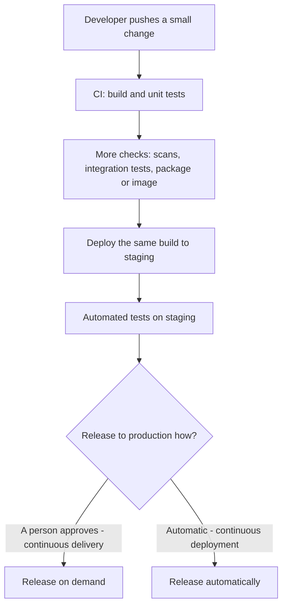
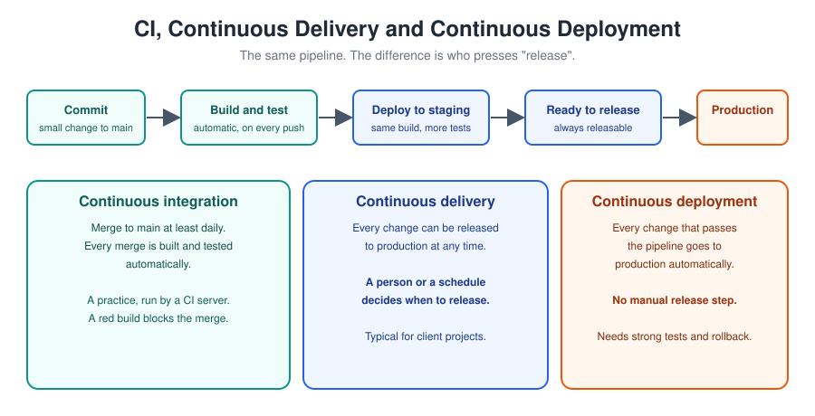
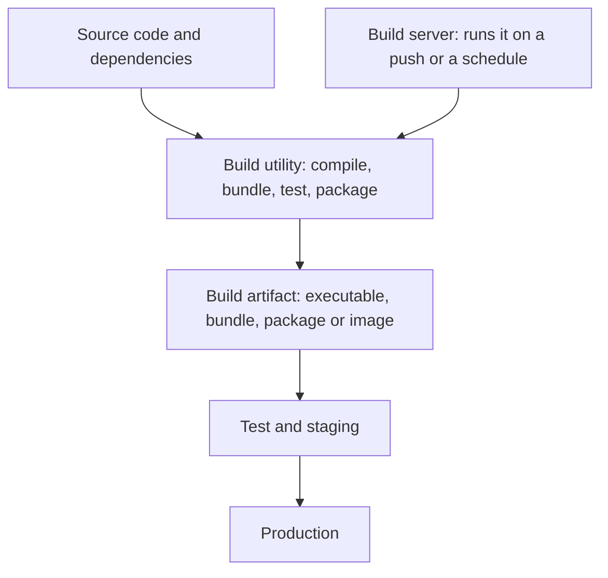
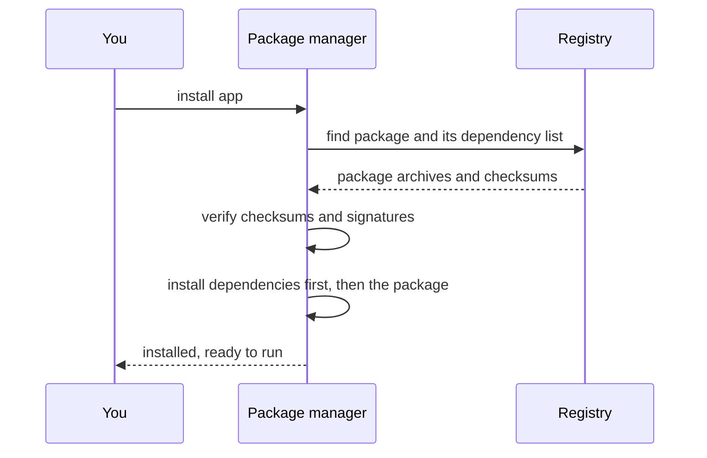

# 07 — More Application Development Tools

> **How to read these notes:** facts from the lecture are the base. **✅ Modern Best Practice** and **Not in the lecture — industry practice** blocks add how teams work today. **⚠️ Correction** blocks fix a lecture statement. The lecture's own words appear only in quiz lines, "Lecture says" quotes and "Lecture" table columns.

---

## 1. Jargon Translation (Read This First)

| Term | Official definition | Simple words | Analogy |
|---|---|---|---|
| **CI (Continuous Integration)** | A practice where team members merge their work into the shared mainline often (at least daily), and every merge is checked by an automated build and tests. | Join code often, test it automatically. | A baker who tastes the dough every time an ingredient is added. |
| **CD (Continuous Delivery)** | Building software so that it **can be released to production at any time** (Fowler), the path to production is automated, and the release itself is a choice. | Always ready to ship. | A parcel packed and addressed, waiting for the courier. |
| **Continuous Deployment** | Every change that passes the pipeline is **released to production automatically** (Fowler's definition). | Ships by itself. | The parcel leaves the moment it is packed. |
| **Pipeline** | The automated chain of steps (build, test, scan, package, deploy) that a change passes through. | A factory line for code. | An assembly line. |
| **Build tool** | A tool that turns source code into something you can run or install, and manages the steps and dependencies. | The "make it work" machine. | A factory robot that assembles parts. |
| **Build artifact** | The output of a build: an executable, a bundle, a package or a container image. | The finished product from the build. | The box leaving the factory. |
| **Bundler** | A tool that joins many source files and their dependencies into a few files for the browser. | Packs many files into one. | A suitcase for your clothes. |
| **Compiler / transpiler** | A **compiler** turns source code into another form (for example binary). A **transpiler** turns code into another version of a similar language. Babel is often called either. | A translator for code. | A translator who rewrites modern English into old English. |
| **Package** | An archive file with the app files, install instructions and **metadata** (name, version, dependencies). | A ready-to-install box of code. | A flat-pack furniture box with a manual. |
| **Package manager** | A tool that finds, downloads, installs, updates and removes packages and handles their dependencies. | An app store for developers. | A librarian who fetches the books you need. |
| **Registry (repository)** | A server that stores packages (for example the npm registry). | The warehouse of packages. | A library of ready-made parts. |
| **Lockfile** | A file that records the exact versions (and hashes) of every installed dependency. | The shopping receipt of your dependencies. | A recipe with exact brands and weights. |
| **WebAssembly (Wasm)** | A binary instruction format for a stack-based virtual machine, designed as a portable compilation target for programming languages. | A fast, portable code format that other languages compile **to**. | A universal shipping container for code. |
| **Dependency** | A package your code needs. | Code you borrow. | An ingredient from another shop. |

---

## 2. Topics Introduced in the Lecture Transcript

1. **CI/CD** — continuous integration, continuous delivery and continuous deployment.
2. **Build tools** — what they do, what they automate, and the two categories.
3. **Examples of build tools** — Webpack, Babel and WebAssembly.
4. **Packages** — archives with app files, installation instructions and metadata.
5. **Package managers** — what they do (find, install, maintain, uninstall; verify; manage dependencies).
6. **Package managers by platform** — Linux, Windows, Android, macOS.
7. **Package managers by language** — npm, Gradle and Maven, RubyGems, pip and Conda.

---

## 3. Exhaustive Deep Dive & Structured Notes

### 3.1 CI/CD

#### 3.1.1 What the lecture says

- **CI/CD** means the practices of **continuous integration** and either **continuous delivery** or **continuous deployment**.
- It is a **best practice for DevOps teams**, so developers can **deliver frequent changes reliably**.
- **CI is implemented through a build-automation server.** It makes sure **all code components work together smoothly**.
- A CI build environment lets you **integrate new code often: at least every day, if not every hour**, depending on how fast the project changes.
- **CD begins where CI ends** (see the correction below).

⚠️ **Correction (per Martin Fowler's description of continuous delivery):** the lecture's picture of CD is incomplete: it describes only the deployment to a staging environment, which is one stage of the pipeline. **Continuous delivery** means every change is kept **ready to release to production at any time**; the pipeline builds, tests, and promotes the same build through test and staging environments, and the **business or the team decides when to release**. **Continuous deployment** goes one step further: every change that passes the pipeline is **released to production automatically**. Deploying to a test or staging environment is only **one stage** of the pipeline, not the definition of CD.
> **Lecture wording (for the quiz):** "Continuous delivery (CD) begins where CI ends. The CI process automatically builds and tests your code, then CD deploys all code changes in a build to a testing or staging environment."





#### 3.1.2 ✅ Modern Best Practice: pipeline as code, trunk-based, small changes

> **Lecture says:** CI integrates code at least every day, and CI runs on a build-automation server.
> **Industry today:** the pipeline is **code in the repository**, runs on **every push and pull request**, and teams merge **small changes to `main` often** (trunk-based development).

- **Definition check (Fowler):** CI means team members **merge changes at least daily**, and each integration is **verified by an automated build including tests**.
- **Pipeline as code:** the steps are written in a file kept in Git and reviewed like code, for example a GitHub Actions workflow in `.github/workflows/ci.yml`. Other CI servers: Jenkins, GitLab CI, Azure DevOps.
- **What a good pipeline does (general practice):** install from the lockfile, lint, type check, unit tests, build **once**, scan dependencies and secrets, publish the artifact, deploy to staging, run smoke tests, then release.
- **Fast feedback:** keep the main build fast (general practice: minutes, not hours), fix a broken build immediately, and never merge with a red build.
- **Build once, promote the same artifact** through staging to production. Do not rebuild for production.
- **Measure:** DORA (DevOps Research and Assessment) metrics (five metrics: change lead time, deployment frequency, failed deployment recovery time, change fail rate and deployment rework rate; see the SDLC (Software Development Life Cycle) guide, README §10). The LumenVenture rules are in [Deployment](../../../SDLC/05-Deployment/Deployment.md).

---

### 3.2 Build Tools

#### 3.2.1 What the lecture says

- **A build tool transforms your source code into the binaries needed for installation.**
- Build tools **organize your source code, set compile flags and manage dependencies**.
- They matter most where there are **many inter-connected projects** and **many developers** on each. It is hard to track **what changed, in what order, which dependencies exist, and what goes into the next build**, so **automation is key**.
- **Build automation can do:** **downloading dependencies**, **compiling source code into binary code**, **packaging that binary code**, **running tests**, and **deployment to production systems**.
- You can **start a build from the command line or from an IDE** (Integrated Development Environment).

**Two categories of build tools (lecture)**

| Category | What it does | Examples (the note's classification; not all in the lecture) |
|---|---|---|
| **Build-automation utilities** | Generate **build artifacts** such as **executables** by compiling and linking source code | Make, Maven, Gradle, npm scripts, Webpack |
| **Build-automation servers** | **Run the utilities** on a **scheduled or triggered basis** | Jenkins, GitHub Actions, GitLab CI |

#### 3.2.2 The lecture's examples

| Tool | What the lecture says | Note |
|---|---|---|
| **Webpack** | A **module bundler** for JavaScript | Confirmed by its docs: "a static module bundler for modern JavaScript applications" |
| **Babel** | A **JavaScript compiler** | Its docs say the same; mainly converts modern ECMAScript (2015+) to a backwards-compatible version, and handles JSX (JavaScript XML, the HTML-like syntax of React) and TypeScript syntax |
| **WebAssembly** | Listed as a build tool example: a binary instruction format that runs in your browser | **Not a build tool** (see the correction) |

⚠️ **Correction:** **WebAssembly** (written as one word, short name **Wasm**) is not a build tool. It is a **binary instruction format for a stack-based virtual machine**, designed as a **portable compilation target** for other programming languages. You compile code **to** WebAssembly with a toolchain, and the result runs in browsers **and also outside the browser** (for client and server applications).
> **Lecture wording (for the quiz):** "And Web Assembly - a binary instruction format that runs in your browser."



#### 3.2.3 ✅ Modern Best Practice: build tools today

> **Lecture says:** build tools such as Webpack and Babel compile and bundle code and automate dependencies, tests and deployment.
> **Industry today:** the JavaScript build step is mostly **fast, ready-made tooling** with **reproducible builds**, and the CI server does the automation.

- **Newer, faster bundlers:** Vite (dev server and build; its docs say it originally used esbuild in development and Rollup for production, and describe a move to a unified toolchain, so check the current docs), esbuild, Rollup and Rspack are common. **Webpack is still widely used.**
- **Less Babel:** modern browsers and Node.js run recent JavaScript, so Babel is needed less. Fast compilers such as SWC and esbuild often replace it for TypeScript and JSX (general practice, not verified here). TypeScript's own compiler (`tsc`) checks types.
- **Backend (Node.js):** a plain JavaScript service often needs **no bundler**. TypeScript services compile with `tsc` or, in newer Node.js versions, run with built-in type stripping (see the Node.js TypeScript docs and check your version). Docker builds package the result.
- **Reproducible builds:** install from the **lockfile** (`npm ci`), pin the Node.js LTS (Long-Term Support) version, and keep build scripts in `package.json` (`npm run build`).
- **Cache and keep builds small:** cache dependencies in CI, build **once**, and produce a **single artifact** that moves through all environments.

---

### 3.3 Packages

#### 3.3.1 What the lecture says

- After the app is **developed and tested**, you deploy it. It must be **simple and trouble-free for the user to install**.
- A common technique: **collect all necessary files and bundle them into a package**.
- **Packages are archive files** containing the **app files**, **instructions for installation** and **any metadata** you choose.
- A package also has **its own metadata**: the **package description**, the **package version**, and its **dependencies** (other packages that must be installed first).
- After bundling the app into a package, you use a **package manager to distribute it**.

#### 3.3.2 ✅ Modern Best Practice: what a package really is today

> **Lecture says:** a package is an archive with the app files, installation instructions and metadata; a package manager distributes it.
> **Industry today:** the same idea, with **versioning rules, integrity hashes and signed or traceable builds**. For cloud services the **container image** is the usual deployable unit.

- **npm package example:** a `.tgz` archive made by `npm pack`, described by `package.json` (name, version, dependencies, `main`, `files`). Real output is in section 5.1: only the files you list in `files` are included, so `.env` is **not** shipped.
- **Semantic Versioning (SemVer):** `MAJOR.MINOR.PATCH` tells users if an update may break their code (see [Development §4.2](../../../SDLC/03-Development/Development.md#42-commits-and-versioning)).
- **Never put secrets in a package.** Check what is inside with `npm pack --dry-run` before you publish.
- **Container images** package the app **and** its runtime (for example Node.js and system libraries) for Docker or Kubernetes. Many cloud teams deploy images, not language packages, and keep images in a **registry**.

---

### 3.4 Package Managers

#### 3.4.1 What the lecture says

- A package manager handles **finding, installing, maintaining and uninstalling** software packages when the user asks.
- **Package management systems:**
  - **coordinate with file archivers** to extract package archives;
  - **verify checksums and digital certificates** to ensure the **integrity and authenticity** of the package;
  - **locate, download, install or update** software from a **software repository**;
  - **manage dependencies**, so a package is installed with all the packages it needs.



**Package managers by platform (lecture)**

| Platform | Lecture | Notes and corrections |
|---|---|---|
| **Linux (Debian family)** | "Debian Package Management System (DPKG)" | **dpkg** is the low-level tool; **APT** is the usual high-level tool (general practice; see the correction below) |
| **Linux (Red Hat family)** | "Red Hat Package Manager (RPM)" | The official name is **RPM Package Manager** (see the correction below); `dnf` is a common high-level tool (general knowledge, not verified) |
| **Windows** | Chocolatey | Microsoft's own **WinGet** (Windows Package Manager) is a command line tool to discover, install, upgrade and remove applications |
| **Android** | Package Manager | (Android's PackageManager is an operating-system service, not a command you type; general knowledge.) Apps are installed as packages (APK or AAB files); people usually get them from the Google Play store (general knowledge, not verified here) |
| **macOS** | Homebrew and MacPorts | Both are common |

⚠️ **Correction:** **dpkg** is the **low-level** Debian package tool. Debian's own reference says that commands such as `dpkg -i` do **not** automatically take care of the required package dependencies. **dpkg** handles the package files; **APT** (`apt`) adds finding, downloading and dependency handling (general practice on Debian-based systems). Together they match the lecture's definition of a package manager.
> **Lecture wording (for the quiz):** "On Linux - Debian Package Management System (DPKG)."

⚠️ **Correction:** **RPM** is a **recursive acronym** (the first letters stand for RPM itself): **RPM Package Manager**. The official site calls it "The RPM Package Manager". The first word originally stood for the company name Red Hat, and older documents still show that expansion (Wikipedia). It was created at Red Hat; other Linux distributions also use it (general knowledge).
> **Lecture wording (for the quiz):** "Red Hat Package Manager (RPM)."

**Package managers by language (lecture)**

| Language | Lecture | Also common today |
|---|---|---|
| **Node.js / JavaScript** | npm | pnpm, Yarn |
| **Java** | Gradle and Maven | (Gradle and Maven are also build tools) |
| **Ruby** | RubyGems | Bundler |
| **Python** | pip and Conda | virtual environments (`venv`) with pip; Conda for data science |

- The lecture says libraries and utility code developed as part of your application are managed with the "cloud application package managers". In simple words: you manage your **dependencies with the package manager of your language** (for example npm for Node.js), described in a file such as `package.json`.

#### 3.4.2 ✅ Modern Best Practice: lockfiles, integrity hashes and supply-chain safety

> **Lecture says:** package managers verify checksums and certificates, and manage dependencies.
> **Industry today:** teams also use **lockfiles**, **trusted sources** and **automated scans**, because attacks on packages are real.

- **Lockfile:** `package-lock.json` records the exact version, download URL (Uniform Resource Locator) and an **integrity hash** (`sha512-…`) for each package. Install with `npm ci` so every machine and every CI run gets the same files.
- **Verify the source:** use the official registry or a **private registry or proxy**, check package names (typosquatting), prefer packages with **provenance** and active maintainers.
- **Scan and update on purpose:** run `npm audit` or a scanner in CI, use Dependabot or Renovate for updates, and review new dependencies.
- **Keep an SBOM (Software Bill of Materials)** for releases (a list of everything inside).
- The LumenVenture rules are in [Development §4.8](../../../SDLC/03-Development/Development.md#48-dependencies-and-supply-chain-security); see also [note 06](06-application-development-tools.md).

---

### 3.5 Often-Missed Parts

- **CI is a practice, not a tool.** A CI server without frequent merges and good tests is not CI.
- **A green pipeline needs good tests,** or it only gives false comfort.
- **Infrastructure and config are code too:** Dockerfiles, Kubernetes manifests and pipeline files belong in Git and in the pipeline.
- **Secrets** must come from a secret manager or CI secrets, never from the repository.
- **Rollback:** every deployment needs a way back (see the Deployment guide).

**Done enough when…**

- [ ] Every push runs an automated build and tests (CI); a red build blocks the merge.
- [ ] Builds are **reproducible** (lockfile, pinned runtime) and produce **one artifact** that is promoted through all environments.
- [ ] The pipeline is code in the repository, reviewed like any change.
- [ ] Dependencies are installed with `npm ci`, scanned, and updated on purpose.
- [ ] The team knows whether it does continuous delivery (a person releases) or continuous deployment (automatic).

---

## 4. Concrete Real-World Example: The Book Review API (Application Programming Interface) Pipeline

| Step | What happens | Lecture idea |
|---|---|---|
| 1 | A developer opens a pull request from `feature/rating-validation` | Version control, CI trigger |
| 2 | CI installs with `npm ci`, runs lint, unit tests and a dependency scan | CI, package manager |
| 3 | The build step creates a Docker image tagged with the commit SHA (Secure Hash Algorithm id of the Git commit) | Build tool, package |
| 4 | The image is deployed to staging and smoke tests run | CD to a staging environment |
| 5 | (Example) The Tech Lead approves the release (client project) or it goes live automatically (internal product) | Continuous delivery vs deployment |
| 6 | Dependencies for the next feature are added with `npm install`, and the lockfile changes in the same PR | Package manager |

---

## 5. Minimal Working Code Blocks

### 5.1 Packaging and bundling with npm and esbuild (tested with Node.js 24)

```json
{ "name": "@lumen/slugify", "version": "1.0.0", "type": "module",
  "description": "Turn a title into a URL slug",
  "main": "src/index.js", "files": ["src"] }
```

```bash
npm pack --dry-run       # show what would go into the package archive
```

Real output (trimmed; the folder also contained a `.env` file):

```text
name: @lumen/slugify
version: 1.0.0
filename: lumen-slugify-1.0.0.tgz
total files: 2          <- only package.json and src/index.js
```

```bash
# main.js:  import { slugify } from './src/index.js'; console.log(slugify('Pair Programming 101'));
npm i -D esbuild                                   # a build tool (bundler)
npx esbuild main.js --bundle --minify --outfile=dist/app.js
node dist/app.js                                   # prints: pair-programming-101
```

The lockfile now records an integrity hash for each package, for example `"integrity": "sha512-…"`. `npm ci` checks it on every install.

**What happens if…** you forget the `files` list (and have no `.npmignore`)? npm may include more of the folder than you want, such as test data or a local `.env` with secrets. Always check with `npm pack --dry-run` before `npm publish`.

### 5.2 A minimal CI workflow (GitHub Actions; not run here, shown for the structure)

```yaml
# .github/workflows/ci.yml
name: ci
on: [push, pull_request]               # run on every push and pull request
jobs:
  build-test:
    runs-on: ubuntu-latest
    steps:
      - uses: actions/checkout@v7      # pin to a version or commit SHA in real projects
      - uses: actions/setup-node@v7
        with: { node-version: 24, cache: npm }   # the same Node.js LTS line as production
      - run: npm ci                    # exact versions from the lockfile
      - run: npm test                  # a red test fails the job and blocks the merge
      - run: npm run build             # build once; keep the artifact
```

Both actions were at major version 7 in their READMEs when checked on 2026-11-26. The workflow assumes your `package.json` defines `test` and `build` scripts.

**What happens if…** you use `npm install` instead of `npm ci` in CI? The install can change the lockfile or pick other versions, so the CI build is no longer the same as a developer's build.

---

## 6. Related Concepts

1. **Version control and pull requests (Git):** every pipeline starts from a Git push; branch protection requires a green CI build before merge.
2. **Docker and container registries:** a container image is the cloud-native package, and the registry is the package repository for images.
3. **DevOps and DORA metrics:** CI/CD is how teams get frequent, reliable releases; DORA metrics measure it.
4. **Semantic Versioning and lockfiles:** version rules and exact pins decide whether a package update is safe.
5. **Supply-chain security (OWASP, Open Worldwide Application Security Project; general practice):** checksums, integrity hashes, provenance, scanning and SBOMs protect the packages you install.

---

## 7. Lecture Summary & Quick Reference Table

| Topic | Lecture | ✅ Modern best practice |
|---|---|---|
| **CI** | Build-automation server; integrate at least daily | A **practice** (merge to main at least daily, automated build and tests); pipeline as code; red build blocks the merge |
| **CD** | Begins where CI ends; deploys to a test or staging environment | **Continuous delivery** = always releasable, a person decides; **continuous deployment** = automatic to production; build once, promote |
| **Build tools** | Transform source into binaries; automate dependencies, compile, package, test, deploy | Fast tooling (Vite, esbuild, SWC), reproducible builds, one artifact, CI runs the automation |
| **Utilities and servers** | Utilities build artifacts; servers run them on a schedule or trigger | Utilities: Make, Maven, Gradle, npm scripts. Servers: Jenkins, GitHub Actions, GitLab CI |
| **Webpack, Babel** | Module bundler; JavaScript compiler | Both confirmed by their docs; Webpack still common, Babel needed less |
| **WebAssembly** | A build tool (binary format in the browser) | **Not a build tool**: a portable compilation target, in and outside the browser |
| **Package** | Archive with app files, install instructions, metadata | Plus SemVer, integrity hashes, provenance; container images for cloud apps |
| **Package manager** | Find, install, maintain, uninstall; verify; dependencies | Lockfile and `npm ci`, trusted registry, `npm audit`, SBOM |
| **Platform managers** | DPKG, RPM, Chocolatey, Android Package Manager, Homebrew, MacPorts | **APT** over dpkg, **RPM Package Manager**, WinGet from Microsoft, Homebrew and MacPorts on macOS |
| **Language managers** | npm, Gradle and Maven, RubyGems, pip and Conda | Add pnpm and Yarn (JavaScript), Bundler (Ruby), `venv` (Python) |
