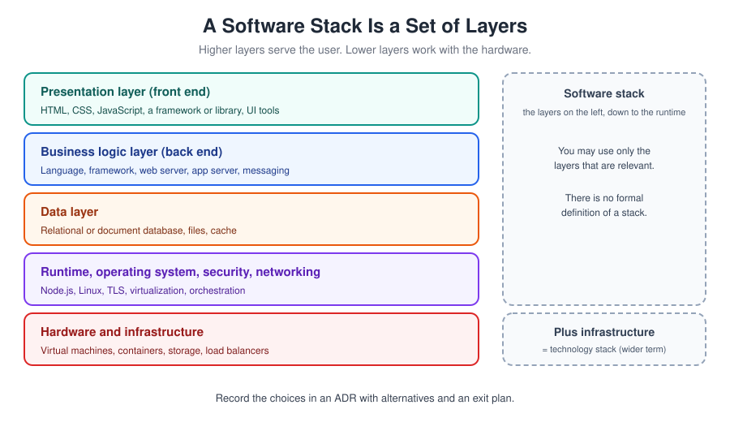
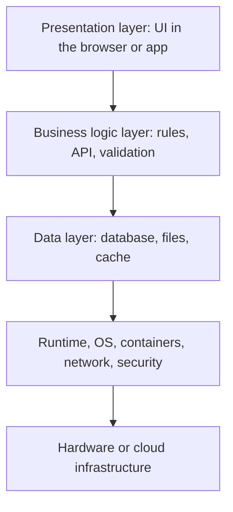
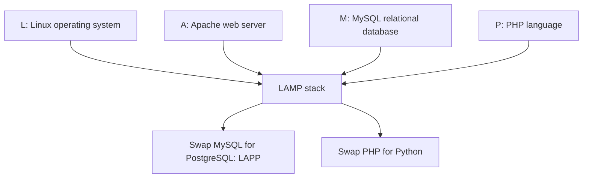
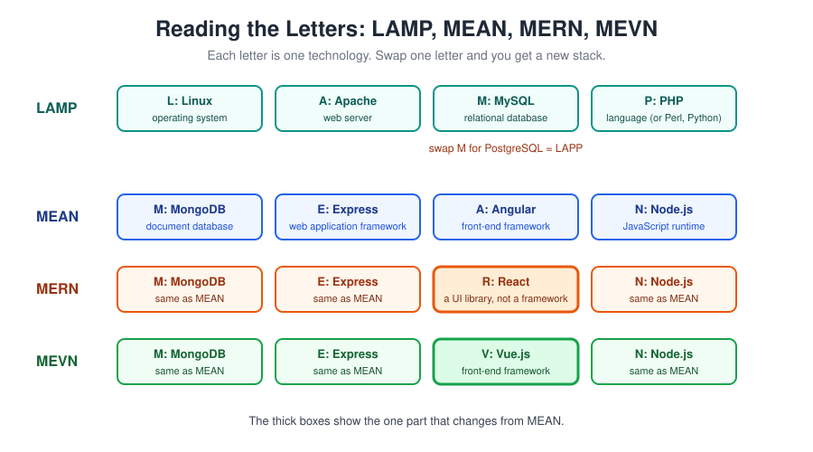

# 08 — Introduction to Software Stacks

**Learning goals of this lecture:** after this lecture you can **describe software stack terminology**, **identify some commonly used software stacks**, and **list the benefits and challenges of different software stacks**.

---

## 1. Jargon Translation (Read This First)

| Term | Official definition | Simple words | Analogy |
|---|---|---|---|
| **Software stack** | A combination of technologies (software and programming languages) that are layered together to build and run an application. | The set of tools you build one app with. | The layers of a cake: each one rests on the one below. |
| **Technology stack** | A broader term: the software stack **plus** hardware and infrastructure (virtual machines, containers, storage, load balancers). | The software stack and the machines it runs on. | The cake and the oven and the kitchen. |
| **Front end / back end** | The **front end** runs in the user's browser or device. The **back end** runs on servers and holds logic and data. | What you see vs. the engine room. | Shop floor vs. warehouse. |
| **Presentation, business logic and data layers** | The three basic layers: the user interface, the rules of the application, and the stored data. | Screen, brain, memory. | Menu, kitchen, pantry. |
| **Web server / application server** | A **web server** answers HTTP requests and serves files. An **application server** runs the business code. Many apps use one program for both. | The "front desk" and the "workshop". | Reception desk and workshop. |
| **Runtime** | The environment that runs your code, for example **Node.js** for JavaScript. | The engine that runs a language. | A disc player for discs. |
| **Open source** | Software whose source code is public under a license that lets you use, change and share it. | Free to read, use and change (within the license). | A public recipe book. |
| **Loosely coupled** | Parts that depend on each other as little as possible, so you can replace one without breaking the rest. | Easy to swap pieces. | LEGO bricks. |
| **Platform-agnostic** | Runs on many operating systems and environments, not only one. | Works on Windows, macOS and Linux. | A plug that fits many sockets. |
| **Relational database (SQL)** | Stores data in tables with columns and rows, linked by keys, and queried with SQL (Structured Query Language). | Linked spreadsheets. | A set of linked filing cabinets. |
| **Document database (NoSQL)** | Stores flexible, JSON-like documents without a fixed table shape. MongoDB is an example. | Folders of flexible records. | A folder of different forms. |
| **Orchestration** | Software that starts, connects, scales and repairs many containers or services (for example Kubernetes). | The conductor of many services. | An air-traffic controller. |
| **JSON and XML** | **JSON (JavaScript Object Notation)** and **XML (Extensible Markup Language)** are text formats for sending data between programs. JSON is the common one today. | A shared language for data. | A standard shipping form. |
| **Full-stack developer** | A developer who works on both the front end and the back end of a stack. | Works on all layers. | A builder who does walls and wiring. |

---

## 2. Topics Introduced in the Lecture Transcript

1. **What a software stack is** — layered technologies, higher levels serve the user, lower levels touch the hardware.
2. **Front-end and back-end technologies** in a stack.
3. **Technology stack vs. software stack.**
4. **Layers** — the simple three layers and more complex stacks; no formal definition of a stack.
5. **Example stacks** — Python Django, Ruby on Rails, ASP.NET.
6. **LAMP** (Linux, Apache, MySQL, PHP).
7. **MEAN** (MongoDB, Express.js, Angular, Node.js) and its relatives **MERN** (React) and **MEVN** (Vue.js).
8. **Benefits and challenges** of MEAN, MEVN and LAMP.

---

## 3. Exhaustive Deep Dive & Structured Notes

### 3.1 What a Software Stack Is

- **A software stack is a combination of technologies** that include software and **programming languages**.
- People use a stack **to create applications and solutions, such as web and mobile apps**.
- The technologies are **stacked in a hierarchy** and **work together to support the execution of an application**.
- **Higher levels** in the stack provide **tasks or services for the user**. **Lower levels interact with the computer hardware.**



#### 3.1.1 What a stack typically includes

| Side | Typical parts (lecture) |
|---|---|
| **Front end** | The lecture's front-end technologies: programming languages, frameworks and **user interface tools** |
| **Back end** | Programming languages, frameworks, **web servers, app servers, operating systems, messaging applications, and databases** |

- **Messaging applications** (message brokers such as RabbitMQ or Kafka) pass messages between parts so slow work can happen in the background.

#### 3.1.2 Software stack vs. technology stack

- The lecture says you may hear **"technology stack"** used instead of "software stack".
- But a **technology stack is a broader term**: it includes **hardware and infrastructure**, such as **virtual machines, containers, storage, and load balancers**, **as well as** the software stack.

#### 3.1.3 Layers and flexibility

- **The simplest stack** has a **presentation layer**, a **business logic layer** and a **data layer**.
- **More complex applications** use stacks that may include software for **virtualization, scheduling and orchestration, runtime environments, database connectivity, networking, and security**.
- The software and services in a stack can come **from internal resources to third-party providers to cloud providers**.
- There is **no formal definition** of what a stack looks like. The **only rule** is that the software and services must **support an application's development, functionality or deployment**.
- You **don't have to use all the layers**. You **only need to use those which are relevant** to your solution.



#### ✅ Modern Best Practice: a stack is a set of choices you record and own

> **Lecture says:** there is no formal definition of a stack, and you use only the layers you need.
> **Industry today:** the "stack" is decided by an **architecture decision**, not by a brand name. Cloud teams also treat **infrastructure and delivery tools** as part of the stack.

- **Write the choice as an ADR (Architecture Decision Record)** with the reasons, the alternatives and an exit plan (LumenVenture [Design rule 5](../../../SDLC/02-Design/Design.md#64-rules)).
- **Modern stacks usually add:** containers (Docker), a CI/CD (Continuous Integration and Continuous Delivery) pipeline, a managed database or cloud service, monitoring (logs, metrics, traces) and security tooling. This is why "technology stack" is often the more honest word.
- **How to choose** (not in the lecture):

| Question | Why it matters |
|---|---|
| What skills does the team have, and can we hire for them? | A stack nobody knows is slow and risky |
| What shape is the data (tables, documents, both)? | Drives the database choice |
| What are the scale, speed and availability targets? | Drives architecture, not only the language |
| What does the client or the law require (hosting, license, security)? | Some licenses and clouds are not allowed |
| How long will it be supported? | Check end-of-life dates and maintainers (general practice) |
| How do we run and watch it (cost, operations)? | A cheap stack can be an expensive one to operate |

---

### 3.2 Example Stacks (Lecture)

| Stack | What the lecture says | Today |
|---|---|---|
| **Python Django** | The Python programming language with the Django web framework. All **open source**, commonly used for **large-scale, fast-changing web applications**. | Django is a full-featured ("batteries included") Python framework (general knowledge) |
| **Ruby on Rails** | The Ruby language with a server-side web application framework. Great with JSON or XML (JavaScript Object Notation or Extensible Markup Language) for data transfer, and **HTML (HyperText Markup Language), CSS (Cascading Style Sheets) and JavaScript** for the front end. | "Rails" is the framework itself; JSON is the usual format today (general practice) |
| **ASP.NET** (a Microsoft web framework; the name comes from Active Server Pages, general knowledge) | Microsoft technologies: the **ASP.NET MVC** framework, the **IIS (Internet Information Services) web server**, **SQL Server** and **Azure**. | See the block below |

#### ✅ Modern Best Practice: ASP.NET today is ASP.NET Core

> **Lecture says:** the ASP.NET stack includes the ASP.NET MVC framework, the IIS web server, SQL server and Azure.
> **Industry today:** new projects use **ASP.NET Core**, a **cross-platform, high-performance, open-source framework** for modern web apps on .NET. It has its own built-in web server, **Kestrel**, which is also cross-platform, so IIS is optional (Microsoft docs). SQL Server and Azure remain common choices but are not required.

- The older **ASP.NET MVC** (on the original .NET Framework) is legacy; check support dates before using it on new work.
- Lesson: **stack names age**. Always check what a name means today.

---

### 3.3 The LAMP Stack

#### 3.3.1 What the lecture says

- **LAMP** runs on the **Linux operating system**. It uses the **Apache HTTP** (web) server, **MySQL** databases and the **PHP** programming language.
- LAMP is an **early incarnation of a software stack**, designed for building **websites and cloud applications**.
- All its parts are **open source** and **loosely coupled**, so it is **easy to swap** options in:
  - **PostgreSQL** instead of MySQL → the **LAPP** (Linux, Apache, PostgreSQL, PHP) stack.
  - **Python** instead of PHP.
- **Benefits (lecture):** open source, **lots of reusable code**, and because it is **one of the oldest software stacks** it is easy to find support and reusable solutions.
- **Challenges (lecture):**
  - Because the **Linux operating system is an integral part of the stack**, it is "not as flexible" as MEAN and MEVN (see the correction).
  - **MySQL is relational**, so LAMP "cannot take advantage of unstructured data" (see the correction).
  - The back end runs on **PHP, Perl, or Python**, while the front end uses **JavaScript and HTML**, so developers find it **harder to switch** than with the all-JavaScript stacks.
- **Lecture summary:** the LAMP stack on Linux works well for relational data, and the biggest advantage of MEAN is that all parts use JavaScript, so developers need only a single language.

⚠️ **Correction:** LAMP can run on other operating systems. Apache, MySQL and PHP also run on Windows and macOS (bundles such as XAMPP, WAMP and MAMP exist, mainly for local development; general knowledge). The lecture itself says the parts are **loosely coupled and easy to swap**, so "Linux is integral" overstates it. The difference from MEAN is small, because production servers for most stacks, including MEAN, commonly run on Linux (general practice).
> **Lecture wording (for the quiz):** "However, because the Linux operating system is an integral part of the stack, it isn't as flexible as MEAN and MEVN, which are platform-agnostic."

⚠️ **Correction:** a relational database can **also store flexible, unstructured data**. **MySQL has a native JSON data type** (with automatic validation and fast access to parts of a document), and **PostgreSQL** has `jsonb`. So "relational" does not mean "cannot handle unstructured data".
> **Lecture wording (for the quiz):** "MySQL is a relational database, so the stack cannot take advantage of unstructured data."



---

### 3.4 The MEAN Stack and Its Relatives

#### 3.4.1 What the lecture says

- **MEAN** = **M**ongoDB (database), **E**xpress.js (web application server framework), **A**ngular (front-end JavaScript framework), **N**ode.js (platform for server-side scripting).
- MEAN is described as **free, open source, platform-agnostic**, and "used for building web applications".
- **Related stacks:**
  - **MERN** replaces Angular with **React**, described as "flexible and high-performing" for front ends (see the correction).
  - **MEVN** replaces Angular with **Vue.js**. The lecture calls Vue **lighter-weight with less capabilities, but possibly better performance** than Angular.



⚠️ **Correction:** **React is a library, not a framework.** Its own site calls it "the library for web and native user interfaces" and says it does not prescribe how to do routing and data fetching. A library is something **you call**; a framework **calls your code** (see [note 06](06-application-development-tools.md)). The stack name **MERN** is still correct.
> **Lecture wording (for the quiz):** "...the MERN stack, which replaces Angular with React and is a flexible and high-performing framework for developing front-ends..."

⚠️ **Correction:** MongoDB's server is under MongoDB's own **Server Side Public License (SSPL)**, which the **Open Source Initiative (OSI)** says is **not an open source license**. It is "source available": the code is public, but the terms differ, for example if you offer MongoDB as a service. Check the license with your legal team. Node.js, Express.js, Angular and React are usually under MIT-style licenses (general knowledge, not verified here; check each license file).
> **Lecture wording (for the quiz):** "The MEAN software and services are platform-agnostic, free, and open source."

#### 3.4.2 Benefits and challenges of MEAN (lecture)

| Benefit | Detail |
|---|---|
| **One language** | The biggest advantage: all parts use JavaScript, so developers need to know only a **single language** |
| **Low cost** | The software is free to use, which is attractive to businesses |
| **Documentation and reusable code** | A lot of both |
| **Fast development** | Node.js has a **huge collection of free, reusable module libraries** |

| Challenge (lecture) | Notes |
|---|---|
| "May not be well-suited for **large-scale applications**" | See the block below |
| With Express.js the **business logic often resides on the server**, which **prevents reuse** of some services, like **batching operations** | See the block below |
| MongoDB is **great for unstructured data**, but offers **less functionality than a relational database** | See the block below |

#### ✅ Modern Best Practice: scale and database features depend on design, not on the stack's name

> **Lecture says:** MEAN may not be well-suited for large-scale applications, and MongoDB lacks the functionality of a relational database.
> **Industry today:** scalability comes from **architecture** (stateless services, caching, queues, horizontal scaling), not from the stack's letters. And MongoDB has grown.

- **MongoDB supports multi-document ACID (Atomicity, Consistency, Isolation, Durability) transactions**, which closes one commonly cited gap (MongoDB docs). Its documents often **reduce the need** for multi-document transactions by embedding related data (general practice).
- **Still true:** a document database fits **flexible, nested data**; a relational database fits **strongly linked data, complex joins and strict rules**. Many teams use **both** (polyglot persistence), or **PostgreSQL with `jsonb`** to get tables and documents together.
- **Business logic on the server** is the normal design for any web back end, not a MEAN weakness. Reuse comes from **modules, services and shared packages**, and long jobs (batching) go to **queues and workers**.
- **TypeScript** is common across MEAN-style stacks. It keeps the single-language benefit and adds types.
- **Node.js is a runtime** (an asynchronous, event-driven JavaScript runtime), not a framework (Node.js site). Express is the framework on top of it.

#### 3.4.3 The MEVN stack

- **MEVN** is a web stack like MEAN but uses **Vue.js** instead of Angular for the user interface.
- The lecture says MEVN and MEAN have **similar advantages**, but that Vue.js is **"much newer"** and has **fewer reusable libraries** than Angular.

⚠️ **Correction:** Vue is **not "much newer"**: it has existed since **2014** (Evan You). It also has **official libraries for routing (Vue Router) and state management (Pinia)**, and Nuxt for server rendering (general knowledge). What is fair: Vue's **core is smaller** and you add what you need, while Angular ships more built in. But "better performance" and "fewer libraries" are **not general rules**: performance depends on how you build the app, so measure your own pages (see [note 02](02-learning-front-end-development.md)).
> **Lecture wording (for the quiz):** "Vue.js is a much newer technology and doesn't have as many reusable libraries as Angular."

---

### 3.5 Comparing LAMP, MEAN and MEVN

| | **LAMP** | **MEAN** | **MEVN** |
|---|---|---|---|
| **Letters** | Linux, Apache, MySQL, PHP | MongoDB, Express, Angular, Node.js | MongoDB, Express, Vue, Node.js |
| **Database** | Relational (MySQL) | Document (MongoDB) | Document (MongoDB) |
| **Languages** | PHP (or Perl, Python) on the back end; HTML, JavaScript on the front end | JavaScript everywhere | JavaScript everywhere |
| **Main lecture benefit** | Old, so easy to find support | One language | One language; lighter front end |
| **Main lecture challenge** | Mixed languages; relational only (corrected above) | Large-scale doubts; MongoDB features (updated above) | Fewer libraries (corrected above) |
| **Modern note (general practice)** | PHP is still widely used; PostgreSQL swap is common | MongoDB license (SSPL), TypeScript | Vue 3 is the current major version (vuejs.org) |

---

### 3.6 Often-Missed Parts

- **Stacks are not only web stacks:** mobile (Kotlin or Swift, or React Native or Flutter), data (Python, Spark), and others. The lecture covers web stacks.
- **Other common web stacks** (not in the lecture): **PERN** (PostgreSQL, Express, React, Node.js), Java with Spring, PHP with Laravel, and Python with Django plus PostgreSQL (Spring and Laravel are frameworks, not named stacks). A stack is a combination of **choices**, so there are many names (general knowledge).
- **Front end and back end can be separate:** a React or Vue front end can talk to a back end written in any language through a REST (Representational State Transfer) API. A "single-language stack" is a convenience, not a rule.
- **Monolith vs. services:** the layers can live in one app or in many services (see the Design guide on architecture styles).
- **Managed services:** many teams use a cloud-managed database instead of installing MySQL or MongoDB themselves.
- **Licenses and costs matter** (see the MongoDB correction).

**Done enough when…**

- [ ] The team can name the **layers** of its own app and the technology in each.
- [ ] The stack choice has an **ADR** with alternatives, reasons and an exit plan.
- [ ] **Licenses** of the main components were checked.
- [ ] Support and **end-of-life dates** of the main components are known (general practice).
- [ ] The team knows who **runs** each part (own servers, managed service, third party).

---

## 4. Concrete Real-World Example: The Book Review API on a MERN-style Stack

| Layer | Technology | Role |
|---|---|---|
| **Presentation** | React (JavaScript library) in the browser | Shows books, sends reviews |
| **Business logic** | Express on Node.js | REST API (Application Programming Interface): validation, authentication, rules |
| **Data** | MongoDB (or PostgreSQL) | Stores users, books, reviews |
| **Infrastructure** | Docker containers, a cloud host, a load balancer, CI/CD | Runs and delivers the app (the "technology stack" part) |

A reader opens the site (React) → a request goes to Express → Express checks the user and the data → MongoDB stores the review → JSON returns to the browser. If reviews need strict links to users and books, the same app could use PostgreSQL instead, and only the data layer changes (loose coupling).

---

## 5. Minimal Working Code Blocks

A tiny `docker-compose.yml` for a MERN-style back end (configuration only; shown for the structure, not run here):

```yaml
# docker-compose.yml
services:
  api:                                  # business logic layer: Node.js + Express
    build: ./api
    ports: ["3000:3000"]
    environment:
      MONGODB_URL: mongodb://db:27017/reviews   # "db" is the service name, not localhost
    depends_on: [db]
  db:                                   # data layer: MongoDB
    image: mongo:8                      # pin a version; check Docker Hub for a supported tag
    volumes: ["dbdata:/data/db"]        # keep data outside the container
volumes:
  dbdata:
```

`depends_on` only controls the start order; it does not wait until MongoDB is ready (use a health check or retry logic).

**What happens if…** the API uses `mongodb://localhost:27017` instead of `mongodb://db:27017`? Inside the API container, `localhost` is the **API container itself**, where no MongoDB runs, so the connection fails. Containers reach each other by **service name**.

---

## 6. Related Concepts

1. **Layered (n-tier) architecture:** the presentation, business logic and data layers are the classic way to split an application.
2. **REST APIs and JSON:** the usual contract between a front end and a back end of any stack.
3. **Docker and Kubernetes (orchestration):** the infrastructure part that makes a "technology stack" bigger than a software stack.
4. **SQL vs. NoSQL data modeling:** choosing relational, document or both; JSON columns blur the line.
5. **Open-source licensing and supply-chain checks:** licenses (MIT, Apache-2.0, GPL, SSPL) and dependency risk affect which stack you may use.

---

## 7. Lecture Summary & Quick Reference Table

| Topic | Lecture | ✅ Modern best practice |
|---|---|---|
| **Software stack** | Layered technologies for building and running an application | A set of recorded choices (ADR); includes delivery and operations tools |
| **Technology stack** | Broader: adds hardware and infrastructure | Containers, cloud, CI/CD, monitoring are part of it |
| **Layers** | Presentation, business logic, data; no formal definition; use only relevant layers | Same; add runtime, security, networking as needed |
| **ASP.NET** | MVC, IIS, SQL Server, Azure | **ASP.NET Core**, cross-platform, Kestrel; IIS optional |
| **LAMP** | Linux, Apache, MySQL, PHP; early; swap parts; "less flexible"; "no unstructured data" | Not tied to Linux; MySQL has JSON; PostgreSQL `jsonb`; PHP still widely used |
| **MEAN** | MongoDB, Express, Angular, Node.js; free and open source | MongoDB uses the SSPL (OSI: not open source); Node.js is a runtime |
| **MERN** | Angular replaced by React, "a framework" | React is a **library** |
| **MEVN** | Angular replaced by Vue; Vue "much newer", fewer libraries | Vue since 2014; official router and state libraries; both are full frameworks |
| **MEAN benefits** | One language, low cost, docs, fast development | Plus TypeScript; choose by team skills and needs |
| **MEAN challenges** | Large-scale doubts; server logic blocks reuse; MongoDB less functional | Scale comes from architecture; MongoDB has multi-document ACID transactions |
