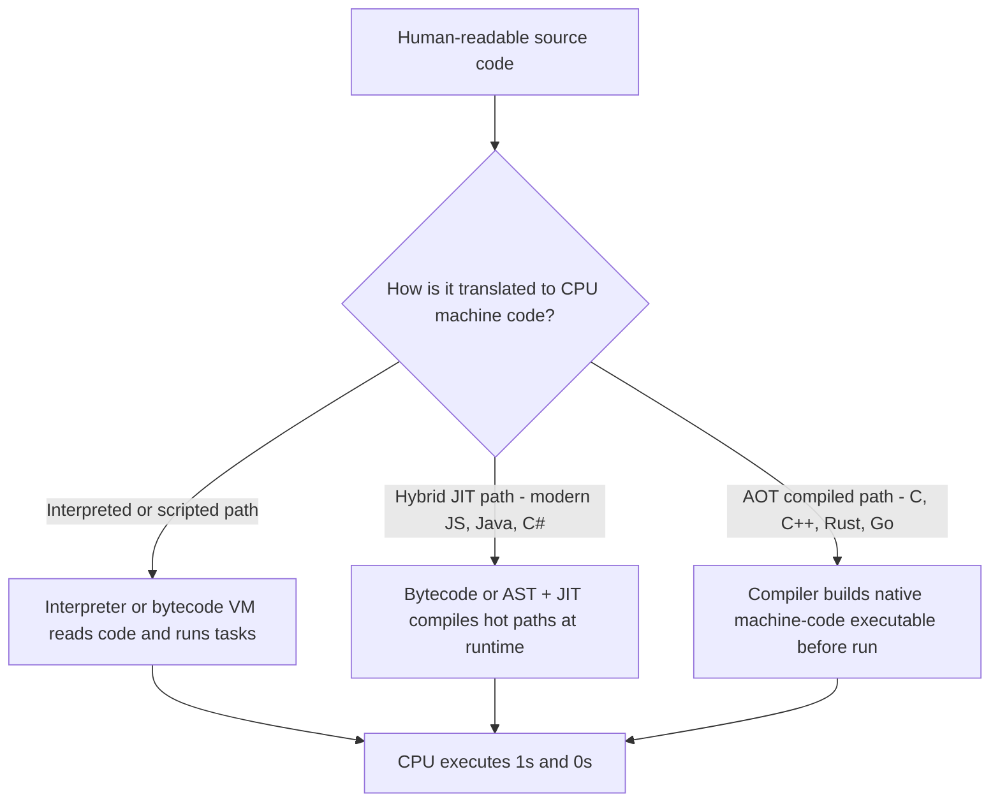
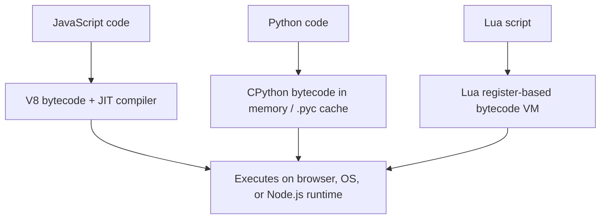
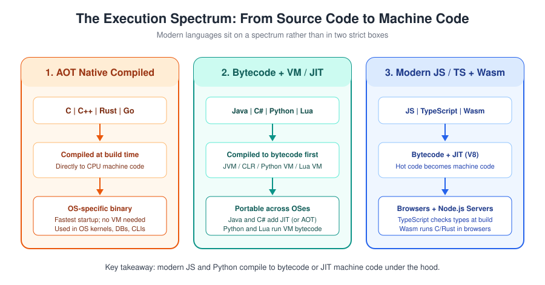
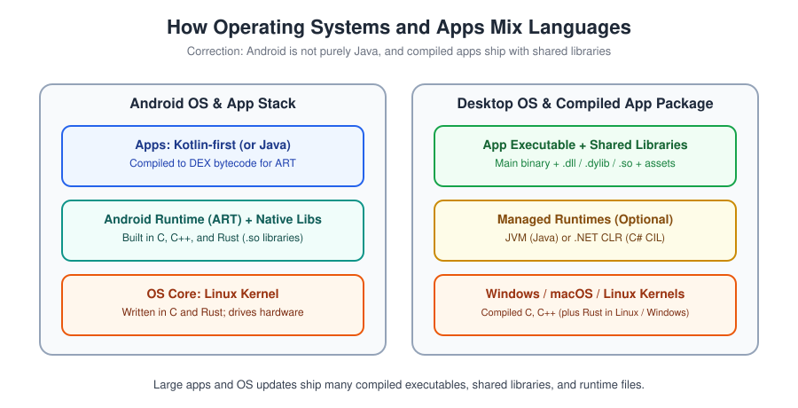
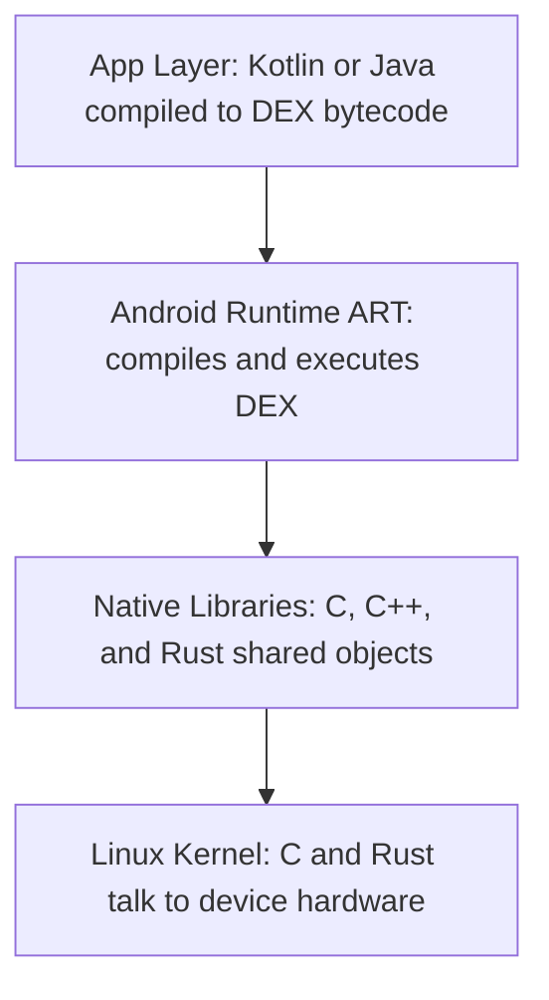

# 01 — Interpreted and Compiled Programming Languages

## 1. Jargon Translation

| Term | Official definition | Simple words | Analogy |
|---|---|---|---|
| **Machine Code** | Binary instructions made of ones and zeros (`1` and `0`) that a computer's CPU (Central Processing Unit) executes directly. | The native number language that computer hardware understands. | Morse code taps that only the telegraph machine can read directly. |
| **Source Code** | Human-readable instructions written by a programmer in a high-level programming language such as JavaScript, Python, or C. | The readable code file a developer writes and edits. | A cooking recipe written in plain English. |
| **Programming Language** | A formal human-readable language used to write instructions that tell a computer what to do. | A structured language that bridges human thinking and machine code. | Music notation that lets a composer tell a player which notes to play. |
| **Interpreter** | A program (running on an OS, Operating System, or inside a web browser) that reads and executes source code (or intermediate bytecode) directly without requiring a separate standalone executable build step. | A live translator that reads your code and runs it right away. | A live simultaneous translator speaking at the same time as the presenter. |
| **Interpreted (Scripting) Language** | A programming language typically run by an interpreter (or a bytecode/JIT, Just-In-Time, engine) directly from source files, commonly called a scripted or scripting language. | A language whose scripts you run directly with an interpreter or runtime. | A play script read aloud on stage without printing a hardcover book first. |
| **Compiler** | A program that translates human-readable source code into machine code (or intermediate bytecode) before the program runs, producing an executable or build artifact. | A translator that converts your whole program ahead of time so it is ready to run. | Translating an entire book into another language once and printing copies for readers. |
| **Compiled Language** | A programming language whose source code is normally translated by a compiler into machine code or bytecode before execution. | A language you build before running, often into a fast executable file. | A baked cake sold in a box—the baking already happened before the customer opens it. |
| **Executable File** | A binary file (such as `.exe` on Windows or a Mach-O / ELF, Executable and Linkable Format, binary on macOS/Linux) packaged so the OS can load and run it directly when clicked or invoked. | A ready-to-run program file on your device. | A finished appliance you just plug in and switch on. |
| **Bytecode** | Compact, platform-independent intermediate instructions generated by a compiler (used by Java, C#, Python, and Lua) for a virtual machine rather than a specific physical CPU. | A middle-step code that is faster than plain text and works across platforms with the right runtime. | Sheet music written in standard symbols that any trained orchestra can play. |
| **VM (Virtual Machine — Language Runtime)** | Software (such as the JVM, Java Virtual Machine, or .NET CLR, Common Language Runtime) that loads bytecode and executes or compiles it on the host machine. | A software engine that runs portable bytecode on any supported computer. | A universal adapter that lets one plug fit outlets in different countries. |
| **JIT (Just-In-Time) Compilation** | A runtime technique (used in V8, the JVM, and .NET) that compiles frequently executed ("hot") code into native machine code while the program is running. | Translating the busiest parts of a running script into super-fast machine code on the fly. | Memorizing a speech paragraph you repeat ten times a day so you no longer read your notes. |
| **AOT (Ahead-Of-Time) Compilation** | Compiling source code or bytecode all the way to native CPU machine code during the build step, before the app ever starts. | Doing all the translation at build time so the app starts instantly. | Pre-packing every meal before the trip so you never cook on the road. |
| **WebAssembly (Wasm)** | A portable binary instruction format (per webassembly.org) that lets compiled languages like C, C++, and Rust run inside web browsers and server runtimes alongside JavaScript. | A fast compiled binary format that runs safely inside web browsers. | Adding a turbo engine module next to the car's main engine. |
| **API (Application Programming Interface)** | A defined contract of rules, endpoints, or functions that lets software components communicate with each other. | The agreed menu and rules for talking to another piece of software. | A restaurant menu that tells guests exactly how to order from the kitchen. |

---

## 2. Topics Introduced in the Lecture Transcript

1. **What programming languages are** — why computers need human-readable programming languages instead of raw machine code (binary ones and zeros).
2. **Two broad language categories** — Interpreted (scripted/scripting) languages and Compiled languages, and choosing based on the purpose of the project.
3. **How interpreted and scripting languages work** — running human-readable scripts through a runtime or browser engine, why some older scripting languages became outdated while versatile ones thrive, and examples (**JavaScript**, **Python**, **Lua**).
4. **How compiled and bytecode languages work** — compilers translating source code into native machine code or portable bytecode for apps and operating systems, running fast and repeatedly, with examples (**C**, **C++**, **C#**, and **Java** — distinct from JavaScript).
5. **Operating systems and installation programs** — how Windows updates and operating systems (**Microsoft Windows**, **Apple macOS**, **Linux**, and **Android**) rely on compiled machine-code files alongside system libraries and runtimes.
6. **Comparing execution models** — matching interpreted/bytecode scripts and compiled binaries to the right job across platforms.

---

## 3. Exhaustive Deep Dive & Structured Notes

### 3.1 From Binary Machine Code to Human-Readable Languages

- **Why programming languages exist:**
  - Computers do **not** understand human languages such as English.
  - At the hardware level, a CPU executes **machine code**—**binary code** made entirely of **ones and zeros** (`1` and `0`).
  - Writing large programs directly in binary is slow and error-prone, so programmers use **human-readable programming languages** to tell computers what to do.
- **Two broad categories:**
  - Programming languages are commonly grouped into **Interpreted** languages and **Compiled** languages.
  - Many languages sit across these two categories, and the **purpose of the project** helps a developer choose which language fits best.



#### ✅ Modern Best Practice: view compilation and interpretation as a spectrum

> **Lecture says:** programming languages fall into two broad categories: Interpreted and Compiled.
> **Industry today:** modern languages sit on a **translation spectrum**—most popular languages combine compilation and interpretation (bytecode + JIT, or AOT native builds) to balance developer speed and runtime performance.

- **Why the strict two-box model breaks down today:**
  - **Most popular "interpreted" languages used in backend work today compile first:** **CPython** (the standard C-based implementation of Python) compiles `.py` source to **bytecode** in memory (and caches `.pyc` files on disk for imported modules) before executing it; Lua compiles scripts to register-based bytecode; modern JavaScript engines (**V8**, **SpiderMonkey**, **JavaScriptCore**) parse code into an **AST (Abstract Syntax Tree)** and bytecode, then **JIT-compile** hot functions straight to native machine code. (Purely line-by-line interpreters like `bash` shell scripts are the exception rather than the rule for backend apps.)
  - **Several "compiled" languages use a runtime VM too:** Java and C# normally compile to **bytecode** (`.class` / `.dll`), which is then interpreted and JIT-compiled by the **JVM** or **.NET CLR**—yet both also support **AOT** native executables (**GraalVM Native Image** and **.NET Native AOT**).
  - **Choose by workload and team, not labels:** Pick **Node.js / TypeScript** or **Python** for rapid APIs, web services, and data/AI (Artificial Intelligence) pipelines; pick **Go**, **Rust**, **C++**, or **Java / C#** when predictable low latency, tight memory limits, or systems-level access matters.

---

### 3.2 Interpreted (Scripting) Languages

- **Core terms from the lecture:**
  - An **interpreted language** is also commonly called a **scripted** or **scripting language**.
  - Every interpreted language needs an **interpreter** to translate source code into machine code so the computer can complete the requested task.
  - That translator is either **built into a web browser** or **installed as a program on your computer's OS**.
- **Evolution of scripting languages:**
  - As computers and web pages changed and advanced, **some older interpreted languages became outdated** and less useful or relevant (for example early server-side CGI, Common Gateway Interface, Perl scripts or VBScript, Visual Basic Script, in older browsers).
  - Languages that are **more versatile and easier to learn** are preferred and used much more often today, especially for **repetitive** tasks and cross-platform scripts when the matching runtime or interpreter is installed.
- **Examples covered in the lecture:**
  1. **JavaScript:** Runs in web browsers (and on servers via runtimes like **Node.js**).
  2. **Python:** Very popular because it is **easy to learn and use** for developers across web back-ends, automation, and data science.
  3. **Lua:** A **general-purpose, lightweight, embeddable scripting language** (per lua.org) that is easy to learn and widely used for game scripting inside C/C++ engines.

> ⚠️ **Correction:** **Modern JavaScript is JIT-compiled (not purely interpreted line-by-line) and runs outside browsers too** → Modern JavaScript engines such as **V8** (used in Chrome and Node.js, per v8.dev and nodejs.org) do **not** run JavaScript with a simple line-by-line interpreter; they combine a bytecode interpreter with a **JIT (Just-In-Time)** optimizing compiler that compiles hot functions into native machine code. Likewise, JavaScript is no longer only a "simpler" browser script—with **Node.js**, **Deno**, **Bun**, and **TypeScript**, it powers large-scale back-end APIs and full-stack cloud systems.
> **Lecture wording (for the quiz):** `"Some examples of common interpreted programming language types are JavaScript, a simpler scripting language that runs through the web browser interpreter"`





#### ✅ Modern Best Practice: how Python, JavaScript, and Lua actually run

> **Lecture says:** the interpreter takes human-readable scripted code and translates it into machine code, built into a web browser or installed on the computer.
> **Industry today:** modern runtimes compile scripts into bytecode or native machine code in memory, and rely on pinned runtime versions and type tooling for safety.

| Language | How it runs under the hood today | Common use cases |
|---|---|---|
| **JavaScript / TypeScript** | Parsed to AST and bytecode, then **JIT-compiled** to native machine code by engines like **V8** (Chrome, Node.js); TypeScript adds static types checked before runtime | Browser UIs (User Interfaces), Node.js back-end APIs, full-stack web apps |
| **Python** | **CPython** (the standard C-based Python runtime) compiles `.py` source to **bytecode** in memory (caching `.pyc` files on disk for imported modules) and executes it on a bytecode interpreter (per docs.python.org) | Back-end APIs (Django, FastAPI), scripting, automation, data/AI |
| **Lua** | Lua is written in ANSI (American National Standards Institute) C. Its built-in compiler turns source into compact bytecode, and the Lua VM runs that bytecode on a **register-based** virtual machine (per lua.org) | Game scripting (World of Warcraft; Roblox uses Luau, a language derived from Lua 5.1, per luau.org), Redis scripting, Nginx through OpenResty (general knowledge) |

---

### 3.3 Compiled Languages, Operating Systems, and Executables

- **How compiled programs work:**
  - Applications such as a **music app** or your device's **operating system** are often built with compiled languages (and compiled languages are also used to build interpreters and compilers themselves).
  - Compiled programming languages are often referred to simply as **"programming languages"** (in contrast to "scripting languages").
  - A **compiler** translates human-readable source code into native machine code (for languages like C/C++/Rust/Go) or portable bytecode (for Java/C#), producing fast build artifacts you can run **repeatedly** (for example by launching an app icon) without re-translating the source code each time.
- **Examples covered in the lecture:**
  - **C** and **C++**: used in building major operating systems including **Microsoft Windows**, **Apple macOS**, and **open-source Linux** (alongside newer **Rust** components in Linux and Android; general knowledge, and Android's Rust use is stated on source.android.com).
  - **C# (C Sharp)**: a modern, managed object-oriented language in the **.NET** ecosystem (used for web services, cloud apps, games, and Windows apps—not OS kernels).
  - **Java**: another compiled/bytecode language—**do not confuse Java with JavaScript** (they are completely different languages with different syntax, type systems, and runtimes).
- **Operating systems and installation programs:**
  - When you install an OS update (such as updating **Microsoft Windows**), your device downloads an **installation program** made of many compiled executables, shared libraries, and system files that deliver machine-code instructions to your hardware.
  - Operating systems named in the lecture: **Linux**, **Microsoft Windows**, **Apple macOS**, and **Android**.

> ⚠️ **Correction:** **Java and C# normally compile to intermediate bytecode + VM (not directly to one native machine-code executable), and C# is not a minor variation of C** → Native AOT languages such as **C**, **C++**, **Rust**, **Go**, and **Swift** compile ahead-of-time directly into native CPU machine code. By contrast, **Java** compiles to **JVM (Java Virtual Machine) bytecode** (`.class` / `.jar`), and **C#** compiles to **CIL (Common Intermediate Language)** assemblies (`.dll` / `.exe`) executed and JIT-compiled by the **.NET CLR (Common Language Runtime)** (per learn.microsoft.com), unless you explicitly enable **GraalVM Native Image** or **.NET Native AOT**. Also, **C#** is a modern, managed, garbage-collected language in the .NET ecosystem—closer in structure to Java than to C.
> **Lecture wording (for the quiz):** `"The source code is converted from the programming language to machine code. Then it is compiled into one executable file... Some examples of compiled programming languages are C and its variations, C++ and C Sharp... Java is another compiled programming language."`

> ⚠️ **Correction:** **The Android OS is not written solely in Java, and large compiled apps are not literally one single file** → The **Android OS** uses a **Linux kernel** written in **C** (plus **Rust** for newer OS/kernel components), native system libraries and the **ART (Android Runtime)** written in **C/C++** (per developer.android.com / Android architecture docs), while Android **apps** compile Kotlin or Java into **DEX (Dalvik Executable)** bytecode—and Google has recommended **Kotlin-first** for Android app development since 2019 (per developer.android.com). Similarly, desktop apps and OS installers are rarely "one single file": they rely on an executable plus shared libraries (`.dll` — Dynamic-Link Library, `.so` — Shared Object, `.dylib`), drivers, and data assets.
> **Lecture wording (for the quiz):** `"The Android OS is written in Java because it works well across computing platforms."` and `"Simply put, it piles the code into one file that runs when you double-click on the app on your device."`

> ⚠️ **Correction:** **Scripted languages also run complex production systems, and compiled languages also build small tools** → Today, Python and JavaScript power massive back-end systems, search engines, and AI workloads, while compiled languages like **Go** and **Rust** are routinely used for small, fast **CLI (Command-Line Interface)** utilities and cloud microservices.
> **Lecture wording (for the quiz):** `"Compiled programming languages are for more complex programs that complete larger tasks."`





#### ✅ Modern Best Practice: TypeScript, WebAssembly, and shipping backend code safely

> **Lecture says:** interpreted scripts need an interpreter on the machine or browser, while compiled languages output an executable file that runs directly on the device.
> **Industry today:** teams add **static type checking** (TypeScript) to dynamic languages, package runtimes inside **Docker** containers so the "right interpreter" is always present, and use **WebAssembly** when browsers need native-speed compiled code.

- **Static types before runtime (TypeScript):** **TypeScript** compiles (transpiles) typed JavaScript down to plain JavaScript in CI (Continuous Integration) so type bugs are caught at build time—giving JavaScript teams one of the biggest advantages of compiled languages without leaving the Node.js ecosystem.
- **Solve the "missing interpreter" problem with containers:** Instead of hoping the server has the right Python or Node.js version installed, teams ship a **Docker** container holding the exact pinned **LTS (Long-Term Support)** runtime + `package-lock.json` dependencies.
- **Native speed in the browser (WebAssembly):** When a web app needs heavy video editing, 3D graphics, or cryptography in the browser, developers compile **C**, **C++**, or **Rust** into **WebAssembly (Wasm)** (per webassembly.org) to run alongside JavaScript at near-native speed.

---

### 3.4 Not in the Lecture — Industry Practice: Often-Missed Parts

A senior backend engineer reviewing a choice between an interpreted runtime (Node.js, Python) and an AOT-compiled binary (Go, Rust, .NET Native AOT) also checks:

- **Cold-start time vs. peak throughput:** Serverless functions (such as AWS, Amazon Web Services, Lambda) care about **cold-start** milliseconds—where AOT binaries (Go, Rust, .NET Native AOT) start faster than heavy VMs (JVM without Native Image). Long-running servers care more about steady-state throughput and memory limits.
- **Security and memory safety:** Compiled **C and C++** give full hardware control but allow memory-safety bugs (buffer overflows, use-after-free). That is why modern systems teams adopt **Rust** or memory-safe managed runtimes (Node.js, Python, Go, C#, Java) and keep **C/C++** dependencies patched.
- **Dependency supply chain (`node_modules` / `pip`):** Interpreted ecosystems move fast by pulling open-source packages, so pinning exact versions in a lockfile (`package-lock.json`) and installing with `npm ci`, checking licenses, and auditing vulnerabilities (`npm audit`) are mandatory before shipping.
- **Reproducible builds & cross-compilation:** Always build production binaries and containers in **CI/CD (Continuous Integration / Continuous Delivery)**—never from a developer's laptop—and target the exact production CPU architecture (`x86_64` vs. `arm64`, e.g. Apple Silicon Mac vs. Linux server).
- **Responsible AI (Artificial Intelligence) coding tools:** AI assistants can translate patterns between Python, JavaScript, and C#/Java quickly, **but** they frequently mix runtime versions or older compiler flags—always compile, lint, and test generated code locally and in CI (common practice).

#### Done enough when… (choosing a language and runtime for a backend service)

- [ ] The choice of language and runtime (e.g., Node.js LTS + TypeScript, Python, Go, or Java) matches the project's latency, memory, and team-skill requirements (recorded in an architecture decision record).
- [ ] Type checking (`tsc` or `mypy` / `pyright`), linting, and automated unit tests run in CI on every pull request.
- [ ] The runtime version and dependencies are pinned (`.nvmrc`, `package-lock.json`, `Dockerfile` base image) so local, CI, and production environments match.
- [ ] If C/C++ native add-ons or compiled binaries are shipped, they are built in CI for the target OS and CPU architecture (`linux/amd64` or `linux/arm64`).
- [ ] Memory-safety and dependency vulnerability scans pass before shipping (common practice).

---

## 4. Concrete Examples

1. **Course Book Review API (Node.js + Express + Docker):**
   - Your Express back-end runs on the **Node.js** runtime (which uses the **V8** engine to JIT-compile your JavaScript routes into machine code).
   - Because production Linux servers might not have the exact Node.js LTS version pre-installed, you package your code plus the pinned Node.js runtime into a **Docker** container so the API runs identically everywhere.
2. **Database & Search Infrastructure (Compiled Engines Running Under Your Scripts):**
   - Your Node.js or Python back-end handles HTTP (HyperText Transfer Protocol) requests and JSON (JavaScript Object Notation) validation cleanly.
   - Underneath, **PostgreSQL** (written in **C**) and **Redis** (written in **C**) are **compiled native programs** handling disk storage, indexes, and memory locks at maximum CPU speed.
3. **Kubernetes CLI & DevOps Tools (Compiled Binaries):**
   - Tools like `docker`, `kubectl` (written in **Go**), and `git` (written mostly in **C**) ship as compiled executables so developers can run them instantly from the terminal without installing a separate language runtime first.

---

## 5. Code Blocks

### 5.1 Observing V8 JIT Warm-Up (Node.js) and Python Bytecode Locally

Both snippets below were tested locally on this machine (`Node.js v24.18.0` and `Python 3.14.8`):

```javascript
// jit-warmup.mjs — shows V8 JIT speeding up a hot loop (tested on Node.js v24.18.0)
function sumTo(n) {
  let total = 0;
  for (let i = 0; i < n; i++) total += i;      // Hot loop targeted by V8's JIT compiler
  return total;
}

const t0 = performance.now();
const firstRun = sumTo(1_000_000);               // Cold run: parsed + interpreted / baseline compiled
const t1 = performance.now();
const secondRun = sumTo(1_000_000);              // Warm run: optimized machine code runs faster
const t2 = performance.now();

console.log({
  firstRun,
  coldMs: (t1 - t0).toFixed(3),
  warmMs: (t2 - t1).toFixed(3),
});
```

```python
# bytecode_demo.py — shows CPython compiles Python to bytecode first (tested on Python 3.14.8)
import dis
def add_one(x):
    return x + 1                                 # Python turns this into bytecode instructions
dis.dis(add_one)                                 # Print the bytecode executed by the Python VM
```

Real output from running both commands locally:

```text
{ firstRun: 499999500000, coldMs: '4.652', warmMs: '1.237' }
Python bytecode:
  3           RESUME                   0

  4           LOAD_FAST_BORROW         0 (x)
              LOAD_SMALL_INT           1
              BINARY_OP                0 (+)
              RETURN_VALUE
```

**What happens if... you ship a Node.js script expecting it to run like a standalone compiled binary on a clean Linux server?** Without Node.js installed (or a container packaging it), the server prints `node: command not found` and fails to start. Packaging the app in a **Docker** image (or bundling an explicit runtime) guarantees the matching runtime is always present.

### 5.2 Inspecting a Compiled Binary vs. an Interpreted Script (`bash`)

```bash
# Check what a compiled binary vs. an interpreted script looks like on macOS/Linux
file "$(which node)"    # Compiled Mach-O / ELF native executable (built from C++)
file app.mjs            # Plain UTF-8 text source code read by Node.js at runtime

# Type-check a TypeScript project before running JavaScript (requires typescript + tsconfig.json)
npx --no-install tsc --noEmit
```

**What happens if... you copy a compiled C executable built on a Mac (`arm64` Mach-O) onto an `x86_64` Linux Docker container?** The Linux kernel refuses to execute it (`exec format error`), because compiled native machine code depends on **both** the target OS and the CPU architecture. You must compile inside the target Linux/Docker environment or cross-compile for `linux/amd64` / `linux/arm64`.

---

## 6. Related Concepts

1. **JavaScript Runtime Environments (Node.js, Deno, Bun):** Runtimes wrap a JIT-capable JS engine (such as V8 or JavaScriptCore) with OS APIs (Application Programming Interfaces) so JavaScript runs on back-end servers, not just in web browsers.
2. **TypeScript and Static Type Checking:** Adds a compile-time type-checking step to JavaScript so bugs like passing a string where a number is expected fail during CI instead of in production.
3. **Docker Containers and Multi-Stage Builds:** Packages your interpreted or compiled app together with its exact pinned runtime (and compiles native binaries for the target Linux CPU) so builds are reproducible.
4. **Databases and Storage Engines (PostgreSQL, SQLite, Redis):** Back-end APIs written in JavaScript or Python rely on compiled C/C++ database engines under the hood to execute SQL (Structured Query Language) queries and cache lookups fast.
5. **CI/CD Pipelines and Cross-Platform Builds:** Automated workflows compile TypeScript, C#, Java, or Go artifacts, run tests, check dependency security, and target the right OS/CPU architecture before deploying.

---

## 7. Lecture Summary & Quick Reference Table

| Topic | Lecture | ✅ Modern best practice |
|---|---|---|
| **Machine code vs. source code** | Computers understand binary machine code (`1`s and `0`s); humans write high-level languages | True; compilers, bytecode VMs, and JIT engines translate source code down to CPU machine code |
| **Two categories** | Interpreted (scripting) vs. Compiled (programming) languages; project purpose decides | Treat translation as a **spectrum** (AOT native → bytecode + VM/JIT → interpreter); choose by workload, team, and ecosystem |
| **JavaScript** | Described as a basic browser script running through a browser translator | Runs via **JIT compilers** (like V8) in browsers **and** server runtimes (**Node.js**, Deno, Bun), often paired with **TypeScript** |
| **Python & Lua** | Python is easy to learn; Lua is a lightweight game scripting language | Both compile to **bytecode** for a VM (CPython bytecode; Lua register-based VM) and power major web, AI, and game systems |
| **C, C++, C#, and Java** | All listed as compiled languages turning source into one executable file; C# as a C variation; Java distinct from JS | **C/C++** compile AOT to native code; **Java** (JVM) and **C#** (.NET CLR) normally compile to **bytecode + JIT** (with optional Native AOT); C# is a managed .NET language, not a C variant |
| **Operating systems & Android** | Windows, macOS, Linux, and Android OS described as built in compiled languages (claiming Android uses Java) | OS kernels use **C** (plus **Rust** in Linux/Android); Android apps use **Kotlin-first** (since 2019, per developer.android.com) or Java compiled to DEX on **ART**; apps ship with shared libraries (`.dll`/`.so`/`.dylib`) |
| **Cross-platform delivery** | Interpreted runs anywhere with the right interpreter; compiled creates direct executables | Use **Docker** containers to bundle pinned runtimes cleanly, **CI** to cross-compile for target CPU architectures, and **WebAssembly** for compiled browser code |
