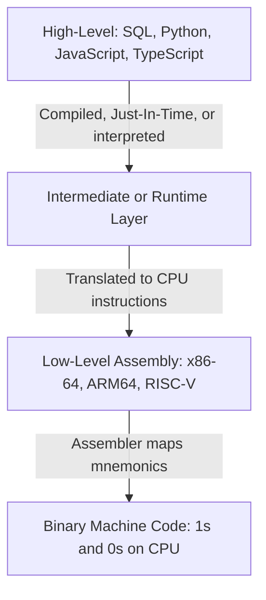
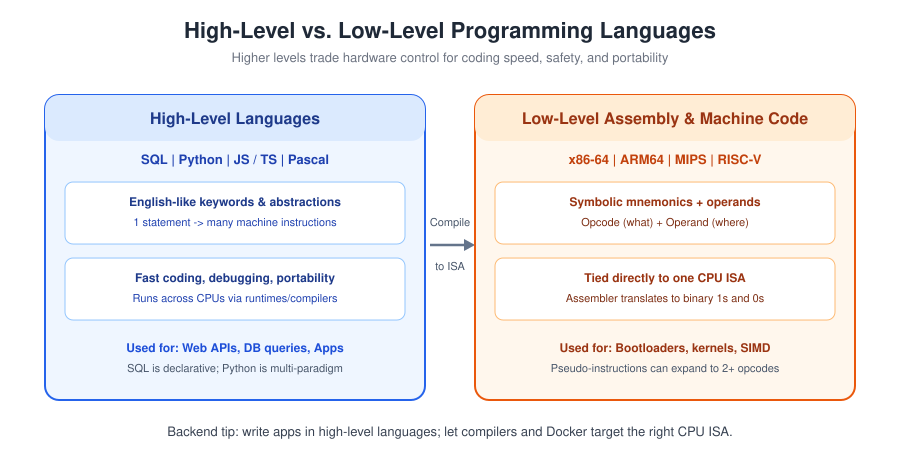
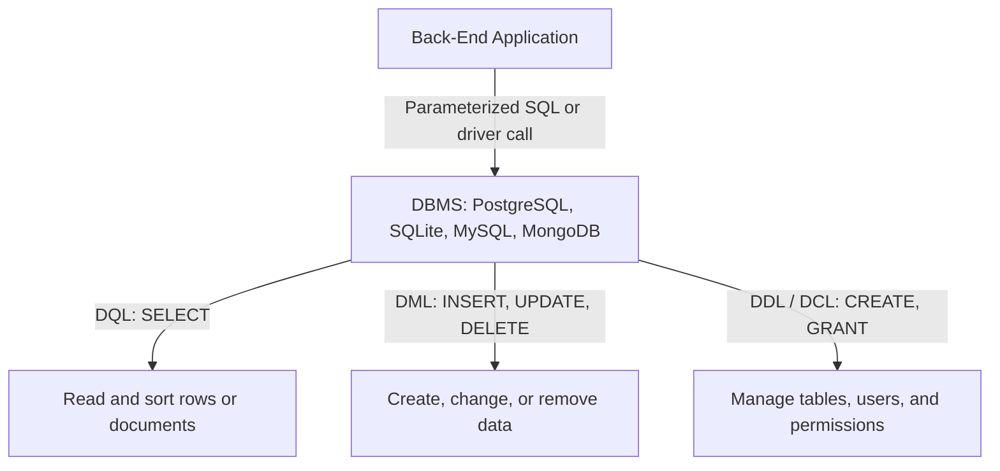
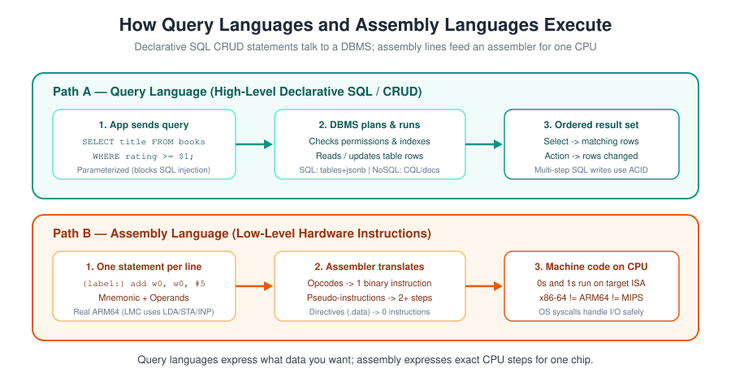
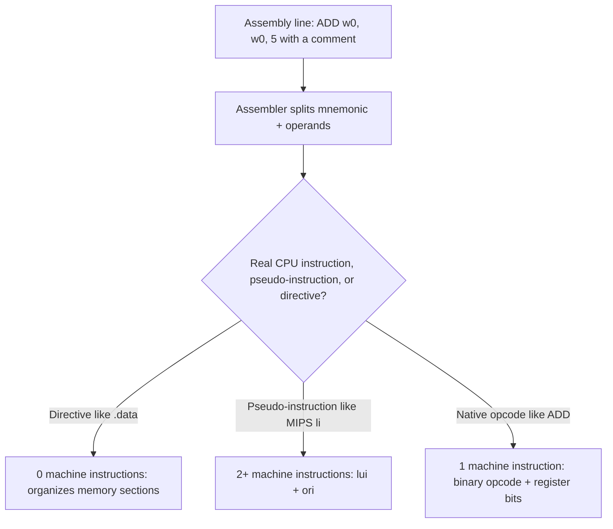

# 02 — Query and Assembly Programming Languages

## 1. Jargon Translation

| Term | Official definition | Simple words | Analogy |
|---|---|---|---|
| **High-Level Programming Language** | A programming language using English-like keywords and abstractions far from hardware details, speeding up coding and debugging. | A human-friendly coding language where one line does a lot of work. | Telling a driver "take me to the airport" instead of instructing every pedal press and wheel turn. |
| **Low-Level Programming Language** | A programming language close to hardware machine code, using short symbols for CPU (Central Processing Unit) instructions and memory registers. | A hardware-level language that speaks almost directly to the processor chip. | Giving step-by-step instructions to each gear and piston inside an engine. |
| **Query Language (Database Query Language)** | A high-level language of predefined statements used by applications to request, insert, update, delete, and manage data in a database. | A structured question-and-command language for talking to databases. | Filling out an order slip that the warehouse clerk understands right away. |
| **SQL (Structured Query Language)** | The standard declarative query language used to query, manipulate, and administer relational databases made of tables. | The universal language for asking questions and changing rows in table databases. | The standard library catalog system used across almost every major library. |
| **NoSQL (Not Only SQL)** | A family of non-relational databases (document, key-value, wide-column, graph) built for flexible schemas, horizontal scaling, or specialized access patterns. | Databases that store data as documents, pairs, or graphs instead of classic relational tables. | Filing folders, sticky-note boards, or index cards instead of linked Excel spreadsheets. |
| **DBMS (Database Management System)** | Software (such as PostgreSQL, MySQL, SQLite, or MongoDB) that stores databases, executes queries, enforces rules, and protects data. | The database server software that receives your queries and manages the stored data. | The warehouse manager who checks permissions, finds shelves, and returns the boxes. |
| **CRUD (Create, Read, Update, Delete)** | The four fundamental operations for persistent data: creating records, reading them, updating existing records, and deleting them. | The four basic actions every app does with saved data. | Adding, reading, editing, and erasing entries in an address book. |
| **Select Query vs. Action Query (Statement)** | A `SELECT` statement reads data from tables without changing it; an action statement (`CREATE`, `INSERT`, `UPDATE`, `DELETE`) creates or changes data or structure. | Asking to look at records (`SELECT`) vs. changing what is saved (`INSERT`, `UPDATE`, `DELETE`). | Reading a bank statement vs. making a deposit or transfer. |
| **Assembly Language** | A low-level programming language that uses short symbolic mnemonics to represent binary machine-code instructions for a specific processor architecture. | A human-readable shorthand for the `0`s and `1`s of a specific CPU chip. | Using letter abbreviations (`ADD`, `MOV`) instead of dialing raw binary switch codes. |
| **Assembler** | A translator tool (distinct from a compiler or interpreter) that converts assembly-language statements into executable binary machine code. | The tool that turns assembly symbols into the processor's raw `0`s and `1`s. | A clerk who replaces shorthand codes with exact numeric part numbers. |
| **ISA (Instruction Set Architecture)** | The processor's hardware specification (such as x86-64, ARM, MIPS, or RISC-V) defining its registers, memory model, and supported machine instructions. | The exact vocabulary of instructions that a specific CPU family understands. | The exact set of controls inside one airplane model's cockpit. |
| **Mnemonic and Opcode** | An **opcode** (operation code) is the numeric instruction telling the CPU what operation to perform; a **mnemonic** is its readable name (such as `ADD`, `MOV` on x86-64, or `LDR` on ARM64). | The opcode is the CPU's number for an action; the mnemonic is the short word humans write for it. | A speed-dial number (`1`) vs. the name (`Mom`) shown on your phone screen. |
| **Operand** | The parameter part of an assembly statement telling the processor which register, constant value, or memory address the instruction operates on. | The target or value an assembly instruction acts upon. | In "Add 5", "Add" is the action (opcode) and "5" is the target (operand). |
| **Pseudo-Instruction** | A convenience assembly shorthand (common in ARM, MIPS, and RISC-V) that the assembler expands into two or more real CPU machine instructions. | One helpful shortcut line that turns into multiple real hardware instructions. | Saying "make coffee" on a checklist when the machine actually runs three smaller steps. |

---

## 2. Topics Introduced in the Lecture Transcript

1. **High-level vs. low-level programming languages** — how high-level languages (such as **SQL**, **Pascal**, and **Python**) use English-like syntax for speed and readability, while low-level assembly languages (**ARM** — Advanced RISC Machine, **MIPS** — Microprocessor without Interlocked Pipelined Stages, and **x86**) use symbols for machine code.
2. **Query languages and database communication** — how apps query databases, why both sides must speak the same language, **SQL** as the main query language, plus alternatives (**AQL** — ArangoDB Query Language, **CQL** — Cassandra Query Language, **Datalog**, and **DMX** — Data Mining Extensions).
3. **SQL vs. NoSQL ("Not Only SQL") databases** — comparing relational table schemas with non-relational document/column/graph models, and correcting common myths about schemas and unstructured data.
4. **CRUD (Create, Read, Update, Delete) and SQL statements** — how tables organize data into rows and columns, `SELECT` queries vs. action statements (`CREATE`, `INSERT`, `UPDATE`, `DELETE`), and administrative permission commands.
5. **Assembly languages and CPU (Central Processing Unit) architectures** — why each hardware processor architecture has its own assembly language, line-by-line syntax (optional label, mnemonic/opcode, operands, optional comments), and translation by an **assembler**.
6. **Assembly mnemonics, opcodes, operands, and instruction mapping** — examining `INPUT` (`INP`), `OUTPUT` (`OUT`), `LOAD` (`LDA`), `STORE` (`STA`), and `ADD`, and clarifying educational CPU models vs. real production hardware.

---

## 3. Exhaustive Deep Dive & Structured Notes

### 3.1 High-Level vs. Low-Level Programming Languages

- **Two abstraction levels from the lecture:**
  - **High-level programming languages** are closer to human English. They hide hardware details (CPU registers and memory addresses) to increase the **speed of coding and debugging**.
    - Lecture examples: **Query languages** (`SQL`, a declarative language for data), **Structured Programming Languages** (`Pascal`, an older educational/structured language), and multi-paradigm languages that support **Object-Oriented Programming (OOP)** (`Python`).
  - **Low-level programming languages** stay close to binary machine code (`0`s and `1`s), using a set of symbols for CPU operations.
    - Lecture examples: **Assembly languages** for hardware architectures such as **ARM**, **MIPS**, and **x86**.

> ⚠️ **Correction:** **Paradigm nuances for SQL, Python, and Pascal** → **SQL** is a **declarative domain-specific language (DSL)** for data—you describe *what* rows you want rather than writing step-by-step loops. **Python** is **multi-paradigm** (supporting procedural, object-oriented, and functional styles, not only OOP). **Pascal** is mostly historical and educational today; modern structured/systems code uses languages like TypeScript, Python, Go, Rust, or C#. Also, **C** is commonly treated as a low-level or mid-level systems language because it exposes raw memory pointers directly.
> **Lecture wording (for the quiz):** `"Examples of high-level programming languages include query languages, such as Structured Query Language, or SQL, Structured Programming Languages, such as PASCAL, and object-oriented programming languages, such as Python."`





#### ✅ Modern Best Practice: pick the abstraction level that fits the layer

> **Lecture says:** high-level languages use English-like words to speed up coding and debugging; low-level assembly uses symbols for machine code.
> **Industry today:** teams build almost all web, mobile, and business software in **high-level languages** (JavaScript/TypeScript, Python, Java, C#, Go) and rely on optimizing compilers and compiled databases beneath them rather than hand-writing low-level assembly.

- **Use high-level languages for application logic:** Express routes, authentication, validation, and database queries move far faster in TypeScript or Python with fewer memory bugs.
- **Let compilers and engines handle the low level:** **V8** (in Node.js), **PostgreSQL** (written in C), and modern C/C++/Rust compilers generate highly tuned x86-64 and ARM64 machine code automatically.

---

### 3.2 Query Languages, SQL vs. NoSQL, and CRUD Operations

- **What a query is and why a shared query language is required:**
  - A **query** is a request for information from a database.
  - The database handles the query, searches its **tables** (made of **rows and columns**), arranges matching data into an order, and returns the results to the calling application.
  - Both the **user application** making the query and the **database** answering it must speak the **same query language**.
  - Writing a query uses predefined, understandable programmatic statements—this is a **query language** (also called a **database query language**).
- **Prevalent query languages named in the lecture:**
  - **SQL (Structured Query Language)** is by far the most widely used query language for database queries and database management.
  - Other query languages exist for specialized systems:
    - **AQL (ArangoDB Query Language):** used by ArangoDB (multi-model document/graph database).
    - **CQL (Cassandra Query Language):** SQL-like query language for Apache Cassandra.
    - **Datalog:** declarative logic query language used in deductive databases (databases that use logical rules to figure out new facts from stored data) and analytics engines.
    - **DMX (Data Mining Extensions):** query language originally built for Microsoft SQL Server Analysis Services data mining models. Microsoft lists Analysis Services Data Mining among its deprecated features (see Microsoft's Analysis Services backward-compatibility page), so treat DMX as legacy.

#### 3.2.1 SQL vs. NoSQL ("Not Only SQL")

- **Two major database families:**
  - **SQL databases** are relational and organize data into linked **tables** with rows and columns.
  - **NoSQL ("Not Only SQL")** databases are non-relational (document stores like MongoDB, wide-column stores like Cassandra, key-value stores like Redis, and graph databases like Neo4j).

> ⚠️ **Correction:** **Modern SQL databases support flexible JSON too, and many NoSQL databases use schemas for structured or semi-structured data** →
> - Relational **SQL** databases are not limited to rigid columns: **PostgreSQL** (`jsonb` — JSON, JavaScript Object Notation, Binary — with GIN, Generalized Inverted Index, indexing, per postgresql.org) and **MySQL** (`JSON`) store and index semi-structured documents inside tables.
> - **NoSQL** does not always mean "schema-less unstructured data": **Cassandra CQL** requires defined tables and typed column schemas (per cassandra.apache.org), and **MongoDB** supports **JSON Schema validation** to enforce field types and rules (per mongodb.com).
> - Truly unstructured binary files (photos, videos, PDFs — Portable Document Format) belong in object storage (like S3, Simple Storage Service), not inside a NoSQL database.
> **Lecture wording (for the quiz):** `"While SQL databases are relational and use structured predefined schemas, NoSQL databases are non-relational in nature and have dynamic schemas for unstructured data."`



#### 3.2.2 CRUD, Select vs. Action Queries, and SQL Statement Types

- **CRUD (Create, Read, Update, Delete):**
  - Query languages are mainly used to perform the four **CRUD** operations using syntax understood by the **DBMS (Database Management System)**.
- **Select queries vs. action queries (statements):**
  - The word **statement** is commonly used for database commands.
  - **Select queries** (`SELECT`) **request data** from a database without modifying it.
  - **Action queries** (`CREATE`, `INSERT`, `UPDATE`, `DELETE`) **manipulate data** or database structures—or combine reading and writing (for example `INSERT ... SELECT` or `UPDATE ... WHERE`).
  - **Administrative statements** create users and modify permissions (`CREATE USER`, `GRANT`, `REVOKE`).

| SQL category (industry terms) | Common statements | Lecture mapping | Example SQL syntax |
|---|---|---|---|
| **DQL (Data Query Language)** | `SELECT` | Select query (**Read**) | `SELECT id, title FROM books WHERE rating >= 4 ORDER BY title;` |
| **DML (Data Manipulation Language)** | `INSERT`, `UPDATE`, `DELETE` | Action query (**Create, Update, Delete**) | `INSERT INTO books (title, rating) VALUES ('Clean Code', 5);` |
| **DDL (Data Definition Language)** | `CREATE`, `ALTER`, `DROP` | Action / structure statement | `CREATE TABLE books (id INT PRIMARY KEY, title TEXT NOT NULL);` |
| **DCL (Data Control Language)** | `GRANT`, `REVOKE` | Administrative permissions | `GRANT SELECT, INSERT ON books TO app_user;` |
| **TCL (Transaction Control Language)** | `BEGIN`, `COMMIT`, `ROLLBACK` | *(Industry practice)* Atomic multi-step writes | `BEGIN; UPDATE accounts ...; COMMIT;` |

#### ✅ Modern Best Practice: parameterized queries, transactions, indexes, and least privilege

> **Lecture says:** the application sends query statements to the database to read or manipulate rows and manage permissions.
> **Industry today:** back-ends never build SQL by concatenating user strings, wrap multi-step writes in transactions, check query speed with `EXPLAIN`, and limit the app's database permissions.

- **Always parameterize queries:** Pass user values with placeholders (`$1`, `?`) or a safe query builder/ORM (Object-Relational Mapping) so user input can never alter SQL structure (**OWASP**, Open Worldwide Application Security Project, Top 10 `A05:2025` Injection, per owasp.org).
- **Use transactions (`BEGIN` / `COMMIT` / `ROLLBACK`):** Wrap related writes (such as creating an order and reducing inventory) in one **ACID** (Atomicity, Consistency, Isolation, Durability) transaction so either every step succeeds or none is saved.
- **Check query plans (`EXPLAIN`):** When a `SELECT` query slows down, inspect its execution plan and add proper indexes instead of letting the DBMS scan every row.
- **Separate runtime and admin DB (Database) accounts:** Give the running web app only the `SELECT`/`INSERT`/`UPDATE`/`DELETE` rights it needs—never superuser `DROP TABLE` or `GRANT` privileges (run schema migrations with a separate pipeline role).

---

### 3.3 Assembly Languages, Syntax, Mnemonics, and Hardware Mapping

- **Why assembly languages are low-level:**
  - Assembly languages use simple symbolic codes to represent the zeros and ones of machine code—far less abstracted than query, structured, or object-oriented languages.
  - Because assembly talks directly to hardware registers and instructions, it is **closely tied to the processor architecture (ISA)** from hardware manufacturers (**x86 / x86-64**, **ARM / AArch64**, **MIPS**, and modern open-source **RISC-V**, Reduced Instruction Set Computer Five). Each CPU family typically has its own assembly language.
- **Statement format (entered one line at a time, one statement per line):**
  - Standard line structure (where items shown in `{...}` in the lecture slide are **optional**):
    `{label:}  mnemonic  operands  {; comment}`
  - **Two main parts of an instruction:**
    1. **Instruction / Mnemonic (Opcode):** tells the processor **what operation to do** with the data.
    2. **Parameters / Operands:** tells the processor **where to find the data** (which register, number, or memory address).
  - **Optional label and comment:** labels mark jump targets or data locations; comments explain human intent and are ignored by the assembler.
- **Translation by an assembler:**
  - Assembly code is translated into machine code by an **assembler**, **not** a compiler or an interpreter.



> ⚠️ **Correction:** **Assembly does not always have a strict 1-to-1 line-to-instruction mapping** →
> - Real hardware opcodes map 1-to-1 to machine-code instructions, **but** real assembly files also use **assembler directives** (`.data`, `.text`, `.global`), **macros**, and **pseudo-instructions** (very common in **ARM** and **MIPS/RISC-V**).
> - Directives generate **zero** CPU instructions (they only organize memory sections).
> - A single pseudo-instruction such as `li` (load immediate 32-bit value) or `bgt` (branch if greater than) expands into **two or more** real machine instructions in MIPS (general knowledge).
> **Lecture wording (for the quiz):** `"one statement translates into just one machine code instruction, as opposed to high-level languages where one statement can be translated into multiple machine code instructions... And assembly language instructions have a one-to-one association with their machine code counterpart."`

> ⚠️ **Correction:** **`INP`, `OUT`, `LDA`, and `STA` are educational toy-CPU mnemonics (not real x86 or ARM server instructions)** →
> - Mnemonics such as `INP` (input), `OUT` (output), `LDA` (load), and `STA` (store) come from classroom models like the **LMC (Little Man Computer)** used to teach how opcodes work (general knowledge: the lecture does not name its model).
> - Real production hardware uses different instructions: **x86-64** uses `MOV`, `ADD`, `SUB`, `CMP`, `JMP`, `SYSCALL`, and **ARM64** uses `LDR`, `STR`, `ADD`, `B`, `SVC`.
> - Modern user-space programs do **not** read keyboards directly with `INP` or `OUT`; they ask the **OS (Operating System)** kernel through system calls.
> **Lecture wording (for the quiz):** `"Assemblers translate assembly language into machine code using mnemonics, such as INPUT, INP, OUTPUT, OUT, LOAD, LDA, STORE, STA, and ADD, A-D-D."`

| Concept | Classroom / LMC example | Real x86-64 (Intel/AMD) | Real ARM64 (Apple Silicon / AWS Graviton) |
|---|---|---|---|
| **Load value** | `LDA 20` | `mov eax, [rbx]` | `ldr w0, [x1]` |
| **Add numbers** | `ADD 21` | `add eax, 5` | `add w0, w0, #5` |
| **Store value** | `STA 22` | `mov [rbx], eax` | `str w0, [x1]` |
| **Input / Output** | `INP` / `OUT` | `syscall` (OS kernel call) | `svc #0` (OS supervisor call) |



#### ✅ Modern Best Practice: how backend engineers interact with low-level assembly today

> **Lecture says:** assembly languages vary per CPU manufacturer and translate instructions into machine code via an assembler.
> **Industry today:** developers rarely write apps in assembly directly, **but** CPU architecture (`x86_64` vs. `arm64`) and compiler output still matter in cloud builds, performance tuning, and debugging.

- **Let compilers write assembly for you:** Modern C, C++, and Rust compilers perform vectorization (**SIMD**, Single Instruction, Multiple Data) and register allocation better than most humans. Hand-written assembly is kept small and rare (bootloaders, kernel traps, cryptography primitives).
- **Match builds to the target CPU ISA:** Running an `arm64` binary or container on an `x86_64` Linux cloud host fails (`exec format error`), so **CI (Continuous Integration)** and **CD (Continuous Delivery)** pipelines explicitly target `linux/amd64` or `linux/arm64`.
- **Inspect generated assembly when debugging or optimizing:** Tools like **Compiler Explorer** (`godbolt.org`), `objdump`, **GDB** (GNU Debugger), and **LLDB** (LLVM Debugger) let engineers inspect compiled instructions when chasing severe CPU bottlenecks or crashes.

---

### 3.4 Not in the Lecture — Industry Practice: Often-Missed Parts

A senior backend engineer working with SQL/NoSQL queries and multi-architecture deployments checks these items too:

- **SQL injection & input validation:** Never pass raw request strings into SQL, CQL, or MongoDB query objects (NoSQL injection happens too if untrusted `$gt` / `$ne` objects are accepted from JSON bodies without schema validation).
- **Declarative SQL vs. imperative N+1 loops:** An **N+1 loop** happens when code runs `1` query to fetch `N` IDs and then runs `N` extra queries inside a `for` loop (`1 + N` total queries), which destroys latency. A single well-indexed SQL `JOIN` lets the database engine fetch everything in one fast query.
- **Query timeouts & connection limits:** Every database query needs a timeout (`statement_timeout`) and a bounded connection pool so one slow analytical query cannot stall the entire API (Application Programming Interface).
- **Data migrations vs. ad-hoc `CREATE` / `ALTER`:** Never run manual DDL changes in production; keep versioned migrations in Git that remain backward-compatible during rolling updates.
- **Responsible AI (Artificial Intelligence) usage:** AI assistants write SQL and query builders fast, **but** often invent non-existent columns or omit `WHERE` clauses and indexes—always test generated SQL against a real database and run `EXPLAIN` before merging (common practice).

#### Done enough when… (database queries and low-level build targets in a backend service)

- [ ] Every SQL or NoSQL query uses parameterized placeholders or validated schemas (no string concatenation or raw untrusted query objects).
- [ ] Multi-step writes run inside database transactions (`BEGIN` / `COMMIT` / `ROLLBACK`), and list queries enforce pagination limits.
- [ ] Schema changes live in versioned migration scripts run by CI/CD, while the running app uses a least-privilege DB role (no `DROP` or `GRANT`).
- [ ] Slow queries are checked with `EXPLAIN` and backed by appropriate indexes (including `jsonb` GIN indexes where JSON fields are queried).
- [ ] Any compiled dependencies or Docker images are built in CI for the exact production CPU ISA (`linux/amd64` or `linux/arm64`).

---

## 4. Concrete Examples

1. **Book Review API (`SELECT` & `INSERT` via Parameterized SQL):**
   - When a reader opens `/api/books?minRating=4`, Node.js sends a parameterized `SELECT` query (`WHERE rating >= $1 ORDER BY title LIMIT 20`) to PostgreSQL.
   - When the reader submits a review, the back-end opens a transaction, runs an `INSERT INTO reviews ...` statement, updates the cached average rating, and commits—using an `app_user` DB account that has `SELECT`/`INSERT`/`UPDATE` rights on those tables only.
2. **Flexible Metadata in a Relational DB (`jsonb`) vs. NoSQL Schema Validation:**
   - Instead of spinning up a separate NoSQL server just to store varying book attributes (edition notes, translation tags), PostgreSQL stores them in a `jsonb` column alongside relational `books` and `reviews` tables (per postgresql.org).
3. **Why CPU Architecture Matters in Docker & Kubernetes:**
   - A developer writes Express code on an **ARM64** MacBook, but production Kubernetes nodes run **x86-64** Linux servers. Because native Node.js add-ons (like `argon2` or `sqlite3`) contain compiled machine code tied to one CPU ISA, CI builds the Docker image specifically for `linux/amd64` so the server never hits a binary mismatch.

---

## 5. Code Blocks

### 5.1 SQL CRUD & Parameterized Queries in Node.js (Tested in Node.js 24)

This working example runs SQL `CREATE`, `INSERT`, `SELECT`, `UPDATE`, and `DELETE` statements using Node.js 24's built-in `node:sqlite` module (`tested on Node.js v24.18.0`). Note: the Node.js docs still mark `node:sqlite` as experimental or a release candidate depending on the version, so for production use a stable driver (for example `pg` for PostgreSQL or `better-sqlite3`):

```javascript
// sql-crud-demo.mjs — CRUD and parameterized SQL in Node.js v24.18.0
import { DatabaseSync } from 'node:sqlite';

const db = new DatabaseSync(':memory:');
db.exec('CREATE TABLE books (id INTEGER PRIMARY KEY, title TEXT NOT NULL, rating INTEGER)'); // DDL: create table

// Action query (Create): ? placeholders keep user values separate from SQL syntax
const insertBook = db.prepare('INSERT INTO books (title, rating) VALUES (?, ?)');
insertBook.run('Clean Code', 5);
insertBook.run('Designing Data-Intensive Apps', 5);

// Select query (Read): ordered results with a parameterized filter
const topBooks = db.prepare('SELECT id, title, rating FROM books WHERE rating >= ? ORDER BY id').all(4);
console.log('SELECT:', topBooks);

// Action queries (Update and Delete)
db.prepare('UPDATE books SET rating = ? WHERE id = ?').run(4, 1);
console.log('AFTER UPDATE:', db.prepare('SELECT id, title, rating FROM books WHERE id = ?').get(1));

db.prepare('DELETE FROM books WHERE id = ?').run(2);
console.log('COUNT AFTER DELETE:', db.prepare('SELECT COUNT(*) AS n FROM books').get());
```

Real output from our run on `Node.js v24.18.0`:

```text
SELECT: [
  [Object: null prototype] { id: 1, title: 'Clean Code', rating: 5 },
  [Object: null prototype] {
    id: 2,
    title: 'Designing Data-Intensive Apps',
    rating: 5
  }
]
AFTER UPDATE: [Object: null prototype] { id: 1, title: 'Clean Code', rating: 4 }
COUNT AFTER DELETE: [Object: null prototype] { n: 1 }
```

**What happens if... you run `UPDATE books SET rating = 4` or `DELETE FROM books` and forget the `WHERE` clause?** Every single row in the `books` table gets overwritten or deleted at once! Always double-check `WHERE` filters (and wrap risky operations in a transaction so you can `ROLLBACK` if row counts look wrong).

### 5.2 Inspecting Assembly Syntax & Disassembly (`assembly` & `bash`)

```armasm
// Example ARM64 assembly (AArch64, GNU as / clang syntax) — {label:} mnemonic operands {// comment}
add_five:                        // Optional label marking the start of this function
    ldr  w0, [x1]                // Opcode = ldr (load 32-bit int), Operands = w0, [x1]
    add  w0, w0, #5              // Opcode = add, Operands = destination w0, source w0, literal #5
    str  w0, [x1]                // Opcode = str (store result back to memory address in x1)
    ret                          // Return to caller
```

```bash
# Disassemble machine instructions inside an existing compiled binary on macOS/Linux
objdump -d ./my-program
```

**What happens if... you try to run an `x86-64` assembly file through an `ARM64` assembler?** The assembler rejects unknown instructions and register names (`eax`, `rbx`), because assembly syntax and opcodes belong strictly to one CPU hardware architecture.

---

## 6. Related Concepts

1. **Relational vs. NoSQL Data Modeling:** Choosing between normalized tables (`SELECT ... JOIN`), PostgreSQL `jsonb`, or document/wide-column NoSQL stores based on consistency needs and query patterns.
2. **SQL Injection & Parameterized Queries (`OWASP A05:2025`, per owasp.org):** Keeping user data strictly in query parameters (`$1`, `?`) so attackers can never inject extra SQL or NoSQL commands.
3. **Database Transactions (`ACID`) & Least Privilege:** Ensuring multi-step `INSERT`/`UPDATE` operations succeed or roll back together, while limiting app credentials away from admin (`DDL`/`DCL`) rights.
4. **Compilers, Assemblers, & CPU ISAs (`x86-64` vs. `ARM64`):** Understanding how high-level code compiles down to architecture-specific machine code, affecting Docker multi-platform builds and native dependencies.
5. **ORMs & Query Optimization (`EXPLAIN` & Indexes):** Using ORMs safely without hiding slow queries, `N+1` loops, or missing indexes underneath declarative SQL.

---

## 7. Lecture Summary & Quick Reference Table

| Topic | Lecture | ✅ Modern best practice |
|---|---|---|
| **High-level vs. low-level** | High-level (`SQL`, `Pascal`, `Python`) uses English-like keywords; low-level (`ARM`, `MIPS`, `x86`) uses symbols for machine code | **SQL** is a declarative DSL; **Python** is multi-paradigm; **C** is a low/mid-level systems language; **RISC-V** joins ARM and x86-64 |
| **Query languages** | Shared language between app and DB; **SQL** most prevalent, plus **AQL**, **CQL**, **Datalog**, **DMX** | Always use **parameterized queries** (`$1`, `?`) or validated schemas to stop injection (`OWASP A05:2025`, per owasp.org) |
| **SQL vs. NoSQL** | SQL uses relational predefined tables; NoSQL described as dynamic schemas for unstructured data | Relational DBs (**PostgreSQL `jsonb`**, **MySQL `JSON`**) handle JSON too; **Cassandra CQL** uses typed tables and **MongoDB** supports JSON Schema validation; raw files belong in object storage |
| **CRUD & SQL statements** | **CRUD** (Create, Read, Update, Delete); `SELECT` reads data while action statements (`CREATE`, `INSERT`, `UPDATE`, `DELETE`) modify data + admin permissions | Classify into **DQL/DML/DDL/DCL/TCL**; wrap multi-step writes in **ACID transactions**; inspect slow queries with `EXPLAIN`; enforce **least privilege** DB accounts |
| **Assembly format & assembler** | One statement per line (`{label:} mnemonic operands {;comment}`); **assembler** translates 1-to-1 to machine code | Hardware opcodes map 1-to-1, **but** assembly files also use **directives** (0 instructions) and **pseudo-instructions** (2+ instructions) |
| **Assembly mnemonics** | `INP`, `OUT`, `LDA`, `STA`, `ADD` with opcode (what) and operand (where), tied to CPU architecture | `INP`/`OUT`/`LDA`/`STA` are classroom **LMC** mnemonics; real **x86-64** and **ARM64** use `MOV`/`ADD`/`LDR`/`STR` and OS system calls (`SYSCALL`/`SVC`), usually generated by compilers rather than hand-written |
