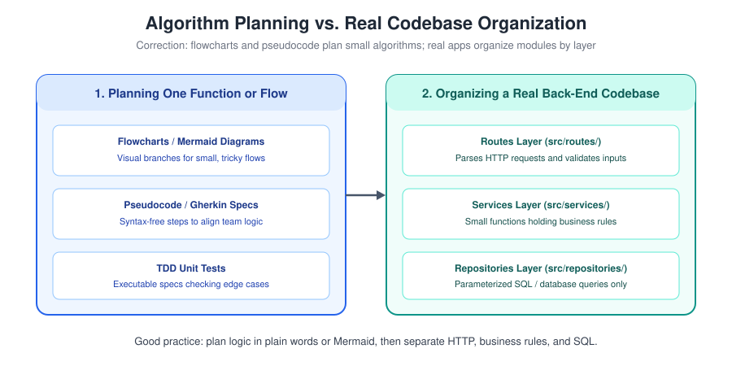
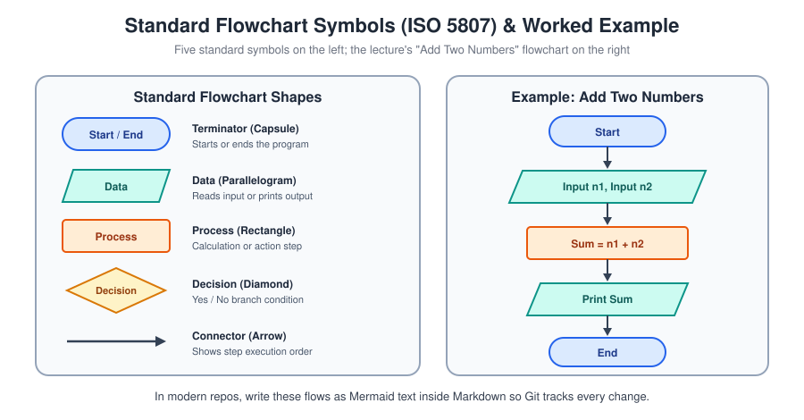
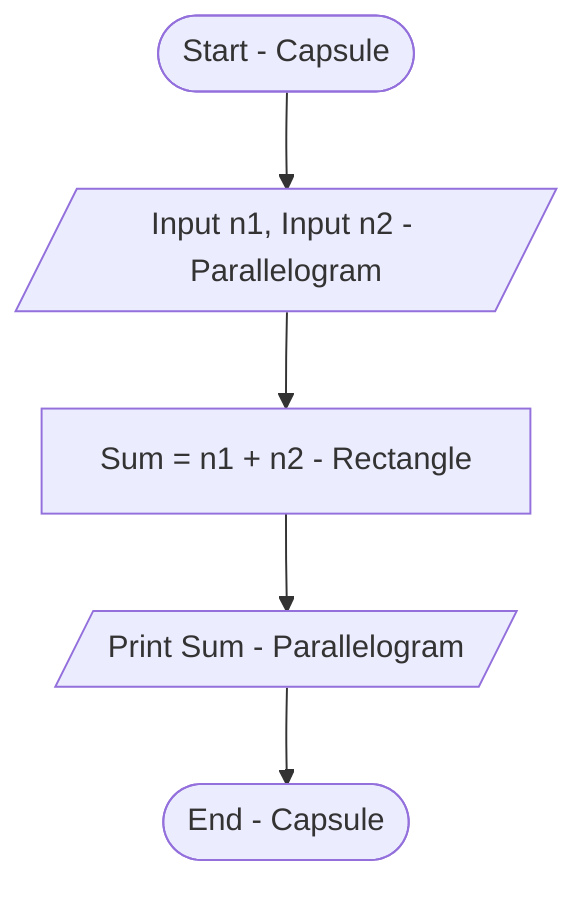
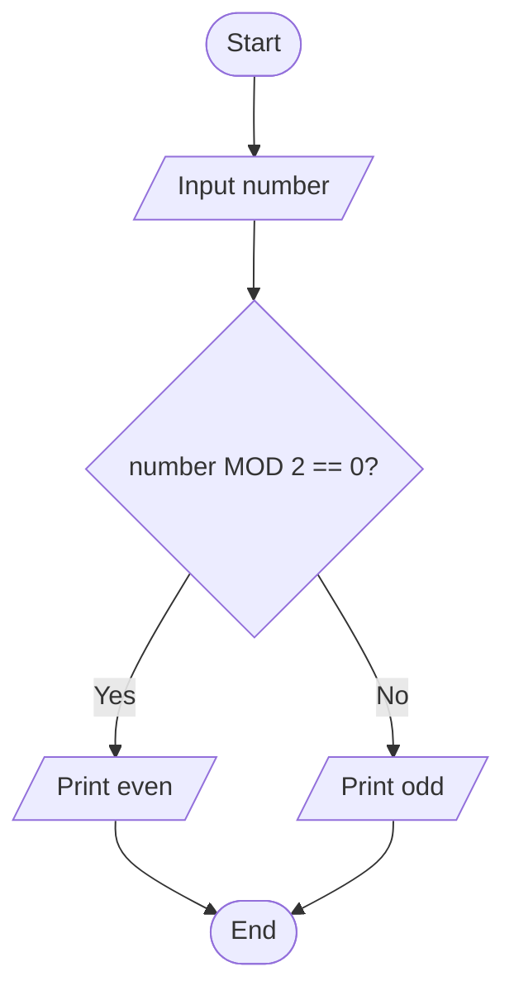

# 03 — Understanding Code Organization Methods

## 1. Jargon Translation

| Term | Official definition | Simple words | Analogy |
|---|---|---|---|
| **Algorithm** | A finite, step-by-step sequence of clear instructions for solving a given problem or completing a calculation. | An exact step-by-step recipe to solve one problem. | A cooking recipe with numbered steps from raw ingredients to the finished dish. |
| **Flowchart** | A graphical or pictorial diagram of an algorithm or process using standardized shapes (capsules, rectangles, diamonds, parallelograms) connected by arrows to show execution order. | A step-by-step picture map of how a program flows from Start to End. | A subway map showing stations, branches, and arrows between stops. |
| **Pseudocode** | An informal, human-readable outline of an algorithm that looks like structured code without strict syntax rules or hardware details. | Plain-English step-by-step logic written like rough code before coding for real. | Sketching a room layout on paper with labels before hiring builders. |
| **Terminator (Capsule / Oval)** | The standard flowchart shape (oval or rounded capsule, per ISO 5807, International Organization for Standardization) marking the **Start** or **End** point of a flow. | The rounded pill shape that shows where a flowchart begins and stops. | The "Start" and "Finish" banners on a race track. |
| **Process (Rectangle)** | The standard flowchart box representing an operation, calculation, or task (such as `Sum = n1 + n2`). | A plain box showing one action or calculation step. | One task card on a checklist, such as "Mix flour and eggs". |
| **Decision (Diamond)** | The standard flowchart diamond shape representing a conditional check (`yes`/`no` or `true`/`false`) that splits flow along two or more branches. | A question box where the arrow goes one way for "yes" and another for "no". | A fork in the road with a sign asking "Member? Left / Right". |
| **Data / Input-Output (Parallelogram)** | The slanted-side flowchart shape representing input entering a program or output displayed/printed to a user. | The tilted box used when the program reads input or prints a result. | The mailbox slot where letters come in and replies go out. |
| **Connector (Arrow)** | A directed line connecting flowchart shapes to show the order in which steps execute. | An arrow pointing from one step to the next. | Street signs showing which direction traffic flows. |
| **Flowchart Software** | A visual diagramming tool (such as Microsoft Visio, Lucidchart, or draw.io (drawio.com)) with drag-and-drop shape editors and team sharing. | An app for drawing and sharing flowcharts cleanly on screen. | Digital LEGO boards for dragging boxes and arrows into place. |
| **Diagrams as Code** | Writing diagrams as plain text inside Markdown or source files (using **Mermaid** or **PlantUML**) so Git tracks changes and diffs alongside code. | Writing simple text lines that render automatically into clean diagrams. | Writing a musical score in text so any software can print the sheet music. |
| **Separation of Concerns** | Organizing a real codebase into distinct modules and layers (such as HTTP, HyperText Transfer Protocol, routes → business services → database repositories) so each part has one clear job. | Keeping UI (User Interface), business rules, and database queries in separate files. | A restaurant keeping the dining room, kitchen, and accounting desk separate. |

---

## 2. Topics Introduced in the Lecture Transcript

1. **Why planning and organizing code matters** — improving readability, maintainability, scalability, and configuration while reducing bugs and errors across a project's lifespan.
2. **Algorithm planning tools vs. codebase organization** — defining an algorithm, comparing **flowcharts** and **pseudocode** as planning tools, and distinguishing them from how real multi-file codebases are structured.
3. **Flowchart symbols, workflow, and tools** — standard shapes (capsule Start/End, rectangle Process, diamond Decision, parallelogram Data, arrow Connectors), the "add two numbers" example (`Sum = n1 + n2`), and active tools (**Microsoft Visio**, **Lucidchart**, **draw.io**) alongside updating legacy tool names from the video.
4. **Pseudocode syntax-free planning and examples** — bridging human logic and code execution, aligning programmers and non-programmers, and walking through the **odd-or-even** check translated into **C++** (and JavaScript).
5. **Comparing flowcharts and pseudocode** — when visual diagrams shine (small concepts, early visual communication) vs. when text-based planning or real architectural specs work better.

---

## 3. Exhaustive Deep Dive & Structured Notes

### 3.1 Why Planning and Organizing Code Matters

- **Impact on the software lifespan:**
  - Planning logic before coding and organizing code cleanly helps developers **read**, **maintain**, and **configure** software over time.
  - Well-planned software design produces **cleaner, more reliable code**, gives the team a **consistent and logical format** while coding, and **reduces bugs and errors** across the whole life of a project.
  - Visual planning before implementation also improves the quality, **readability**, **maintainability**, and **scalability** of the codebase once written.

> ⚠️ **Correction:** **Flowcharts and pseudocode are algorithm planning tools, not how real codebases are organized** → While flowcharts and pseudocode help plan a **single algorithm or function**, real-world **code organization** means structuring files, modules, and layers cleanly (**separation of concerns**, e.g. `routes/ → services/ → repositories/`), writing small single-purpose functions, and documenting system architecture with **C4** (Context, Container, Component, Code) and **Mermaid** diagrams in Git.
> **Lecture wording (for the quiz):** `"There are two main methods of organizing code: flowcharts and pseudocode."`



#### ✅ Modern Best Practice: combine upfront design thinking with clean module boundaries

> **Lecture says:** well-planned design using flowcharts or pseudocode helps programmers write cleaner, more reliable code with fewer bugs.
> **Industry today:** teams plan small algorithms with quick text sketches or tests, and organize the actual codebase using layered folders, lint rules, and versioned diagrams in Git.

- **Organize the codebase by responsibility:** Keep HTTP (HyperText Transfer Protocol) request parsing (`routes/`), business logic (`services/`), and database queries (`repositories/`) separate so each file stays short and testable.
- **Follow core design principles:** Apply **KISS** (Keep It Simple, Stupid), **DRY** (Don't Repeat Yourself), **YAGNI** (You Aren't Gonna Need It), and **SOLID** (Single Responsibility, Open-Closed, Liskov Substitution, Interface Segregation, Dependency Inversion — especially Single Responsibility: one module, one reason to change).
- **Enforce complexity limits automatically:** Use **ESLint** rules (`complexity`, `max-depth`, `max-lines-per-function`) in **CI (Continuous Integration)** so overly tangled functions are caught automatically.

---

### 3.2 Flowcharts: Symbols, Worked Example, and Tools

- **What a flowchart is:**
  - A **flowchart** is a **graphical or pictorial representation** of an **algorithm** (a step-by-step sequence for solving a problem).
  - It uses shapes of different sizes and colors connected by arrows to show step order, highlight key elements, and analyze different ways to solve a problem or document a process.
- **Standard flowchart shapes (formalized in the ISO 5807 standard, general knowledge):**
  1. **Start / End (Capsule / Oval):** Marks where the algorithm begins and finishes.
  2. **Data (Parallelogram):** Marks inputs entering the program or outputs printed/returned.
  3. **Process (Rectangle):** Marks a calculation or internal action.
  4. **Decision (Diamond):** Evaluates a condition (`true`/`false`) to choose a branch.
  5. **Connectors (Arrows):** Show the exact direction and sequence from one step to the next.



- **Lecture worked example — Adding two numbers:**
  1. **Start** (`capsule`) → arrow to next step.
  2. **Data input** (`parallelogram`): `Input n1` and `Input n2` → arrow to process.
  3. **Process** (`rectangle`): `Sum = n1 + n2` → arrow to output.
  4. **Data output** (`parallelogram`): `Print Sum` → arrow to end.
  5. **End** (`capsule`).



- **Flowchart software:**
  - Drag-and-drop diagramming editors let teams place shapes, connect arrows, and collaborate on diagrams—active tools include **Microsoft Visio**, **Lucidchart**, and **draw.io** (drawio.com). The lecture also names DrawAnywhere; I could not find an active DrawAnywhere site when I checked (drawanywhere.com returned no page content), so treat it as unverified and legacy.

> **Not verified:** the lecture lists *Draw.io* and *DrawAnywhere*. **draw.io** is still the product's name (its site is drawio.com and its GitHub project describes it as "a JavaScript, client-side editor for general diagramming"), so the lecture's name is correct. `diagrams.net` was an earlier website name for the same tool. I could not verify DrawAnywhere, so do not rely on it. Today teams also prefer **diagrams as code** (**Mermaid** or **PlantUML**) because plain-text diffs review cleanly in pull requests, alongside whiteboard tools like **Excalidraw** for rough sketches.

#### ✅ Modern Best Practice: use diagrams as code (Mermaid) instead of binary diagram files

> **Lecture says:** flowchart software lets teams drag shapes into order and collaborate in an editor.
> **Industry today:** developers store **Mermaid** or **PlantUML** diagrams inside Markdown files in Git so diagrams stay next to the code and never rot out of date in an external folder.

| Diagramming style | Best for | Downside |
|---|---|---|
| **Visual editors** (Visio, Lucidchart, draw.io) | Workshops with non-technical clients or high-level slide decks | Binary/external files drift away from code; hard to diff in Git pull requests |
| **Diagrams as code** (**Mermaid** in Markdown, **PlantUML**) | Flows, sequence diagrams, and state machines living inside the repo | Less pixel-by-pixel control over layout than drag-and-drop tools |

---

### 3.3 Pseudocode: Syntax-Free Planning, Examples, and Trade-Offs

- **What pseudocode is:**
  - An **informal, high-level description** of an algorithm that avoids strict programming language syntax or low-level technology details.
  - Acts as a **rough draft / outline** and a **bridge** between the programmer's brain and the computer's code executor.
  - System designers use pseudocode so developers understand requirements and align code accordingly, and beginners can start learning logic without syntax headaches.
- **Advantages of pseudocode highlighted in the lecture:**
  - Explains **what each line** of an application should do.
  - Keeps focus on **logic rather than language syntax**, removing coding distractions.
  - Uses plain words and phrases for basic operations so programmers working in **different programming languages** can collaborate and translate the logic into any target language (such as **C++** or **JavaScript**).
  - Easier for **non-programmers** and different development groups to read and review than raw source code.
  - **Concise and easy to modify** when design changes are needed.
- **Lecture comparison (flowcharts vs. pseudocode):**
  - **Flowcharts** are easier to create at the beginning and great for **smaller concepts** and quick visual communication.

> ⚠️ **Correction:** **Pseudocode alone does not scale to large programming projects** → While pseudocode is helpful for sketching **one small algorithm or tricky function** (usually under a page), writing an entire large project in one-page pseudocode does not work. Real large systems use **OpenAPI** contracts, **ADRs (Architecture Decision Records)**, an **RFC (Request for Comments)** per major feature, **C4** component diagrams, and executable **BDD (Behavior-Driven Development) / Gherkin** (`Given / When / Then`) or **TDD (Test-Driven Development)** test specifications.
> **Lecture wording (for the quiz):** `"while pseudocode is more efficient for larger programming projects... And lastly, unlike some flowcharts, pseudocode is usually less than one page."`

- **Worked example from the lecture — Odd or even number check:**

```text
START
  DISPLAY "Enter a whole number:"
  INPUT number
  IF number MOD 2 == 0 THEN
    DISPLAY number + " is even"
  ELSE
    DISPLAY number + " is odd"
  END IF
END
```



#### ✅ Modern Best Practice: replace long pseudocode with readable code + Gherkin / tests

> **Lecture says:** pseudocode helps programmers and non-programmers agree on the program's goal and how the task should be done.
> **Industry today:** teams align with business stakeholders using **Gherkin** (`Given / When / Then`) examples and align developers using **readable typed code + unit tests**, saving pseudocode only for short whiteboard or design-doc sketches.

```gherkin
# Executable specification (Gherkin) — readable by non-programmers AND runnable as a test
Scenario: Identify an even number
  Given a whole number 4
  When the odd-or-even check runs
  Then the result is "even"
```

---

### 3.4 Not in the Lecture — Industry Practice: Often-Missed Parts

A senior backend engineer reviewing how a team organizes code and plans logic also checks:

- **Readable code reduces the need for pseudocode:** Meaningful names (`calculateInvoiceTotal` instead of `calc`), early returns instead of deep `if/else` nesting, and small single-purpose functions make real JavaScript/TypeScript almost as easy to read as pseudocode.
- **Directory & module boundaries:** In a Node.js + Express app, group files by layer or feature (`src/routes/`, `src/services/`, `src/repositories/`) and enforce boundaries in CI so route handlers never import database SQL directly.
- **API (Application Programming Interface) & data contracts before code:** Agree on JSON (JavaScript Object Notation) request/response shapes (`openapi.yaml`) and error formats before writing handlers—that replaces informal planning notes between front-end and back-end teams.
- **Docs live next to code in Git:** Keep **ADRs**, Mermaid flowcharts, and `README.md` in the same pull request as the code, rather than detached diagrams in Visio or external drives that go stale.
- **Responsible AI (Artificial Intelligence) coding tools:** AI assistants can generate clean functions or Mermaid flowcharts from pseudocode, **but** developers must still design module boundaries, check edge cases (like negative numbers or non-integers in `oddOrEven`), and write real unit tests (common practice).

#### Done enough when… (a module or algorithm is cleanly organized)

- [ ] Complex logic was sketched first (short flowchart, Mermaid diagram, pseudocode, or failing TDD test) before writing messy nested code.
- [ ] Every function has one clear job, shallow nesting (early returns), and descriptive names.
- [ ] Real codebase files separate HTTP routing, business logic, and database access cleanly.
- [ ] Edge cases (empty input, negative numbers, non-integers) are covered by unit tests, not just the happy path.
- [ ] Architecture and flow diagrams live as Mermaid/PlantUML text in Git and match the current code.

---

## 4. Concrete Examples

1. **Course Book Review API — Planning a Review Validation Flow:**
   - Before writing `POST /api/books/:isbn/reviews`, you sketch a 5-step **Mermaid flowchart** inside the feature RFC: `Validate JSON body → Check JWT (JSON Web Token) auth → Check if user already reviewed this ISBN (International Standard Book Number) → Insert row → Return 201 Created`.
   - Then you organize the real code into three files: `routes/reviews.js` (HTTP + validation), `services/reviewService.js` (one-review-per-user rule), and `repositories/reviewRepo.js` (SQL, Structured Query Language, queries).
2. **Checkout Discount Logic (Pseudocode → Unit Test → Code):**
   - Product and engineering agree on a 6-line pseudocode / Gherkin rule for tiered shipping discounts before implementing it in `pricingService.js`, ensuring non-programmers verify the rule before a single line of Express code ships.
3. **Docker & Kubernetes Health-Check Flow:**
   - **DevOps (Development and Operations)** engineers document `/healthz` and `/readyz` probe behavior (endpoints that containers or Kubernetes check to see if an app is alive and ready for traffic) with a concise `flowchart TD` diagram in the repo `README.md` so **on-call engineers** (the engineers on duty for production alerts) see startup vs. shutdown flow in seconds during an incident.

---

## 5. Code Blocks

### 5.1 Translating the Lecture's "Odd or Even" Pseudocode into Tested JavaScript (Node.js 24)

Here is the lecture's odd/even pseudocode implemented cleanly in an `.mjs` (ES module JavaScript) file with input validation (`tested on Node.js v24.18.0`):

```javascript
// odd-even.mjs — clean translation of the odd/even pseudocode (tested on Node.js v24.18.0)
function isEvenOrOdd(n) {
  if (!Number.isInteger(n)) {                            // Guard edge case: reject floats or strings
    throw new TypeError('Expected a whole integer');
  }
  return n % 2 === 0 ? 'even' : 'odd';                   // Modulo (%) checks remainder after dividing by 2
}

console.log([4, 7, 0, -3].map((x) => ({ input: x, result: isEvenOrOdd(x) })));
```

Real output from running in `Node.js v24.18.0`:

```text
[
  { input: 4, result: 'even' },
  { input: 7, result: 'odd' },
  { input: 0, result: 'even' },
  { input: -3, result: 'odd' }
]
```

**What happens if... you skip the `Number.isInteger(n)` check and pass `4.5` or `"4"`?** As tested in `Node.js v24.18.0`, `4.5 % 2 === 0` is `false` (quietly returning `'odd'` for a decimal!) and `"4" % 2 === 0` coerces `"4"` to `4` and returns `'even'`. Planning edge cases before coding catches these silent bugs early.

### 5.2 Translating the Same Pseudocode into C++ (Matching the Lecture's C++ Example)

```cpp
// odd_even.cpp — C++ translation of the lecture's odd/even pseudocode
#include <iostream>

int main() {
    int n = 0;
    std::cout << "Enter a whole number: ";               // Output prompt (parallelogram)
    if (!(std::cin >> n)) {                              // Guard against non-integer input
        std::cerr << "Invalid integer\n";
        return 1;
    }
    if (n % 2 == 0) {                                    // Decision (diamond): remainder zero?
        std::cout << n << " is even\n";
    } else {
        std::cout << n << " is odd\n";
    }
    return 0;
}
```

**What happens if... the user types `"hello"` into `std::cin >> n` without the `if (!(std::cin >> n))` guard?** `n` stays `0`, so the program wrongly prints `"0 is even"` instead of rejecting invalid input.

### 5.3 Checking Code Complexity Automatically (`bash`)

```bash
# Run ESLint in CI to catch overly complex or deeply nested functions automatically
npx --no-install eslint .
```

**What happens if... you rely only on manual code review instead of lint rules?** Large, deeply nested functions slowly slip into the codebase under deadline pressure until nobody dares refactor them.

---

## 6. Related Concepts

1. **Software Architecture & Layered Design (`routes → services → repositories`):** Organizing multi-file back-end codebases by responsibility rather than stuffing logic into one giant file.
2. **Design Docs, RFCs, & ADRs:** Documenting architectural decisions, trade-offs, and system flows in Git alongside code.
3. **Diagrams as Code (Mermaid, PlantUML, C4 Model):** Keeping flowcharts, sequence diagrams, and container diagrams versioned in Markdown instead of stale external files.
4. **BDD (Behavior-Driven Development) & TDD (Test-Driven Development):** Turning plain-English specifications (`Given / When / Then`) and failing unit tests into executable design tools.
5. **Clean Code Principles (KISS, DRY, YAGNI, SOLID) & Linting:** Keeping functions small, readable, and automatically checked for complexity in CI.

---

## 7. Lecture Summary & Quick Reference Table

| Topic | Lecture | ✅ Modern best practice |
|---|---|---|
| **Why organize code** | Improves reading, maintaining, configuring, reliability, scalability, and reduces bugs over the project lifespan | True; pair upfront design thinking with **layered folders**, small single-job functions, and **ESLint** complexity checks |
| **Main methods** | Describes flowcharts and pseudocode as the two main ways of organizing code | Flowcharts and pseudocode plan **individual algorithms**; real **codebase organization** uses **separation of concerns**, modules, API contracts, and **C4 / Mermaid** diagrams |
| **Flowcharts** | Pictorial algorithm diagram using capsules (Start/End), rectangles (Process), diamonds (Decision), parallelograms (Data), and arrows (`Sum = n1 + n2`) | Formalized in **ISO 5807** (general knowledge); store repo flows as **Mermaid** diagrams as code inside Markdown |
| **Flowchart software** | **Microsoft Visio**, **Lucidchart**, **Draw.io**, and **DrawAnywhere** | **draw.io** is still the product name (drawio.com); **DrawAnywhere** could not be verified; teams also use **Mermaid** / **Excalidraw** |
| **Pseudocode** | Informal syntax-free outline (< 1 page) bridging logic and code, great for cross-language and non-programmer review (odd/even → C++) | Useful for **one tricky algorithm**; for larger projects use **Gherkin** specs, **OpenAPI** contracts, **ADRs**, and readable typed code + unit tests |
