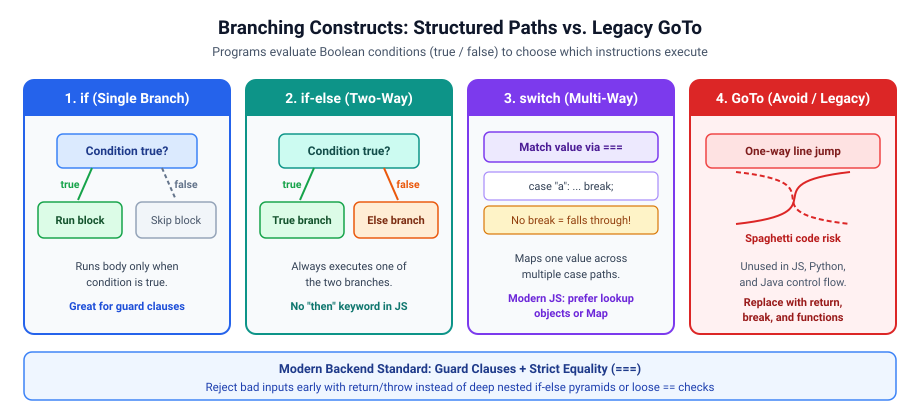
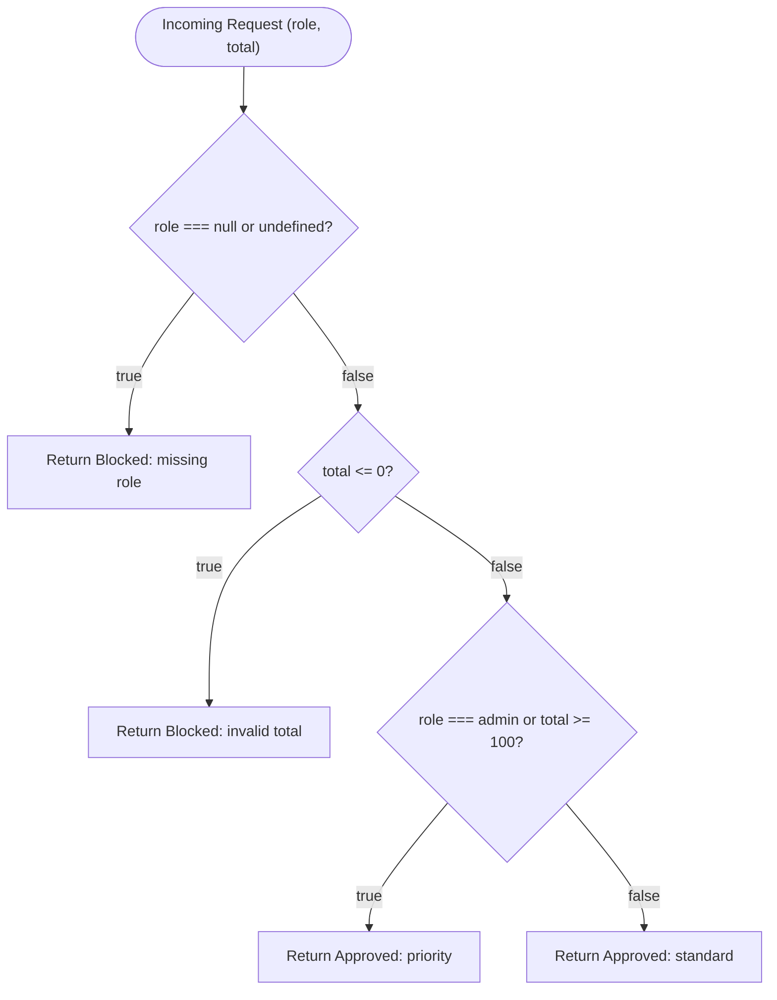
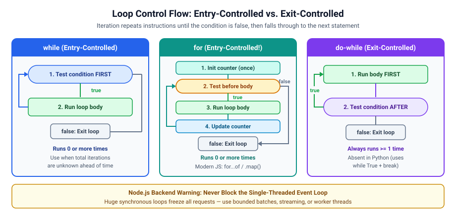
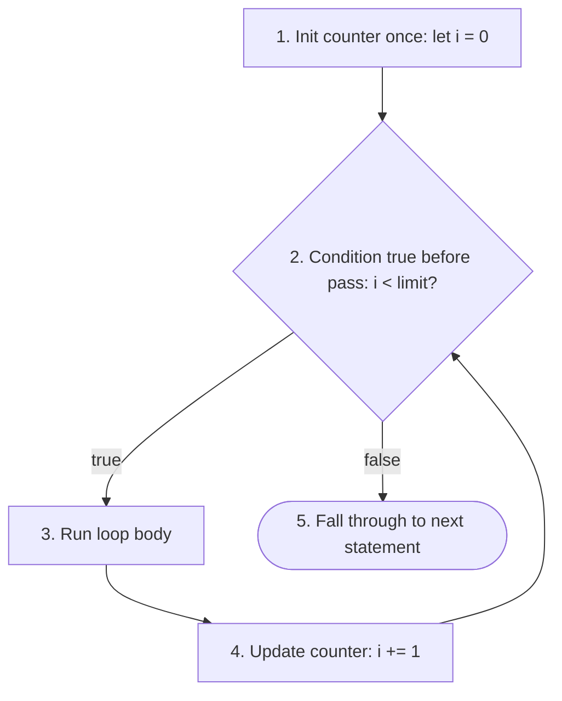

# 04 — Branching and Looping Programming Logic

## 1. Jargon Translation

| Term | Official definition | Simple words | Analogy |
|---|---|---|---|
| **Boolean Expression** | A programming expression that evaluates to exactly one of two truth values: `true` or `false`. | A yes-or-no question written in code. | A light switch with only two positions: on (`true`) or off (`false`). |
| **Variable & Parameter** | A named storage location holding data that can change during execution (`variable`), and a named input slot declared by a function or subroutine (`parameter`). | A labeled box holding changing data, and the inbox slot receiving values passed into a function. | A whiteboard label ("price") and the order form field passed to a cashier. |
| **Branching Logic** | Control flow that chooses among different instruction pathways depending on whether conditions are met at runtime. | Making the code take different paths based on conditions. | A train track switch sending a train left or right depending on its destination. |
| **`if` / `if-else` Statement** | Conditional statements where `if` runs a block only when a condition is `true`, and `if-else` executes one block on `true` and an alternate block on `false`. | "If this is true, do A; otherwise, do B." | Checking if an order qualifies for free shipping before calculating the total. |
| **`switch` Statement & Fall-Through** | A multi-way branch matching one expression against candidate `case` clauses; in C-style languages, omitting `break` causes execution to **fall through** into subsequent cases. | A lookup menu for one value—and a trap if you forget `break` between choices. | An elevator stopping at the matching floor unless the brake fails and it slides past. |
| **`GoTo` & Function Call** | `GoTo` is an unconditional **one-way transfer** of control to another labeled line, whereas a **function call** runs a subroutine and returns control to the caller afterward. | `GoTo` jumps away and never remembers where it came from; a function call comes back. | Moving to another city one-way (`GoTo`) vs. making a phone call and returning to your desk (function call). |
| **Guard Clause (Early Return)** | A short `if` check at the top of a function that exits (`return`) or throws an error immediately on invalid/edge inputs instead of wrapping the happy path in nested `else` blocks. | Checking the deal-breakers at the front door so the main logic stays flat. | A venue security check at the entrance before guests walk into the main hall. |
| **Looping Logic & Iteration** | Control flow that repeats a sequence of instructions multiple times until a stopping condition is met; each single pass through the body is one **iteration**. | Repeating a task automatically until a goal or limit is reached. | Washing plates in a sink one by one until the stack is empty. |
| **Entry-Controlled Loop (`while`, `for`)** | A loop that tests its Boolean condition **before** executing the loop body, meaning the body executes zero times if the condition starts `false`. | Checking the ticket *before* stepping onto the ride. | Checking if a cart has items *before* scanning the first item. |
| **Exit-Controlled Loop (`do-while`)** | A loop that executes its body **first** and checks its Boolean condition **after** each pass, guaranteeing at least one execution. | Stepping onto the ride once, then checking whether to go around again. | Asking a user for a password at least once, then repeating if it was wrong. |

---

## 2. Topics Introduced in the Lecture Transcript

1. **Two major types of programming logic** — **branching** (deciding which actions/paths to run) and **looping** (deciding how many times to repeat an action), both powered by **Boolean expressions** and **variables**.
2. **Instructions, data, variables, and Boolean values** — how programs combine fixed instructions with changing data (`variables` and `parameters` passed from user input or earlier procedures) and evaluate `true` / `false` decisions.
3. **Branching logic and constructs** — how branching allows unlimited alternative code pathways using **`if`**, **`if-else`** (also written `if-then-else` in pseudocode/some languages), **`switch`** (matching an expression to a path), and legacy **`GoTo`** (an unstructured **one-way transfer**, unlike a returning **function call**, absent in modern JS/Python/Java).
4. **Looping logic and counter-based iteration** — repeating an instruction block until a condition becomes false (or a **counter** hits a target), then **falling through** cleanly to the next sequential instruction.
5. **The three classic loop statements** — comparing **`while`** (entry-controlled check before the body), **`for`** (counter initialization + condition + iteration update), and **`do-while`** (**exit-controlled** execution after the body).

---

## 3. Exhaustive Deep Dive & Structured Notes

### 3.1 Boolean Expressions, Variables, and Program State

- **How programs store and decide:**
  - A program pairs **instructions** (what actions the computer runs) with **data** (the values it reads and transforms).
  - **Variables** hold values that change based on conditions, user input, or outputs from earlier functions. When passed into a function or subroutine, those incoming slots are called **parameters**.
  - A **Boolean expression** evaluates strictly to `true` or `false` (`1` or `0` at machine level). Branching and looping statements read these Boolean results to steer execution.

#### ✅ Modern Best Practice: default to `const`, strict `===`, and explicit Boolean checks

> **Lecture says:** Boolean expressions evaluate to `true` or `false`, and variables hold values that change as data moves through the program.
> **Industry today:** modern JavaScript (`ES6+`, ECMAScript 2015+, general knowledge) avoids accidental variable mutation with `const` by default (`let` only when reassigned) and avoids type-coercion bugs with strict equality (`===` / `!==`) instead of loose `==`.

| Check style | What JavaScript does | Hidden bug or safety gain |
|---|---|---|
| `if (count)` (truthy check) | Treats `0`, `""`, `null`, `undefined`, `NaN` as `false` | Bug if `count = 0` is a valid number (for example, `0` items in cart or free tier `$0`) |
| `count == "0"` (loose equality) | Coerces string `"0"` to number `0` → `true` | Causes surprising matches (`"" == 0` is `true`, `false == "0"` is `true`) |
| `count === 0` / `role !== undefined` | Compares both **type and value** with no coercion | Safe and predictable; standard in modern JavaScript back-ends |

---

### 3.2 Branching Logic: Decisions and Constructs (`if`, `if-else`, `switch`, and Legacy `GoTo`)

- **What branching logic does:**
  - **Branching** lets a program evaluate conditions on inputs or **parameters** and jump to different instruction paths (**branches**). You can combine as many branches as the business rules require.
- **Classic branching statements covered in the lecture:**
  1. **`if` statement:** Evaluates one Boolean condition. If `true`, the block runs; if `false`, the block is skipped and execution continues below it.
  2. **`if-else` statement:** Guarantees **two mutually exclusive paths**—when the condition is `true`, the `if` branch runs; when `false`, the `else` branch runs. Neither path runs twice, and one always executes. (Pseudocode, Pascal, SQL (Structured Query Language), and Bash often call or write this `if-then-else`, whereas JS, Python, and C-family languages omit `then`.)
  3. **`switch` statement:** Compares one variable or expression against a list of discrete values (`case` branches) to pick a path cleanly—useful when checking one status code, role name, or menu command against many fixed choices.
  4. **Legacy `GoTo` statement (historical / low-level concept):** Performs an unconditional **one-way transfer** of control directly to a target line or label. Unlike a **function call** (which pushes a return frame onto the call stack and returns to the caller when done), `GoTo` never automatically comes back, and modern JS/Python/Java do not use it.





> **Not in the lecture — industry practice:** Pascal, SQL and Bash write `if ... then ... else`, but **JavaScript, Python, Java, C and C++** use `if (cond) { ... } else { ... }` (or `if cond:` in Python) with **no `then` keyword**. Also, per MDN (Mozilla Developer Network), omitting `break` or `return` inside a JavaScript `switch` makes execution **fall through** and run the next `case` body even if its label does not match. ESLint's `no-fallthrough` rule flags this.

> ⚠️ **Correction:** **`GoTo` is avoided in modern application code, and several mainstream languages have no usable `goto`** → Unstructured `GoTo` jumps create tangled **"spaghetti code"** that is hard to read, debug or reason about. **JavaScript** has no `goto` statement (`goto` is not a reserved word in modern JavaScript, so it is even a legal variable name; we tested `var goto = 1` on `Node.js v24.18.0`), **Python** has no `goto` statement (per `docs.python.org`), and **Java** reserves `goto` as a keyword but does not use it (per the Java Language Specification). Not every language dropped it: **C, C++, C#** (per learn.microsoft.com) and **Go** (per go.dev/ref/spec) still have a `goto` statement, although style guides discourage it. Modern code replaces `GoTo` with structured blocks (`if/else`), early `return`, `break` / `continue` (plus labeled `break` in JS) and `try/catch`.
> **Lecture wording (for the quiz):** paraphrase of the lecture (the exact transcript wording was not saved): it lists `GoTo` alongside `if`, `if-then-else` and `switch` as common branching statements and describes it as a one-way transfer of control, unlike a function call.

#### ✅ Modern Best Practice: guard clauses (early returns), lookup objects instead of long `switch`, and zero `GoTo`

> **Lecture says:** branching lets a program follow unlimited conditional pathways using `if`, `if-else`, `switch`, and `GoTo`.
> **Industry today:** teams keep branching flat with **guard clauses** (fail fast at the top of a function), replace multi-line `switch` blocks with a **`Map` or a lookup object guarded by `Object.hasOwn`**, and enforce shallow nesting via **ESLint** (`max-depth`, `complexity`, `default-case`) in **CI (Continuous Integration)**.

- **Use guard clauses instead of deep `else` pyramids:** Checking invalid inputs first (`if (!user) return ...`) eliminates nested indentation so the normal path reads top-to-bottom.
- **Avoid unintentional `switch` fall-through:** Every `case` should end with `return` or `break`, plus a `default` branch for unexpected values—or use a lookup table, which cannot fall through at all. Look keys up safely: a plain object also finds inherited keys (`ROLE_ACCESS["constructor"]` returns a function, tested on `Node.js v24.18.0`), so use `Object.hasOwn(ROLE_ACCESS, role)`, a `Map`, or an object created with `Object.create(null)` when `role` comes from a request.

---

### 3.3 Looping Logic: Iteration, Counters, and Loop Types (`while`, `for`, `do-while`)

- **What looping logic does:**
  - A **loop** repeats a block of instructions until its **loop condition** becomes `false` (for example, after processing every item in a list or reaching a target **counter** limit).
  - Once the loop condition becomes `false` (fails), execution **falls through** cleanly to the first statement after the loop. Each single execution of the loop body is one **iteration**.
- **The three classic loop constructs:**
  1. **`while` loop (entry-controlled):** Evaluates its Boolean condition **before** each pass. If `true`, the body runs and control loops back to re-test the condition. If `false` on entry, the body runs **zero times**.
  2. **`for` loop (entry-controlled counter loop in C-style languages):** Runs an initialization step once (such as `let i = 0`), evaluates the Boolean condition **before** each iteration, runs the body if `true`, then runs the update step (`i += 1`) before re-testing the condition.
  3. **`do-while` loop (exit-controlled):** Runs the loop body **first**, then evaluates the Boolean condition **after** the body. Because the check happens at the exit, the body is guaranteed to execute **at least once**, even when the condition is initially `false`.





> ⚠️ **Correction:** **A standard `for` loop evaluates its condition before each iteration, not after—and Python has no `do-while` loop** → In JavaScript, C, C++, Java, and C# (per MDN, Mozilla Developer Network), `for (init; condition; update)` is **entry-controlled**: `condition` is tested **before** each loop body runs (`for (let i = 5; i < 5; i++)` executes **0 times**, tested on `Node.js v24.18.0`), while only the `update` expression (`i++`) runs after the body before the next pre-check. Only `do-while` evaluates its condition **after** the body. Additionally, **Python** (`docs.python.org`) has no C-style counter `for` and **no `do-while`** loop—its `for x in items:` iterates over a collection/iterable, and post-check loops are written as `while True: ... if cond: break`.
> **Lecture wording (for the quiz):** paraphrase of the lecture (the exact transcript wording was not saved): a `for` loop sets an initial counter value once, and the counter is compared to a fixed value after each iteration; `while` checks before the body and `do-while` checks after it.

#### ✅ Modern Best Practice: prefer `for...of` / array methods and protect the Node.js event loop

> **Lecture says:** loops repeat instructions with counters and exit conditions (`while`, `for`, `do-while`) until the condition is satisfied.
> **Industry today:** modern JavaScript avoids manual `i++` index bugs with `for...of` and declarative array methods (`.map()`, `.filter()`, `.reduce()`), puts explicit upper bounds on `while` retries, and chunks heavy loops in Node.js so long synchronous loops never freeze concurrent HTTP (HyperText Transfer Protocol) requests.

- **Prevent infinite loops & event-loop stalls:** Always ensure a `while` loop advances toward its exit condition (or enforces `maxAttempts`), and remember Node.js executes JS on one main thread—a synchronous loop over millions of rows blocks all other users until it finishes.

---

### 3.4 Often-missed parts

- **`if` vs. `if-else` guarantees:** Plain `if` can skip its block and do nothing when `false`; `if-else` guarantees **exactly one** of its two blocks runs.
- **Two distinct meanings of "falls through":** In **looping**, finishing a loop "falls through" to the statement below the loop (normal exit). In a **`switch`** statement, forgetting `break` makes control "fall through" into the *next* `case` block accidentally (classic bug).
- **`do-while` minimum run count:** Even if the condition starts `false`, `do-while` runs **once** before testing; `while` and `for` run **zero times**.
- **Forgetting the loop update:** Omitting `i += 1` inside a `while` loop creates an **infinite loop** that hangs the program or crashes an HTTP server request.
- **`GoTo` vs. `function call`:** A function call pushes a return address onto the call stack and returns control cleanly; `GoTo` jumps one-way without returning, which is why modern application languages exclude or restrict it.
- **Zero (`0`) and empty string (`""`) truthiness in JS:** Writing `if (price)` rejects a valid `$0` discount/free item; write `if (price !== undefined && price !== null)` or `typeof price === "number"`.

---

### 3.5 Done enough when…

- [ ] You can predict whether a `while`, `for`, or `do-while` loop runs **0 times** or **1 time** when the starting condition is already `false`.
- [ ] You understand why forgetting `break` inside a JavaScript `switch` causes unintended **fall-through** (and why a lookup table avoids it).
- [ ] You can explain why `GoTo` is avoided/absent in modern JavaScript, Python, and Java, and how functions + early `return` + `break`/`continue` replace it.
- [ ] You rewrite deeply nested `if / else` blocks into flat **guard clauses** using strict equality (`===`).

---

## 4. Concrete Examples

1. **Back-End API (Application Programming Interface) Authorization & Validation (Guard Clauses vs. Nested `if-else`):**
   An order endpoint checks three things before charging a card: is the user logged in (`userRole !== null`), is `orderTotal > 0`, and does the user qualify for priority fulfillment (`userRole === "admin" || orderTotal >= 100`)? Writing each invalid case as a short early `return` keeps the normal path flat and easy to test.
2. **Role Permission Routing (`switch` Fall-Through Bug vs. Safe Lookup Map):**
   Suppose `"viewer"` should only get `"read"` access and `"editor"` gets `"write"`. If a developer writes a `switch (role)` statement and forgets `break;` under `case "viewer":`, Node.js falls straight into `case "editor":` and accidentally grants `"read write"` permissions to a read-only viewer—a security bug eliminated by a key-value lookup (a `Map`, or an object read through `Object.hasOwn`).
3. **Database Retry vs. Pagination (`do-while` vs. `while` / `for...of`):**
   - Checking a network health ping that must attempt **at least 1 call** before deciding whether to retry fits `do-while` (exit-controlled, capped at `maxAttempts = 3`).
   - Fetching remaining database pages while `nextCursor !== null` fits `while` (entry-controlled—if `nextCursor` is already `null`, fetch 0 extra pages).

---

## 5. Code Blocks

### 5.1 Branching in JavaScript: Guard Clauses, `switch` Fall-Through, and Safe Lookup

```javascript
// branching-demo.mjs — tested on Node.js v24.18.0
function evaluateOrderAccess(userRole, orderTotal) {
  if (userRole === undefined || userRole === null) {
    return "Blocked: missing user role";                 // Guard clause 1 (early return)
  }
  if (!Number.isFinite(orderTotal) || orderTotal <= 0) {
    return "Blocked: invalid order total";               // Guard clause 2 (blocks NaN/Infinity/<=0)
  }
  if (userRole === "admin" || orderTotal >= 100) {
    return "Approved: priority fulfillment";
  }
  return "Approved: standard fulfillment";
}

function routeRoleBrokenSwitch(role) {
  let access = "";
  switch (role) {
    case "viewer":
      access += "read ";
      // Missing break -> unintentional fall-through into "editor"!
    case "editor":
      access += "write ";
      break;
    default:
      access = "none";
  }
  return access.trim();
}

const ROLE_ACCESS = {
  viewer: "read",
  editor: "read + write",
  admin: "read + write + delete",
};

function routeRoleSafe(role) {
  // Object.hasOwn ignores inherited keys such as "constructor" or "toString"
  return Object.hasOwn(ROLE_ACCESS, role) ? ROLE_ACCESS[role] : "none";
}

console.log("evaluateOrderAccess(null, 50):", evaluateOrderAccess(null, 50));
console.log("evaluateOrderAccess('member', 120):", evaluateOrderAccess("member", 120));
console.log("evaluateOrderAccess('member', 40):", evaluateOrderAccess("member", 40));
console.log("routeRoleBrokenSwitch('viewer'):", routeRoleBrokenSwitch("viewer"));
console.log("routeRoleSafe('viewer'):", routeRoleSafe("viewer"));
console.log("routeRoleSafe('guest'):", routeRoleSafe("guest"));
console.log("routeRoleSafe('constructor'):", routeRoleSafe("constructor"));
```

Real output from running in `Node.js v24.18.0`:

```text
evaluateOrderAccess(null, 50): Blocked: missing user role
evaluateOrderAccess('member', 120): Approved: priority fulfillment
evaluateOrderAccess('member', 40): Approved: standard fulfillment
routeRoleBrokenSwitch('viewer'): read write
routeRoleSafe('viewer'): read
routeRoleSafe('guest'): none
routeRoleSafe('constructor'): none
```

**What happens if... you replace `userRole === null` with loose `userRole == null` or skip `break`?** Loose `==` blurs type rules across comparisons, while omitting `break` in `routeRoleBrokenSwitch('viewer')` silently grants `'read write'` instead of `'read'`.

### 5.2 Looping in JavaScript: Entry-Controlled (`while`, `for`) vs. Exit-Controlled (`do-while`) & `for...of`

```javascript
// loops-demo.mjs — tested on Node.js v24.18.0
let whileRuns = 0;
let count = 5;
while (count < 5) {                                      // Entry-controlled: false at start -> 0 runs
  whileRuns += 1;
  count += 1;
}
console.log("while (count < 5) runs when count=5:", whileRuns);

let forRuns = 0;
for (let i = 5; i < 5; i += 1) {                         // Condition runs BEFORE body -> 0 runs!
  forRuns += 1;
}
console.log("for (i=5; i < 5; i++) runs:", forRuns);

let doWhileRuns = 0;
let attempts = 5;
do {                                                     // Exit-controlled: body runs first -> 1 run
  doWhileRuns += 1;
  attempts += 1;
} while (attempts < 5);
console.log("do-while (attempts < 5) runs when attempts=5:", doWhileRuns);

const tasks = ["validate-input", "query-database", "send-response"];
const completed = [];
for (const task of tasks) {                              // Modern iteration without manual index counter
  if (task === "query-database") {
    completed.push(`${task} (cached skip demo)`);
    continue;                                            // Skip rest of this iteration cleanly
  }
  completed.push(task);
}
console.log("for...of result:", completed);
```

Real output from running in `Node.js v24.18.0`:

```text
while (count < 5) runs when count=5: 0
for (i=5; i < 5; i++) runs: 0
do-while (attempts < 5) runs when attempts=5: 1
for...of result: [
  'validate-input',
  'query-database (cached skip demo)',
  'send-response'
]
```

**What happens if... you assume `for (let i = 5; i < 5; i++)` tests after the first run like `do-while`?** You would expect `forRuns === 1`, when in reality our script tested on `Node.js v24.18.0` prints `0` because `for` checks `i < 5` *before* entering the body.

### 5.3 Cross-Language Comparison: Python Looping (No `do-while`, No `GoTo`, Sequence `for`)

```python
# loop_compare.py — Python (per docs.python.org) has no do-while and no goto
tasks = ["validate", "save", "notify"]
for task in tasks:                                       # Iterates items directly, no counter needed
    print(task)

attempts = 0
while True:                                              # Standard Python pattern instead of do-while
    attempts += 1
    if attempts >= 1:
        break                                            # Clean structured exit
```

**What happens if... you try writing `do { ... } while (cond)` or `goto start` in Python?** Python raises a `SyntaxError` immediately because neither `do-while` nor `goto` exists in the language grammar.

---

## 6. Related Concepts

1. **Short-Circuit Evaluation & Logical Operators (`&&`, `||`, `??`):** Skipping unnecessary condition checks (and safely supplying fallback defaults without falling into truthy/falsy `0` traps).
2. **Error Handling & Call Stack (`try / catch / throw`):** Structured error propagation across function calls, replacing brittle status flags or legacy `GoTo` jumps.
3. **Functional Array Pipelines (`.map()`, `.filter()`, `.reduce()`):** Declarative alternatives to manual `for`-counter loops when transforming back-end JSON (JavaScript Object Notation) arrays.
4. **Cyclomatic Complexity & Static Linting (`ESLint`):** Measuring how many branches/loops live inside one function so `CI` flags tangled logic before merge.
5. **Asynchronous Iteration & Event-Loop Safety (`for await...of`, Streams, Worker Threads):** Processing large datasets or paginated API responses in Node.js without blocking incoming requests.

---

## 7. Lecture Summary & Quick Reference Table

| Topic | Lecture | ✅ Modern best practice |
|---|---|---|
| **Boolean & variables** | Boolean expressions evaluate to `true`/`false`; variables hold changeable data and parameters pass inputs into functions | Default to `const` (use `let` only when reassigned) and use strict equality (`===`) to avoid JS type-coercion and truthy `0` traps |
| **Branching (`if`, `if-else`)** | `if` runs on `true`; `if-then-else` / `if-else` picks between two branches based on conditions | Use flat **guard clauses** (early `return`) to validate bad inputs first; C-style languages and Python do **not** use a `then` keyword |
| **Multi-way `switch`** | Matches a variable or expression to a matching code path via search and map | Always include `break`/`return` (to prevent JS **fall-through**, per Mozilla Developer Network) + `default`, or use a lookup `Map` (or `Object.hasOwn` on an object) |
| **`GoTo` vs. functions** | Describes `GoTo` as a one-way transfer of control (unlike returning function calls) and lists it as a branching construct | No `goto` statement in **JavaScript** or **Python** (`docs.python.org`); reserved but unused in **Java**; still present in **C, C++, C#** and **Go** but discouraged (spaghetti code); use functions, `return`, `break`, and `try/catch` |
| **Looping (`while`, `for`, `do-while`)** | `while` checks before body; describes `for` counter checked *after* iteration; `do-while` is exit-controlled; exits fall through sequentially | `for` evaluates its condition **before** each iteration (0+ runs, per Mozilla Developer Network); **Python** has no `do-while`; prefer `for...of`/array methods and protect the Node.js event loop |

