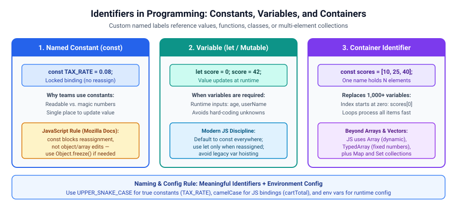
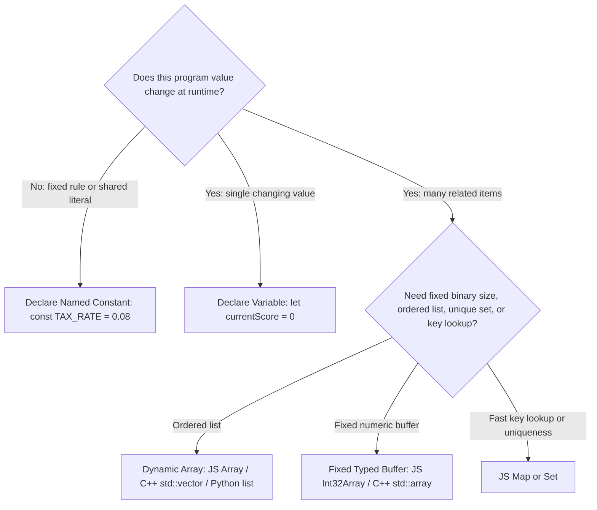
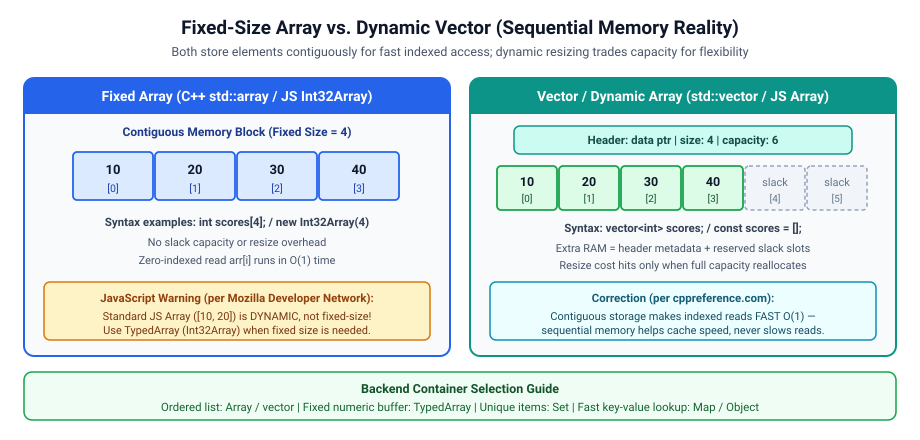
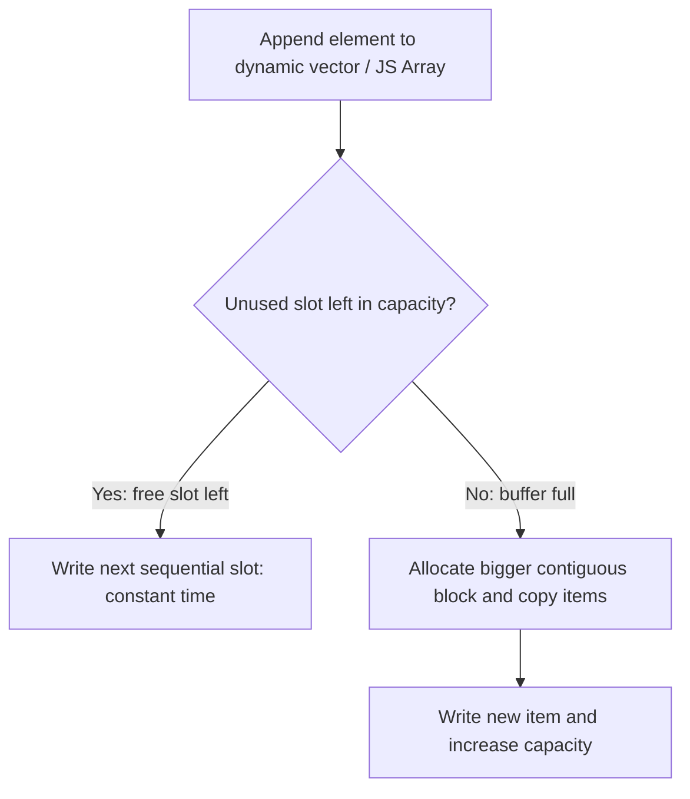

# 05 — Introduction to Programming Concepts Part 1

## 1. Jargon Translation

| Term | Official definition | Simple words | Analogy |
|---|---|---|---|
| **Identifier** | A custom programmer-chosen name used to reference a program component such as a stored value, variable, constant, method, interface, or class. | A meaningful label you give to something in your code so you can refer to it by name. | Contact names in your phone so you tap "Mom" instead of typing an 11-digit number every time. |
| **Constant (Named Constant)** | An identifier whose bound value is assigned at definition and cannot be reassigned while the program runs. | A labeled value locked against reassignment (often paired with `UPPER_SNAKE_CASE` for fixed config like `TAX_RATE`). | A speed-limit sign bolted into the road: every driver reads it, nobody changes it mid-trip. |
| **Variable** | A named identifier storing data whose value can change during program execution (either initialized on declaration or assigned later). | A labeled storage slot whose value updates as users interact or calculations run. | A scoreboard counter that starts at `0` and updates every time a player scores. |
| **Hard-Coding** | Writing fixed literal values (`"admin"`, `0.08`, file paths, user names) directly throughout source logic instead of using named constants, variables, or config. | Pasting raw numbers or strings straight into formulas and code instead of naming or passing them dynamically. | Printing a restaurant menu with no prices written in pencil—requiring a whole reprint if one item changes. |
| **Container (Collection)** | A compound data structure referenced by one identifier that groups multiple elements together so code doesn't need one separate variable per item. | One box holding many items cleanly under one variable name. | One numbered locker bank (`lockers[0..999]`) instead of carrying 1,000 separate keys with unique names. |
| **Fixed-Size Array** | A zero-indexed container holding a fixed maximum number of elements of one data type in contiguous (sequential) memory (e.g., C++ `int scores[6];` or JavaScript (`JS`) `Int32Array`). | A fixed-length row of matching boxes starting at slot `0`. | An egg carton with exactly 12 slots—fast to index, cannot grow to 13 without buying a new carton. |
| **Vector (Dynamic Array)** | A contiguous, zero-indexed sequence container that tracks `size` and `capacity` and grows or shrinks automatically as items are added or removed (e.g., C++ `std::vector`, JS `Array`, Python `list`). | A smart row of boxes that expands automatically when you push more items in. | A digital photo album that adds extra pages automatically as you upload more photos. |
| **Zero-Based Indexing** | Numbering container elements starting at `0` for the first item (`arr[0]`), `1` for the second, up to `length - 1`. | Counting slots starting from `0` instead of `1`. | Building floors starting at ground floor `0`, where floor `1` is one step above the start address. |
| **`TypedArray` (`Int32Array`, `Uint8Array`)** | A JavaScript container providing a fixed-length, typed binary view over a raw memory buffer—the true JS counterpart to fixed homogeneous arrays. | A fixed-size JavaScript number array designed for exact memory size and speed. | A shipping container divided into equal steel compartments holding strictly uniform blocks. |
| **`Map` & `Set` (Associative Containers)** | Built-in modern containers for unique collections (`Set`) and fast key-value lookups (`Map` / plain objects) without scanning an entire list. | A deduplicated guest list (`Set`) and a label-to-value phonebook (`Map`). | A dictionary (`Map`) where you jump straight to a word instead of reading page 1 to page 500 in order. |

---

## 2. Topics Introduced in the Lecture Transcript

1. **Purpose of identifiers in programming** — giving custom names to stored data, methods, interfaces, and classes so code is readable and easy to maintain.
2. **Constants (named constants)** — fixed data items assigned at definition (`pi_value`, `cost_price`, `tax_rate`, fixed player name), improving readability and offering single-point updates when a constant changes.
3. **Variables vs. hard-coding** — data items whose values change during execution (age, high score, user name, service name, file name), declared with an optional initial value or assigned later rather than hard-coding unknowns.
4. **Containers vs. individual variables** — grouping many values under one identifier (replacing 6 or 1,000+ separate variables) for speed, readability, and maintainability.
5. **Fixed-size arrays vs. dynamic arrays (vectors)** — zero-indexed sequential elements declared with square-brace bounds vs. angle-bracket dynamic containers (`vector<type> name`) that resize automatically—plus how modern languages like JavaScript, Python, and C++ handle containers and immutability today.

---

## 3. Exhaustive Deep Dive & Structured Notes

### 3.1 Identifiers: Constants vs. Variables and Avoiding Hard-Coding

- **What identifiers name:**
  - Developers assign **identifiers** not only to stored values, but also to **methods**, **interfaces**, and **classes**.
  - When an identifier holds data, it acts as either a **constant** (locked binding) or a **variable** (reassignable binding).
- **Named constants (`const` / constants):**
  - Assigned a value when defined (such as `pi_value`, `cost_price`, `tax_rate`, or a constant player name).
  - **Two major benefits:**
    1. **Readability:** `total * TAX_RATE` explains intent immediately, whereas a bare `0.08` ("magic number") forces readers to guess what `0.08` means.
    2. **Single-point update:** If a tax constant changes from `0.08` to `0.09` (general knowledge example), updating one named constant updates every calculation safely instead of hunting across dozens of files.
- **Variables (`let` / mutable variables):**
  - Hold values that are unknown upfront or change while running—such as user age, game high score, user name, external service name, or file name.
  - Depending on the language, a variable may declare a **data type** and **initial value** upfront (e.g., `int score = 0;`) or wait to receive a value from later instructions. Without variables, developers would **hard-code** values, breaking reuse across different users or environments.





> ⚠️ **Correction:** **JavaScript `const` locks the variable binding against reassignment—it does NOT freeze object or array contents** → Per MDN (Mozilla Developer Network), `const` guarantees that the *binding* cannot be reassigned (`TAX_RATE = 0.09` throws `TypeError` at runtime), **but** if a `const` holds an object or array (`const scores = [10, 20]`), code can still call `scores.push(30)` or mutate `config.port = 9000`! To lock top-level object/array edits at runtime use `Object.freeze(...)` (shallow) or deep clone/freeze utilities (or TypeScript `readonly` / `as const` at compile time). Also, production services put values that vary per environment (`DATABASE_URL`, `TAX_RATE` overrides) in **environment variables** rather than recompiling source constants.
> **Lecture wording (for the quiz):** `"A constant is a data item whose value does not change within a program."`

#### ✅ Modern Best Practice: default to `const`, ban magic numbers, and name in idiomatic case

> **Lecture says:** use named constants (such as `pi_value`, `cost_price`, `tax_rate`) for readability and single-point edits, and variables when data changes.
> **Industry today:** JavaScript/TypeScript teams default to `const` (enforced via **ESLint** `prefer-const`), reserve `let` only when reassignment is necessary (never `var`), use **`UPPER_SNAKE_CASE`** (`TAX_RATE`) for module-level fixed constants and **`camelCase`** (`taxRate`, `costPrice`) for local `const`/`let` bindings, and pull deployment-specific config from validated environment variables (`process.env` + schema validation like Zod).

---

### 3.2 Containers: Fixed-Size Arrays vs. Dynamic Vectors (and Beyond)

- **Why containers exist:**
  - Creating `n1, n2, n3, n4, n5, n6` for 6 integers is tedious; defining 1,000+ separate variables is unreadable and impossible to scale. A **container** stores multiple elements under **one identifier**, accessed by index or iterated with a loop.
- **Classic C++/typed array model described in the lecture:**
  - **Fixed-size array:** Has a **fixed size** determined upfront, storing same-type elements in **sequential order** (contiguous memory) starting from **index zero** (`0`). Declared in C/C++ with element type, name, and square braces: `int scores[6];` (modern C++ wraps this safely as `std::array<int, 6>`).
  - **Vector (dynamic array):** Has a **dynamic size**, storing elements sequentially without a fixed compile-time maximum and automatically resizing when elements are added or removed. Declared in C++ with angle brackets: `std::vector<int> scores;` (naming the **vector**, no max size required).





> ⚠️ **Correction:** **Arrays and vectors are NOT the only containers—and standard JavaScript `Array` is a resizable dynamic container, not a fixed-size array** → Modern software engineering relies on several core container families: **dynamic arrays** (JS `Array`, Python `list`, Java `ArrayList`, C++ `std::vector`), **associative maps/dictionaries** (JS `Map`, `Object`, Python `dict`), **sets** (`Set` for unique elements), **queues/stacks**, and **tuples/records**. Crucially, per MDN (Mozilla Developer Network), **JavaScript `Array` (`const items = [1, 2, 3]`) is dynamically resizable and can hold mixed data types**—you never write type + max size in square braces to create a JS `Array`. Fixed-length homogeneous numeric arrays in JS require **`TypedArray`** (such as `new Int32Array(6)`).
> **Lecture wording (for the quiz):** `"There are two types of containers to specify multiple elements, arrays and vectors."` and describes array declaration syntax as specifying data type, name, and maximum size in square braces (matching C/C++ `int arr[N];`, not JavaScript).

> ⚠️ **Correction:** **`std::vector` elements do NOT take longer to access *because* they live in sequential memory; contiguous storage makes indexed access FAST (`O(1)`) in both arrays and vectors** → Per `cppreference.com`, **both** C++ arrays and `std::vector` store elements **contiguously (sequentially)** in RAM (Random Access Memory), giving both constant-time `O(1)` indexed reads (`v[i]`) and strong CPU (Central Processing Unit) cache performance (unlike linked lists, whose nodes scatter across heap memory). Why does `std::vector` take extra memory and occasionally extra time? (1) Memory: a vector adds a small control header (data pointer + size + capacity) plus **unused slack capacity** allocated ahead of time. (2) Time: adding elements (`push_back` / JS `.push()`) is normally `O(1)`, taking longer **only when capacity fills up** and the runtime allocates a larger block and copies existing elements—not when reading items sequentially! *(Note also a minor spoken slip in the transcript saying "name of the **array**" when describing `vector<type> name` vector syntax.)*
> **Lecture wording (for the quiz):** `"Because they are dynamic in nature, vectors take up more memory space than arrays, and their elements also take a little longer to access than elements in an array, as they are stored in sequential memory locations."`

#### ✅ Modern Best Practice: match the container to your access pattern & bound memory in Node.js

> **Lecture says:** pick fixed-size arrays when count is known or dynamic vectors when size changes.
> **Industry today:** choose **JS `Array`** for ordered lists, **`TypedArray`** (`Int32Array`, `Uint8Array`) for fixed binary/numeric buffers, **`Map`** for frequent `id -> record` lookups (`O(1)` instead of `O(n)` array scans), **`Set`** for uniqueness checks, and **enforce upper bounds / pagination** so unbounded dynamic containers never trigger an **OOM (Out of Memory)** crash on an HTTP (HyperText Transfer Protocol) API (Application Programming Interface) server.

| Container type | Language examples | Size behavior | Typical lookup / insert trade-off |
|---|---|---|---|
| **Fixed homogeneous array** | C++ `std::array<int, 6>`, JS `Int32Array(6)`, Java `int[6]` | Fixed at creation | Exact memory footprint, `O(1)` read, cannot grow |
| **Dynamic array / Vector** | JS `Array`, C++ `std::vector<int>`, Python `list`, Java `ArrayList` | Grows/shrinks dynamically | `O(1)` read & amortized `O(1)` append; slack capacity + occasional resize copy; `O(n)` scan by value |
| **Associative Map / Object** | JS `Map`, `{}` object, Python `dict`, C++ `std::unordered_map` | Dynamic | `O(1)` average lookup by key instead of scanning a big array |
| **Unique Set** | JS `Set`, Python `set`, C++ `std::unordered_set` | Dynamic | Automatic deduplication + `O(1)` average `.has()` membership test |

---

### 3.3 Often-missed parts

- **Identifiers cover more than data:** Variables and constants are identifiers, **and** so are function/method names, class names, and interface names.
- **`const` binding vs. frozen contents in JS:** `const items = [1, 2]; items.push(3)` succeeds without error; `items = [4]` throws `TypeError` (`Assignment to constant variable`).
- **Uninitialized variables in strict JS:** `let x;` starts as `undefined` (not `0` or `""`), while `const y;` without an initial value fails to parse (`SyntaxError: Missing initializer in const declaration`).
- **Zero-based indexing (`0` to `length - 1`):** A 6-element array uses indexes `0, 1, 2, 3, 4, 5`—accessing index `6` reads `undefined` in JS, throws `IndexError` in Python, or triggers **undefined behavior** (memory corruption) in raw C/C++ arrays!
- **Contiguous memory helps reads:** Sequential storage improves CPU cache prefetching in **both** fixed arrays and vectors; reallocation only happens during growth when `size === capacity`.
- **`vector` declaration slip in video:** C++ `std::vector<int> scores;` uses angle brackets `<int>` and the vector's own identifier (`scores`), without `[maxSize]`.

---

### 3.4 Done enough when…

- [ ] You can explain why `const TAX_RATE = 0.08` beats hard-coding `0.08` across files—and why `const obj = {}` still allows property mutation in JavaScript unless frozen.
- [ ] You know when to replace a `for`-scan over an `Array` with a `Map` or `Set`.
- [ ] You can compare C++ `std::array` / JS `Int32Array` (fixed length, homogeneous) against C++ `std::vector` / JS `Array` (resizable, tracks capacity).
- [ ] You can clearly explain why sequential memory makes indexed array and vector reads fast (`O(1)`), while resizing cost comes from capacity reallocation.

---

## 4. Concrete Examples

1. **Checkout Pricing Rule (`const` Named Constant + Validated Env Config vs. Hard-Coding):**
   Instead of pasting `* 1.08` across five checkout routes, define `const TAX_RATE = 0.08` (or read `config.taxRate` validated on startup) and pass dynamic per-order values (`userDiscount`, `cartSubtotal`) as variables/parameters.
2. **Replacing Individual Variables with a Dynamic Container (`1,000+` Measurements):**
   Tracking 1,000 API response latencies as `lat1, lat2, ... lat1000` is unmaintainable; storing them in one `const latencies = []` dynamic array lets a single loop compute average and percentile metrics cleanly.
3. **Deduplicating Permissions (`Set` / `Map` vs. Linear `Array` Scan):**
   If a backend checks whether an incoming `userId` exists in 50,000 active sessions, checking `activeSessionIds.has(userId)` on a `Set` runs in constant `O(1)` average time rather than scanning an `Array` sequentially (`O(n)`).

---

## 5. Code Blocks

### 5.1 Constants, `const` Mutability Gotcha, and Variables in JavaScript

```javascript
// identifiers-demo.mjs — tested on Node.js v24.18.0
const TAX_RATE = 0.08;                                   // Named constant: single source of truth
const APP_CONFIG = Object.freeze({ currency: "USD", maxRetries: 3 });

const cartPrices = [25, 15];                             // const binding can still mutate array contents!
cartPrices.push(10);                                     // Allowed by MDN spec: reference is unchanged

let userDiscount = 0;                                    // Variable: reassigned later in execution
userDiscount = 5;

const subtotal = cartPrices.reduce((sum, p) => sum + p, 0);
const total = (subtotal - userDiscount) * (1 + TAX_RATE);
console.log("Cart subtotal:", subtotal, "Final total:", Number(total.toFixed(2)), "Currency:", APP_CONFIG.currency);

try {
  TAX_RATE = 0.10;                                       // Attempt to reassign the const binding (runtime TypeError)
} catch (err) {
  console.log("Reassigning const throws:", err.name, "-", err.message);
}
```

Real output from running in `Node.js v24.18.0`:

```text
Cart subtotal: 50 Final total: 48.6 Currency: USD
Reassigning const throws: TypeError - Assignment to constant variable.
```

**What happens if... you assume `const cartPrices = [25, 15]` freezes the items inside?** `cartPrices.push(10)` succeeds silently and pushes `subtotal` from `40` to `50` because JS `const` only locks the variable binding, not the array elements.

### 5.2 Dynamic `Array`, Fixed Homogeneous `Int32Array`, `Set`, and `Map` in JavaScript

```javascript
// containers-demo.mjs — tested on Node.js v24.18.0
const dynamicScores = [10, 20, 30];                      // Dynamic JS Array (zero-indexed, resizable)
dynamicScores.push(40);                                  // Grows automatically (no fixed max needed)
console.log("dynamicScores[0]:", dynamicScores[0], "length:", dynamicScores.length, "items:", dynamicScores);

const fixedBuffer = new Int32Array(3);                   // Fixed-size homogeneous 32-bit int buffer
fixedBuffer[0] = 100;
fixedBuffer[1] = 200;
fixedBuffer[2] = 300;
fixedBuffer[3] = 400;                                    // Silently ignored: beyond fixed length 3!
console.log("Int32Array(3):", Array.from(fixedBuffer), "byteLength:", fixedBuffer.byteLength);

const uniqueRoles = new Set(["viewer", "editor", "viewer"]);
const roleLimits = new Map([["viewer", 100], ["editor", 500]]);
console.log("Set size (deduped):", uniqueRoles.size, "Map editor limit:", roleLimits.get("editor"));
```

Real output from running in `Node.js v24.18.0`:

```text
dynamicScores[0]: 10 length: 4 items: [ 10, 20, 30, 40 ]
Int32Array(3): [ 100, 200, 300 ] byteLength: 12
Set size (deduped): 2 Map editor limit: 500
```

**What happens if... you write past index `2` on a `new Int32Array(3)` expecting it to grow like `Array`?** As shown in our run on `Node.js v24.18.0`, `fixedBuffer[3] = 400` is silently ignored and `fixedBuffer` stays `[100, 200, 300]` (`12` bytes, from our run).

### 5.3 Cross-Language Syntax: C++ Fixed `std::array` vs. Dynamic `std::vector`

```cpp
// containers.cpp — illustrates the lecture's C++ syntax vs. modern std::array
#include <array>
#include <vector>

int main() {
    int legacyScores[4] = {10, 20, 30, 40};              // Fixed C-style array: type name[maxSize]
    std::array<int, 4> safeFixed = {10, 20, 30, 40};     // Modern C++ fixed array (knows .size())
    std::vector<int> dynamicScores = {10, 20, 30};       // Dynamic vector: type<T> name (resizes)
    dynamicScores.reserve(1000);                         // Optional: pre-allocate capacity to skip resizes
    dynamicScores.push_back(safeFixed[0] + legacyScores[0]);
    return 0;
}
```

**What happens if... you index `legacyScores[4]` without bounds checking in C++?** Because C-style arrays don't track `.size()` at runtime and start at index `0`, index `4` reads out-of-bounds memory (undefined behavior) instead of throwing cleanly.

---

## 6. Related Concepts

1. **Variable Scope, Hoisting & Temporal Dead Zone (`const` / `let` vs. `var`):** Why block-scoped `const` and `let` prevent accidental leaks across functions and loops in JavaScript.
2. **Value vs. Reference Semantics:** Why primitives (`number`, `string`, `boolean`) copy values while containers (`Array`, `Object`, `Map`) pass references in memory.
3. **Time & Space Complexity (`Big-O` Notation):** Comparing `O(1)` indexed reads and `Map`/`Set` lookups against `O(n)` scans and amortized `vector` growth.
4. **Immutability & Pure Functions (Spread `[...arr]`, `Object.freeze`):** Returning new copied arrays/objects in services so shared state cannot be corrupted silently.
5. **12-Factor App Configuration (`process.env` & Startup Schema Validation):** Moving environment-dependent values out of source constants into validated runtime environment config.

---

## 7. Lecture Summary & Quick Reference Table

| Topic | Lecture | ✅ Modern best practice |
|---|---|---|
| **Identifiers** | Custom names referencing values, methods, interfaces, or classes | Use clear `camelCase` / `UPPER_SNAKE_CASE` names across variables, functions, classes, and interfaces |
| **Constants vs. Variables** | Named constants (`pi_value`, `tax_rate`) never change (`readability` + single-place update); variables hold changing/unknown values (`age`, `userName`) to avoid hard-coding | Default to `const` (ESLint `prefer-const`); remember JS `const` blocks reassignment, not object mutation (`Object.freeze` / TypeScript `readonly`), and store runtime environment values in validated `process.env` config |
| **Containers** | Groups many items under one identifier; lecture names two types: **arrays** and **vectors** | Modern apps use **dynamic arrays** (JS `Array`), **`TypedArray`** (fixed numeric buffers), **`Map`** (key lookup), **`Set`** (unique items), plus queues/stacks |
| **Fixed arrays** | Zero-indexed, fixed-size homogeneous items in sequential memory declared as `type name[size]` (C/C++) | Use **`std::array`** in C++ or **`TypedArray`** (`Int32Array`) in JS when fixed homogeneous layout is needed; remember **standard JS `Array` is dynamic**, not fixed |
| **Vectors (dynamic arrays)** | Dynamic resize (`vector<type> name`); states vectors use more memory and take longer to access *because* items are in sequential memory | Contiguous/sequential memory gives **fast `O(1)` indexed access** (per `cppreference.com`); extra cost comes from metadata header, **slack capacity**, and **occasional resize reallocation** |

