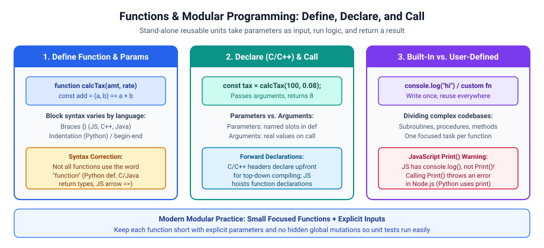
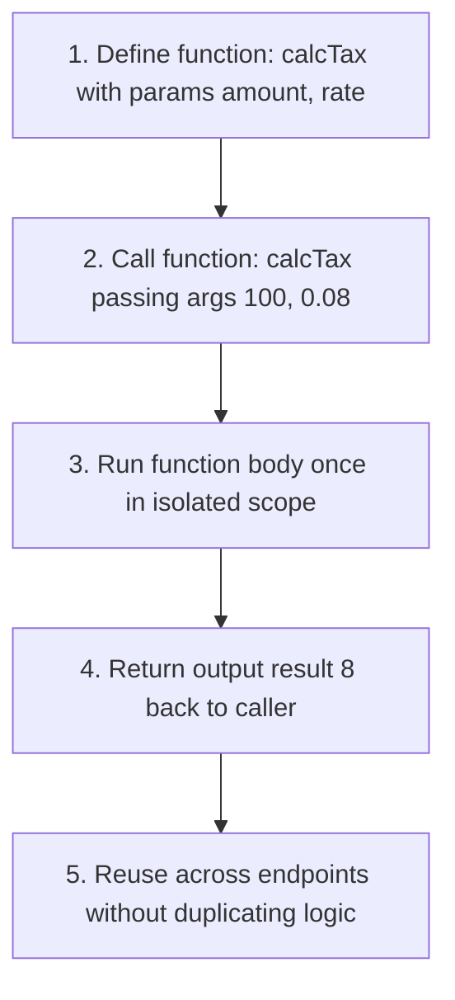
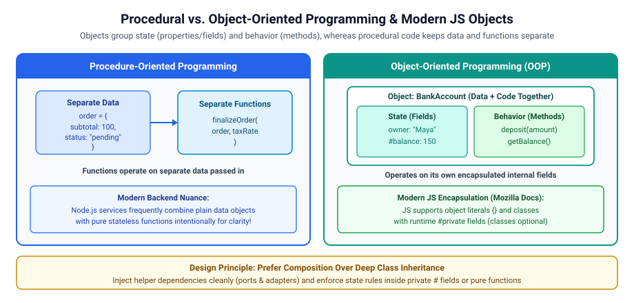
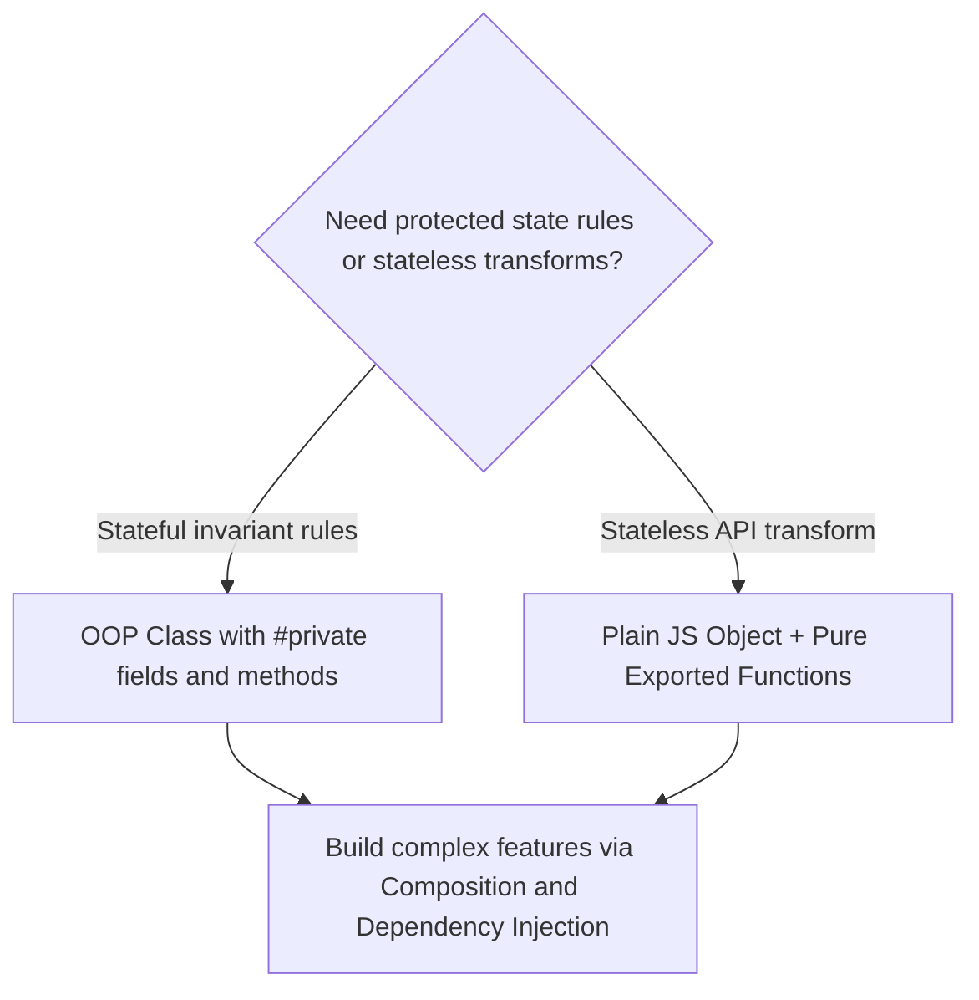

# 06 — Introduction to Programming Concepts Part 2

## 1. Jargon Translation

| Term | Official definition | Simple words | Analogy |
|---|---|---|---|
| **Modular Programming** | A software design methodology that breaks a complex program into independent, reusable modules/components, each handling one specific responsibility. | Splitting a huge program into small, focused building blocks instead of one giant script. | Kitchen stations (prep, grill, pastry) working independently instead of one chef trying to cook every dish alone. |
| **Function** | A self-contained, reusable block of code that takes optional inputs, executes a specific task, and optionally returns an output value (also called **subroutines**, **procedures**, **methods**, or **modules** in different languages). | A named mini-program you write once and run whenever you need that job done. | A blender button: you put fruit in (input), press Blend (run), and get a smoothie back (output). |
| **Standard Library (Built-In) Function** | A ready-to-use function shipped directly with a programming language or runtime (such as `console.log()` in JavaScript or `print()` in Python). | Useful helper functions already built into the language so you don't rewrite them from scratch. | Pre-installed phone apps (calculator, clock) available out of the box. |
| **User-Defined Function** | A custom function written by the developer to solve application-specific logic and reused across the codebase. | A function you create yourself to fit your project's exact rules. | Saving your own custom shortcut macro on a keyboard for a repeated workflow. |
| **Declare vs. Define vs. Call** | **Declare** announces a function's name and signature ahead of use (needed in C/C++ headers); **define** provides its full implementation body; **call** (invoke) executes the body at runtime. | Declaring introduces the name, defining writes the steps inside, and calling actually runs it. | Listing a recipe in a menu index (declare), writing the recipe steps (define), and cooking the order (call). |
| **Parameter vs. Argument** | A **parameter** is a named input variable declared in a function's definition; an **argument** is the actual value passed when calling the function (per Mozilla Developer Network). | Parameter = the empty box label on the form; argument = the real value you fill in when ordering. | A parking spot sign (`spotA`) vs. the actual car parked inside it today. |
| **Object-Oriented Programming (OOP)** | A programming methodology organized around **objects** that bundle data (**properties**/**attributes**) together with code (**methods**), rather than **procedure-oriented programming** where functions act on separate data structures. | Grouping an entity's data and actions into one self-contained software bundle. | A smart car key holding both internal security codes (state) and lock/unlock buttons (behaviors) together. |
| **Object State & Properties (`Fields`)** | The current data values describing an object (for example, `balance = 150` or `status = "running"`), stored inside named **fields** (or variables in some languages). | The current facts/settings stored inside an object. | A washing machine's current water level, cycle mode, and door-lock status. |
| **Object Behavior & `Methods`** | The actions an object can perform (for example, `deposit()`, `start()`, `query()`), exposed as functions attached to the object. | What the object can do on command—often updating its own fields safely. | The washing machine's actions: `fillWater()`, `spin()`, and `drain()`. |
| **Encapsulation & Composition** | Hiding internal object fields behind controlled methods (such as JavaScript `#private` fields) and building complex behavior by combining small components instead of deep inheritance chains. | Locking sensitive internals behind public methods and snapping small pieces together cleanly. | Protecting a bank vault behind a teller window (`deposit`/`withdraw`) rather than letting customers walk into the cash room. |

---

## 2. Topics Introduced in the Lecture Transcript

1. **Functions & modular programming** — why **modular programming** breaks large programs into stand-alone, reusable **functions** (also called **subroutines**, **procedures**, **methods**, or **modules**), and how code blocks use **braces**, `begin`/`end`, or **indentation** depending on the language.
2. **Function inputs, outputs, and categories** — functions taking **parameters**, returning output, and splitting into **built-in** (**standard library**) functions (such as `console.log()` in JavaScript or `print()` in Python) vs. **user-defined** functions.
3. **Steps to use a function** — **defining** (creating) a function with its name and body, **calling** (invoking) it with inputs, and forward **declaring** functions in languages like C and C++.
4. **Object-Oriented Programming (OOP) vs. procedure-oriented programming** — shifting from functions operating on separate data structures to **objects** that package data and behavior together.
5. **States (`properties` / `attributes` / `fields`) and behaviors (`methods`)** — modeling real-world items (car, bike, television, washing machine) and software entities (Windows service, user account, database table, system folder) as software objects whose complexity scales with their states and behaviors.

---

## 3. Exhaustive Deep Dive & Structured Notes

### 3.1 Functions: Modular Building Blocks, Syntax, and Execution Steps

- **Why functions exist:**
  - Under **modular programming**, developers divide a large, complex program into focused, reusable units where each unit handles **one specific task**.
  - Depending on the language tradition, reusable routines are named **functions**, **subroutines**, **procedures**, **methods** (when attached to an object/class), or **modules**—though modern languages most commonly call them **functions**.
- **Built-in vs. user-defined & block delimiters:**
  - **Standard library (built-in) functions** come packaged with the language runtime (output formatting, math, string helpers), while **user-defined functions** encode custom business logic once and reuse it everywhere.
  - Languages mark function bodies differently: curly **braces** (`{ ... }` in JavaScript (`JS`), C, C++, Java), **indentation** (Python), or `BEGIN ... END` keywords (Pascal, SQL, Structured Query Language).
- **Define, declare, and call:**
  1. **Define:** Write the function's signature (name + **parameters**) and body statements.
  2. **Call (invoke):** Execute the function by name and pass concrete values (**arguments**) for its parameters.
  3. **Declare (when required):** Compiled languages like C and C++ require a forward prototype (`int add(int a, int b);`)—often in `.h` header files—so callers above the definition know the function exists.





> ⚠️ **Correction:** **Not all languages use a `function` keyword, JavaScript does NOT have a built-in `Print()` function, and JS/Python do not require separate forward declarations** →
> 1. **`function` keyword:** While JS `function name() {}` uses `function`, C/C++/Java start with a return type (`int add(...)`), Python uses `def`, Go uses `func`, Rust uses `fn`, and modern JS **arrow functions** (`const add = (a, b) => a + b`) omit the `function` keyword entirely (per MDN, Mozilla Developer Network).
> 2. **`Print()` in JavaScript:** JS prints to the terminal with **`console.log()`**—not `Print()` (which throws `ReferenceError: Print is not defined`, tested on `Node.js v24.18.0`). In browsers, lowercase `window.print()` triggers the printer dialog! Python uses lowercase `print()`, Java uses `System.out.println()`.
> 3. **Declarations vs. definitions:** C/C++ compile top to bottom, so a function must be declared before it is called. Python has no separate declaration step: a function only has to be **defined (the `def` line has run) before the call runs**, so a function can call another one defined later in the file, but a module-level call placed above its `def` raises `NameError` (tested on `Python 3.14.8`). JS **hoists** `function` declarations to the top of their scope (per MDN), though arrow functions assigned to `const` are **not** hoisted and must appear before they are called (calling one early throws `ReferenceError`, tested).
> 4. **Parameters vs. arguments:** Strictly (per MDN Glossary), **parameters** are the variable names listed in the definition, whereas **arguments** are the actual values supplied in the call.
> **Lecture wording (for the quiz):** `"When you define a function, you provide a function keyword, then give the function a unique name..."`, cites `"the ‘Print’, function"` as a standard library example, and states `"some programming languages, such as C and C++ , also require you to declare a function."`

#### ✅ Modern Best Practice: small pure functions, arrow expressions, and strict input contracts

> **Lecture says:** functions split large programs into reusable pieces taking inputs and returning outputs.
> **Industry today:** modern Node.js services write short, single-responsibility functions with explicit parameters (avoiding hidden global variables), prefer ES (ECMAScript) module `export` + `const fn = (...) => ...` or named `function` declarations, document/type signatures with **TypeScript** or **JSDoc**, and keep business logic **pure** (no hidden side effects) so unit tests run in milliseconds without mocking a whole server.

---

### 3.2 Objects and Object-Oriented Programming (OOP)

- **Procedure-oriented vs. Object-Oriented Programming (OOP):**
  - **Procedure-oriented programming** organizes code around procedures/functions that read and modify separate data structures passed to them.
  - **`OOP`** packages **data** (**properties** / **attributes** stored in **fields**) and **code** (**behaviors** exposed via **methods**) together inside self-contained **objects**, so each object manages its own internal data.
- **Modeling real-world and software objects:**
  - Asking **"What states can this object be in?"** identifies its **properties** (`speed`, `isLocked`, `accountBalance`), while **"What behaviors can it perform?"** identifies its **methods** (`accelerate()`, `lockDoor()`, `deposit()`).
  - Real-world examples (car, bike, television, washing machine) parallel software objects (Windows service, user account, database table, system folder): richer objects track more states and expose more behaviors.





> ⚠️ **Correction:** **OOP is not "objects instead of functions": an object's methods are functions attached to it, and JavaScript does not need classes to make objects** → The difference is **how code and data are organized**: procedural code keeps data structures and functions separate, while OOP bundles data (fields) and the functions that work on it (methods) in one object. Per MDN (Mozilla Developer Network), JavaScript creates objects directly as **object literals** (`const user = { id: 1, role: "admin" }`) with no class boilerplate, and its `class` syntax sits on top of prototype-based objects and supports runtime **`#private` fields** (`#balance`). In modern Node.js back-ends, teams do **not** build deep inheritance trees (`class AdminUser extends StaffUser extends BaseUser`); they keep HTTP (HyperText Transfer Protocol) payloads for an API (Application Programming Interface) as plain immutable objects (`DTOs`, Data Transfer Objects) handled by stateless service functions, or use small cohesive classes with **private `#` fields** and **composition** (passing helper objects in as dependencies) only where an entity owns strict **invariant** rules (rules that must always stay true, such as a bank balance never dropping below zero).
> **Lecture wording (for the quiz):** `"Object-oriented programming (or OOP) is a programming methodology that is focused on objects rather than functions"` and `"Software objects ... consist of states (or properties) and behaviors (or methods)."`

#### ✅ Modern Best Practice: encapsulate state with `#private` fields or pure updates, and prefer composition

> **Lecture says:** objects bundle fields and methods so each object acts on its own data structure.
> **Industry today:** enforce business rules (invariants, such as non-negative balances) inside objects with JavaScript `#private` fields (preventing external callers from mutating `account.#balance = -999` directly, per MDN), pass dependencies via **composition** instead of deep inheritance hierarchies, and return fresh copies (`{ ...order, status: "confirmed" }`) in stateless services so concurrent requests never corrupt shared state.

---

### 3.3 Often-missed parts

- **Different words, similar concept:** Quiz questions may equate **subroutines**, **procedures**, **methods**, and **modules**—know that **method** specifically means a function attached to an object/class, while **function** is the general modern term.
- **`declare` vs. `define` vs. `call`:** Only C/C++-style compiled languages require separate forward **declarations** (`.h` prototypes); *every* language requires **defining** and **calling** functions.
- **`Print()` fails in JavaScript:** Remember `console.log()` for JS output, `print()` (lowercase) for Python, and `Print()` only as a generic textbook name from the video.
- **Procedural vs. `OOP` core distinction:** Procedural keeps data structures and functions **separate**; `OOP` packages **fields (properties)** and **methods (behaviors)** together in one unit.
- **Real JS privacy needs `#`:** Writing `this.balance = 100` makes `balance` public on any JS object; `#balance` enforces privacy at runtime (`SyntaxError` if accessed outside, per MDN).

---

### 3.4 Done enough when…

- [ ] You can explain the difference between **declaring** (C/C++ prototype), **defining** (signature + body), and **calling** (executing with arguments) a function.
- [ ] You distinguish **parameters** (names in the definition) from **arguments** (values passed on invocation).
- [ ] You can contrast **procedure-oriented** code (separate data + functions) with **`OOP`** (fields + methods packaged together).
- [ ] You know when a Node.js back-end benefits from a stateful class with `#private` fields vs. plain data objects + pure service functions.

---

## 4. Concrete Examples

1. **Reusable Tax Calculation Module (`define` + `call` vs. Copy-Paste Formulas):**
   Instead of repeating `(amount * rate).toFixed(2)` in cart, invoice, and refund endpoints, define one `calculateTax(amount, taxRate)` function and call it with each endpoint's arguments—updating rounding rules in one place.
2. **Encapsulated `BankAccount` Class (`OOP` State & Behavior with `#balance`):**
   A `BankAccount` object holds `owner` and private `#balance` **fields** (**state**), exposing `deposit(amount)` and `getBalance()` **methods** (**behavior**) that reject negative deposits so invalid negative balances cannot occur.
3. **Stateless Order Processing Service (Plain Object + Pure Function Composition):**
   In an Express order route, the incoming JSON (JavaScript Object Notation) body (`{ id: "ord-1", subtotal: 100, status: "pending" }`) is a plain data object passed into a pure `finalizeOrder(order, rate)` function that returns a new object `{ ...order, tax: 8, status: "confirmed" }` without mutating the input.

---

## 5. Code Blocks

### 5.1 Defining & Calling Functions in JavaScript (Hoisted Declarations, Arrow Functions, and `console.log` vs. `Print()`)

```javascript
// functions-demo.mjs — tested on Node.js v24.18.0
console.log("Hoisted declaration call:", calculateTax(100, 0.08)); // Parameters: amount, taxRate; Arguments: 100, 0.08

function calculateTax(amount, taxRate) {                 // Defined with `function` keyword (hoisted in JS)
  return Number((amount * taxRate).toFixed(2));
}

const formatPrice = (amount, currency = "USD") => `${currency} ${amount.toFixed(2)}`; // Arrow syntax: no `function` keyword
console.log("Arrow function:", formatPrice(108));

try {
  Print("Hello");                                        // Verifies JS has no global Print() built-in
} catch (err) {
  console.log("Calling Print() in Node.js throws:", err.name, "-", err.message);
}
```

Real output from running in `Node.js v24.18.0`:

```text
Hoisted declaration call: 8
Arrow function: USD 108.00
Calling Print() in Node.js throws: ReferenceError - Print is not defined
```

**What happens if... you call `formatPrice(108)` *above* `const formatPrice = ...`?** Unlike `function calculateTax(...)` declarations, `const` arrow expressions are **not** hoisted—calling `formatPrice` before initialization throws a `ReferenceError`.

### 5.2 `OOP` Encapsulation (`#private` Fields) vs. Plain Objects + Pure Service Functions

```javascript
// objects-demo.mjs — tested on Node.js v24.18.0
class BankAccount {
  #balance;                                              // Private field: inaccessible directly outside class (MDN)
  constructor(owner, initialBalance = 0) {
    this.owner = owner;                                  // Public property (state)
    this.#balance = initialBalance;
  }
  deposit(amount) {                                      // Method (behavior)
    if (!Number.isFinite(amount) || amount <= 0) {
      throw new RangeError("Deposit must be positive");
    }
    this.#balance += amount;
    return this.#balance;
  }
  getBalance() {
    return this.#balance;
  }
}

const acct = new BankAccount("Maya", 100);
console.log("Owner:", acct.owner, "After deposit(50):", acct.deposit(50), "Private prop via obj.balance:", acct.balance);

const orderRecord = { id: "ord-1", subtotal: 100, status: "pending" }; // Plain JS object literal (no class needed)
const finalizeOrder = (order, rate) => ({
  ...order,
  tax: Number((order.subtotal * rate).toFixed(2)),
  status: "confirmed",
});
console.log("Stateless service output:", finalizeOrder(orderRecord, 0.08));
console.log("Original record untouched:", orderRecord.status);
```

Real output from running in `Node.js v24.18.0`:

```text
Owner: Maya After deposit(50): 150 Private prop via obj.balance: undefined
Stateless service output: { id: 'ord-1', subtotal: 100, status: 'confirmed', tax: 8 }
Original record untouched: pending
```

**What happens if... code outside `BankAccount` writes `acct.#balance` directly?** Per MDN (Mozilla Developer Network), JavaScript rejects `acct.#balance` with a **`SyntaxError`** at parse time because private fields cannot be referenced outside their class body (while `acct.balance` simply reads an absent public property and returns `undefined`).

### 5.3 Forward Function Declaration in C++ (Why the Lecture Mentions Declaring Functions)

```cpp
// forward_declare.cpp — shows separate C++ declaration vs. definition
#include <iostream>

int calculateTax(int amount, int percent);               // 1. Declaration (prototype) needed before main()

int main() {
    std::cout << calculateTax(100, 8) << "\n";           // 2. Call works because prototype appeared above
    return 0;
}

int calculateTax(int amount, int percent) {              // 3. Definition implemented below main()
    return (amount * percent) / 100;
}
```

**What happens if... you remove line 4 (`int calculateTax(...)`) in C++ while keeping the definition below `main()`?** The C++ compiler rejects the call inside `main()` with an undeclared-identifier error because C/C++ compile strictly from top to bottom unless a prototype appears first.

---

## 6. Related Concepts

1. **Closures & Lexical Scope:** How JavaScript functions remember variables from their outer scope—used for factory functions and data hiding without classes.
2. **Higher-Order Functions & Callbacks:** Passing functions as arguments into other functions (such as Express middleware `(req, res, next) => ...` or `.map()`).
3. **SOLID (Single Responsibility, Open-Closed, Liskov Substitution, Interface Segregation, Dependency Inversion) & Dependency Injection:** Keeping functions and classes focused on one job and injecting database/client dependencies rather than hard-coding them inside methods.
4. **Prototypes vs. ES Classes:** How JavaScript's `class` keyword creates prototype-linked methods efficiently in memory under the hood.
5. **Async Functions & Promises (`async / await`):** Extending standard functions for non-blocking network and database calls in Node.js back-ends.

---

## 7. Lecture Summary & Quick Reference Table

| Topic | Lecture | ✅ Modern best practice |
|---|---|---|
| **Functions & modularity** | Stand-alone, reusable single-purpose code blocks (also called subroutines, procedures, methods, modules) dividing complex programs | Keep functions small, cohesive, and explicit with inputs/outputs; write **pure** service helpers where possible for fast unit testing |
| **Built-in vs. custom & syntax** | Built-in (`Print`) vs. user-defined functions; blocks use braces, begin/end, or indentation; `function` keyword used on definition | JS prints via **`console.log()`** (calling `Print()` throws `ReferenceError` in Node.js); C/Python/Go and JS arrow functions (`=>`) do **not** use a `function` keyword |
| **Define, declare, call** | Define + call in all languages; C/C++ also require declaring functions | Distinguish **parameters** (definition) from **arguments** (call); C/C++ forward declarations handle top-down compiling, whereas JS hoists `function` declarations |
| **Objects & `OOP`** | Bundles data (`properties`/`attributes` in `fields`) and code (`methods`) together, unlike procedure-oriented programming | JavaScript creates objects directly with `{}` literals **or** classes with runtime `#private` fields (MDN); back-ends favor **composition** and often pair plain data objects with pure functions |
| **States & behaviors** | Objects model real-world (car, bike, television, washing machine) and software items (service, account, table, folder) via states and behaviors | Guard object rules (such as preventing negative balances) inside `#private` methods or pure state transitions so callers cannot leave objects in corrupt states |

