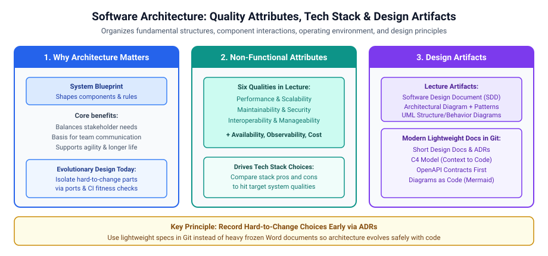
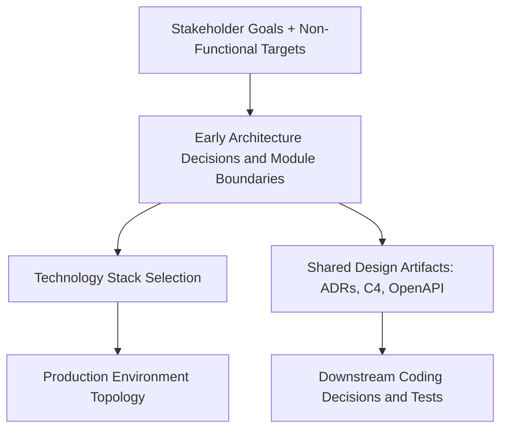
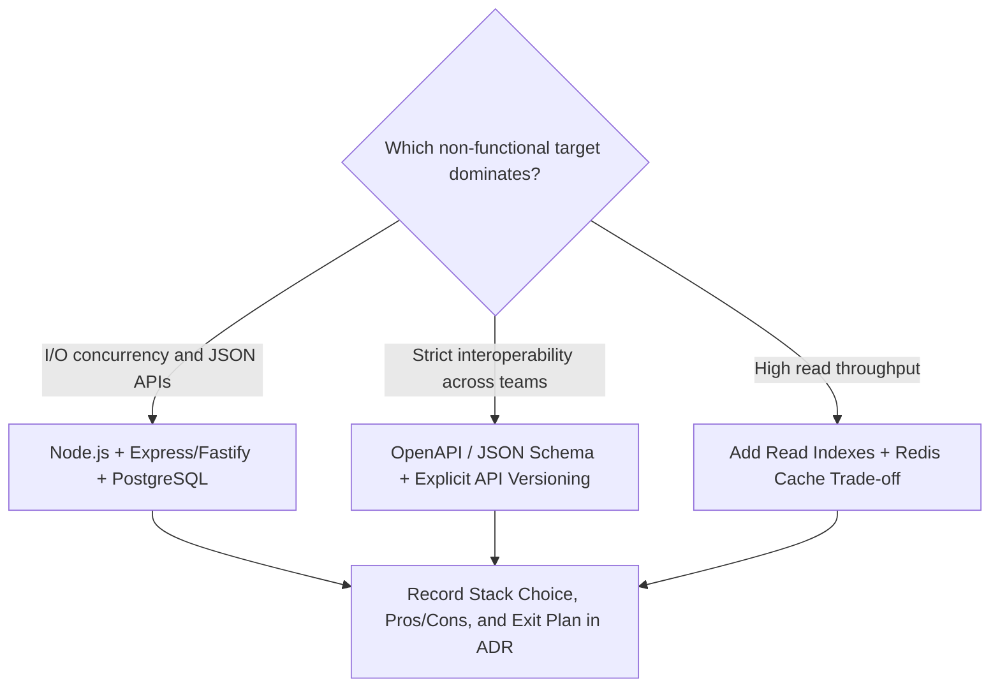
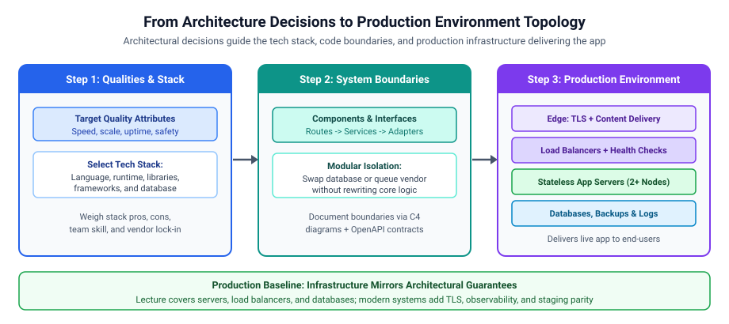
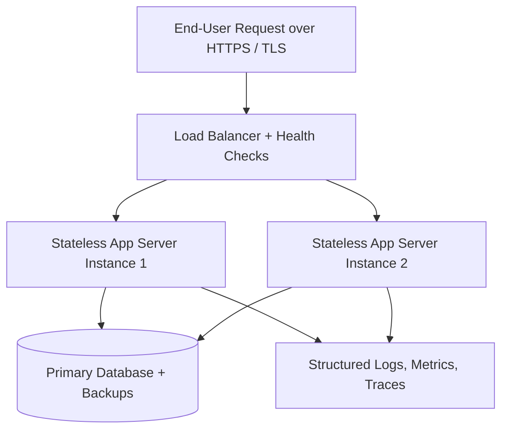

# 01 — Introduction to Software Architecture

## 1. Jargon Translation

| Term | Official definition | Simple words | Analogy |
|---|---|---|---|
| **Software Architecture** | The **organization of the system**: its fundamental structures, component interactions, relation to its **operating environment**, and guiding design principles. | The high-level blueprint showing how the major pieces of a software system fit and talk together. | A building's structural blueprint—showing foundations, plumbing, wiring, and load-bearing walls before buying furniture. |
| **Non-Functional Requirement (`NFR`) / Quality Attribute** | A measurable system characteristic specifying *how well* software works—such as **performance**, **scalability**, **maintainability**, **interoperability**, **security**, and **manageability**—rather than what specific feature it offers. | Rules about speed, safety, growth, and ease of care rather than user buttons. | How fast, safe, repairable, and fuel-efficient a car is, rather than whether it has heated seats. |
| **Tech Stack (Technology Stack)** | The complete set of software, programming languages, runtimes, libraries, and frameworks chosen to build and run an application. | The specific tools and languages a team uses together to build a project. | Choosing concrete, steel, copper wiring, and solar panels to construct a building. |
| **Software Design Document (`SDD`)** | A technical specification artifact describing functional behavior alongside **assumptions**, **dependencies**, **constraints**, **requirements**, **objectives**, and **methodologies**. | A structured specification explaining what the system will build, why, and under what limits. | An architect's written binder of structural specs and engineering constraints handed to builders. |
| **Architectural Diagram & Pattern** | A visual view of system components, their **interactions**, **constraints**, **confines**, and reusable **architectural patterns** (proven solutions to recurring design problems). | A map of boxes and arrows showing how parts connect and which proven layout pattern they follow. | A city transit map showing stations, rail lines, and transfer rules. |
| **Unified Modeling Language (UML)** | A programming-language-agnostic standardized visual notation maintained by Object Management Group (`OMG`), Version `2.5.1` (per OMG, `omg.org/spec/UML/`), used to model system **structure** and **behavior**. | A shared universal drawing language so developers on different tech stacks read the same diagrams. | Musical sheet notation—readable by pianists, guitarists, and violinists alike. |
| **Architecture Decision Record (`ADR`)** | A concise Markdown document kept in Git capturing one significant architectural decision, its context, rejected alternatives, and consequences (per `adr.github.io`). | A short "why we chose X instead of Y" log entry saved right alongside the code. | A flight log entry noting why a pilot chose Route B over Route A. |
| **C4 Model** | A hierarchical diagramming framework (`Context`, `Container`, `Component`, `Code`) created as zoomable "maps of your code" for technical and non-technical audiences (per `c4model.com`). | Four zoom levels for drawing architecture—from whole-system overview down to code modules. | Google Maps zoom levels: country view, city view, neighborhood view, street view. |
| **Production Environment** | The live infrastructure—**servers**, **load balancers**, **databases**, network security, and telemetry—that runs and delivers an application to end-users. | The real live cloud/server setup serving actual customers every day. | The working commercial kitchen and dining room serving paying guests (unlike a test kitchen). |

---

## 2. Topics Introduced in the Lecture Transcript

1. **Software architecture definition & SDLC (Software Development Life Cycle) timing** — architecture takes place in the **design phase** as the **organization of the system**, serving as a **blueprint** defining **fundamental structures**, component behavior, **operating environment**, and design principles.
2. **Importance of well-designed architecture** — captures **early design decisions** (**costly to change** once implemented), addresses **non-functional** needs (**performance**, **scalability**, **maintainability**, **interoperability**, **security**, **manageability**), aligns **stakeholders** as a **basis for communication**, shapes later coding choices, and improves **agility** and system **lifespan**.
3. **Architecture driving technology stack selection** — evaluating a **tech stack** (software, languages, libraries, frameworks) by weighing advantages and disadvantages against non-functional goals.
4. **Architectural design artifacts** — producing the **Software Design Document (`SDD`)** (technical specs, functional description, **assumptions**, **dependencies**, **constraints**, **requirements**, **objectives**, **methodologies**), the **architectural diagram** (components, interactions, constraints, confines, **architectural patterns**), and **`UML`** (**Unified Modeling Language**) diagrams—compared with lightweight modern **ADRs** and **C4** diagrams in Git.
5. **Production deployment considerations** — how architecture shapes the **production environment** (**servers**, **load balancers**, **databases**, plus modern cloud, security, and observability layers) that delivers the live application to end-users.

---

## 3. Exhaustive Deep Dive & Structured Notes

### 3.1 What Software Architecture Is & Why It Matters

- **Core definition (`design phase` of the `SDLC`):**
  - Software design and architectural documentation occur during the **design phase**.
  - Software architecture is the **organization of the system**—a high-level **blueprint** developers use to build interacting components.
  - It captures the **fundamental structures** of the software, explains system **behavior**, and defines how components interact with each other, the **operating environment**, and the engineering principles governing construction.
- **Why well-designed architecture pays off:**
  1. **Balances stakeholders & communication:** Product owners, security teams, operations, and developers have competing goals; architecture serves as a shared **basis for communication** across every stakeholder.
  2. **Early decisions shape everything downstream:** Architecture represents the **earliest design decisions**, which are often **costly to change** after implementation and strongly constrain later coding choices. *(Note: the spoken transcript says `"conflate other coding implementation decisions"`, likely meaning **constrain** or **cascade into** downstream coding decisions.)*
  3. **Agility & longer system lifespan:** Clear structural boundaries absorb changing business requirements smoothly, increasing the **lifespan** of the software even when internal implementation details change.





#### ✅ Modern Best Practice: evolutionary architecture, modular isolation, and fitness functions

> **Lecture says:** software architecture represents early decisions that are hard and costly to change once development starts.
> **Industry today:** teams isolate genuinely **hard-to-change** choices (database engine, public API, identity provider; per `martinfowler.com/architecture/`) behind clean module boundaries (**ports and adapters**), keep implementation details reversible, and enforce boundaries automatically in **CI (Continuous Integration)**.

- **Delay unnecessary lock-in (`Evolutionary Architecture`):** Business logic inside `services/` depends only on abstract interfaces/callbacks (**ports**), while database or third-party vendor clients live in replaceable **adapters** (`repositories/`). Swapping a vendor no longer forces rewriting domain rules.
- **Architecture fitness functions:** Write automated CI checks (such as dependency-rule tests or lint import boundaries) that fail a pull request immediately if a route imports database internals directly or a module breaks layering rules.

---

### 3.2 Non-Functional Quality Attributes & Tech Stack Selection

- **Functional vs. non-functional focus:**
  - Functional requirements specify *what* features exist; **non-functional** capabilities determine *how well* the architecture delivers them.
- **The six core attributes named in the lecture (plus three critical production additions):**
  1. **Performance:** Low response latency and high throughput under load.
  2. **Scalability:** Growing smoothly (adding instances or partitioning data) as traffic or data expands.
  3. **Maintainability:** How quickly engineers can understand, fix, and safely extend the codebase.
  4. **Interoperability:** How cleanly the system exchanges data with external services and standards-based clients.
  5. **Security:** Protecting data in transit and at rest, enforcing authentication/authorization, and isolating trust boundaries.
  6. **Manageability:** Ease of configuring, updating, monitoring, backing up, and troubleshooting the running system.
  - *Not in the lecture — modern industry essentials:* **Availability** (staying online during node/zone failures), **Observability** (structured logs, metrics, traces), and **Cloud Cost** efficiency.
- **Guiding the `tech stack`:**
  - A **tech stack** lists every software runtime, programming language, library, and framework building the solution (for example, `Node.js` + `Express` + `PostgreSQL` + `Redis`).
  - Architects evaluate each candidate stack's **advantages and disadvantages**—matching ecosystem maturity, concurrency model, security tooling, and team expertise to the system's target non-functional profile before committing code.



#### ✅ Modern Best Practice: document stack trade-offs, licenses, and exit plans in ADRs

> **Lecture says:** architects must know a tech stack's advantages and disadvantages to satisfy non-functional capabilities.
> **Industry today:** teams record stack choices in versioned **ADRs** (`adr.github.io`) listing at least two alternatives evaluated, **open-source license** and **support end-of-life dates** (common practice), operational ownership, and a concrete exit plan—avoiding hype-driven stack sprawl.

---

### 3.3 Design Artifacts: `SDD`, Architectural Diagrams, and `UML` vs. Modern Lightweight Docs

- **Blueprints for stakeholders and developers:**
  - Just as house blueprints guide construction crews, architectural design produces concrete communication artifacts:
    1. **Software Design Document (`SDD`):** Technical specifications defining how the design will be implemented, including a **functional description** alongside **assumptions**, **dependencies**, **constraints**, **requirements**, **objectives**, and **methodologies**.
    2. **Architectural diagram:** Shows major **components**, their **interactions**, **constraints**, **confines** (system boundaries), and named **architectural patterns** (general, reusable solutions to recurring design problems—such as layered, event-driven, or microservices).
    3. **Unified Modeling Language (UML):** A programming-language-agnostic notation (per OMG, `omg.org/spec/UML/`, Version `2.5.1`) communicating static **structure** (for example, class/component diagrams) and dynamic **behavior** (sequence/state diagrams).

#### ✅ Modern Best Practice: replace monolithic Word SDDs with C4 maps, OpenAPI contracts, and ADRs in Git

> **Lecture says:** design produces a Software Design Document (`SDD`), an architectural diagram, and `UML` diagrams.
> **Industry today:** heavy standalone Word/PDF SDDs go stale as soon as coding starts; modern teams keep short **Design Docs**, **ADRs (`adr.github.io`)**, **OpenAPI** API (Application Programming Interface) contracts, and **C4 Model** (`c4model.com`) **diagrams as code** right inside the repository.

| Artifact | Lecture / Traditional style | Modern industry counterpart (`c4model.com` & `adr.github.io`) | Why teams switched |
|---|---|---|---|
| **Written Specification** | Long upfront **SDD** binder covering assumptions, constraints, requirements, and objectives | Short markdown **Design Doc** (`1–3` pages) + numbered **ADRs** per key choice (general knowledge) | Keeps context concise, searchable, and reviewed as pull requests alongside code |
| **System Diagrams** | Static binary Visio / **UML** exports stored in shared folders | **C4 Model** (`Context` → `Container` → `Component` → `Code`, per `c4model.com`) written in **Mermaid** / **PlantUML** / **Structurizr** | Git tracks every change cleanly; `Context` views stay clear for non-technical stakeholders |
| **API & Data Contracts** | Text tables inside an SDD section | Machine-readable **OpenAPI** (`YAML` / `JSON`) + SQL (Structured Query Language) migration schemas | Front-end, back-end, and automated contract tests build against one single source of truth |

---

### 3.4 Production Environment & Deployment Considerations

- **Architecture shapes live operations:**
  - The system's architecture directly drives **production environment** choices—the live infrastructure running and delivering software to end-users, including **servers**, **load balancers**, and **databases**.
  - For example, designing stateless **HTTP (HyperText Transfer Protocol)** request handlers enables putting multiple app servers behind a **load balancer** without losing user sessions when one server restarts.





#### ✅ Modern Best Practice: stateless multi-instance services, TLS, CDN, and observability parity

> **Lecture says:** the production environment includes the infrastructure delivering the app, such as servers, load balancers, and databases.
> **Industry today:** production backends run **stateless** containerized processes (`2+` instances across availability zones behind a health-checked load balancer), enforce **TLS (Transport Layer Security)** at the edge, offload static assets to a **CDN (Content Delivery Network)**, and ship structured logs/metrics/traces (`Observability`) plus staging parity via **IaC (Infrastructure as Code)**.

---

### 3.5 Often-missed parts

- **Architecture covers both structure *and* behavior:** It defines static components/boundaries **and** how they interact at runtime with each other and the **operating environment**.
- **Six explicit `NFR` keywords in this lecture:** Memorize **performance, scalability, maintainability, interoperability, security, and manageability**—plus all six **SDD** checklist elements (**assumptions, dependencies, constraints, requirements, objectives, methodologies**).
- **`SDD` vs. architectural diagram vs. `UML`:** Know each artifact's distinct job (**SDD** = technical specs + functional description + design considerations; **architectural diagram** = components, interactions, constraints, confines, patterns; **`UML`** = language-agnostic notation for structure and behavior).
- **Caption wording `"conflate"`:** The video transcript reads *"those decisions conflate other coding implementation decisions later"*—recognize it for quiz wording while understanding it means early architecture **shapes and constrains** later code.
- **Tech stack scope:** A **tech stack** includes **software, programming languages, libraries, and frameworks**—not just one language.

---

### 3.6 Done enough when…

- [ ] You can explain how **non-functional requirements** drive both **tech stack** choices and **production environment** topology.
- [ ] You can list all six **`SDD`** design considerations (**assumptions, dependencies, constraints, requirements, objectives, methodologies**) and explain what modern **ADRs** and **C4** diagrams replace or streamline.
- [ ] You understand why keeping business logic isolated behind **ports and adapters** makes architecture *easier* (not impossible) to evolve safely.
- [ ] You can explain why **stateless** application servers are essential behind a **load balancer** in production.

---

## 4. Concrete Examples

1. **Book Review REST (Representational State Transfer) API — Non-Functional Requirements Driving the Stack & Topology:**
   - Need high concurrent `JSON` (JavaScript Object Notation) I/O (input/output) and strict relational integrity ("one review per user per book") → pick **Node.js + Express** (fast non-blocking event loop) + **PostgreSQL** (`UNIQUE` constraint) instead of scanning files in memory.
   - Need zero-downtime scaling and **manageability** → keep API handlers **stateless** (store sessions/tokens externally, never in RAM (Random Access Memory)) so a **load balancer** can distribute traffic across multiple server instances.
2. **Replacing a 40-Page SDD with `ADR 0003` + `OpenAPI` + `C4` Diagram in Git:**
   - Instead of writing a frozen Word SDD before Sprint 1, the team opens a pull request containing a 1-page **`ADR`** (comparing PostgreSQL vs. MongoDB with rejected options), an **OpenAPI** YAML (YAML Ain't Markup Language) contract for `/reviews`, and a **Mermaid** `C4 Container` diagram (`Web -> API -> PostgreSQL / Redis`).
3. **Ports & Adapters Isolating Hard-to-Change Vendor Dependencies:**
   - Business rules (`checkReadiness` / `createReview`) receive database and cache probes as parameters instead of importing PostgreSQL drivers directly—letting unit tests pass instant fakes while allowing database migration with zero core domain rewrites.

---

## 5. Code Blocks

### 5.1 Keeping Architecture Adaptable in Node.js (Ports & Adapters + Automated Boundary Fitness Check)

```javascript
// architecture-boundary.mjs — tested on Node.js v24.18.0
import assert from "node:assert/strict";

// 1. Stack-independent service: receives probes as ports (no hardcoded DB driver import)
function createHealthService({ dbProbe, cacheProbe }) {
  if (typeof dbProbe !== "function" || typeof cacheProbe !== "function") {
    throw new TypeError("Missing required infrastructure probes");
  }
  return async function checkReadiness() {
    const [dbOk, cacheOk] = await Promise.all([dbProbe(), cacheProbe()]);
    return {
      status: dbOk && cacheOk ? "ready" : "degraded",
      dependencies: { database: dbOk, cache: cacheOk },
    };
  };
}

const checkReadiness = createHealthService({
  dbProbe: async () => true,                             // Fake DB adapter for fast unit tests
  cacheProbe: async () => false,
});

const healthResult = await checkReadiness();
console.log("Service readiness via injected adapters:", healthResult);

// 2. Architectural fitness function: enforces layered import rules automatically
const ALLOWED_IMPORTS = new Map([
  ["routes", new Set(["services"])],
  ["services", new Set(["domain"])],
  ["repositories", new Set(["domain"])],
]);

function checkLayerRule(fromLayer, targetLayer) {
  const allowed = ALLOWED_IMPORTS.get(fromLayer);
  if (!allowed || !allowed.has(targetLayer)) {
    return `VIOLATION: ${fromLayer} -> ${targetLayer} breaks layered architecture`;
  }
  return `OK: ${fromLayer} -> ${targetLayer}`;
}

console.log(checkLayerRule("routes", "services"));
console.log(checkLayerRule("services", "repositories"));
assert.equal(healthResult.status, "degraded");
```

Real output from running in `Node.js v24.18.0`:

```text
Service readiness via injected adapters: { status: 'degraded', dependencies: { database: true, cache: false } }
OK: routes -> services
VIOLATION: services -> repositories breaks layered architecture
```

**What happens if... `services/` imports `repositories/` directly instead of using an injected port?** `checkLayerRule("services", "repositories")` flags `VIOLATION` immediately in CI before tight coupling turns changing the database into a risky rewrite.

### 5.2 Lightweight Architecture Artifact Example: Short ADR (`docs/adr/0003-use-postgresql.md`)

```markdown
# ADR 0003: Use PostgreSQL for Book Reviews

- **Status:** Accepted
- **Quality attributes addressed:** Maintainability, Security, Scalability, Interoperability
- **Context:** Users, books, and reviews require relational joins and a strict uniqueness constraint (`one review per user per book`).
- **Decision:** Use PostgreSQL as the primary database behind repository adapters.
- **Rejected options:** MongoDB (fewer native cross-collection relational joins for our access patterns).
- **Consequences:** One database to operate and back up; revisit read replicas or caching if read traffic scales sharply.
```

**What happens if... a team skips recording why PostgreSQL beat MongoDB?** Six months later, new teammates question the stack choice during an incident or casually introduce a second incompatible database without understanding the original constraints.

---

## 6. Related Concepts

1. **Software Architecture Styles (Modular Monolith, Microservices, Serverless, Event-Driven):** Structural blueprints explored next in this module (`C4` containers and service trade-offs).
2. **Domain-Driven Design (`DDD`) & Bounded Contexts:** Splitting large systems along clear business boundaries rather than technical layers alone.
3. **API-First Design (`OpenAPI` & `AsyncAPI`):** Machine-readable interface contracts allowing front-end, back-end, and clients to develop in parallel.
4. **Twelve-Factor App Principles:** Externalized config, stateless processes, and backing-service parity between development and production environments.
5. **Cloud Deployment Topologies & Observability (`Docker`, `Kubernetes`, `OpenTelemetry`):** Running, scaling, health-checking, and debugging production containers reliably.

---

## 7. Lecture Summary & Quick Reference Table

| Topic | Lecture | ✅ Modern best practice |
|---|---|---|
| **Architecture role & timing** | System organization/blueprint defined in SDLC design phase; defines structures, interactions, environment, principles; early and costly to change | Isolate hard-to-change vendor choices behind **ports and adapters** and guard module boundaries with **CI fitness functions** (`martinfowler.com/architecture/`) |
| **Stakeholders & agility** | Balances stakeholder needs, enables communication, shapes downstream coding choices, boosts agility and lifespan | Align teams early with concise pull-request-reviewed design docs, clear bounded contexts, and additive versioned contracts |
| **Non-functional attributes & tech stack** | Covers performance, scalability, maintainability, interoperability, security, manageability; guides stack pros/cons | Add **availability, observability, and cost**; justify stack choices (with alternatives, licenses, support dates, exit plan) in an **ADR** |
| **Design artifacts** | **SDD** (technical specs, functional description, assumptions, dependencies, constraints, requirements, objectives, methodologies), **architectural diagram** (+ patterns), **UML** | Favor living **ADRs** (`adr.github.io`), **C4 diagrams** (`c4model.com`) stored as Mermaid/PlantUML in Git, and **OpenAPI** contracts; `UML` (per OMG, `omg.org/spec/UML/`, Version `2.5.1`) stays optional for detailed flows |
| **Production environment** | Infrastructure delivering the live app: servers, load balancers, databases | Run **stateless** multi-instance services behind TLS + load balancers + CDN, managed databases with tested backups, and centralized telemetry |
