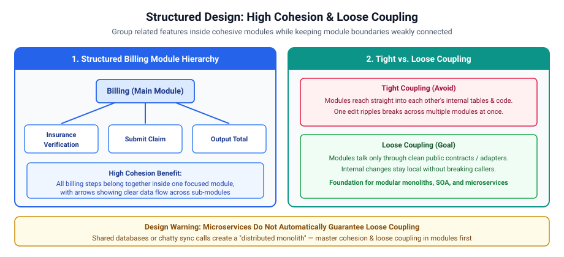
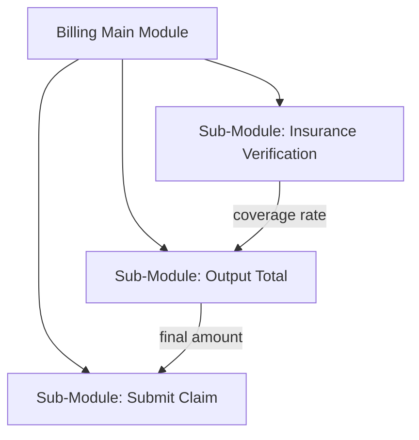
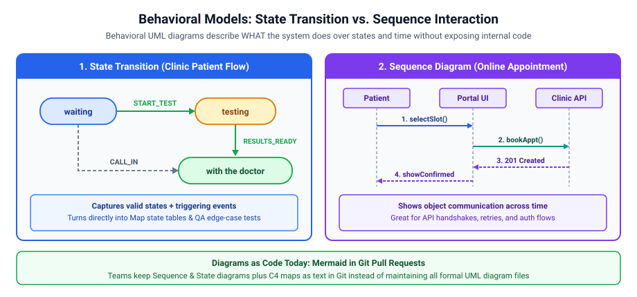
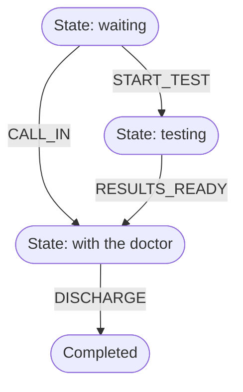

# 02 — Software Design and Modeling

## 1. Jargon Translation

| Term | Official definition | Simple words | Analogy |
|---|---|---|---|
| **Software Design & Modeling** | Documenting structural components and behavioral attributes before coding by creating visual diagrams of the system, sub-components, and their interactions. | Drawing out the pieces of the software and how they behave together before writing code. | Sketching a house layout and electrical plan before pouring concrete. |
| **Structured Design** | A design method that breaks a software problem into well-organized smaller elements (**modules** and **sub-modules**) focused on clear organization. | Splitting one big problem into neatly organized parts and sub-parts. | Organizing a restaurant into clearly labeled prep, cooking, and billing stations. |
| **Cohesion** | The degree to which all functionally related elements inside a single module belong together around one clear responsibility. | Keeping closely related work grouped inside one focused module instead of scattered everywhere. | A toolbox holding only electrical tools together rather than mixing spatulas with screwdrivers. |
| **Coupling & Loose Coupling** | **Coupling** is how strongly modules depend on each other; **loose coupling** minimizes cross-module dependencies so changing one module has minimal impact elsewhere. | How tightly parts are glued together—loose means changing one part doesn't break its neighbors. | Plugging appliances into a standard wall outlet rather than soldering wires directly into the wall. |
| **Behavioral Model** | A model describing *what* a system does over states and time without specifying *how* the code internally implements it. | Showing what actions and states a system goes through from the outside, without showing code details. | A vending machine user flow ("insert coin → select snack → dispense") without showing the motor gears inside. |
| **Unified Modeling Language (UML)** | A standardized, **programming language agnostic** visual notation maintained by Object Management Group (OMG) (per OMG, `omg.org/spec/UML/`, Version `2.5.1`), grouped into **structural** and **behavioral** diagrams. | One shared visual drawing language developers on any tech stack can read. | Traffic signs—understood whether you drive a truck, motorcycle, or car. |
| **State Transition Diagram (State Machine)** | A behavioral diagram containing **states** and **events** showing every state an entity can occupy and which events trigger transitions between them (per `mermaid.js.org`). | A map of all statuses something can have and what event moves it from one status to the next. | A traffic light cycling from `Green` to `Yellow` to `Red` on timer events. |
| **Interaction Diagram (`Sequence Diagram`)** | A behavioral diagram showing how objects or services communicate in chronological **time** order (per `mermaid.js.org`). | A step-by-step timeline of messages passed back and forth between parts. | A text-message thread showing who texted first and who replied next. |

---

## 2. Topics Introduced in the Lecture Transcript

1. **Software design & modeling** — documenting **structural components** and behavioral attributes ahead of development using flowcharts or **`UML`** (**Unified Modeling Language**).
2. **Structured design, cohesion, and loose coupling** — breaking a problem into **modules** and **sub-modules** (demonstrated with the **billing** module containing **insurance verification**, **submit claim**, and **output total**), maximizing **cohesion**, and keeping modules **loosely coupled** for **service-oriented architectures** and **microservices**.
3. **Behavioral models** — describing *what* a system does rather than *how* it implements it via behavioral diagrams.
4. **`UML` categories and benefits** — structural vs. behavioral diagrams that stay **programming language agnostic**, help teams plan features before coding (**saves time and money**), onboard teammates quickly, align technical and **non-technical** audiences, and **navigate the source code**.
5. **State transition diagrams & interaction (sequence) diagrams** — modeling states (`waiting`, `testing`, `with the doctor`) and **events** for a clinic patient, alongside a time-ordered **sequence diagram** for booking an online clinic **appointment**.

---

## 3. Exhaustive Deep Dive & Structured Notes

### 3.1 Structured Design: Modules, Sub-Modules, Cohesion, and Loose Coupling

- **How structured design decomposes problems:**
  - Complex software becomes unmanageable if written as one tangled block. **Structured design** breaks a large system into smaller, organized **modules** and **sub-modules** arranged hierarchically.
  - **Lecture billing example:** A top-level **`billing`** module organizes three focused **sub-modules**—**insurance verification**, **submit claim**, and **output total**—with arrows showing how billing data flows between them.
- **Two golden rules of module structure:**
  1. **High cohesion:** Group functionally related steps together inside one module so everything inside serves one cohesive domain goal.
  2. **Loose coupling:** Keep dependencies between separate modules weak and narrow through clean interfaces. When modules are **loosely coupled**, modifying **insurance verification** rules rarely breaks **submit claim** or unrelated user profiles—a core architectural principle behind **service-oriented architectures (`SOA`)** and **microservices**.





#### ✅ Modern Best Practice: achieve high cohesion & loose coupling inside a modular monolith first

> **Lecture says:** loose coupling is an architectural principle often used in service-oriented architectures (`SOA`) and microservices.
> **Industry today:** teams enforce **high cohesion** and **loose coupling** inside a single **modular monolith** using **Domain-Driven Design (`DDD`)** bounded contexts, **ports and adapters**, and **CI (Continuous Integration)** import boundary rules—because jumping straight to microservices with shared databases creates a tightly coupled "distributed monolith".

---

### 3.2 `UML` (Unified Modeling Language): Structure vs. Behavior & Practical Trade-Offs

- **What `UML` provides:**
  - **Unified Modeling Language (`UML`)** gives teams a standardized, **programming language agnostic** visual toolkit across the development process. Every diagram falls into one of two broad classes:
    - **Structural diagrams:** Static building blocks, modules, classes, and component relationships.
    - **Behavioral diagrams:** Runtime interactions, workflows, and state changes over time.
- **Four advantages highlighted in the lecture:**
  1. **Plan before coding (`saves time and money`):** Catching missing flows on a diagram is far cheaper than refactoring three microservices after coding starts.
  2. **Faster onboarding:** New developers or engineers switching teams understand system structure rapidly from visual maps.
  3. **Bridge technical and `non-technical` stakeholders:** Visual diagrams give product owners and engineers a shared picture of requirements.
  4. **Navigate the source code:** Seeing module relationships visually makes unfamiliar folders easier to explore.

#### ✅ Modern Best Practice: draw lightweight C4 + Sequence/State Mermaid diagrams in Git, not every UML diagram

> **Lecture says:** `UML` diagrams let you plan features before coding and facilitate communication between technical and non-technical audiences.
> **Industry today:** per `c4model.com`, ad hoc box-and-line diagrams often use inconsistent notation, and the C4 model is a simplified approach inspired by `UML`; diagrams kept in external files also tend to drift stale (general knowledge, not verified). Most backend teams draw **C4 Context/Container** maps (`Design §4.8`) for shared understanding and keep **Sequence** + **State** diagrams as **Mermaid** or **PlantUML** text in Git pull requests, backed by automated state-transition tests (`Testing` phase).

---

### 3.3 Behavioral Models: State Transition Diagrams & Interaction (Sequence) Diagrams

- **Describing *what*, not *how*:**
  - **Behavioral models** capture observable system behavior without prescribing low-level loops, variables, or database syntax.
- **State transition diagram (clinic patient example):**
  - Models every valid **state** a subject or entity can be in (**`waiting`**, **`testing`**, **`with the doctor`**) plus the **events** on directed arrows that trigger valid transitions (such as `START_TEST` moving `waiting` → `testing`, or `RESULTS_READY` moving `testing` → `with the doctor`).
- **Interaction diagram (`sequence diagram`, clinic `appointment` example):**
  - Visualizes dynamic collaboration among objects/services—highlighting **who calls whom in strict chronological time order** (such as `Patient` → `Online Portal` → `Clinic API` when booking an **appointment**).





#### ✅ Modern Best Practice: encode state transitions explicitly in `Map` tables and sequence API contracts

> **Lecture says:** state transition and sequence diagrams visually communicate states, events, and time-ordered object messages before coding.
> **Industry today:** teams convert **state transition diagrams** directly into explicit transition tables (`Map`) + negative state-transition unit tests (`Testing` checks both allowed *and* forbidden moves), and align **sequence diagrams** directly with `OpenAPI` HTTP (HyperText Transfer Protocol) status codes and timeouts (`per Mermaid docs, mermaid.js.org`).

---

### 3.4 Often-missed parts

- **Cohesion vs. coupling (`don't swap them!`):** **High cohesion** is *good* (related things live together inside a module); **tight coupling** is *bad* (modules depend heavily on each other's internals). Aim for **high cohesion + loose coupling**.
- **Behavioral models show *what*, not *how*:** Remember this key definition contrast for quizzes (**structured design** = static module organization; **behavioral models** = what the system does across states and time).
- **`State transition` vs. `Sequence` focus:** State diagrams track **one entity's states and events**; sequence diagrams track **multiple objects/services exchanging messages over time**.
- **Why `UML` helps code navigation:** Developers read diagrams alongside codebases to locate which module handles which responsibility (`navigate the source code`).
- **Forbidden state jumps matter most in code:** Diagrams show allowed arrows cleanly, so developers often forget to block illegal jumps (like `waiting → discharged`) in backend handlers!

---

### 3.5 Done enough when…

- [ ] You can compare **structured design** (modules, cohesion, coupling) with **behavioral models** (states, events, time-ordered interactions).
- [ ] You can explain **high cohesion** and **loose coupling** using the **billing** module (`insurance verification`, `submit claim`, `output total`) without confusing the two terms.
- [ ] You can trace transitions in a **state transition diagram** (`waiting`, `testing`, `with the doctor`) and turn them into a safe `Map`-based transition guard in Node.js.
- [ ] You know when a **sequence diagram** helps clarify `API` (Application Programming Interface) calls and why teams store **Mermaid** diagrams in Git alongside **OpenAPI** contracts.

---

## 4. Concrete Examples

1. **Healthcare Billing Service (`High Cohesion` + `Loose Coupling` in Express):**
   Keep `insuranceVerification`, `calculateTotal`, and `submitClaim` cleanly decoupled behind injected interfaces inside `services/billing/`. Switching insurance providers later touches only `verifyInsurance` while `submitClaim` and `calculateTotal` stay untouched.
2. **Clinic Queue API (`State Transition Diagram` → Production Guardrails):**
   Represent patient status transitions (`waiting` → `testing` → `with the doctor`) with an explicit `Map` transition table so a `PATCH /visits/:id` request can never skip straight from `waiting` to `completed`. (Two requests arriving at the same moment also need an atomic database update, such as `UPDATE ... WHERE status = 'waiting'`; the `Map` only defines which moves are legal.)
3. **Appointment Booking Sequence Diagram (`Patient → Portal → Scheduler API`):**
   Drawing the 4-step sequence diagram (`selectSlot` → `bookAppointment` → `201 Created` → `confirmation UI`, User Interface) reveals upfront where a database uniqueness constraint is needed so two patients never double-book the same doctor slot.

---

## 5. Code Blocks

### 5.1 Clinic Patient State Machine + Loosely Coupled Billing Module (`Node.js`)

```javascript
// design-modeling-demo.mjs — tested on Node.js v24.18.0
import assert from "node:assert/strict";

// 1. State Transition Table (mirrors the lecture's clinic patient behavioral model)
const PATIENT_TRANSITIONS = new Map([
  ["waiting", new Map([["START_TEST", "testing"], ["CALL_IN", "with the doctor"]])],
  ["testing", new Map([["RESULTS_READY", "with the doctor"]])],
  ["with the doctor", new Map([["DISCHARGE", "completed"]])],
]);

function transitionPatient(currentState, event) {
  const allowedEvents = PATIENT_TRANSITIONS.get(currentState);
  if (!allowedEvents || !allowedEvents.has(event)) {
    throw new Error(`Invalid transition: ${currentState} --(${event})--> ?`);
  }
  return allowedEvents.get(event);
}

let state = "waiting";
state = transitionPatient(state, "START_TEST");
console.log("After START_TEST:", state);
state = transitionPatient(state, "RESULTS_READY");
console.log("After RESULTS_READY:", state);
assert.equal(state, "with the doctor");

try {
  transitionPatient("waiting", "DISCHARGE");             // Guard forbids invalid state jump
} catch (err) {
  console.log("Blocked forbidden transition:", err.message);
}

// 2. Cohesive Billing Orchestrator with Loosely Coupled Sub-Modules
function createBillingService({ verifyInsurance, submitClaim, calculateTotal }) {
  return async function processPatientBill(patientId, lineItems) {
    const coverage = await verifyInsurance(patientId);
    const total = calculateTotal(lineItems, coverage.discountRate);
    const claim = await submitClaim({ patientId, total, covered: coverage.active });
    return { claimId: claim.id, finalTotal: total };
  };
}

const billPatient = createBillingService({
  verifyInsurance: async () => ({ active: true, discountRate: 0.2 }),
  calculateTotal: (items, rate) => {
    const raw = items.reduce((sum, price) => sum + price, 0);
    return Number((raw * (1 - rate)).toFixed(2));
  },
  submitClaim: async ({ patientId, total }) => ({ id: `CLM-${patientId}-${total}` }),
});

console.log("Billing result:", await billPatient("P101", [100, 50]));
```

Real output from running in `Node.js v24.18.0`:

```text
After START_TEST: testing
After RESULTS_READY: with the doctor
Blocked forbidden transition: Invalid transition: waiting --(DISCHARGE)--> ?
Billing result: { claimId: 'CLM-P101-120', finalTotal: 120 }
```

**What happens if... you validate patient transitions with ad-hoc `if` flags instead of an explicit `Map`?** Illegal combinations (`waiting` → `DISCHARGE`) are easy to miss in scattered flags and can leave database records inconsistent, whereas `PATIENT_TRANSITIONS.get(currentState)` keeps every legal move in one table and rejects the rest immediately.

### 5.2 Behavioral Diagrams as Code (Mermaid `sequenceDiagram` Reference, per `mermaid.js.org`)

```text
sequenceDiagram
    participant Patient
    participant Portal as Online Portal
    participant API as Clinic Scheduler API
    Patient->>Portal: Request appointment slot
    Portal->>API: POST /appointments (slotId)
    API-->>Portal: 201 Created (bookingId)
    Portal-->>Patient: Show confirmation
```

**What happens if... you keep diagrams only as unversioned slide images outside Git?** Within two sprints, endpoints and statuses diverge from the exported slides, erasing the onboarding and code-navigation benefits of modeling.

---

## 6. Related Concepts

1. **Domain-Driven Design (`DDD`) & Bounded Contexts:** Grouping cohesive data models and business logic around real domain areas rather than giant shared folders.
2. **Entity-Relationship Diagrams (`ERD`) & Relational Schemas:** Structural modeling specifically for database tables, foreign keys, and integrity constraints.
3. **Finite State Machines & Workflow Engines:** Formalizing multi-step order, payment, and approval lifecycles safely in code and tests.
4. **C4 Architecture Model (`Context`, `Container`, `Component`, `Code`):** Modern lightweight alternative to heavyweight upfront `UML` suites for architectural storytelling (`c4model.com`).
5. **Negative / State-Transition Testing:** Systematically writing automated tests for both valid state arrows and forbidden transitions (`SDLC` Testing phase).

---

## 7. Lecture Summary & Quick Reference Table

| Topic | Lecture | ✅ Modern best practice |
|---|---|---|
| **Software design & modeling** | Documents structural components and behavioral attributes before coding using flowcharts or `UML` | Pair lightweight living diagrams in Git (`Mermaid`, `C4`) with **API-first** `OpenAPI` contracts and automated tests |
| **Structured design** | Splits problems into **modules** and **sub-modules** (`billing` → `insurance verification`, `submit claim`, `output total`) with high **cohesion** and **loose coupling** (`SOA` / microservices) | Enforce high cohesion + loose coupling inside a **modular monolith** first (`DDD` bounded contexts, ports/adapters, CI import boundary checks) before splitting services |
| **`UML` & advantages** | **Programming language agnostic** structural + behavioral notation; plans features early (**saves time and money**), onboards teams, aids **non-technical** communication, helps **navigate the source code** | Focus on the highest-value views (**C4** for architecture + **Sequence** / **State** in **Mermaid**; `UML`, per OMG, `omg.org/spec/UML/`, Version `2.5.1`, stays optional for detailed object views) |
| **State transition diagrams** | Behavioral model of **states** (`waiting`, `testing`, `with the doctor`) and **events** triggering state changes | Encode allowed moves explicitly in **`Map` transition tables** and write unit tests verifying both valid transitions and rejected invalid jumps |
| **Interaction (`sequence`) diagrams** | Behavioral model showing dynamic communication among objects over time (online portal **appointment** booking) | Store `sequenceDiagram` definitions in Git PRs (`mermaid.js.org`) alongside `OpenAPI` endpoints to catch race conditions and timeout paths early |

---

← [01 — Introduction to Software Architecture](01-introduction-to-software-architecture.md)
