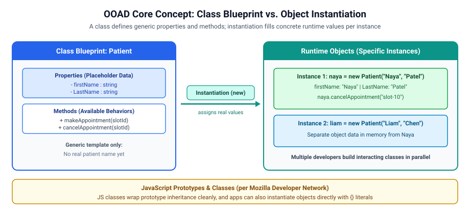
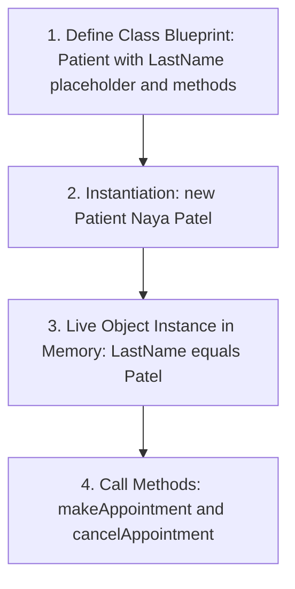
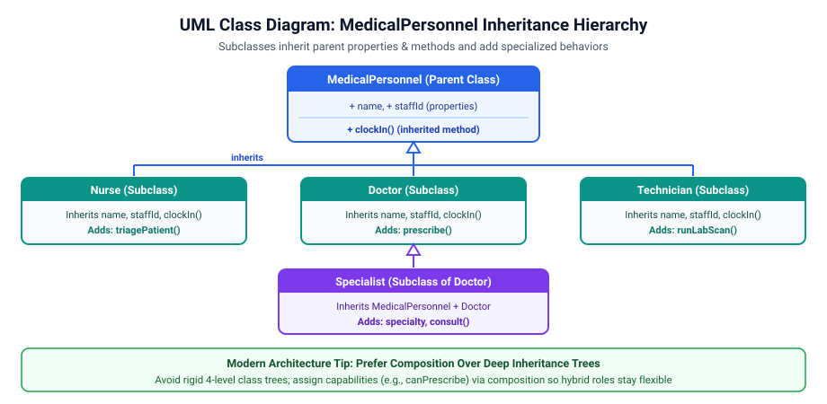
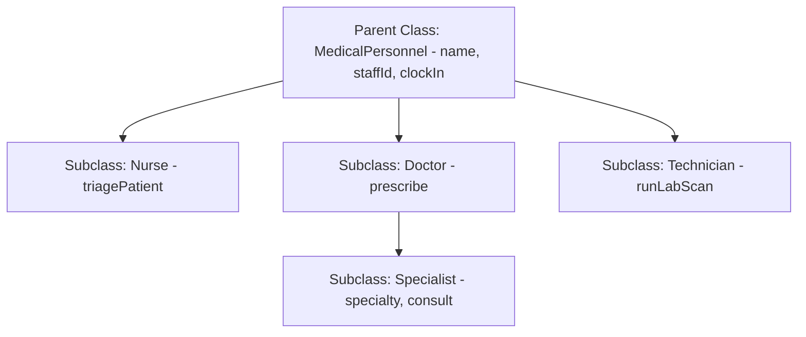

# 03 — Object-Oriented Analysis and Design

## 1. Jargon Translation

| Term | Official definition | Simple words | Analogy |
|---|---|---|---|
| **Object-Oriented Analysis and Design (OOAD)** | A software analysis and design approach for planning systems built with object-oriented programming (`OOP`, Object-Oriented Programming) languages as sets of interacting objects. | Planning software by breaking the problem into interacting objects before coding. | Planning a hospital workflow by listing patients, doctors, and appointments and how they interact. |
| **Object & Instance** | A runtime entity holding concrete **data** (properties) and **behaviors** (methods) created from a class; every runtime object created from a class is an **instance** of that class. | One real, active copy built from a blueprint with its own actual values filled in. | One specific house built at `12 Main Street` from an architectural house plan. |
| **Class** | A generic **blueprint** or template (per Mozilla Developer Network, MDN) defining placeholder properties and methods shared by every instance built from it. | The empty cookie cutter / template that defines what every object of that kind will have. | A blank Patient registration form before any patient writes their name on it. |
| **Instantiation** | The runtime act of creating a concrete object instance from a class in code (for example, `new Patient("Naya", "Patel")`) and assigning actual values to placeholder properties. | Stamping out one live object from its class blueprint and filling in its real data. | Filling out a blank patient form for **Naya Patel** at the check-in desk. |
| **Class Diagram (`UML` Structural Diagram)** | A static **Unified Modeling Language (UML)** diagram showing classes, their attributes/methods, and the **relationships** between classes (per `mermaid.js.org`). | A map of all your software blueprints (classes) and how they connect or inherit from one another. | An organizational chart showing roles and who reports to whom, rather than one person's daily schedule. |
| **Inheritance (`Parent Class` & `Subclass`)** | A relationship where a **subclass** automatically inherits the properties and methods of its **parent class** while adding its own specialized properties or methods. | A child blueprint automatically getting everything from its parent blueprint, plus extra abilities. | A `Doctor` inherits general `MedicalPersonnel` badge check-in and adds `prescribe()`. |
| **Composition Over Inheritance** | Designing classes to hold flexible capability objects/components ("has-a") instead of building deep rigid inheritance trees ("is-a"). | Plugging capability cards into a staff profile instead of forcing a rigid family tree. | Giving a clinician credential badges (`triage`, `prescribe`) rather than inventing 8 hybrid job subclasses. |

---

## 2. Topics Introduced in the Lecture Transcript

1. **Purpose of Object-Oriented Analysis and Design (`OOAD`)** — analyzing and designing software systems for `OOP` languages like **Java**, **C++**, and **Python** by decomposing work into interacting **objects** so **multiple developers** can work in parallel.
2. **Objects, classes, instances, and instantiation** — defining **objects** (data + behaviors), **classes** as **blueprints**, and **instantiation** setting placeholder properties (such as `LastName`) for concrete instances like **Naya Patel** of **`Patient`** calling appointment methods.
3. **Class diagrams as structural `UML` diagrams** — contrasting structural **class diagrams** with earlier behavioral diagrams, showing class boxes, **attributes** (properties and methods), and class **relationships**.
4. **Parent classes, subclasses, and inheritance** — tracing how **`Nurse`**, **`Doctor`**, and **`Technician`** inherit from **`MedicalPersonnel`**, and **`Specialist`** inherits from **`Doctor`**, inheriting attributes and adding specialized capabilities.

---

## 3. Exhaustive Deep Dive & Structured Notes

### 3.1 What `OOAD` Is & How Classes Instantiate Runtime Objects

- **Why `OOAD` fits multi-developer teams:**
  - When a system will be implemented in object-oriented languages such as **Java**, **C++**, **Python**, or modern JavaScript (`JS`), **`OOAD`** models the problem around cooperating domain **objects** rather than one giant script.
  - Because each class owns a clear boundary of data (**properties**) and actions (**methods**), **multiple developers** can implement different classes (`Patient`, `Appointment`, `MedicalPersonnel`) in parallel once class interfaces are agreed.
- **Blueprint vs. runtime instance (`Patient` & `Naya Patel`):**
  1. **Class (`Patient`):** Defines placeholder **properties** (`LastName`) and **methods** (`makeAppointment()`, `cancelAppointment()`), without storing any particular patient's data.
  2. **Instantiation:** Inside the running program (`new Patient(...)` in JS/Java or `Patient(...)` in Python), **instantiation** creates a concrete **instance** (specific object) in memory and sets its initial values.
  3. **Instance execution:** Now `naya` (`Naya Patel`) holds concrete values and can invoke `naya.cancelAppointment(...)` independently of every other patient instance.





#### ✅ Modern Best Practice: JS supports lightweight object literals alongside ES classes

> **Lecture says:** before creating an object like Naya Patel, you must first create a generic class blueprint (`Java`, `C++`, `Python`).
> **Industry today:** per **MDN (Mozilla Developer Network)**, JavaScript classes (`class Patient {}`) provide clean prototype templates, **but** Node.js back-ends do not force every data record into a class—plain HTTP (HyperText Transfer Protocol) payloads (`DTOs`, Data Transfer Objects) stay lightweight `{ firstName: "Naya", lastName: "Patel" }` literals while classes encapsulate domain rules or stateful resources.

---

### 3.2 `UML` Class Diagrams, Strict Terminology, and Inheritance Hierarchies

- **Communicating static structure (`class diagram`):**
  - While behavioral `UML` diagrams (state transition & sequence diagrams) show runtime changes over time, a **`class diagram`** shows the **static structure** of classes and their **relationships**.
  - Each rectangle box displays the class name, its stored fields, and its methods, connected by relationship arrows.
- **Lecture terminology note on `attributes` vs. formal `UML` compartments:**
  - The lecture states *"an object's attributes are both its properties or its data, and its available actions, called methods."* Keep that broad wording in mind for course quizzes; in formal **`UML`** boxes (and Mermaid `classDiagram`), the box splits into three distinct sections: **Class Name** (top), **Attributes / Properties** (middle), and **Operations / Methods** (bottom).
- **Inheritance & subclasses (`MedicalPersonnel` clinic hierarchy):**
  - When a **subclass** inherits from a **parent class**, it automatically gains all parent properties and methods (`clockIn()`) and can add new ones:
    - **`Nurse`**, **`Doctor`**, and **`Technician`** are subclasses of **`MedicalPersonnel`** (so a `Doctor` can do anything `MedicalPersonnel` can do, plus `prescribe()`).
    - **`Specialist`** is a subclass of **`Doctor`** (inheriting both `MedicalPersonnel` and `Doctor` capabilities, plus adding `specialty` and `consult()`).





#### ✅ Modern Best Practice: prefer composition over deep multi-level inheritance trees

> **Lecture says:** subclasses like `Specialist -> Doctor -> MedicalPersonnel` inherit parent attributes and methods and add more specializations.
> **Industry today:** multi-level inheritance causes the **"fragile base class"** problem—editing `MedicalPersonnel` can accidentally break distant subclasses, and rigid trees struggle with cross-cutting roles (for example, a senior `Nurse` who is authorized to prescribe). Modern OOAD favors **composition** (holding a `Set` of capability badges or injected policy objects) and treats C4 **Level 4 Code** class diagrams as optional/auto-generated (`SDLC Design §4.8`).

---

### 3.3 Often-missed parts

- **`Class` vs. `Instance` vs. `Instantiation`:** **Class** = blueprint (`Patient`), **Instantiation** = creation step (`new Patient(...)`), **Object / Instance** = specific runtime entity (`Naya Patel`).
- **Static structure vs. dynamic behavior:** A **`class diagram`** captures **static structure** (unlike state transition and sequence diagrams, which capture dynamic behavior).
- **Double meaning of `"attributes"`:** In this lecture, `"attributes"` refers broadly to *both* properties and methods; in formal `UML` / Java / Python, `"attributes"` usually means just data fields while `"methods"`/`"operations"` are behaviors.
- **Multi-level inheritance is transitive:** Because `Specialist` subclasses `Doctor` and `Doctor` subclasses `MedicalPersonnel`, a `Specialist` object is an instance of **all three** (`instanceof MedicalPersonnel === true`).
- **Don't hand-draw every getter/setter on whiteboards:** Modern backend teams use class diagrams only for tricky core domain relationships, keeping database columns in SQL (Structured Query Language) migrations / `ERD`s (Entity-Relationship Diagrams).

---

### 3.4 Done enough when…

- [ ] You can clearly distinguish **class**, **instantiation**, and **object instance** using the **`Patient` / `Naya Patel`** example.
- [ ] You understand why **`class diagram`** relationships (`MedicalPersonnel` → `Doctor` → `Specialist`) belong under **static structural** `UML` diagrams.
- [ ] You can implement both `extends` inheritance and a flexible **composition** alternative in Node.js without fragile base-class bugs.
- [ ] You know when plain JavaScript object literals beat formal classes for `API` (Application Programming Interface) data transfer objects.

---

## 4. Concrete Examples

1. **Patient Appointment Service (`Class` + `Instantiation`):**
   Defining `class Patient` lets one booking service create isolated instances for thousands of concurrent patients (`Naya Patel`, `Liam Chen`) where calling `naya.cancelAppointment(slotId)` modifies only Naya's bookings.
2. **Clinic Staff Authorization Hierarchy (`Inheritance` vs. `Composition`):**
   A `MedicalPersonnel -> Doctor -> Specialist` class tree cleanly models base clock-in + doctor prescribing + cardiology consulting, whereas modeling a Nurse Practitioner who can *both* triage *and* prescribe works much cleaner with a composed `capabilities` `Set` (`["triage", "prescribe"]`).
3. **Documenting Domain Entities in Git PRs (`Mermaid classDiagram`):**
   Instead of exporting static diagram images, backend engineers commit a 10-line `classDiagram` in Markdown when introducing complex domain entities like `Order`, `LineItem`, and `Payment` (`per mermaid.js.org`).

---

## 5. Code Blocks

### 5.1 Classes, Instantiation (`Naya Patel`), Inheritance (`MedicalPersonnel`), and Composition (`Node.js`)

```javascript
// ooad-demo.mjs — tested on Node.js v24.18.0
import assert from "node:assert/strict";

// 1. Class blueprint + Instantiation (Patient example: Naya Patel)
class Patient {
  constructor(firstName, lastName) {
    this.firstName = firstName;
    this.lastName = lastName;                            // Lecture property example: LastName
    this.appointments = new Set();
  }
  makeAppointment(slotId) {
    this.appointments.add(slotId);
    return `${this.firstName} ${this.lastName} booked ${slotId}`;
  }
  cancelAppointment(slotId) {
    const removed = this.appointments.delete(slotId);
    return removed
      ? `${this.firstName} ${this.lastName} canceled ${slotId}`
      : `No booking found for ${slotId}`;
  }
}

const naya = new Patient("Naya", "Patel");               // Instantiation creates concrete object
console.log(naya.makeAppointment("2026-12-01-10:00"));
console.log(naya.cancelAppointment("2026-12-01-10:00"));
assert.equal(naya instanceof Patient, true);

// 2. Inheritance hierarchy: MedicalPersonnel -> Doctor -> Specialist
class MedicalPersonnel {
  constructor(name, staffId) {
    this.name = name;
    this.staffId = staffId;
  }
  clockIn() {
    return `${this.name} (${this.staffId}) clocked in`;
  }
}

class Doctor extends MedicalPersonnel {
  prescribe(patientName, item) {
    return `Dr. ${this.name} prescribed ${item} for ${patientName}`;
  }
}

class Specialist extends Doctor {
  constructor(name, staffId, specialty) {
    super(name, staffId);                                // Calls parent Doctor/MedicalPersonnel constructor
    this.specialty = specialty;
  }
  consult() {
    return `Specialist ${this.name} [${this.specialty}] ready`;
  }
}

const cardiologist = new Specialist("Rao", "MD-42", "Cardiology");
console.log(cardiologist.clockIn());
console.log(cardiologist.prescribe("Naya Patel", "ECG"));
console.log(cardiologist.consult());
assert.equal(cardiologist instanceof MedicalPersonnel, true);

// 3. Modern composition alternative (flexible capabilities without deep subclasses)
class Clinician {
  constructor(name, capabilities = []) {
    this.name = name;
    this.capabilities = new Set(capabilities);
  }
  can(action) {
    return this.capabilities.has(action);
  }
}

const nursePractitioner = new Clinician("Lin", ["triage", "prescribe"]);
console.log("Composition nurse can prescribe:", nursePractitioner.can("prescribe"));
```

Real output from running in `Node.js v24.18.0`:

```text
Naya Patel booked 2026-12-01-10:00
Naya Patel canceled 2026-12-01-10:00
Rao (MD-42) clocked in
Dr. Rao prescribed ECG for Naya Patel
Specialist Rao [Cardiology] ready
Composition nurse can prescribe: true
```

**What happens if... `Specialist`'s constructor forgets `super(name, staffId)` in JavaScript?** JavaScript throws a `ReferenceError: Must call super constructor in derived class before accessing 'this' or returning from derived constructor` (real message from Node.js v24.18.0) immediately on instantiation because the parent class properties must initialize first.

### 5.2 Formal `UML` Class Diagram as Code (`Mermaid classDiagram` Syntax Reference, per `mermaid.js.org`)

```text
classDiagram
    MedicalPersonnel <|-- Nurse
    MedicalPersonnel <|-- Doctor
    MedicalPersonnel <|-- Technician
    Doctor <|-- Specialist
    class MedicalPersonnel {
        +String name
        +String staffId
        +clockIn()
    }
    class Doctor {
        +prescribe()
    }
    class Specialist {
        +String specialty
        +consult()
    }
```

**What happens if... a subclass overrides a parent method with incompatible inputs or broken guarantees?** Callers expecting any `MedicalPersonnel` or `Doctor` to work reliably break (**Liskov Substitution Principle** violation)—one key reason teams favor shallow inheritance + composition.

---

## 6. Related Concepts

1. **Encapsulation & Access Modifiers (`#private` Fields / `public` / `protected`):** Controlling which class properties and methods external code can read or mutate directly.
2. **SOLID (Single Responsibility, Open-Closed, Liskov Substitution, Interface Segregation, Dependency Inversion) Design Principles:** Keeping parent/child hierarchies and composed adapters safely interchangeable without breaking callers.
3. **Domain-Driven Design (`DDD`) Entities vs. Value Objects:** Deciding which domain concepts deserve identity-bearing classes (`Patient`) vs. immutable value objects (`Money`, `DateRange`).
4. **Object-Relational Mapping (`ORM`) & Data Mappers:** Bridging in-memory domain objects cleanly to relational PostgreSQL tables without tying domain classes straight to SQL drivers.
5. **Architectural & Design Patterns (`Factory`, `Strategy`, `Adapter`):** Standard object-collaboration recipes explored in upcoming lectures in this module.

---

## 7. Lecture Summary & Quick Reference Table

| Topic | Lecture | ✅ Modern best practice |
|---|---|---|
| **OOAD approach** | Analyzes and designs systems in `OOP` languages (`Java`, `C++`, `Python`) as interacting objects so **multiple developers** build parts concurrently | Agree on domain module interfaces and `OpenAPI`/type contracts early so teams build and unit-test in parallel safely |
| **Classes, objects & instantiation** | **Class** = blueprint with placeholder attributes (`LastName`); **instantiation** creates a concrete **instance** (`Naya Patel` of `Patient`) calling methods | Use `class` blueprints (`per MDN`) for invariant domain rules, while keeping simple request/response data as plain JS `{}` literals |
| **Class diagrams (`UML`)** | Structural `UML` diagram showing static class boxes (properties + methods) and relationships | Generate code-level class views from TypeScript/code when needed (`C4 Level 4`) or commit small **Mermaid `classDiagram`** blocks for tricky domain models |
| **Inheritance & subclasses** | `Nurse`, `Doctor`, `Technician` inherit `MedicalPersonnel` attributes; `Specialist` inherits `Doctor` and adds specialized attributes | Keep inheritance shallow (`1–2` levels) and **prefer composition** (`capabilities` `Set` / injected interfaces) to avoid fragile base classes |

---

← [02 — Software Design and Modeling](02-software-design-and-modeling.md)
