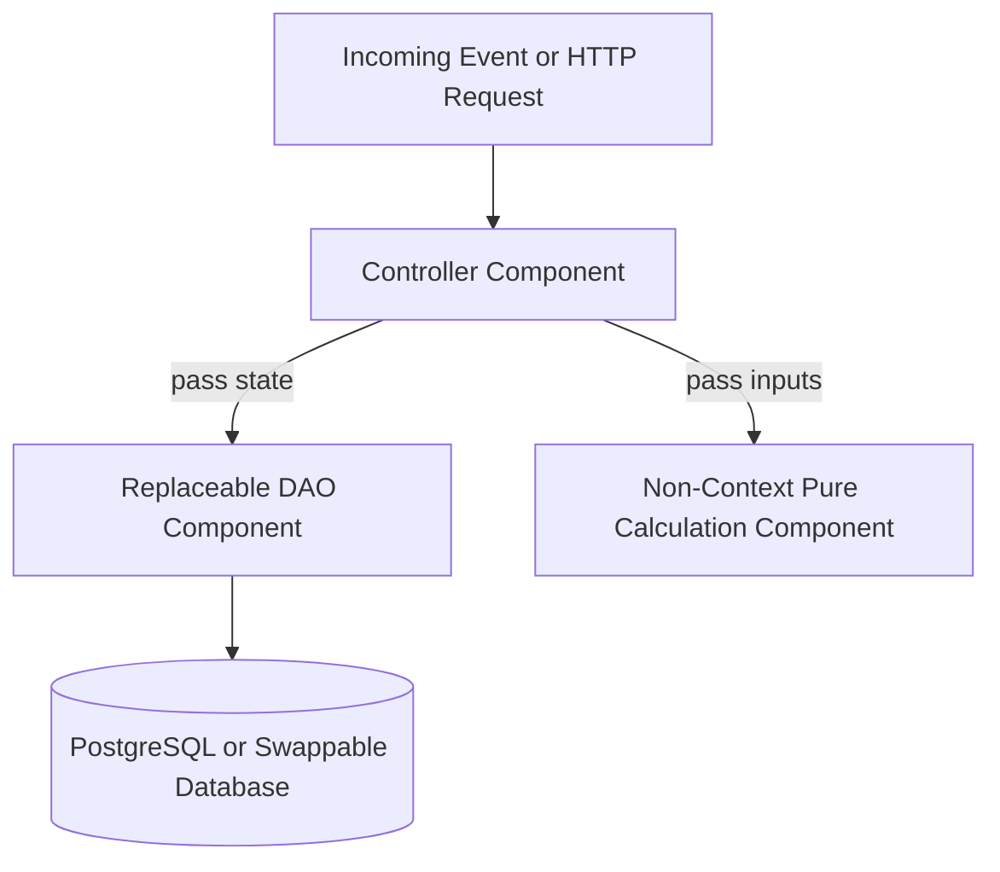
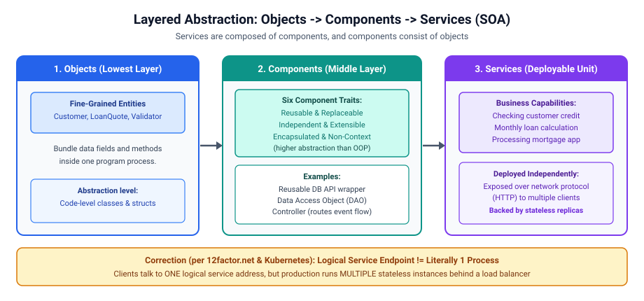
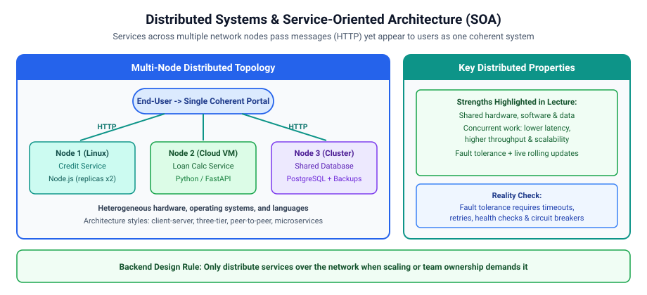
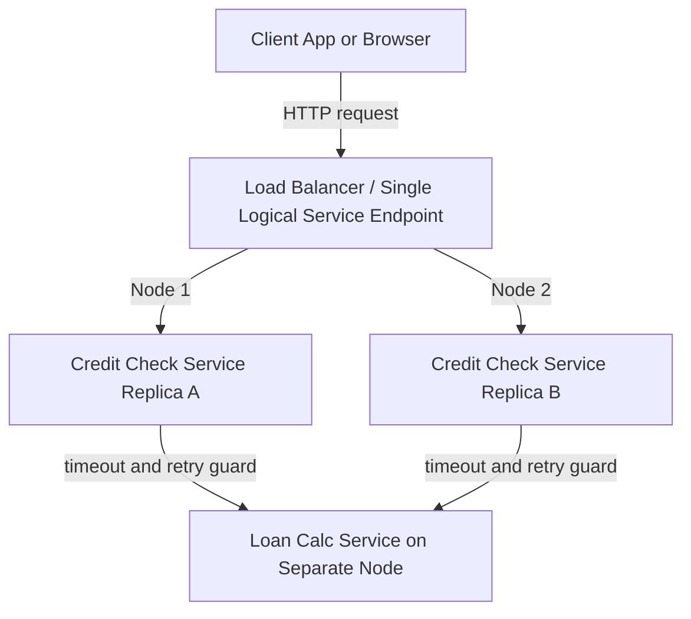

# 04 — Approaches to Application Architecture

## 1. Jargon Translation

| Term | Official definition | Simple words | Analogy |
|---|---|---|---|
| **Component** | An individual, encapsulated unit of functionality providing a **higher level of abstraction** than objects and collaborating with other components inside an application. | A self-contained, swappable building block inside an app (such as a database adapter or request controller). | A car's alternator—you can swap it for a compatible replacement without rebuilding the engine. |
| **Component-Based Architecture** | Decomposing system design into loosely coupled, independent logical components (`reusable`, `replaceable`, `independent`, `extensible`, `encapsulated`, `non-context specific`). | Designing an app from plug-and-play blocks that don't depend on internal code details of other blocks. | Building a modular stereo from separate amplifier, tuner, and speaker units wired with standard cables. |
| **Data Access Object (`DAO`)** | A component providing a uniform interface to a database so the underlying storage engine can be swapped without the application code knowing. | A database translator box that lets you switch databases without changing business logic. | A universal wall power adapter—your laptop uses the same plug in different countries. |
| **Controller** | A component that receives an event or request and orchestrates which other components run and how data flows between them. | A traffic coordinator deciding which service/component handles an incoming action. | An air-traffic controller routing incoming planes cleanly to the right runway. |
| **Service** | An independently deployed business capability (`checking a customer's credit`, `calculating a monthly loan payment`, `processing a mortgage application`) built from components and callable by multiple systems. | A stand-alone running back-end capability reachable over the network to solve one business need. | An external payroll department serving multiple branch offices through one desk phone number. |
| **Service-Oriented Architecture (`SOA`)** | An architectural approach where loosely coupled services expose business capabilities and communicate over a network protocol. | Connecting independent back-end services cleanly across a network via standard API protocols. | City utilities (water, power, mail) operating independently and serving every home through standard hookups. |
| **Distributed System** | Multiple services running on different **nodes** (machines/devices on a network recognizing, processing, and transmitting data) coordinating via message passing (`HTTP`, HyperText Transfer Protocol) while appearing as a **single coherent system**. | Several servers collaborating across a network so users experience them as one smooth app. | A multi-kitchen restaurant chain taking one app order and routing drinks, hot food, and delivery across teams. |
| **Latency vs. Throughput** | **Latency** is the delay time for one request to complete; **throughput** is how many total operations a system completes per unit of time. | Latency = how fast one trip is; throughput = how many cars cross the bridge every hour. | A sports car (low latency) vs. a multi-lane highway carrying thousands of commuters per hour (high throughput). |

---

## 2. Topics Introduced in the Lecture Transcript

1. **Components & six core component characteristics** — defining an encapsulated unit of functionality that is **reusable**, **replaceable**, **independent**, **extensible**, **encapsulated**, and **non-context specific**.
2. **Component examples & component-based architecture** — reusable open-source **`API`** (Application Programming Interface) packages, **`data access object` (`DAO`)** interfaces, and **`controller`** flow orchestrators providing a **higher level of abstraction** than `OOP` (Object-Oriented Programming).
3. **Services vs. components (`Objects → Components → Services`)** — how services are made of components (and components consist of objects), focus on a business need (`checking a customer's credit`, `calculating a monthly loan payment`, `processing a mortgage application`), and are **deployed independently** in **`SOA`** (**service-oriented architecture**).
4. **Distributed systems, nodes, and system properties** — services on separate **nodes** exchanging **`HTTP`** messages while presenting a **single coherent system**, delivering shared resources, **fault-tolerant** live execution, concurrent processing (lower **latency**, higher **throughput**), **scalable** growth, and heterogeneous hardware/operating systems (`OS`, Operating System)/languages.
5. **Distributed architecture families previewed** — **`client-server`**, **`three-tier`**, **`peer-to-peer`**, and **`microservices`**.

---

## 3. Exhaustive Deep Dive & Structured Notes

### 3.1 Components & Component-Based Architecture

- **Six defining characteristics of well-designed components:**
  1. **Reusable:** Designed cleanly so multiple modules or applications can reuse the same component.
  2. **Replaceable:** Can be swapped out for another implementation matching the same contract without breaking callers.
  3. **Independent:** Avoids tight coupling and hidden dependencies on other concrete components.
  4. **Extensible:** Supports adding new behaviors cleanly without editing sibling components.
  5. **Encapsulated:** Bundles data and methods together while hiding internal state details from callers.
  6. **Non-context specific:** Avoids hard-coding environment globals; state/config is passed *into* the component so it runs across tests, staging, and production.
- **Concrete component roles highlighted in the lecture:**
  - **Reusable `API` adapter:** For example, an open-source library wrapping database connectivity.
  - **`Data Access Object` (`DAO`):** Shields the app from vendor SQL (Structured Query Language)—allowing teams to swap storage engines invisibly.
  - **`Controller`:** Determines which downstream components execute for an incoming event and manages data flow between them.
- **Higher abstraction than `OOP`:**
  - While `OOP` focuses on classes and objects inside one feature, **component-based architecture** composes coarse, loosely coupled logical components into complete applications.



#### ✅ Modern Best Practice: inject narrow interfaces ("ports") instead of aiming for literal zero dependencies

> **Lecture says:** "Independent means the component should be designed so it doesn't have dependencies on other components."
> **Industry today:** practical back-end components (controllers, services, repositories) rarely have zero dependencies—instead, they depend only on **narrow abstractions / passed-in functions** (**dependency injection**, `ports and adapters`) rather than importing concrete sibling modules directly, keeping them **replaceable** and trivially unit-testable.

---

### 3.2 Services, Layered Hierarchy, and Service-Oriented Architecture (`SOA`)

- **How layers compose:**
  - **Services are made of components, and components consist of objects.**
- **What separates a service from an in-process component:**
  - A **service** packages components around a cohesive business capability—such as **checking a customer's credit**, **calculating a monthly loan payment**, or **processing a mortgage application**—and is **deployed independently** so multiple client applications reuse it over the network.
  - In a **service-oriented architecture (`SOA`)**, loosely coupled services interface across a network via standardized communication protocols (`HTTP`, `REST` Representational State Transfer, `gRPC`, or message queues).



> ⚠️ **Correction:** **Clients talk to one logical service endpoint—not literally a single running process in production** → Per **Twelve-Factor App (`12factor.net/processes` and `12factor.net/concurrency`)** and **Kubernetes Service documentation (`kubernetes.io/docs/concepts/services-networking/service/`)**, scalable back-end services run as **multiple stateless processes/Pods** (for example, `2+` replicas across availability zones behind a load balancer) sharing **one logical service URL/DNS (Domain Name System) address**! Running literally one single process instance creates a single point of failure (`SPOF`) and blocks both horizontal scaling and zero-downtime rolling upgrades—contradicting the fault tolerance and scalability described later in this same lecture.
> **Lecture wording (for the quiz):** `"A key difference between a component and a service is that a service will only have one unique, always running instance with whom multiple clients communicate."`

#### ✅ Modern Best Practice: deploy stateless services in multiple replicas & adopt microservices only when needed

> **Lecture says:** services are deployed independently and interface over network protocols in `SOA`.
> **Industry today:** modern teams expose each service through one stable `OpenAPI` / `DNS` endpoint backed by **stateless containers (per Twelve-Factor App, `12factor.net/processes`)** scaled across `2+` instances (`SDLC Design rule 14`), and **start with a modular monolith** (`Design §4.2`) before splitting into separate network-deployed microservices unless independent scaling or multi-team release cadence justifies network overhead.

---

### 3.3 Distributed Systems, Nodes, and Architecture Families

- **What makes a system distributed:**
  - Multiple services executing on separate **nodes** (any network device capable of recognizing, processing, and transmitting data) coordinate by passing messages over network protocols like **`HTTP`**.
  - Despite physical distribution across machines, users interact with it as a **single coherent system**.
- **Core properties covered in the lecture:**
  - **Shared resources:** Distributes hardware, software, and data across clients/nodes.
  - **Fault-tolerant operation:** Continues operating when an individual node or service fails, and supports updating parts live without full downtime.
  - **Concurrency (`latency` & `throughput`):** Parallel work across machines cuts per-request waiting (**latency**) and lifts requests handled per second (**throughput**).
  - **Scalable & heterogeneous:** Scales horizontally as users grow, even across different hardware, operating systems (`OS`), and programming languages.
- **Four distributed architecture styles previewed for upcoming lectures:** **client-server**, **three-tier**, **peer-to-peer**, and **microservices**.





#### ✅ Modern Best Practice: engineer fault tolerance actively (never assume the network is reliable)

> **Lecture says:** distributed systems are fault-tolerant, meaning if a node or service fails the system continues to run.
> **Industry today:** distributed networks experience packet drops, slow dependencies, and partial failures; resilience never happens for free—back-end teams enforce **timeouts**, **retries with exponential backoff and jitter**, **circuit breakers**, **idempotency keys**, and **readiness health checks** (`SDLC Design §4.6`).

---

### 3.4 Often-missed parts

- **`Objects → Components → Services` hierarchy:** **Services** contain **components**; **components** contain **objects**.
- **Memorize all 6 component characteristics:** **reusable**, **replaceable**, **independent**, **extensible**, **encapsulated**, **non-context specific**.
- **Component role trio:** Reusable **`API`** package, **`DAO` (`Data Access Object`)** hiding database swaps, and **`Controller`** directing data flow on events.
- **One *logical* service vs. *physical* replicas:** Know `"one unique, always running instance"` for the video quiz, while remembering real production runs `2+` stateless replicas behind one load-balanced service endpoint (`per 12factor.net`).
- **Node definition:** Any device on a network able to **recognize, process, and transmit** data to other nodes.

---

### 3.5 Done enough when…

- [ ] You can list and explain all six **component characteristics** and distinguish a **`DAO`**, a **`controller`**, and a **`service`**.
- [ ] You can explain the `Objects → Components → Services` hierarchy and why services introduce network protocols (`HTTP`), deployment independence, and latency trade-offs.
- [ ] You can explain why production services use **multiple stateless replicas** behind one logical endpoint (`per 12factor.net` and Kubernetes docs) rather than a literal single process.
- [ ] You understand why distributed **fault tolerance** demands explicit timeouts, retries, and circuit breakers in backend code.

---

## 4. Concrete Examples

1. **Swappable `DAO` Inside a Mortgage Service (`Replaceable` & `Non-Context Specific`):**
   Switching `PostgresLoanDao` to `MockBackupLoanDao` in `createMortgageService(...)` leaves the **controller** and `calculateMonthlyLoanPayment` untouched because the loan calculation receives all required numbers explicitly (`principal`, `annualRate`, `months`) with zero hardcoded environment globals.
2. **Modular Express API (`Controller` + `DAO` + `Service`) vs. Network Split:**
   Keeping `CreditCheck`, `LoanCalculator`, and `MortgageController` as clean components inside one Express modular monolith delivers low in-process latency first—while still letting you extract `CreditCheck` onto a Python/FastAPI network node later if traffic demands independent scaling.
3. **Resilient Multi-Replica Loan Service in Kubernetes:**
   Clients send `POST /mortgages` to one logical **`HTTP` Load Balancer** endpoint, which balances across `3` stateless Node.js Pods across availability zones with `500ms` (general knowledge example timeout) `Promise.race` guards around downstream calls.

---

## 5. Code Blocks

### 5.1 Swappable `DAO`, Non-Context Pure Component, and Timeout-Guarded Mortgage Service (`Node.js`)

```javascript
// architecture-components-demo.mjs — tested on Node.js v24.18.0
import assert from "node:assert/strict";

// 1. Replaceable Data Access Object (DAO) components hiding storage engines
class PostgresLoanDao {
  async getApplicantScore(customerId) {
    return { customerId, creditScore: 745, source: "PostgreSQL" };
  }
}

class MockBackupLoanDao {
  async getApplicantScore(customerId) {
    return { customerId, creditScore: 745, source: "Read-Replica-Cache" };
  }
}

// 2. Non-context-specific pure calculation component (all inputs passed explicitly)
function calculateMonthlyLoanPayment({ principal, annualRate, months }) {
  const monthlyRate = annualRate / 12;
  const factor = Math.pow(1 + monthlyRate, months);
  return Number(((principal * monthlyRate * factor) / (factor - 1)).toFixed(2));
}

// 3. Controller / Service composing components + distributed timeout guard
function createMortgageService(loanDao, timeoutMs = 500) {
  return async function processMortgageApplication(req) {
    let timer;
    const timeoutPromise = new Promise((_, reject) => {
      timer = setTimeout(() => reject(new Error("DAO timeout")), timeoutMs);
    });
    try {
      const profile = await Promise.race([loanDao.getApplicantScore(req.customerId), timeoutPromise]);
      const eligible = profile.creditScore >= 680;
      const monthlyPayment = eligible
        ? calculateMonthlyLoanPayment({ principal: req.amount, annualRate: 0.06, months: 360 })
        : 0;
      return { approved: eligible, monthlyPayment, backingStore: profile.source };
    } finally {
      clearTimeout(timer);                                 // Prevents timer leaks when DAO replies early
    }
  };
}

const primaryService = createMortgageService(new PostgresLoanDao());
const swappedService = createMortgageService(new MockBackupLoanDao());

const res1 = await primaryService({ customerId: "CUST-9", amount: 300000 });
const res2 = await swappedService({ customerId: "CUST-9", amount: 300000 });

console.log("Primary DAO result:", res1);
console.log("Swapped DAO result:", res2);
assert.equal(res1.monthlyPayment, res2.monthlyPayment);
```

Real output from running in `Node.js v24.18.0`:

```text
Primary DAO result: { approved: true, monthlyPayment: 1798.65, backingStore: 'PostgreSQL' }
Swapped DAO result: {
  approved: true,
  monthlyPayment: 1798.65,
  backingStore: 'Read-Replica-Cache'
}
```

**What happens if... `loanDao` stalls across a slow distributed network link without `timeoutPromise`?** each request waits as long as the slow dependency does, so waiting requests pile up and can exhaust connections or memory—which is why every remote hop needs an explicit timeout. (`Promise.race` stops *waiting*, but does not cancel the slow call; real clients should also use `AbortSignal` where the library supports it.)

---

## 6. Related Concepts

1. **Dependency Injection & Inversion of Control:** Passing replaceable `DAO` and client components into constructors/functions rather than instantiating concrete vendors inside business services.
2. **API Gateways & Load Balancing:** Routing one public client endpoint safely across multiple stateless distributed service instances with health checks.
3. **Circuit Breakers, Retries & Idempotency:** Preventing cascading failures when one distributed node degrades or times out under load.
4. **Monolith vs. Microservices Trade-Offs (Modular Monolith Default):** Avoiding premature network boundaries when a single well-componentized deployment works better.
5. **Distributed Data & Eventual Consistency (`CAP`, Consistency/Availability/Partition Tolerance, & Saga Pattern):** Handling transactions cleanly when data lives on separate database nodes instead of one shared relational database.

---

## 7. Lecture Summary & Quick Reference Table

| Topic | Lecture | ✅ Modern best practice |
|---|---|---|
| **Components & traits** | Encapsulated functional unit; **reusable, replaceable, independent, extensible, encapsulated, non-context specific** | Enforce **loose coupling** via dependency injection / narrow port interfaces instead of literal zero dependencies |
| **Component examples & abstraction** | Reusable `API`, **`DAO`** (swaps DB transparently), **`controller`** (routes event flow); higher abstraction than `OOP` | Keep **controllers** thin (HTTP parsing only), **services** pure/orchestrated, and **repositories/`DAO`s** swappable behind contracts |
| **Services & `SOA`** | **Services are made of components, components consist of objects**; **deployed independently** (`credit check`, `loan payment`, `mortgage`); states a service has *"one unique, always running instance"* | Expose **one logical `DNS`/`HTTP` endpoint**, backed by **multiple stateless replicas** (`per 12factor.net` & `kubernetes.io`) to avoid single points of failure (`SPOF`) |
| **Distributed systems & nodes** | Multiple services on network **nodes** passing `HTTP` messages, appearing as a **single coherent system**; shared resources, **fault-tolerant**, concurrent (**latency**/**throughput**), **scalable**, heterogeneous | Add active resilience (**timeouts, retries with jitter, circuit breakers, health checks**) and prefer a modular monolith before distributing (`client-server`, `three-tier`, `peer-to-peer`, `microservices`) |

---

← [03 — Object-Oriented Analysis and Design](03-object-oriented-analysis-and-design.md)
