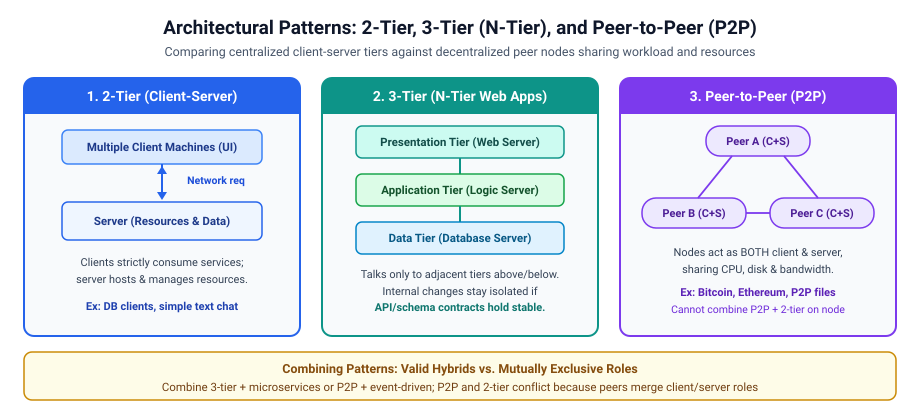
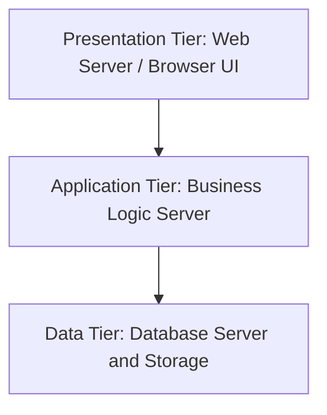
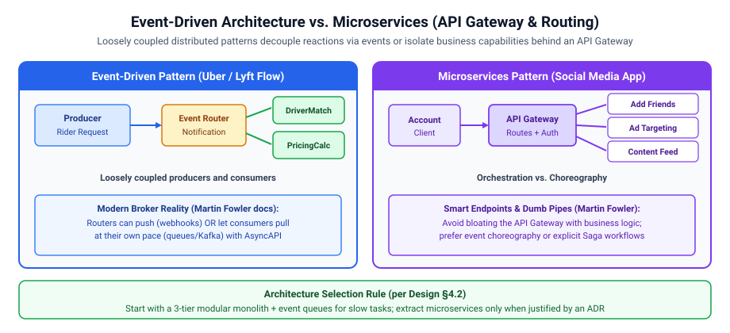
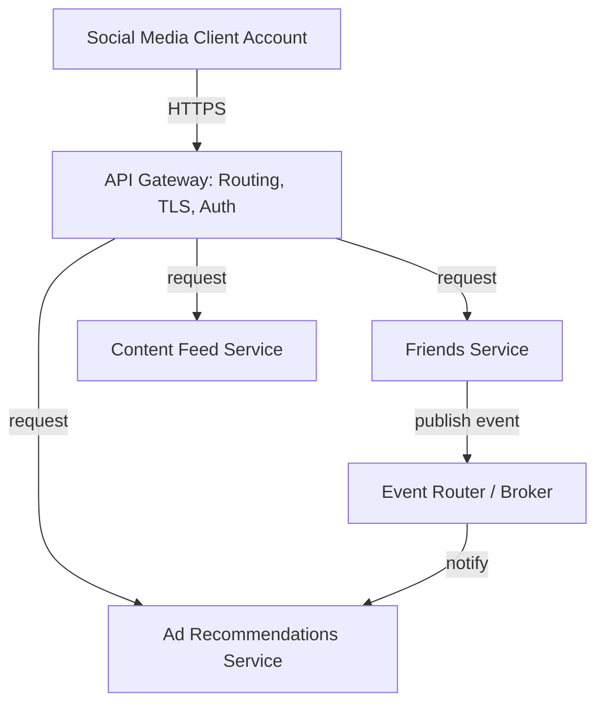

# 05 — Architectural Patterns in Software

## 1. Jargon Translation

| Term | Official definition | Simple words | Analogy |
|---|---|---|---|
| **Architectural Pattern** | A **repeatable solution** to a recurring problem in software architecture highlighting common internal elements and structural rules. | A proven blueprint template that engineers reuse whenever the same design challenge appears. | Standard building layouts (ranch, apartment tower, warehouse) solved once and adapted safely. |
| **2-Tier Architecture (`Client-Server`)** | A computing model where a server hosts, delivers, and manages most resources/services while one or more clients run the interface and send network requests. | A direct two-party setup: client app talks straight to one central server. | Customers walking up to a single cafe counter and ordering directly from the barista. |
| **3-Tier (`N-Tier`) Architecture** | A horizontal layered architecture dividing software into logical/physical computing tiers—**presentation tier**, **application tier**, and **data tier** (or more layers for `n-tier`)—where each tier talks only to adjacent tiers. | Splitting an app cleanly into screen (UI, User Interface), business rules, and database storage. | A restaurant's dining room (presentation), kitchen (application logic), and walk-in pantry (data). |
| **Peer-to-Peer (`P2P`)** | A decentralized network of nodes that act as **both clients and servers**, partitioning workload and sharing processing power, disk storage, or network bandwidth directly without central servers. | Equal participants trading compute, storage, or data directly with one another—no central boss. | A neighborhood study group where everyone brings notes and shares with anyone nearby. |
| **Event-Driven Architecture** | An asynchronous pattern where **producers** emit **event notifications** upon state changes to an **event router** (broker), which routes them to loosely coupled **consumers**. | One component shouts "Order placed!" to a router, and every interested listener reacts independently. | A radio station broadcasting weather alerts to every car tuned in without knowing each driver's address. |
| **Microservices & `API Gateway`** | Breaking an application into independently deployable business services communicating over **APIs** (**Application Programming Interfaces**), with an **`API Gateway`** routing external client calls cleanly. | Small specialist back-end services behind one reception desk (`API Gateway`). | A hospital reception desk routing patients to separate Cardiology, Dental, and Lab departments. |
| **Orchestration vs. Choreography** | **Orchestration** uses a central coordinator directing services step by step; **choreography** lets services react independently to published domain events ("smart endpoints and dumb pipes", per `martinfowler.com`). | Orchestration = an orchestra conductor cueing musicians; choreography = jazz dancers reacting cleanly to the beat. | A manager assigning each task explicitly (`orchestration`) vs. teammates responding automatically to Slack alerts (`choreography`). |

---

## 2. Topics Introduced in the Lecture Transcript

1. **Architectural pattern definition & un-covered patterns overview** — defining an **architectural pattern** as a **repeatable solution** and naming related patterns beyond this video: **model-view-controller**, **message-broker**, **blackboard**, **pipe-filter**, and **controller-responder**.
2. **`2-tier` (`client-server`) & `3-tier` (`n-tier`) architectures** — client-to-server resource delivery (**text messaging** apps, **database clients** connecting to **database servers**) vs. horizontal **web apps** split into **presentation tier** (**web server**), **application tier** (**application server**), and **data tier** (**database server**).
3. **Peer-to-peer (`P2P`) architecture** — decentralized workload partitioning sharing CPU (Central Processing Unit), disk, and network bandwidth for file sharing, chat, collaboration, high-performance computing, and **cryptocurrencies** (**Bitcoin**, **Ethereum**).
4. **Event-driven architecture** — **producers**, **event notifications**, **event routers**, and loosely coupled **consumers** (demonstrated with **ride-sharing apps** like **Lyft** and **Uber**).
5. **Microservices & pattern compatibility** — independently modular business services communicating via `API`s behind an **`API Gateway`** with **Orchestration** (**social media** sites: adding friends, targeted ad recommendations, displaying content), plus which pattern pairs combine (`3-tier` + `microservices`, `P2P` + `event-driven`) vs. conflict (`P2P` + `2-tier`).

---

## 3. Exhaustive Deep Dive & Structured Notes

### 3.1 What Architectural Patterns Are (& Named Patterns Beyond This Video)

- **Repeatable structural solutions:**
  - An **architectural pattern** captures a **repeatable solution** to a recurring system-design problem, defining core building blocks and how they interact. Different patterns often share overlapping traits (such as loose coupling or message routing).
- **Five additional named patterns mentioned in the lecture (covered in broader system design):**
  - **Model-view-controller (`MVC`):** Separates domain state (`Model`), user interface (`View`), and input handling (`Controller`) inside web applications.
  - **Message-broker:** Decouples senders and receivers through queued topics/exchanges (such as `RabbitMQ` or `Apache Kafka`).
  - **Blackboard:** Multiple independent specialists read and write hypotheses to one shared knowledge workspace (`AI` / signal processing).
  - **Pipe-filter:** Streams data step by step through modular transform stages (`Unix` shell pipelines, media transcoders).
  - **Controller-responder:** Request-routing coordinator invoking focused handler components (closely aligned with web controller handlers).

---

### 3.2 `2-Tier` (`Client-Server`) and `3-Tier` (`N-Tier`) Architectures

- **`2-tier` (`client-server`) architecture:**
  - The server hosts, delivers, and manages core resources/services while multiple client machines run the interface (`UI`, User Interface) and send network requests.
  - **Lecture examples:** **Database clients** querying **database servers** directly over SQL (Structured Query Language), and conceptual **text messaging** (`client A → server → client B`). *(Modern chat apps like WhatsApp/Slack scale well beyond 2 tiers using gateways, push servers, and distributed message stores.)*
- **`3-tier` (or `n-tier`) architecture:**
  - Organizes applications into horizontal layers where each tier talks **only** to the tiers directly above and below it (`presentation tier` / **web server** ↔ **application tier** / **application server** ↔ **data tier** / **database server**)—making it the classic structure behind **web apps**.





#### ✅ Modern Best Practice: internal tier changes stay isolated only when inter-tier contracts remain backward-compatible

> **Lecture says:** "Changes in one tier do not affect the other tier."
> **Industry today:** swapping a database query index or UI styling stays local **only while API and schema contracts remain compatible** (`SDLC Design §4.4.1`). Breaking an `OpenAPI` field or renaming a database column breaks adjacent tiers unless protected by additive changes, versioned APIs, and `repository` adapters.

---

### 3.3 Decentralized Computing: Peer-to-Peer (`P2P`) Architecture

- **Every node serves *and* consumes:**
  - Unlike `client-server` (clients consume, servers supply), **`P2P`** partitions work across decentralized nodes where every machine acts as **both client and server**, sharing processing power, disk storage, and bandwidth without central server coordination.
  - **Use cases & examples:** Decentralized file sharing, instant messaging, peer collaboration, high-performance compute grids, and public blockchains such as **Bitcoin** and **Ethereum**.

#### ✅ Modern Best Practice: avoid decentralized `P2P` complexity for standard business CRUD (Create, Read, Update, Delete) backends

> **Lecture says:** `P2P` partitions resources across decentralized nodes acting as both client and server.
> **Industry today:** unless your core requirement is censorship resistance, trustless ledger consensus (**Bitcoin**/**Ethereum**), or direct browser media streaming (`WebRTC`), standard web backends stay simpler, faster, and far cheaper to operate with centralized cloud servers + managed relational databases (`PostgreSQL`).

---

### 3.4 Event-Driven Architecture & Microservices (`API Gateway`, `Orchestration` vs. `Choreography`)

- **Event-driven architecture (`Lyft` & `Uber` ride-sharing example):**
  - An **event** represents a significant state change (such as a user click or a customer requesting a ride from pickup to drop-off).
  - **Producers** emit an **event notification** (`per martinfowler.com/articles/201701-event-driven.html`) to an **event router**, which decouples delivery to listening **consumers** (driver matching, fare calculation, receipt alerts).
- **Microservices (`social media` site example):**
  - Breaks application capabilities into independently deployable services communicating via **`APIs`** (Application Programming Interfaces)—for example, one account requesting **adding friends**, **targeted ad recommendations**, and **displaying content**.
  - An **`API Gateway`** routes external client requests to the appropriate service, while **Orchestration** (or event-based **choreography**) coordinates multi-service workflows.





#### ✅ Modern Best Practice: "Smart endpoints and dumb pipes", push/pull brokers, and thin `API Gateways`

> **Lecture says:** the router pushes event notifications to consumers, the `API Gateway` routes APIs, and `Orchestration` handles inter-service communication.
> **Industry today:** per **Martin Fowler (`martinfowler.com/articles/microservices.html`)**, microservices thrive on **"smart endpoints and dumb pipes"**—keep routing gateways thin (authentication, rate limits, TLS termination, never business rules), balance **orchestration** (central coordinator for strict multi-step rollbacks) against **choreography** (services reacting autonomously via events), and remember brokers support both **push** (webhooks) and **consumer pull** (`Kafka` partitions preventing consumer overload), documented in **AsyncAPI**.

---

### 3.5 Combining Patterns & Incompatible Pairings (`Not Mutually Exclusive`)

- **Combining compatible patterns:** Real production platforms regularly blend multiple patterns—for instance, a **`3-tier` architecture** whose application tier consists of **`microservices`**, or a **`P2P` blockchain network** propagating transactions using **`event-driven`** messages.
- **Incompatible pairings:** **`P2P` and `2-tier` cannot coexist in the same node relationship** because **`P2P`** gives every machine a combined client-and-server role whereas **`2-tier`** explicitly splits client machines from dedicated server machines. *(Note: the spoken video summary says `"some are not mutually exclusive"` right after illustrating why `P2P` + `2-tier` conflict—meaning patterns can combine unless their core node assumptions directly contradict, so some pairs **are** mutually exclusive.)*

---

### 3.6 Often-missed parts

- **Pattern vs. specific tech:** **Event-driven** is a pattern; `Kafka`, `RabbitMQ`, and Node.js `EventEmitter` are specific implementations.
- **`3-tier` ≠ `3` physical machines:** Tiers are *logical* separations too—a **modular monolith** can separate Presentation, Application, and Data logic cleanly inside one deployment (`SDLC Design §4.2`).
- **Adjacent-tier rule:** In strict **`3-tier`**, the presentation tier must never bypass the application tier to query the database tier directly!
- **`Orchestration` vs. `Choreography`:** `Orchestration` has one central coordinator; `Choreography` lets each microservice listen to event notifications independently.
- **Un-covered pattern names for quizzes:** Remember the 5 extra pattern names listed early in the video (**`model-view-controller`**, **`message-broker`**, **`blackboard`**, **`pipe-filter`**, **`controller-responder`**).

---

### 3.7 Done enough when…

- [ ] You can name and match all five core patterns (`2-tier`, `3-tier`, `peer-to-peer`, `event-driven`, `microservices`) to their lecture examples (**text messaging / DB clients**, **web apps**, **Bitcoin / Ethereum**, **Lyft / Uber**, **social media**).
- [ ] You can explain why a **`3-tier`** app still breaks across tiers if an **`API`** or schema contract changes incompatibly.
- [ ] You can explain **`API Gateway` routing** alongside **orchestration vs. choreography** without cramming business logic into the gateway.
- [ ] You can build an **event producer → router → multiple consumers** workflow in Node.js and explain why `P2P` + `2-tier` conflict.

---

## 4. Concrete Examples

1. **Book Review Web App (`3-Tier Modular Monolith` + `Event-Driven` Emails):**
   Browser (`React`) = Presentation tier; Express `API` (`routes → services → repositories`) = Application tier; `PostgreSQL` = Data tier. When a user posts a review, the service emits a `review.created` event to a queue so a notification worker sends an email asynchronously without slowing down the `HTTP` response (`SDLC Design §4.2`).
2. **Ride-Sharing Dispatch (`Event-Driven` `Lyft`/`Uber` Style):**
   The Rider app produces one `ride.requested` event notification (`pickup`, `dropoff`, `riderId`). An **event router** dispatches it independently to both `DriverMatcher` and `PricingService`, so adding a `FraudMonitor` consumer later requires zero changes to the rider producer.
3. **Social Media Backend (`Microservices` Behind an `API Gateway`):**
   A logged-in user account sends requests through one **`API Gateway`** (`/friends`, `/ads`, `/feed`), which checks rate limits and authentication tokens before routing calls to isolated `FriendsService`, `AdService`, and `FeedService` deployments.

---

## 5. Code Blocks

### 5.1 Event-Driven Router (`node:events`) + `Map`-Backed `API Gateway` (`Node.js`)

```javascript
// patterns-demo.mjs — tested on Node.js v24.18.0
import { EventEmitter } from "node:events";

// 1. Event-Driven Architecture: Producer -> Event Router -> Loosely Coupled Consumers
const eventRouter = new EventEmitter();
const rideLog = [];

eventRouter.on("ride.requested", (eventNotification) => {
  rideLog.push(`DriverMatcher notified for rider ${eventNotification.riderId} at ${eventNotification.pickup}`);
});
eventRouter.on("ride.requested", (eventNotification) => {
  rideLog.push(`PricingService computed fare estimate from ${eventNotification.pickup}`);
});

function requestRide(riderId, pickup, dropoff) {
  const eventNotification = { riderId, pickup, dropoff, createdAt: "2026-11-27T11:17Z" };
  eventRouter.emit("ride.requested", eventNotification); // Producer publishes without knowing consumers
}

requestRide("U-402", "Downtown", "Airport");
console.log("Event consumers executed:", rideLog);

// 2. Microservices API Gateway routing with safe Map lookup (prevents prototype key collisions)
const SERVICE_ROUTES = new Map([
  ["/friends", (user) => ({ service: "FriendsService", status: `Added friend for ${user}` })],
  ["/ads", (user) => ({ service: "AdService", recommendations: [`Backend Course for ${user}`] })],
  ["/feed", (user) => ({ service: "FeedService", posts: ["Welcome to Node.js"] })],
]);

function apiGateway(path, user) {
  const targetService = SERVICE_ROUTES.get(path);
  if (!targetService) {
    return { status: 404, error: "Route not found" };
  }
  return { status: 200, data: targetService(user) };
}

console.log("Gateway /friends:", apiGateway("/friends", "Naya"));
console.log("Gateway /ads:", apiGateway("/ads", "Naya"));
console.log("Gateway /unknown:", apiGateway("/unknown", "Naya"));
```

Real output from running in `Node.js v24.18.0`:

```text
Event consumers executed: [
  'DriverMatcher notified for rider U-402 at Downtown',
  'PricingService computed fare estimate from Downtown'
]
Gateway /friends: {
  status: 200,
  data: { service: 'FriendsService', status: 'Added friend for Naya' }
}
Gateway /ads: {
  status: 200,
  data: {
    service: 'AdService',
    recommendations: [ 'Backend Course for Naya' ]
  }
}
Gateway /unknown: { status: 404, error: 'Route not found' }
```

**What happens if... `SERVICE_ROUTES` used a plain `{}` object indexed directly (`routes[reqPath]`) instead of a `Map`?** A lookup key taken from user input (for example a service name such as `"toString"` or `"constructor"` without the leading `/`) hits an inherited `Object.prototype` property instead of returning `undefined` (`404`) (checked locally: `({})["toString"]` is a function, `routes["/toString"]` is `undefined`), whereas `Map.prototype.get()` returns `undefined` for every unregistered key.

---

## 6. Related Concepts

1. **Modular Monolith vs. Microservices Decision (`ADR`):** Avoiding premature distributed complexity until independent scaling or autonomous team deployments justify the cost.
2. **Backend for Frontend (`BFF`) Pattern:** Tailoring specialized lightweight API gateway aggregators per client type (mobile vs. web browser).
3. **Message Queues, Dead-Letter Queues & Backpressure (`Kafka`, `RabbitMQ`):** Making event-driven consumers durable so events survive consumer crashes instead of disappearing in RAM (Random Access Memory).
4. **Saga Pattern & Eventual Consistency:** Coordinating multi-step workflows across independent microservice databases without brittle distributed locks.
5. **`AsyncAPI` Event Contracts:** Documenting producer/consumer event payloads and channel schemas just like `OpenAPI` documents REST (Representational State Transfer) APIs.

---

## 7. Lecture Summary & Quick Reference Table

| Pattern / Topic | Lecture | ✅ Modern best practice |
|---|---|---|
| **Architectural pattern** | **Repeatable solution** highlighting internal elements (`MVC`, `message-broker`, `blackboard`, `pipe-filter`, `controller-responder` also named) | Match patterns to real quality-attribute trade-offs in an `ADR` (`Design §4.2`) rather than following trends blindly |
| **`2-tier` (`client-server`)** | Clients send requests to server managing resources (**text messaging**, **database clients → database servers**) | Keep 2-tier for internal DB tools/prototypes; real web/messaging platforms add app tiers, gateways, and queues |
| **`3-tier` (`n-tier`)** | **Presentation tier** (**web server**) ↔ **application tier** (**application server**) ↔ **data tier** (**database server**); **web apps**; isolated tier changes | Isolation depends on backward-compatible `API`/DB contracts (`Design §4.4.1`); default to a **modular monolith** for new web apps |
| **Peer-to-peer (`P2P`)** | Decentralized nodes act as **both client and server** sharing CPU, disk, bandwidth (**Bitcoin**, **Ethereum**, file sharing) | Reserve `P2P` for decentralized/ledger or direct peer-media cases (`WebRTC`); use centralized managed DBs for standard APIs |
| **Event-driven** | **Producers** send **event notifications** to an **event router** pushed to **consumers** (**Lyft**, **Uber**); loosely coupled | Supports push **and** pull (`Kafka`) with durable queues, **AsyncAPI** contracts, and idempotent consumers (general practice); event types per `martinfowler.com` |
| **Microservices & combinations** | Independent services via `API` + **`API Gateway`** + **Orchestration** (**social media**); combine compatible pairs (`3-tier` + `microservices`, `P2P` + `event-driven`), never `P2P` + `2-tier` | Keep gateways thin and services autonomous ("smart endpoints, dumb pipes", `per martinfowler.com`); weigh choreography vs. orchestration carefully |

---

← [04 — Approaches to Application Architecture](04-approaches-to-application-architecture.md)
