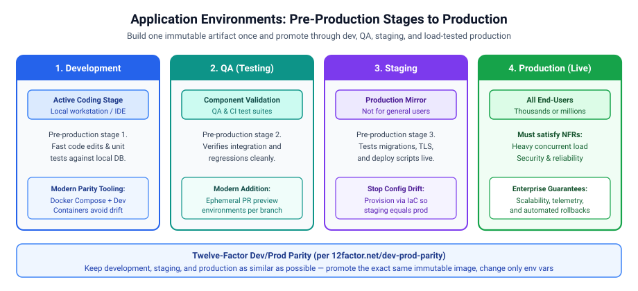
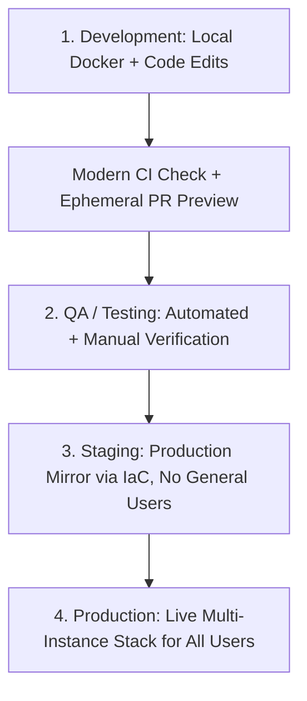
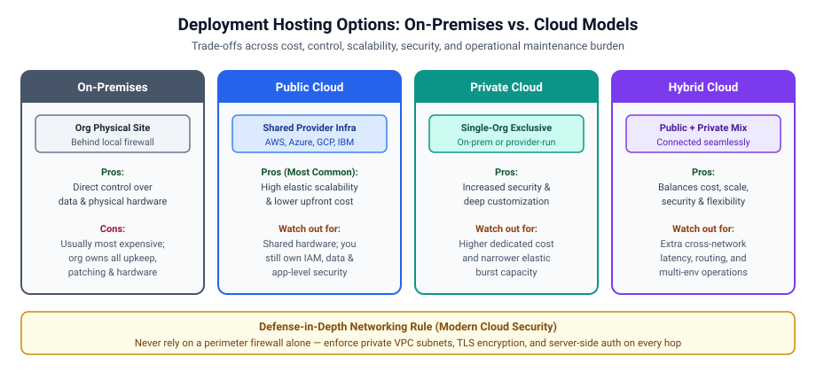
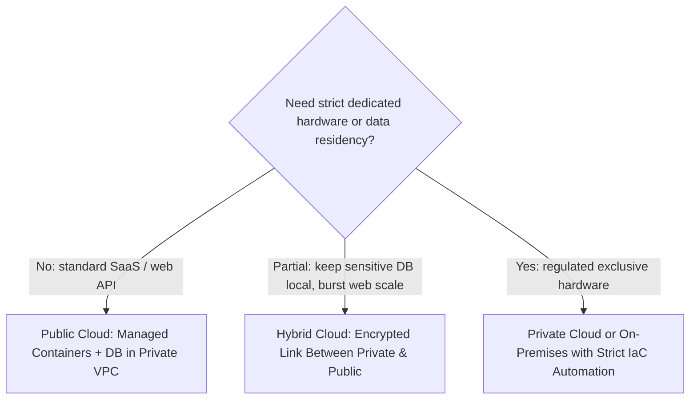

# 06 — Application Deployment Environments

## 1. Jargon Translation

| Term | Official definition | Simple words | Analogy |
|---|---|---|---|
| **Application Environment** | The complete combination of hardware and software resources required to run an app: code/**binary executables**, software stack (libraries, third-party apps, **middleware**, operating system), networking, and compute/memory/storage hardware. | Everything—code, dependencies, OS (Operating System), network, and servers—needed for an app to run. | A concert venue: not just the musicians (code), but the stage, sound system, power, and building. |
| **Pre-Production Environments** | Non-public environments (**development**, **QA**, Quality Assurance, and **staging**) where software is built, tested, and verified before general user release. | Practice and rehearsal rooms where teams code and test safely before opening to real customers. | A restaurant's test kitchen and dress-rehearsal dinner before grand opening night. |
| **Development Environment** | The workspace where engineers actively write and debug application code—often starting on the developer's local workstation. | The coder's local laptop or dev sandbox where new features are written first. | An artist's workshop table where sketches are drawn and revised freely. |
| **QA (`Testing`) Environment** | A dedicated pre-production environment where the Quality Assurance (`QA`) team and automated suites verify components and regressions. | The dedicated testing lab where bugs are caught before users ever see them. | A car crash-test and emissions track before vehicles ship to dealerships. |
| **Staging Environment** | A pre-production environment mirroring production architecture, config shape, and services as closely as possible without exposing access to general users. | A near-exact twin of live production used for final dress-rehearsal checks. | A full dress rehearsal on the real theater stage with costumes and lights, just without paying audience members. |
| **Production Environment** | The live hardware, software stack, and supporting infrastructure serving **all users** at scale—engineered for concurrent **load**, **security**, **reliability**, and **scalability**. | The real live system serving actual customers (`thousands or millions` at enterprise scale). | Grand opening night and daily service for real paying diners. |
| **On-Premises & Firewall** | Hosting servers and data physically inside an organization's own building behind a **firewall** (network filter blocking unauthorized access to/from a private network). | Running your own servers in your own locked building rather than renting cloud servers. | Keeping cash in your own store safe with a security guard instead of using a bank. |
| **Public, Private, and Hybrid Cloud** | **Public cloud** rents shared multi-tenant internet infrastructure (`AWS`, `Azure`, `GCP`, `IBM Cloud`); **private cloud** provisions exclusive single-org infrastructure; **hybrid cloud** links both together seamlessly. | Renting shared cloud capacity (`public`), exclusive single-company cloud (`private`), or mixing both (`hybrid`). | Public bus (`public`), leased private shuttle (`private`), or owning a van while calling rideshares for peaks (`hybrid`). |

---

## 2. Topics Introduced in the Lecture Transcript

1. **What defines an application environment** — combining code/**binary executables**, dependencies/libraries, third-party tools, **middleware**, operating system, networking, and physical/virtual compute, memory, and storage.
2. **Pre-production environments** — **`development`** (active coding on developer workstations), **`QA`** (**quality assurance** / **testing** components), and **`staging`** (replicating production closely for final non-public verification).
3. **Production environment requirements** — serving **all users** (`thousands or millions` concurrently) while handling **load**, **security**, **reliability**, and **scalability** across complex infrastructure.
4. **On-premises deployment** — running infrastructure in-house behind a **firewall** for strict local control and security, while taking full ownership of hardware, infrastructure, maintenance, and higher capital costs.
5. **Cloud deployment models (`public`, `private`, `hybrid`)** — multi-tenant **`public cloud`** (**`Amazon Web Services` / `AWS`**, **`Microsoft Azure`**, **`Google Cloud Platform`**, **`IBM Cloud`**, International Business Machines Cloud) for cost and scale; single-tenant **`private cloud`** for enhanced security and **flexibility**; and **`hybrid cloud`** combining both.

---

## 3. Exhaustive Deep Dive & Structured Notes

### 3.1 What Makes Up an Application Environment & Lifecycle Progression

- **Four layers inside every environment:**
  1. **Application artifact:** Application source code or compiled **binary executables** for modules/components.
  2. **Software stack:** Language runtime, libraries, third-party services, **middleware** (messaging, web servers), and the operating system.
  3. **Networking:** Subnets, DNS (Domain Name System), load balancers, TLS (Transport Layer Security) termination, and firewalls.
  4. **Compute & storage hardware:** Physical servers or virtual machines providing processing cores, memory, and disk storage.
- **Pre-production vs. production progression:**
  - **`Development`:** Fast edit-test loop on the developer's laptop or cloud workstation.
  - **`QA` / `testing`:** Runs automated integration checks and **QA** verification across connected components.
  - **`Staging`:** Mirrors production's software versions, networking, and data shape closely for final pre-production checks (per `12factor.net/dev-prod-parity` / general knowledge)—closed to general users.
  - **`Production`:** Serves live traffic from **all users** (**thousands or millions** at enterprise scale), requiring deliberate capacity for concurrent **load**, **security**, **reliability**, and **scalability**.





#### ✅ Modern Best Practice: Twelve-Factor dev/prod parity, immutable Docker images, and ephemeral PR previews

> **Lecture says:** staging replicates production as closely as possible after development and QA testing.
> **Industry today:** per **Twelve-Factor App (`12factor.net/dev-prod-parity`)**, keep development, staging, and production as close as possible across time, tooling, and backing services—teams promote **one exact immutable Docker image digest (`build once, promote everywhere`)** configured solely via environment variables (`process.env`), provision environments declaratively via **IaC (Infrastructure as Code)** (Terraform/OpenTofu) so staging cannot drift from production, and spin up **ephemeral preview environments** on pull requests (`PR`, Pull Request) (`SDLC Deployment §3`).

---

### 3.2 Deployment Models: On-Premises vs. Public, Private, and Hybrid Cloud

- **Choosing where infrastructure lives:**

| Deployment model | Where infrastructure runs | Main strengths | Main trade-offs / responsibilities |
|---|---|---|---|
| **On-Premises** | Organization's physical building behind a local **firewall** | Direct physical control over sensitive data and hardware | Organization buys, patches, and maintains all hardware/infrastructure; usually **more expensive** than cloud |
| **Public Cloud** (`AWS`, `Microsoft Azure`, `Google Cloud Platform`, `IBM Cloud`) | Provider-owned hardware accessed over the internet, shared across tenants | **Most common** model; fast elastic **scalability** and pay-as-you-go **cost** | Shared underlying hardware; team still owns app code, configuration, and access rules ("security *in* the cloud", `Design §4.12`) |
| **Private Cloud** | Single-organization dedicated cloud (on-prem, or provider-managed for one customer). A **VPC** is a private network *inside* a public cloud, not by itself a private cloud | Increased **security** isolation plus full customization and **flexibility** | Higher cost and less instant global burst capacity than public cloud |
| **Hybrid Cloud** | Connected **public + private** clouds operating together | Balances **cost**, **security**, **scalability**, and **flexibility** per workload | More complex cross-network routing, identity sync, and operations |





#### ✅ Modern Best Practice: perimeter firewalls aren't enough—pair private VPC subnets, TLS, and zero-trust auth

> **Lecture says:** on-premises systems sit behind a firewall that prevents unauthorized access to or from a private network.
> **Industry today:** attackers routinely pivot inside networks once inside one app container; whether running on-premises or in the cloud, teams place databases inside private **VPC (Virtual Private Cloud)** subnets with no public IP (Internet Protocol), encrypt every internal hop with **TLS**, verify authentication/authorization on every service call (**defense in depth** / zero trust, `SDLC Design §4.5`), and record hosting/compliance choices in an **ADR (Architecture Decision Record)**.

---

### 3.3 Often-missed parts

- **`Middleware` belongs to the environment stack:** Application environments include not only your code and OS, but also **middleware**, libraries, third-party apps, networking, and virtual/physical hardware.
- **Staging ≠ Production:** Even when **staging** mirrors production closely, it is **not** exposed to general end-users (`UAT`, User Acceptance Testing, and final pre-production checks only, general knowledge).
- **Private cloud isn't always on-premises:** A **private cloud** can run in-house *or* be owned and managed off-site by a cloud vendor exclusively for one organization.
- **Public cloud is NOT "cloud handles security":** Cloud providers secure physical hosts ("security *of* the cloud"), while your team still owns app permissions, `SQL` (Structured Query Language) injection defense, encryption, and secrets ("security *in* the cloud").
- **Never branch business logic on `if (env === 'prod')`:** Promote identical code/images everywhere and inject differences strictly through environment variables (`12factor.net/dev-prod-parity`).

---

### 3.4 Done enough when…

- [ ] You can describe all four layers of an **application environment** and differentiate **development**, **QA**, **staging**, and **production**.
- [ ] You can explain why **production** differs sharply from pre-production due to real user **load**, **security**, **reliability**, and **scalability**.
- [ ] You can compare **on-premises**, **public cloud**, **private cloud**, and **hybrid cloud** on cost, control, flexibility, and operational upkeep.
- [ ] You understand **dev/prod parity** (`12factor.net`), why immutable container images promote safely across stages, and why defense-in-depth networking goes beyond a perimeter firewall.

---

## 4. Concrete Examples

1. **Promoting a Book Review `API` (Application Programming Interface) Without Drift (`Dev → QA → Staging → Prod`):**
   A developer codes locally with Node.js + Docker PostgreSQL (`development`), CI (Continuous Integration) runs automated integration suites on a PR (`QA`), merges deploy the exact same SHA-pinned container image to `staging` for final checks, and then promote that exact digest to `production` behind a load balancer.
2. **Fail-Fast Environment Config Guard (`Node.js` Startup Check):**
   Instead of hard-coding environment checks inside checkout routes, startup code reads `APP_ENV`, `PORT`, `MIN_REPLICAS`, and `DATABASE_URL`—immediately throwing on startup if production tries to boot without a database URL (Uniform Resource Locator) or with `< 2` replicas.
3. **Hybrid Cloud Healthcare Portal:**
   Sensitive patient medical records stay inside an encrypted **private cloud** database complying with strict regional rules, while stateless front-end portals and appointment search scale elastically on **public cloud** (`AWS` or `Microsoft Azure`) over private encrypted links.

---

## 5. Code Blocks

### 5.1 Twelve-Factor Environment Config Validator (`Node.js` — Same Code Runs Across Every Environment)

```javascript
// env-config-demo.mjs — tested on Node.js v24.18.0
import assert from "node:assert/strict";

const ALLOWED_ENVS = new Set(["development", "qa", "staging", "production"]);

// Twelve-Factor parity (per 12factor.net): identical app code runs everywhere; only env config changes
function loadRuntimeConfig(envVars) {
  const envName = envVars.APP_ENV ?? "development";
  if (!ALLOWED_ENVS.has(envName)) {
    throw new RangeError(`Unsupported APP_ENV: ${envName}`);
  }
  const port = Number(envVars.PORT ?? "3000");            // Standard Node dev fallback port
  const minReplicas = Number(envVars.MIN_REPLICAS ?? "1");
  const requireTls = envName === "staging" || envName === "production";

  if (!Number.isInteger(port) || port < 1 || port > 65535) { // Valid TCP port bounds (general knowledge)
    throw new RangeError(`Invalid PORT: ${envVars.PORT}`);
  }
  if (envName === "production" && !envVars.DATABASE_URL) {
    throw new Error("Production environment requires DATABASE_URL");
  }
  if (envName === "production" && minReplicas < 2) {
    throw new Error("Production environment requires at least 2 stateless replicas");
  }

  return Object.freeze({ envName, port, minReplicas, requireTls });
}

console.log("Dev config:", loadRuntimeConfig({ APP_ENV: "development" }));
console.log(
  "Prod config:",
  loadRuntimeConfig({
    APP_ENV: "production",
    PORT: "8080",
    MIN_REPLICAS: "3",
    DATABASE_URL: "postgres://db.internal:5432/app",
  })
);

assert.throws(
  () => loadRuntimeConfig({ APP_ENV: "production", MIN_REPLICAS: "1" }),
  /requires DATABASE_URL/
);
console.log("Verified fail-fast guard catches misconfigured production startup!");
```

Real output from running in `Node.js v24.18.0`:

```text
Dev config: {
  envName: 'development',
  port: 3000,
  minReplicas: 1,
  requireTls: false
}
Prod config: { envName: 'production', port: 8080, minReplicas: 3, requireTls: true }
Verified fail-fast guard catches misconfigured production startup!
```

**What happens if... someone accidentally deploys a new staging/production pod without `DATABASE_URL` or with `MIN_REPLICAS="1"`?** `loadRuntimeConfig` fails immediately at startup (`assert.throws` tested on `Node.js v24.18.0`) so Kubernetes / load-balancer readiness checks keep serving the previous healthy version instead of accepting broken live traffic.

---

## 6. Related Concepts

1. **Twelve-Factor App Parity & Externalized Config (`process.env`):** Eliminating hidden differences between developer laptops, QA, staging, and production.
2. **Infrastructure as Code (`IaC` — Terraform, OpenTofu, CloudFormation) & `GitOps`:** Versioning cloud networks, load balancers, and staging/prod clusters as reproducible Git commits.
3. **Immutable Container Builds (`Docker` Multi-Stage Images & Digests):** Guaranteeing the exact tested binary and middleware dependencies move unchanged from QA to production.
4. **Cloud Shared Responsibility Model (`IaaS`, `PaaS`, `FaaS`, `SaaS`):** Clarifying which security, OS patching, and database backup tasks belong to your team vs. `AWS`, `Azure`, or `GCP` (`Design §4.12`).
5. **Ephemeral Preview Environments & Progressive Delivery (`Canary`, `Blue-Green`, `Feature Flags`):** Testing pull requests in disposable environments and releasing safely inside production (`Deployment §3`).

---

## 7. Lecture Summary & Quick Reference Table

| Topic | Lecture | ✅ Modern best practice |
|---|---|---|
| **Application environment** | Code/**binary executables**, libraries, **middleware**, OS, networking, and physical/virtual compute, memory, storage | Package runtime + dependencies in **immutable Docker images** and provision infrastructure via **IaC** in Git |
| **Pre-production (`dev`, `QA`, `staging`)** | **`Development`** (coding on workstation), **`QA`/`testing`** (QA checks components), **`staging`** (mirrors prod, no general users) | Enforce **dev/prod parity** (`per Twelve-Factor App, 12factor.net/dev-prod-parity`), reuse one immutable image across stages, and add automated **CI/ephemeral PR previews** |
| **Production environment** | Serves **all users** (`thousands or millions`); must handle **load**, **security**, **reliability**, and **scalability** | Run stateless multi-AZ replicas behind load balancers, health checks, backups, and structured observability (`SDLC Design §4.12`) |
| **On-premises deployment** | In-house hardware behind a **firewall**; high local control/security, higher hardware + maintenance cost | Go beyond perimeter firewalls with private subnets, **TLS**, and server-side auth; keep on-prem only for strict compliance/residency needs |
| **Cloud models (`public`, `private`, `hybrid`)** | **`Public cloud`** (`AWS`, `Microsoft Azure`, `Google Cloud Platform`, `IBM Cloud`) for cost/scale; **`private cloud`** for security/**flexibility**; **`hybrid cloud`** mixes both | Default to managed **public cloud** in isolated `VPC`s with clear shared-responsibility ownership (`Design §4.12`); use `private`/`hybrid` only when justified in an `ADR` |

---

← [05 — Architectural Patterns in Software](05-architectural-patterns-in-software.md)
