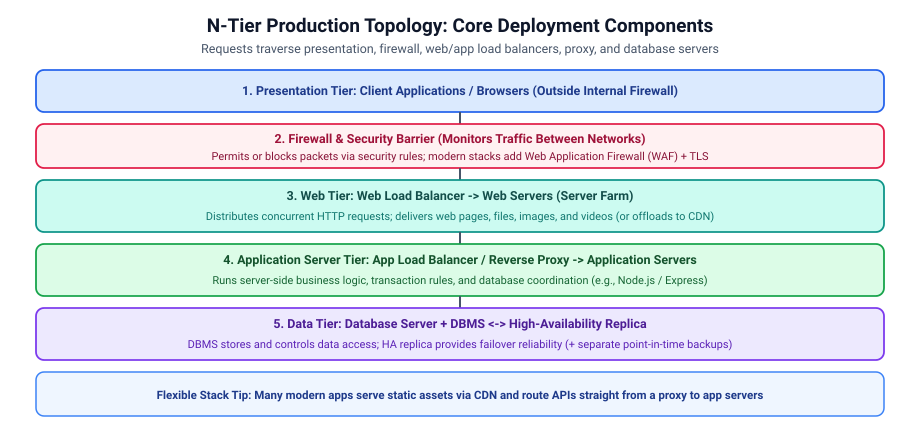
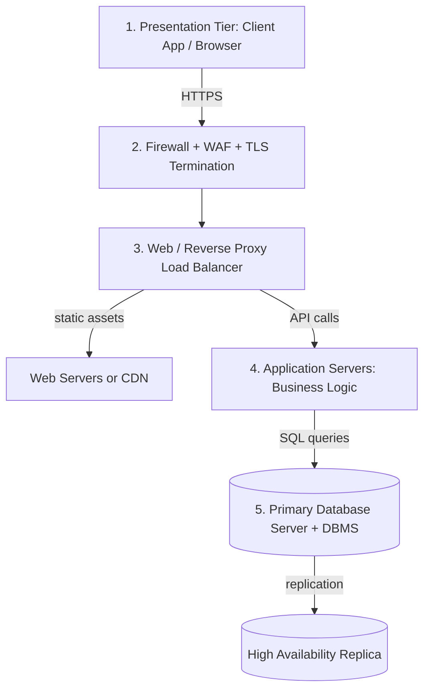
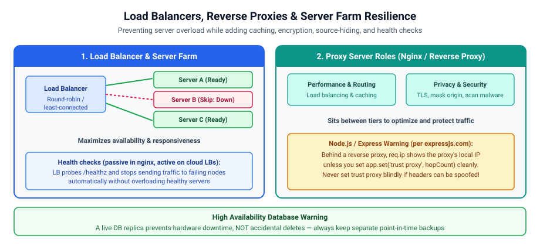
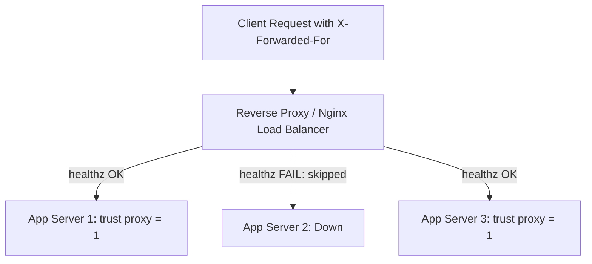

# 07 — Production Deployment Components

## 1. Jargon Translation

| Term | Official definition | Simple words | Analogy |
|---|---|---|---|
| **Firewall** | A network security device or software filter that monitors traffic between networks and permits or blocks packets based on **security rules** to block hackers, viruses, and **malware**. | A network bouncer checking every incoming/outgoing packet against an allowed-rules list. | An airport security checkpoint screening passengers and bags before entry. |
| **Load Balancer (`Server Farm`)** | A traffic distributor sitting between clients and multiple servers (a **server farm**) that routes concurrent requests efficiently across capable nodes to prevent overload and maximize **availability** and **responsiveness**. | A traffic cop dividing incoming visitors evenly across healthy servers so none get overwhelmed. | A supermarket queue host sending shoppers to whichever cashier lane is free. |
| **Web Server** | Hardware or software primarily responding to **hypertext transfer protocol** (`HTTP`, HyperText Transfer Protocol) requests from browsers to deliver content such as web pages, files, images, and videos. | The file/page server handing out HTML, images, stylesheets, and videos to browsers. | A receptionist handing out printed brochures and menus at the front desk. |
| **Application Server (`App Server`)** | A server executing server-side **business logic** (transactions, rule enforcement, data creation/modification) and coordinating database reads/writes instead of running logic on the client machine. | The back-end brain running calculations, authorization rules, and database updates securely on the server. | The kitchen chefs preparing custom orders using recipes and ingredients before plating. |
| **Proxy Server (Reverse Proxy)** | An intermediate server sitting between tiers to handle requests for load balancing, system optimization, **caching**, firewall filtering, **obscuring the source**, **encryption**, and **malware** scanning. | A middleman server protecting, speeding up, and hiding internal servers from direct public exposure. | A personal assistant screening calls, caching frequent answers, and protecting the executive's private extension. |
| **Database Server & DBMS** | The **database server** stores structured data on disk/memory, controlled by database management system (DBMS) software connecting applications to retrieve or manipulate stored records reliably. | The storage server (`PostgreSQL` / `MySQL`) + its manager software answering structured data queries safely. | A climate-controlled vault (`database server`) plus the head librarian (DBMS) retrieving exact folders. |
| **High Availability Replica** | A synchronized standby or read copy of the primary database server placed to take over or serve reads if the primary database node fails. | A live twin database ready to step in so a single server crash doesn't take the app offline. | A backup generator wired to kick in within seconds if the main power line cuts out. |
| **Web Application Firewall (`WAF`)** | A Layer-7 HTTP security filter inspecting decrypted web requests for application API (Application Programming Interface) attacks (such as SQL injection or cross-site scripting) that packet firewalls cannot inspect inside TLS (Transport Layer Security). | A smart security guard reading HTTP API requests after decryption to block app-level hacks. | A customs inspector opening sealed boxes (after security clearance) to check the contents inside. |

---

## 2. Topics Introduced in the Lecture Transcript

1. **N-tier production deployment diagram** — mapping how traffic moves from the **presentation tier** past a **firewall** through the **web tier** (web **load balancer** + **web servers**), **application server tier** (app load balancer / **proxy server** + **app servers**), and **data tier** (**database server** + **high availability replica**), noting not every app needs every separate tier.
2. **Firewalls** — network monitoring barriers enforcing **security rules** to block hackers, viruses, and **malware** from entering internal tiers.
3. **Load balancers & server farms** — preventing server overload, balancing concurrent requests across a **server farm**, and maximizing **availability** and **responsiveness**.
4. **Web servers vs. application servers** — serving **hypertext transfer protocol** web pages, files, images, and videos (`web server`) vs. executing server-side **business logic**, transaction outcomes, and database read/writes (`app server`).
5. **Proxy servers, databases, and `DBMS`** — intermediate proxies handling **caching**, **encryption**, **obscuring the source**, **malware** checks, and optimization, plus **database management system (`DBMS`)** software linking applications to persistent storage.

---

## 3. Exhaustive Deep Dive & Structured Notes

### 3.1 N-Tier Production Deployment Topology

- **Layered flow from user browser to persistent storage:**
  1. **Presentation tier:** Front-end browser/mobile clients outside the internal **firewall**.
  2. **Firewall boundary:** Guards internal tiers by permitting/blocking network traffic according to **security rules**.
  3. **`Web tier`:** A web **load balancer** balances incoming browser traffic across multiple **web servers**.
  4. **`Application server tier`:** An app load balancer or **proxy server** routes calls to **application servers** executing core **business logic**.
  5. **`Data tier`:** The **database server** (managed by a **`DBMS`**) stores persistent records alongside a **high availability replica** for failover reliability.
- **Not every app uses every box:** As the lecture notes, simpler systems often omit separate web server clusters when one runtime or modern edge network handles static files cleanly.





#### ✅ Modern Best Practice: serve static assets via CDN and route APIs through a reverse proxy directly to Node.js app servers

> **Lecture says:** the web tier uses web servers for HTTP pages/files/images/videos while a lower tier runs application servers (noting not every deployment needs both).
> **Industry today:** teams host static assets (HTML, JavaScript, CSS, images, videos) on a **CDN (Content Delivery Network)** / object storage rather than running separate HTTP web-server VMs (Virtual Machines), while an edge **reverse proxy / load balancer** terminates TLS and routes dynamic `API` (Application Programming Interface) traffic directly to stateless **Node.js / Express** app servers (`Design §4.12`).

---

### 3.2 Firewalls, Load Balancers (`Server Farm`), and Proxy Servers

- **Firewalls (`security rules`):**
  - Inspect network packets crossing boundaries, blocking unauthorized ports, IP (Internet Protocol) ranges, viruses, **malware**, and intrusions before traffic touches internal servers.
- **Load balancers (`availability` & `responsiveness`):**
  - Sit between clients and a pool of backend machines (**server farm**), checking server readiness/capacity and spreading concurrent requests evenly so no single server saturates (per `nginx.org/en/docs/http/load_balancing.html`: round-robin, least-connected, least-time, weighted routing, and passive **health checks** that mark a failing server; *active* probe requests such as `/healthz` need NGINX Plus (commercial) or a cloud load balancer, per `nginx.org` upstream docs).
- **Proxy servers (`reverse proxy` roles):**
  - Intermediate servers sitting between tiers providing **load balancing**, system optimization, **caching**, **acting as a firewall**, **obscuring the source** identity/IP, **encryption** (`TLS`), and **malware** inspection—lifting efficiency, privacy, and security.





#### ✅ Modern Best Practice: configure WAF + Express `trust proxy` cleanly and never rely on packet firewalls alone

> **Lecture says:** a firewall blocks hackers/malware via security rules, and a proxy handles load balancing, caching, obscuring source, and encryption.
> **Industry today:** classic packet firewalls cannot read encrypted HTTPS (HTTP Secure) payloads to catch `SQL` (Structured Query Language) injection or cross-site scripting—pair network rules with a **WAF** and edge **TLS**. A WAF does not replace **server-side authorization**: `BOLA` (Broken Object Level Authorization, the top item in the Open Worldwide Application Security Project (OWASP) API Security Top 10) is a business-logic flaw that only your own code can check. Furthermore, per Express documentation (`expressjs.com/en/guide/behind-proxies.html`), apps behind a reverse proxy see the proxy's internal IP in `req.ip` unless you set `app.set('trust proxy', hopCount)` to the exact trusted proxy hop count (avoiding blind `true`, which trusts spoofed `X-Forwarded-For` headers).

---

### 3.3 Web Servers, Application Servers, and Databases (`DBMS`)

- **Comparing production server types:**

| Component | Primary responsibility | Lecture examples / behavior | Modern Node.js backend stack |
|---|---|---|---|
| **Web Server** | Serves `HTTP` files and static media to browsers | Web pages, files, images, videos | **CDN** + **Nginx / Caddy** static serving |
| **Application Server** | Runs server-side **business logic** and database calls | Transaction outcomes, validating/saving data off the client machine | **Node.js** + **Express / Fastify** stateless containers |
| **Proxy Server** | Mediates requests between tiers | Load balancing, caching, TLS, source hiding, malware scan | **Reverse proxy** (`Nginx`, `Envoy`, cloud Load Balancer) |
| **Database Server & `DBMS`** | Persists structured data and controls access/flow | **DBMS** connects apps to storage; paired with **high availability replica** | Managed **PostgreSQL** (`Multi-AZ` HA replica + point-in-time backups) |

#### ✅ Modern Best Practice: high availability replicas do NOT replace separate point-in-time backups

> **Lecture says:** a high availability replica of the database is often used to ensure reliability.
> **Industry today:** a synchronous or streaming **high availability replica** protects against hardware crashes, **but** if buggy code runs `DELETE` without `WHERE` or ransomware corrupts data, that deletion replicates instantly to the HA (High Availability) replica too! Production teams always pair HA replicas with encrypted, separate **point-in-time backups** and regular restore drills (`SDLC Maintenance`).

---

### 3.4 Often-missed parts

- **`Web server` vs. `App server` distinction:** Web servers serve static/HTTP content (`pages, files, images, videos`); **app servers** run server-side **business logic** (`transactions`, DB orchestration).
- **Presentation tier sits *outside* the internal firewall:** Browsers/mobile apps run on untrusted user networks; every internal tier sits behind the firewall.
- **`Proxy server` is multi-purpose:** Remember all 7 proxy duties mentioned in the video (`load balancing, system optimization, caching, acting as a firewall, obscuring the source, encryption, malware scanning`).
- **Reverse vs. Forward Proxy:** A *reverse proxy* sits in front of your servers (what `Express trust proxy` expects, `per expressjs.com`); a *forward proxy* sits in front of client browsers on a corporate network.
- **`DBMS` role:** Software (such as `PostgreSQL`, `MySQL`, `Oracle`) connecting the physical **database server** to application requests.

---

### 3.5 Done enough when…

- [ ] You can trace every tier of an **n-tier production deployment diagram** from presentation client to **high availability database replica**.
- [ ] You can distinguish **firewall**, **WAF**, **load balancer**, **reverse proxy**, **web server**, **application server**, and **DBMS**.
- [ ] You understand how **health-checked load balancing** (passive in open-source nginx, active in cloud load balancers; `per nginx.org`) avoids sending requests to crashed backend instances.
- [ ] You know why **Express** requires setting `trust proxy` (`per expressjs.com`) cleanly behind a load balancer / reverse proxy and why HA replicas don't replace backups.

---

## 4. Concrete Examples

1. **Node.js Book Review API Behind Nginx & a Cloud Load Balancer (`trust proxy`):**
   Static React bundles serve directly from a **CDN**; dynamic `/api/reviews` requests hit a cloud **WAF** + **TLS Load Balancer**, which routes across `3` healthy `Express` app servers (`app.set('trust proxy', 1)`) querying primary **PostgreSQL** with an HA standby replica in another availability zone.
2. **Health-Checked Server Farm Skip-Over:**
   When `app-az2-b` fails its `/healthz` readiness probe during a crash or deploy, the **load balancer** skips `app-az2-b` immediately and routes traffic solely across `app-az1-a` and `app-az2-c` (`tested on Node.js v24.18.0`).
3. **Rate-Limiting Behind a Reverse Proxy Without Spoofing (`(example)` tested below):**
   If a client injects a fake `X-Forwarded-For: 1.2.3.4` header, trusting the rightmost `1` edge proxy hop extracts the genuine client IP (`203.0.113.50`, from our run) rather than letting attackers bypass rate limits by faking headers.

---

## 5. Code Blocks

### 5.1 Health-Aware Load Balancer + Safe `X-Forwarded-For` Client IP Extraction (`Node.js`)

```javascript
// production-components-demo.mjs — tested on Node.js v24.18.0
import assert from "node:assert/strict";

// 1. Health-aware round-robin router across a backend server farm
function createLoadBalancer(nodes) {
  let cursor = 0;
  return function routeRequest(reqPath) {
    const healthy = nodes.filter((n) => n.ready);        // Skip failed / booting instances
    if (healthy.length === 0) {
      return { status: 503, error: "No healthy upstream servers" };
    }
    const chosen = healthy[cursor % healthy.length];
    cursor += 1;
    return { status: 200, handledBy: chosen.id, path: reqPath };
  };
}

const serverFarm = [
  { id: "app-az1-a", ready: true },
  { id: "app-az2-b", ready: false },                     // Failing readiness probe -> bypassed
  { id: "app-az2-c", ready: true },
];

const route = createLoadBalancer(serverFarm);
console.log("Req 1:", route("/api/books"));
console.log("Req 2:", route("/api/books"));
console.log("Req 3:", route("/api/books"));

// 2. Trusted reverse-proxy client IP extraction (matches Express `trust proxy: 1` logic)
function extractClientIp(forwardedForHeader, trustedProxyCount = 1) {
  if (!forwardedForHeader) return "unknown";
  const hops = forwardedForHeader.split(",").map((ip) => ip.trim()).filter(Boolean);
  const clientIndex = Math.max(0, hops.length - trustedProxyCount);
  return hops[clientIndex];                              // Takes real peer appended by trusted LB
}

const realIp = extractClientIp("1.2.3.4, 203.0.113.50", 1);
console.log("Extracted real client IP (1 trusted LB):", realIp);
assert.equal(realIp, "203.0.113.50");
```

Real output from running in `Node.js v24.18.0`:

```text
Req 1: { status: 200, handledBy: 'app-az1-a', path: '/api/books' }
Req 2: { status: 200, handledBy: 'app-az2-c', path: '/api/books' }
Req 3: { status: 200, handledBy: 'app-az1-a', path: '/api/books' }
Extracted real client IP (1 trusted LB): 203.0.113.50
```

**What happens if... an Express server leaves `trust proxy` disabled or sets `trust proxy: true` unconditionally?** Leaving it off causes rate-limit middleware to see the load balancer's single internal IP and accidentally block *every* user; setting `true` trusts forged `X-Forwarded-For` headers (`per Express docs, expressjs.com`).

---

## 6. Related Concepts

1. **Reverse Proxy Configuration (`Nginx`, `Envoy`, `Caddy` & TLS Termination):** Offloading HTTPS certificates, compression, and static caching cleanly before requests hit Node.js.
2. **Database Connection Pooling & Read Replicas:** Reusing `DBMS` sockets efficiently across app servers (`Development §4.15`) and offloading heavy read queries to replicas safely.
3. **Kubernetes Services, Ingress & Readiness Probes:** Automating load balancing, health checks, and rolling replacements across container server farms.
4. **Defense in Depth & Zero-Trust Networking (`WAF`, VPC (Virtual Private Cloud) Subnets, `TLS`):** Protecting internal tiers even if an attacker reaches the outer edge.
5. **Backups, Point-in-Time Recovery & Disaster Drills (`RTO` / `RPO`):** Complementing high availability replicas so logical data corruption stays recoverable.

---

## 7. Lecture Summary & Quick Reference Table

| Component | Lecture | ✅ Modern best practice |
|---|---|---|
| **Firewall** | Monitors network traffic via **security rules** to block hackers, viruses, and **malware** | Combine VPC security groups with **TLS** and a **WAF** (`Layer 7`) because packet firewalls cannot inspect encrypted HTTPS `API` payloads |
| **Load balancer (`server farm`)** | Distributes concurrent traffic across a **server farm** to avoid overload and boost **availability** & **responsiveness** | Use health checks (active `/healthz` probes on cloud load balancers or NGINX Plus; passive `max_fails` in open-source nginx, `per nginx.org`) + least-connected/round-robin routing across stateless containers |
| **Web vs. application server** | **Web server** serves `HTTP` pages/files/images/videos; **app server** runs **business logic** off the client | Serve static assets from a **CDN** / object store and route dynamic `API` traffic through a reverse proxy to stateless **Node.js** app servers |
| **Proxy server** | Sits between tiers for load balancing, optimization, **caching**, firewalling, **obscuring the source**, **encryption**, **malware** scan | Deploy a **reverse proxy** (`Nginx`/`Envoy`) and configure `app.set('trust proxy', hopCount)` explicitly in Express (`per Express docs, expressjs.com`) |
| **Database server, `DBMS` & replica** | **DBMS** connects apps to persistent **database server** storage; **high availability replica** ensures reliability | Run **Multi-AZ** HA replicas for hardware failover **plus** separate encrypted point-in-time backups (`SDLC Design §4.12`) |

---

← [06 — Application Deployment Environments](06-application-deployment-environments.md)
