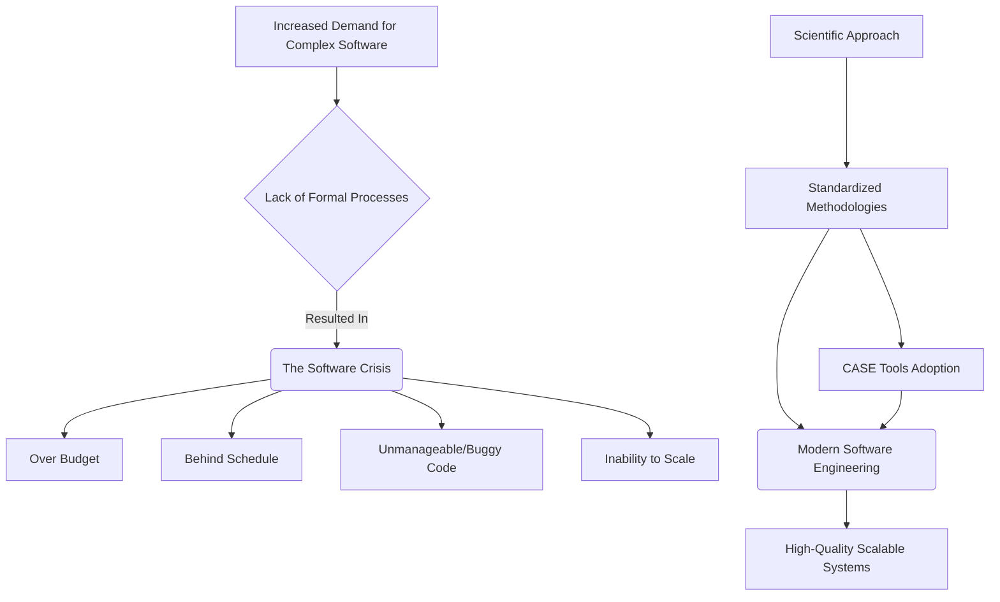
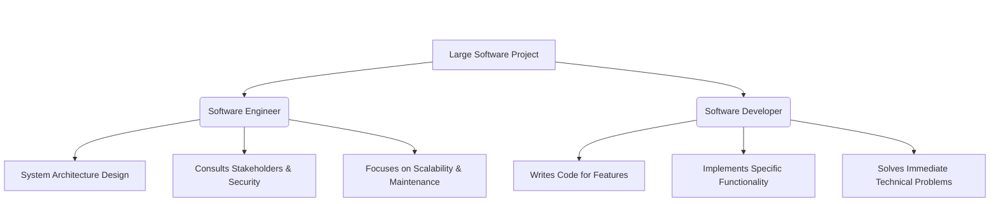
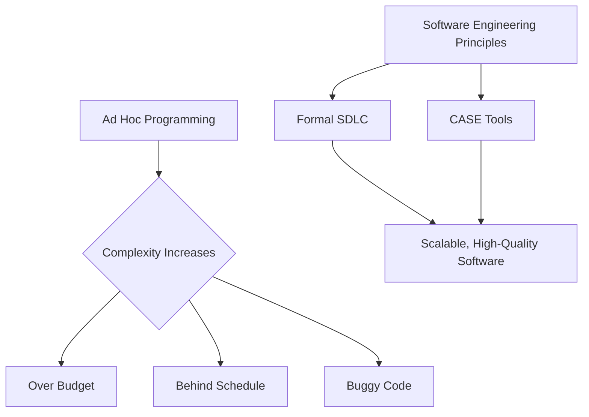
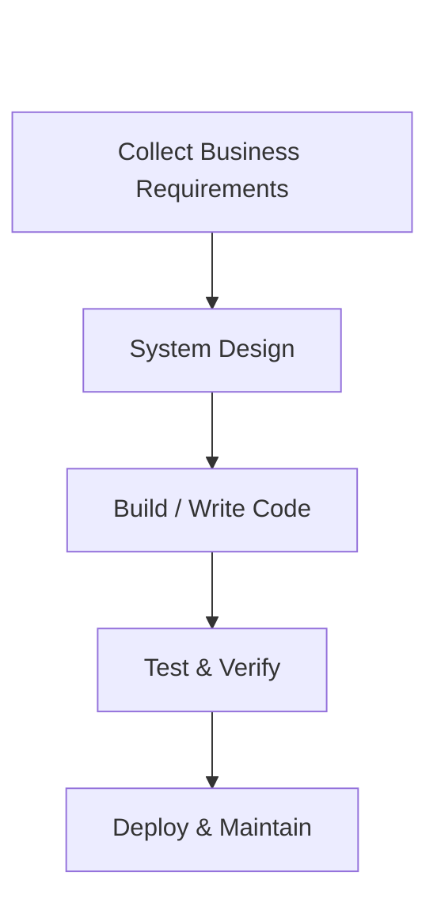
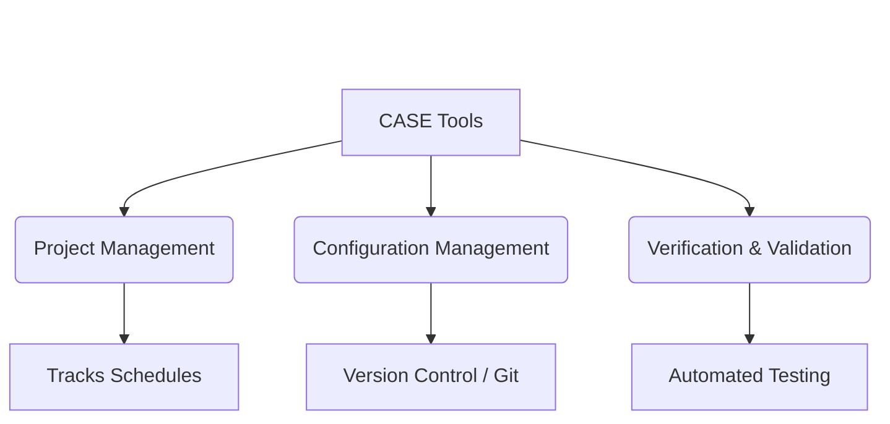
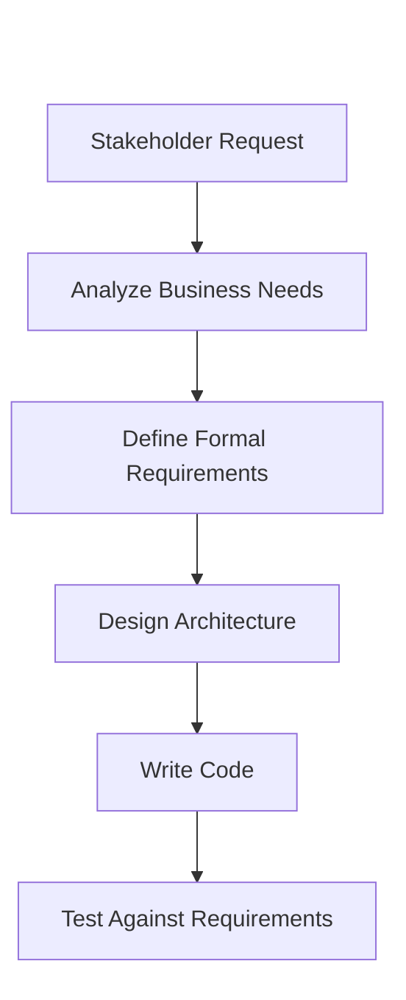

# 01 - What Is Software Engineering?

## 1. Jargon Translation

- **Software Engineering**: 
  - *Official Definition*: The application of scientific principles to the design and creation of software.
  - *Under the Hood*: Think of software engineering like being an architect and lead contractor for a skyscraper. Instead of just grabbing a hammer and starting to build (which might work for a doghouse), you first carefully analyze the soil, create detailed blueprints, and follow strict safety codes to ensure the building doesn't collapse. In software, this means systematically collecting business requirements before writing a single line of code to ensure the final application solves the actual problem.
- **The Software Crisis**: 
  - *Official Definition*: A historical period spanning from the mid-1960s to the mid-1980s characterized by major difficulties in delivering software that was on time, on budget, and free of bugs.
  - *Under the Hood*: Imagine the demand for cars suddenly skyrocketing, but every car is still being built entirely by hand without an assembly line. The process couldn't keep up. As computers became widespread, the demand for complex software outpaced the ad hoc methods used to create it, leading to projects that constantly failed, ran out of money, or were completely unmanageable.
- **Refactor**: 
  - *Official Definition*: The process of restructuring existing computer code without changing its external behavior.
  - *Under the Hood*: It's like reorganizing your incredibly messy closet. You aren't adding or removing clothes; you are just arranging them so that you can actually find things quickly in the future. In code, it means cleaning up the messy, tangled logic to make it readable and scalable.
- **CASE (Computer-Aided Software Engineering)**: 
  - *Official Definition*: The use of software tools and methods to aid in the development and maintenance of software.
  - *Under the Hood*: It's using power tools instead of hand tools. These are software programs designed specifically to help software engineers do their jobs better—like tools that automatically track code changes (Git), test the code for bugs, or manage project timelines (Jira).
- **SDLC (Software Development Lifecycle)**: 
  - *Official Definition*: A formalized, standard process used by the software industry to design, develop, and test high-quality software.
  - *Under the Hood*: The ultimate master checklist. It's the step-by-step recipe that a development team follows to take a software project from a raw idea all the way to a launched, functioning product.

## 2. Topics Introduced in Lecture Transcript

1. The Definition of Software Engineering
2. The Evolution from Ad Hoc Programming to Scientific Methods
3. The Software Crisis (mid-1960s - mid-1980s)
4. Introduction to CASE (Computer-Aided Software Engineering) Tools
5. Comparing Software Engineers vs. Software Developers
6. The Primary Responsibilities of a Software Engineer
7. Introduction to the SDLC (Software Development Lifecycle)

## 3. Exhaustive Deep Dive & Structured Notes

### The Foundations of Software Engineering
Software engineering is far more than just writing code. It is a highly systematic discipline designed to guarantee software quality, scalability, and alignment with business needs.

- **The Systematic Approach**: 
  - **Requirement Collection**: Engineers must first collect and analyze business requirements.
  - **Design & Build**: Using the requirements, the system's architecture is designed, and the application is built.
  - **Testing**: Software must be rigorously tested to verify it satisfies the initial business requirements.

### The Evolution and The Software Crisis
The software engineering field was not always a formalized discipline. Its history is marked by a massive transition driven by necessity.

- **The Late 1950s (The Ad Hoc Era)**:
  - Computing was new, and software creation lacked any formal development process. Programming was primarily an "ad hoc" activity—writing code unstructured and on-the-fly to solve immediate problems.
- **The Software Crisis (Mid-1960s to Mid-1980s)**:
  - **The Cause**: As the world rapidly adopted computers, software became integral to many aspects of life. The demand for complex computing resources spiked. The old, ad hoc processes were entirely inefficient and could not meet this new demand.
  - **The Symptoms**: 
    - Projects constantly ran **over budget**.
    - Projects fell chronically **behind schedule**.
    - The resulting code was **unmanageable** and highly **buggy**.
    - Ad hoc solutions that worked for small systems utterly failed to **scale** to large, complex projects.
  - **The Technology Pace Problem**: By the time developers finally finished older software solutions, the technology landscape had already advanced. This forced software engineers to painfully refactor their code or completely redesign the system from the ground up to utilize the newer, faster technologies.

### The Engineering Solution
To solve the software crisis, the industry had to transform unorganized coding efforts into an established, rigorous engineering discipline.

- **Application of Engineering Principles**: By the 1960s, the field evolved by utilizing a measured, scientific approach.
- **Formalized Methods**: Trends moved sharply away from ad hoc programming and towards standardized methodologies. 
- **The Result**: Today, computing resources are widely available, and standardized methodologies allow engineers to build large, complex solutions that scale effortlessly. While bugs and budget issues still exist, they occur to a much lesser extent due to these consistent engineering principles.




### CASE Tools (Computer-Aided Software Engineering)
The mid-1980s saw the rapid growth of CASE tools, which were instrumental in relieving the software crisis. They automate and enforce the engineering process. CASE tools are categorized into six distinct areas:

1. **Business Analysis and Modeling**: Tools to map out requirements and architecture visually.
2. **Development Tools**: Environments used to write code, specifically featuring **debugging environments** to catch errors early.
3. **Verification and Validation Tools**: Tools used to test the software and ensure it behaves as required.
4. **Configuration Management**: Systems that track changes to the code, allowing teams to collaborate safely (e.g., version control).
5. **Metrics and Measurement**: Tools to analyze the performance and quality of the codebase.
6. **Project Management**: Tools to manage schedules, budgets, and team workflows.

### Software Engineers vs. Software Developers
While the terms are often used interchangeably, "software developer" is deemed narrower in scope than "software engineer."

- **The Software Engineer**:
  - **Scope of Knowledge**: Broader knowledge base.
  - **Thinking Approach**: Takes a systematic, big-picture approach to development.
  - **Focus**: Employs their specialized knowledge to build **entire systems**. They focus on the broad structure and architecture of a large-scale project rather than just solving an immediate problem.
  - **Core Responsibilities**: Designing, building, and maintaining software systems.
  - **Consulting**: Actively consults with stakeholders such as clients, third-party software vendors, security specialists, and other cross-functional team members.
  
- **The Software Developer**:
  - **Thinking Approach**: Often has a more creative approach to solving immediate, localized problems.
  - **Focus**: Uses their specialized knowledge to write code to implement **specific functionality** within the broader system that the engineer designed.

### The SDLC (Software Development Lifecycle)
The adoption of a measured scientific approach culminated in the SDLC.
- **Purpose**: It identifies the precise, formal steps needed to develop high-quality software, guiding the entire modern development process.

## 4. Step-by-Step Breakdown: The Transition to Engineering
1. **Ad Hoc Era (1950s)**: Code is written with no formal processes.
2. **Demand Spike (1960s)**: Computers become widely adopted; demand for complex software outpaces development capabilities.
3. **The Software Crisis (1960s-1980s)**: Projects fail, run over budget, and produce buggy code that cannot scale.
4. **Discipline Emerges (1960s-1980s)**: The field transforms unorganized coding into a scientific discipline.
5. **Tooling Adoption (1980s)**: CASE tools are heavily adopted to assist in the formal processes.
6. **Modern Era (Today)**: The SDLC guides the development of large, complex, scalable solutions.

## 5. Concrete Examples
- **Software Engineer Role**: You are tasked with designing a ride-sharing application. You take a big-picture approach: you decide the system needs a real-time tracking microservice, a secure payment gateway integration with a third-party vendor (like Stripe), and a highly scalable database to handle millions of concurrent users. You consult with security specialists to ensure user data is safe.
- **Software Developer Role**: Working on that same ride-sharing application, you are assigned a ticket to implement the specific UI functionality that allows a user to tip their driver. You write the JavaScript code to update the tip amount and trigger the payment function. You are focused entirely on this specific, immediate feature.

## 6. Code Blocks

While software engineering processes are conceptual, we can contrast ad hoc programming (the cause of the Software Crisis) with engineered, systematic programming.

```javascript
// BAD: Ad Hoc Programming (Software Crisis Era Style)
// - No error handling
// - Hardcoded values
// - Unmanageable and impossible to scale to a large system
function processPayment() {
    let balance = 100;
    let cost = 50;
    // If something goes wrong here (e.g. database down), the entire app crashes
    balance = balance - cost;
    console.log("Payment successful, new balance is: " + balance);
}

// GOOD: Engineered Programming (Modern Systematic Approach)
// - Uses a modular class structure (Systematic)
// - Includes rigorous error handling and validation (Verification)
// - Can be easily scaled and maintained
class PaymentSystem {
    constructor(databaseConnection) {
        this.db = databaseConnection; // Injecting dependencies for scalability
    }

    async processUserPayment(userId, amount) {
        try {
            // Validation: Ensuring the business requirements are met
            if (typeof amount !== 'number' || amount <= 0) {
                throw new Error("Invalid payment amount.");
            }

            // Simulating a systematic, secure database interaction
            const userBalance = await this.db.getBalance(userId);
            
            if (userBalance < amount) {
                throw new Error("Insufficient funds.");
            }

            const newBalance = userBalance - amount;
            await this.db.updateBalance(userId, newBalance);
            
            return { status: "success", remainingBalance: newBalance };

        } catch (error) {
            // Systematic error handling instead of unmanageable app crashes
            console.error("Transaction failed:", error.message);
            // In a real system, you might trigger a CASE metrics tool here
            throw error;
        }
    }
}

// What happens if... you pass a string instead of a number?
// In the ad-hoc version, it might result in a NaN bug propagated everywhere.
// In the engineered version, the explicit validation block catches it and throws a safe Error.
```

## 7. Related Concepts
1. **System Architecture**: The conceptual model that defines the structure and behavior of a system. Software engineers rely heavily on this to view the "big picture."
2. **SDLC (Software Development Lifecycle)**: The standardized, multi-phase process used to design, develop, and test software. It is the direct solution to the ad hoc programming of the past.
3. **Agile Methodology**: A modern project management framework (a type of SDLC) that focuses on iterative development, helping prevent the "behind schedule" and "over budget" issues of the Software Crisis.
4. **CI/CD (Continuous Integration / Continuous Deployment)**: The automated process of merging code and deploying it. This falls heavily under the "Configuration Management" category of CASE tools.
5. **Microservices Architecture**: A modern approach where a large application is built as a suite of small, independent services. This is a big-picture structural pattern used by software engineers to ensure massive scalability.

## 8. Key Takeaways (Flashcard-Ready)
* **Q: What is the primary definition of Software Engineering?**
  * **A**: The application of scientific principles and a systematic approach to the design, creation, and testing of software to satisfy business requirements.
* **Q: What was the "Software Crisis"?**
  * **A**: A period from the mid-1960s to mid-1980s where a lack of formal development processes led to software projects running over budget, behind schedule, and producing unmanageable, buggy code.
* **Q: What is a key difference between a Software Engineer and a Software Developer?**
  * **A**: Engineers focus on the broad, big-picture architecture to build entire systems, while developers focus on implementing specific functionalities within that system.
* **Q: What are CASE tools?**
  * **A**: Computer-Aided Software Engineering tools; automated tools (like debuggers, project management, and modeling software) that assist in the engineering process.
* **Q: Why was the SDLC created?**
  * **A**: To provide a formal, scientific approach to software development, identifying the specific steps needed to consistently produce high-quality software that scales.

## 9. The Trick Section

* **💡 The Secret Engineering Trick:** **"Premature Optimization is the Root of All Evil."** While software engineers must look at the big picture and ensure a system can scale, a common pitfall is over-engineering a solution for a scale that doesn't exist yet (e.g., building a complex Kubernetes cluster for a blog that gets 10 visitors a day). The trick is to design a flexible *architecture* that can be scaled later, but write the simplest, most direct *code* necessary for today's business requirements.

## 10. Interview Questions Section

### 1. Can you explain the difference between a Software Engineer and a Software Developer?

* **Simple Definition**: An engineer is like the architect who designs the entire blueprint of a skyscraper and ensures it won't collapse. A developer is like the expert carpenter who follows those blueprints to build the beautiful cabinets inside the skyscraper.
* **Official Definition**: A software engineer applies scientific and engineering principles to take a systematic, big-picture approach to designing, building, and maintaining entire software systems. A software developer focuses on writing code to implement specific functionality within that system.
* **Primary Responsibilities / Core Details**:
  * **Software Engineer**: Employs a broad, systematic approach to problem-solving.
  * **Software Engineer**: Focuses on system architecture, data flow, scaling, and integration.
  * **Software Engineer**: Actively consults with stakeholders, third-party vendors, and security specialists.
  * **Software Developer**: Employs a more creative approach to solve immediate technical challenges.
  * **Software Developer**: Focuses on writing clean, efficient code for specific features.
  * **Both Roles**: Require highly specialized technical knowledge.
* **Real-World Example**: In a banking application, the Software Engineer decides that the app needs a microservices architecture with a dedicated, encrypted payment gateway to handle high traffic securely. The Software Developer is then assigned to write the actual REST API endpoint (the code) that allows a user to initiate a money transfer.
* **Best Coding/Development Practices**:
  * **Separate Concerns**: Ensure modules do one thing well (Single Responsibility Principle) so developers can work on specific features without breaking the entire system engineered around them.
    * *Example*: Keeping routing logic entirely separate from database logic in an Express app.
  * **Design Before Coding**: Spend time mapping out the architecture and gathering requirements before writing the first line of code.
    * *Example*: Creating an API specification document and drawing a system flowchart before opening your code editor.
  * **Communicate Constantly**: Engineers must talk to stakeholders to ensure what is being built actually solves the business problem.
    * *Example*: Scheduling regular syncs with product managers and security teams.
* **Visual Aid (Mermaid Flowchart)**:

* **Core Focus Areas**: System Architecture | Scope of Responsibility | Approach to Problem Solving

### 2. What was the Software Crisis, and how did the industry solve it?

* **Simple Definition**: The Software Crisis was a time when people wanted complex software, but programmers were basically "winging it," leading to massively expensive, buggy failures. It was solved by forcing programmers to act like engineers and follow strict, scientific processes.
* **Official Definition**: A historical period (mid-1960s to mid-1980s) where the rapidly increasing demand for complex software outpaced the ad hoc development methods of the time, resulting in projects that ran over budget, behind schedule, and produced unmanageable code. It was resolved by adopting formalized engineering principles.
* **Primary Responsibilities / Core Details**:
  * **The Trigger**: Wide adoption of computers led to a massive increase in demand for complex software.
  * **The Method Failure**: Creation of software lacked a formal development process (ad hoc programming).
  * **The Budget Issue**: Projects consistently ran out of money before completion.
  * **The Schedule Issue**: Deadlines were almost never met.
  * **The Quality Issue**: Code was unmanageable, buggy, and failed to scale to larger systems.
  * **The Solution**: The transformation of unorganized coding into a disciplined engineering field using standard methodologies (like the SDLC) and CASE tools.
* **Real-World Example**: A company in 1975 attempts to build an airline reservation system by just letting 50 programmers write code however they want. Five years later, they have spent millions, the system crashes daily, and newer, faster computers have already been released, making their code obsolete.
* **Best Coding/Development Practices**:
  * **Adopt a Methodology**: Never just start coding on a large project; strictly follow a formalized methodology (like Agile or Waterfall).
    * *Example*: Planning out 2-week Sprint cycles for your development team.
  * **Utilize CASE Tools**: Use automated tools to reduce human error and manage complexity.
    * *Example*: Utilizing a CI/CD pipeline to automatically test code before it is deployed.
  * **Plan for Scale**: Design systems knowing that they will need to handle more traffic and complexity in the future.
    * *Example*: Using a load balancer to distribute traffic across multiple servers.
* **Visual Aid (Mermaid Flowchart)**:

* **Core Focus Areas**: Historical Context | Scalability Failures | Engineering Methodologies

### 3. What is the SDLC, and why is it important in software engineering?

* **Simple Definition**: The SDLC is the ultimate master checklist for building software. It ensures you don't build the roof of a house before you've poured the foundation.
* **Official Definition**: The Software Development Lifecycle (SDLC) is a formalized process identifying the steps needed to design, develop, test, and deploy high-quality software that meets business requirements.
* **Primary Responsibilities / Core Details**:
  * **Provides Structure**: It moves development away from ad hoc programming into a scientific, measured approach.
  * **Requirement Collection**: Forces teams to analyze what the business actually needs first.
  * **Standardization**: Allows large teams to work together efficiently because everyone follows the same process.
  * **Quality Assurance**: Identifies testing as a mandatory step to ensure high-quality software.
  * **Scalability**: Without it, large, complex solutions cannot be successfully built or maintained.
* **Real-World Example**: Before a team writes the code for a new mobile game, they use the SDLC to first write a design document, map out the database, build a prototype, write the code, and then send it to QA testers to find bugs before releasing it to the app store.
* **Best Coding/Development Practices**:
  * **Never Skip Requirements Gathering**: Always understand the *why* before determining the *how*.
    * *Example*: Writing User Stories before designing the database schema.
  * **Test Driven Development (TDD)**: Write tests for your code before you even write the functional code to ensure it meets requirements.
    * *Example*: Writing a Jest test that checks if an API returns a 200 status code before building the API endpoint.
  * **Iterative Review**: Constantly review the software against the initial requirements at each phase of the lifecycle.
    * *Example*: Conducting a sprint review with the client every two weeks to show progress.
* **Visual Aid (Mermaid Flowchart)**:

* **Core Focus Areas**: Formalized Processes | Quality Assurance | System Lifecycle

### 4. What are CASE tools, and how do they relieve the software crisis?

* **Simple Definition**: CASE tools are power tools for programmers. Instead of tracking a million lines of code in your head or on paper, you use specialized software to automate the boring, error-prone parts of managing a big project.
* **Official Definition**: Computer-Aided Software Engineering (CASE) refers to software tools used to assist in the automated development, maintenance, and management of software systems, categorized into modeling, development, testing, configuration, metrics, and project management.
* **Primary Responsibilities / Core Details**:
  * **Business Modeling**: Helps visualize the architecture.
  * **Development Environments**: IDEs and debuggers that help write clean code.
  * **Verification**: Automated testing frameworks.
  * **Configuration Management**: Tracks code versions and prevents developers from overwriting each other's work.
  * **Metrics**: Analyzes code quality and performance.
  * **Project Management**: Keeps budgets and schedules on track.
* **Real-World Example**: A team of 50 developers uses **Git** (a configuration management CASE tool) to merge their code changes without breaking the main application, and **Jira** (a project management CASE tool) to track which developer is working on which bug.
* **Best Coding/Development Practices**:
  * **Use Version Control**: Never rely on passing zip files of code around; always use a Git repository.
    * *Example*: Running `git commit` and `git push` daily.
  * **Automate Testing**: Use validation tools to automatically run tests every time new code is added.
    * *Example*: Configuring GitHub Actions to run your unit tests on every Pull Request.
  * **Track Metrics**: Don't guess if your app is slow; use metrics tools to prove it.
    * *Example*: Installing an APM (Application Performance Monitoring) tool to track API response times.
* **Visual Aid (Mermaid Flowchart)**:

* **Core Focus Areas**: Automation | Process Management | Quality Control

### 5. Why is "collecting and analyzing business requirements" the first critical step in Software Engineering?

* **Simple Definition**: Because if you build a perfectly engineered bridge over a river, but the business actually needed a tunnel under a mountain, your perfect bridge is useless.
* **Official Definition**: The systematic process of gathering, defining, and analyzing the needs of stakeholders to ensure that the designed and built software system will accurately satisfy the core business objectives.
* **Primary Responsibilities / Core Details**:
  * **Alignment**: Ensures the engineering team and the clients are aiming for the exact same goal.
  * **Scope Definition**: Prevents "scope creep" by defining exactly what will and won't be built.
  * **Architectural Foundation**: You cannot design the architecture of a system (like choosing SQL vs NoSQL) without knowing the data requirements.
  * **Testability**: Requirements form the basis for all verification and validation testing.
  * **Cost Efficiency**: Fixing a requirement error before writing code costs almost nothing; fixing it after deployment costs a fortune.
* **Real-World Example**: A client asks for a "fast database." The software engineer analyzes the requirement and discovers the client needs to store highly unstructured, rapidly changing user profiles. Based on this analysis, the engineer chooses a NoSQL database (like MongoDB) instead of a rigid SQL database.
* **Best Coding/Development Practices**:
  * **Document Everything**: Write down requirements in a formal document (like an SRS) that stakeholders sign off on.
    * *Example*: Maintaining a Confluence page detailing the exact specifications for a new feature.
  * **Ask "Why" Multiple Times**: Don't just accept a feature request; dig into the underlying business problem it is trying to solve.
    * *Example*: If a user asks for a button, ask *why* they need to click it, and you might realize they actually need an automated background process instead.
  * **Build Prototypes**: Create low-fidelity mockups to confirm requirements visually before building complex backends.
    * *Example*: Using Figma to show the client the UI before you start writing the API to power it.
* **Visual Aid (Mermaid Flowchart)**:

* **Core Focus Areas**: Business Alignment | Scope Management | System Design Foundation
