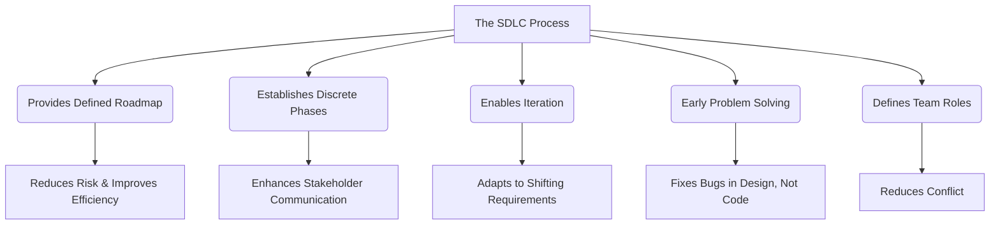
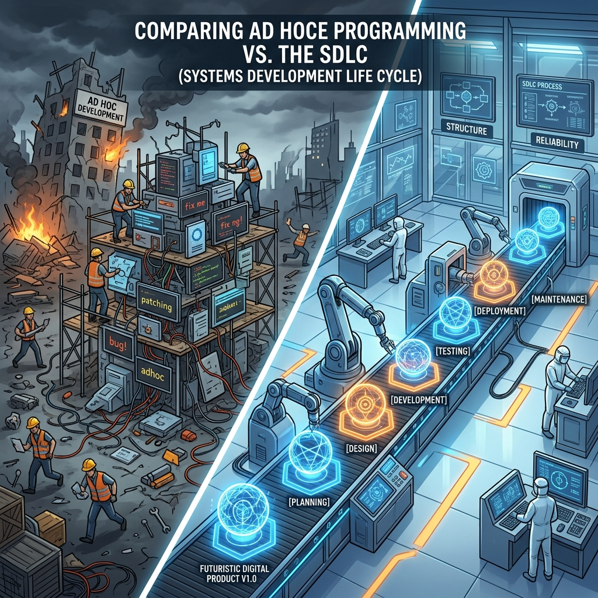
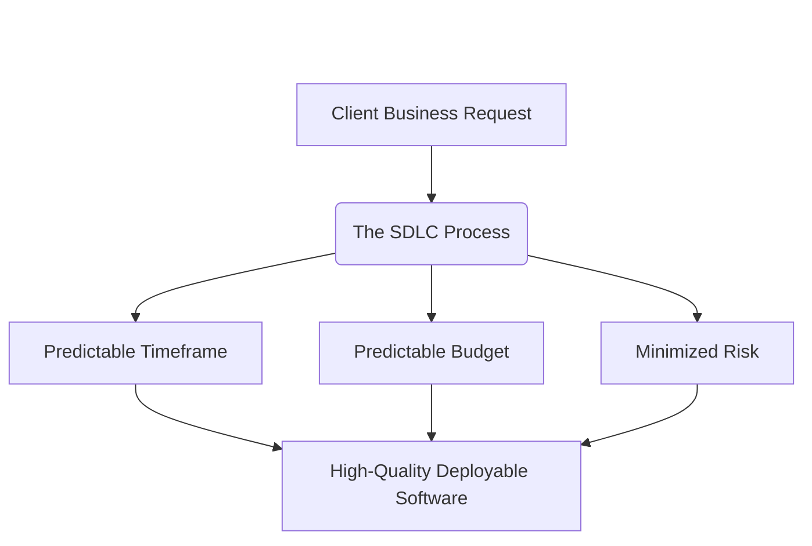
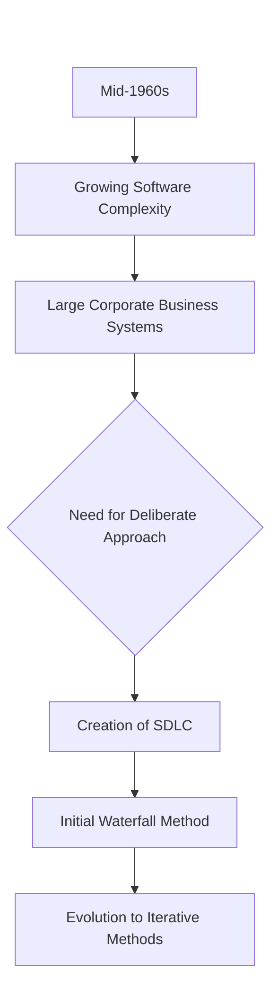
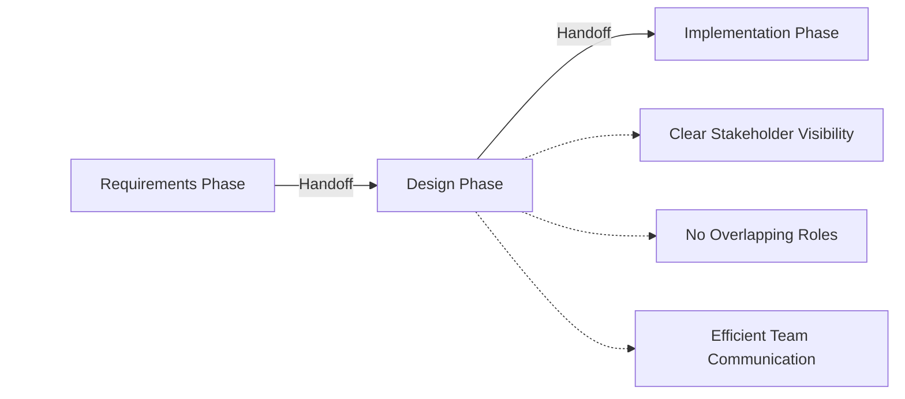
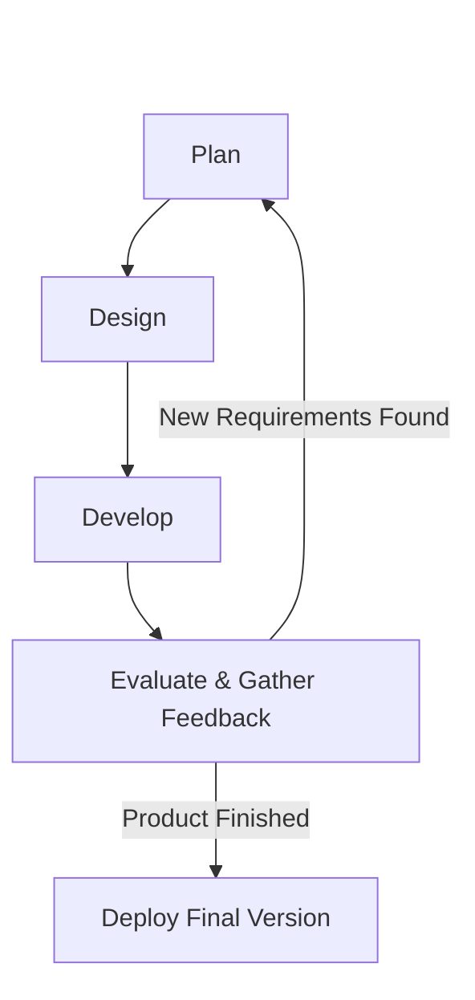
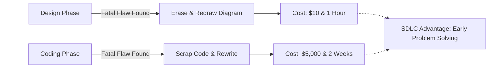

# 02 - Introduction to the Software Development Lifecycle (SDLC)

## 1. Jargon Translation

- **SDLC (Software Development Lifecycle)**:
  - *Official Definition*: A systematic process used by the software industry to design, develop, and test high-quality software within a predictable timeframe and budget.
  - *Under the Hood*: Imagine trying to build a massive skyscraper. You wouldn't just grab a hammer and start nailing wood together. You'd need a strict set of blueprints, phases for laying the foundation, plumbing, and electrical work. The SDLC is the ultimate master blueprint and step-by-step checklist that software teams follow so they don't accidentally try to "build the roof" before "pouring the foundation."
- **Waterfall Method**:
  - *Official Definition*: An early SDLC methodology where development follows a strict, linear pattern through discrete stages, with each stage needing to be fully completed before the next begins.
  - *Under the Hood*: Think of an assembly line at a car factory. Once the car moves past the painting station, you can't send it back to get a different engine. In software, this meant you had to finalize 100% of the design before you could start even 1% of the coding.
- **Iterative Approach**:
  - *Official Definition*: A modern software development methodology where the system is developed through repeated cycles (iterations) and in smaller portions at a time.
  - *Under the Hood*: Imagine building a house, but instead of finalizing the entire design upfront, you build it room by room. After finishing the living room, you show the client. If they want a different paint color for the kitchen, you can adapt easily because you haven't built the kitchen yet.
- **Cross-Domain Teams**:
  - *Official Definition*: Groups of professionals with different areas of expertise working collaboratively toward a common goal.
  - *Under the Hood*: It’s like the plumber, the electrician, and the carpenter all coordinating their schedules. In software, this means frontend developers, backend developers, UI designers, and QA testers working in sync.

## 2. Topics Introduced in Lecture Transcript

1. The Definition and Goal of the SDLC
2. The History and Origins of the SDLC (Mid-1960s)
3. The Waterfall Method vs. Iterative Methods
4. The 5 Key Advantages of Using the SDLC

## 3. Exhaustive Deep Dive & Structured Notes

### The Definition and Goal of the SDLC
* **What is it?** The SDLC is a systematic process designed to replace the chaotic "ad hoc" programming of the past. It defines distinct phases of the software development process, each encompassing its own processes and deliverables (like planning, design, and development).
* **The Core Goal:** The primary objective of the SDLC is to produce software that perfectly meets a client’s business requirements.
* **Predictability:** Adherence to the SDLC allows teams to build high-quality, deployable software within a **predictable timeframe** and a **predictable budget**, dramatically minimizing project risks and costs.

### The History and Origins of the SDLC
* **The Tipping Point (Mid-1960s):** Software development began to necessitate a more detailed approach due to rapidly growing complexity.
* **Corporate Needs:** Large corporations were attempting to manage incredibly complex business systems that required heavy computational resources. "Winging it" (ad hoc programming) was resulting in massive, expensive failures. 
* **The Deliberate Approach:** The SDLC emerged as a deliberate, formalized approach to manage this complexity and prevent budget overruns.

### The Waterfall Method vs. Iterative Adaptation
* **Initial Conception (Waterfall):** When the SDLC was first created, it utilized the **waterfall method**.
  * **Micro-Mechanics:** Projects were managed in a strict, linear pattern. Development flowed downward through discrete stages. 
* **Modern Adaptation (Iterative):** The SDLC is not a rigid, unchanging law; it is a framework that evolves.
  * **Micro-Mechanics:** Over time, the SDLC adapted into **iterative methods**. Instead of a single, massive linear progression, development happens in cycles.
  * **The "Why":** This adaptation was necessary to successfully address modern customer needs and constantly shifting business requirements. 

| Dimension | Waterfall (Original) | Iterative (Modern Adaptation) |
| :--- | :--- | :--- |
| **Flow Pattern** | Strict, linear, downward | Cyclical, repeating loops |
| **Requirement Changes** | Extremely costly to accommodate | Absorbed into the next cycle |
| **Client Visibility** | Only at the very end | Frequently, after each cycle |
| **Best Suited For** | Fixed, well-understood scope | Evolving, uncertain scope |

### The 5 Key Advantages of Following the SDLC
For businesses and engineering teams, following the SDLC provides five distinct advantages:

1. **Provides a Defined Process (Efficiency & Risk Reduction)**
   * Replaces chaotic ad hoc programming with a proven roadmap.
   * Improves team efficiency and drastically reduces the risk of project failure.
2. **Establishes Discrete Phases (Enhanced Communication)**
   * Every phase is well-defined. Team members know exactly what to work on and when.
   * Facilitates seamless communication between the customer, stakeholders, and the development team. 
   * **Stakeholder Visibility:** Stakeholders get a clear overview of the process and know exactly where they fit in.
   * **Cross-Domain Handoffs:** Because phases are discrete, cross-domain teams know exactly when they have completed their tasks and when development can officially move to the next phase.
3. **Provides Room for Iteration**
   * At the end of a cycle, the SDLC process can simply circle back to the beginning to seamlessly incorporate additional or changed requirements.
4. **Early Problem Solving (Shift-Left)**
   * Problem-solving is incorporated early in the cycle.
   * Fatal logic or architectural problems are addressed in a timely fashion during the **design phase** rather than being discovered during the coding phase when they are wildly expensive to fix.
5. **Well-Defined Roles**
   * Every team member has a specific, well-defined role (e.g., architect, developer, tester).
   * This structure drastically reduces interpersonal conflict and prevents overlapping responsibilities.





## 4. Step-by-Step Breakdown: The Value of SDLC
1. **The Catalyst**: Mid-1960s corporate systems become too complex for basic programming.
2. **The Invention**: The SDLC is created to enforce a deliberate, predictable approach.
3. **The First Iteration**: The Waterfall method enforces strict linear progression.
4. **The Evolution**: The SDLC adapts to Iterative cycles to handle shifting customer requirements.
5. **The Modern Result**: Today, SDLC adherence ensures high-quality, deployable software built on time and on budget.

## 5. Concrete Examples
* **Without SDLC (Ad Hoc):** You are hired to build a payroll system. You just start typing JavaScript on day one. Two months in, you realize the client needed it to handle multiple currencies, but your database is hardcoded for USD. You have to scrap 80% of your work.
* **With SDLC:** You spend the first two weeks just gathering requirements and designing the database schema. You discover the multi-currency requirement during the *Design Phase*. You add a "currency type" column to your blueprint. It costs you 5 minutes of effort instead of 2 months of wasted coding.

## 6. Code Blocks
*(While the SDLC is a process and not a specific syntax, here is how the SDLC mindset affects code structure compared to ad-hoc coding.)*

```javascript
// BAD: Ad-Hoc Approach (No Design Phase)
// - No error handling, no validation, assumes everything goes perfectly.
// - This happens when developers start typing before thinking.
app.post('/transfer', (req, res) => {
    let sourceUser = db.getUser(req.body.from);
    let targetUser = db.getUser(req.body.to);
    
    sourceUser.balance -= req.body.amount;
    targetUser.balance += req.body.amount; // What if the server crashes right here?
    
    res.send("Money transferred!");
});

// GOOD: SDLC-Driven Approach (Result of a Planning & Design Phase)
// - The design phase identified that a server crash during a transfer would destroy money.
// - Therefore, the code implements atomic database transactions and strict validation.
app.post('/transfer', async (req, res) => {
    try {
        const { fromId, toId, amount } = req.body;

        // Validation (Determined during Requirements phase)
        if (amount <= 0) {
            return res.status(400).json({ error: "Invalid transfer amount." });
        }

        // Using Database Transactions to ensure data integrity (Determined during Design phase)
        await db.transaction(async (trx) => {
            const source = await trx.getUser(fromId);
            if (source.balance < amount) {
                throw new Error("Insufficient funds");
            }
            await trx.decrementBalance(fromId, amount);
            await trx.incrementBalance(toId, amount);
        });

        res.status(200).json({ message: "Transfer successful" });
    } catch (error) {
        console.error("Transfer failed:", error.message);
        res.status(500).json({ error: "Transaction aborted to protect data integrity." });
    }
});
```

## 7. Related Concepts
1. **Agile Methodology:** A highly popular iterative implementation of the SDLC that focuses on rapid cycles and constant stakeholder feedback.
2. **Requirements Gathering:** The critical first phase of the SDLC where the exact business needs are documented before any code is written.
3. **Shift-Left Testing:** A practice born from the SDLC's focus on early problem solving; it involves moving testing and QA to the earliest possible phases of development.
4. **Project Management Triangle:** The iron triangle of "Time, Cost, and Quality." The SDLC aims to balance these constraints to achieve predictability.
5. **Cross-Functional Teams:** Agile teams that contain all the necessary domain experts (backend, frontend, QA) required to complete a full SDLC iteration.

## 8. Key Takeaways (Flashcard-Ready)
* **Q: What is the main goal of the SDLC?**
  * **A:** To develop high-quality software in a predictable timeframe and budget that perfectly meets a client's business requirements.
* **Q: Why was the SDLC created in the mid-1960s?**
  * **A:** Software complexity was growing rapidly, and large corporations needed a deliberate, systematic approach to manage heavy computational business systems.
* **Q: What is the defining characteristic of the Waterfall method?**
  * **A:** It manages projects in a strict, linear pattern through discrete stages, with no room to step backward.
* **Q: Why are discrete phases in the SDLC an advantage?**
  * **A:** They facilitate communication; stakeholders know exactly where they fit in the process, and cross-domain teams know exactly when to start and finish their tasks.
* **Q: How does the SDLC handle problem solving?**
  * **A:** It incorporates problem-solving early in the cycle, ensuring major issues are addressed during the design phase rather than during the coding phase.

## 9. The Trick Section
* **💡 The Secret Engineering Trick:** **"The Exponential Cost of Fixing Bugs."** Junior developers often view the Planning and Design phases of the SDLC as "boring paperwork" and want to rush straight into writing code. The secret trick to being a senior engineer is understanding that a logic bug discovered during the Design phase costs almost nothing to fix (you just erase a line on a whiteboard). That exact same logic bug discovered *after* the code is written and deployed can cost a company thousands or millions of dollars in downtime, data corruption, and emergency refactoring. Follow the SDLC and fix your problems on paper first.

## 10. Interview Questions Section

### 1. What is the Software Development Lifecycle (SDLC) and what is its primary goal?

* **Simple Definition**: The SDLC is the ultimate master blueprint and step-by-step checklist that software teams follow. It ensures a team doesn't accidentally try to build the roof of a house before laying the foundation.
* **Official Definition**: The SDLC is a systematic, formalized process used by the software industry to design, develop, and test high-quality software. Its primary goal is to produce software that meets a client’s business requirements within a highly predictable timeframe and budget.
* **Primary Responsibilities / Core Details**:
  * **Predictability**: Transforms chaotic programming into a manageable, predictable engineering process.
  * **Risk Minimization**: Adherence to the SDLC minimizes the immense risks and costs associated with building complex software.
  * **Process Over Ad Hoc**: Gives teams a rigid process to follow rather than winging it.
  * **Deliverable Tracking**: Defines distinct phases, each encompassing its own processes and mandatory deliverables.
  * **Iterative Potential**: While it can be linear, modern SDLCs are implemented as iterative cycles.
* **Real-World Example**: A healthcare company uses the SDLC to build a patient portal. Because they follow the SDLC, they spend two months rigorously gathering HIPAA compliance requirements before a single line of code is written, ensuring the final product won't result in a massive lawsuit for data leakage.
* **Best Coding/Development Practices**:
  * **Do Not Skip Phases**: Never begin the Implementation (coding) phase if the Design phase hasn't been officially signed off by stakeholders.
    * *Example*: Refusing to start writing database queries until the database schema diagram is approved.
  * **Document Deliverables**: Ensure every phase produces a tangible deliverable (like an architecture diagram or a test plan).
    * *Example*: Writing a Software Requirements Specification (SRS) document during the planning phase.
  * **Embrace Iteration**: Build the software in small chunks so you can show the client and adjust to their feedback quickly.
    * *Example*: Releasing a beta version of the app to a small group of users to gather feedback before the final launch.
* **Visual Aid (Mermaid Flowchart)**:

* **Core Focus Areas**: Predictability | Risk Management | Systematic Process

### 2. How did the SDLC originate, and why was it necessary?

* **Simple Definition**: In the 1960s, computers got really powerful, and companies wanted to build massive programs. But programmers were still building software like it was a weekend hobby project. Everything broke, so they invented the SDLC to force programmers to act like real engineers.
* **Official Definition**: The SDLC began to take shape in the mid-1960s out of absolute necessity. As software development grew exponentially in complexity, large corporations needed a deliberate, detailed approach to manage complex business systems requiring heavy computational resources.
* **Primary Responsibilities / Core Details**:
  * **The Catalyst**: The transition of computing from small scripts to massive corporate business systems.
  * **The Failure of Ad Hoc**: Developers could no longer hold the entire logic of a massive program in their heads.
  * **The Initial Framework**: The SDLC was initially conceived using the Waterfall method.
  * **The Linear Approach**: This early SDLC forced development into a strict linear pattern through discrete stages to maintain control.
  * **The Evolution**: It eventually evolved from strict linear patterns into iterative cycles to handle modern, rapidly shifting customer needs.
* **Real-World Example**: In 1968, a major bank attempts to digitize its entire ledger system. The code becomes a million lines of tangled spaghetti code, and the project fails. They adopt the SDLC, force the team to plan the architecture for 6 months first, and successfully launch the system the following year.
* **Best Coding/Development Practices**:
  * **Respect the Complexity**: Recognize that enterprise software is vastly more complex than a personal side project and requires extreme rigor.
    * *Example*: Implementing strict linting and code review rules for all enterprise commits.
  * **Adapt the Methodology**: Understand when a rigid linear approach is needed (like writing software for an airplane) versus an iterative approach (like a social media app).
    * *Example*: Choosing Agile over Waterfall for a startup project with vague initial requirements.
  * **Focus on Architecture**: In complex systems, the architecture is more important than the specific code syntax.
    * *Example*: Deciding between a monolithic or microservices architecture during the design phase.
* **Visual Aid (Mermaid Flowchart)**:

* **Core Focus Areas**: Historical Context | Handling Complexity | Evolution of Methodologies

### 3. Why are "discrete phases" a major advantage of the SDLC?

* **Simple Definition**: Discrete phases mean the development process is chopped up into clean, separate blocks. This stops the UI designer, the database engineer, and the QA tester from stepping on each other's toes because they know exactly when it's their turn to work.
* **Official Definition**: The SDLC divides the massive undertaking of software development into well-defined, discrete phases. This structural advantage improves efficiency by ensuring team members know exactly what they should be working on, when their tasks are complete, and when the project can transition to the next stage.
* **Primary Responsibilities / Core Details**:
  * **Role Clarity**: Each phase is well-defined, giving team members a clear objective.
  * **Facilitated Communication**: Because phases are strictly delineated, communication between customers, stakeholders, and the dev team is streamlined.
  * **Process Overview**: Stakeholders gain a high-level view of the project and know exactly where their input is required.
  * **Cross-Domain Handoffs**: Cross-domain teams (e.g., backend and frontend) know exactly when a phase is complete and they can safely begin the next one.
  * **Conflict Reduction**: With well-defined roles inside discrete phases, overlapping responsibilities and interpersonal conflicts are minimized.
* **Real-World Example**: A stakeholder wants to know when they can see a working demo. Because the team follows the SDLC, the project manager can look at the discrete phases and accurately say, "We are in the Design phase; the Implementation phase begins next month, so you will see a demo in 6 weeks."
* **Best Coding/Development Practices**:
  * **Establish Definition of Done (DoD)**: Have a strict checklist that proves a discrete phase is actually finished before moving on.
    * *Example*: A feature is not "Done" until all unit tests pass and the code is reviewed by a senior engineer.
  * **Maintain Cross-Domain Communication**: Even in discrete phases, ensure domains talk to each other to prevent bottlenecks.
    * *Example*: Backend engineers providing mock API data to frontend engineers so they can work simultaneously.
  * **Avoid Phase Bleed**: Do not let stakeholders force major architectural design changes while you are in the middle of the coding phase.
    * *Example*: Pushing a massive new feature request into the *next* iteration cycle rather than disrupting the current one.
* **Visual Aid (Mermaid Flowchart)**:

* **Core Focus Areas**: Team Communication | Process Visibility | Handoff Efficiency

### 4. How does the SDLC handle changing customer requirements?

* **Simple Definition**: Instead of building the entire software in one giant, unstoppable straight line, modern SDLCs build the software in a loop. When the loop finishes, you check with the customer. If they changed their mind, you just add the new requirements to the next loop.
* **Official Definition**: While the original SDLC utilized a rigid, linear Waterfall method, it has heavily adapted to utilize iterative methods. The SDLC provides room for iteration where, at the end of a cycle, the development process can seamlessly circle back to incorporate additional or shifting requirements as needed.
* **Primary Responsibilities / Core Details**:
  * **Iterative Adaptation**: Modern SDLC is a cycle of planning, design, and development, not a one-way street.
  * **Customer Responsiveness**: Designed specifically to address shifting customer needs.
  * **Feedback Loops**: At the end of every cycle, stakeholders evaluate the deliverable.
  * **Risk Mitigation**: Catching a changed requirement after a 2-week cycle is vastly cheaper than catching it after a 2-year linear project.
  * **Continuous Improvement**: The software naturally evolves and improves over time through these iterations.
* **Real-World Example**: A team is building an e-commerce site. During cycle 1, they build the shopping cart. They show the client, who suddenly realizes they also want users to be able to save items for later. The team simply adds this new "Wishlist" requirement to the planning phase of cycle 2.
* **Best Coding/Development Practices**:
  * **Write Modular Code**: Code must be loosely coupled so that when requirements change, you only have to rewrite small pieces, not the whole system.
    * *Example*: Using separate files and functions for database queries versus API routing.
  * **Implement CI/CD**: Use Continuous Integration to automatically test and deploy these iterative cycles rapidly.
    * *Example*: Using a Jenkins pipeline to deploy code to a staging server every time a developer merges a pull request.
  * **Maintain a Backlog**: Keep a highly organized list of all the new requirements the customer thinks of, and prioritize them for the next cycle.
    * *Example*: Using Jira to rank user stories by business value.
* **Visual Aid (Mermaid Flowchart)**:

* **Core Focus Areas**: Iteration | Customer Feedback | Adaptability

### 5. Why is "Early Problem Solving" considered a key advantage of the SDLC?

* **Simple Definition**: It is much easier to use an eraser on a blueprint than a sledgehammer on a brick wall. The SDLC forces you to find and fix problems on paper before you start pouring concrete.
* **Official Definition**: The SDLC mandates that problem-solving is incorporated extremely early in the development cycle. By forcing rigorous planning and design phases, massive architectural or logic problems are addressed in a timely fashion during the design phase rather than being discovered later during the coding or deployment phases.
* **Primary Responsibilities / Core Details**:
  * **Shift-Left Mentality**: Moving the discovery of bugs and flaws as far "left" (early) in the timeline as possible.
  * **Cost Reduction**: A bug found in design is exponentially cheaper to fix than a bug found in production.
  * **Architectural Integrity**: Ensures the foundation of the code is solid before layers of logic are piled on top of it.
  * **Timely Resolution**: Prevents projects from grinding to a halt because a fatal flaw was discovered three months into coding.
  * **Enhanced Quality**: Ultimately leads to higher-quality, deployable software because the core logic was vetted before implementation.
* **Real-World Example**: During the SDLC Design phase for a messaging app, an engineer points out that the proposed database schema will crash if a million users send a message at the exact same second. The team redraws the schema to use a message queue system instead. If they hadn't found this early, the app would have crashed on launch day, ruining the company's reputation.
* **Best Coding/Development Practices**:
  * **Conduct Rigorous Design Reviews**: Before coding starts, have senior engineers review the architecture diagrams to hunt for flaws.
    * *Example*: A 2-hour whiteboard session with the lead architect to attack and stress-test the proposed database schema.
  * **Use Threat Modeling**: During the design phase, proactively brainstorm how a hacker might break the system.
    * *Example*: Utilizing the STRIDE framework to identify security flaws before writing the API.
  * **Prototyping**: Build a rapid, throw-away version of a risky feature to prove the concept works before fully engineering it.
    * *Example*: Writing a 50-line Python script to test a complex math algorithm before implementing it in the main Node.js backend.
* **Visual Aid (Mermaid Flowchart)**:

* **Core Focus Areas**: Shift-Left Strategy | Cost Mitigation | Architectural Integrity
