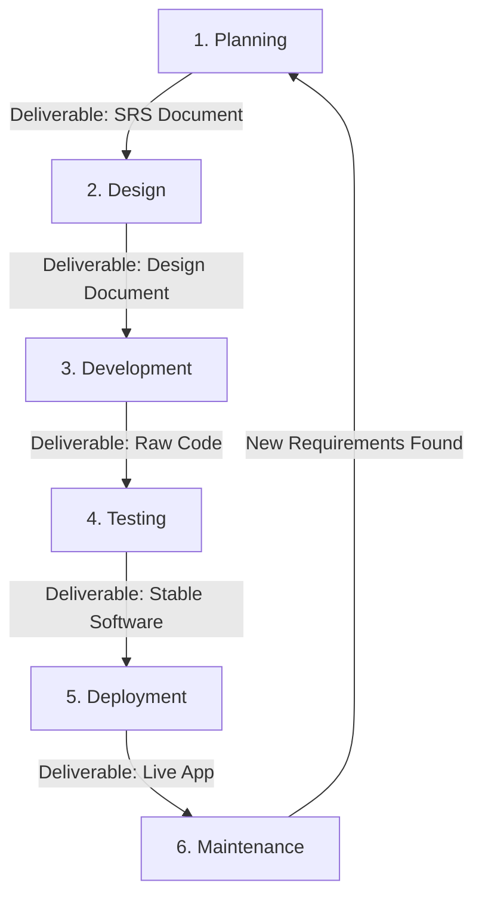
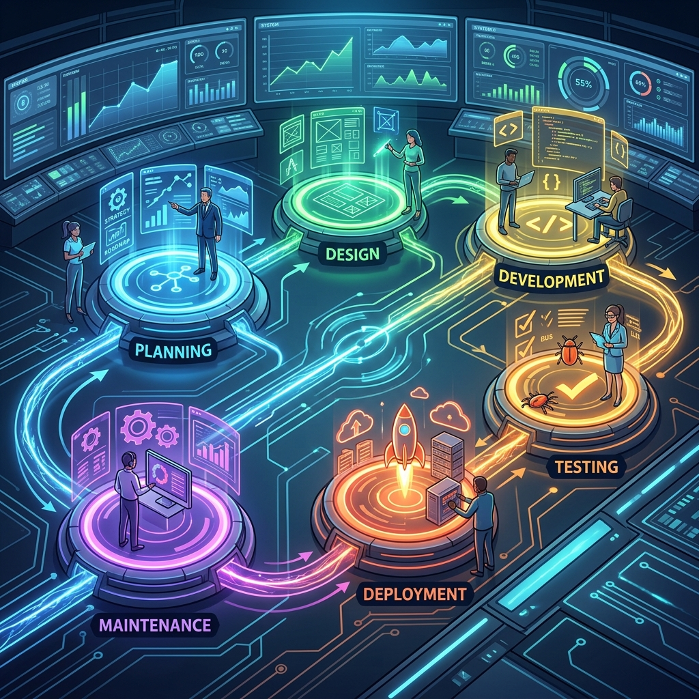
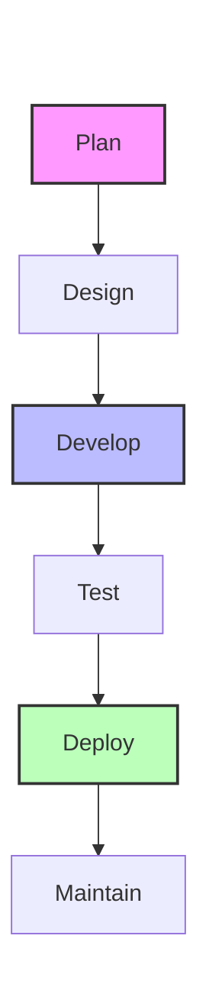
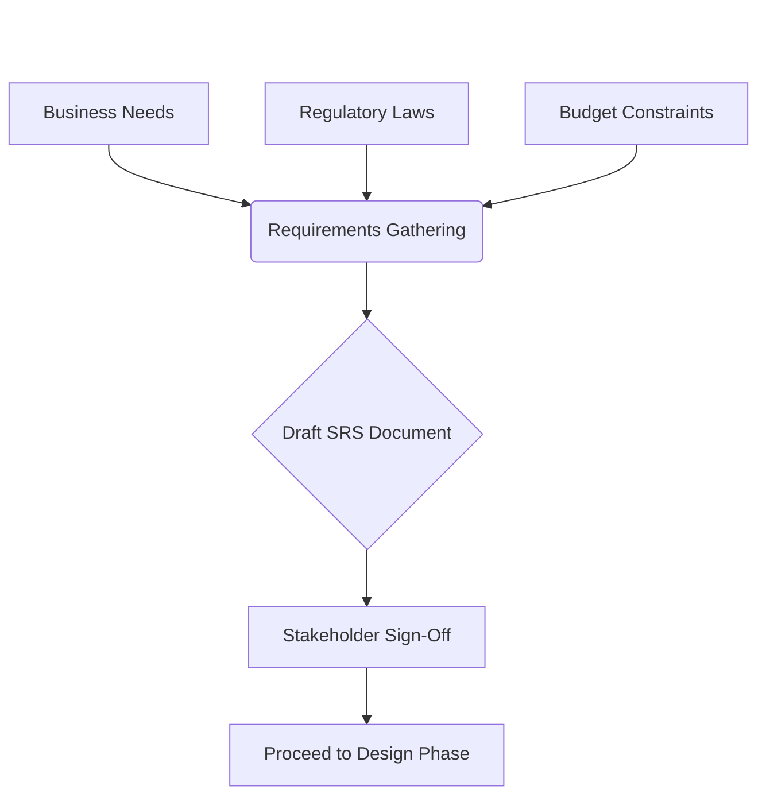
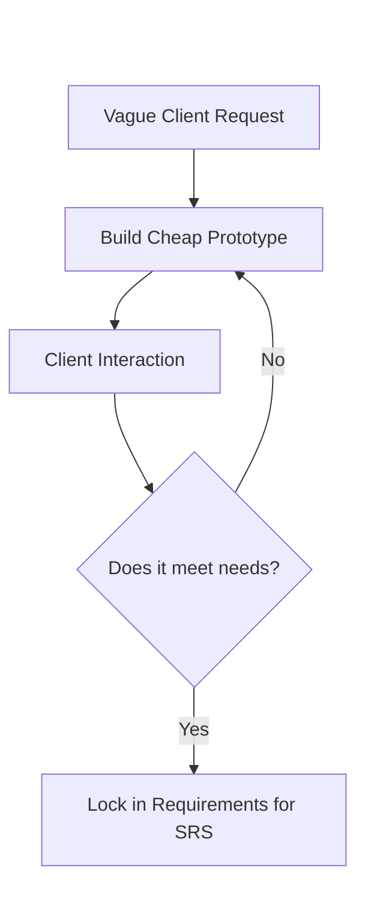
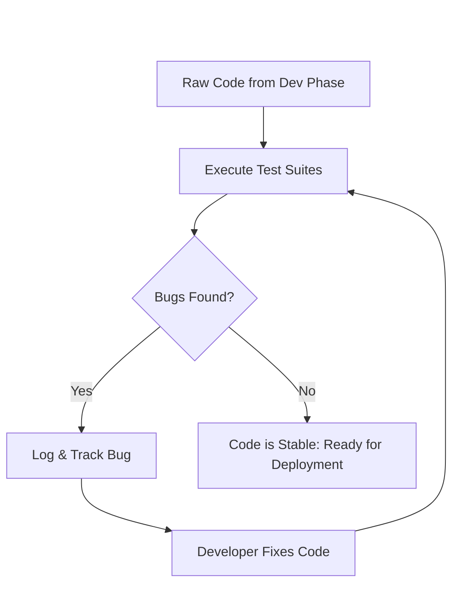
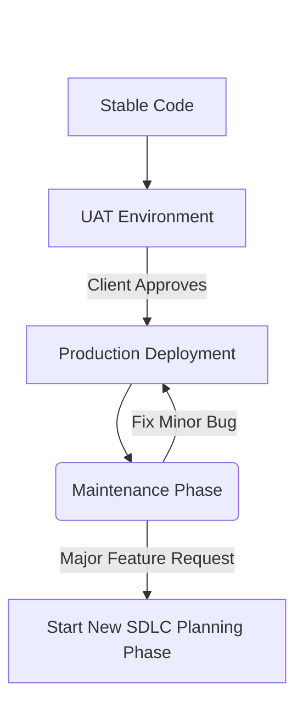

# 03 - Phases of the Software Development Lifecycle (SDLC)

## 1. Jargon Translation

- **SRS (Software Requirements Specification)**:
  - *Official Definition*: A comprehensive document created during the Planning phase that details exactly what the software must do.
  - *Under the Hood*: Think of it as the final, legally-binding contract between the business and the engineering team. It explicitly describes the problem being solved and the exact requirements the final product must meet. If it isn't in the SRS, it doesn't get built.
- **Prototype**:
  - *Official Definition*: A small-scale replica or preliminary mock-up of the system used for demonstration purposes.
  - *Under the Hood*: Imagine building a cardboard model of a skyscraper before pouring concrete. It's a quick, cheap way to show the client what you *intend* to build, to see if they actually like it before you spend thousands of hours writing real code.
- **UAT (User Acceptance Testing)**:
  - *Official Definition*: A testing phase where the actual customer or end-user tries out the software to verify it meets their needs before final production release.
  - *Under the Hood*: This is taking a test drive in a newly built car to make sure you actually like how it handles before you hand over the check.
- **Production Environment**:
  - *Official Definition*: The live server environment where real users interact with the final software.
  - *Under the Hood*: This is the public internet (as opposed to a developer's private laptop). Once code is in "production," real money and real data are on the line.

## 2. Topics Introduced in Lecture Transcript

1. The Six Discrete Phases of the SDLC
2. The Planning Phase (Requirements & SRS)
3. The Design Phase (Architecture & Design Documents)
4. The Development Phase (Coding)
5. The Testing, Deployment, and Maintenance Phases

## 3. Exhaustive Deep Dive & Structured Notes

### The Six Discrete Phases of the SDLC
* **The Core Concept:** The SDLC is generally divided into six distinct, **discrete phases**.
  * **Micro-Mechanics:** "Discrete" means that the tasks from a previous phase do not overlap with tasks in the next phase. The team officially finishes one phase before beginning the next.
  * **The 6 Phases:** Planning → Design → Development → Testing → Deployment → Maintenance.

| Phase | Primary Goal | Key Deliverable | Primary Actor |
| :--- | :--- | :--- | :--- |
| **1. Planning** | Gather and document requirements | SRS Document | Product Manager / Analyst |
| **2. Design** | Translate requirements into a blueprint | Design Document | System Architect |
| **3. Development** | Write the actual code | Working Code | Software Developer |
| **4. Testing** | Verify code against the SRS | Bug Reports / Stable Build | QA Engineer |
| **5. Deployment** | Release to real users | Live Application | DevOps / SRE |
| **6. Maintenance** | Support and gather new needs | Patches / New Requirements | Whole Team |

### 1. The Planning Phase
* **The Goal:** Requirements are gathered, analyzed, documented, and prioritized.
* **The Process:**
  * **Critical Factors Assessed:** The team must consider the users, overall purpose, data inputs/outputs, legal/regulatory compliance, risk identification, QA requirements, and project scheduling.
  * **Resource Allocation:** Labor and material costs are estimated and weighed against time constraints. Project teams and roles are identified.
  * **Prototyping (Teasing Out Requirements):** If stakeholders are struggling to define what they want, the development team may produce a **prototype** (a small-scale replica) to establish requirements.
* **The Deliverable:** The **SRS (Software Requirements Specification)** document is created, reviewed, and approved by all stakeholders. Developers are involved to gain a clear understanding.

### 2. The Design Phase
* **The Goal:** Translating the business requirements from the SRS into a technical blueprint.
* **The Process:**
  * **Software Architecture:** Several team members work together to develop the software architecture based on the SRS.
  * **Prototyping (Demonstration):** Preliminary mock-ups of the system can be designed for demonstration purposes.
* **The Deliverable:** A **Design Document** is created. This document is the technical blueprint that developers will use in the next phase.

### 3. The Development Phase (Building/Implementation)
* **The Goal:** Writing the actual code.
* **The Process:**
  * Project planners use the design document to assign specific coding tasks.
  * Developers write code using selected programming tools, languages, and software stacks.
  * **Micro-Mechanics:** The code must adhere strictly to organizational standards and the design document blueprint.

### 4. The Testing Phase
* **The Goal:** Ensuring the code is stable, secure, and perfectly meets the SRS requirements.
* **The Process:**
  * **Execution:** Code is thoroughly tested (manual, automated, or hybrid) by dedicated testing teams.
  * **Bug Tracking:** Product bugs are reported, tracked, fixed, and the code is retested.
  * **Testing Levels:** Common levels include unit testing, integration testing, system testing, and acceptance testing.

### 5. The Deployment Phase
* **The Goal:** Releasing the application into the **production environment** so users can access it.
* **The Process:**
  * **Staged Releases:** Often, it is first released to a **UAT (User Acceptance Testing)** platform. Once the customer signs off, it goes to production.
  * **Platforms:** Deployment can happen via a public website, a mobile app store, or a corporate distribution server.

### 6. The Maintenance Phase
* **The Goal:** Supporting the software post-launch.
* **The Process:**
  * Identifying hidden bugs, user interface (UI) issues, or entirely new requirements that were missed in the original SRS.
  * High-priority bugs are fixed immediately. New requirements/enhancements are documented, and the entire SDLC process **starts over again** for the next software release.





## 4. Step-by-Step Breakdown: The Value of SDLC
1. **Planning**: Gather the exact rules (SRS) and budget so you know what to build.
2. **Design**: Create a technical blueprint so the developers know *how* to build it.
3. **Development**: Write the actual code following the blueprint.
4. **Testing**: Try to break the code to prove it is safe and stable.
5. **Deployment**: Give the finished code to the real users.
6. **Maintenance**: Fix issues and plan new features, restarting the cycle.

## 5. Concrete Examples
* **Without Distinct Phases:** A developer talks to a client on the phone for 5 minutes (weak Planning) and immediately starts writing a web app (Development). Two weeks later, the client asks to see the database schema (Design). The developer realizes they used a NoSQL database when the client legally required strict SQL compliance. The project is ruined.
* **With Distinct Phases:** The team spends a month writing an SRS (Planning). They spend two weeks drafting database schemas and a Design Document (Design). The client reviews the Design Document, notices the team proposed NoSQL, and corrects them to use SQL *before* a single line of code is written.

## 6. Code Blocks
*(This demonstrates how the **Testing Phase** catches catastrophic errors before they reach the **Deployment Phase**.)*

```javascript
// Development Phase Output
// A developer wrote this function to calculate an employee's annual bonus.
function calculateBonus(salary, performanceRating) {
    if (performanceRating = "Excellent") { // FATAL TYPO: Assignment (=) instead of comparison (===)
        return salary * 0.20;
    }
    return salary * 0.05;
}

// ---------------------------------------------------------
// Testing Phase Execution
// The QA team runs automated unit tests against the code.

const testResult1 = calculateBonus(50000, "Average");
console.assert(testResult1 === 2500, `Test Failed! Expected 2500, got ${testResult1}`);
// OUTPUT: Test Failed! Expected 2500, got 10000
// Why? The assignment typo (=) forced the rating to "Excellent" for everyone!

// Result: The bug is caught in the Testing Phase, reported, and fixed by the developer.
// If this had skipped testing and gone to the Deployment Phase, the company would have
// accidentally paid out 20% bonuses to every single employee, bankrupting the business.
```

## 7. Related Concepts
1. **Agile Methodology:** A framework that compresses the 6 SDLC phases into short, 2-week "sprints."
2. **Quality Assurance (QA):** The dedicated engineering discipline focused entirely on the Testing phase.
3. **DevOps (Development and Operations):** A set of practices that automates and integrates the processes between software development and IT teams, primarily focused on automating the Testing and Deployment phases.
4. **Wireframing:** A specific type of UI/UX prototyping used heavily in the Design phase to visually map out an application's layout.
5. **Technical Debt:** The implied cost of additional rework caused by choosing an easy (limited) solution in the Development phase instead of using a better approach that would take longer. Often discovered during the Maintenance phase.

## 8. Key Takeaways (Flashcard-Ready)
* **Q: What is the SRS and when is it created?**
  * **A:** The Software Requirements Specification (SRS) is the master document detailing exact business requirements. It is created during the Planning phase.
* **Q: What is the primary output of the Design phase?**
  * **A:** The Design Document, which serves as the technical blueprint for the developers.
* **Q: During which phase is actual coding performed?**
  * **A:** The Development phase (also called Building or Implementation).
* **Q: What is the purpose of User Acceptance Testing (UAT)?**
  * **A:** It is a staged part of the Deployment phase where the actual customer tests the software to sign off on its functionality before it goes to the live production environment.
* **Q: What happens during the Maintenance phase if a massive new feature is requested?**
  * **A:** The new requirement is documented, and the SDLC process cycles back to the Planning phase for a future software release.

## 9. The Trick Section
* **💡 The Secret Engineering Trick:** **"The Prototype Trap."** Prototyping is heavily utilized in the Planning and Design phases to visually show clients what you intend to build. The dangerous trick is that clients often look at a shiny visual prototype and assume the software is "almost done." As a senior engineer, you must aggressively communicate that a prototype is a hollow cardboard box. Never let a stakeholder push you to deploy a prototype to a production environment.

## 10. Interview Questions Section

### 1. What are the six phases of the SDLC, and why must they be discrete?

* **Simple Definition**: The 6 phases are Planning, Design, Development, Testing, Deployment, and Maintenance. They must be discrete (separate) so you don't try to test code that hasn't been written, or write code for a design that hasn't been approved.
* **Official Definition**: The SDLC is comprised of six sequential phases: Planning, Design, Development, Testing, Deployment, and Maintenance. These phases are discrete, meaning that tasks from a previous phase do not overlap with tasks in the next phase, ensuring a methodical and quality-controlled progression.
* **Primary Responsibilities / Core Details**:
  * **1. Planning**: Gathering requirements, assessing risks, estimating budgets, producing the SRS.
  * **2. Design**: Translating the SRS into a technical architecture and Design Document.
  * **3. Development**: Writing the code based strictly on the Design Document.
  * **4. Testing**: Validating the code against the SRS requirements (unit, integration, system).
  * **5. Deployment**: Releasing the software to a UAT or Production environment.
  * **6. Maintenance**: Fixing post-launch bugs and gathering requirements for the next iteration.
* **Real-World Example**: A bank building a mobile app finishes the Design phase and gets official sign-off on the Design Document. Only then do they enter Development. Because the phases are discrete, if the bank executives suddenly demand a massive UI overhaul, the project manager halts Development and officially moves the project *back* to the Design phase, rather than letting developers haphazardly guess at the new UI.
* **Best Coding/Development Practices**:
  * **Phase Gates**: Implement strict "gates" between phases requiring formal stakeholder sign-off before proceeding.
    * *Example*: Refusing to allow a deployment to production until QA has formally signed off on the Testing phase.
  * **Avoid Phase Bleeding**: Do not let team members operate in multiple phases simultaneously on the same feature.
    * *Example*: Stopping a developer from writing production code (Development) while the architect is still finalizing the database schema (Design).
* **Visual Aid (Mermaid Flowchart)**:

* **Core Focus Areas**: Sequence | Discipline | Scope Management

### 2. What is the Software Requirements Specification (SRS), and why is it critical to the Planning phase?

* **Simple Definition**: The SRS is the ultimate rulebook. It is written down during the Planning phase so that months later, when the client says "I thought this button would be blue!", the developers can point to the SRS and say, "You signed the document agreeing it would be red."
* **Official Definition**: The SRS is a comprehensive document generated during the Planning phase that gathers, analyzes, documents, and prioritizes all project requirements. It serves as the single source of truth for all stakeholders regarding what the software will functionally and non-functionally accomplish.
* **Primary Responsibilities / Core Details**:
  * **Comprehensive Scope**: Must include user definitions, overarching purpose, specific data inputs/outputs, and legal/regulatory compliance (e.g., GDPR, HIPAA).
  * **Risk & Resource Management**: The SRS helps identify risks and is used to estimate labor, material costs, and time constraints.
  * **Stakeholder Agreement**: It must be clearly understood and formally approved by all stakeholders before moving to Design.
  * **Developer Baseline**: Developers review the SRS heavily to gain a flawless understanding of the end goal.
* **Real-World Example**: During the planning phase for an e-commerce platform, the SRS specifically states, "The system must process payments via Stripe API within 2 seconds." When the Testing phase occurs 6 months later, QA uses that exact sentence from the SRS to write their performance tests.
* **Best Coding/Development Practices**:
  * **Be Unambiguous**: Requirements in an SRS must be testable and precise.
    * *Example*: Instead of writing "The app must be fast," write "The app homepage must load in under 1.5 seconds on a 4G connection."
  * **Prioritize Requirements**: Use frameworks like MoSCoW (Must have, Should have, Could have, Won't have) in the SRS to manage scope.
    * *Example*: Marking a dark-mode UI as a "Could have" so developers prioritize the core payment gateway first.
* **Visual Aid (Mermaid Flowchart)**:

* **Core Focus Areas**: Documentation | Legal/Compliance | Scope Definition

### 3. How does Prototyping fit into the SDLC?

* **Simple Definition**: A prototype is a fake, clickable model of an app. You build it during the early phases so the client can "feel" the app and tell you what they actually want, before you waste time writing complex backend code.
* **Official Definition**: Prototyping is the creation of a small-scale replica or preliminary mock-up of the end product. While primarily used during the Planning and Design stages to tease out, clarify, and establish requirements through stakeholder demonstration, it can occur at various phases whenever requirements need reconsideration.
* **Primary Responsibilities / Core Details**:
  * **Teasing Out Requirements**: Used when stakeholders struggle to verbally define what they want in the Planning phase.
  * **Demonstration**: Used in the Design phase to visually represent the proposed software architecture and UI layout.
  * **Risk Mitigation**: Testing basic design ideas cheaply and quickly before committing to expensive Development phase coding.
  * **Flexibility**: Can be utilized iteratively across phases if project scope drastically changes.
* **Real-World Example**: A client wants a "dashboard for inventory." The team has no idea what that really means. The designer creates a clickable Figma prototype showing graphs and tables (writing zero actual code). The client clicks it and says, "Oh, I actually need a map view, not graphs." The requirement is caught instantly.
* **Best Coding/Development Practices**:
  * **Never Deploy a Prototype**: Ensure stakeholders understand a prototype contains no actual business logic, database, or security.
    * *Example*: Using mock data (hardcoded JSON) in a UI prototype so it's obvious the app isn't connected to a real database.
  * **Use the Right Fidelity**: Use low-fidelity (wireframes) for rapid structural feedback, and high-fidelity for final UI/UX sign-off.
    * *Example*: Drawing on a whiteboard (low-fi) for the first meeting, using a polished Figma design (high-fi) for the final SRS attachment.
* **Visual Aid (Mermaid Flowchart)**:

* **Core Focus Areas**: Visual Communication | Risk Mitigation | Requirement Clarification

### 4. What is the role of the Testing Phase, and what happens when bugs are found?

* **Simple Definition**: The Testing phase is where dedicated engineers try to violently break the software. When they find a bug, they send it back to the developers to fix, and then they try to break it again until it's indestructible.
* **Official Definition**: The Testing phase occurs after Development is complete. Its purpose is to rigorously verify that the codebase is stable, secure, and meets every requirement outlined in the SRS. When bugs are discovered, they are reported, tracked, and fixed by developers, followed by retesting until stability is achieved.
* **Primary Responsibilities / Core Details**:
  * **Validation against SRS**: Ensuring the software actually does what the contract said it would do.
  * **Methodologies**: Testing can be purely manual, fully automated via scripts, or a hybrid of both.
  * **Testing Levels**: Proceeds through multiple tiers, including unit testing (individual functions), integration testing (modules working together), system testing (the whole app), and acceptance testing.
  * **The Bug Lifecycle**: A strict loop of Report → Track → Fix → Retest.
* **Real-World Example**: A developer writes code for a login screen. During the Testing phase, a QA engineer types a 10,000-character string into the password field and the server crashes. The QA engineer logs a bug in Jira. The developer adds a character limit, and the QA engineer retests the exact same 10,000-character string to ensure the fix worked.
* **Best Coding/Development Practices**:
  * **Automate Everything Possible**: Write automated test scripts for repetitive checks to free up human QA for complex exploratory testing.
    * *Example*: Utilizing a CI/CD pipeline that automatically runs thousands of Unit Tests every time code is pushed to GitHub.
  * **Never Test Your Own Code**: Developers have blind spots regarding their own logic; always have dedicated testers or peer reviews.
    * *Example*: Enforcing a rule that Developer A must review Developer B's pull request before it can be merged.
* **Visual Aid (Mermaid Flowchart)**:

* **Core Focus Areas**: Quality Assurance | Bug Lifecycle | Automation

### 5. What occurs during the Deployment and Maintenance phases?

* **Simple Definition**: Deployment is putting the app on the internet so people can use it. Maintenance is keeping the app alive over the next few years by fixing new bugs and adding small upgrades.
* **Official Definition**: The Deployment phase is the controlled release of the application into the live production environment. The subsequent Maintenance phase involves the long-term support of the live software, encompassing bug fixing, UI adjustments, and identifying new requirements for future iterations.
* **Primary Responsibilities / Core Details**:
  * **Staged Deployment**: Deployment often utilizes User Acceptance Testing (UAT) platforms to get final customer sign-off before hitting production.
  * **Distribution Vectors**: Deployments target websites, mobile app stores, or corporate software distribution servers.
  * **Post-Launch Support**: Maintenance catches bugs that slipped past the Testing phase.
  * **Iterative Feedback Loop**: If massive new code enhancements or missing requirements are identified during Maintenance, they are fed back into a brand new SDLC Planning phase.
* **Real-World Example**: A video game is officially launched on an app store (Deployment). A week later, players discover a glitch that gives them infinite money. The engineering team immediately patches the game (Maintenance). A month later, players request a new multiplayer mode, which forces the team to start a new Planning phase for an expansion pack.
* **Best Coding/Development Practices**:
  * **Zero-Downtime Deployments**: Utilize modern architecture to ensure deploying a new version doesn't knock the live service offline.
    * *Example*: Using Blue-Green deployment strategies on AWS to seamlessly swap server traffic.
  * **Robust Logging and Monitoring**: You cannot maintain what you cannot see. Ensure production environments have extreme visibility.
    * *Example*: Implementing Datadog or New Relic to automatically alert the engineering team if the live server CPU spikes to 100%.
* **Visual Aid (Mermaid Flowchart)**:

* **Core Focus Areas**: Production Environments | Ongoing Support | Feedback Loops
