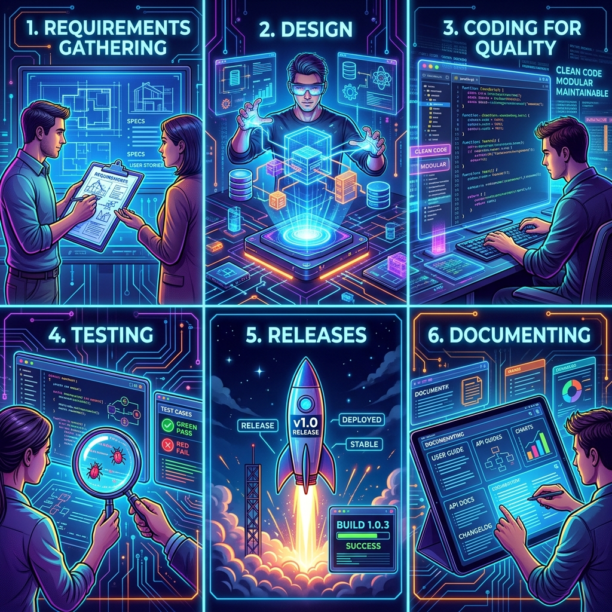
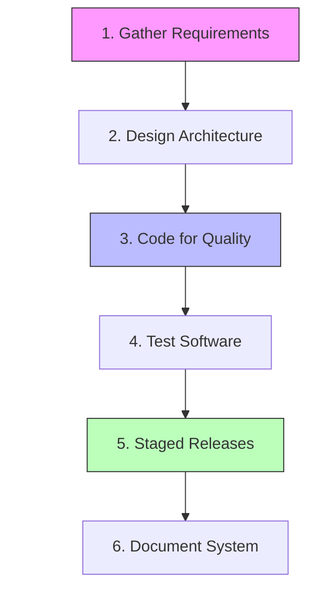
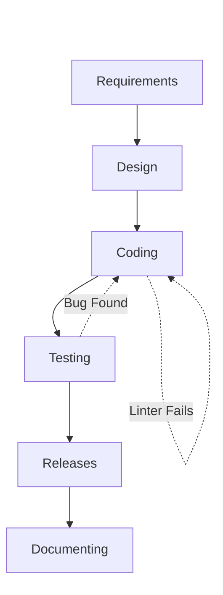
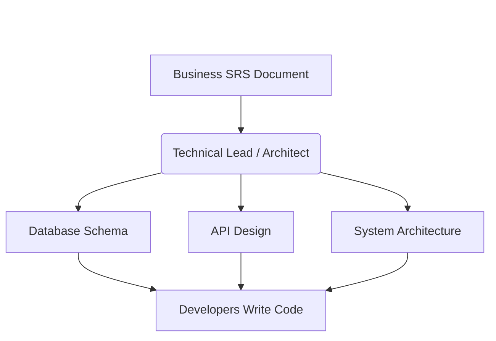
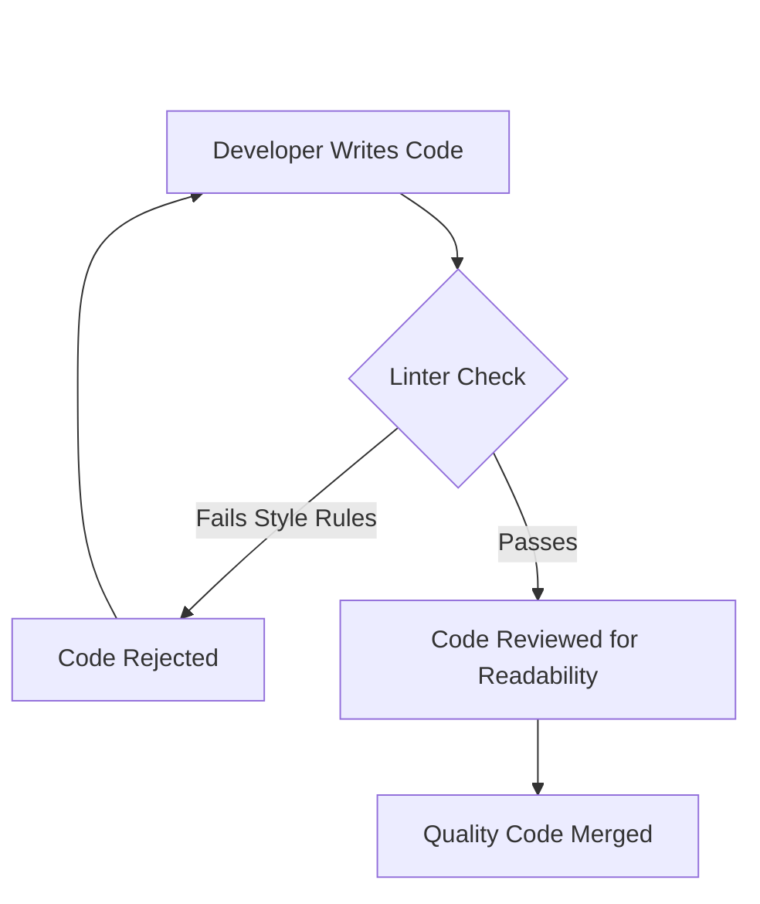
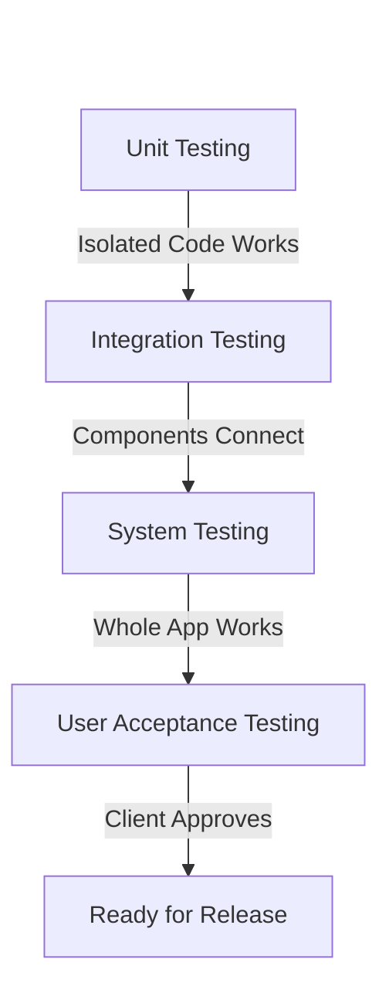
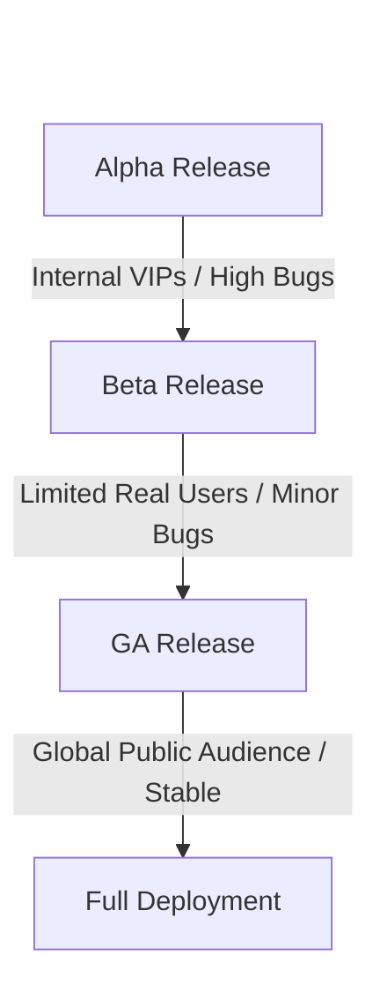

# 04 - Building Quality Software



## 1. Jargon Translation

- **SRS (Software Requirements Specification)**:
  - *Official Definition*: The process and document encompassing all collected requirements a software project must adhere to.
  - *Under the Hood*: The ultimate master checklist of what the app must do before it can be considered "finished."
- **Linters**:
  - *Official Definition*: Automated tools used during development to detect programmatic and stylistic errors in source code.
  - *Under the Hood*: A spellchecker for your code that yells at you if you forget a semicolon or use the wrong indentation.
- **UAT (User Acceptance Testing) / Beta Testing**:
  - *Official Definition*: The phase where intended end-users test the software in real-world conditions to verify functionality.
  - *Under the Hood*: Letting actual customers play with the app to see if they can break it before you launch it to the whole world.
- **GA (General Availability)**:
  - *Official Definition*: The final release stage where the software product is formally made available to the general public.
  - *Under the Hood*: Opening day. The app is live, and anyone can download and use it.

## 2. Topics Introduced in Lecture Transcript

1. Requirements Gathering (The SRS)
2. Software Design (System Architecture)
3. Coding for Quality (Standards and Practices)
4. Software Testing (Verification and Levels)
5. Software Releases (Alpha, Beta, GA)
6. Software Documenting (System vs. User Documentation)

## 3. Exhaustive Deep Dive & Structured Notes

### 1. Requirements Gathering
* **The Goal:** Collecting and documenting the exact set of requirements that the software needs to adhere to.
* **The Output:** The **SRS (Software Requirements Specification)**.
  * May include a set of use cases that describe the business needs and user flows.
* **4 Categories of Requirements:**
  1. **Functional:** What the system actually does.
  2. **Non-Functional:** How well the system performs (speed, security).
  3. **External and UI:** How the system interacts with users and outside environments.
  4. **System Features:** Specific capabilities of the application.

### 2. Software Design
* **The Goal:** Transforming the requirements into an implementable structure (translating business needs into a language developers can use to write code).
* **The Process:**
  * **Component Breakdown:** The Technical Lead breaks down the requirements into sets of related components with clearly defined behaviors, boundaries, and interactions.
  * **System Architecture:** These components collectively define the **system architecture**, incorporating guidance on functions, performance, and security.
* **Design Communication:** The design specifically dictates business rules, application logic, API (Application Programming Interface) design, UI, and database schemas.

### 3. Coding for Quality
* **The Goal:** Producing code that fulfills intended requirements perfectly without defects.
* **Quality Attributes:** Quality code is maintainable, readable, testable, secure, clean, consistent, and efficient.
* **Coding Practices:**
  * **Standards & Conventions:** Following common coding standards, patterns, and styles.
  * **Automated Tools:** Using **linters** to automatically detect programmatic and stylistic errors.
  * **Commenting:** Writing clear inline comments to make the code easy for others to modify.

### 4. Software Testing
* **The Goal:** Verifying that the software matches established requirements and is completely free of bugs.
* **The Purpose:** Identifying errors, gaps, or missing requirements compared to the SRS. Ensures reliability, security, and performance.
* **Testing Levels:**
  1. **Unit Testing:** Done by developers. Tests the smallest, most isolated component of code.
  2. **Integration Testing:** Occurs once unit-tested components are integrated into a larger product.
  3. **System Testing:** Takes place after the entire, larger product is deemed completed.
  4. **User Acceptance Testing (UAT):** Testing performed by the intended end user.
* **Testing Categories:** Broadly divided into Functional, Non-Functional, and Regression testing.

### 5. Software Releases
* **The Goal:** Distributing the newest version of the software to different audiences via staged releases.
* **Release Stages:**
  1. **Alpha Release:** The first functioning version released to a select group of stakeholders. It contains most desired functionality, but likely contains errors and design changes may still occur.
  2. **Beta Release (Limited Release):** Given to stakeholders outside the developing organization. Intended to test functionality under real conditions and identify outstanding bugs. Must meet functional requirements.
  3. **GA (General Availability):** The stable version released to *all* users.

### 6. Software Documenting
* **The Goal:** Explaining the software via text or video to both technical and non-technical audiences.
* **System Documentation (For Technical Users):** 
  * Geared towards engineers, developers, or architects. Explains how the software operates under the hood.
  * *Examples:* README files, inline comments, architecture/design documents, maintenance guides.
* **User Documentation (For Non-Technical End-Users):**
  * Geared towards assisting normal users in actually operating the product.
  * *Examples:* User guides, instructional videos, manuals, online/inline help.



## 4. Step-by-Step Breakdown: The Value of Quality Processes
1. **Requirements**: Define exactly what success looks like.
2. **Design**: Create a blueprint so success is technically possible.
3. **Coding**: Write clean, readable code using linters so the blueprint is executed correctly.
4. **Testing**: Try to break the code at the unit, integration, and system levels to prove it works.
5. **Releases**: Roll the code out slowly (Alpha, Beta) to catch remaining issues before the massive GA launch.
6. **Documentation**: Write down how it works so future engineers and current users don't get confused.

## 5. Concrete Examples
* **Without Quality Processes:** A lone developer decides to build a calendar app. They skip requirements and just start coding (No Requirements/Design). Their code is messy and uncommented (Poor Coding Quality). They launch it immediately to the public (No Testing/Alpha/Beta). Users download it, it crashes immediately, and because there are no manuals, nobody knows how to use it anyway (No Documentation). The app fails.
* **With Quality Processes:** The developer writes an SRS for a calendar app. They map out the database schema. They write clean code using a linter. They write unit tests to ensure the date calculation is perfect. They release an Alpha version to 10 friends, fix 5 bugs, then release a Beta to 100 strangers. Finally, they launch to GA with a helpful "How-to" video. The app succeeds.

## 6. Code Blocks
*(This demonstrates the concept of "Coding for Quality" by showing how linters and comments transform bad code into good code.)*

```javascript
// BAD: Poor Quality Code (No Comments, No Styling Standards)
// A linter would throw massive warnings on this block.
function c(x,y){
if(x>10)
{return x*y}else{
return y}}

// ---------------------------------------------------------

// GOOD: High Quality Code (Follows Quality Standards)
// - Uses descriptive variable names instead of "x" and "y"
// - Includes a JSDoc block for System Documentation
// - Follows strict indentation rules (enforced by a linter)

/**
 * Calculates the total bulk discount price for an order.
 * If the quantity ordered is greater than 10, a multiplier is applied.
 * 
 * @param {number} quantity - The number of items ordered.
 * @param {number} basePrice - The base price of a single item.
 * @returns {number} The final calculated price.
 */
function calculateBulkPrice(quantity, basePrice) {
    if (quantity > 10) {
        return quantity * basePrice;
    } else {
        return basePrice;
    }
}

// ---------------------------------------------------------

// WHAT HAPPENS IF... we don't handle errors or edge cases?
// If a user accidentally passes a string instead of a number, the function might 
// return NaN (Not a Number) or concatenate the strings, causing catastrophic bugs in the cart.
// High-quality code would add type checking here.
function calculateBulkPriceNoTypeCheck(quantity, basePrice) {
    // If quantity is "11" and basePrice is "5" (strings from an HTML input), 
    // quantity > 10 is true, but "11" * "5" relies on implicit type coercion which is unsafe.
    if (quantity > 10) {
        return quantity * basePrice; 
    }
    return basePrice;
}
```

## 7. Related Concepts
1. **API (Application Programming Interface):** A set of rules defined during the Design phase that dictates exactly how different software applications talk to each other.
2. **CI/CD (Continuous Integration / Continuous Deployment):** An automated pipeline that automatically runs unit tests and linters every time a developer saves code.
3. **Technical Lead / Software Architect:** The senior engineer responsible for transforming the SRS into the System Architecture during the Design phase.
4. **Code Review:** A quality assurance practice where developers manually read each other's code to ensure it meets styling and quality standards before merging.
5. **JSDoc:** A markup language used to annotate JavaScript source code files, acting as a highly efficient form of System Documentation.

## 8. Key Takeaways (Flashcard-Ready)
* **Q: What is the main purpose of the Software Design phase?**
  * **A:** To transform business requirements (the SRS) into an implementable technical structure and blueprint for the developers.
* **Q: What is a linter?**
  * **A:** An automated tool used during development to detect programmatic and stylistic errors, ensuring code quality.
* **Q: What is the difference between Unit Testing and System Testing?**
  * **A:** Unit testing checks the smallest isolated component of code (done by devs), while System testing checks the fully integrated, completed product.
* **Q: What is the purpose of a Beta release?**
  * **A:** To give the software to a limited group of outside stakeholders to test functionality under real-world conditions and catch outstanding bugs before General Availability (GA).
* **Q: What is the difference between System Documentation and User Documentation?**
  * **A:** System documentation is for technical users (engineers) to understand how the code works; User documentation is for non-technical users to understand how to operate the product.

## 9. The Trick Section
* **💡 The Secret Engineering Trick:** **"Self-Documenting Code is a Myth."** Many developers hate writing documentation and will claim, "My code is so clean, it is self-documenting!" The secret trick is knowing this is an excuse for laziness. Clean code explains *what* the software is doing, but it will never explain *why* it is doing it. You must always write System Documentation (like inline comments) to explain the *business logic* behind a strange function, or the next developer will accidentally delete it because they didn't understand the context.

## 10. Interview Questions Section

### 1. What are the six primary processes required for building quality software?

* **Simple Definition**: To build a good app, you have to figure out what to build, draw a blueprint, write clean code, test it rigorously, release it slowly to smaller groups, and write manuals so people know how to use it.
* **Official Definition**: Building high-quality, defect-free software relies on six core engineering processes: Requirements Gathering, Software Design, Coding for Quality, Software Testing, Staged Releases, and Documenting.
* **Primary Responsibilities / Core Details**:
  * **Requirements Gathering**: Collecting functional and non-functional needs to produce the SRS.
  * **Design**: Translating the SRS into a system architecture and API design.
  * **Coding for Quality**: Writing readable, maintainable, and strictly linted code.
  * **Testing**: Verifying the code matches the SRS via unit, integration, and system tests.
  * **Releases**: Distributing the software in stages (Alpha, Beta, GA) to mitigate risk.
  * **Documenting**: Providing text/video guides for both technical engineers and non-technical end-users.
* **Real-World Example**: A team building a weather app documents the need for location tracking (Requirements), designs the database to hold city names (Design), writes well-commented JavaScript (Coding), runs automated checks on the temperature converter (Testing), releases a beta to 50 users in Florida (Releases), and provides a README file for future developers (Documenting).
* **Best Coding/Development Practices**:
  * **Do Not Isolate Processes**: Understand that a failure in one process cascades to the others.
    * *Example*: If Requirements Gathering is sloppy, the Testing phase becomes impossible because QA won't know what they are supposed to be testing against.
  * **Prioritize Quality Early**: Catching a quality issue in the Design phase is 100x cheaper than catching it in the Release phase.
    * *Example*: Fixing a bad API blueprint on a whiteboard rather than rewriting thousands of lines of deployed code.
* **Visual Aid (Mermaid Flowchart)**:

* **Core Focus Areas**: End-to-End Quality | Process Interdependence | Risk Mitigation

### 2. How does the Software Design process bridge the gap between business needs and development?

* **Simple Definition**: Business people speak in features (like "I want a shopping cart"). Developers speak in code (like "I need an SQL table with a foreign key"). The Design process translates the business language into a technical blueprint the developers can actually build.
* **Official Definition**: Software design is the process of transforming the requirements established in the SRS into a highly structured, implementable technical architecture. It translates business requirements into a technical language that developers can use to write precise code.
* **Primary Responsibilities / Core Details**:
  * **Component Breakdown**: The technical lead segments massive requirements into small, related components with clearly defined boundaries.
  * **Architecture Definition**: Establishes the overarching system architecture, including database design and UI layouts.
  * **API Design**: Dictates exactly how the app will communicate internally and with external databases.
  * **Constraint Management**: Incorporates strict guidance on system performance, security standards, and platform characteristics.
* **Real-World Example**: The SRS says "Users must securely reset their passwords." During the Design process, the architect translates this into: "The backend will generate a 256-bit encrypted token, store it in the 'users' database table, and expose a POST endpoint at `/api/reset-password`." The developer then uses this exact blueprint to write the code.
* **Best Coding/Development Practices**:
  * **Design for Scalability**: The architecture must be designed not just for day one, but for year five.
    * *Example*: Designing the database schema to handle 1 million users even if you only have 100 users at launch.
  * **Standardize APIs**: Ensure your API design follows strict REST or GraphQL standards so frontend and backend developers can work seamlessly.
    * *Example*: Creating a Swagger document during the design phase that rigidly defines all API request/response payloads.
* **Visual Aid (Mermaid Flowchart)**:

* **Core Focus Areas**: Architectural Blueprint | Translation | Component Breakdown

### 3. What does "Coding for Quality" entail, and what tools enforce it?

* **Simple Definition**: It means not writing messy, spaghetti code just to get the job done quickly. You must write clean code that follows strict styling rules and is heavily commented, so the next person who reads it doesn't get a headache.
* **Official Definition**: Coding for quality entails strictly following a set of established coding practices, conventions, patterns, and styles during the development phase. Quality code must fulfill intended requirements without defects while being highly maintainable, readable, testable, and secure.
* **Primary Responsibilities / Core Details**:
  * **Readability and Maintainability**: Code is read vastly more often than it is written; it must be completely understandable by other engineers.
  * **Standardization**: Following agreed-upon organizational coding standards (e.g., camelCase for variables).
  * **Automated Enforcement**: Utilizing automated tools known as **linters** to detect programmatic and stylistic errors before code is saved.
  * **Documentation**: Writing inline comments directly in the code to explain complex logic.
* **Real-World Example**: A developer writes a highly complex math algorithm. Without quality standards, they name their variables `a`, `b`, and `c`. With quality standards, they name the variables `taxRate`, `baseSalary`, and `totalDeductions`, use a linter to ensure perfect indentation, and add a comment explaining *why* the calculation works.
* **Best Coding/Development Practices**:
  * **Enforce CI/CD Linting**: Never allow code to be merged into the main codebase if it fails the automated linter checks.
    * *Example*: Setting up GitHub Actions to automatically reject any pull request that contains unlinted code.
  * **Adhere to DRY**: Don't Repeat Yourself. Quality code extracts duplicated logic into reusable functions.
    * *Example*: Instead of writing the same database connection string in 5 different files, create one `db.js` file and import it.
* **Visual Aid (Mermaid Flowchart)**:

* **Core Focus Areas**: Maintainability | Linters | Coding Standards

### 4. What are the four main levels of Software Testing, and how do they differ?

* **Simple Definition**: You test the smallest pieces first (Unit), then test how they fit together (Integration), then test the whole app (System), and finally let the actual customer test it (UAT) to make sure they are happy.
* **Official Definition**: Software testing occurs across multiple escalating levels to ensure reliability, security, and performance. The process scales up from isolating individual code components to verifying the entire integrated system against the original SRS.
* **Primary Responsibilities / Core Details**:
  * **Unit Testing**: Performed by the developer. Tests the smallest, most isolated component of code (like a single function).
  * **Integration Testing**: Occurs once individual components are combined, verifying that they interact correctly without breaking each other.
  * **System Testing**: Takes place when the larger product is deemed complete; tests the software as a whole entity in an environment mirroring production.
  * **User Acceptance Testing (UAT)**: Also known as beta testing, performed by the intended end-users to validate that the software meets real-world business needs.
* **Real-World Example**: Building a car. Unit Testing is checking if the spark plug sparks. Integration Testing is putting the spark plug in the engine and seeing if the engine turns on. System Testing is putting the engine in the car and driving it on a track. UAT is letting a suburban dad test-drive it to see if the cupholders are big enough.
* **Best Coding/Development Practices**:
  * **Test-Driven Development (TDD)**: Write your unit tests *before* you write the actual code to ensure you only write code that fulfills the test.
    * *Example*: Writing a test asserting `calculateTotal(5, 5)` equals `10` before actually writing the `calculateTotal` function.
  * **Maintain High Test Coverage**: Ensure a high percentage of your codebase is covered by automated unit tests.
    * *Example*: Requiring an 80% minimum code coverage threshold in Jest before a build can pass.
* **Visual Aid (Mermaid Flowchart)**:

* **Core Focus Areas**: Escalating Scope | Validation | End-User Approval

### 5. What are the different types of software releases, and who are their audiences?

* **Simple Definition**: Alpha is the rough draft for VIP insiders. Beta is the polished draft for a small group of real users to try and break. GA (General Availability) is the final published book for the whole world to buy.
* **Official Definition**: When software is distributed, it occurs through staged releases intended for different audiences, gradually scaling up in stability and user base to mitigate risk. The three primary stages are Alpha, Beta (Limited Release), and GA (General Availability).
* **Primary Responsibilities / Core Details**:
  * **Alpha Release**: The first functioning version containing most functionality, but lacking the full feature set and likely containing major errors. Released to a select group of internal stakeholders. Design changes can still heavily occur.
  * **Beta Release**: Also called a limited release, distributed to external stakeholders/users outside the developing organization. Must meet functional requirements. Intended to test functionality under real conditions and catch outstanding bugs.
  * **GA (General Availability)**: The highly stable, final version released. The audience is all users.
* **Real-World Example**: A video game company finishes coding. They give the Alpha version to their internal QA and executives (who find massive graphical glitches). They fix it, then give the Beta version to 1,000 random fans who pre-ordered (who find a bug where the game crashes on level 3). They fix it, then launch the GA version globally on the Playstation Store.
* **Best Coding/Development Practices**:
  * **Feature Toggles**: Use feature flags during Beta releases to instantly turn off a buggy new feature without needing to redeploy the whole application.
    * *Example*: Wrapping a new payment gateway in an `if (beta_enabled)` check so it can be disabled if it starts failing in the real world.
  * **Gather Telemetry**: During Alpha and Beta, ensure your software is sending massive amounts of crash logs and telemetry back to the developers so they can fix bugs before GA.
    * *Example*: Implementing Sentry.io to automatically report stack traces during the Beta test.
* **Visual Aid (Mermaid Flowchart)**:

* **Core Focus Areas**: Staged Rollouts | Risk Mitigation | Audience Scaling
