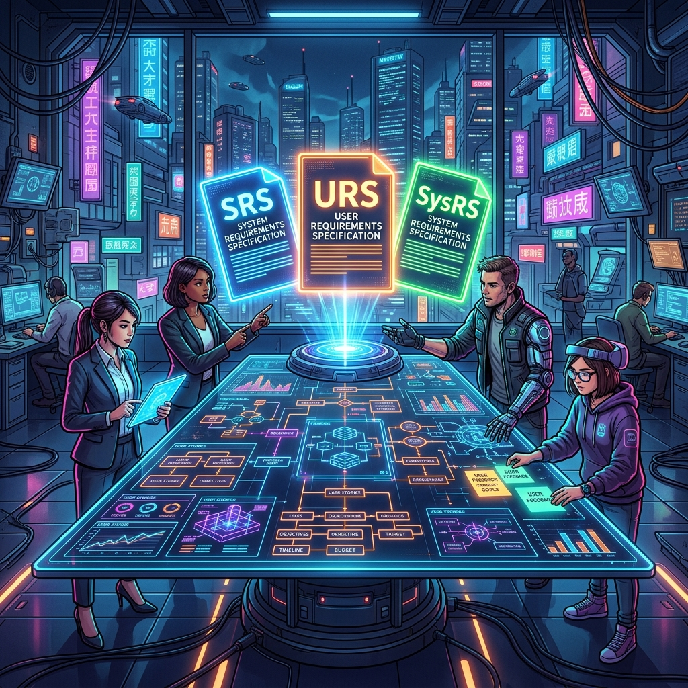
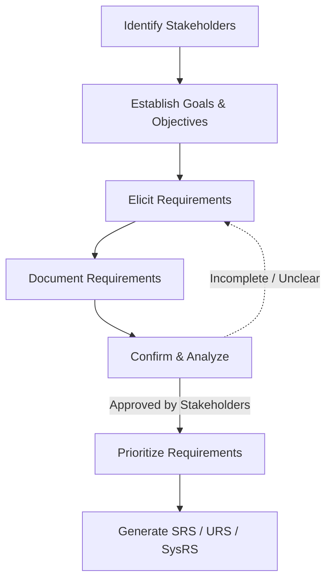
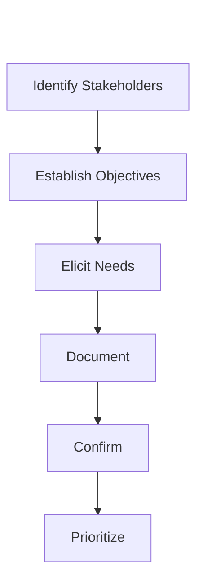
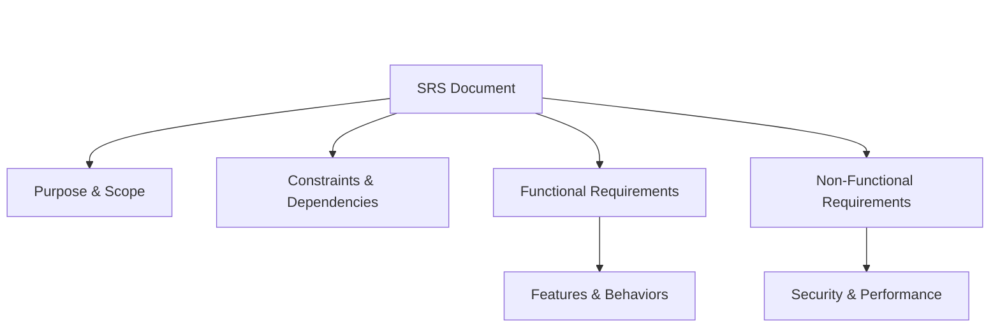
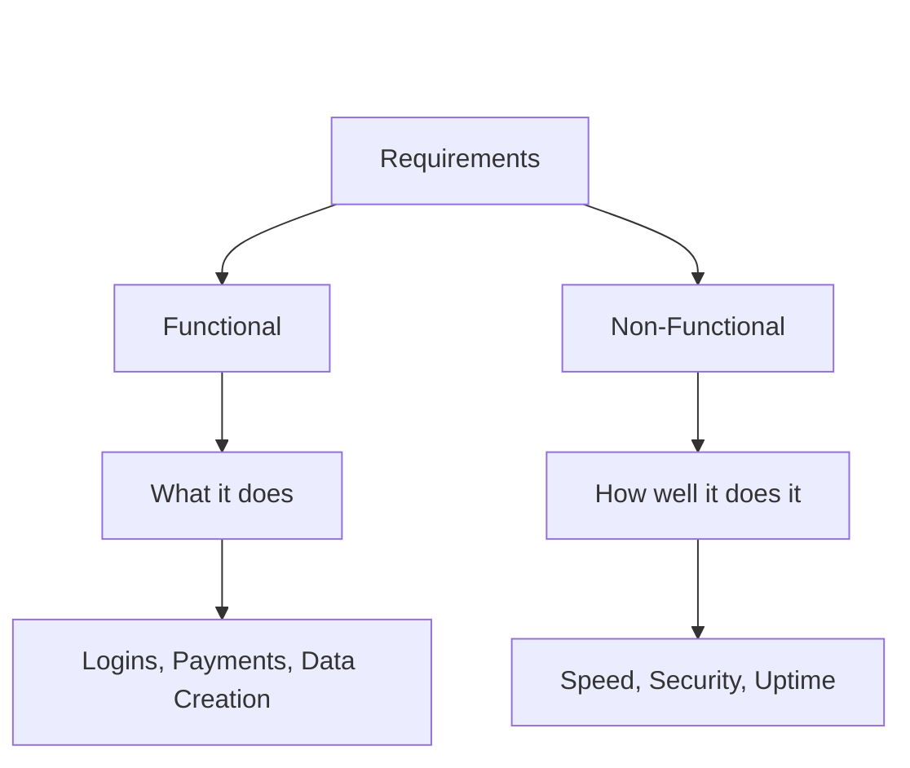
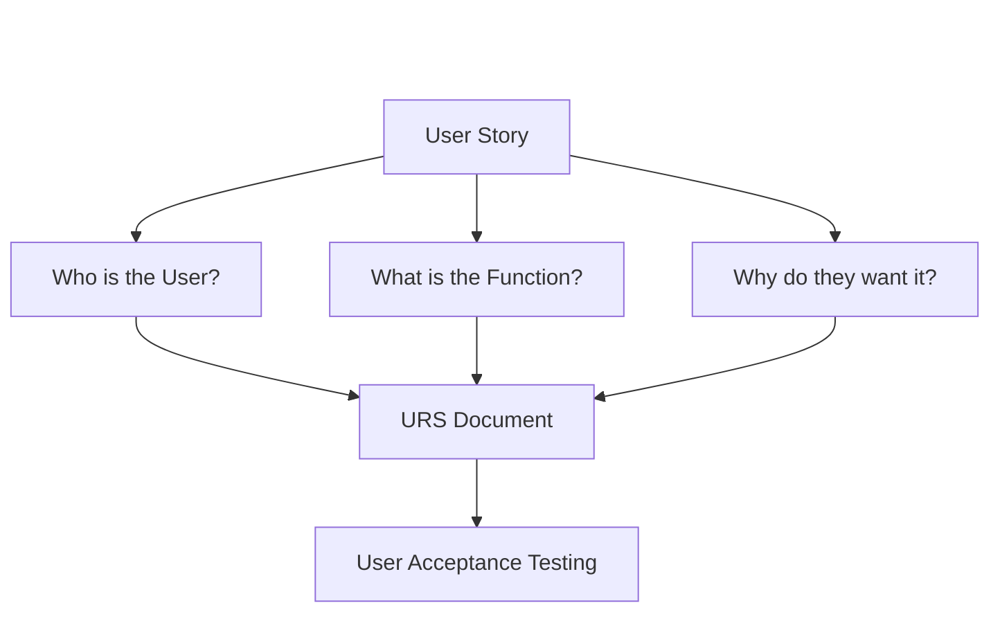
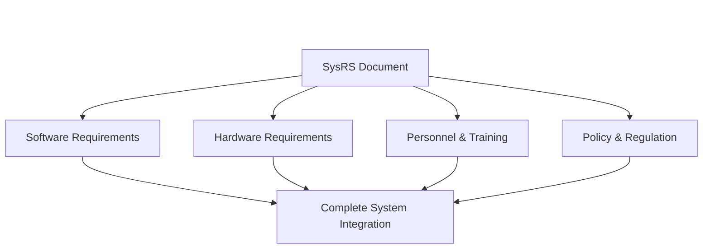

# 05 - Requirements



## 1. Jargon Translation

- **URS (User Requirement Specification)**:
  - *Official Definition*: A document that describes the business needs and expectations of the end-users, often written as user stories.
  - *Under the Hood*: What the user actually wants to do with the software and why they want to do it.
- **SRS (Software Requirement Specification)**:
  - *Official Definition*: A document capturing the specific functionalities the software must perform and benchmarks for its performance.
  - *Under the Hood*: The master blueprint that tells developers exactly what the app must do and how fast it must run.
- **SysRS (System Requirement Specification)**:
  - *Official Definition*: A broader document outlining the requirements of an entire system, including hardware, software, and policies.
  - *Under the Hood*: The big-picture manual that includes not just the app, but the servers, rules, and hardware it runs on.
- **Elicitation**:
  - *Official Definition*: The process of gathering requirements from stakeholders through surveys, interviews, and questionnaires.
  - *Under the Hood*: Interviewing clients to figure out what they *really* need, rather than just what they *say* they want.
- **Stakeholders**:
  - *Official Definition*: Key personnel from the organization requesting the software (e.g., end-users, admins, marketing, sales).
  - *Under the Hood*: Anyone whose job or life is affected by the software succeeding or failing.

## 2. Topics Introduced in Lecture Transcript

1. The Requirement Gathering Process (The 6 Steps)
2. Identifying Stakeholders, Goals, and Objectives
3. Requirement Elicitation, Documentation, and Prioritization
4. The SRS (Software Requirement Specification) Document
5. The URS (User Requirement Specification) Document
6. The SysRS (System Requirement Specification) Document

## 3. Exhaustive Deep Dive & Structured Notes

### 1. The Requirement Gathering Process
* **The Goal:** Defining the exact problem to be solved and explicitly documenting how to go about solving that problem.
* **Iterative Nature:** The steps of eliciting, documenting, and confirming are usually completed iteratively, rather than just once.

### 2. Identifying Stakeholders, Goals, and Objectives
* **Stakeholders:** People who work for the organization requesting the software.
  * *Who to include:* Decision-makers, end-users, system administrators, engineering, marketing, sales, and customer support. It is critical to have a representative from *every group* the product affects.
* **Goals vs. Objectives:**
  * **Goals:** Broad, long-term achievable outcomes (e.g., "Increase customer checkout speed by 50%").
  * **Objectives:** Specific, actionable, and measurable actions that achieve the stated goals (e.g., "Implement one-click Apple Pay integration on the checkout page").

### 3. Eliciting, Confirming, and Prioritizing
* **Elicitation:** Extracting the requirements from stakeholders via surveys, questionnaires, and interviews.
* **Confirmation & Analysis:** Analyzing documented requirements to ensure they are consistent, clear, and complete. After analysis, they must be shared with and approved by stakeholders.
* **Prioritization:** Sorting requirements into strict categories:
  1. *Must-have*
  2. *Highly desired*
  3. *Nice to have*

### 4. The SRS (Software Requirement Specification)
* **The Goal:** The most common document. It captures the functionalities the software should perform and establishes benchmarks/service levels for its performance.
* **Core Components of an SRS:**
  1. **Purpose Statement:** The intended use of the SRS, its audience, and scope (benefits, goals, and objectives).
  2. **Constraints:** Conditions that may limit options in the design phase (e.g., conformance to specific standards or strict hardware limitations).
  3. **Assumptions & Dependencies:** Required operating systems, required hardware, or dependencies on other software products.
  4. **Requirements (The 4 Categories):**
     * **Functional:** What the software must actually do.
     * **External Interface:** How the software addresses behavior in relation to external entities (users, other hardware/software).
     * **System Features:** A subset of functional requirements; the core required features for the system to function.
     * **Non-functional:** Specifying performance, safety, security, and quality standards.

### 5. The URS (User Requirement Specification)
* **The Goal:** Describes the business need and expectations of the end-users from the software system.
* **Structure (User Stories/Use Cases):** Written to answer three fundamental questions:
  1. Who is the user?
  2. What function needs to be performed?
  3. Why does the user want this functionality?
* **Verification:** **User Acceptance Testing (UAT)** is strictly used to determine if these specific requirements have been met.
* *Note: URS is often combined directly into a single SRS document.*

### 6. The SysRS (System Requirement Specification)
* **The Goal:** Outlines the requirements of an *entire* system. It is much broader in scope than an SRS.
* **Core Components:** 
  * System capabilities, interfaces, and user characteristics.
  * Policy, regulation, and personnel requirements.
  * Performance and security requirements.
  * System acceptance criteria.
  * *Crucially:* Expectations of the **hardware** needed for the system (in addition to software).



## 4. Step-by-Step Breakdown: The Requirement Gathering Workflow
1. **Identify Stakeholders**: Find everyone who will use or care about the software.
2. **Establish Goals & Objectives**: Figure out what the broad win-state is, and the specific metrics to achieve it.
3. **Elicit Requirements**: Interview the stakeholders to figure out what they need to hit those metrics.
4. **Document**: Write down everything they said in a clear, understandable format.
5. **Analyze and Confirm**: Check the document for contradictions. Ask the stakeholders to sign off on it.
6. **Prioritize**: Rank the requirements (Must-have, Highly desired, Nice to have) so developers know what to build first.

## 5. Concrete Examples
* **Goal:** A hospital wants a new patient portal.
* **Stakeholders:** Doctors, Nurses, Patients, IT Admin, Legal Team.
* **Elicitation:** Surveying patients about UI preferences; interviewing doctors about data access; consulting legal about HIPAA compliance.
* **Prioritization:**
  * *Must-have:* Patients can securely view test results (Functional / Security).
  * *Highly desired:* Email notifications when results are ready.
  * *Nice to have:* Dark mode UI.
* **Constraints:** Must run on the hospital's existing 10-year-old Windows servers (Hardware constraint).
* **Output:** An SRS documenting the portal's functionalities and a SysRS detailing the server hardware requirements.

## 6. Code Blocks
*(This demonstrates how a User Story (URS) is translated directly into a Functional Requirement, and then into automated API tests.)*

```javascript
// URS (User Story): 
// "As a user, I want to securely log in with my email and password so I can access my dashboard."

// SRS (Functional Requirement): 
// "The system must expose a POST /login endpoint that accepts JSON containing an email and password. 
// It must return a 200 OK and a JWT token on success, or a 401 Unauthorized on failure."

// DEVELOPER IMPLEMENTATION & TEST:
const request = require('supertest');
const app = require('../app'); // The Express app

describe('POST /login', () => {
    it('should return 200 and a token for valid credentials', async () => {
        const response = await request(app)
            .post('/login')
            .send({ email: 'user@test.com', password: 'secure123' });
        
        // Asserting the Functional Requirement is met
        expect(response.statusCode).toBe(200);
        expect(response.body).toHaveProperty('token');
    });
});

// ---------------------------------------------------------

// WHAT HAPPENS IF... we don't have Non-Functional Requirements?
// A developer might build the route securely, but poorly optimized.
// If the SRS forgot to include the Non-Functional requirement: "Login must take < 1 second",
// the developer might use a massive, unindexed database query that takes 10 seconds.
// It functionally works (passes the test above), but fails the business objective.
```

## 7. Related Concepts
1. **User Stories (Agile):** A specific, non-technical format for writing URS requirements (As a [role], I want [feature], so that [benefit]).
2. **Acceptance Criteria:** The specific conditions that a software product must satisfy to be accepted by a user (used heavily in UAT).
3. **Scope Creep:** When requirements continuously grow and change after the initial SRS is signed, causing budget and timeline blowouts.
4. **HIPAA / GDPR:** Common external regulations that heavily dictate the Non-Functional security and privacy requirements in an SRS.
5. **Wireframes / Mockups:** Visual, low-fidelity sketches of a user interface often created during Elicitation to help stakeholders visualize their requirements.

## 8. Key Takeaways (Flashcard-Ready)
* **Q: What is the difference between a Goal and an Objective?**
  * **A:** Goals are broad, long-term outcomes, while Objectives are specific, actionable, and measurable actions to achieve those goals.
* **Q: What are the three questions a User Story (URS) must answer?**
  * **A:** Who is the user? What function needs to be performed? Why does the user want this functionality?
* **Q: What is the main difference between an SRS and a SysRS?**
  * **A:** An SRS focuses specifically on software functionalities and performance, while a SysRS outlines the entire system, heavily including hardware, policies, and regulations.
* **Q: What does it mean to "elicit" requirements?**
  * **A:** Actively extracting requirements from stakeholders using tools like surveys, questionnaires, and interviews.
* **Q: Why must requirements be prioritized into categories like "Must-have" and "Nice to have"?**
  * **A:** To ensure that the engineering team builds the most critical, core functionalities first, especially if time or budget constraints occur.

## 9. The Trick Section
* **💡 The Secret Engineering Trick:** **"The XY Problem."** During Requirement Elicitation, stakeholders will often ask you for a specific solution (X) instead of explaining their actual problem (Y). For example, they might say, "We need a massive button that exports the database to CSV every hour" (X). If you just build it, the server will crash. If you ask *why* they need it, they might say, "Because marketing needs to know how many users signed up today" (Y). The actual requirement is just a simple dashboard counter. Great requirement gathering uncovers the Y.

## 10. Interview Questions Section

### 1. Can you walk me through the six steps of the requirement gathering process?

* **Simple Definition**: It’s the process of figuring out exactly what to build. You find the right people, set a goal, interview them, write down their needs, get them to sign off on the document, and decide what to build first.
* **Official Definition**: Requirement gathering is a systematic six-step process for defining a problem and documenting the solution: Identifying Stakeholders, Establishing Goals/Objectives, Eliciting Requirements, Documenting, Analyzing/Confirming, and Prioritizing.
* **Primary Responsibilities / Core Details**:
  * **Identifying Stakeholders**: Ensuring every affected department (sales, engineering, users) is represented.
  * **Establishing Goals**: Defining the broad outcome and specific measurable objectives.
  * **Eliciting**: Conducting interviews, surveys, and questionnaires to extract needs.
  * **Documenting**: Writing the requirements down clearly so both technical and non-technical parties understand them.
  * **Confirming**: Analyzing for consistency and obtaining formal approval from stakeholders.
  * **Prioritizing**: Tagging items as "must-have", "highly desired", or "nice to have".
* **Real-World Example**: A bank wants a new mobile app. They identify tellers and customers (Stakeholders), set a goal to reduce in-person visits (Goals), interview customers about their pain points (Eliciting), write the features down (Documenting), have the bank executives sign the document (Confirming), and decide that checking balances is a must-have while dark-mode is nice-to-have (Prioritizing).
* **Best Coding/Development Practices**:
  * **Iterative Elicitation**: Do not expect stakeholders to know everything in the first meeting. Elicit, document, confirm, and loop back to elicit more details as concepts become clearer.
    * *Example Code (Requirement Elicitation)*:
      ```html
      <!-- Showing a quick HTML wireframe to elicit specific UI requirements -->
      <button class="btn-primary">Checkout (Mockup)</button>
      ```
  * **Prevent Scope Creep**: Once the requirements are confirmed and prioritized, formally lock them in. Any new "must-haves" require a new review process.
    * *Example Code (Jira Ticket Validation)*:
      ```javascript
      // A Git hook script preventing commits that don't reference a locked SRS requirement
      if (!commitMessage.match(/SRS-REQ-\d+/)) {
          throw new Error("Scope Creep Prevented: Commit must reference an approved SRS requirement.");
      }
      ```
* **Visual Aid (Mermaid Flowchart)**:

* **Core Focus Areas**: Systematic Workflow | Stakeholder Alignment | Iterative Refinement

### 2. What is an SRS, and what are its core components?

* **Simple Definition**: The SRS is the master blueprint of the software. It lists exactly what the app is supposed to do, how fast it should do it, and what external limits (like server size) it has to obey.
* **Official Definition**: The Software Requirement Specification (SRS) is a formal document that captures the functionalities the software should perform, establishes benchmarks for performance, and details constraints, assumptions, and dependencies.
* **Primary Responsibilities / Core Details**:
  * **Purpose Statement**: Defines the intended use, audience, and scope of the software.
  * **Constraints**: Hard limits on design, such as specific hardware limitations or strict industry standards.
  * **Assumptions & Dependencies**: Required operating systems or reliance on third-party software products (e.g., AWS).
  * **Functional Requirements**: What the software must actually execute or allow the user to do.
  * **Non-Functional Requirements**: Metrics for how the software performs (speed, security, safety, uptime).
* **Real-World Example**: For a video streaming app, the SRS Purpose Statement outlines it is an app for watching movies. A Constraint is that it must not exceed 50MB in file size. A Dependency is that it requires iOS 15+. A Functional Requirement is that users can pause videos. A Non-Functional Requirement is that videos must buffer in under 2 seconds.
* **Best Coding/Development Practices**:
  * **Clarity and Lack of Ambiguity**: Functional requirements must be written in absolute, testable terms. Never use words like "fast" or "user-friendly".
    * *Example Code (Testable Non-Functional Requirement)*:
      ```javascript
      // A test validating the exact SRS benchmark
      const start = Date.now();
      await request(app).get('/search?q=test');
      expect(Date.now() - start).toBeLessThan(200); // Enforcing the < 200ms rule
      ```
  * **Traceability**: Every feature developed in the codebase should trace directly back to a specific requirement in the SRS.
    * *Example Code (Traceability)*:
      ```bash
      # Tagging a commit to provide direct traceability to the SRS document
      git commit -m "feat: Add user authentication route (Resolves SRS-REQ-042)"
      ```
* **Visual Aid (Mermaid Flowchart)**:

* **Core Focus Areas**: Comprehensive Documentation | Traceability | Strict Benchmarks

### 3. How do Functional and Non-Functional Requirements differ?

* **Simple Definition**: Functional requirements describe what the car does (it drives, it steers, it honks). Non-functional requirements describe how well the car performs (it drives at 100mph, it steers smoothly, it honks loudly).
* **Official Definition**: Functional requirements define the specific behaviors, capabilities, and functions a software system must execute. Non-functional requirements specify criteria that judge the operation of a system, such as performance, safety, security, and quality standards.
* **Primary Responsibilities / Core Details**:
  * **Functional - Behavior**: Defines input, behavior, and output (e.g., clicking 'Login' authenticates the user).
  * **Functional - System Features**: The core operational capabilities necessary for the software to have value.
  * **Non-Functional - Performance**: Benchmarks for speed, response time, and throughput.
  * **Non-Functional - Security**: Cryptographic standards, access control, and data privacy regulations.
  * **Non-Functional - Reliability**: Uptime guarantees (e.g., 99.99% availability).
* **Real-World Example**: In an e-commerce backend, the Functional Requirement dictates: "The API must deduct funds from the user's wallet when they purchase an item." The Non-Functional Requirement dictates: "The transaction must be encrypted using AES-256 and process within 500 milliseconds to prevent double-spending."
* **Best Coding/Development Practices**:
  * **Automate Non-Functional Testing**: Just as you write unit tests for functional requirements, use load testing tools to verify non-functional performance requirements continuously.
    * *Example Code (K6 Load Testing for Non-Functional Req)*:
      ```javascript
      import http from 'k6/http';
      // Bombarding the API to ensure the server doesn't crash under load
      export default function () {
          http.get('https://api.example.com/login');
      }
      ```
  * **Security by Design**: Implement non-functional security requirements into the architecture from day one, rather than trying to patch them in after the functional features are built.
    * *Example Code (Security by Design)*:
      ```javascript
      // Centralized security middleware applied BEFORE functional routes
      app.use('/api', validateJWT); 
      
      app.post('/api/purchase', (req, res) => {
          // Functional business logic...
      });
      ```
* **Visual Aid (Mermaid Flowchart)**:

* **Core Focus Areas**: Behavior vs. Performance | Measurability | System Attributes

### 4. What is a URS, and how does it relate to User Stories?

* **Simple Definition**: The URS is a document filled with short, specific sentences explaining exactly who the user is and what they want to achieve, written from their perspective.
* **Official Definition**: The User Requirement Specification (URS) describes the business needs and expectations of the end-users from the software system. It is heavily comprised of "user stories" or "use cases" that define who the user is, the function they need, and the reasoning behind it.
* **Primary Responsibilities / Core Details**:
  * **End-User Focus**: Unlike the technical SRS, the URS focuses entirely on the human utilizing the software.
  * **The 3-Part Structure**: User stories must answer: Who is the user? What function needs to be performed? Why does the user want this functionality?
  * **Business Need**: Highlights the underlying business value or goal of a specific feature.
  * **UAT Validation**: User Acceptance Testing is the specific testing phase used to prove that the URS requirements have been met.
  * **Integration**: Often, modern agile teams combine the URS directly into the broader SRS.
* **Real-World Example**: A URS for a blog application contains the following User Story: "As an Author (Who), I want to be able to save my articles as drafts (What), so that I don't lose my work if I close the browser (Why)."
* **Best Coding/Development Practices**:
  * **Keep Stories Atomic**: A single user story should represent a single, testable feature. If a story is too large (an "Epic"), break it down.
    * *Example Code (Atomic Stories in JSON)*:
      ```json
      {
        "storyId": "URS-101",
        "description": "As a user, I want to add an item to a cart.",
        "status": "Done"
      }
      ```
  * **Behavior-Driven Development (BDD)**: Translate user stories directly into automated tests using BDD frameworks.
    * *Example Code (Cucumber/Gherkin BDD)*:
      ```gherkin
      Scenario: Saving a draft
        Given I am an authenticated author
        When I click "Save Draft"
        Then my work is saved securely in the database
      ```
* **Visual Aid (Mermaid Flowchart)**:

* **Core Focus Areas**: User-Centric Design | The 'Why' | Agile Methodologies

### 5. When would an organization create a SysRS instead of just an SRS?

* **Simple Definition**: You write an SRS when you are just building an app. You write a SysRS when you are building the app, building the physical server it runs on, hiring the people to manage it, and writing the legal policies to govern it.
* **Official Definition**: A System Requirement Specification (SysRS) is created when a project is broader in scope than just software. It outlines the requirements of an *entire system*, heavily incorporating hardware expectations, policy regulations, and personnel requirements alongside the software capabilities.
* **Primary Responsibilities / Core Details**:
  * **Hardware Integration**: Outlines specific hardware components, servers, or physical machines needed for the system.
  * **Software Capabilities**: Still includes all the software interfaces and functional requirements found in an SRS.
  * **Policy & Regulation**: Documents legal, compliance, and organizational policy requirements.
  * **Personnel Requirements**: Defines who is needed to operate the system, including staffing and training needs.
  * **System Acceptance Criteria**: Holistic criteria required to prove the entire hardware/software ecosystem is operational.
* **Real-World Example**: If you are building a simple mobile game, you write an SRS (just software). If you are building a completely new biometric security gate for an airport, you write a SysRS. It dictates the software for the facial recognition, the physical hardware for the camera and gate, the security regulations for the TSA, and the training manual for the guards.
* **Best Coding/Development Practices**:
  * **Clear Boundary Definition**: In a complex SysRS, ensure the interface boundaries between the hardware components and the backend software are rigidly defined.
    * *Example Code (Hardware-Software Interface)*:
      ```javascript
      // Node.js backend configured exactly as the SysRS boundary dictates
      const mqtt = require('mqtt');
      // Listening precisely on the documented Port 1883 for physical hardware sensors
      const client = mqtt.connect('mqtt://localhost:1883'); 
      ```
  * **Cross-Disciplinary Reviews**: A SysRS cannot be reviewed by software engineers alone; it requires sign-off from hardware engineers, legal, and operations.
    * *Example Code (Policy Enforcement via Code)*:
      ```javascript
      // A cron job enforcing the SysRS legal data retention policy
      cron.schedule('0 0 * * *', async () => {
          // Automatically delete data older than 30 days to comply with GDPR policy
          await db.query('DELETE FROM user_logs WHERE created_at < NOW() - INTERVAL 30 DAY');
      });
      ```
* **Visual Aid (Mermaid Flowchart)**:

* **Core Focus Areas**: Holistic Scope | Hardware & Software Interplay | Complex Systems
