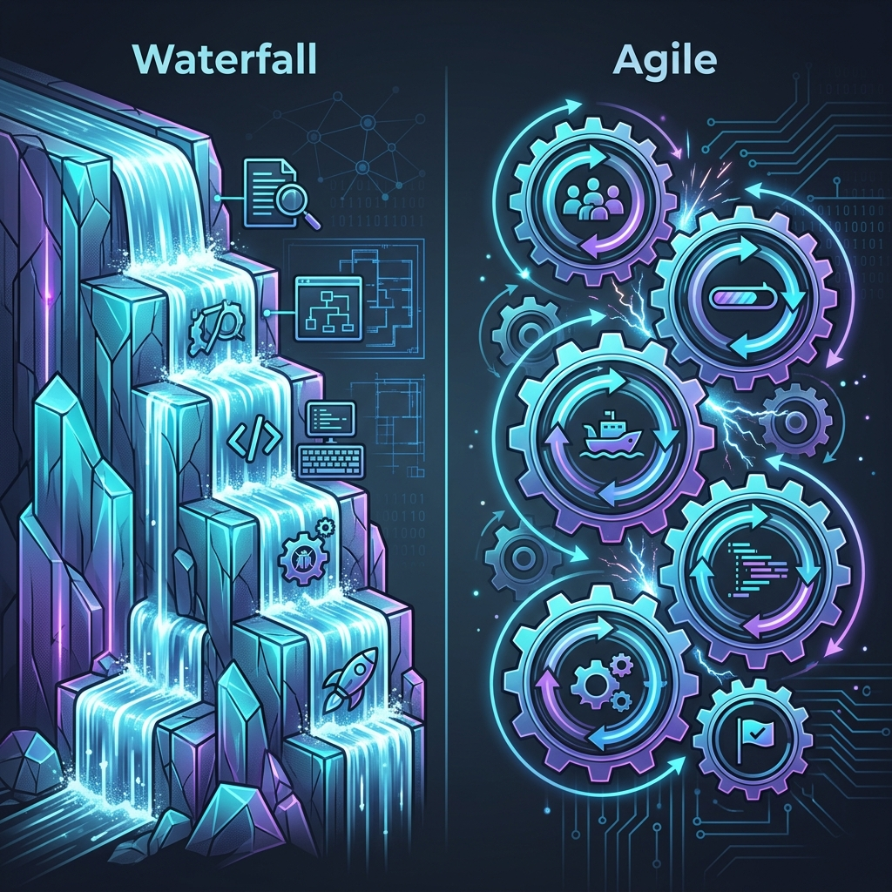
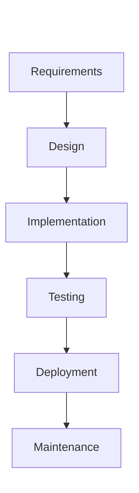
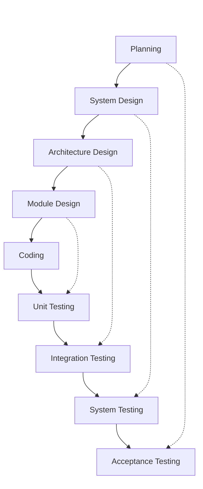
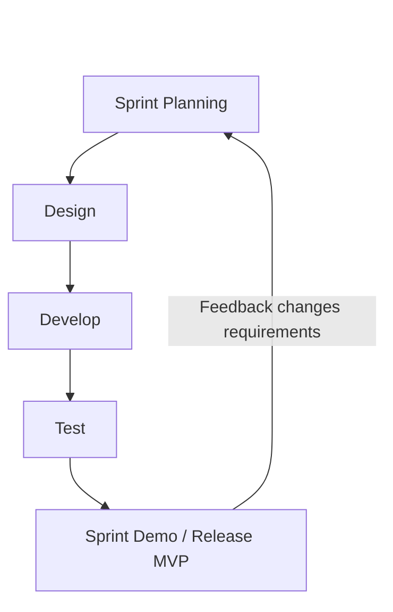
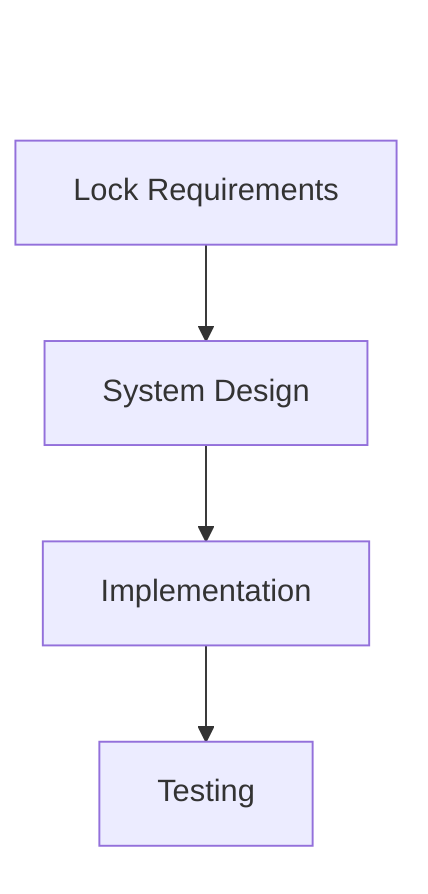
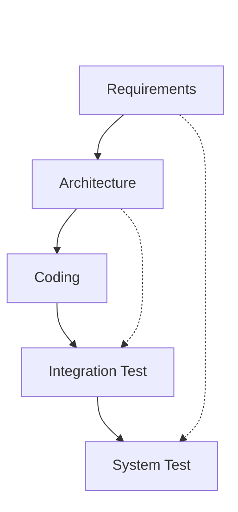
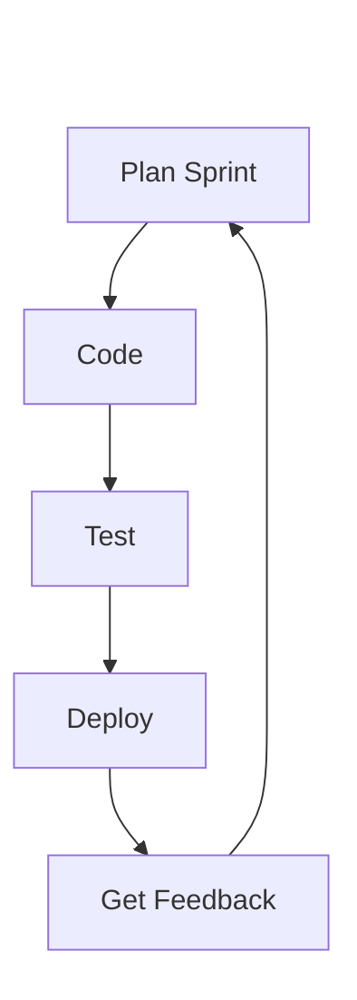
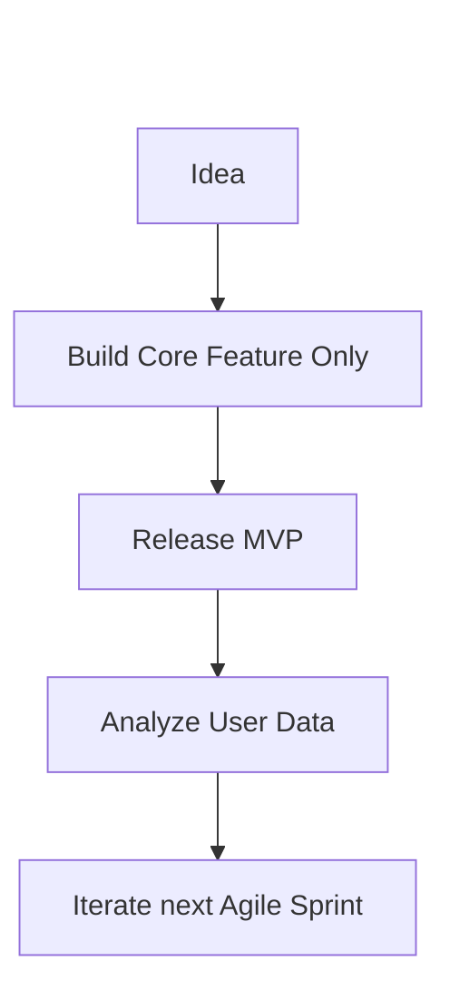
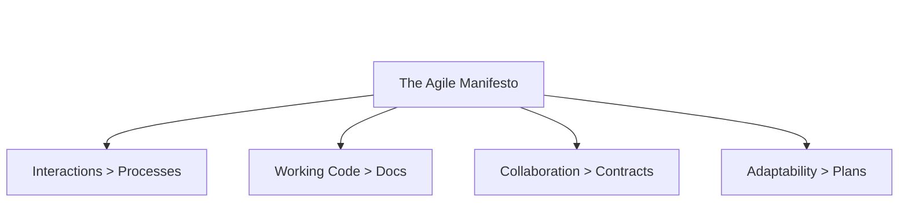

# 06 - Software Development Methodologies



## 1. Jargon Translation

- **Sequential Methodology**:
  - *Official Definition*: A linear product development process where each phase must be completed before the next phase begins.
  - *Under the Hood*: Building a house. You cannot start framing the roof until the foundation is poured and completely dried.
- **Iterative Methodology**:
  - *Official Definition*: A development process where a project is broken down into small, manageable increments or cycles.
  - *Under the Hood*: Sculpting from clay. You build a rough shape, ask if it looks right, and continuously refine it in small cycles.
- **Sprint**:
  - *Official Definition*: A set period of time (usually 1-4 weeks) during which specific work has to be completed and made ready for review.
  - *Under the Hood*: A short, intense mini-deadline where developers promise to finish a specific feature and actually prove it works at the end.
- **MVP (Minimum Viable Product)**:
  - *Official Definition*: A version of a product with just enough features to be usable by early customers who can then provide feedback for future product development.
  - *Under the Hood*: Releasing a basic skateboard to see if people want to roll down a hill, before spending millions building a Ferrari.
- **Sprint Demo**:
  - *Official Definition*: A meeting at the end of a sprint where the team demonstrates the working software to stakeholders.
  - *Under the Hood*: "Show and tell" day where developers prove they wrote working code, and the client says whether they like it or not.

## 2. Topics Introduced in Lecture Transcript

1. Sequential vs. Iterative Software Development
2. The Waterfall Methodology (Mechanics, Pros, and Cons)
3. The V-Shape Model (Verification vs. Validation)
4. The Agile Methodology and the Sprint Cycle
5. Building a Minimum Viable Product (MVP)
6. The Four Core Values of the Agile Manifesto

## 3. Exhaustive Deep Dive & Structured Notes

### Sequential vs. Iterative Development
Methodologies define *how* a team communicates, plans, and releases software. 
- **Sequential Approaches** (Waterfall, V-Shape) demand that the entire product is designed and planned up front. The customer does not see working software until the very end.
- **Iterative Approaches** (Agile) focus on short bursts of development. The customer sees small pieces of working software frequently and can change their mind mid-project.

### The Waterfall Methodology
The oldest methodology, derived from manufacturing and construction. Output from one phase becomes the strict input for the next.
- **Mechanics**: Planning -> Design -> Development -> Testing -> Deployment -> Maintenance. You cannot go backward.
- **Pros**: 
  - Extremely easy to understand.
  - Roles are discrete and well-defined.
  - Budgets, schedules, and resource allocation are easily estimated upfront because the scope is rigidly locked.
- **Cons**: 
  - **Zero Flexibility**: If a requirement changes or was missed, it is incredibly expensive and difficult to fix later.
  - The customer waits years to see the final product, increasing the risk that the final product isn't actually what they want.



### The V-Shape Model (Verification and Validation)
An evolution of Waterfall that places a massive emphasis on testing. The phases form a "V".
- **Verification (Going Down)**: The left side of the V. This includes Planning, System Design, Architecture Design, and Module Design.
- **Validation (Going Up)**: The right side of the V. This includes Unit Testing, Integration Testing, System Testing, and Acceptance Testing.
- **Mechanics**: For every phase on the left, a corresponding test plan is written immediately. When coding at the bottom of the V is done, the team executes the tests moving up the right side.
- **Pros**: Writing test plans during the design phase saves considerable time later and ensures extremely high quality.
- **Cons**: Even more rigid than Waterfall. Almost impossible to accommodate changing requirements once testing begins.



### The Agile Methodology
Agile flips the script. Instead of planning the entire product upfront, teams plan small pieces of it, build it, test it, and release it in cycles called **Sprints**.
- **Mechanics**: Teams work in 1-4 week sprints. Unit testing happens constantly within the sprint. Instead of "Maintenance", the final stage of a sprint is "Feedback" (The Sprint Demo).
- **Pros**: 
  - Highly adaptable to changing requirements.
  - Customers see working code (the MVP) quickly, reducing the risk of building the wrong thing.
- **Cons**: 
  - Budgets and schedules are extremely difficult to estimate upfront because the final scope is intentionally left undefined.
  - Resource allocation is challenging.



### The Agile Manifesto
The four core values that define Agile:
1. **Individuals and interactions** over processes and tools.
2. **Working software** over comprehensive documentation.
3. **Customer collaboration** over contract negotiation.
4. **Responding to change** over following a plan.

## 4. Step-by-Step Breakdown: The Agile Sprint Lifecycle

1. **Sprint Planning**: The team looks at the list of features the client wants (the backlog) and picks a small chunk to build over the next 2 weeks.
2. **Development & Unit Testing**: Developers write the code and test it simultaneously (often using TDD - Test Driven Development).
3. **Integration**: The small chunks of code are integrated into the main codebase.
4. **Sprint Demo**: The team presents the working feature to the stakeholders.
5. **Feedback**: Stakeholders say "We love this, but can you change the color?" or "We actually don't need this anymore."
6. **Repeat**: The feedback is put into the backlog, and the cycle begins again.

## 5. Concrete Examples

Imagine you are building a new Social Media API.
- **Waterfall Approach**: You spend 6 months designing the database for posts, comments, likes, and messaging. You spend 1 year building it. When you release it, you realize users actually only care about short videos (like TikTok). You wasted 1.5 years of budget.
- **Agile MVP Approach**: You spend 2 weeks building a basic API that only lets users post text (The MVP). You release it. Users complain they can't post videos. In the next 2-week sprint, you pivot and add video support. You saved 1.5 years of budget by failing fast.

## 6. Code Blocks

```javascript
// Representing an Agile User Story passing through a Sprint Lifecycle

const sprintBoard = {
    backlog: [
        { id: 1, task: "Build Login API", status: "TODO" },
        { id: 2, task: "Build Video Upload", status: "TODO" }
    ],
    inProgress: [],
    done: []
};

// 1. Sprint Planning: Move task into the active sprint
function startSprint(taskId) {
    const taskIndex = sprintBoard.backlog.findIndex(t => t.id === taskId);
    if (taskIndex > -1) {
        const task = sprintBoard.backlog.splice(taskIndex, 1)[0];
        task.status = "IN_PROGRESS";
        sprintBoard.inProgress.push(task);
        console.log(`Starting Sprint for: ${task.task}`);
    }
}

// 2. Development & Testing
function completeTask(taskId) {
    const taskIndex = sprintBoard.inProgress.findIndex(t => t.id === taskId);
    if (taskIndex > -1) {
        const task = sprintBoard.inProgress.splice(taskIndex, 1)[0];
        task.status = "DONE";
        sprintBoard.done.push(task);
        console.log(`Task ${task.task} is ready for Sprint Demo!`);
    }
}

startSprint(1);
completeTask(1);

// WHAT HAPPENS IF... we use Waterfall and a requirement changes mid-development?
// In Waterfall, if the client says "Wait, we want OAuth Google Login instead of Email Login" 
// while the task is IN_PROGRESS, the rigid structure forces developers to stop, rewrite the 
// entire architectural documentation, get it re-approved, and start over, costing massive amounts of money.
// In Agile, we just add "Google OAuth" to the backlog for the next sprint.
```

## 7. Related Concepts

1. **Scrum**: A specific, highly popular framework used to implement Agile, involving specific roles like Scrum Master and Product Owner.
2. **CI/CD (Continuous Integration / Continuous Deployment)**: The automated DevOps pipeline that allows Agile teams to release small chunks of code safely every single sprint.
3. **Microservices Architecture**: Breaking an app into small independent services. This perfectly aligns with Agile, as different small teams can sprint on different microservices simultaneously.
4. **Kanban**: Another Agile framework that focuses on continuous delivery rather than time-boxed sprints (often visualized via a Kanban board with sticky notes).
5. **Test-Driven Development (TDD)**: A coding practice heavily used in Agile where developers write the automated tests *before* they write the functional code.

## 8. Key Takeaways (Flashcard-Ready)

- **Q: What is the defining characteristic of the Waterfall methodology?**
  - A: It is a sequential, linear process where one phase must completely finish before the next begins, and all planning is done upfront.
- **Q: How does the V-Shape model differ from Waterfall?**
  - A: It is also sequential, but for every design/planning phase on the left side of the "V", a corresponding test plan is written immediately before coding begins.
- **Q: What is the main advantage of Agile over sequential methods?**
  - A: It is highly adaptable to changing requirements because software is built in small, iterative cycles (sprints).
- **Q: What is a Minimum Viable Product (MVP)?**
  - A: The most basic version of a product released early to stakeholders/users to validate assumptions and gather feedback.
- **Q: What is a major drawback of the Agile methodology?**
  - A: Because the final scope is not rigidly defined upfront, it is very difficult to accurately estimate the final budget and schedule.

## 9. 💡 The Secret Engineering Trick

**The "Water-Scrum-Fall" Anti-Pattern**
Many enterprise companies claim they are "Agile", but under the hood, they are actually doing "Water-Scrum-Fall". They spend 6 months doing rigid Waterfall planning, then they use Agile Sprints for the coding phase, and then they spend 3 months doing rigid Waterfall testing and deployment. If your company only releases software once a year, you are not Agile, regardless of whether you have "Sprints" or "Daily Standups." True Agile requires releasing working software to users continuously.

## 10. Interview Questions Section

### 1. What is the Waterfall methodology, and when should it be used?

* **Simple Definition**: Building software exactly like building a bridge. You plan the whole thing, build the foundation, and you can't go back and change the design halfway through without destroying the bridge.
* **Official Definition**: Waterfall is a sequential software development methodology where progress flows linearly downwards through phases like requirements, design, implementation, testing, and maintenance.
* **Primary Responsibilities / Core Details**:
  * Emphasizes massive upfront planning and documentation.
  * Rigid phase gates (cannot enter phase B until phase A is signed off).
  * Highly predictable resource allocation and budgeting.
  * Testing is deferred entirely until the end of the development phase.
  * Extremely poor at adapting to shifting business requirements.
* **Real-World Example**: NASA building software for a space shuttle. The requirements cannot change halfway to Mars. Absolute predictability and massive upfront documentation are strictly required over speed and flexibility.
* **Best Coding/Development Practices**:
  * **Exhaustive Documentation**: Because you cannot go back, the SRS (Software Requirement Specification) must be flawless.
    * *Example Code (Documenting strict rigid schemas)*:
      ```sql
      -- In Waterfall, the database schema is locked entirely before any coding starts.
      CREATE TABLE users (
          id INT PRIMARY KEY,
          email VARCHAR(255) NOT NULL UNIQUE
      );
      ```
  * **Strict Change Control**: Any change to requirements requires formal "Change Request" board approval.
    * *Example Code (Change Request Status)*:
      ```json
      {
        "changeRequestId": "CR-992",
        "status": "REJECTED",
        "reason": "Exceeds locked Waterfall budget."
      }
      ```
* **Visual Aid (Mermaid Flowchart)**:

* **Core Focus Areas**: Predictability | Upfront Planning | Rigid Execution

### 2. What is the V-Shape Model, and how does it differ from Waterfall?

* **Simple Definition**: It's exactly like Waterfall, but instead of waiting until the end to figure out how you are going to test the software, you write the tests on day one while you are designing the system.
* **Official Definition**: The V-model is a sequential SDLC model where execution of processes happens in a V-shape. It is an extension of the waterfall model, characterized by corresponding testing phases for each development phase.
* **Primary Responsibilities / Core Details**:
  * Pairs Verification (planning/design) with Validation (testing).
  * System Requirements pair with System Testing.
  * Architecture Design pairs with Integration Testing.
  * Module Design pairs with Unit Testing.
  * Solves the Waterfall problem of tests being an afterthought.
* **Real-World Example**: Building medical device software (like an MRI machine GUI). It requires sequential predictability (like Waterfall) but demands absolute, pre-planned rigorous testing protocols to prevent fatal errors.
* **Best Coding/Development Practices**:
  * **Test-Driven Design Phase**: Write the test criteria before writing the code.
    * *Example Code (Defining the test before the module)*:
      ```javascript
      // The test plan is written during the Architecture phase
      describe('Payment Module', () => {
          it('should reject invalid credit cards', () => {
             // To be implemented during coding phase
          });
      });
      ```
  * **Traceability Matrix**: Map every validation test back to a specific verification requirement.
    * *Example Code (Traceability Mapping)*:
      ```json
      {
         "requirement": "SYS-REQ-01",
         "validationTestId": "TEST-INT-01"
      }
      ```
* **Visual Aid (Mermaid Flowchart)**:

* **Core Focus Areas**: Verification | Validation | Early Test Planning

### 3. What is Agile, and why is it currently the industry standard?

* **Simple Definition**: Building an app like you play with Lego. You build a little piece, show it to the client, take it apart if they don't like it, and snap on new pieces continuously until they are happy.
* **Official Definition**: Agile is an iterative and collaborative approach to software development that emphasizes flexibility, continuous feedback, and rapid delivery of working software in short cycles called sprints.
* **Primary Responsibilities / Core Details**:
  * Focuses on responding to change rather than following a rigid plan.
  * Breaks development into 1-4 week sprints.
  * Requires high collaboration between developers and business stakeholders.
  * Relies heavily on CI/CD to safely deploy code frequently.
  * Hard to predict final budgets because the scope is intentionally fluid.
* **Real-World Example**: Spotify updating its mobile app. They don't plan a 2-year release. They release a new feature (like AI DJ) to 10% of users in a 2-week sprint, gather data, tweak it in the next sprint, and then roll it out globally.
* **Best Coding/Development Practices**:
  * **Continuous Integration**: Code must be merged and tested daily.
    * *Example Code (CI Pipeline YAML)*:
      ```yaml
      # Automated testing on every agile commit
      steps:
        - run: npm install
        - run: npm test
      ```
  * **Modular Architecture**: Build code in decoupled microservices so small teams can iterate quickly without breaking the whole monolith.
    * *Example Code (Decoupled Agile Service)*:
      ```javascript
      // A small, independent microservice API for user reviews
      app.post('/reviews', (req, res) => {
          // Can be updated and deployed independently in a 1-week sprint
      });
      ```
* **Visual Aid (Mermaid Flowchart)**:

* **Core Focus Areas**: Iteration | Adaptability | Continuous Feedback

### 4. What is a Minimum Viable Product (MVP), and how does it relate to Agile?

* **Simple Definition**: The absolute bare-bones version of your app that still actually does what it promises, used to test if users actually want your app before you spend a fortune on it.
* **Official Definition**: An MVP is a version of a new product which allows a team to collect the maximum amount of validated learning about customers with the least effort.
* **Primary Responsibilities / Core Details**:
  * Validates core business assumptions quickly.
  * Prevents wasting money on features users don't actually want.
  * Serves as the baseline product that Agile sprints build upon.
  * Is *not* a broken product; it is small, but it must be functional and high-quality.
* **Real-World Example**: The first version of Amazon was an MVP. It was a simple, ugly website that literally only sold books. Once that assumption was validated (people buy things on the internet), they used Agile to iterate and sell CDs, then electronics, then everything.
* **Best Coding/Development Practices**:
  * **YAGNI (You Aren't Gonna Need It)**: Do not write code for hypothetical future features when building an MVP.
    * *Example Code (MVP vs Over-engineering)*:
      ```javascript
      // MVP: Save to a simple local SQLite file
      const db = require('better-sqlite3')('app.db'); 
      
      // NOT MVP: Setting up a 10-node distributed Cassandra cluster for 5 beta users
      ```
  * **Feature Flags**: Deploy the MVP behind a toggle so you can turn it off immediately if it breaks production.
    * *Example Code (Feature Flagging)*:
      ```javascript
      if (process.env.ENABLE_MVP_FEATURE === 'true') {
          renderNewDashboard();
      } else {
          renderOldDashboard();
      }
      ```
* **Visual Aid (Mermaid Flowchart)**:

* **Core Focus Areas**: Validated Learning | Minimal Scope | Speed to Market

### 5. Can you explain the four core values of the Agile Manifesto?

* **Simple Definition**: A declaration written by frustrated developers in 2001 that basically says: "Stop wasting time writing 500-page manuals and signing contracts, and just talk to each other and build software that works."
* **Official Definition**: The guiding principles of Agile development that prioritize human interaction, working software, customer collaboration, and adaptability over rigid, process-heavy traditional methodologies.
* **Primary Responsibilities / Core Details**:
  * **Individuals and interactions** over processes and tools (Talking is better than Jira).
  * **Working software** over comprehensive documentation (Code that runs is better than a 100-page manual).
  * **Customer collaboration** over contract negotiation (Work *with* the client, don't fight them in court over a contract clause).
  * **Responding to change** over following a plan (Pivot when needed, don't blindly follow a failed 2-year plan).
* **Real-World Example**: Instead of spending 3 weeks exchanging emails (Process) to determine how a button should look, a developer sits next to the designer for 20 minutes (Interaction), writes the code, and shows it working on the screen (Working Software).
* **Best Coding/Development Practices**:
  * **Self-Documenting Code**: Because Agile values working software over massive external documentation, the code itself must be incredibly readable.
    * *Example Code (Self-Documenting variables)*:
      ```javascript
      // GOOD (Agile friendly, requires no external manual)
      const userHasSufficientFunds = user.walletBalance >= cart.totalPrice;
      
      // BAD (Requires a 10-page manual to understand)
      const chk1 = u.wb >= c.tp; 
      ```
  * **Automated Deployments**: To rapidly respond to change, deploying must be a 1-click process, not a manual 3-day checklist.
    * *Example Code (1-Click Deployment script)*:
      ```bash
      # A simple script prioritizing 'Working Software' delivery
      npm run build && docker push my-app && kubectl apply -f deploy.yml
      ```
* **Visual Aid (Mermaid Flowchart)**:

* **Core Focus Areas**: Human-Centric | Adaptability | Delivering Value
